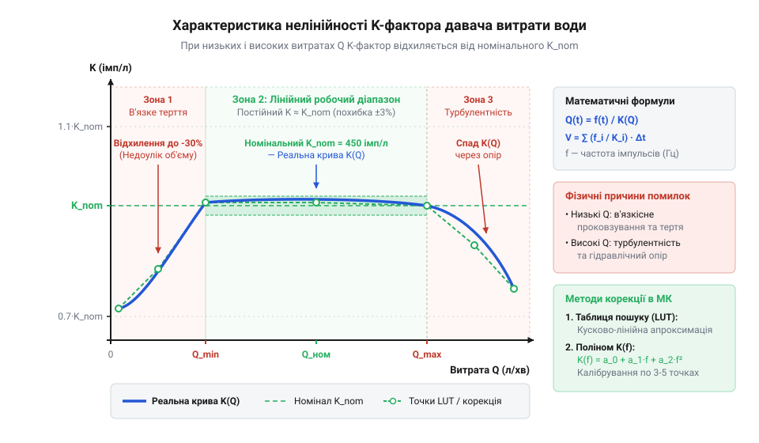
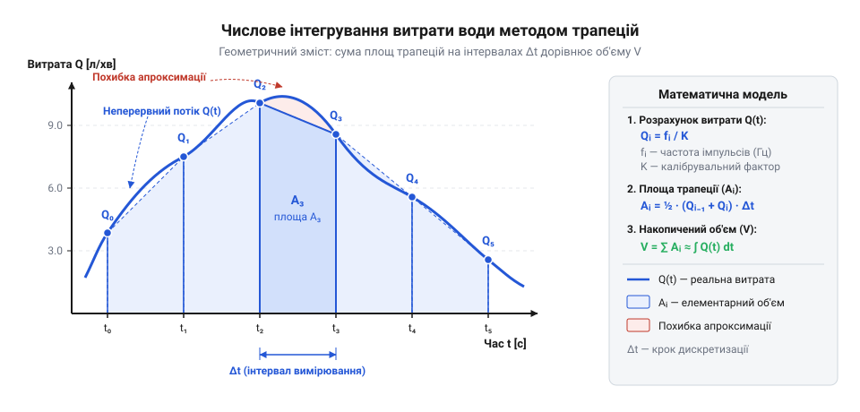
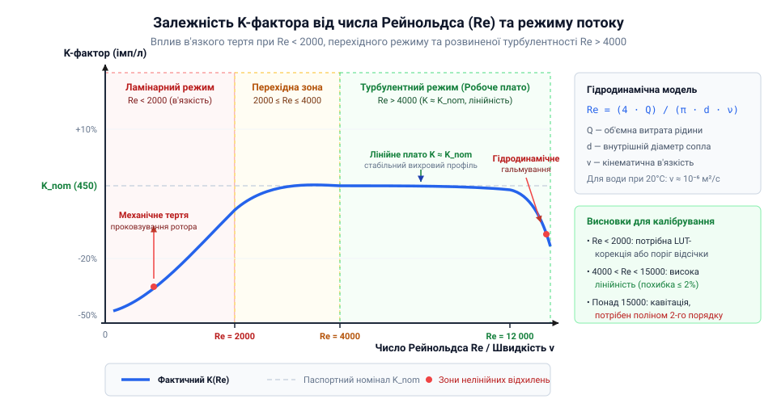
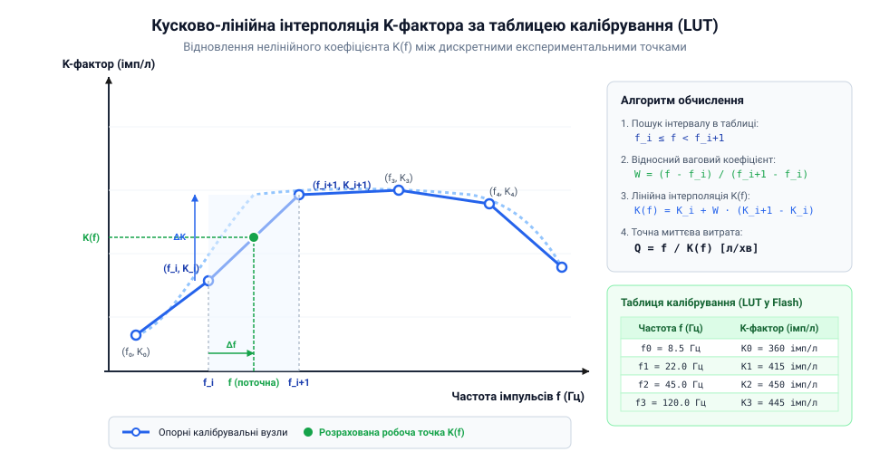
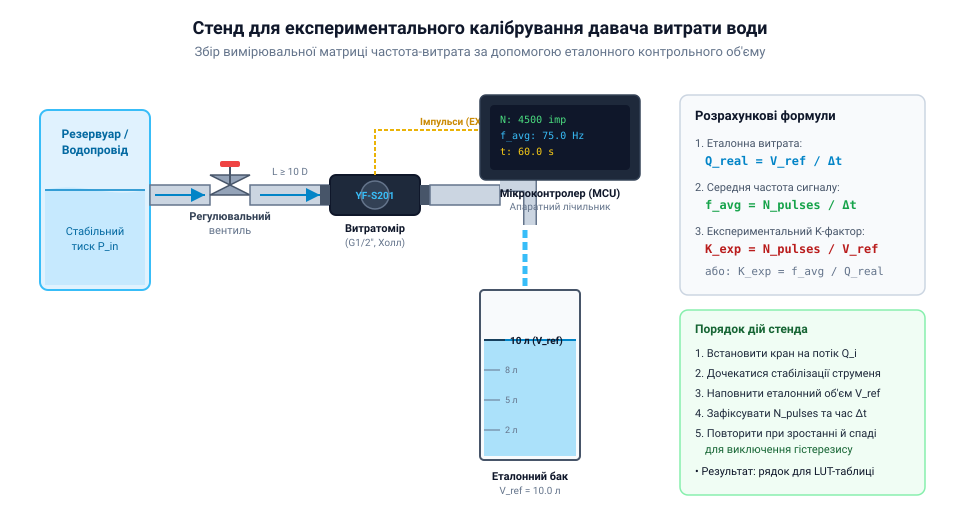

# Математичні моделі розрахунку витрати та калібрування K-фактора

## Неточність підрахунку при змінному потоці

Управління подачею рідини в автоматизованій системі поливу чи водопостачання вимагає точного розуміння об'єму води, що пройшла крізь трубу. На відміну від статичних вимірювань, де рівень рідини контролюють [давачем рівня рідини](root:cat-hw-sensors/liquid-level-sensor) або [давачем рівня води HW-038](root:cat-hw-sensors/hw-038-water-level), потік у трубі постійно змінює свою швидкість. Коли відкривається клапан або вмикається насос, рідина прискорюється, утворюючи динамічний перехідний процес.

Усередині проточного давача встановлено мініатюрний @@en|турбінний витратомір@@ (від лат. @@la|turbo@@ — вихор). Потік рідини тисне на лопаті ротора та змушує його обертатися зі швидкістю, пропорційною швидкості руху води. На роторі закріплено постійний магніт, який під час кожного оберту проходить повз @@en|давач Холла@@ (від англ. @@en|Hall sensor@@, на честь фізика Едвіна Холла) або @@uk|геркон@@ (від скор. герметизований контакт), генеруючи електричний імпульс.

Найпростіший підхід до вимірювання полягає в підрахунку загальної кількості імпульсів за певний проміжок часу та множенні цієї кількості на фіксований об'єм однієї порції. Проте при змінному потоці цей підхід дає суттєву похибку, оскільки під час стрімких динамічних змін виникає @@en|інерційний вибіг@@ ротора. Коли миттєва об'ємна витрата рідини `Q(t)` раптово падає до нуля в момент `t₀`, механічна @@en|інерція@@ (від лат. @@la|inertia@@ — бездіяльність, нерухомість) ротора з моментом інерції `I` не дозволяє йому зупинитися миттєво. Частота генерації імпульсів `f(t)` згасає за експоненційним законом `f(t) = f₀ · e^(-t / τ)`, де `f₀` — початкова частота обертання до зупинки потоку, `τ` — стала часу механічного та гідродинамічного гальмування, а `t` — час від моменту перекриття. Кількість додаткових хибних імпульсів `ΔN`, зафіксованих за тривалість обертання `t_вибігу`, визначається інтегруванням частоти згасання:

```
ΔN = ∫₀ᵗ_вибігу f₀ · e^(-t / τ) dt
   = f₀ · τ · (1 - e^(-t_вибігу / τ))    [інтегрування експоненційного згасання частоти]
   ≈ f₀ · τ                              [при тривалому вибігу t_вибігу ≫ τ]
```

Отримані хибні імпульси `ΔN` перераховуються у хибний об'єм. Накопичена похибка вимірювання об'єму `ΔV_похибки` обчислюється шляхом ділення `ΔN` на постійний коефіціент пропорційності `K`:

```
ΔV_похибки = ΔN / K
           = (f₀ · τ) / K                [підстановка кількості імпульсів вибігу]
```

Отриманий вираз `(f₀ · τ) / K` показує значення систематичної похибки: при різкій зупинці потоку витратомір зафіксує зайву воду, а при раптовому пуску затримка розгону ротора спричинить еквівалентну недооцінку об'єму. Проте інерційний вибіг є лише однією з причин викривлення вимірювань, і загалом при змінному потоці спрощений підрахунок дає суттєву похибку з трьох фізичних причин:

1. **Інерція механічної системи.** Ротор витратоміра має власну масу й момент інерції. При різкому перекритті клапана рух рідини зупиняється миттєво, але турбіна продовжує обертатися за інерцією, генеруючи хибні імпульси. При раптовому пуску, навпаки, рідина вже тече, а турбіна лише розганяється, втрачаючи відліки. 2. **Нестаціонарність вимірювального вікна.** Якщо обчислювати витрату шляхом підрахунку імпульсів у рідких інтервалах (наприклад, раз на 5 секунд), будь-які короткі піки чи просідання тиску всередині цього вікна повністю згладжуються. Контролер бачить лише середнє значення, втрачаючи реальну динаміку споживання. 3. **Зміна інтервалу між імпульсами.** При прискоренні потоку час між сусідніми імпульсами постійно скорочується. Вважати, що кожен імпульс відповідає строго однаковій об'ємній частці незалежно від швидкості обертання ротора, означає ігнорувати гідродинамічні зміни всередині камери.

Неперервний рух рідини перетворюється давачем на дискретний у часі сигнал. Ця @@en|часова дискретизація@@ (від лат. @@la|discretus@@ — розділений) означає, що між двома сусідніми імпульсами мікроконтролер не має прямих даних про потік. Щоб обчислити реальну витрату без накопичення похибки, потрібна математична модель, яка пов'язує миттєву частоту генерації імпульсів із дійсною об'ємною витратою рідини в кожний момент часу.

## Модель миттєвої витрати та K-фактор

Для побудови математичної моделі витрати розглянемо зв'язок між рухом рідини та частотою імпульсів. Об'єм рідини, що проходить крізь вимірювальну камеру, повертає ротор турбіни на відповідний кут. Конструктивний параметр давача, який визначає кількість імпульсів, що генеруються при проходженні одиниці об'єму, називається @@en|K-фактором@@ (від лат. @@la|factor@@ — чинник, який робить).

Знаючи поточну частоту імпульсів `f(t)` у hertz (Гц), миттєва @@en|об'ємна витрата@@ `Q(t)` визначається формулою пропорційності:

Q(t) = f(t) / K              [означення K-фактора]
     = (N / Δt) / K          [вираження частоти через кількість імпульсів N за час Δt]

де `Q(t)` — миттєва об'ємна витрата рідини у літрах за хвилину (л/хв), `f(t)` — частота імпульсів у hertz (Гц), `N` — кількість імпульсів за інтервал `Δt` у секундах, а `K` — коефіцієнт давача у виразі імпульсів на літр за хвилину (імпульсів/(л/хв)).

Якщо параметр давача вказано в імпульсах на літр (`K_L`), то для отримання витрати у літрах за хвилину при вимірюванні частоти `f(t)` у секундах виконують перерахунок часового масштабу:

Q(t) = (f(t) × 60) / K_L     [переведення частоти з Гц у хвилини для витрати в л/хв]

де `f(t)` — частота в Гц (імпульсів за секунду), множник `60` переводить секунди у хвилини, а `K_L` — кількість імпульсів на 1 літр рідини.

Для визначення миттєвої частоти `f(t)` у коді мікроконтролера застосовують два математичні підходи:

1. @@en|Частотний метод@@ (від лат. @@la|frequentia@@ — щільність, відвідуваність): обчислення кількості імпульсів `N` за фіксований проміжок часу `Δt` (наприклад, 1 секунда). Метод забезпечує високу стійкість при великих швидкостях потоку, але створює значну похибку дискретизації на низьких швидкостях, де за 1 секунду проходить лише 1–2 імпульси. 2. @@en|Періодний метод@@ (від грец. @@el|περίοδος@@ — обхід, коловорот): вимірювання точного інтервалу часу `T` між двома послідовними фронтами імпульсів за допомогою [апаратного захоплення періоду](root:hw-arch/capture-compare). Частота обчислюється як `f(t) = 1 / T`. Підхід забезпечує миттєву реакцію та високу точність при малому потоці, проте чутливий до механічних асиметрій лопатей турбіни.

У спрощених розрахунках `K` вважають константою. Проте в реальних гідродинамічних умовах значення `K` не є постійним. При низьких швидкостях потоку в'язке тертя в підшипниках ротора гальмує обертання, через що давач генерує менше імпульсів на літр. При високих швидкостях виникає @@en|турбулентність@@ (від лат. @@la|turbulentus@@ — бурхливий) і змінюється [число Рейнольдса у витратомірах](root:ph-mechanics/reynolds-number-in-flowmeters), що порушує лінійну пропорційність.


*Крива зміни K-фактора залежно від частоти імпульсів із зонами тертя та турбулентності.*

## Числове інтегрування для розрахунку об'єму

Миттєва витрата `Q(t)` показує швидкість проходження рідини у даний момент часу. Щоб дізнатися сумарний накопичений об'єм `V`, який пройшов крізь витратомір за інтервал від моменту `t_0` до `t_end`, необхідно визначити інтеграл функції витрати за часом:

V = ∫ Q(t) dt                [неперервний інтеграл витрати за часом]

де `V` — накопичений об'єм рідини у літрах, `Q(t)` — функція миттєвої витрати у літрах за секунду, а `dt` — нескінченно малий приріст часу.

Оскільки мікроконтролер отримує дані через дискретні інтервали часу `Δt_i = t_i - t_{i-1}`, неперервну формулу замінюють на @@en|числове інтегрування@@ (від лат. @@la|integrare@@ — робити цілим, відновлювати).

Найпростішим алгоритмом є @@en|метод прямокутників@@: припускається, що протягом інтервалу `Δt_i` витрата рідини залишається незмінною й дорівнює останньому виміряному значенню `Q(t_i)`:

ΔV_i = Q(t_i) × Δt_i         [обчислення приросту об'єму на і-тому кроці]
V_n = V_{n-1} + ΔV_i         [накопичення сумарного об'єму]

де `ΔV_i` — приріст об'єму за інтервал `Δt_i`, а `V_n` — сумарний об'єм після `n` кроків. Метод прямокутників вимагає мінімуму обчислень, але створює систематичну похибку під час прискорення чи сповільнення потоку.

Точнішим є @@en|метод трапецій@@ (від грец. @@el|τραπέζιον@@ — столик, чотирикутник). Він припускає лінійну зміну витрати між двома сусідніми відліками `Q(t_{i-1})` та `Q(t_i)`:

Q_avg = (Q(t_{i-1}) + Q(t_i)) / 2    [середнє значення витрати на інтервалі]
ΔV_i = Q_avg × Δt_i                 [приріст об'єму за методом трапецій]
V_n = V_{n-1} + ΔV_i                [накопичення об'єму методом трапецій]

де `Q_avg` — середня витрата між двома вимірами. Завдяки усередненню крайніх значень метод трапецій суттєво зменшує похибку інтегрування при динамічній зміні потоку.


*Числове інтегрування дискретних відліків витрати води за методами прямокутників та трапецій.*

Для реалізації числового інтегрування в реальному часі на мікроконтролері використовують обчислення інтервалу між відліками таймера:

:::tabs
@tab ESP-IDF (C)
:::code math-water-flow-k-factor/c/esp-idf/flow-meter-init.c
@tab Arduino (C++)
:::code math-water-flow-k-factor/cpp/arduino/flowmeter.cpp
:::

## Причини нелінійності коефіцієнта K-фактора

Припущення про постійність коефіцієнта @@en|K-фактор@@ (від англ. *K-factor*, де *K* походить від нім. *Konstante* — стала) здається логічним, проте спроба обчислити витрату тонкого струменя води або потужного струменя за одним і тим самим значенням `K` призводить до значних похибок вимірювання. У реальних гідродинамічних умовах кількість імпульсів, згенерованих давачем на один літр рідини, змінюється залежно від швидкості потоку.

На низьких швидкостях руху рідини вирішальним чинником стає механічне тертя в підшипниках ротора та в'язкісні сили. Малий динамічний напір рідини не здатний ефективно долати опір спокою та в'язкісне тертя обертання. У результаті частина рідини протікає крізь вимірювальну камеру, просковзуючи повз лопаті ротора без їхнього пропорційного повертання. За малого об'ємного потоку турбіна обертається повільніше за розрахункову швидкість, генерація імпульсів сповільнюється, а локальний @@de|K-фактор@@ стрімко падає.

Гідродинамічний режим потоку на низьких швидкостях визначається як @@la|ламінарний потік@@ (від лат. *lamina* — пластинка, шар). У цьому режимі шари рідини рухаються паралельно, а профіль швидкостей у перерізі труби має параболічну форму з максимумом по центру та нулем на стінках. Баланс між інерційними силами потоку та силами внутрішнього тертя виражає [число Рейнольдса](root:ph-mechanics/reynolds-number) (від прізвища британського інженера Осборна Рейнольдса, @@en|Osborne Reynolds@@).

```
v = 4 · Q ÷ (π · d²)                  [середня швидкість потоку в трубі]
Re = v · d ÷ ν                        [визначення числа Рейнольдса]
= (4 · Q ÷ (π · d²)) · d ÷ ν          [підстановка швидкості v]
= 4 · Q ÷ (π · d · ν)                 [залежність числа Рейнольдса від витрати Q]
```

У цій математичній моделі `Q` позначує об'ємну витрату рідини, `d` — внутрішній діаметр патрубка, а `ν` — кінематичну в'язкість. За низьких значень `Re < 2000` переважають сили в'язкості `ν`, що підсилює нелінійну залежність між обертанням турбіни та об'ємом пропущеної води.

При зростанні швидкості потоку значення `Re` перевищує критичну межу 4000, і формується @@la|турбулентний потік@@ (від лат. *turbulentus* — збурений). Шари рідини інтенсивно перемішуються, а профіль швидкостей вирівнюється. На лопатях ротора виникає додатковий @@el|гідродинамічний опір@@ (від грец. *hydōr* — вода та *dynamis* — сила), який зростає пропорційно квадрату швидкості. Нелінійне вихроутворення та падіння тиску за лопатями спричиняють гідродинамічне гальмування ротора або його інерційне перекручування, що знову відхиляє @@de|K-фактор@@ від номінального значення.


*Зміна K-фактора при низьких, середніх та високих витратах рідини через гідродинамічні ефекти.*

Отже, характеристика @@de|K-фактор@@ у всьому діапазоні вимірювань має виражену S-подібну або нелінійну форму з робочим плато в середній зоні. Застосування сталого коефіцієнта обмежене вузьким діапазоном номінальних витрат, а забезпечення високої точності вимагає алгоритмічної компенсації нелінійності.

## Алгоритми кусково-лінійної та поліноміальної корекції

Отримання точного значення витрати за наявності гідродинамічної нелінійності потребує обчислення динамічного коефіцієнта `K(f)` для кожної виміряної частоти імпульсів `f`. Для цього в коді мікроконтролера застосовують математичні моделі корекції.

Перший метод базується на табличному збереженні експериментальних опорних точок та їх подальшій обробці. Структура data-points зберігає парами значення частоти та відповідного коефіцієнта `(f₀, K₀), (f₁, K₁), ..., (fₙ, Kₙ)`, що формують @@en|таблиця пошуку@@ (від англ. *look up* — шукати). Коли виміряна частота `f` потрапляє між сусідніми вузлами `fᵢ` та `fᵢ₊₁`, застосовується @@la|кусково-лінійна інтерполяція@@ (від лат. *interpolatio* — оновлення, зміна).

```
Δf = f - fᵢ                           [відхилення частоти від лівої межі]
ΔK = Kᵢ₊₁ - Kᵢ                       [приріст K-фактора на інтервалі]
W = Δf ÷ (fᵢ₊₁ - fᵢ)                 [відносне положення точки в інтервалі]
K(f) = Kᵢ + W · ΔK                   [обчислення скоригованого K-фактора]
```

Цей підхід гарантує монотонність обчислень, унеможливлює сплески між вузлами та потребує лише базових арифметичних операцій.


*Кусково-лінійна інтерполяція для відновлення значення K-фактора за виміряною частотою.*

Другий метод базується на тому, що крива `K(f)` описується аналітично через @@el|поліноміальна інтерполяція@@ (від грец. *polys* — численний та лат. *interpolatio*). Найчастіше використовують поліном другого ступеня, де коефіцієнти `a₀, a₁, a₂` розраховують заздалегідь через [метод найменших квадратів](root:math-numeric/least-squares-polynomial-fit).

```
K(f) = a₀ + a₁ · f + a₂ · f²          [поліноміальна модель K-фактора]
Q(f) = f ÷ K(f)                       [миттєва витрата зі скоригованим K]
= f ÷ (a₀ + a₁ · f + a₂ · f²)         [підстановка полінома в модель витрати]
```

Обчислення скоригованого коефіцієнта `K(f)` за таблицею пошуку реалізується в коді мікроконтролера наступним чином:

:::tabs
@tab C (ESP-IDF)
:::code math-water-flow-k-factor/c/esp-idf/get-corrected-k-factor.c
@tab C++ (Arduino)
:::code math-water-flow-k-factor/cpp/arduino/kfactorpoint.cpp
:::

Вибір між алгоритмами залежить від обчислювальних ресурсів: @@en|таблиця пошуку@@ з кусково-лінійною інтерполяцією виключає ризик осциляцій полінома на краях діапазону, тоді як поліноміальне обчислення потребує менше пам'яті для збереження коефіцієнтів.

## Експериментальне калібрування давача витрати

Будь-які теоретичні розрахунки нелінійності втрачають сенс без точних опитних даних для конкретної гідравлічної системи. Процедура побудови матриці корекції вимагає проведения серії вимірювань, яка зветься @@fr|експериментальне калібрування@@ (від араб. *qalib* — форма для лиття, через фр. *calibre*).

Для проведення випробувань збирають калібрувальний стенд, що складається з джерела рідини з регульованим вентилем, досліджуваного витратоміра, лічильника імпульсів мікроконтролера та еталонної вимірювальної ємності з точними поділками об'єму `V_ref`. На відміну від динамічного вимірювання потоку турбіною, де контролюється кількість імпульсів за час, для стаціонарного контролю рівня води в резервуарах застосовують [давач рівня рідини](root:cat-hw-sensors/liquid-level-sensor).


*Схема збору вимірювальної матриці частота-витрата з використанням контрольного об'єму.*

Вимірювальний експеримент для однієї точки витрати виконується в такій послідовності. Регулювальним вентилем встановлюють стабільний потік рідини. Після стабілізації струменя розпочинають заповнення еталонного резервуара до строго фіксованого об'єму `V_ref`, одночасно фіксуючи тривалість вимірювання `Δt` та загальну кількість імпульсів `N_pulses`.

```
Q_real = V_ref ÷ Δt                   [еталонна об'ємна витрата]
f_avg = N_pulses ÷ Δt                 [середня частота імпульсів]
K_exp = N_pulses ÷ V_ref               [експериментальний K-фактор]
= (f_avg · Δt) ÷ (Q_real · Δt)         [підстановка N = f · Δt та V = Q · Δt]
= f_avg ÷ Q_real                       [спрощення за часовим інтервалом Δt]
```

Серію замірів повторюють для 5–10 різних положень вентиля, охоплюючи весь робочий діапазон від мінімально відчутної витрати до максимальної. За результатами експерименту будують таблицю пар `(f_avg, K_exp)`.

Під час обробки даних враховують @@el|гістерезис@@ (від грец. *hysteresis* — запізнення, відставання), який виникає через інерцію ротора при розгоні та гальмуванні потоку. Для цього заміри виконують як у режимі збільшення витрати, так і в режимі її зменшення, зсереднюючи отримані значення `K_exp`. Отримана матриця експериментальних даних завантажується в таблицю пошуку мікроконтролера або слугує основою для обчислення коефіцієнтів полінома.