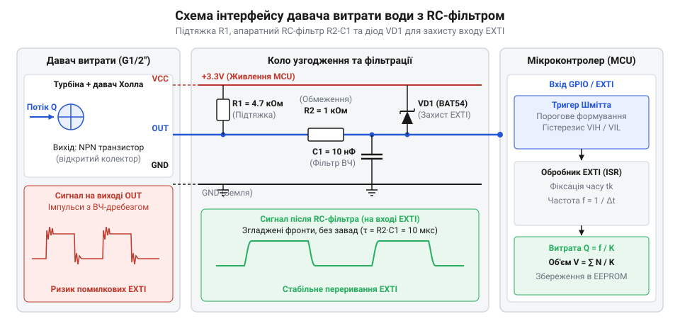
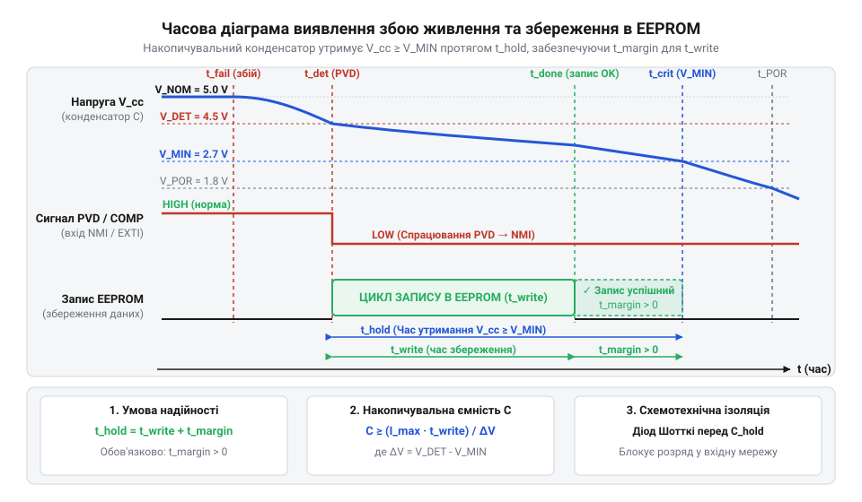

# Практична реалізація імпульсного лічильника витрати води на мікроконтролері

<preknowlist>
- [HW-038 — давач рівня води](root:cat-hw-sensors/hw-038-water-level) — Базові принципи визначення наявності рідини та відмінності між статичним вимірюванням рівня і динамічним обліком потоку.
</preknowlist>

## Проблема втрати імпульсів та неточного обліку

Облік рідин у побутових та промислових магістралях традиційно спирається на тахометричні давачі (турбінні витратоміри з ефектом Холла, наприклад, популярні моделі типорозміру G1/2″). Фізика їх роботи базується на обертанні крильчатки під дією потоку води. Вбудований у лопать крильчатки постійний магніт під час кожного повного оберту проходить повз інтегрований датчик Холла, викликаючи зміну магнітного поля та формуючи на виході короткий імпульс напруги з відкритим колектором.

На практиці розробники вбудованих систем часто зіштовхуються з критичною проблемою: пряме опитування (polling) стану виходу датчика в основному циклі програми (`while(1)`) призводить до масового пропуску імпульсів. Мікроконтролер, зайнятий обробкою мережевих стеків (наприклад, MQTT поверх TCP/IP), оновленням екранів чи роботою з іншою перифериею, просто не встигає зафіксувати короткий імпульс (тривалість якого при високій витраті може становити лише кілька мілісекунд або навіть сотні мікросекунд). У результаті накопичена похибка вимірювання об'єму досягає десятків відсотків, що є неприпустимим для облікових приладів.

Базові статичні давачі рівня рідини (такі як поплавкові чи ємнісні сенсори, наприклад, [HW-038 — давач рівня води](root:cat-hw-sensors/hw-038-water-level)) призначені лише для фіксування факту наявності чи відсутності рідини на певній висоті. Вони принципово не здатні вимірювати динамічну витрату у протоці, оскільки не генерують послідовності імпульсів, пропорційних об'єму пропущеної рідини. Тому для точного обліку необхідний саме тахометричний давач, підключений до лінії зовнішніх переривань мікроконтролера (`EXTI`), що гарантує миттєву реакцію на кожне перемикання станів без залежності від завантаженості основного циклу.

## Схемотехнічне узгодження та апаратна фільтрація

Вихід датчика Холла виконаний за схемою з відкритим колектором (Open-Collector / Open-Drain), що вимагає обов'язкового використання підтягувального резистора (`R1`) до напруги живлення (зазвичай `+3.3V` або `+5V`). Проте реальні польові умови експлуатації сантехнічного обладнання супроводжуються потужними електромагнітними наведеннями від насосів, запусків електроклапанів та гідроударів, які викликають високочастотні дрижання (дрибезк) фронтів та хибні імпульси.

Для захисту входу мікроконтролера формується комплексний апаратний вузол, що складається з підтягувального резистора, вхідного RC-фільтра низьких частот (`R2`-`C1`) та захисних діодів від викидів напруги. На принциповій схемі показано класичне підключення: . Резистор `R2` разом із конденсатором `C1` утворюють фільтр із постійною часу, яка ефективно зрізає високочастотні імпульсні перешкоди, але не спотворює легітимні фронти сигналів від крильчатки при максимальній витраті.

## Точний підрахунок імпульсів та обчислення витрати

Навіть після апаратної фільтрації можливі поодинокі дребезги контактів або перехідні процеси. Тому на рівні програмного забезпечення реалізується двохуровнева обробка: апаратне переривання `EXTI` фіксує фронт сигналу та миттєво записує мітку часу (в мікросекундах) у потокобезпечний кільцевий буфер (`ring_buffer_t`), уникаючи тривалого виконання кодів усередині ISR.

Фоновий цикл або апаратний таймер періодично збирає дані з буфера, обчислює згладжену частоту імпульсів `f` (Гц) за допомогою збережених часових інтервалів та переводить її у миттєву витрату у літрах за хвилину (`L/min`) за допомогою паспортного K-фактора давача (для типорозміру G1/2″ K-фактор дорівнює `7.5`, тобто формула має вигляд:
```
Flow = f / 7.5
```
). Для забезпечення довговічності даних реалізовано механізм аварійного збереження показників у неенергонезалежну пам'ять (EEPROM/Flash) під час спрацьовування детектора просідання живлення (PVD/BOD), часова діаграма якого зображена тут: .

## Збереження накопиченого об'єму при знеструмленні

Під час експлуатації пристрою вимірювання витрати рідини критично важливо гарантувати, що накопичені дані не зникнуть у разі раптового зникнення живлення або аварійного знеструмлення мережі. Якщо щохвилинно оновлюваний лічильник зберігатиме показники лише в оперативній пам'яті (RAM), будь-який збій у зовнішній електромережі призведе до втрати точних даних про спожиту воду, що є неприпустимим для комерційного чи побутового обліку. Проте безперервний запис кожного нового імпульсу чи об'єму безпосередньо у внутрішню енергонезалежну пам'ять (EEPROM або Flash) швидко вичерпає обмежений виробником ресурс циклів стирання-запису, який для типової комірки становить від ста тисяч до мільйона операцій. Для розв'язання цієї проблеми застосовують комбінований підхід із відкладеним програмним накопиченням у мікроконтролері та апаратним детектором падіння напруги (Power-Voltage Detector, PVD або Brown-Out Detector, BOD). 

Спеціалізований драйвер управління живленням та збереженням даних реалізовано у модулі `power_down_eeprom.h`, де описано структуру запису з магічним заголовком верифікації та циклічним лічильником записів. Коли напруга живлення в схемі починає просідати нижче критичного порогу (наприклад, 2.9 В для 3.3-вольтової логіки), вбудований у мікроконтролер компаратор збуджує аварійне переривання. У тілі ISR-обробника (`power_down_pvd_isr`) система не виконує жодних складних операцій чи виділення пам'яті, а здійснює миттєвий прямий запис поточного сумарного об'єму та кількості імпульсів у захищену область EEPROM, як це показано в реалізації `power_down_eeprom.c`. Для захисту від запису «сміття» під час аварійного вимкнення напівпровідників використовується 16-бітна контрольна сума CRC16-CCITT, розрахована функцією `power_down_crc16`. Під час наступного увімкнення та старт-апу мікроконтролера головний модуль із файлу `main.c` звертається до процедури відновлення: якщо магічне число `POWER_DOWN_MAGIC_HEADER` та контрольна сума збігаються, лічильник води відновлює попередній стан без втрати жодної краплі порахованого об'єму. Аналогічний підхід до надійного збереження стану нагадує механізми, які використовуються в проєктах із контролю рівня за допомогою пристроїв на кшталт датчика [HW-038 — давач рівня води](root:cat-hw-sensors/hw-038-water-level), де також критично важлива стійкість до збоїв живлення.

## Локальна індикація та мережева телеметрія MQTT

Після надійного підрахунку імпульсів та захисту даних від знеструмлення виникає потреба у зручному візуальному відображенні поточних показників для користувача на місці встановлення, а також у дистанційній передачі телеметрії до системи диспетчеризації. Пряме опитування давача турбіни не повинно блокувати оновлення екрана чи роботу мережевого стека, тому всі процеси обчислення та зв'язку реалізуються на основі неблокуючих циклів та черг подій. Для локальної індикації використовується графічний OLED-дисплей, підключений за протоколом I2C, який у реальному часі виводить миттєву витрату у літрах за хвилину, сумарний об'єм та статус живлення пристрою. У середовищі C++ цей функціонал інкапсульовано в орієнтованому на об'єкти класі `OledDisplay`, оголошеному в заголовочному файлі `oled_display.hpp`, де метод `render` оновлює екран не частіше ніж раз на пів секунди для запобігання мерехтінню та зайвому завантаженню процесора.

Для передачі даних у зовнішні системи використовується легковісний протокол повідомлень @@en|MQTT@@ (Message Queuing Telemetry Transport), який ідеально підходить для пристроїв Інтернету речей (IoT) із лімітованим енергоспоживанням та нестабільним каналом зв'язку. Модуль телеметрії форматує структуру поточних метрик у компактний рядок у форматі JSON, куди входять ідентифікатор пристрою `device_id`, миттєва витрата `flow_rate_lpm`, загальний об'єм `total_volume_l`, кількість імпульсів та індикатор стану живлення `power_good`. На мові C серіалізація та публікація пакетів забезпечуються за допомогою модуля `mqtt_telemetry.h` та його імплементації у `mqtt_telemetry.c`, тоді як у C++ аналогічну задачу виконує клас `MqttTelemetry` з файлу `mqtt_telemetry.hpp`. Якщо мікроконтролер переходить у режим зниженого енергоспоживання через просідання напруги від батареї, що відстежується класом `PowerMonitor` із файлу `power_monitor.hpp`, головний цикл програми з файлу `main.cpp` автоматично збільшує інтервал відправки MQTT-звітів, щоб зберегти енергію автономного вузла. Повна взаємодія всіх компонентів — від апаратного обробника переривань та кільцевого буфера з файлу `ring_buffer.h` до дисплея та мережевого стека — демонструє завершену архітектуру автономного інтелектуального лічильника води.

:::tabs
@tab C (Драйвер лічильника)
:::code proj-microcontroller-water-flow-counter/c/src/water_flow_sensor.c
@tab C++ (Клас WaterFlowSensor)
:::code proj-microcontroller-water-flow-counter/cpp/src/water_flow_sensor.cpp
:::