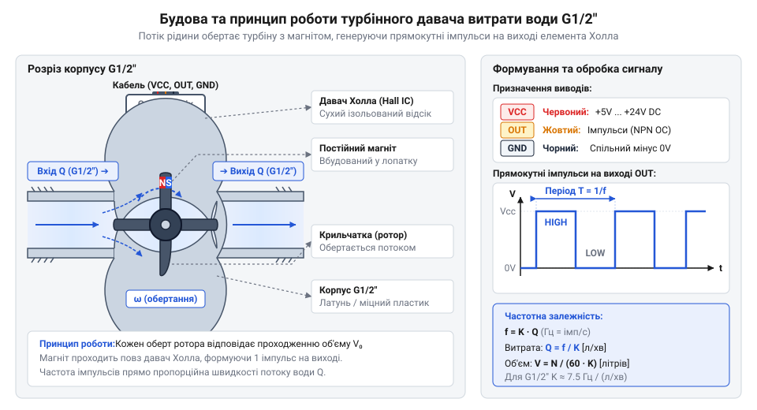
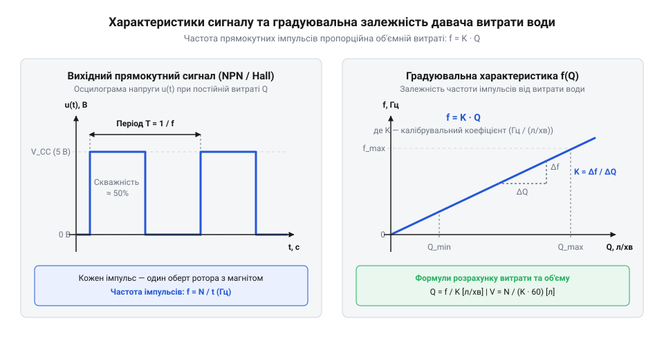
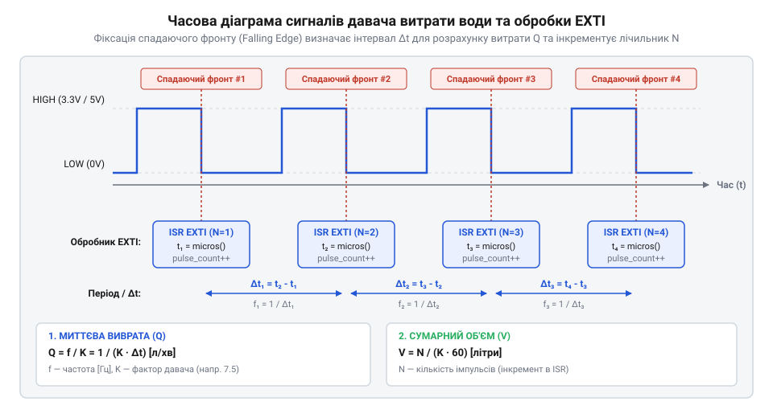
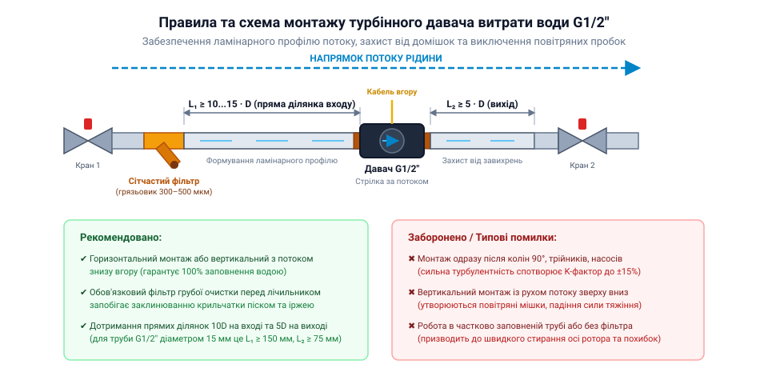

# Давач витрати води (турбіна + Холл, G1/2″)

<preknowlist>
- [HW-038 — давач рівня води](root:cat-hw-sensors/hw-038-water-level) — принципи контактного вимірювання наявності та рівня рідини для розуміння відмінностей від об'ємної витрати у потоці
- [Давач рівня рідини](root:cat-hw-sensors/liquid-level-sensor) — статичні методи моніторингу об'єму в резервуарах для порівняння з динамічним обліком у замкнених трубопроводах
</preknowlist>

## Чому статичні вимірювачі підводять у потоці

Коли виникає завдання контролювати постачання води в системі автоматичного поливу, обліковувати витрату в контурі охолодження або стежити за наповненням накопичувального бака, першим інтуїтивним рішенням часто стає встановлення давачів рівня. Здавалося б, якщо розмістити контактні електроди або поплавцеві перемикачі у резервуарі, можна стежити за тим, як змінюється об'єм рідини. Проте така схема миттєво ламається, як тільки вода починає рухатися під тиском у замкненому трубопроводі.

Коли застосовується [контактний давач рівня](root:cat-hw-sensors/hw-038-water-level), ми отримуємо лише дискретний сигнал про наявність або відсутність рідини у конкретній точці камери. Навіть якщо встановити безперервний [давач рівня рідини](root:cat-hw-sensors/liquid-level-sensor) у резервуарі, він покаже лише статичний залишок води у ємності. Але якщо з резервуара одночасно відбирають воду кілька споживачів з різною інтенсивністю, статична висота стовпа рідини не дає жодного уявлення про миттєву швидкість руху води в окремій трубі. Статичний вимірювач принципово не бачить векторної величини — швидкості потоку (@@en|flow rate@@), яка визначає масову або об'ємну витрату рідини за одиницю часу.

Спроба занурити статичний давач безпосередньо у внутрішній канал труби створює серйозні гідродинамічні проблеми. Будь-який механічний елемент, занурений у потік, створює додатковий гідравлічний опір (@@en|hydraulic resistance@@), спричиняє падіння тиску (@@en|pressure drop@@) та викликає турбулентність (@@en|turbulence@@). Електроди контактних давачів під дією постійного руху води та розчинених солей швидко піддаються електролізу, корозії та ерозії, а механічні поплавки заклинюють у вузькому просвіті труби під дією швидкісного напору.

Щоб точно контролювати динамічні процеси у водопроводі, потрібен пристрій зовсім іншого класу. Нам необхідно безперервно перетворювати кінетичну енергію (@@en|kinetic energy@@) рухомої рідини на електричний сигнал, не створюючи критичних перешкод для руху потоку. Ба більше, електронна частина вимірювача має бути повністю ізольована від агресивного рідкого середовища, щоб уникнути корозії та короткого замикання. Саме так влаштована довга [історія турбінних витратомірів](root:cat-hw-sensors/water-flow-sensor/hist-turbine-water-flowmeter.md), яка привела до створення компактних імпульсних давачів із безконтактним магнітним зніманням даних. Щоб зрозуміти, як поєднати гідродинаміку та мікроелектроніку, варто переглянути загальні [принципи вимірювання витрати](root:hw-sensing/fluid-flowmeters-principles-overview), після чого зануритися у внутрішню будову турбінної камери.

## Турбінне перетворення потоку в імпульси

В основі роботи давача витрати води стандарту G1/2″ (зовнішня різьба пів дюйма) лежить узгоджена робота трьох компонентів: гідродинамічної камери, ротора-турбіни та електромагнітного знімача. Корпус давача виготовляють із термостійкого пластику або латуні. Усередині корпусу сформовано наскрізний циліндричний канал, через який проходить потік рідини.

У центрі водяного каналу на осі з нержавіючої сталі встановлено легкий ротор (@@en|rotor@@, від лат. @@la|rotare@@ — обертатися) — крильчатку (@@en|impeller@@, від англ. @@en|impel@@ — штовхати) із лопатями спеціальної геометрії. Лопаті розташовані під кутом до напрямку руху рідини. Коли вода під тиском входить у камеру, кінетична енергія потоку тисне на поверхню лопатей, створюючи крутний момент (@@en|torque@@). Завдяки мінімальному тертю в підшипниках ротор починає обертатися. Кутова швидкість обертання ротора напряму залежить від лінійної швидкості руху води: що більша витрата рідини за секунду, то швидше обертається турбіна.

Для передачі інформації про обертання ротора за межі герметичної водяної камери використовується безконтактне магнітне сполучення. У одну або кілька лопатей ротора впресовано постійні магніти (@@en|permanent magnet@@). Оскільки корпус давача виготовлено з немагнітного матеріалу (пластик або латунь), магнітне поле вільно проникає крізь суцільну стінку камери назовні. Це повністю виключає потребу у рухомих сальниках або ущільнювачах, які з часом протираються й протікають.

Ззовні корпусу, безпосередньо проти зони проходження магнітів, розташовано сухий електронний модуль. Його головним елементом є давач Холла (@@en|Hall sensor@@, названий на честь фізика Едвіна Холла; @@en|Hall effect@@). Принцип дії давача Холла полягає у виникненні поперечної різниці потенціалів у напівпровіднику під дією зовнішнього магнітного поля. Вивчити фізичні [принципи давачів Холла](root:hw-sensing/hall-sensor) детальніше можна у спеціалізованому матеріалі.

Коли ротор обертається, магніт у лопаті почергово наближається до елемента Холла та віддаляється від нього. Зміна магнітної індукції викликає коливання напруги на напівпровідниковій пластині. Щоб перетворити ці аналогові коливання на чіткий цифровий сигнал, у корпус давача вбудовано компаратор із тригером Шмітта (@@en|Schmitt trigger@@). Тригер Шмітта формує прямокутний цифровий сигнал — меандр (@@en|square wave@@ / @@en|pulse train@@). Кожен вихідний імпульс відповідає повороту ротора на визначений кут, тобто проходженню строго фіксованого об'єму рідини крізь давач.


*Будова турбінного давача витрати води G1/2″: потік рідини обертає ротор із магнітом, а ізольований елемент Холла реєструє зміну магнітного поля та формує імпульси.*

Електрично давач Холла у пристроях G1/2″ зазвичай має три виводи: живлення VCC (від 5 до 24 В постійного струму), спільний провід GND та вихід сигналу Signal. Вихідний каскад найчастіше виконано за схемою з відкритим колектором (@@en|open collector@@). Це означає, що давач самостійно може лише притягувати сигнальну лінію до землі (низький логічний рівень, GND), а для формування високого рівня потрібен зовнішній або внутрішній підтягувальний резистор (@@en|pull-up resistor@@). Вивчивши детальний [залізний інтерфейс давача](root:cat-hw-sensors/water-flow-sensor/api-water-flow-sensor-g12-hw.md), можна дізнатися точні електричні межі, розводку дротів та схеми узгодження напруги живлення з логікою мікроконтролера.

## Математика розрахунку витрати та K-фактор

Отриманий із давача Холла прямокутний цифровий сигнал є послідовністю імпульсів, частота яких пропорційна швидкості потоку води. Для перетворення кількості імпульсів у фізичні величини — миттєву об'ємну витрату та сумарний пропущений об'єм — використовується калібрувальний коефіцієнт, який називають K-фактором (@@en|K-factor@@).

K-фактор показує, скільки імпульсів генерує давач при проходженні через нього одного літра рідини. Одиницею вимірювання K-фактора є імпульси на літр (@@en|pulses per liter@@, імп/л). Знаючи частоту імпульсів `f` (у Hertz, Гц, що дорівнює кількості імпульсів за одну секунду), ми можемо обчислити миттєву витрату рідини `Q` у літрах за хвилину (л/хв). Зв'язок між частотою та витратою описується базовою формулою:

```
f = (K · Q) / 60         [частота імпульсів через витрату в літрах за хвилину]
Q = (60 · f) / K         [вираження миттєвої витрати через частоту імпульсів]
```

Для стандартного популярного давача витрати води G1/2″ (наприклад, моделі YF-S201) паспортне значення частоти описується рівнянням `f = 7.5 · Q`. У цьому рівнянні коефіцієнт 7.5 має розмірність (Гц / (л/хв)). Перерахувавши цей коефіцієнт у базовий K-фактор, отримуємо `K = 7.5 × 60 = 450` імпульсів на один літр води.

Щоб обчислити сумарний об'єм води `V` (у літрах), що пройшов крізь турбіну за певний проміжок часу, мікроконтролер підраховує загальну кількість імпульсів `N`. Обчислення об'єму виконується за формулою:

```
N = ∑ f · Δt             [підсумовування імпульсів за інтервалу часу]
V = N / K                [обчислення загального об'єму в літрах]
```


*Часова діаграма прямокутного імпульсного сигналу та залежність частоти від об'ємної витрати води з позначенням лінійного діапазону.*

Проте у реальних умовах K-фактор не є абсолютно постійною величиною на всьому діапазоні вимірювань. На графіку залежності частоти від витрати чітко виділяється робочий лінійний діапазон (зазвичай від 1 до 30 л/хв для G1/2″). За межами цього діапазону виникають гідродинамічні нелінійності:

1. **Низька витрата (менше 1 л/хв):** Кінетичної енергії слабкого потоку недостатньо для подолання початкового моменту тертя в підшипниках та в'язкісного опору рідини. Ротор може обертатися ривками або зупинятися, через що давач занижує показники або взагалі не генерує імпульси. 2. **Висока витрата (понад 30 л/хв):** Виникає турбулентність потоку, зростає гідравлічний опір та може спостерігатися явище кавітації (@@en|cavitation@@, від лат. @@la|cavus@@ — порожнина). Це призводить до ковзання лопатей відносно потоку та перевищення допустимих обертів ротора, що викривляє K-фактор. 3. **В'язкість та температура:** Зміна температури води змінює її в'язкість та густину, що дещо зсуває механічний опір ротора. Для точного обліку в промислових або опалювальних системах застосовують табличну або поліноміальну корекцію K-фактора залежно від частоти.

Розглянемо числовий приклад розрахунку миттєвої витрати та об'єму при використанні давача G1/2″ з K-фактором 450 імп/л:

**Обчислення параметрів потоку за виміряною частотою імпульсів**
```
f = 37.5 Hz              [виміряна мікроконтролером частота імпульсів]
K = 450 pulses/L         [паспортний K-фактор давача G1/2″]
Q = (60 × 37.5) / 450
  = 2250 / 450           [множення частоти на 60 секунд]
  = 5.0 L/min            [миттєва витрата води]
N = 37.5 Hz × 10 s
  = 375 pulses           [кількість імпульсів за 10 секунд вимірювання]
V = 375 / 450
  = 0.833 L              [пропущений сумарний об'єм води]
```

Для фіксації коротких імпульсів високої частоти мікроконтролер повинен обробляти сигнальну лінію без втрат. Звичайне опитування стану виводу в циклі (@@en|polling@@) не підходить, оскільки мікроконтролер може пропустити фронт імпульсу під час виконання інших завдань. Для цього використовують [зчитування зовнішніх переривань](root:hw-arch/microcontroller-exti-pulse-counting) або апаратні таймери-лічильники (@@en|hardware timer counters@@). Кожен спадний або зростаючий фронт сигналу викликає функцію обробки переривання (@@en|interrupt service routine@@, ISR), яка збільшує лічильник `N` на одиницю.

Поглибити знання з фізико-математичного опису турбінного руху допоможуть розширені [математичні моделі витрати](root:cat-hw-sensors/water-flow-sensor/math-water-flow-k-factor.md). Для тих, хто будує власну приладову панель або автоматику, корисною буде повноцінна [практична реалізація лічильника](root:cat-hw-sensors/water-flow-sensor/proj-microcontroller-water-flow-counter.md) на мікроконтролері, а також готовий структурований [програмний інтерфейс драйвера](root:cat-hw-sensors/water-flow-sensor/api-water-flow-sensor-driver-sw.md).

## Зчитування імпульсів через зовнішні переривання

Якщо спробувати зчитувати сигнал із давача витрати води у звичайному циклі за допомогою постійного опитування стану цифрового входу (@@en|polling@@), система неминуче зіткнеться з втратою даних. При високій швидкості потоку рідини турбіна обертається з частотою у кілька сотень обертів на секунду, а імпульси від давача Холла виникають із періодом у кілька мілісекунд. Якщо мікроконтролер у цей момент виконує обчислення, передає дані по мережі або оновлює дисплей, він пропустить фронт сигналу. Втрата навіть частини імпульсів призводить до накопичення суттєвої помилки в розрахунку загального об'єму води, роблячи облік неточним.

Для надійного захоплення кожного імпульсу вихід давача, побудований за схемою з відкритим колектором (від англійського @@en|open collector@@), підключається до виводу мікроконтролера, який підтримує апаратні @@en|Hardware Interrupts@@. Оскільки вихідний транзистор давача Холла здатен лише замикати лінію на землю, для формування високого логічного рівня необхідний підтягувальний резистор (від англійського @@en|pull-up resistor@@) до джерела живлення. Для підключення до сучасних мікроконтролерів із логічними рівнями 3.3 В підтяжку слід виконувати саме до шини 3.3 В, навіть якщо сам давач живиться від 5 В, щоб запобігти пошкодженню входів. Наявні електричні параметри роз'ємів та схемотехнічні вимоги описує [залізний інтерфейс давача](root:cat-hw-sensors/water-flow-sensor/api-water-flow-sensor-g12-hw.md) для стандарту G1/2″.

Коли фронт напруги змінюється з високого на низький, апаратне переривання (від латинського @@la|interruptio@@ — переривання) миттєво призупиняє виконання основної програми та викликає обробник переривання (від англійського @@en|interrupt service routine@@ — ISR). Обробник повинен виконувати мінімальний обсяг роботи: лише збільшувати значення цілочисельного лічильника імпульсів. Будь-які складні обчислення, роботу з плаваючою крапкою або виклики функцій введення-виведення усередині обробника робити заборонено, оскільки це заблокує інші події системи.

Оскільки лічильник імпульсів модифікується всередині переривання, а зчитується в основному циклі, виникає ризик стану гонитви. Якщо мікроконтролер є 8-бітним або 32-бітним, а змінна лічильника має розмірність 32 біти, її зчитування виконується за кілька машинних інструкцій. Якщо переривання спрацює посеред процесу зчитування, програма отримає викривлене значення. Для запобігання цьому змінну лічильника оголошують із модифікатором `volatile`, а процес її зчитування в основному циклі роблять атомарним (від грецького @@el|atomos@@ — неподільний), тимчасово вимикаючи переривання на час копіювання значення. Детальніші концепції про [обробку зовнішніх переривань](root:hw-arch/microcontroller-exti-pulse-counting) показують, як будувати стійкі апаратні лічильники. Опис методів безпечного обміну даними між перериваннями та основним циклом деталізують [атомарні операції та критичні секції](root:sf-tasks/atomic-ops).

Для візуального розуміння часових співвідношень між фізичним потоком рідини, генерацією прямокутних імпульсів та миттєвим спрацьовуванням апаратного переривання наведено часову діаграму.


*Формування спадаючого фронту на лінії давача Холла викликає негайне апаратне переривання мікроконтролера для збільшення лічильника.*

Обчислення миттєвої витрати води виконується через регулярні проміжки часу (наприклад, щосекунди) за допомогою системного таймера. Зафіксувавши кількість імпульсів `N`, отриманих за інтервал часу `Δt`, програма обчислює частоту `f`, після чого вираховує витрату `Q` через калібрувальний коефіцієнт K-фактор.

Для обчислення миттєвої витрати води `Q` у літрах за хвилину за виміряною частотою `f` використовується наступне покрокове співвідношення:

```
f = N ÷ Δt
  = 750 імпульсів ÷ 10 с          [визначення частоти за інтервал вимірювання]
  = 75 Гц                          [частота імпульсів давача]

Q = f ÷ K
  = 75 Гц ÷ 7.5 (Гц · хв / Л)    [застосування K-фактора давача G1/2″]
  = 10 Л/хв                        [миттєва об'ємна витрата рідини]
```

У наведеному розрахунку символ `N` позначає кількість підрахованих імпульсів, `Δt` — інтервал часу вимірювання у секундах, `f` — частоту імпульсів у герцах, а `K` — коефіцієнт пропорційності давача.

Програмний шар обробки сигналів будується таким чином, щоб розділити апаратне захоплення імпульсів і високорівневу бізнес-логіку. Типову структуру методів та функцій містить [програмний інтерфейс драйвера](root:cat-hw-sensors/water-flow-sensor/api-water-flow-sensor-driver-sw.md) давача витрати води. Практичне застосування цієї схеми на мікроконтролері показано нижче для двох поширених платформ.

:::tabs

:::code water-flow-sensor-d/c/esp-idf/gpio-isr-handler.c

:::code water-flow-sensor-d/cpp/arduino/onpulse.cpp

:::

Повний пристрій з виведенням інформації та збереженням даних демонструє готовий проєкт, де зібрано [реалізацію імпульсного лічильника](root:cat-hw-sensors/water-flow-sensor/proj-microcontroller-water-flow-counter.md) на мікроконтролері.

## Експлуатаційні межі та монтажні вимоги

Навіть найдосконаліший алгоритм зчитування імпульсів виявиться безпорадним, якщо турбінний давач встановлено з порушенням гідравлічних норм або у невідповідному середовищі. Реальна водопровідна вода містить пісок, окалину, частки іржі та розчинені гази. Оскільки ротор давача G1/2″ обертається на чутливій осі, механічні домішки можуть заклинити крильчатку або спричинити прискорене зношування опорних підшипників. Застрягання твердої частки між лопаткою турбіни та стінкою камери повністю зупиняє генерацію імпульсів, а знос осі призводить до зміщення калібрувальної характеристики. Для захисту механізму безпосередньо перед давачем обов'язково встановлюють сітчастий фільтр грубої очистки з осередком не більше 0.2–0.5 мм.

Сформований профіль потоку рідини безпосередньо впливає на швидкість обертання турбіни. Згини труб, кутники, вентилі та редуктори тиску створюють гідравлічну турбулентність (від латинського @@la|turbulentus@@ — бурхливий) і закручування потоку. Якщо турбулентний вихор потрапляє на лопатки ротора, він змінює кут атаки рідини, через що частота імпульсів починає відхилятися від номінальної значення. Щоб потік став ламінарним (від латинського @@la|lamina@@ — пластинка), витратомір необхідно монтувати між двома прямими ділянками труби постійного діаметра: довжиною не менше 10 внутрішніх діаметрів (10D) до давача та не менше 5 діаметрів (5D) після нього.

Напрямок монтажу корпуса G1/2″ також визначає стабільність вимірювань. При вертикальному монтажі потік води повинен подаватися знизу вгору. Якщо спрямувати потік зверху вниз, вимірювальна камера може заповнюватися рідиною не повністю, а бульбашки повітря накопичуватимуться у верхній частині, створюючи повітряні пробки й викривляючи швидкість обертання ротора. При горизонтальному монтажі давач розміщують так, щоб електронний блок із давачем Холла знаходився зверху або збоку, запобігаючи накопиченню осаду у зоні магнітного сенсора.

Схему правильного розташування фільтра, прямих ділянок трубопроводу та орієнтації давача наведено нижче.


*Монтаж витратоміра вимагає встановлення сітчастого фільтра на вході, дотримання прямих ділянок 10D до та 5D після давача і напрямку потоку знизу вгору при вертикальній орієнтації.*

Експлуатаційні межі пристрою визначаються матеріалами корпуса та герметизуючих ущільнень. Стандартний пластиковий давач G1/2″ із нейлону (PA66) розрахований на робочий тиск до 1.75 МПа (17.5 бар) та температуру носія до 80 °C. Перевищення допустимої температури призводить до термічного розширення пластикового ротора, зміни зазорів між лопатками і корпусом та можливого деформування пластику.

При високих швидкостях потоку і різкому падінні тиску на звуженнях каналу виникає кавітація (від латинського @@la|cavitas@@ — порожнеча) — утворення і мікровибухове схлопування парових бульбашок. Кавітаційні удари руйнують крайки лопаток турбіни та створюють високочастотні пульсації тиску, що спотворюють вимірювану частоту. Загальні гідравлічні закономірності описує [огляд принципів витратомірів](root:hw-sensing/fluid-flowmeters-principles-overview) у замкнених трубопроводах.

Експлуатаційний K-фактор давача (наприклад, 7.5 Гц на Л/хв) вимірюється виробником в ідеальних лабораторних умовах. У реальній системі в'язкість рідини, конфігурація підключення та шорсткість труб зміщують реальну характеристику. Тому для відповідальних задач необхідне практичне калібрування (від арабського @@ar|qalib@@ — форма) за місцем встановлення.

Для цього через давач пропускають точно виміряний об'єм води `V_real` (наприклад, 10 літрів у мірний резервуар) та фіксують загальну кількість підрахованих імпульсів `P_total`. Новий практичний K-фактор обчислюють за формулою:

```
K_real = P_total ÷ V_real
       = 4650 імпульсів ÷ 10 Л           [обчислення кількості імпульсів на 1 літр]
       = 465 імпульсів / Л               [або 7.75 Гц · хв / Л при діленні на 60 с]
```

Тут `P_total` позначає загальну кількість зафіксованих імпульсів за час експерименту, а `V_real` — еталонний об'єм пропущеної рідини. Детальні математичні моделі з урахуванням нелінійності на краях діапазону містять [математичні моделі розрахунку](root:cat-hw-sensors/water-flow-sensor/math-water-flow-k-factor.md) K-фактора. Розуміти, як вимірювання витрати еволюціонувало від великих механічних лічильників до компактних імпульсних датчиків, допомагає [еволюція вимірювання витрати](root:cat-hw-sensors/water-flow-sensor/hist-turbine-water-flowmeter.md) у промисловості та побуті.

На відміну від того, як працюють статичні вимірювачі, такі як [давач рівня води](root:cat-hw-sensors/hw-038-water-level) або ємнісний [давач рівня рідини](root:cat-hw-sensors/liquid-level-sensor) у резервуарах, проточний турбінний давач надає динамічну картину споживання в режимі реального часу, вимагаючи дотримання викладених вимог монтажу.