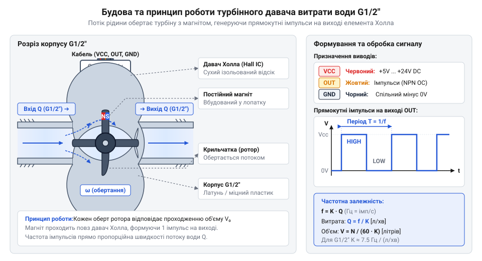
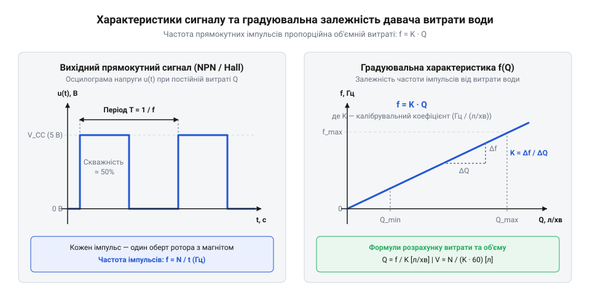
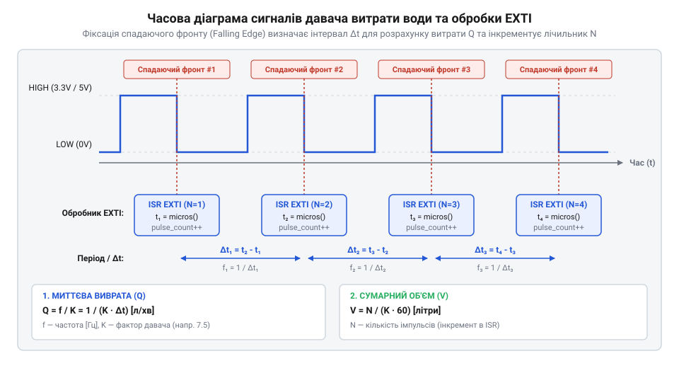
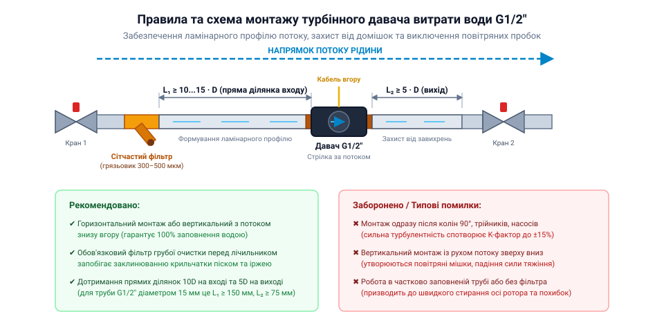

# Давач витрати води (турбіна + Холл, G1/2″)

<preknowlist>
- [HW-038 — давач рівня води](root:cat-hw-sensors/hw-038-water-level) — принципи контактного вимірювання наявності рідини для розуміння відмінностей від об'ємної витрати в потоці
- [Давач рівня рідини](root:cat-hw-sensors/liquid-level-sensor) — статичні методи моніторингу об'єму в резервуарах для порівняння з динамічним обліком у трубопроводах
</preknowlist>

## Чому статичні вимірювачі підводять у потоці

Контактний [давач рівня води](root:cat-hw-sensors/hw-038-water-level) або поплавцеві [статичні давачі рівня](root:cat-hw-sensors/liquid-level-sensor) фіксують висоту вільної поверхні рідини у відкритому баку. Проте в закритій трубі, повністю заповненій водою, її рівень завжди становить 100%, незалежно від того, чи рідина стоїть, чи рухається.

Статичний рівень у баку не відображає миттєву швидкість руху середовища в трубі. Для керування насосами, дозування чи пошуку витоків потрібна @@en|об'ємна витрата@@ (англ. *volumetric flow rate*) — кількість рідини, що проходить крізь переріз трубопроводу за одиницю часу.

Спроба занурити статичні зонди у потік викликає серйозні проблеми. Сторонній елемент створює високий @@en|гідродинамічний опір@@, падіння тиску та турбулентність. Постійне бомбардування рухомою рідиною прискорює корозію і налипання домішок, спричиняючи відмову датчика. Тому для замкнених магістралей використовують динамічні витратоміри.

## Турбінне перетворення потоку в імпульси

У турбінному витратомірі G1/2″ потік рідини обертає ротор зі швидкістю, пропорційною її витраті.

Щоб запобігти витокам крізь ущільнювачі під тиском, обертання передають безконтактно: магніт у лопаті обертається в герметичній камері, а за її стінкою @@en|давач Холла@@ (англ. *Hall sensor*) фіксує зміну магнітного поля.


*Будова турбінного витратоміра: потік обертає ротор із магнітом, а давач Холла за герметичною стінкою формує імпульси.*

Вбудований @@en|тригер Шмітта@@ (англ. *Schmitt trigger*) перетворює сигнал на прямокутні імпульси. Вихідний каскад із @@en|відкритим колектором@@ (англ. *open-collector*) лише замикає лінію на землю (`GND`), тож для формування високого рівня між виходом і `VCC` потрібен зовнішній @@en|підтягувальний резистор@@ (англ. *pull-up resistor*) на 4.7–10 кОм.

## Математика розрахунку витрати та K-фактор

Кількість імпульсів на один літр води визначає калібрувальний @@en|K-фактор@@ (англ. *K-factor*, від *calibration factor*). Для давача G1/2″ (YF-S201) @@en|K-фактор@@ дорівнює `7.5` Гц на `Л/хв`.

Миттєву @@en|об'ємну витрату@@ `Q` (у `Л/хв`) обчислюють діленням частоти імпульсів `f` (у `Гц`) на @@en|K-фактор@@:
```
Q = f / K                    [формула перерахунку частоти в миттєву витрату]
= 45.0 / 7.5                [підстановка 45 Гц та K-фактора 7.5]
= 6.0                        [витрата у Л/хв]
```

Сумарний пропущений об'єм води `V` (у літрах) додають підрахунком накопичених імпульсів `N`:
```
V = N / (K × 60)             [перерахунок імпульсів у літри]
= 4500 / (7.5 × 60)          [підстановка 4500 імпульсів]
= 4500 / 450                  [кількість імпульсів на 1 літр]
= 10.0                       [сумарний об'єм у літрах]
```


*Залежність частоти імпульсів від витрати рідини: у робочому діапазоні характеристика лінійна, але при низьких та надвисоких витратах виникають нелінійні похибки.*

Розрахунки точні лише в межах лінійності. За витрати менше ніж 1 Л/хв тертя підшипників спричиняє просковзування ротора й заниження показників. Понад 30 Л/хв виникає @@la|кавітація@@ (лат. *cavitas* — порожнеча) та турбулентність, що порушує лінійність.

## Зчитування імпульсів через зовнішні переривання

При максимальній витраті частота імпульсів давача перевищує 100–200 Гц, тому звичайне опитування входу в циклі спричиняє пропуски через затримки `delay()` та обробку інших задач. Для точного підрахунку застосовують @@en|зовнішнє переривання@@ (англ. *external interrupt*, EXTI): фронт сигналу призупиняє основний код і викликає коротку функцію — @@en|обробник переривання@@ (англ. *Interrupt Service Routine*, ISR). Для детальнішого ознайомлення з апаратною обробкою швидких імпульсних сигналів та налаштуванням векторів EXTI перегляньте статтю про [зовнішні апаратні переривання мікроконтролерів](root:sf-devices/exti-microcontrollers).


*Синхронізація обробки переривань: фронт імпульсу ініціює ISR, а основний цикл атомарно зчитує лічильник.*

Змінна-лічильник ISR потребує @@la|модифікатора volatile@@ (лат. *volatilis* — летючий), щоб компілятор не кешував її значення в реєстрах. В основному циклі її копіюють через @@el|атомарне зчитування@@ (грец. *atomos* — неподільний) з тимчасовим вимкненням переривань, запобігаючи спотворенню багатобайтового значення.

:::tabs
@tab Arduino C++
:::code water-flow-sensor/cpp/arduino/pulseisr.cpp
@tab ESP-IDF C
:::code water-flow-sensor/c/esp-idf/gpio-isr-handler.c
:::

## Експлуатаційні межі та монтажні вимоги

Механічні домішки заклинюють ротор, тому перед входом встановлюють @@en|сітчастий фільтр@@ грубої очистки.

Турбулентність від колін і вентилів спотворює вимірювання. Для @@la|ламінаризації потоку@@ (лат. *lamina* — пластинка) давач монтують на прямій ділянці: 10–15D перед ним і 5D після.


*Монтаж з фільтром і прямими ділянками.*

Паспортний @@en|K-фактор@@ уточнюють польовим калібруванням у реальній магістралі: пропускають еталонний об'єм води й розраховують фактичний @@en|K-фактор@@.