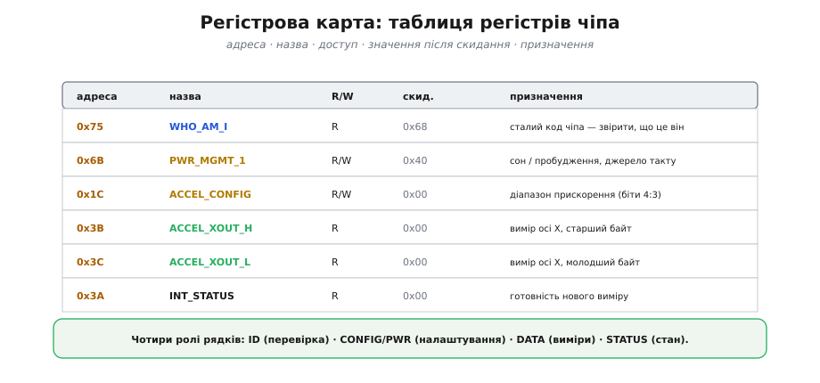
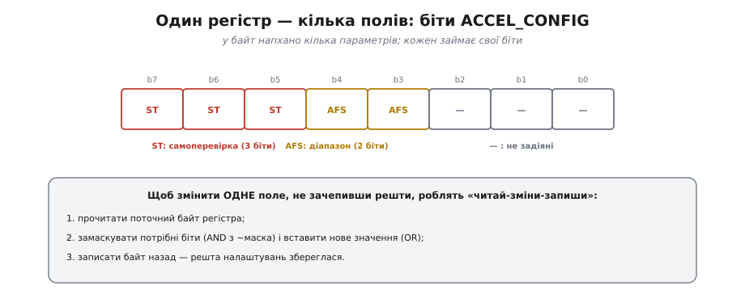
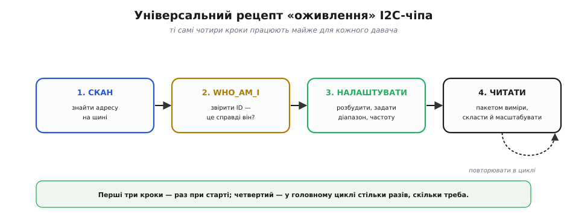
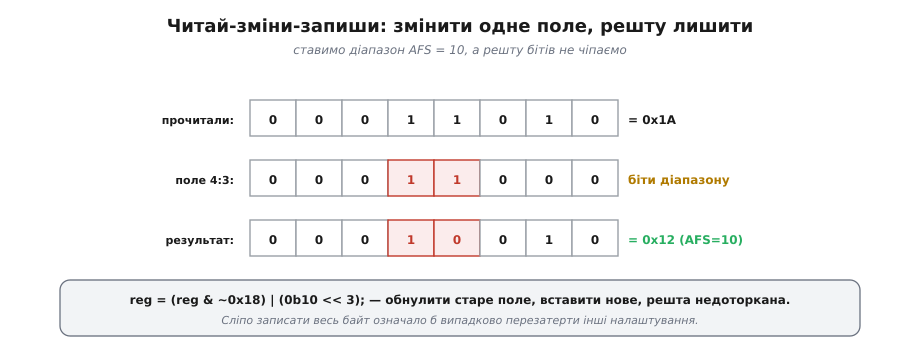
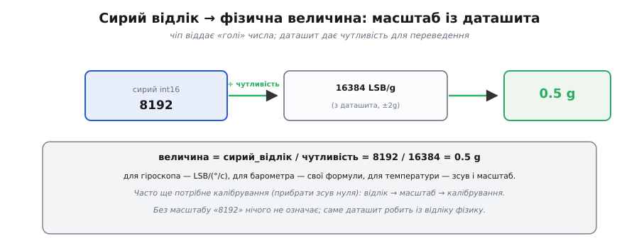
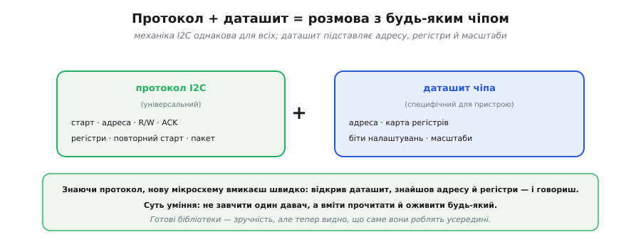

# Регістрова карта

Уся механіка [шини I2C](root:com-devices/i2c-bus) — старти, [адреси](root:com-devices/i2c-addressing), [транзакції до регістрів](root:com-devices/i2c-transaction), підтвердження — варта чогось лише тоді, коли з її допомогою вдається оживити реальний чіп. І тут чудова новина: хоч давачів тисячі, «розмовляють» вони майже однаково, а ключ до кожного — його **регістрова карта** в даташиті. Опанувавши один універсальний підхід, можна взяти будь-який незнайомий I2C-пристрій і за пів години змусити його працювати — не покладаючись на готову бібліотеку, а розуміючи, що саме відбувається.

### Регістрова карта: інструкція до чіпа

Усередині давача сидить набір **регістрів** — однобайтових комірок, у кожної свій номер (адреса). Записати в комірку — означає віддати чіпу команду чи налаштування; прочитати — забрати вимір чи стан. Перше, що шукають у даташиті, — **регістрова карта** (*register map*, «карта регістрів»): таблиця всіх таких комірок. Вона і є інструкція, як із чіпом говорити.


*Карта дає для кожного регістра адресу, назву, доступ (читання R чи запис W), значення після ввімкнення й призначення. Рядки бувають чотирьох ролей: ID — сталий код для перевірки, CONFIG/PWR — налаштування, DATA — виміри, STATUS — стан. Прочитати карту означає знати, що куди писати й звідки що читати.*

У карті варто бачити саме ці **чотири ролі** рядків — і будь-який чіп стає зрозумілим. **ID-регістр** (часто з назвою WHO_AM_I, «хто я») — сталий код, за яким переконуються, що на шині справді той чіп. **Регістри налаштувань** (CONFIG, PWR_MGMT — від *power management*, «керування живленням») — комірки, куди пишуть, щоб увімкнути давач і задати режим. **Регістри даних** (DATA) — звідки читають виміри. **Регістр стану** (STATUS) — звідки дізнаються, чи готовий новий вимір. Робота з чіпом зводиться до цих чотирьох груп.

Числа в підписах вище — не вигадані: це реальний акселерометр-гіроскоп MPU-6050. WHO_AM_I у нього лежить за адресою 0x75 і завжди віддає 0x68; живленням керує PWR_MGMT_1 (0x6B); діапазон акселерометра задають у ACCEL_CONFIG (0x1C); виміри осі X читають із пари 0x3B/0x3C. Ці адреси нам ще знадобляться в коді.

### Біти всередині регістра

Часто один регістр налаштувань пакує **кілька** параметрів — кожен у своїх бітах. Це **бітові поля** (*bit fields*, «бітові поля»): окремі ділянки байта, кожна зі своїм змістом.


*Байт ACCEL_CONFIG чіпа MPU-6050: біти 4:3 — діапазон прискорення (поле AFS), старші біти — самоперевірка осей, молодші не задіяні. Три різні налаштування живуть в одному байті. Щоб змінити одне поле, не зачепивши інших, застосовують «читай-зміни-запиши».*

Тут ховається важлива пастка: якщо просто записати весь байт заради одного поля, інші поля випадково **перезатруться**. Тому поля міняють обережно — прийомом «читай-зміни-запиши». Головне правило просте: один регістр ≠ одне налаштування, і дивитися треба на **біти**, а не на байт цілком.

### Універсальний рецепт оживлення

Є послідовність, що працює майже для кожного I2C-давача — назвімо її рецептом оживлення.


*Чотири кроки: (1) скан — знайти адресу на шині; (2) WHO_AM_I — звірити ID, що це справді той чіп; (3) налаштувати — розбудити, задати діапазон і частоту; (4) читати — пакетом виміри, скласти й масштабувати. Перші три виконують раз при старті, четвертий крутиться в головному циклі стільки разів, скільки треба вимірів.*

Цей рецепт — серце всієї теми. Кроки 1–3 виконують **один раз** при старті: знайшов, перевірив, налаштував. Крок 4 крутиться в головному циклі. Два кроки рецепта заслуговують уважнішого погляду — звірка ID й обережна зміна поля; з них і почнемо.

### WHO_AM_I: перша перевірка

Найрозумніше, що можна зробити перед будь-яким налаштуванням, — прочитати ID-регістр і звірити його з очікуваним значенням.


*Читаємо WHO_AM_I, очікуємо сталий код (у MPU-6050 це 0x68), отримали 0x68 — збіглося: це той чіп, адреса й дроти справні, можна налаштовувати. Якщо ж повернулося 0x00, 0xFF чи інше — налаштування не починають, спершу розбираються з підключенням.*

> 🔧 **Навіщо це.** Звірка WHO_AM_I економить **години** налагодження. Вона одразу відділяє два зовсім різні класи проблем: «чіп живий і відповідає» (ID збігся — далі шукай помилку в логіці) від «щось із підключенням» (ID не той — підтяжки, живлення, адреса, дроти). Значення 0xFF на всіх регістрах зазвичай означає обірвану лінію (підтяжка тримає «1»), а 0x00 — часто відсутнє живлення. Цю перевірку ставлять **першою**: за один обмін вона каже, чи варто рухатися далі.

### Читай-зміни-запиши

Тепер про обережну зміну бітового поля. Щоб поставити, скажімо, поле діапазону AFS = 10, не зіпсувавши біти поряд, застосовують прийом **читай-зміни-запиши** (*read-modify-write*, «прочитай, зміни, запиши»).


*Прочитали поточний байт (0x1A); замаскували старі біти діапазону (4:3) і вставили нове значення 10; записали назад (0x12). Біти поряд лишилися недоторканими.*

**Поставити лише поле AFS, решту лишити.** Хай регістр ACCEL_CONFIG зараз містить 0x1A, а діапазон (біти 4:3) треба виставити в 0b10, не чіпаючи решти:

```
reg = 0x1A                       // прочитали:          0001 1010
reg = reg & ~0x18                // обнулили біти 4:3:   0000 0010   (~0x18 = 1110 0111)
reg = reg | (0b10 << 3)          // вставили 10:         0001 0010 = 0x12
// записати 0x12 назад у регістр ACCEL_CONFIG
```

Якби ми просто записали `0b10 << 3` (тобто 0x10) у весь регістр, то випадково обнулили б решту бітів. «Читай-зміни-запиши» — стандартний і безпечний спосіб міняти **одне** поле, лишаючи сусідні як були.

> 🔧 **Навіщо це.** Майже кожне ввімкнення давача проходить через цей прийом: розбудити чіп, виставити діапазон, увімкнути переривання — усе це окремі біти в спільних регістрах. Сліпий запис байта — класичне джерело «працювало вчора, сьогодні ні»: змінив одне поле, мовчки скинув інше. Звичка читати-зміни-записувати знімає цілий клас таких помилок.

### Сирий відлік у фізичну величину

Останній крок рецепта — перетворити «голі» числа давача у фізичні величини. Чіп віддає **сирий відлік** (*raw count*, «сирий відлік»); даташит дає **чутливість** (*sensitivity*, «чутливість») — на скільки відліків припадає одиниця величини, щоб перевести їх у g, °/с, °C тощо.


*Сирий int16 (8192), поділений на чутливість із даташита (16384 LSB/g для діапазону ±2g), дає фізичну величину (0.5 g). Без масштабу «8192» нічого не означає — саме даташит робить із відліку фізику.*

**Відлік у прискорення.** Хай акселерометр MPU-6050 у діапазоні ±2g віддав сирий відлік 8192, а даташит для цього діапазону каже чутливість 16384 LSB/g:

```
величина = сирий_відлік / чутливість
величина = 8192 / 16384
величина = 0.5 g
```

Для гіроскопа масштаб буде в LSB/(°/с), для барометра — своя формула, для температури — зсув і коефіцієнт. А ще виміри часто потребують [калібрування](root:hw-sensing/calibration) (прибрати зсув нуля): сирий відлік → масштаб → калібрування → справжня величина.

### Усе разом: оживлення в коді

Зберімо рецепт у код. Хай яке середовище, потрібні рівно дві дії: записати байт у регістр і прочитати байт із регістра — усе інше з них складається. Кожна I2C-бібліотека дає їх під своєю назвою: в Arduino це `Wire`, в ESP-IDF — `driver/i2c.h`, у STM32 HAL — `HAL_I2C_Mem_*`, у Linux — `smbus`. Спершу два маленькі помічники: один читає байт регістра за адресою, другий — записує.

:::tabs
:::code register-map-d/c/arduino/use-razom-ozhyvlennia-v.ino
:::code register-map-d/c/esp-idf/use-razom-ozhyvlennia-v.c
:::code register-map-d/c/stm32/use-razom-ozhyvlennia-v.c
:::code register-map-d/py/use-razom-ozhyvlennia-v.py
:::

Маючи ці двоє, увесь рецепт лягає у кілька рядків:

:::tabs
:::code register-map-d/c/arduino/use-razom-ozhyvlennia-v-2.ino
:::code register-map-d/c/esp-idf/use-razom-ozhyvlennia-v-2.c
:::code register-map-d/c/stm32/use-razom-ozhyvlennia-v-2.c
:::code register-map-d/py/use-razom-ozhyvlennia-v-2.py
:::

Кожен рядок спирається на просту механіку шини. Усередині `readReg`/`writeReg` — той самий шаблон [«запис номера регістра, повторний старт, читання»](root:com-devices/i2c-transaction); перевірка ID — це WHO_AM_I; конфіг — це читай-зміни-запиши; зчитування двох сусідніх байтів — старший і молодший півбайти виміру. Уся складність схована за чотирма кроками рецепта.

Цей приклад навмисно спрощений: він читає осі по байту й не перевіряє помилок шини. Надійніший варіант віддає три осі одним пакетом (щоб вісь не «склеїлася» з двох різних вимірів), повертає код помилки з кожної функції й правильно складає знаковий відлік. Як це оформити в невеликий, але чесний драйвер у три шари — у вставці [мінімальний драйвер давача](root:com-devices/register-map/proj-sensor-driver.md).

### Універсальне вміння

І ось головний підсумок.


*Розмова з будь-яким чіпом = протокол I2C (універсальний) плюс даташит (специфічний для пристрою: адреса, карта регістрів, біти, масштаби). Знаючи протокол, нову мікросхему вмикаєш швидко: відкрив даташит, знайшов адресу й регістри — і говориш.*

> 🔧 **Навіщо це.** Суть уміння: не завчити один конкретний давач, а навчитися оживляти будь-який. Готові бібліотеки — зручність, і ними варто користуватися; але тепер видно, що саме вони роблять усередині, і драйвер можна полагодити, коли щось піде не так, чи написати з нуля для чіпа, на який бібліотеки ще немає. Протокол відомий — лишається відкрити даташит і прочитати таблицю.

---

Варто бачити й межі самого I2C. Це дотепний компроміс: [дві лінії](root:com-devices/i2c-bus), багато пристроїв на спільній шині, помірна швидкість — ціною [адресації](root:com-devices/i2c-addressing) й повільного [відкритого колектора](root:hw-digital/open-drain-bus-pullup-sizing). Коли потрібна швидкість і не шкода кількох зайвих ліній, беруть іншу синхронну шину — [SPI](root:com-devices/spi-bus): повнодуплексну, без адрес і підтяжок, із роздільними лініями даних в обидва боки. Але регістрова карта лишається тією самою ідеєю незалежно від шини: відкрив даташит, знайшов адресу й регістри — і говориш.
