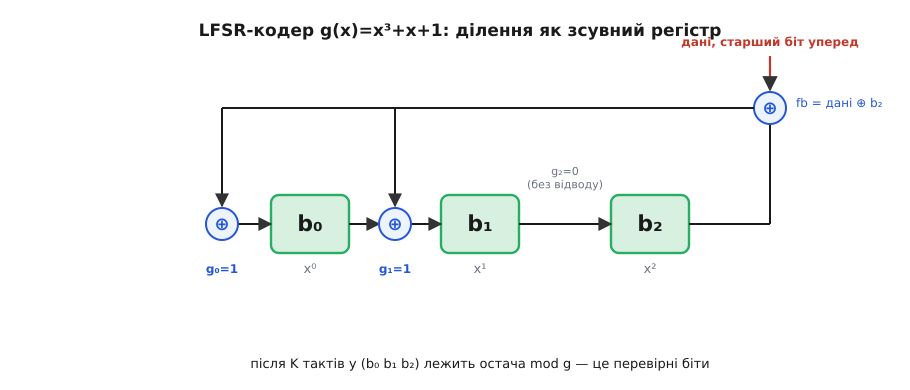
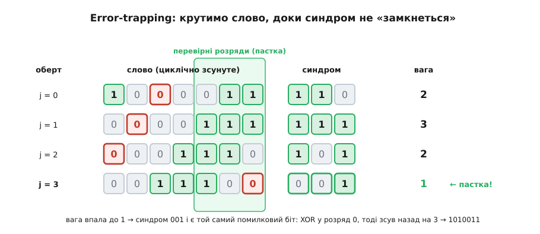

# ⚙️ Кодек циклічного коду: кодер, синдром і пастка для помилки в 60 рядках C

Ось повний робочий кодек [7, 4]-коду [Геммінга](root:com-modulation/hamming-code) з g(x) = x³ + x + 1 = `1011` — він кодує чотири біти даних у семибітове слово, ми псуємо на «дроті» один біт, а декодер відбудовує оригінал; мова — C, бо кожен рядок тут є бітовою арифметикою над [GF(2)](root:math-algebra/finite-fields) на гарячому шляху, і код, який ви читаєте, майже буквально є вентилями в мікросхемі. Обіцянка циклічного коду — що «дороге» ділення многочленів насправді є жменею зсувів і XOR — легше за все повірити, коли бачиш, як вона працює.

Чому саме C, а не мова зі стеку. Тут немає бізнес-логіки, DTO чи виразності — є регістр, біти й XOR за такт. Ділення над GF(2) — це операція, заради якої залізо будують окремо; C лягає на неї один-в-один, а Python чи TypeScript лише сховали б за абстракцією саме те, що ми хочемо роздивитися. Тому весь кодек — прямий C без залежностей.

## Домовленість про біти — перш ніж писати хоч рядок

Найпоширеніша помилка в кодеках циклічних кодів живе не в алгебрі, а в порядку бітів. Тому спершу зафіксуймо **одну** домовленість і більше від неї не відступаймо.

Слово завдовжки n зберігаємо у звичайному цілому: **біт i числа — це коефіцієнт при xⁱ**. Тоді двійковий запис числа читається старшим степенем ліворуч, як на папері. Твірний многочлен g(x) = x³ + x + 1 стає числом `0b1011`. Дані сидять у старших бітах, а R = n − k перевірних бітів — у молодших. Усе далі підкоряється цьому; варто дзеркально перевернути домовленість (біт 0 — старший степінь) — і кожен зсув поїде не в той бік.

:::tabs
@tab C
```c
#include <stdint.h>
#include <stdio.h>

/* [7,4]-код Геммінга, g(x) = x³ + x + 1 */
#define N 7            /* довжина слова                     */
#define K 4            /* біти даних                        */
#define R (N - K)      /* перевірні біти = 3 = deg g        */
#define G 0x0Bu        /* 0b1011: біт i = коефіцієнт при xⁱ */
```
@tab C++
```cpp
#include <cstdint>

// [7,4]-код Геммінга, g(x) = x³ + x + 1
constexpr int N = 7;                            // довжина слова
constexpr int K = 4;                            // біти даних
constexpr int R = N - K;                        // перевірні біти = 3 = deg g
constexpr std::uint16_t G = 0x0Bu;              // 0b1011: біт i = коефіцієнт при xⁱ
```
:::

## Ділення, що вміє один регістр

Уся машина стоїть на одній операції — остача від ділення на g(x). Над GF(2) шкільне ділення в стовпчик спрощується до краю: віднімання — це XOR, а питання «чи вміщається g у провідний член» — це просто «чи стоїть одиниця у старшому розряді». Ідемо від верхнього біта вниз; де над степенем R стирчить одиниця, XOR-имо туди g, зсунутий так, щоб його старший член погасив саме цей біт.

:::tabs
@tab C
```c
/* остача word mod g(x): ділення XOR-зсувами.
   word — до N бітів; g має степінь R (старший біт g стоїть у розряді R). */
static uint16_t poly_rem(uint16_t word) {
    for (int i = N - 1; i >= R; --i)      /* від старшого біта вниз до розряду R */
        if (word & (1u << i))             /* провідний член ще стирчить? */
            word ^= (G << (i - R));       /* відняти g, вирівняний під xⁱ    */
    return word & ((1u << R) - 1);        /* лишилась остача степеня < R      */
}
```
@tab C++
:::code proj-cyclic-codec/cpp/dilennia-shcho-vmiie-odyn.cpp
:::

Тут захована друга класична пастка — **вирівнювання степеня**. Старший біт g стоїть у розряді R; щоб його одиниця погасила біт i слова, g треба зсунути рівно на `i − R`. Зсунеш на `i` замість `i − R` — і код тихо ділитиме не на те, без жодної помилки компіляції.

## Кодування: дописати остачу

Кодуємо **систематично** — так, щоб дані лишалися видні у слові, а перевірні біти просто дописувалися збоку. Кодове слово c(x) = xᴿ·m(x) + [xᴿ·m(x) mod g(x)]: зсуваємо дані вгору на R розрядів, ділимо на g, а остачу кладемо в молодші R бітів, що звільнилися.

:::tabs
@tab C
```c
/* систематичне кодування: c = m·xᴿ + (m·xᴿ mod g) */
static uint16_t encode(uint16_t msg) {    /* msg — K бітів даних */
    uint16_t shifted = msg << R;          /* зсунути дані вгору на R      */
    return shifted | poly_rem(shifted);   /* дописати остачу в молодші R  */
}
```
@tab C++
```cpp
#include <cstdint>

// систематичне кодування: c = m·xᴿ + (m·xᴿ mod g)
constexpr std::uint16_t encode(std::uint16_t msg) { // msg — K бітів даних
    std::uint16_t shifted = static_cast<std::uint16_t>(msg << R); // зсунути дані вгору на R
    return shifted | poly_rem(shifted);             // дописати остачу в молодші R
}
```
:::

Для m = `1010` це дає shifted = `1010000`, остачу `011` — і слово `1010011`, де старші чотири біти досі читаються як дані, а три молодші порахувалися одним діленням.

## Той самий поділ — як тактований регістр

`poly_rem` жує все слово за раз. Мікросхема так не вміє: біти течуть до неї по одному за такт. Але те саме ділення тоді перетворюється на [регістр зсуву зі зворотним зв'язком (LFSR)](root:hw-digital/lfsr) — R тригерів тримають поточну остачу, а відводи XOR стоять рівно там, де в g(x) стоять одиниці. Дані вкидаємо старшим бітом уперед; кожен такт: зворотний біт fb = вхід ⊕ старший тригер; зсув; якщо fb = 1 — додати відводи.


*Ділення на g(x) як залізо: три тригери остачі, відводи XOR там, де в g стоять одиниці (g₀=g₁=1), і жодного відводу там, де нуль (g₂=0). Один такт — один біт даних. Після K тактів у регістрі лежить та сама остача, що її `poly_rem` рахує над цілим словом.*

:::tabs
@tab C
:::code proj-cyclic-codec/c/toi-samyi-podil-iak.c
@tab C++
:::code proj-cyclic-codec/cpp/toi-samyi-podil-iak.cpp
:::

Обидві функції на m = `1010` повертають `1010011` — та сама остача, дві машини. Різниця в тому, що `encode_lfsr` — це буквально кілька тригерів і вентилів XOR, які ковтають по біту на повній швидкості лінії; ось чому кодування циклічного коду «коштує майже задарма», а той самий регістр, лише [зсувний](root:hw-digital/shift-register), стоїть у кожному кадрі, захищеному [CRC](root:com-modulation/crc).

> 🔧 **Навіщо це.** Придивіться: одна й та сама операція «остача mod g» робить у кодеку три роботи — кодує (остача даних), перевіряє прийняте (синдром) і навіть крутиться всередині виправлення. Це не збіг, а вся суть циклічного коду: раз увесь код — це кратні одного g(x), то єдиний подільник на g і є той універсальний вузол, на якому тримається і кодер, і декодер. Тому в залізі циклічний кодек — це фактично один регістр із відводами, перемкнутий між режимами, а не три різні схеми.

## Синдром: чи ціле те, що прийшло

На прийомі ділимо здобуте слово на g(x). Остача — це **синдром**. Нульовий синдром означає, що слово ділиться на g націло, тобто є кратним g(x) — а отже, кодовим словом: видимої помилки немає. Ненульовий синдром означає, що помилка є, і — головне — саме його значення підказує, **де** вона.

:::tabs
@tab C
:::code proj-cyclic-codec/c/syndrom-chy-tsile-te-shcho.c
@tab C++
:::code proj-cyclic-codec/cpp/syndrom-chy-tsile-te-shcho.cpp
:::

## Пастка для помилки — error-trapping

Найкрасивіша частина. Одна помилка — це e(x) = xⁱ; прийняте слово дорівнює кодовому плюс xⁱ, тож синдром = xⁱ mod g. Можна було б наперед скласти табличку «позиція → синдром» і шукати в ній. Але є прийом дешевший і суто механічний — **error-trapping**, і це той самий циклічний зсув, лише повернений на службу декодеру.

Ключ ось у чому. Зсунути все слово на один крок по колу — це помножити його многочлен на x за модулем xⁿ − 1. А що при цьому робиться з синдромом? Оскільки g **ділить** xⁿ − 1 (та сама властивість, на якій стоїть увесь код), доданок, що «перескакує через край», щезає за модулем g — і зсув слова на один крок означає рівно **множення синдрому на x за модулем g**. Тобто крутити слово по колу й оновлювати синдром можна тим самим однокроковим діленням, яким ми вже володіємо.

Тепер сама пастка. Поки помилка сидить у старших розрядах, її синдром xⁱ mod g «розмазаний» і має вагу два-три. Та щойно помилка доїде до молодших R розрядів — тих самих перевірних, — стається диво: там степінь помилки менший за R, тож xⁱ mod g = xⁱ, і **синдром буквально дорівнює помилковому бітові**, а його вага падає до одиниці. Отже, рецепт: крути слово, доки вага синдрому не стане одиницею. У цю мить синдром — це і є той зсунутий помилковий біт: XOR-имо його у слово, докручуємо слово назад — і помилки нема.

:::tabs
@tab C
:::code proj-cyclic-codec/c/pastka-dlia-pomylky-error.c
@tab C++
:::code proj-cyclic-codec/cpp/pastka-dlia-pomylky-error.cpp
:::

На нашому зіпсутому слові `1000011` (це `1010011` із перекинутим розрядом x⁴) синдром `110` має вагу два, тож пастка не спрацьовує одразу — слово починає крутитися:


*Синдром крутиться разом зі словом: `110 → 111 → 101 → 001`, вага `2 → 3 → 2 → 1`. На четвертому оберті помилковий біт заходить у перевірні розряди, вага падає до одиниці — синдром `001` і є той самий біт. XOR його у слово, докрутити назад на три оберти — і відновлено `1010011`.*

## Наскрізний прогін

Складімо все докупи: закодуємо чотири біти, зіпсуємо один на «дроті», продекодуємо назад.

:::tabs
@tab C
:::code proj-cyclic-codec/c/naskriznyi-prohin.c
@tab C++
:::code proj-cyclic-codec/cpp/naskriznyi-prohin.cpp
:::

Що друкує програма:

```
дані      m = 1010
код       c = 1010011
код(LFSR) c = 1010011
прийнято  r = 1000011
синдром   s = 110
виправл.  c = 1010011
відновл.  m = 1010
```

Одна перекинута одиниця не пройшла: декодер знайшов її циклічним зсувом і повернув `1010` слово в слово.

## Складність і пастки

**Складність.** Кодування через LFSR — це K тактів, по кілька вентилів на такт: O(k). Через `poly_rem` над цілим словом — O(n·(n − k)) простих XOR-ів. Синдром — так само O(n·(n − k)). Error-trapping робить щонайбільше n обертів, кожен коштує один крок ділення O(n − k), разом O(n·(n − k)). Для справжніх CRC чи BCH форма та сама, лише слова довші; коефіцієнт же в залізі — жменя вентилів, і саме тому циклічні коди сидять на гарячому шляху.

**Пастки** — рівно ті три, що їх ховає акуратний приклад:

- **Порядок бітів.** Обери раз: біт i числа = коефіцієнт при xⁱ. Дзеркальна домовленість (біт 0 — старший степінь) перевертає кожен зсув; змішаєш дві в одному файлі — дістанеш слова, що кодуються, але не декодуються.
- **Ширина регістра.** Після кожного XOR зі зворотним зв'язком регістр треба маскувати до R бітів (`reg &= (1u << R) - 1`), інакше він росте вгору й отруює остачу. Ціле для слова мусить мати щонайменше n бітів: `uint16_t` тягне n ≤ 16; для CRC-32 треба `uint32_t`, і там пильнуй, щоб `1u << 31` не переповнило знаковий `int` — бери `1uL`/`1ul` та беззнакові типи.
- **Вирівнювання степеня.** Старший член g стоїть у розряді R; гаси ним біт i зсувом на `i − R`, не на `i`. Ця однобітова похибка не падає компіляцією — вона просто дає сміття.

І ще дві межі, про які варто пам'ятати. По-перше, g **мусить** нести свій старший член: записати g як `0b011` замість `0b1011` — означає ділити на інший, неправильний многочлен. По-друге, ця пастка виправляє **одну** помилку, бо [7, 4]-код Геммінга має мінімальну відстань 3 (t = 1), а його швидкість R = 4/7 менша за 1/t = 1 — рівно та зона, де простий error-trapping працює без хитрощів. Більше помилок за оберт у перевірні розряди не «замкнути»: тоді беруть варіанти з покривними многочленами (метод, що його вигострив Тадао Касамі 1964 року) або всю алгебраїчну машинерію [кодів BCH](root:com-modulation/bch-codes) чи [Рід — Соломона](root:com-modulation/reed-solomon). Сам же прийом «крути слово, доки помилка не замкнеться» — класичний найпростіший декодер циклічних кодів, що виріс із того самого погляду на зсув як на множення; статус цього — усталений.
