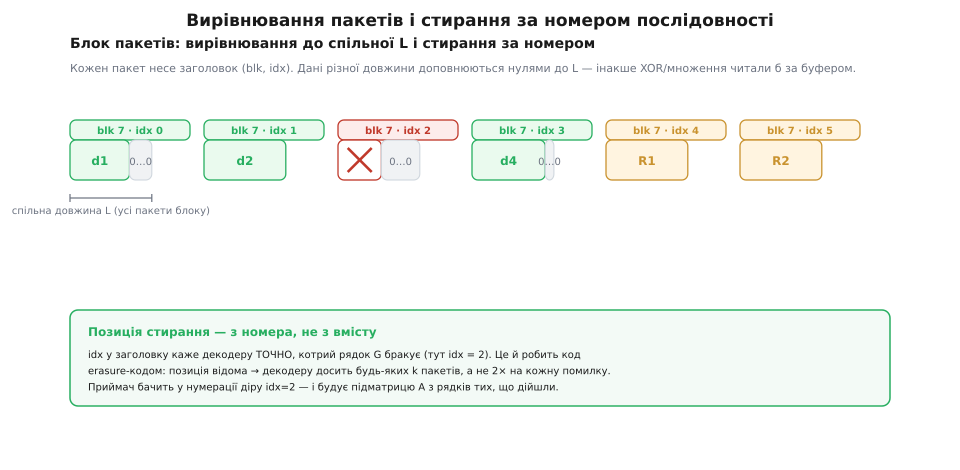

# 📦 Пакетний FEC-кодек: від XOR до Рід–Соломона на пакетах

Задача звучить просто, аж підозріло. Маємо `k` пакетів даних, кожен по `L` байтів. Треба зліпити з них `n` пакетів усього — `k` даних плюс `n − k` ремонтних — так, щоб приймач, отримавши **будь-які `k`** із цих `n`, підняв усі `k` вихідних. Байдуже, котрі саме пропали в дорозі, аби долетіла хоч якась `k`-ка.

Один пакет парності — XOR усіх даних — це вже робочий кодек, але з нього видно тільки перший поверх. Він відновлює рівно **одну** втрату. Щоб пережити дві, три, чотири, треба піднятися вище — і по дорозі стане ясно, чому там, нагорі, обов'язково з'являється арифметика над скінченним полем, матриця особливого крою й розв'язування системи рівнянь. Зберемо все це в справжній C, шматок за шматком, і кожен шматок буде відповіддю на конкретну ваду попереднього.

## Межа однієї парності

XOR-парність — це вже блоковий код `(k+1, k)`: `k` даних і один ремонтний. Дивитися на нього варто так: ремонтний пакет — це лінійна комбінація даних, де **всі коефіцієнти дорівнюють одиниці**. `R = 1·d₀ ⊕ 1·d₁ ⊕ … ⊕ 1·d_{k−1}`. Одне рівняння з відомою лівою частиною (`R` долетів) і одним невідомим (зниклий `d_s`) — тому рівно одна втрата й розв'язується.

Спокуса очевидна: додаймо *другий* ремонтний пакет — ще один XOR, але якоїсь іншої підмножини даних, — і пережиймо дві втрати. Ось де XOR ламається. Візьмімо `R₀ = d₀⊕d₁⊕d₂⊕d₃` і `R₁ = d₀⊕d₁`. Хай зникли `d₀` і `d₁`. Із `R₁ = d₀⊕d₁` маємо суму двох невідомих, а `R₀` після викреслення відомих `d₂,d₃` дає ту саму суму `d₀⊕d₁`. Два рівняння — але вони кажуть одне й те саме; розділити `d₀` і `d₁` нічим. Хоч як добираймо підмножини, над бітами (коефіцієнти лише 0 або 1) завжди знайдеться пара стовпців, яку два рядки не розрізняють. Причина глибша за невдалий вибір: у світі, де єдина арифметика — XOR, замало *різних* коефіцієнтів, щоб кожна пара невідомих мала свою, окрему пару рівнянь.

Отже, потрібні багатші коефіцієнти. Не тільки «береш / не береш» (0 або 1), а «береш стільки-то» — з палітри, де значень багато. Але множники не можуть бути звичайними числами: пакети — це байти, і сума `c·dⱼ` мусить лишатися байтом, інакше вона не влізе назад у пакет. Нам потрібна арифметика, замкнена на 256 значеннях байта, де є і додавання, і множення, і ділення, і всі звичні закони. Така штука існує й зветься **скінченним полем**.

## Поле, де кожен байт — це число: GF(256)

[Скінченне поле (поле Галуа)](root:math-algebra/finite-fields) з 256 елементами, `GF(256)`, — це і є арифметика на байтах, у якій усе поводиться «як з числами»: додавання, віднімання, множення, ділення на будь-що ненульове. Названо на честь Евариста Галуа (Évariste Galois, 1811–1832) — французького математика, що заклав теорію таких полів іще підлітком, за кілька років до загибелі на дуелі у двадцять.

Додавання в `GF(256)` — це **той самий XOR**. Через це віднімання збігається з додаванням (`a ⊕ a = 0`), і мінусів у формулах не буде взагалі. А множення хитріше: байт розглядають як многочлен над `GF(2)` (біти — коефіцієнти при `x⁷…x⁰`), множать як многочлени, а результат беруть за модулем сталого **незвідного** многочлена восьмого степеня. Стандартний вибір — `0x11D = x⁸ + x⁴ + x³ + x² + 1`.

Щоб не робити цю поліноміальну гімнастику на кожен байт, її роблять **раз** і будують дві таблиці. Елемент `α = 2` — породжувальний (його степені `α⁰, α¹, α², …` пробігають усі 255 ненульових байтів), тож кожен ненульовий байт — це `α` у якомусь степені. Таблиця `gf_exp[i] = αⁱ` (антилогарифм) і зворотна `gf_log[αⁱ] = i` перетворюють множення на додавання показників:

:::code proj-packet-fec/c/pole-de-kozhen-bait-tse.c

Зсув-із-редукцією в `gf_init` — це і є множення на `α`, побачене зблизька. Візьмімо `0x80 = x⁷` і помножмо на `α = x`: виходить `x⁸`, а це за модулем нашого многочлена дорівнює `x⁴+x³+x²+1 = 0x1D`. Тому в коді: старший біт стояв → після зсуву XOR-имо `0x1D`. Один рядок, а за ним уся теорія редукції.

> 🔧 **Навіщо це.** Чистий XOR — це арифметика над `GF(2)`, де всього два значення й коефіцієнти лише 0 та 1. Саме тому одна парність латає лише одну втрату: замало *різних* множників. `GF(256)` дає 255 ненульових коефіцієнтів — цілу палітру «нахилів», якими можна зробити рядки матриці кодування такими несхожими, що будь-яка їхня `k`-ка лишиться незалежною. Перехід від однієї парності до справжнього `(n, k)`-коду — це буквально перехід від бідного поля до багатого.

## Матриця, будь-яка k-ка рядків якої невироджена: Коші

Тепер збудуймо кодер як множення матриці на вектор. Складімо повну матрицю кодування `G` розміру `n×k`: вихід `y = G · d`, де `d` — стовпчик із `k` пакетів даних, `y` — стовпчик із `n` пакетів у канал. Щоб код був **систематичним** (перші `k` виходів — це самі дані, без перерахунку), візьмімо `G` у вигляді `[ I ; C ]`: зверху одинична матриця `k×k` (дані проходять як є), знизу — `m = n − k` ремонтних рядків.

![Систематична матриця G = [I ; Cauchy]: верхні k рядків — одинична (дані проходять без змін), нижні m — коефіцієнти Коші; декодування бере k рядків отриманих пакетів, обертає підматрицю й множить](img/systematic-matrix.svg)

*Кодування `y = G · d`: систематична частина `I` віддає дані незмінними, частина Коші рахує ремонтні. Декодування збирає з `G` рядки тих пакетів, що дійшли, у квадратну `A`, обертає її й множить на отримане.*

Уся сила — у нижній частині `C`. Вона мусить мати чудесну властивість: **хоч яку її квадратну підматрицю візьми — вона невироджена** (обернена існує). Тоді, збираючи будь-які `k` рядків із `[ I ; C ]`, ми завжди дістанемо оборотну `k×k`-матрицю, а значить — розв'язну систему. Матриця з такою властивістю відома здавна — це **матриця Коші** (за Оґюстеном-Луї Коші, Augustin-Louis Cauchy, 1789–1857, французький математик):

```
cᵢⱼ = 1 / (xᵢ ⊕ yⱼ)     над GF(256)
```

де `xᵢ` (для ремонтних рядків) і `yⱼ` (для стовпців-даних) — усі **різні** елементи поля, і жодне `xᵢ` не збігається з жодним `yⱼ` (щоб знаменник не занулився). Найпростіший вибір: `xᵢ = i`, `yⱼ = m + j` — два діапазони, що не перетинаються:

```c
// Ремонтна частина: матриця Коші m×k, cᵢⱼ = 1/(xᵢ ⊕ yⱼ).
// xᵢ = i (i<m),  yⱼ = m+j (j<k) — різні елементи, xᵢ ⊕ yⱼ ≠ 0.
void cauchy_matrix(uint8_t *C, int m, int k) {
    for (int i = 0; i < m; i++)
        for (int j = 0; j < k; j++) {
            uint8_t d = (uint8_t)i ^ (uint8_t)(m + j);   // ≠ 0 завжди
            C[i * k + j] = gf_inv(d);                     // 1/(xᵢ ⊕ yⱼ)
        }
}
```

Що робить `[ I ; C ]` **максимально роздільним** (MDS) — тобто «будь-яка `k`-ка досить»? Виберемо якісь `a` рядків із одиничної частини й `b = k − a` рядків із Коші. Одиничні рядки — це одиничні вектори; вони фіксують `a` координат, і визначник усієї `k×k`-матриці зводиться (розкладом за цими рядками) до визначника `b×b`-підматриці, вирізаної з `C`. А кожна квадратна підматриця Коші невироджена — отже, і вся зібрана матриця невироджена. Ось звідки чарівне «будь-яких `k` із `n`»: воно не постулат, а наслідок геометрії матриці Коші.

І тут проступає обіцяний місток до початку. Якщо єдиний ремонтний рядок зробити не за Коші, а **суцільно з одиниць**, `rs_encode` (нижче) із коефіцієнтом `c = 1` виродиться в чистий XOR усіх даних — той самий пакет парності. Плоска XOR-парність — це просто `(k+1, k)`-код, у якого один ремонтний рядок геть одиничний. Загальна конструкція не відкидає першого поверху, а вбирає його в себе окремим випадком.

Одне обмеження варто тримати в голові: над `GF(256)` усі `xᵢ` та `yⱼ` — це різні байти, тож `m + k ≤ 256`, тобто `n ≤ 256`. Для довших блоків беруть `GF(2¹⁶)` (пара байтів на елемент) — та сама конструкція, ширше поле.

## Кодування: множ-і-додай уздовж рядка

Матриця готова; лишилося множити. Кожен ремонтний пакет — це `repairᵢ = Σⱼ cᵢⱼ · dⱼ` над `GF(256)`, побайтово. Серце всього кодека — операція «взяти пакет, помножити кожен його байт на скаляр `c` і підмішати (XOR) в акумулятор». Наївно це два логарифми плюс антилог на *кожен* байт — марнотратно. Хитрість: скаляр `c` під час одного пакета сталий, тож збудуймо для нього разову таблицю множення на 256 входів, і внутрішній цикл по `L` байтах стане одним звертанням до таблиці й одним XOR:

:::code proj-packet-fec/c/koduvannia-mnozh-i-dodai.c

Зверніть увагу на `c = 1`: тоді `mulc[x] = x` (таблиця тотожна), і `gf_mul_add` вироджується в звичайний `dst ^= src`. Тому одиничний рядок і дає плоский XOR — не окремим кодом, а тим самим кодером на тривіальних коефіцієнтах. У канал іде `data[0..k−1]` як є (систематична частина) плюс `repair[0..m−1]`.

## Декодування: зібрати уцілілі рядки й розв'язати систему

Приймач набрав будь-які `k` пакетів із `n` і знає їхні номери (звідки — за мить). Кожен отриманий пакет `r` — це рядок повної матриці `G`, помножений на невідомий вектор даних: якщо це дані з номером `idx`, рядок — одиничний вектор `e_idx`; якщо ремонтний номер `t`, рядок — `C[t]`. Складімо ці `k` рядків у квадратну `A` (`k×k`). Тоді `y_отримане = A · d`, звідки `d = A⁻¹ · y_отримане`. Лишилося обернути `A` — методом Гаусса–Жордана, тільки над `GF(256)`, де віднімання — це XOR:

:::code proj-packet-fec/c/dekoduvannia-zibraty.c

Зауважте розподіл праці: `gf_invert` крутить **скаляри** (маленька `k×k`-матриця коефіцієнтів, окремі байти), а `gf_mul_add` — **вектори** довжиною `L` (важкі навантаження пакетів). Так і роблять справжні кодеки: дороге обернення матриці рахується один раз над крихітними числами, а по мегабайтах пакетів проходить лише дешевий цикл «множ-і-додай». І систематичність дарує подарунок: пакети даних, що *дійшли*, у `A` дають одиничні рядки, тож після обернення вони просто проходять крізь себе. На практиці не перераховують усі `k` виходів — лише ті рядки `inv`, що відповідають **зниклим** даним; уцілілі й так у руках.

## Пастки

Алгоритм чистий, але між ним і робочим кодеком лежать три ями, у які провалюються всі, хто пише таке вперше.

**Вирівнювання пакетів.** Уся арифметика — байт проти байта на однаковій позиції. Але реальні пакети різної довжини: один кадр стиснувся до 96 байтів, інший — до 132. XOR-ити чи множити буфери різної довжини — це читати й писати за їхніми межами, класична руйнівна помилка. Тому всі `k` пакетів блоку доповнюють нулями до спільної `L` (звичайно — до найдовшого), а справжню довжину пишуть у заголовок, щоб на прийомі відрізати доповнення. Ремонтні пакети завжди виходять довжини `L`.



*Дані різної довжини доповнено нулями до спільної `L` — інакше побайтовий XOR/множення вийшли б за буфер. А зниклий пакет декодер упізнає не за вмістом (його ж нема), а за дірою в нумерації `idx`.*

**Позиції стирань — із номерів, не з вмісту.** Декодеру треба знати, *котрих саме* пакетів бракує, — інакше він не збере правильну підматрицю `A`. Звідки він це знає? Із заголовка кожного пакета: номер блоку `blk` і номер усередині блоку `idx`. Побачивши в нумерації діру (`idx = 2` не прийшов), декодер точно знає, який рядок `G` відсутній. Саме це знання й робить код *стираннєвим* (erasure): позиція втрати відома наперед, тож досить будь-яких `k` пакетів, а не подвійного надлишку на кожну помилку невідомого місця. Це той самий виграш удвічі, яким живе весь пакетний FEC — і тримається він на кількох байтах номера в заголовку. Такий самий принцип «номер = позиція стирання» лежить в основі символьного [Рід–Соломона](root:com-modulation/reed-solomon), тільки там номерують символи всередині кодового слова, а тут — цілі пакети в потоці.

**Швидкодія гарячого циклу.** Внутрішній цикл `gf_mul_add` виконується разів `(кількість ремонтних) × k × L` на кодуванні — це мегабайти на секунду відео. Наївний `gf_mul` на кожен байт (два логарифми, додавання, антилог) — приблизно вчетверо повільніший за версію з разовою таблицею `mulc`, яку ми й написали: там у циклі лише вибірка з 256-байтної таблиці та XOR. Наступний щабель — векторизація: множник розкладають на два пошуки по 4-бітних таблицях і женуть інструкцією `PSHUFB`/AVX2 по 16–32 байти за такт, дістаючи одиниці гігабайтів на секунду. Цей прийом — «розклади множення на XOR-и по бітматриці» — і є ідея кодів **Коші–Рід–Соломона**, яку 1995-го описали Блемер, Кальфане, Карп, Карпінський, Люби й Цукерман (технічний звіт ICSI, Берклі): множення в полі заміняють суто на XOR-и, найшвидшу для процесора дію.

Про складність варто сказати чесно. Кодування — `O(m · k · L)` (кожен із `m` ремонтних збирає всі `k` даних). Обернення матриці — `O(k³)` над крихітними скалярами, тож на тлі пакетів воно майже безкоштовне; а власне відновлення навантажень — `O((втрачено) · k · L)` завдяки систематичності. Точність тут абсолютна: поле скінченне, жодних заокруглень, `d = A⁻¹ · y` виходить *точно* — байт у байт той самий, що вирушив у канал.

## Підсумок

Уся дорога від однієї парності до `(n, k)` — це послідовність відповідей на «а чому попереднє не тягне». XOR латає одну втрату, бо над `GF(2)` замало різних коефіцієнтів — беремо багатше поле `GF(256)`. Ремонтні рядки мусять бути такими несхожими, щоб будь-яка `k`-ка була розв'язна, — беремо матрицю Коші, кожна підматриця якої невироджена. Кодування — множення матриці на пакети; декодування — зібрати рядки уцілілих, обернути `k×k` і помножити. А три пастки — вирівнювання буферів, позиції стирань із номерів і швидкість гарячого циклу — це не дрібниці, а те, через що академічна формула стає кодеком, який справді везе живе відео крізь ненадійний ефір.

Історична примітка на завершення. Сам `(n, k)`-код над скінченним полем відкрили 1960 року Ірвінг Рід і Ґустав Соломон (Irving S. Reed, Gustave Solomon) у Лінкольнівській лабораторії MIT — стаття «Polynomial Codes over Certain Finite Fields». А те, що цей код блискуче працює на *пакетах* і на самих лише стираннях (де відновлювати простіше, ніж виправляти помилки невідомого місця), зробив практичним і швидким робочим софтом 1997 року Луїджі Рицо (Luigi Rizzo, Пізанський університет) — його реалізація на матрицях Вандермонда над `GF(256)` розійшлася по бібліотеках надійної передачі й донині лежить в основі багатьох із них. Це добре задокументовані факти, не спірні атрибуції.
