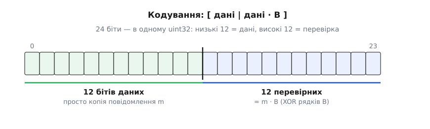
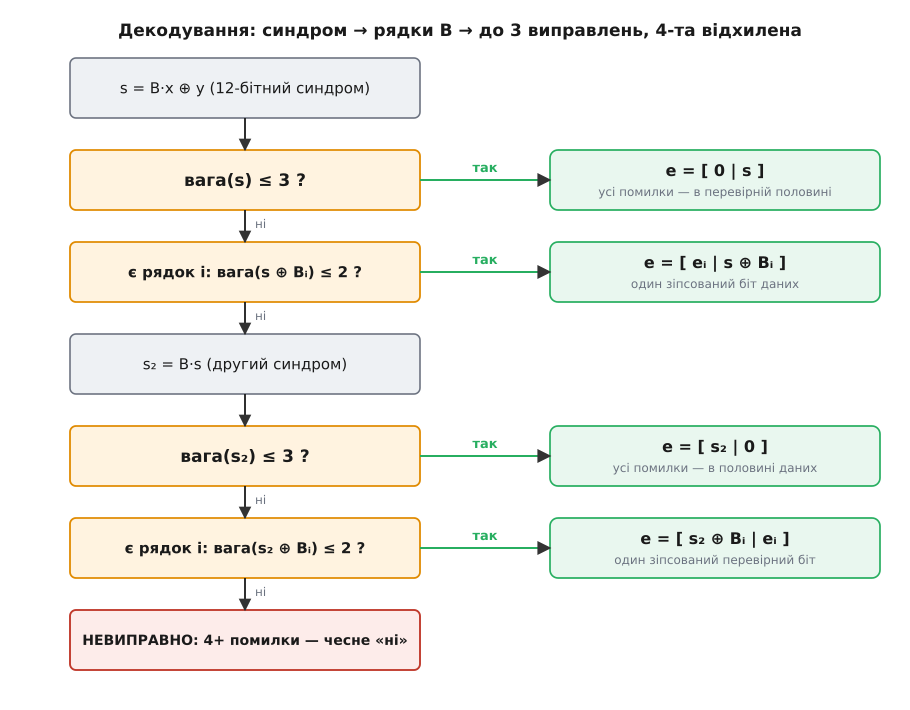

# ⚙️ Кодек коду Голея [24, 12, 8]: полагодити три помилки за пів десятка тактів

Розширений двійковий код Голея гарний на папері, але щоб він захищав знімки з-за Юпітера чи пакет у зашумленому короткохвильовому ефірі, його треба вкласти в кілька машинних операцій над одним 32-бітним регістром — без таблиць на кілобайти й без розгалужень, що залежать від даних. Саме такий робочий кодек ми тут і зберемо: кодер, що робить із 12 бітів даних 24-бітне слово, і декодер, що знімає з нього будь-які три перевернуті біти, а на четвертій помилці чесно каже «не беруся».

## Задача

Вимога проста на словах і сувора в реалізації. На вході — 12 бітів корисних даних. На виході каналу — 24-бітне слово, у якому канал міг перевернути кілька бітів. Приймач мусить:

- відновити будь-які **до трьох** перевернутих бітів, хоч би де вони сиділи;
- якщо помилок **рівно чотири** — не вгадувати навмання, а підняти руку: «блок зіпсовано, повторіть»;
- вкластися в **сталий** час, у кілька десятків операцій, без динамічної памʼяті — бо це крутиться на контролері апарата або в тракті радіо, де такт і байт лічені.

Найтупіший декодер зберігав би всі 4096 кодових слів і для кожного прийнятого слова шукав найближче за відстанню — 4096 порівнянь на один блок. Це і повільно, і памʼяткоємно. Уся суть коду Голея в тому, що **його структура сама виконує цю роботу** — треба лишень дати їй це зробити.

## Ідея кодування: XOR-нути кілька констант

Код Голея — лінійний і систематичний. «Систематичний» означає, що твірна матриця має вигляд `G = [I | B]`: ліва половина — одинична матриця, права — фіксований блок `B` розміром 12×12. Кодове слово повідомлення `m` — це `c = m·G = [m | m·B]`. Ліва одинична матриця нічого з даними не робить: перші 12 бітів слова — **дослівна копія** `m`. Уся робота — у правих 12 бітах, «відбитку» `m·B`.

А що таке `m·B` над полем з двох елементів (арифметика за модулем 2, тобто просто XOR)? Це XOR тих рядків матриці `B`, у яких відповідний біт `m` стоїть одиницею. Отже, кодування зводиться до дванадцяти умовних XOR-ів: пробігаємо біти `m`, і за кожну одиницю домішуємо в акумулятор одну наперед відому 12-бітну константу — рядок `B`.

Ось ця матриця `B` — дванадцять рядків по дванадцять бітів (стовпці 0…11 зліва направо):

```
рядок  0:  1 1 0 1 1 1 0 0 0 1 0 1
рядок  1:  1 0 1 1 1 0 0 0 1 0 1 1
рядок  2:  0 1 1 1 0 0 0 1 0 1 1 1
рядок  3:  1 1 1 0 0 0 1 0 1 1 0 1
рядок  4:  1 1 0 0 0 1 0 1 1 0 1 1
рядок  5:  1 0 0 0 1 0 1 1 0 1 1 1
рядок  6:  0 0 0 1 0 1 1 0 1 1 1 1
рядок  7:  0 0 1 0 1 1 0 1 1 1 0 1
рядок  8:  0 1 0 1 1 0 1 1 1 0 0 1
рядок  9:  1 0 1 1 0 1 1 1 0 0 0 1
рядок 10:  0 1 1 0 1 1 1 0 0 0 1 1
рядок 11:  1 1 1 1 1 1 1 1 1 1 1 0
```

Структура тут не випадкова: верхній лівий блок 11×11 — циклічна таблиця (кожен рядок — зсув сусіднього), а останній рядок і останній стовпець — суцільні одиниці, крім кутової нульки. Але для кодека важлива не так побудова, як дві її властивості, які ми зараз використаємо.

Перша: **матриця симетрична**, `B = Bᵀ`. Ми вибрали саме таку розкладку навмисно — далі це здешевить декодування удвічі. (Конкретний вигляд матриці — справа умовна: код Голея єдиний з точністю до перенумерування стовпців, тож будь-яка правильна систематична форма годиться; ми беремо симетричну.) Друга властивість — `B·Bᵀ = I` — знадобиться трохи згодом; поки що просто занотуймо.

У коді кожен рядок зручно тримати як 12-бітне число, де біт `j` (маска `1<<j`) — це елемент у стовпці `j`. Тоді вся матриця — масив із дванадцяти констант, а кодер — цикл на дванадцять ітерацій:

:::tabs
:::code proj-golay-codec/cpp/ideia-koduvannia-xor-nuty.cpp
:::code proj-golay-codec/c/ideia-koduvannia-xor-nuty.c
:::code proj-golay-codec/rust/ideia-koduvannia-xor-nuty.rs
:::

Усе слово живе в одному `uint32`: низькі 12 бітів — дані, високі 12 — перевірка. Ніяких масивів, ніяких циклів по бітах поодинці на приймачі — лише регістрові операції.


*Розкладка слова. Ліва половина — самі дані (систематичний код: якщо помилок не було, повідомлення читається прямо, без декодування). Права — згортка `m·B`, дванадцять перевірних бітів. Ключова умовність — де тут біт 0: кодер і декодер мусять розуміти її однаково.*

**Кодуємо повідомлення m = 0xB46.**

```
m           = 0xB46                     (12 бітів даних)
відбиток     = m·B = 0xA33              (XOR рядків B за одиницями m)
слово c      = дані | (перевірка << 12)
            = 0xB46 | (0xA33 << 12)
            = 0xA33B46
```

Низькі 12 бітів `0xB46` — це самі дані, високі `0xA33` — перевірка. Це слово й піде в канал.

## Ідея декодування: синдром ловить, структура виправляє

Приймач дістає слово `r`, можливо з перевернутими бітами: `r = c ⊕ e`, де `e` — невідомий патерн помилки. Перший крок — порахувати **синдром**. Розібємо `r` на дві 12-бітні половини, `x` (дані) і `y` (перевірка), і візьмемо

```
s = B·x ⊕ y
```

Навіщо саме це? Якщо `r` — чисте кодове слово, то `x = m`, `y = m·B`, і `s = B·m ⊕ m·B`. А оскільки `B` симетрична, `B·m = m·B`, тож `s = 0`. Отже, **синдром нуль ⟺ слово виглядає правильним**, і виправляти нема чого. Ненульовий синдром — певна ознака помилки.

Найважливіше: синдром залежить **лише від помилки, а не від повідомлення**. Через лінійність [блокового коду](root:com-modulation/generator-and-parity-check-matrices) `s(c ⊕ e) = s(c) ⊕ s(e) = 0 ⊕ s(e) = s(e)`. Усі 4096 повідомлень з тим самим патерном помилки дають той самий синдром — це чистий «підпис» помилки, і по ньому треба знайти найлегший (найменшої ваги) патерн `e`.

Тут напрошується таблиця: 4096 можливих синдромів → для кожного заздалегідь порахований патерн помилки. Працює, але коштує 4096 записів (≈ 12 КБ). Структура `B` дає варіант на **24 байти** — той самий пошук, але через арифметику.

Розібємо помилку на половини, `e = [u | v]`: `u` — перевернуті біти в даних, `v` — у перевірці. Тоді `s = B·u ⊕ v`. Бо помилок щонайбільше три, розберемо випадки за тим, скільки їх у лівій половині.

- **Усі помилки в перевірці** (`u = 0`): тоді `s = v` просто так. Якщо `вага(s) ≤ 3` — готово: `e = [0 | s]`.
- **Один зіпсований біт даних** (`вага(u) = 1`, `u = eᵢ`): тоді `B·u` — це `i`-й рядок `Bᵢ`, а `v = s ⊕ Bᵢ`. Пробуємо всі дванадцять рядків: якщо для якогось `вага(s ⊕ Bᵢ) ≤ 2`, то разом з тим одним бітом даних це три помилки — готово: `e = [eᵢ | s ⊕ Bᵢ]`.

А якщо помилок у даних дві чи три? Тоді перший синдром лишається «важким», жодна з перших двох перевірок не спрацьовує, і в діло вступає та сама симетрія. Помножмо синдром на `B` ще раз:

```
s₂ = B·s = B·(B·u ⊕ v) = B²·u ⊕ B·v = u ⊕ B·v
```

бо `B² = I` (це і є та відкладена властивість `B·Bᵀ = I` разом із симетрією). Вийшла та сама форма, тільки половини помінялись місцями — і два дзеркальні випадки:

- **Усі помилки в даних** (`v = 0`): `s₂ = u`. Якщо `вага(s₂) ≤ 3` — готово: `e = [s₂ | 0]`.
- **Один зіпсований перевірний біт** (`вага(v) = 1`, `v = eⱼ`): `s₂ = u ⊕ Bⱼ`; якщо `вага(s₂ ⊕ Bⱼ) ≤ 2` — готово: `e = [s₂ ⊕ Bⱼ | eⱼ]`.

Якщо не спрацював жоден із чотирьох випадків — помилок щонайменше чотири, і слово невиправне.

Чому ці чотири випадки **напевно** ловлять будь-які три помилки? Бо `вага(u) + вага(v) ≤ 3`. Якщо `вага(u) ≤ 1` — це перші два випадки. Якщо `вага(u) ≥ 2`, то `вага(v) ≤ 1`, і другий синдром переводить задачу в «важкий-у-даних» вигляд, який ловлять третій і четвертий. Жодна трійка не втече. А дванадцять рядків `B` тут і є та сама «таблиця» — тільки не на 4096, а на 12 записів.


*Декодер як водоспад із чотирьох перевірок. Кожна «так»-гілка одразу дає патерн помилки; усі «ні» стікають донизу. Другий синдром `s₂ = B·s` існує лише завдяки `B² = I` — саме заради цього ми й брали симетричну `B`. Останнє «ні» — це не збій, а результат: чотири помилки виявлено.*

У коді весь цей водоспад — одна функція. Вага слова — це кількість одиниць у ньому (для нульового початку вона ж дорівнює [відстані Геммінга](root:com-modulation/hamming-distance) від нуля); її дає апаратна інструкція підрахунку бітів:

:::tabs
:::code proj-golay-codec/cpp/ideia-dekoduvannia-syndrom.cpp
:::code proj-golay-codec/c/ideia-dekoduvannia-syndrom.c
:::code proj-golay-codec/rust/ideia-dekoduvannia-syndrom.rs
:::

Зверніть увагу, як C++20 (`std::optional`) та Rust (`Option`) робить «невиправно» неможливим прогледіти на рівні компілятора: замість чарівного від'ємного числа чи вихідного вказівника повертається виразний контейнер значення, що змушує той код, який викликає декодер, явно розгалужувати обробку випадку відсутності розв'язку. У C цю роль виконує цілочисловий прапорець повернення зі значенням 0 або -1, і забути перевірити його перед використанням `*data` — класична джерельна пастка для системного програміста.

**Декодуємо те саме слово c = 0xA33B46 з трьома перевернутими бітами.** Хай канал перекинув біти на позиціях 2 (у даних), 14 і 21 (у перевірці):

```
прийнято  r  = 0x837B42
синдром   s  = B·x ⊕ y = 0xC8A            вага 5  →  випадок 1 не підходить (5 > 3)
                                          беремо рядки B по черзі:
рядок i=2:  s ⊕ B[2] = 0xC8A ⊕ 0xE8E = 0x204    вага 2  →  спрацювало (2 ≤ 2)
патерн    e  = [ eᵢ=2 | 0x204 ]
            = (1<<2) | (0x204 << 12) = 0x204004
виправлено:  r ⊕ e = 0xA33B46  =  вихідне слово
дані         = (r ⊕ e) & 0xFFF = 0xB46   ← точно те, що кодували
```

Один синдром, кілька XOR-ів і підрахунків бітів — і три помилки зняті.

А тепер **чотири помилки**. Хай зіпсовано біти 1, 5, 17 і 22. Синдром виходить вагою 8; жодна з чотирьох гілок не дає ваги в межах — водоспад стікає до кінця, `golay_error` повертає 0 (Rust — `None`). Декодер не вгадав хибно, а чесно відмовив.

Чому чотири помилки виявляються **завжди**, а не інколи? Бо патерн ваги 4 не може мати той самий синдром, що якийсь патерн ваги ≤ 3: інакше їхній XOR був би ненульовим кодовим словом ваги ≤ 7, а найменша вага кодового слова Голея — вісім. Отже, четвірка ніколи не «перевдягнеться» під виправну трійку — каскад гарантовано провалиться до відмови.

## Складність і пастки

**Складність.** Кодування — дванадцять умовних XOR-ів, тобто фактично константа. Декодування — один синдром (дванадцять XOR-ів), далі щонайбільше два цикли по дванадцять перевірок «XOR + підрахунок бітів» плюс один XOR-прохід на `s₂`: разом кілька десятків регістрових операцій, без розгалужень на даних глибше крихітних циклів і без памʼяті понад масив `B[12]`. Порівняйте з тупим декодером (4096 порівнянь на слово) чи з повною синдромною таблицею (12 КБ): структура коштує близько 24 байтів констант і стало-малий час.

> 🔧 **Навіщо це.** Різниця «24 байти й десяток тактів» проти «12 КБ і повний перебір» — не естетика, а те, чи влізе кодек у контролер зонда з кількома кілобайтами памʼяті й жорстким бюджетом такту на пакет. Сталий час без залежних від даних гілок — ще й захист від того, щоб час декодування не «протікав» назовні: у радіо це буває важливо. Саме тому Голеїв код возять на борту, а не тримають у підручнику.

**popcount.** Уся арифметика рішень тримається на одній операції — вазі слова, кількості одиниць. Сучасні процесори мають для неї окрему інструкцію (`POPCNT` на x86, `CNT` на ARM); у C її дає `__builtin_popcount`, у C++20 — `std::popcount`, у Rust — метод `count_ones`. На мікроконтролері без такої інструкції беруть маленьку таблицю на байт або трюк паралельного підсумовування бітів — але концептуально це один дешевий крок.

**Пастка перша: порядок бітів.** Кодер і декодер мусять до останнього біта однаково розуміти, який дріт — біт 0, яка половина слова — дані, а яка — перевірка. Синдром рахується з `B·x ⊕ y`; переплутайте, звідки брати `x` і `y`, або оберніть порядок бітів у пакуванні 24 бітів у слово — і синдром почне «брехати»: чисте слово даватиме ненульовий підпис, а декодер «виправлятиме» неушкоджене в казна-що. Це найчастіша помилка стикування двох реалізацій. Зафіксуйте домовленість про біти в одному місці й тримайтеся її на обох кінцях.

**Пастка друга: розширений біт парності, якого немає.** Код [24, 12, 8] часто пояснюють як «код [23, 12, 7] плюс один загальний біт парності». Це правда за походженням, але в систематичній розкладці `[I | B]` **окремого біта парності немає** — гарантію парної ваги розмазано по всіх дванадцяти перевірних бітах. Чому кожне кодове слово має парну вагу: код Голея самодвоїстий (`B·Bᵀ = I`), тобто кожне кодове слово ортогональне саме собі; над GF(2) скалярний добуток слова на себе дорівнює його вазі за модулем 2, отже вага завжди парна. «Розширення» вже вшите в `B`. Не намагайтеся доліпити двадцять четвертий біт парності «щоб розширити код» — ви подвоїте парність і зламаєте відстань. Один раз перевірте, що ваша `B` дає лише парні ваги кодових слів, — і живіть спокійно.

**Пастка третя: чотири помилки — виявляти, а не виправляти.** Декодер зобовʼязаний повернути «немає відповіді», а не тихо обрати найближче слово. Усі чотирикратні помилки код виявляє гарантовано (ми щойно бачили, чому). Але на цьому гарантія й закінчується: пʼять і більше помилок можуть випадково лягти на той самий синдром, що якась трійка, — тоді декодер «виправить» їх **хибно**, і ви цього не помітите. Стіна завтовшки вісім обіцяє рівно «виправити три, виявити чотири» й ні на крок більше. Тому й тип повернення має робити випадок «невиправно» неможливим прогледіти — інакше рідкісний, але тихий збій колись коштуватиме зіпсованого кадру.

**Пакувальна ефективність та вирівнювання.** Оскільки кожне кодове слово укладається у 32-бітне ціле `uint32_t`, масив із тисячі блоків займає рівно 4 кілобайти пам'яті та ідеально лягає на кеш-рядок L1. На сучасних процесорах x86 (AVX2/AVX-512) або ARM NEON цей кодек вирівнюється під пакетне обчислення синдромів одразу для 8 або 16 слів паралельно, що робить його придатним для високошвидкісного стримінгу даних у реальному часі.
