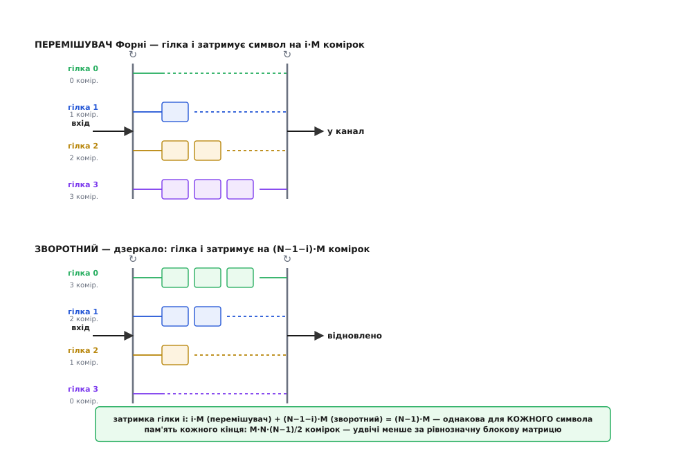
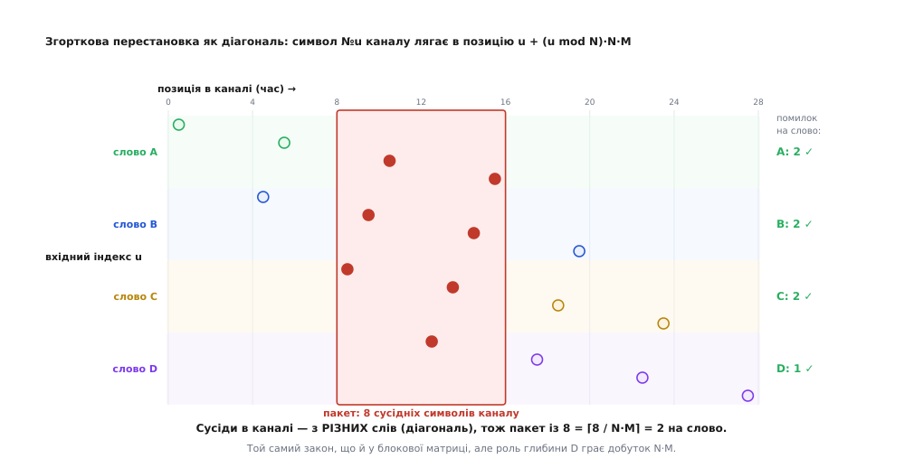

# ⚙️ Робочий перемішувач: матриця й регістри Форні

> Алгоритмічна вставка. Ідея перемішування проста на словах — «розкидай сусідів у часі, щоб пакет упав по крихті на багато слів» — але щоб вона запрацювала в прошивці, треба дві речі: перестановку, яку рівно точно можна повернути назад, і буфер, що вкладається в пам'ять мікроконтролера. Тут дві робочі схеми доведено до коду, який компілюється і крутиться на найскромнішому ядрі: **блоковий** перемішувач як чиста перестановка адрес і **згортковий** (Форні) на сходинці ліній затримки. Обидва проганяємо крізь той самий сценарій — пускаємо потік кодових слів, б'ємо його суцільним пакетом і дивимось, як на прийомі кожне слово дістає лише кілька розкиданих похибок замість убивчого згустку.

### Задача

Перед нами код, що лагодить до `t` зіпсованих символів на кодове слово, — скажімо, [Рід–Соломон](root:com-modulation/reed-solomon), який вигрібає `t` байтів із кожних 255. Поки [пакет помилок](root:com-modulation/burst-error) коротший за `t`, код спокійно все відновлює. Але реальний канал час від часу б'є смугою в сотні символів поспіль, і така смуга, впавши в одне слово, — це вже далеко за `t`: слово гине цілком.

Перемішувач сідає **між кодером і каналом** на передачі й **між каналом і декодером** на прийомі. Його робота — переставити символи так, щоб суцільний пакет у каналі на прийомі розсипався на розкидані поодинокі похибки, кожному слову по кілька. Від коду тут не вимагається нічого: він працює, як і працював, і навіть не дізнається, що в каналі був згусток.

Щоб це стало кодом, а не гарними словами, від перемішувача треба три речі. По-перше, **точна оборотність**: зворотний перемішувач мусить відновити геть той самий порядок, символ у символ, інакше декодер дістане не своє. По-друге, **скінченна пам'ять**: обидва кінці буферизують символи, і цей буфер має вкладатися в наявну RAM. По-третє, **потоковість**: у більшості систем символи течуть безперервно, тож перемішувач має видавати вихідний символ на кожен вхідний, без пауз на «зберемо весь блок». Дві схеми нижче задовольняють ці вимоги по-різному, і саме в цьому «по-різному» вся інженерна вага.

### Блоковий перемішувач — це просто перестановка адрес

Найпростіша схема — матриця. Беремо `D` кодових слів завдовжки `N` символів, **пишемо їх рядками** (слово за словом), а тоді **читаємо стовпцями** — і саме цей порядок віддаємо в канал. Число рядків `D` — глибина перемішування.

Ключ до коду в тому, що ніякої матриці насправді не потрібно. «Записати рядками, прочитати стовпцями» — це просто **перестановка індексів**: символ, що в каналі стоїть на позиції `k`, береться з наперед відомого місця вхідного буфера. Порахуймо це місце. Читаючи стовпцями, позиція `k` розкладається на стовпець `c = k / D` і рядок `r = k mod D` (цілочислове ділення). А в матриці, писаній рядками, символ рядка `r`, стовпця `c` лежав на вхідній позиції `r·N + c`. Складаємо:

```
позиція в каналі k  →  береться з входу:  perm[k] = (k mod D)·N + (k / D)
```

Уся схема — цей один рядок арифметики. Перемішати — розкласти вхід за `perm`; зворотний перемішувач кладе кожен прийнятий символ туди, звідки той прийшов. У прошивці це два вкладені цикли без жодного ділення в гарячому місці; у наочному коді — явний масив перестановки, щоб було видно саме її.

:::tabs
:::code proj-interleaver-code/c/blokovyi-peremishuvach-tse.c
:::code proj-interleaver-code/py/blokovyi-peremishuvach-tse.py
:::

Оскільки це чиста перестановка, зворотність не треба ні доводити, ні тестувати окремо: `perm` — бієкція (кожна вхідна позиція трапляється рівно раз), тож `deinterleave(interleave(x)) == x` за побудовою. Це важлива дрібниця: перемішувач не має **права** втрачати чи плутати символи навіть на один — інакше він сам стає джерелом помилок, гіршим за той пакет, від якого рятує.

### Пакет розсипається: блоковий прогін

Тепер найцікавіше — показати, як пакет справді розлітається. Пронумеруймо символи парою `(слово, позиція)`, перемішаймо, зіпсуймо в каналі суцільну смугу підряд і подивімось, скільки похибок дісталося кожному слову після зворотного розкладання.

:::code proj-interleaver-code/py/paket-rozsypaietsia.py

Смуга з десяти зіпсованих символів каналу обернулася на **рівно по дві похибки в кожному з п'яти слів**. Якщо код лагодить бодай `t = 2` на слово — усі п'ять виживають, хоч канал і бив суцільною чергою. Загальний закон уже видно з чисел: глибина `D` ріже пакет на скибки, і в найгірше слово падає `⌈b / D⌉` символів. Поки `⌈b / D⌉ ≤ t`, тобто поки пакет не довший за `D·t`, декодер витягує все.

Чому саме так, видно з `perm`: сусідні позиції каналу `k` і `k+1` (той самий стовпець, наступний рядок) беруться з входів `perm[k]` і `perm[k]+N` — тобто з **різних слів**, зсунутих рівно на одне слово. Тому будь-які `D` символів каналу поспіль — це `D` різних слів, по одному з кожного, і пакет фізично не може покласти в одне слово більше, ніж одну скибку на кожні `D` своїх символів.

### Згортковий перемішувач Форні: сходинка ліній затримки

Блокова матриця має ваду, яку видно, щойно приглянутися до її буфера. Щоб віддати перший стовпець, передавач мусить спершу заповнити **всі** `D` рядків; поки збирається наступна матриця, попередня вже відіслана, і добра половина пам'яті стоїть без діла. Платимо за повний буфер `D·N`, а працює в кожну мить лише його частина.

[Дейвід Форні 1971 року](root:com-modulation/convolutional-codes) (у праці «Burst-Correcting Codes for the Classic Bursty Channel», незалежно від Джона Ремзі роком раніше) показав, як усунути це марнотратство. Замість цілої матриці — набір **ліній затримки різної довжини**, крізь які символи течуть безперервно. Уяви `N` гілок і комутатор, що по колу роздає їм вхідні символи: перший символ у гілку 0, другий у гілку 1, …, `N`-й знову в гілку 0. Гілка `i` — це лінія затримки на `i·M` комірок (гілка 0 — просто дріт). Другий комутатор на виході синхронно збирає символи назад у потік.


*Сходинка ліній затримки. Угорі — перемішувач: гілка 0 наскрізна, гілка 1 має M комірок, гілка 2 — 2M, і так до (N−1)·M. Унизу — зворотний, дзеркальний: гілка i затримує на (N−1−i)·M. Разом кожен символ, хоч би в яку гілку потрапив, чекає рівно (N−1)·M комірок — тому потік відновлюється синхронно, без збивання порядку.*

Що ця сходинка робить із порядком, можна виписати точною формулою, і вона напрочуд гарна. Символ, що зайшов на вхід під номером `u`, потрапляє в гілку `i = u mod N` і сидить там `i·M` комірок; а що комутатор повертається до цієї гілки кожні `N` кроків, ці `i·M` комірок означають затримку `i·M·N` кроків у потоці. Тож його місце в каналі:

```
позиція в каналі символу №u:   pos(u) = u + (u mod N)·N·M
навпаки, символ у каналі №t:   in(t)  = t − (t mod N)·N·M
```

Ось звідки береться розсіювання. Сусідні входи `u` і `u+1` ідуть у сусідні гілки з різницею затримок `N·M` — і в каналі розходяться приблизно на `N·M` позицій. А отже, дзеркально: **сусіди в каналі — з входів, розкиданих на `N·M` один від одного**. Добуток `N·M` грає тут точно ту саму роль, що глибина `D` у блоковій матриці.


*Перестановка каналу — це сходинкова діагональ: символи одного слова (одного кольору) розповзаються по каналу, а суцільний пакет (червона смуга) навскіс перетинає цю діагональ, тож у кожне слово влучає лише крихта. Той самий закон `⌈b / N·M⌉ на слово`, що й у блокової матриці, — лише роль глибини D грає добуток N·M.*

### Той самий приклад у коді

Кожна гілка — це [кільцевий буфер](root:sf-algorithms/ring-buffer): нова комірка витісняє найстарішу, і саме ця найстаріша виходить у канал. У прошивці всі гілки складають в один плаский масив, щоб зайняти рівно `M·N·(N−1)/2` комірок — стільки, скільки сумарно всіх ліній затримки, ні байтом більше. У Python-і те саме читабельніше видно на `deque` — гілка як черга сталої довжини.

Перемішувач і зворотний — **та сама** схема з різними довжинами гілок: у перемішувача гілка `i` затримує на `i·M`, у зворотного — на `(N−1−i)·M`. Тому пишемо один рушій і заводимо його двічі.

:::tabs
:::code proj-interleaver-code/c/toi-samyi-pryklad-u-kodi.c
:::code proj-interleaver-code/py/toi-samyi-pryklad-u-kodi.py
:::

У C-версії весь стан — це `MEM` байтів буфера плюс кілька лічильників; для `N = 6, M = 2` це рівно **30 байтів** на кожен кінець. Жодних `malloc`, жодного ділення на гарячому шляху (лишок за модулем малого сталого `N` компілятор часто згортає в маску чи умовне віднімання), одна операція читання-запису на символ. Саме така схильність до передбачуваної, дрібної, сталої роботи й робить згорткові перемішувачі домашніми в цифровому телебаченні, DSL та супутникових модемах.

### Демонстрація: Форні розкидає і збирає

Спершу переконаймося, що пара нічого не ламає: після наскрізного прогону зворотний перемішувач мусить віддати геть той самий потік, лише зсунутий на затримку `M·N·(N−1)`.

:::code proj-interleaver-code/py/demonstratsiia-forni.py

Порядок відновлено символ у символ — ціна лише в тих перших 60 фіктивних символах, що витекли, поки заповнювались лінії затримки. Тепер той самий тест на розсіювання: слова по `N` символів, суцільний пакет у каналі.

```python
il = ConvInterleaver(N, M)
words = [(u // N, u % N) for u in range(40 * N)]     # 40 слів по 6 символів
chan = [il.push(w) for w in words]

for blen in (12, 24):                                # два пакети різної довжини
    hit = Counter(chan[k][0] for k in range(120, 120 + blen) if chan[k])
    print(blen, "->", max(hit.values()), "на слово")
# 12 -> 1 на слово        (пакет = N·M = 12 → щонайбільше 1 похибка на слово)
# 24 -> 2 на слово        (⌈24 / 12⌉ = 2)
```

Пакет завдовжки рівно `N·M = 12` символів каналу розкладається так, що **жодне слово не дістає більш як одну похибку** — суцільна дюжина обертається на дюжину поодиноких, розкиданих по дюжині слів. Подвоїмо пакет — і на слово припадає `⌈24 / 12⌉ = 2`, як велить той самий закон `⌈b / N·M⌉`, дзеркальний до блокового `⌈b / D⌉`. Перемішувач Форні у далекому космосі саме так і стоїть — між двома кодами [каскаду](root:com-modulation/concatenated-codes), розтягуючи пакетні зриви внутрішнього декодера по словах зовнішнього Рід–Соломона.

### Скільки коштує кожен: пам'ять і затримка

Обидві схеми ріжуть той самий пакет однаково добре при рівному «важелі глибини» (`D` для блока, `N·M` для згорткового). Різняться вони ціною, і тут згортковий виграє начисто.

```
однаковий захист:                блоковий D=d        згортковий N·M=d
──────────────────────────────────────────────────────────────────────
пам'ять кожного кінця             ≈ d·n комірок       d·(N−1)/2 ≈ ½·d·n
наскрізна затримка               ≈ 2·d·n символів    ≈ d·(N−1) ≈ ½·(2·d·n)
```

Джерело виграшу — саме те марнотратство блокової матриці. Сходинка ліній затримки ніколи не простоює: кожна комірка щомиті або тримає символ у польоті, або віддає його. Тому за той самий захист згортковий бере **приблизно вдвічі менше пам'яті й дає вдвічі меншу затримку** (точний множник залежить від того, як `N` співвідноситься з довжиною слова `n`; при `n ≈ N` це чиста половина). Для `N = 6, M = 2` це 30 байтів проти десь 60–70 у блокового рівної сили. У сховищі чи стрімі, де кілька мілісекунд затримки ніхто не помітить, зайва пам'ять блока не варта клопоту, і його беруть за простоту. А там, де на рахунку кожен байт RAM і кожна мілісекунда — модем, приставка, супутниковий приймач, — вибирають Форні.

### Пастки

- **Прайм і вирівнювання — не декорація, а умова правильності.** Перші `M·N·(N−1)` символів на виході згорткової пари (і перший повний блок у блокової) — фіктивні: вони витікають, поки заповнюються лінії затримки. Приймач мусить **відкинути** рівно цю кількість, інакше зчитуватиме зі зсувом і геть переплутає слова. Ба більше, обидва кінці мають бути праймлені **однаково** (тим самим значенням, у нас нулями) і стартувати з тієї самої гілки — інакше синхронізм між гілками розсиплеться.

- **Зворотний — точне дзеркало, а не «той самий».** Спокуса завести обидва кінці з однаковими довжинами гілок веде до мовчазної руїни: збіжаться лише сумарні затримки, а порядок — ні. Гілка `i` у перемішувача має чекати `i·M`, а у зворотному — рівно `(N−1−i)·M`, щоб кожен символ у сумі відстояв `(N−1)·M`. Переплутати напрям сходинки — дістати на виході кашу, яка навіть не схожа на помилку каналу.

- **Комутатори мусять іти в ногу.** Уся схема тримається на тому, що вхідний і вихідний комутатори на обох кінцях згодні, де «гілка 0» і яка зараз фаза. Втратив приймач лік символам (проковтнув один, вставив зайвий) — і далі все з'їде на одну гілку, аж поки лік не відновиться. Тому згорткові перемішувачі живуть під надійним символьним синхронізмом; де його немає, спершу лагодять синхронізацію.

- **Плаский буфер — щоб не платити пам'яттю двічі.** Наївна реалізація — прямокутний масив `reg[N][(N−1)·M]`, по найдовшій гілці на кожну, — з'їдає `N·(N−1)·M` комірок, рівно вдвічі більше за потрібне, і викидає весь виграш згорткової схеми. Пакування всіх гілок в один масив довжини `M·N·(N−1)/2` (як `base[i]`/`len[i]` вище) — не оптимізація «на потім», а те, заради чого Форні взагалі беруть.

- **Блоковий не віддасть жодного символу, поки не проковтне цілий блок.** Його затримка — не поступова, а стрибком на повну матрицю: передавач мовчить, доки не набереться всіх `D·N` символів, і лише тоді сипле стовпцями. Для інтерактивного трафіку (голос, керування) цей стрибок болить сильніше, ніж рівномірна затримка Форні тієї самої середньої величини, — ще одна причина, чому в реальному часі згортковий частіший.

- **Розміри мусять зійтися на цілих.** `MEM = M·N·(N−1)/2` — завжди ціле (добуток `N·(N−1)` парний), але щойно перемножиш `M`, `N` і довжину слова у 16-бітному лічильнику на дрібному МК, легко переповнити тип. При глибоких перемішувачах (`N` у десятках, `M` у сотнях) `base[i]` і зсуви беруть 32-бітними, а буфер рахують заздалегідь, а не «в рантаймі, якось влізе».

- **Глибину диктує канал, а не пам'ять.** Спокусливо взяти `D` чи `N·M` побільше «про запас», та кожна одиниця глибини — це рівно стільки ж затримки. Обирають її під найдовший **очікуваний** пакет (модель [Гілберта–Елліота](root:com-modulation/gilbert-elliott-model) дає його статистику), а не під найгірший мислимий: платити сталою затримкою за лихо, якого майже не буває, — те саме марнотратство, лише з іншого боку.
