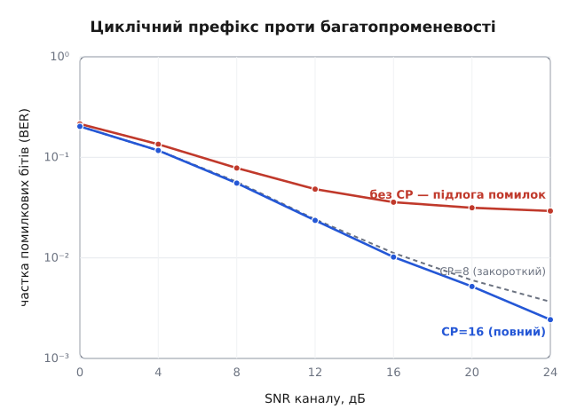
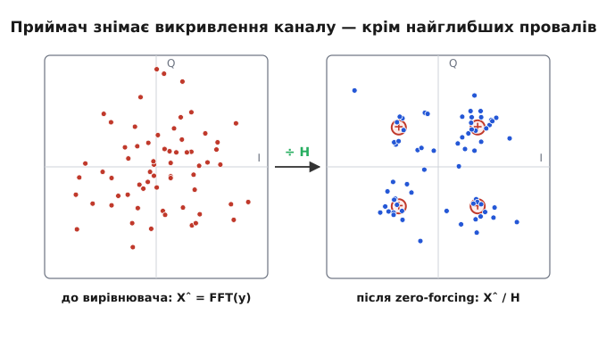

# 🛠️ Робочий OFDM-модем: біти в ефір і назад за пів сотні рядків

Зберімо OFDM-передавач і приймач, які справді працюють — на вхід біти, на виході ті самі біти, а між ними лютий багатопроменевий канал, — і на тому самому коді доведімо головну обіцянку схеми: увімкнеш циклічний префікс — міжсимвольне спотворення зникає; вимкнеш — частка помилок застигає на підлозі, крізь яку не проб'єшся жодною потужністю. Увесь модем — це два перетворення Фур'є, одне ділення й порівняння зі знаком.

Що має статися по кроках — рівно те, що складає ланцюг OFDM:

1. взяти біти й покласти кожну пару на точку [QAM](root:com-modulation/qam) — це символи піднесних;
2. зібрати з N символів один часовий блок зворотним Фур'є (IFFT);
3. приклеїти спереду копію хвоста — циклічний префікс;
4. пропустити крізь канал: згортка з відгуком багатопроменевості плюс [шум](root:math-information/awgn-channel);
5. на прийомі відкинути префікс і зробити пряме Фур'є (FFT);
6. поділити кожну піднесну на відоме підсилення каналу — вирівняти;
7. зрізати кожну точку назад у пару бітів.

Магії поза цим списком немає. Уся складність — щоб кожен крок був числово узгоджений із сусідами: одне забуте нормування, і модем «майже працює», а виміряна якість бреше.

## Символи: пара бітів — одна точка

Найпростіша корисна розкладка — QPSK (англ. *quadrature phase-shift keying* — квадратурна фазова маніпуляція), окремий випадок QAM на чотири точки: один біт обирає знак дійсної частини, другий — уявної.

```
символ  s = ( (1−2·b₀) + j·(1−2·b₁) ) / √2      # b ∈ {0,1} → ±1
зріз    b₀ = [Re ŝ < 0],   b₁ = [Im ŝ < 0]
```

Ділення на √2 робить |s| = 1: кожна піднесна несе рівно одиницю потужності — це знадобиться, щоб чесно задати відношення сигнал/шум. Зворотний зріз — просто знак кожної осі: чотири квадранти, два біти.

## Передавач: IFFT і префікс

N символів піднесних стають одним часовим блоком через зворотне Фур'є. Одна тонкість — нормування.

```
x   = IFFT(S) · √N            # чому саме √N — нижче
xcp = [ x[N−L : N] ,  x ]     # хвіст завдовжки L — спереду
```

Бібліотечний IFFT ділить суму на N. Щоб середня потужність часового відліку лишилася одиницею — такою самою, як у символів, — домножуємо на √N; тоді за [теоремою Парсеваля](root:com-signal/parseval-theorem) Σ|x|² = Σ|S|², і жоден крок не змінює масштаб потай. Циклічний префікс — це буквально копія останніх L відліків блока, приклеєна на його початок.

## Канал: згортка плюс шум

Канал робить дві речі — розмазує сигнал луною і додає шум.

```
y  = conv(потік, h)          # h — відгук багатопроменевості (FIR)
y += σ/√2 · (gᵣ + j·gᵢ)      # gᵣ, gᵢ ~ N(0,1) — комплексний AWGN
```

Відгук h — це кілька відліків: h[0] — прямий промінь, далі відлуння з різними затримками й послабленнями. Його енергію нормуємо до одиниці (Σ|h|² = 1), щоб канал не додавав і не з'їдав потужності, а лише перерозподіляв її по частоті. Тоді потужність сигналу на прийомі ≈ 1 на відлік, шумова — σ², і SNR = 1/σ² (у децибелах −10·log₁₀σ²). Дисперсію шуму ділимо порівну між дійсною та уявною частинами — кожна дістає σ²/2.

## Приймач: FFT і одне ділення на піднесну

Симетрично до передавача, з єдиним новим кроком — вирівнюванням.

```
Y = FFT( y[L : L+N] ) / √N   # зняти префікс, пряме Фур'є, дзеркальне нормування
H = FFT(h, N)                # відгук каналу в частоті (доповнений нулями до N)
Ŝ = Y / H                    # поділити кожну піднесну на її підсилення
```

Тут і окупається вся конструкція. Завдяки префіксу канал усередині блока діє як [кільцева згортка](root:com-signal/circular-convolution), а Фур'є перетворює кільцеву згортку на поточкове множення: Yₖ = Hₖ·Sₖ + шум. Отже кожна піднесна — це одне комплексне число Hₖ, і вирівнювач тривіальний: поділити на нього. Такий вирівнювач, що просто скасовує канал діленням, називають zero-forcing (англ. — «занулення»: він зануляє викривлення каналу) — найпростіший [вирівнювач каналу](root:com-signal/channel-equalization). Звідки приймач знає Hₖ — з відомих пілотних символів; тут ми беремо канал відомим, щоб не змішувати теми.

> 🔧 **Навіщо це.** Один рядок `Ŝ = Y / H` — це і є той страшний вирівнювач широкої смуги, що лякав нас у наївному підході, стиснутий до N незалежних ділень. Саме тому копійчаний Wi-Fi-чип вирівнює канал захаращеної меблями кімнати в реальному часі: замість обернути велику матрицю каналу він N разів ділить комплексне число на комплексне.

## Модем на одному екрані

Складімо ці кроки в передавач `tx` і приймач `rx`. Ліворуч — ідіоматичний numpy: вбудований `fft` і векторні дії над комплексним масивом. Праворуч — те саме ядро мовою C, як воно й живе у baseband-DSP: власне ітеративне [ШПФ](root:com-signal/fft) по місцю, без жодної бібліотеки. Канал між `tx` і `rx` в обох випадках прикладають окремо — щоб потік символів пройшов крізь спільну луну.

:::tabs
:::code proj-ofdm-modem/py/modem-na-odnomu-ekrani.py
:::code proj-ofdm-modem/c/main.c
:::code proj-ofdm-modem/cpp/main.cpp
:::

Усі три мови кажуть одне: символ туди — це IFFT плюс приклеєний хвіст; символ назад — це FFT плюс ділення. Різниця в тому, що numpy бере `fft` готовим, C везе класичні вказівники й масиви, а C++ обгортає все в RAII-контейнери `std::vector` та ідіоматичний `std::complex`.

## Дослід: префікс проти луни

Тепер головне питання — чи справді префікс рятує. Прожену потік символів крізь один спільний багатопроменевий канал двічі: з повним префіксом і зовсім без нього, — і зміряю частку помилкових бітів (BER). Це вже не ядро модема, а числовий експеримент, тож лишаю його на numpy.

:::code proj-ofdm-modem/py/doslid-prefiks-proty-luny.py

Одна деталь ховає весь ефект. Коли `L = 0`, `tx` повертає блок без префікса, і хвіст попереднього символу, що його канал заносить у поточне вікно, більше нема куди подіти — він падає прямо на дані. Коли `L = 16` ≥ довжини луни, той хвіст цілком уміщається в префікс, приймач його відкидає, і згортка каналу стає точно кільцевою. Ось числа:

**Наприклад: канал із розкидом затримок 11 відліків, 5000 символів на точку.**
```
SNR      з CP=16       без CP (L=0)
 0 дБ    2.0·10⁻¹      2.2·10⁻¹      # шум топить обидва — префікс іще не видно
 8 дБ    5.6·10⁻²      7.8·10⁻²
16 дБ    1.0·10⁻²      3.6·10⁻²
24 дБ    2.5·10⁻³      2.9·10⁻²      # з префіксом усе падає; без нього — застрягло
```

Із префіксом BER слухняно падає з потужністю. Без префікса він упирається в підлогу ≈ 3·10⁻² і не зрушить, скільки потужності не дай, — бо це вже не шум, а залишкова луна попереднього символу: детермінована й невитравна нічим, окрім префікса.


*З повним префіксом (CP=16) крива падає з кожним децибелом. Без префікса (CP=0) вона застигає ≈ 3·10⁻² — це детермінована луна, а не шум. Закороткий префікс (CP=8, менший за розкид 11) теж лишає підлогу, лише нижчу.*

## Що робить вирівнювач — видно на точках

Ефект ділення `Y / H` найкраще видно на самих символах. Візьмімо один OFDM-символ на SNR 12 дБ. До вирівнювача канал повернув і розтягнув кожну піднесну по-своєму — замість чотирьох згустків QPSK бачимо розмиту хмару. Ділення на H кожну точку повертає на місце:


*Ліворуч: приймач бачить хмару — канал крутнув фазу й змінив амплітуду кожної піднесної. Праворуч: одне ділення на Hₖ повертає точки в чотири кутки. Кілька викидів — з піднесних, що впали в глибокий провал каналу.*

Майже всі точки збираються у чотири кутки — по одному на пару бітів. Але кілька відлітають геть, і в цьому — вроджена вада zero-forcing. Це піднесні, що впали в глибокий провал [частотно-вибіркового каналу](root:com-medium/multipath-fading): там Hₖ близьке до нуля, а ділення Y/Hₖ роздуває не лише сигнал, а й шум на ньому. У цьому каналі |H| гуляє від 0.065 до 1.9 — майже в 30 разів; на найглибшій піднесній zero-forcing підсилює шум разів у п'ятнадцять, і саме ці кілька піднесних тримають підлогу BER навіть із префіксом. Лік до цього — пастка №4 нижче.

## Складність: чому це дешево

Уся ціна одного символа — два перетворення Фур'є плюс N ділень. Кожне ШПФ — це (N/2)·log₂N «метеликів», тобто O(N·log N); ділення — O(N) і тоне на тлі.

```
на символ:  2 × (N/2)·log₂N  метеликів  +  N ділень
N = 64   →  2 × 32 · 6  +  64  =  448 комплексних множень
```

Порівняймо з наївним «N піднесних окремими генераторами», де вартість росте як O(N²): для N = 64 це вже 4096 множень, і різниця розгортається в прірву на тисячах піднесних 4G/5G, де O(N·log N) проти O(N²) — це вкластися в символ проти не встигнути ніколи. Саме дешеве ШПФ і зробило OFDM практичним. Ціна префікса окрема — він з'їдає L/(L+N) часу; у Wi-Fi це 16/80 = 20 %, п'ята частина ефіру, віддана заради спокою від луни.

## Пастки

**1. Префікс, коротший за розкид затримок.** Префікс рятує, лише поки вся луна вміщається в нього. На кривій BER випадок CP=8 при розкиді 11 теж лишає підлогу — нижчу за «без CP», але непереборну потужністю: частина хвоста таки дістає до даних. Тому довжину префікса беруть із запасом над [розкидом затримок каналу](root:com-medium/delay-spread), а не «на око».

**2. Частотний зсув.** Уся ортогональність тримається на кроці рівно Δf = 1/T. Якщо частота гетеродина приймача зсунута на δf, кожна піднесна більше не вкладається в цілу кількість періодів за символ — її енергія протікає в сусідні (міжпіднесна інтерференція, ICI). Навіть δf у кілька відсотків від Δf помітно підіймає BER. Тому справжній модем спершу синхронізує частоту — по префіксу або пілотах — і лише тоді вважає піднесні ортогональними. У нашому досліді ми мовчки припустили ідеальну синхронізацію.

**3. Нормування потужності.** Три місця, де легко втратити масштаб: множник √N після IFFT, дзеркальне /√N після FFT і поділ дисперсії шуму навпіл між Re та Im. Пропустиш √N — і виміряний SNR зсунеться рівно в N разів (на 18 дБ для N = 64): код «працює», крива малюється, а числа на ній брешуть. Це найпідступніша пастка, бо не валить програму — лише тихо псує висновок.

**4. Zero-forcing роздуває шум на провалах.** Як ми щойно бачили в сузір'ї, там, де Hₖ → 0, ділення Y/Hₖ множить і шум. Лік — MMSE-вирівнювач, що ділить не на Hₖ, а на Hₖ з поправкою на шум:

```
Ŝ = Y · H* / ( |H|² + σ² )      # zero-forcing — це та сама формула при σ² → 0
```

На сильних піднесних це майже те саме ділення, а на провалах знаменник не падає до нуля, тож шум не злітає до неба. Це і є природний [наступний крок вирівнювання каналу](root:com-signal/channel-equalization); разом із кодуванням упоперек піднесних він прибирає ту підлогу, що тримають кілька провалів.

Ці півсотні рядків — не іграшка: та сама послідовність IFFT → префікс → канал → FFT → ділення лежить у baseband кожного Wi-Fi- та LTE-приймача. Промислові відмінності — у синхронізації, оцінці каналу й кодуванні; кістяк модема саме цей.
