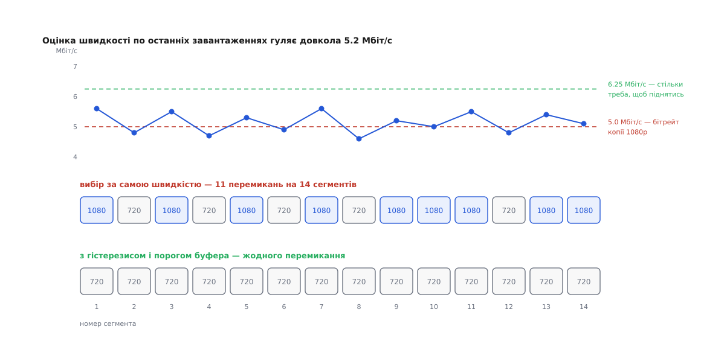

# ⚙️ Мінімальний клієнт HLS: плейлист, живе вікно, перемикання якості

Клієнт живого потоку вміщається в сотню з чимось рядків, і майже вся його складність — не в розборі тексту, а в двох місцях: як не загубити й не повторити сегмент, коли вікно плейлиста їде далі, і за яким правилом міняти якість, щоб картинка не гойдалася туди-сюди кожні кілька секунд.

## Що будуємо

На вході — адреса мультиваріантного плейлиста. На виході — нескінченна послідовність сегментів у правильному порядку, без діри й без повтору, з якістю, яку клієнт обирає сам. Декодування й показ — це вже програвач; ми пишемо ту його частину, що вирішує, **що просити наступним**. Уся мережа тут — звичайні GET-запити ([HTTP](root:com-protocol/http)) без жодного стану на сервері.

## Розбір: адреса належить тегові над нею

Плейлист `.m3u8` — рядковий текст трьох різновидів: тег (починається з `#EXT`), коментар (просто `#`) і адреса. Правило зв'язку одне: **адреса належить тегові, що стоїть просто над нею**. Тому розбирачеві не потрібні ані граматика, ані стан — досить пам'ятати останній тег.

Одна пастка сидить рівно тут. Адреси в плейлисті майже завжди відносні, і відносні вони **до плейлиста**, а не до сторінки, яка запустила програвач. Сторінка може лежати на `example.com`, плейлист — на `cdn.example.net/live/v720/index.m3u8`, і рядок `seg1427.m4s` означає `cdn.example.net/live/v720/seg1427.m4s`. Візьмеш базою адресу сторінки — клієнт мовчки почне просити неіснуючі файли. Тонше: базою має бути **кінцева** адреса, після усіх переспрямувань, бо мережі роздачі ([CDN](root:sf-distributed/cdn)) залюбки переспрямовують запит на конкретний вузол.

:::code proj-hls-client/ts/rozbir-adresa-nalezhyt.ts

Однопрохідний розбір працює тому, що `EXT-X-MEDIA-SEQUENCE` гарантовано стоїть **перед першим сегментом** — так вимагає RFC 8216. Інакше довелося б читати плейлист двічі.

## Живе вікно: рахуємо номери, а не імена

Плейлист живого потоку — вікно, що їде: свіжий сегмент дописується в кінець, найстаріший зникає з початку. Спокуса вести облік іменами файлів. Так не можна: імена вигадує пакувальник, а RFC 8216 прямо застерігає, що однаковий номер у двох різних плейлистах не зобов'язаний означати той самий вміст.

Надійна одиниця обліку — **абсолютний номер сегмента**. `EXT-X-MEDIA-SEQUENCE` дає номер першого сегмента у вікні, решта виходить додаванням позиції. Клієнт тримає одне число `next` — номер сегмента, потрібного йому наступним, — і на кожному перечитуванні звіряє його з вікном `[firstSeq … lastSeq]`:

- `next` усередині вікна — звичайний хід, беремо `segments[next - firstSeq]`;
- `next > lastSeq` — нового ще нема, чекаємо;
- `next < firstSeq` — **вікно поїхало далі, ніж ми встигли**. Сегментів між `next` і `firstSeq` на сервері вже фізично немає. Єдине чесне тут — визнати діру, стрибнути на `firstSeq` і сказати про це в журнал.

Останній випадок не екзотика: досить згорнути вкладку, закрити кришку ноутбука або впертися в хвилинний провал каналу. Клієнт, який цього не перевіряє, лізе в масив за від'ємним індексом і падає — або, гірше, тихо бере не той сегмент і показує стрибок у часі.

Старт теж не довільний. RFC 8216 радить не починати з сегмента, що стоїть **ближче ніж три цільові тривалості від кінця** плейлиста: інакше показ зривається на першому ж провалі каналу. Три сегменти від краю — це і є той початковий запас, за який платять затримкою.

І темп перечитування. Сервер дописує сегмент раз на `TARGETDURATION`, тож питати частіше нема з чого — нового просто не з'явиться. RFC ставить це нормою: між перечитуваннями має минути щонайменше цільова тривалість, а якщо плейлист не змінився — щонайменше її половина. Опитування десять разів на секунду не зменшить затримки ні на мілісекунду: кеш віддасть ту саму копію, а рахунок за запити виросте в сотні разів.

:::code proj-hls-client/ts/zhyve-vikno-rakhuiemo.ts

## Завантаження: 404 біля краю і 404 в глибині — різні події

Той самий код відповіді означає тут дві протилежні речі. Біля краю вікна 404 — це «ще не існує»: пакувальник дописав рядок у плейлист на частку секунди раніше, ніж файл доїхав на вузол роздачі. Номер `next` рухати не можна, треба просто зачекати. У глибині вікна 404 — це «вже не існує»: файл видалено, і чекати нема чого, слід іти вперед. Клієнт, який трактує обидва однаково, або застрягає назавжди, або пропускає щойно народжений сегмент.

Тут же міряємо швидкість — і міряємо її **від запиту**, а не від першого байта відповіді.

:::code proj-hls-client/ts/zavantazhennia-404-bilia.ts

## Вибір якості: чому сама швидкість гойдає картинку

Правило, до якого доходить кожен за першу годину: поміряти швидкість останнього завантаження й узяти найвищу копію, чий бітрейт у неї вміщається. На стенді воно бездоганне, на живому каналі розвалюється — і розвалюється передбачувано.

Виміряна швидкість — шумне число: воно залежить від сусідів по каналу, від того, який саме сегмент трапився важчим, від затримки до вузла роздачі. А правило — сходинка від цього числа. Сходинка від шумного сигналу клацає щоразу, коли шум перетинає межу. І межа не десь збоку: драбину якостей будують так, щоб її щаблі накривали типові швидкості глядачів, тож канал середнього глядача сидить **саме біля щабля**, а не між ними.

```
драбина копій         : 3.0 · 5.0 · 8.0 Мбіт/с
справжня пропускність ≈ 5.2 Мбіт/с, оцінки гуляють 4.6…5.6

правило «найвища копія з бітрейтом ≤ оцінки»
  5.6 → 1080p ↑ ; 4.8 → 720p ↓ ; 5.5 → 1080p ↑ ; 4.7 → 720p ↓ ; …
  11 перемикань на 14 сегментів по 6 с — по одному щовісім секунд
```


*Оцінки гуляють довкола 5.2 Мбіт/с, перетинаючи позначку 5.0 то вгору, то вниз. Правило з однією межею перемикає якість на кожному перетині. Правило з двома межами вимагає для підйому 6.25 Мбіт/с — і не клацає жодного разу.*

Мигтіння роздільності саме собою неприємне, але дорога тут не тільки естетика. Кожне перемикання змушує декодер перезапуститися на новій конфігурації, а сегменти, уже завантажені наперед, або лишаються старої якості, або летять у смітник разом із оплаченим трафіком. Рівне сидіння на нижчій копії глядач оцінює вище, ніж стрибки між сусідніми.

Лік — розвести межу вгору й межу вниз так, щоб між ними лишилася смуга, у якій рішення не міняється. Це гістерезис, і в клієнті він складається з трьох частин.

**Згладжування замість останнього виміру.** Одне завантаження — одна вибірка з шумом. Беремо експоненційно згладжене середнє останніх ([ковзне середнє](root:com-signal/moving-average)), і половина брязкоту гасне ще до того, як правило про нього дізнається.

**Запас при підйомі.** `BANDWIDTH` у плейлисті — за RFC 8216 **пікова** швидкість сегмента копії, а не середня; для середньої є окремий атрибут `AVERAGE-BANDWIDTH`. Узяти копію з бітрейтом рівно в оцінку — значить купити собі паузу на кожному важчому сегменті. Тому підйом дозволяємо, лише коли оцінка перевищує бітрейт із запасом: скажімо, `bitrate / 0.8`. Спуск — коли оцінка провалилася нижче за сам бітрейт. Між `bitrate` і `bitrate / 0.8` рішення не міняється взагалі — це і є смуга нечутливості завширшки чверть бітрейта.

**Буфер як другий свідок.** Швидкість — миттєва величина, і вона бреше. Буфер — накопичена: він росте рівно тоді, коли швидкість справді перевищує бітрейт, і за кілька сегментів усереднює те, чого один вимір не побачив. Тому підйом дозволяємо тільки при повному буфері, а падіння при майже порожньому — без жодних питань до швидкості.

:::code proj-hls-client/ts/vybir-iakosti-chomu-sama.ts

Асиметрія тут навмисна. Спуститися зарано — це кілька секунд гіршої картинки. Піднятися зарано — це порожній буфер і зупинений показ, а зупинка коштує глядачеві незрівнянно дорожче. Тому вниз можна на скільки завгодно щаблів і без дозволу буфера, а вгору — по одному й з двома підписами.

У прикладі з цифрами вище правило з гістерезисом не піднімається на 1080p узагалі: щоб узяти копію на 5.0, треба побачити 6.25, а канал видає 5.2. Це не хиба, а свідома плата — двадцятивідсотковий запас купує стабільність ціною невикористаної верхівки маргінального каналу. Хто хоче ту верхівку вичавити, зменшує запас і платить частішими перемиканнями; довкола цього компромісу й побудовані серйозніші стратегії ([адаптивний бітрейт](root:com-transport/adaptive-bitrate)).

## Складність і пастки

Обчислень тут майже немає: один запит плейлиста на `TARGETDURATION`, один запит на сегмент, розбір лінійний за кількістю рядків, пам'ять — рівно розмір буфера. Уся складність клієнта — у рішеннях, а не в роботі.

**Швидкість, поміряна без часу очікування.** Ділити байти на тривалість самого приймання — значить систематично завищувати оцінку: на коротких сегментах відповіді чекають довше, ніж качають, а з'єднання ще й не одразу виходить на повну ([управління перевантаженням](root:com-transport/congestion-control)). Один такий недогляд робить клієнт стабільно занадто сміливим.

**Рішення доганяє екран із запізненням на весь буфер.** Тридцять секунд запасу означають, що вибрана зараз якість з'явиться перед очима через тридцять секунд. Клієнт, який реагує на кожен вимір, керує тим, чого глядач ще пів хвилини не побачить, — ще одна причина, чому підйом мусить бути повільним, а спуск негайним.

**Один строк життя кешу на плейлист і на сегменти.** Сегмент незмінний і живе довго; плейлист живого потоку застаріває за секунди. Спільне налаштування кешу для обох — найчастіша причина того, що клієнт бачить адреси вже видалених сегментів і збирає 404 там, де все справне.

**Копія без спільних точок розрізу.** Уся конструкція перемикання тримається на тому, що сегмент з номером *n* у будь-якій копії покриває той самий проміжок часу. Порушив це кодувальник — і найакуратніший клієнт даватиме стрибки й провали на кожному перемиканні, а шукатимуть помилку в ньому.
