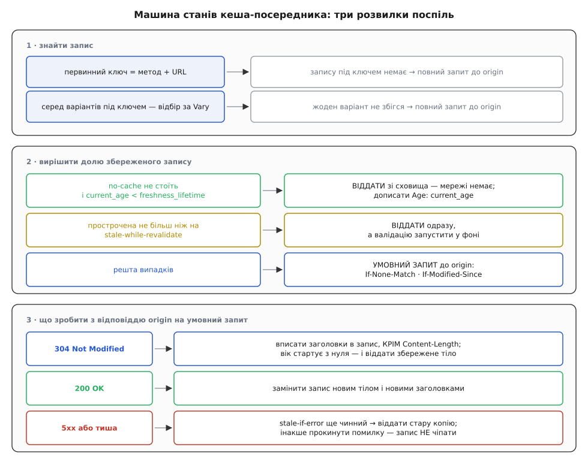
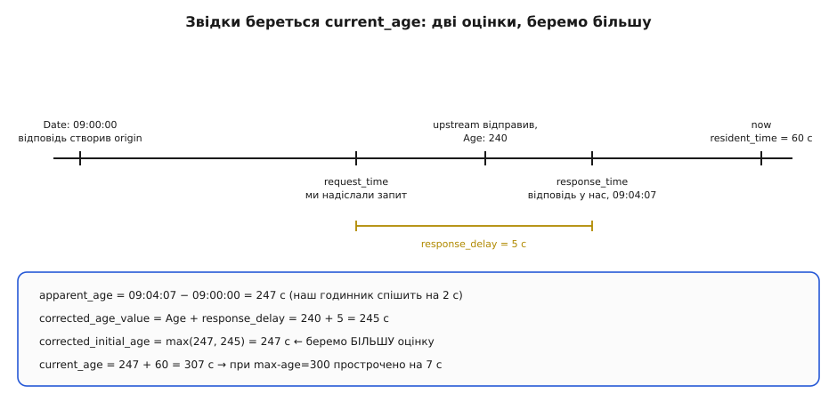

# ⚙️ Кеш-посередник: машина станів, що вирішує долю копії

Напишімо той вузол, який стоїть між клієнтом і origin: він зберігає відповіді, рахує їхній вік і сам вирішує, коли віддати копію мовчки, коли перепитати умовним запитом, а коли зізнатися, що допомогти нічим. RFC 9111 читається як перелік директив, але в коді він перетворюється на одну впорядковану послідовність розвилок — і майже кожна аварія справжніх кешів береться не з незнання директиви, а з переставленої розвилки.

## Задача

Один вхід — `handle(request)`, один вихід — відповідь клієнтові. Між ними сховище на кілька гігабайтів і з'єднання з origin. Вузол спільний: він обслуговує всіх відвідувачів, тож помилка в ньому коштує не повільности, а чужих даних у чужих руках.

Що він мусить робити:

- розібрати `Cache-Control`, `Date`, `Age`, `Expires` — і в запиті, і у відповіді;
- знайти запис під ключем, який складається не лише з адреси;
- порахувати поточний вік копії й порівняти зі строком;
- вибрати одну з чотирьох дій: віддати, віддати й оновити у фоні, перепитати умовним запитом, піти по все;
- увібрати відповідь origin — злити заголовки з `304` у наявний запис або замінити його цілком;
- триматися в межах заданого обсягу пам'яті.

Чого ми свідомо не робимо: не обслуговуємо часткові відповіді (`Range`, `206`), не зберігаємо нічого на диск, не оновлюємо збережений `GET` із відповіді на `HEAD`. Кожна з цих речей — окремий шматок роботи, і жодна не змінює кістяка.



*Три панелі — три послідовні питання. Перше з них узагалі не про кешування, а про пошук; друге вирішує долю копії, третє — долю запису.*

## Ідея: чотири чисті функції й одне брудне сховище

Спокуса тут одна — писати все просто в обробнику запиту, бо кожне рішення дрібне. Наслідок відомий: логіка перемішується з мережею, і перевірити її можна лише піднявши справжній сервер.

Тому ділимо вузол по лінії «є побічні дії чи ні». Чисті шматки не знають ні про сокети, ні про час у системі — час і заголовки приходять до них аргументами:

- `parse_cache_control(text) → CacheControl` — текст у структуру;
- `current_age(entry, now) → секунди` — сама арифметика;
- `decide(entry, request_directives, now, shared) → Act` — одна з чотирьох дій;
- `absorb(entry, upstream_response) → Outcome` — що зробити з відповіддю origin.

Брудна частина одна — сховище: воно тримає пам'ять, витісняє записи й потребує замка. Розділення не косметичне: увесь RFC живе в чистих функціях, а їхні тести — це таблиця «заголовки + момент часу → очікувана дія», без жодного байта мережі.

## Розбір `Cache-Control`

Почнімо з розбору, бо решта на нього спирається. Заголовок виглядає простим переліком через кому — і саме тому його зазвичай розбирають `split(",")`. Це ламається на першому ж значенні в лапках:

```
Cache-Control: max-age=600, no-cache="Set-Cookie, X-Session", public
```

Кома всередині лапок належить значенню, а не переліку. Наївний розбір дасть директиву `X-Session"` і втратить `public`. Тому пишемо звичайний посимвольний прохід, який знає про `quoted-string`:

:::code proj-cache-validator/cpp/rozbir-cache-control.cpp

Дві дрібниці варті окремої уваги. Переповнення `delta-seconds` — не привід відкинути заголовок: RFC 9111 §1.2.2 прямо вимагає вважати завелике число за 2³¹ секунд, тобто «дуже довго». І `max-stale` без значення — це не помилка синтаксису, а окремий смисл: «згоден на прострочене будь-якого віку».

## Вік копії: у підрахунку два різні годинники

Тепер найтонше місце всієї реалізації. Щоб порівняти вік зі строком, вік треба виміряти — а міряти доводиться двома різними годинниками, і плутати їх не можна.

`Date` у відповіді — це показ **чужого** годинника, годинника origin. Порівняти з ним можна лише свій стінний годинник, той самий, що показує дату. А от скільки копія пролежала **в нас**, стінним годинником міряти не можна взагалі: одне підправлення часу службою синхронізації — і різниця двох стінних міток стрибне на пів години в будь-який бік. Тривалість на своїй машині міряють монотонним годинником, який лише росте й ніколи не переставляється. Різницю між цими двома джерелами часу докладно розібрано окремо — [монотонний час проти стінного](root:sf-apps/monotonic-vs-wall-time).

Тому запис зберігає **обидві** мітки моменту отримання:

:::code proj-cache-validator/cpp/vik-kopii-u-pidrakhunku.cpp

Звідки береться `response_delay` і навіщо його додавати до `Age`. Заголовок `Age` upstream виставив у мить, коли **відправляв** відповідь. Поки вона їхала до нас, копія старішала далі, а число в заголовку — ні. Тому до присланого віку додають увесь час від нашого запиту до нашого отримання: це надійна верхня оцінка того, скільки відповідь була в дорозі.

Двох оцінок віку виходить дві, і алгоритм бере **більшу**. Причина асиметрична: помилитися в бік «копія старша, ніж є» означає зайву перевірку, помилитися в другий бік — віддати прострочене як свіже.



*Коли наш стінний годинник спішить, `apparent_age` завищений — і саме він перемагає в `max()`. Розсинхронізація годинників робить кеш обережнішим, а не брехливішим.*

## Строк і рішення

Строк рахують за першим збігом із чотирьох правил (RFC 9111 §4.2.1): для спільного кеша спершу `s-maxage`, тоді `max-age`, тоді різниця `Expires` і `Date`, а як нічого немає — евристика:

:::code proj-cache-validator/cpp/strok-i-rishennia.cpp

Тепер саме рішення. Воно й є та машина станів, заради якої все писалося, і кожен рядок тут стоїть на своєму місці не випадково:

:::code proj-cache-validator/cpp/strok-i-rishennia-2.cpp

> 🔧 **Навіщо це.** Порядок перевірок тут — не стиль, а сама відповідність протоколу. RFC 9111 §4.2.4 забороняє видавати прострочене, «якщо цього явно не дозволив клієнт або origin»: клієнтський дозвіл — це `max-stale`, серверний — `stale-while-revalidate` і `stale-if-error`. Варто підняти рядок про `swr` вище перевірки `must-revalidate` — і кеш почне видавати застаріле там, де сервер це заборонив найсуворішим словом, яке в нього є. Помилка на один рядок, наслідок — застарілий баланс на екрані.

## Умовний запит і те, що з нього повертається

Мати валідатор мало — його треба надіслати незміненим:

```cpp
Fields conditional_headers(const Entry& e) {
    Fields h;
    if (const std::string* et = e.headers.find("etag"))
        h.set("if-none-match", *et);        // разом із префіксом W/, якщо він там був
    if (const std::string* lm = e.headers.find("last-modified"))
        h.set("if-modified-since", *lm);    // байт у байт, без переформатування дати
    return h;
}
```

Обидва рядки віддаються дослівно, і обидва — з причини. `If-None-Match` порівнюють **слабко** (RFC 9110 §8.8.3.2), тобто префікс `W/` тут нікому не заважає; а от зрізати його не можна, бо тоді сховище втратить знання про те, що мітка слабка, і хтось пізніше візьме її для `If-Range`, де порівняння вже суворе. `If-Modified-Since` не переформатовуємо з тієї ж причини, з якої не переписуємо чужий підпис: сервер має право звіряти рядок, а не розібрану дату.

Відповідь origin увібрати теж треба обережно:

:::code proj-cache-validator/cpp/umovnyi-zapyt-i-te-shcho-z.cpp

У цій функції головне те, чого в ній **немає**: жодна гілка з помилкою не торкається `e`. Запис або освіжається, або замінюється, або лишається таким, яким був. Перезапис `e.cc` після злиття заголовків теж обов'язковий: `304` має право принести інший `Cache-Control`, і далі жити треба вже за новим.

## Ключ: метод, адреса й те, що назвав `Vary`

Перш ніж класти, треба вирішити, чи взагалі можна класти:

:::code proj-cache-validator/cpp/kliuch-metod-adresa-i-te.cpp

Тепер сам ключ. Первинна частина — метод плюс повна адреса. Вторинна — значення тих заголовків **запиту**, які відповідь назвала у `Vary`; їх знімають у мить збереження й кладуть поруч із записом:

:::code proj-cache-validator/cpp/kliuch-metod-adresa-i-te-2.cpp

`normalize` — місце, де кеш заробляє свої влучання. Порівнювати сирі рядки дозволено, але тоді `gzip, deflate` і `deflate, gzip` стануть двома різними записами, хоч означають те саме. RFC 9111 §4.1 прямо дозволяє нормалізацію, якщо вона не міняє змісту: для `Accept-Encoding` це нижній регістр, відкидання пробілів і впорядкування переліку. Далі цієї межі йти не можна: нормалізація, що зливає різні значення в одне, — це вже роздача чужого варіанта.

## Сховище: витіснення за обсягом

Останній шматок — пам'ять. Ключ веде до кількох варіантів, варіанти витісняються за обсягом, а витіснення не має права висмикнути запис з-під того, хто його зараз віддає:

:::code proj-cache-validator/cpp/skhovyshche-vytisnennia-za.cpp

Дві опори цієї конструкції варто назвати вголос. Перша: `std::list::splice` переставляє вузол, не зачіпаючи ітераторів на нього, — тому індекс може зберігати саме ітератори, і підйом запису у вершину черги коштує кількох присвоєнь замість пошуку. Друга: сховище віддає `shared_ptr`, а не сирий вказівник. Витіснення в іншому потоці лише скидає одне посилання; тіло, яке зараз тече в сокет, доживе до кінця відправки. Із сирим вказівником це був би класичний доступ до звільненої пам'яті під навантаженням — тобто рівно тоді, коли витіснення взагалі відбувається.

LRU тут — найпростіший розумний вибір, а не єдиний: [політики витіснення](root:sf-data/cache-eviction-policies) розрізняються тим, що саме вони вважають цінністю запису, і для кеша HTTP розмір тіла важить не менше за давність.

## Складання

Тепер усі шматки з'єднуються в один обробник. Він короткий — і саме це ознака того, що логіку винесено правильно:

:::tabs
:::code proj-cache-validator/cpp/skladannia.cpp
:::code proj-cache-validator/go/main.go
:::

Вкладка на Go тут не переклад, а інша вправа з тим самим кістяком. Два місця розходяться по суті. Перше: у Go `time.Time` уже несе всередині монотонний відлік, тож `t2.Sub(t1)` не боїться переставленого системного годинника — окремої пари полів, як у C++, не потрібно. Друге: `http.Request` прив'язаний до контексту, який скасовується, щойно обробник повернув керування, тому фонову валідацію запускають з копією запиту й власним контекстом — інакше `go p.revalidate(r)` тихо вмиратиме кожного разу, і `stale-while-revalidate` перетвориться на просто «видавати застаріле назавжди».

## Складність і ціна

Пошук — одне гешування первинного ключа плюс лінійний прохід по варіантах під ним: `O(1) + O(v)`. Мале `v` — це припущення, а не факт, і воно тримається рівно доти, доки `Vary` називає заголовки з кількома розумними значеннями. `Vary: User-Agent` перетворює `v` на тисячі: кожен промах тепер іще й проходить весь список, а влучань немає майже ніколи.

Рішення `decide` — цілочислова арифметика на десяток порівнянь, `O(1)`. Злиття заголовків із `304` — `O(k)` за їхньою кількістю. Витіснення — `O(1)` на жертву плюс той самий прохід по варіантах.

Гроші тут не в асимптотиці, а в двох інших місцях. Перше — замок: один `std::mutex` на все сховище шикує в чергу всі запити вузла, і на восьми ядрах це видно одразу. Промислові кеші ділять сховище на кільканадцять незалежних скриньок за гешем ключа, тож потоки б'ються лише за спільний шматок; там, де читань набагато більше за записи, допомагає й [замок читачів-письменника](root:sf-tasks/readers-writer-lock). Друге — облік пам'яті: `footprint` має рахувати не тільки тіло, інакше сховище, повне дрібних відповідей із довгими адресами, з'їсть пам'яті вдвічі більше, ніж показує лічильник.

## Пастки

**Слабку мітку зрізали до сильної.** Спокуса викинути префікс `W/` при збереженні виглядає нешкідливою: `If-None-Match` усе одно порівнює слабко. Але сховище після цього більше не знає, що мітка слабка, — і коли той самий рядок піде в `If-Range` чи `If-Match`, де порівняння суворе, сервер відповість на нього як на сильну умову. Наслідок — дописаний шматок від іншого варіанта тіла, тобто побитий файл без жодної помилки в журналі.

**`Content-Length` із `304` перезаписав збережений.** Деякі сервери додають у `304` заголовок `Content-Length: 0` — тіла ж немає. Кеш, який зливає заголовки без винятків, після успішної валідації має запис зі 180 кілобайтами тіла й нулем у довжині. Клієнт отримає порожню відповідь або з'єднання, що зависло. Саме тому RFC 9111 §3.2 виносить `Content-Length` в окремий виняток.

**Помилка сервера перетерла добрий запис.** Найдорожча з усіх, бо спрацьовує рівно під час аварії. Загальна гілка «прийшла відповідь — заміни запис» ковтає й `500`; якщо сторінка помилки ще й несе `Cache-Control: max-age=60` від якогось проміжного шару, кеш щойно закріпив аварію на хвилину для всіх читачів одразу. Гілка з `5xx` не має права торкатися запису — ні тіла, ні заголовків, ні лічильників.

**`Vary`, якого не оголосили.** Кеш зберігає значення тих заголовків, що названі у `Vary`, і робить це правильно. Якщо застосунок вибирає вміст за заголовком, якого у `Vary` немає, кеш чесно вважає варіанти одним записом і роздає перший-ліпший. Дірка тут не в реалізації, а в контракті — але лагодити її доводиться саме на вузлі: типовий захід — примусовий `Vary` за маршрутом у налаштуваннях проксі й безумовна відмова зберігати відповідь на запит із `Authorization`.

**Мовчазне повернення до стінного годинника.** Спокуса замінити пару міток однією `system_clock` велика: код коротшає, тести проходять. Далі служба синхронізації переводить час на пів години назад — `resident_time` стає від'ємним, `current_age` падає, і всі записи в сховищі раптом молодшають на пів години. Прострочене видається як свіже, і жоден журнал цього не покаже.

**Витіснення розбудило стадо.** Популярний запис витіснили — і в ту саму мить на нього приходить сотня запитів, кожен з яких бачить порожньо й іде до origin. Кеш під навантаженням перетворюється на підсилювач навантаження. Ліки відомі й прості: одна спроба походу на ключ, решта чекають на її результат — [злиття однакових запитів](root:sf-distributed/request-coalescing).
