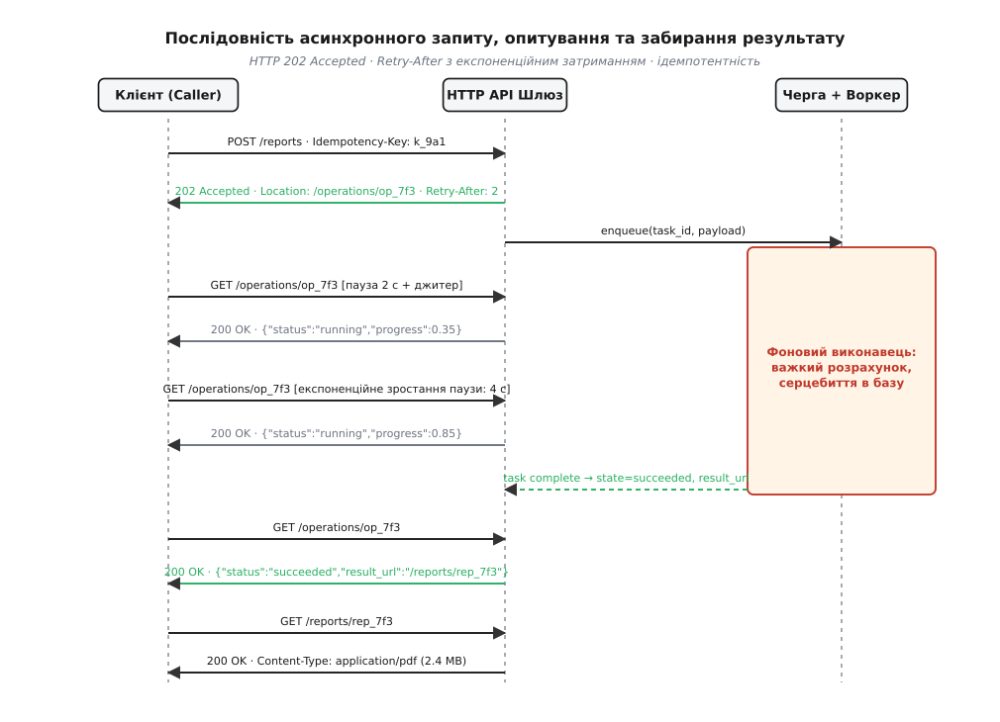
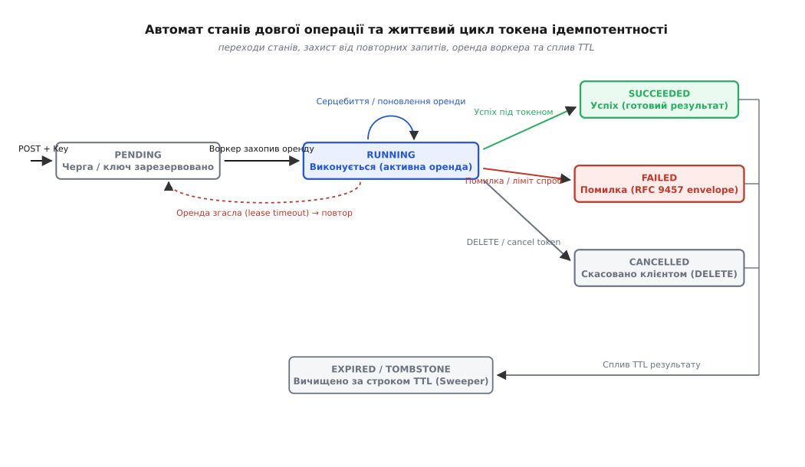
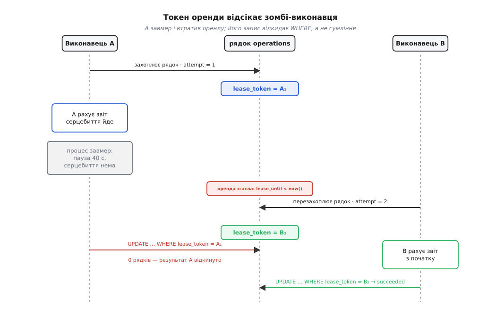
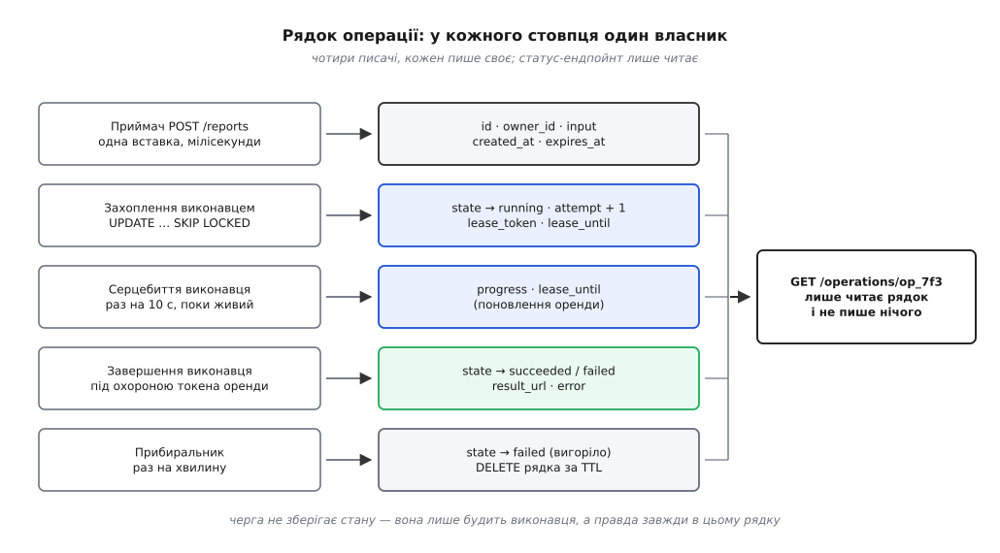

# Довга операція

<preknowlist>
- [HTTP](root:com-protocol/http) — модель обміну «запит → відповідь», семантика методів POST, GET, DELETE, коди стану 202 Accepted і 200 OK.
- [REST API](root:com-protocol/rest-api) — ресурсно-орієнтована модель, ідентифікація операцій через URL, гіпермедіа-навігація.
- [Ідемпотентність API](root:com-protocol/api-idempotency) — семантика заголовка Idempotency-Key, безпечні повтори запитів без подвійних ефектів.
- [Потокові та проштовхувальні транспорти](root:com-protocol/streaming-push-transports) — механізми SSE та WebSocket для зворотного зв'язку без надлишкового опитування.
</preknowlist>

Коли клієнт надсилає вебсерверу команду побудувати зведений аналітичний звіт за три роки, перекодувати відеофайл обсягом у десять гігабайтів чи оновити образ мікропрограми на сотні віддалених промислових контролерів, реальний час виконання задачі вимірюється не мілісекундами, а хвилинами або годинами. Якщо сервер намагається обслужити таку задачу синхронно — тобто утримувати відкритим одне вхідне мережеве TCP-з'єднання аж до моменту повної готовності підсумкового результату, — система неминуче зазнає каскадного колапсу на фізичному, мережевому та системному рівнях.

## Фізичні та протокольні обмеження тривалого синхронного обміну

Мережевий шлях між клієнтським застосунком і кінцевим сервісом обробки ніколи не є прямим нерозривним проводом. У реальній інфраструктурі зв'язку кожен IP-пакет проходить крізь довгий ланцюг транзитних посередників: маршрутизатори інтернет-провайдерів, корпоративні шлюзи, транслятори мережевих адрес (англ. *Network Address Translation*, NAT), міжмережеві екрани з відстеженням стану сесій (англ. *stateful firewalls*), хмарні балансувальники навантаження та зворотні проксі-сервери (англ. *reverse proxies*).

Кожен із цих посередників оптимізований під швидку комутацію коротких пакетів і жорстко обмежує тривалість утримання неактивних з'єднань:

1. **Транслятори NAT та станкові фаєрволи.** Для кожного активного TCP-з'єднання транслятор адрес виділяє запис у внутрішній таблиці трансляцій, зіставляючи внутрішню IP-адресу й порт клієнта із зовнішньою публічною адресою та портом маршрутизатора. За стандартом RFC 5382 час очікування для неактивного TCP-з'єднання може становити до двох годин, проте на практиці мобільні оператори, домашні роутери та хмарні шлюзи скидають записи таблиці трансляцій уже після 60–120 секунд повної відсутності трафіку в сокеті. Коли запис утилізується пам'яттю маршрутизатора, наступний пакет від сервера або клієнта просто відкидається (англ. *silent drop*), а з'єднання перетворюється на «мертвий сокет» без надсилання попереджувальних TCP RST сегментів.
2. **Зворотні проксі-сервери та балансувальники.** Програмні шлюзи (NGINX, HAProxy, Envoy, AWS Application Load Balancer) розраховані на обслуговування сотень тисяч одночасних підключень, тому утримання неактивних клієнтських сокетів є для них неприпустимим марнотратством пам'яті. Параметр `proxy_read_timeout` у NGINX за замовчуванням дорівнює 60 секундам; балансувальник AWS ALB примусово скидає TCP-з'єднання через 60 секунд мовчання сервера; захисний шлюз Cloudflare повертає клієнту статус `HTTP 524 A Timeout Occurred`, якщо початковий вебсервер не надіслав заголовки відповіді протягом 100 секунд.
3. **Обмеження стека ядра та TCP Keepalive.** Механізм періодичного зондування каналу на рівні ядра операційної системи Linux (параметри `net.ipv4.tcp_keepalive_time = 7200`, `net.ipv4.tcp_keepalive_intvl = 75`, `net.ipv4.tcp_keepalive_probes = 9`) за замовчуванням починає відправляти тестові порожні ACK-сегменти лише після двох годин абсолютної бездіяльності. Навіть при агресивному примусовому налаштуванні сокета на боці застосунку (`TCP_KEEPIDLE = 10`, `TCP_KEEPINTVL = 5`) пакети зондування на транспортному рівні лише перевіряють фізичну доступність віддаленої IP-адреси, проте жодним чином не захищають від прикладних таймаутів вебсервера чи шлюзу.
4. **Вичерпання таблиць відстеження зв'язків (conntrack table exhaustion).** У підсистемі ядра Linux Netfilter кожен пакет відстежується модулем `nf_conntrack`. Якщо тисячі з'єднань зависають у стані очікування важких операцій, системна таблиця `nf_conntrack_max` переповнюється. Після цього ядро починає безслідно відкидати всі нові вхідні пакети (у системному журналі з'являється повідомлення `nf_conntrack: table full, dropping packet`), що призводить до повного паралічу мережевого інтерфейсу сервера.
5. **Мультиплексування та блокування ліній у HTTP/2 та HTTP/3.** Хоча сучасні версії протоколу HTTP дають змогу передавати сотні логічних потоків через одне фізичне TCP- чи QUIC-з'єднання, утримання завислого потоку вичерпує ліміт одночасних стрімів (`SETTINGS_MAX_CONCURRENTSTREAMS`). Клієнтський браузер не може відкрити додатковий потік для передачі критичних даних, опиняючись у стані прикладного блокування початку лінії (англ. *head-of-line blocking*).

Окрім мережевих розривів, синхронне очікування призводить до вичерпання пулів робочих потоків сервера (англ. *thread starvation*). Нехай вебсервер сконфігуровано з пулом із `L_max = 200` потоків-обробників, а середня тривалість розрахунку важкої операції становить `W = 45` секунд. Згідно із законом Літтла (англ. *Little's Law*):

```
L = λ · W
```

де `L` — середня кількість одночасно зайнятих потоків, `λ` — темп надходження нових запитів за секунду, а `W` — середній час утримання потоку обробки.

Гранична пропускна здатність пулу потоків до настання повного вичерпання ресурсів становить:

```
λ_max = L_max ÷ W
      = 200 ÷ 45 с
      ≈ 4.44 запити/с
```

Якщо користувачі генерують усього 5 запитів на секунду, пул із 200 потоків вичерпується менш ніж за 40 секунд. Після цього всі наступні запити стають у системну чергу очікування сокета (`listen backlog`), а після її переповнення сервер починає масово скидати з'єднання з кодом `503 Service Unavailable`. У результаті страждають не лише тривалі операції, а й швидкі мікросекундні запити на читання статичних даних чи перевірку працездатності системи.

Коли робочі потоки вичерпуються, у системі починає деградувати стек обробки сигналів і дескрипторів. У класичній моделі введення-виведення блокуючі виклики `read()` і `write()` утримують системні структури ядра `struct file` та буфери сокетів `sk_buff`. При утриманні кількох тисяч відкритих з'єднань, кожне з яких виділяє під буфери прийому й передачі від 128 кілобайтів до кількох мегабайтів оперативної пам'яті (`net.ipv4.tcp_rmem` та `net.ipv4.tcp_wmem`), сервер спалює гігабайти пам'яті ядра ще до того, як розпочнеться виконання самої корисної роботи.

Більше того, у разі аварійного закриття з'єднання з боку проміжного балансувальника сокет на сервері переходить у стан `CLOSE_WAIT`. Якщо потік сервера заблокований на тривалій монолітній операції розрахунку, він не виконує виклик `close(socket_fd)`. У результаті дескриптор залишається висіти у системній таблиці дескрипторів доти, доки обчислення не завершиться. Під навантаженням процес швидко досягає системного ліміту відкритих файлів (`RLIMIT_NOFILE` або `ulimit -n`), після чого нові з'єднання не можуть бути прийняті системним викликом `accept()`, завершуючись системною помилкою `EMFILE (Too many open files)`.

Найнебезпечнішим наслідком синхронного обриву є семантична невизначеність (англ. *network ambiguity* або *two generals paradox*). Якщо клієнт на 59-й секунді очікування отримує код `504 Gateway Timeout` або сигнал TCP RST, він опиняється перед нерозв'язною дилемою:
- Чи встиг сервер запустити процедуру обробки?
- Чи операція впала посеред виконання, залишивши базу даних у транзитному стані?
- Чи сервер успішно завершив дію та зберіг результат у базі за мікросекунду до того, як проміжний балансувальник розірвав з'єднання?

Повторне надсилання того самого запиту (англ. *blind retry*) у разі неідемпотентної операції (наприклад, списання коштів із рахунку чи запуск фінансової транзакції) призводить до подвійного виконання бізнес-дії та непоправного пошкодження фінансового балансу.

Єдиним архітектурним виходом із цього глухого кута є повна відмова від синхронного очікування й перехід до асинхронного протоколу, де тривала операція відокремлюється від транспортного з'єднання і стає самостійним ресурсом із власним ідентифікатором, адресою та життєвим циклом.

## Операція як ресурс першого класу

Розв'язання проблеми тривалого обміну полягає в розщепленні єдиного монолітного виклику на чотири чітко розмежовані протокольні фази:

```
1. Ініціалізація (Ingress): клієнт реєструє намір виконання, сервер негайно повертає 202 Accepted.
2. Фонова обробка (Execution): робочий процес виконує задачу поза контекстом вебсервера.
3. Спостереження (Observation): клієнт періодично читає стан за окремим URL операції.
4. Забирання результату (Artifact Fetching): клієнт отримує готовий результат зі стабільного ресурсу.
```

У парадигмі [REST API](root:com-protocol/rest-api) операція розглядається не як тимчасова процедура, а як повноцінний інформаційний ресурс першого класу (англ. *first-class resource*). Кожна операція отримує унікальний ідентифікатор (наприклад, `op_7f3c9a18b2`), власний URL у просторі імен API (`/operations/{op_id}`), набір метаданих (час створення, відсоток прогресу, авторство) та строго типізований статус життєвого циклу.

Стандарт HTTP визначає для асинхронної ініціалізації спеціальний код відповіді — `202 Accepted` (RFC 9110 §15.3.3). Цей код встановлює формальний протокольний контракт: сервер синтаксично перевірив запит, авторизував користувача, перевірив доступні квоти й офіційно прийняв задачу до виконання, проте на момент завершення поточного HTTP-обміну операція ще не виконана і немає абсолютної гарантії, що вона завершиться успіхом.

Розглянемо фундаментальну різницю між спорідненими кодами стану HTTP в контексті життєвого циклу ресурсів:

- `200 OK`: операція виконана повністю синхронно, тіло відповіді містить остаточний результат роботи.
- `201 Created`: новий ресурс створено синхронно, заголовок `Location` вказує на готовий створений бізнес-об'єкт.
- `202 Accepted`: запит прийнято до виконання асинхронно, обробку не завершено, заголовок `Location` або `Operation-Location` вказує на монітор стану самої операції.
- `303 See Other`: перенаправлення клієнта на інший ресурс методом GET (часто використовується після завершення операції для переходу від монітора до результату).

```
Клієнт                          Шлюз API                       Воркер / Сховище
  │                                │                                   │
  │─── POST /reports ─────────────>│                                   │
  │    Idempotency-Key: k_9a1      │─── 1. зберегти стан: PENDING ────>│
  │    {"period":"2026-Q2"}        │    2. поставити задачу в чергу    │
  │                                │                                   │
  │<── 202 Accepted ───────────────│                                   │
  │    Location: /operations/op_7f │                                   │─── 3. захопити оренду
  │    Retry-After: 2              │                                   │    почати розрахунок
  │                                │                                   │
  │─── GET /operations/op_7f ─────>│                                   │
  │<── 200 OK (status: running) ───│<── 4. серцебиття: прогрес 0.35 ───│
  │    Retry-After: 4              │                                   │
  │                                │                                   │─── 5. зберегти PDF
  │                                │<── 6. стан: SUCCEEDED ────────────│
  │─── GET /operations/op_7f ─────>│       result_url: /reports/r_12   │
  │<── 200 OK (status: succeeded) ─│                                   │
  │    result_url: /reports/r_12   │                                   │
  │                                │                                   │
  │─── GET /reports/r_12 ─────────>│                                   │
  │<── 200 OK (готовий звіт) ──────│                                   │
```

Відповідь `202 Accepted` обов'язково супроводжується заголовками маршрутизації та розкладу:

- `Location`: містить абсолютний або відносний URL ресурсу моніторингу операції (`Location: /operations/op_7f3c9a18b2`). У практиці Microsoft Azure REST API для усунення плутанини з кінцевим бізнес-ресурсом застосовують заголовок `Operation-Location: https://api.example.com/operations/op_7f3c9a18b2`. У разі використання заголовка `Azure-AsyncOperation` клієнту повертається окремий URL, який віддає спрощений статус без додаткових бізнес-властивостей.
- `Retry-After`: задає мінімальний інтервал очікування в секундах перед першим зверненням до статусного ресурсу (`Retry-After: 2`).

У специфікації Google Cloud AIP-151 (англ. *API Improvement Proposals*) асинхронні операції уніфіковано на рівні протокольних буферів gRPC і REST через загальний дескриптор `google.longrunning.Operation`. Метод API, що ініціює довгу роботу, повертає об'єкт із полями:
- `name`: унікальний шлях ресурсу (наприклад, `operations/build-report-2026-q2-op7f3`);
- `metadata`: типізоване корисне навантаження з динамічним прогресом розрахунку;
- `done`: булевий прапорець завершення задачі (`false` — триває, `true` — завершено);
- `result`: поле з варіантами `response` (успішне корисне навантаження) або `error` (об'єкт `google.rpc.Status`).

Клієнтські бібліотеки Google API підтримують метод `WaitOperation`, який утримує з'єднання на стороні сервера до зміни стану або спливу короткого інтервалу, поєднуючи зручність синхронного виклику з надійністю асинхронного автомата.

Тіло відповіді при створенні операції повертає клієнту компактний JSON-дескриптор:

```json
{
  "operation_id": "op_7f3c9a18b2",
  "status": "pending",
  "created_at": "2026-08-28T18:00:00Z",
  "operation_url": "/operations/op_7f3c9a18b2",
  "retry_after_seconds": 2
}
```

Розподіл URL гарантує чистоту архітектури: `/reports` приймає замовлення на роботу, `/operations/op_7f3c9a18b2` відображає динаміку виконання, а `/reports/rep_9981` слугує постійною адресою для завантаження готового документа після його генерації.


*Повна послідовність асинхронного протоколу: негайна відповідь 202 Accepted, розклад опитування на основі Retry-After та забирання фінального результату.*

## Протокол опитування та адаптивне затримання

Отримавши URL операції, клієнт входить у фазу періодичного опитування (англ. *polling*). Для перевірки стану клієнт виконує стандартний безпечний запит `GET /operations/op_7f3c9a18b2`.

Відповідь сервера містить структурований документ стану:

```json
{
  "operation_id": "op_7f3c9a18b2",
  "kind": "report.financial.annual",
  "status": "running",
  "progress": 0.65,
  "stage": "aggregating_transactions",
  "created_at": "2026-08-28T18:00:00Z",
  "updated_at": "2026-08-28T18:00:24Z",
  "estimated_remaining_seconds": 12,
  "result_url": null,
  "error": null
}
```

Поле `status` відображає поточний стан автомату: `pending` (у черзі), `running` (активно обробляється), `succeeded` (завершено успішно), `failed` (помилка обробки) або `cancelled` (скасовано за запитом клієнта).

Поле `progress` передає відсоток завершення у вигляді дійсного числа від `0.0` до `1.0`. Поле `stage` містить інформацію про поточний крок для відображення в інтерфейсі користувача.

Якщо клієнт опитує статусний ендпойнт із занадто високою частотою (наприклад, у безперервному циклі `while (true)` без затримок), він створює шторм запитів (англ. *polling storm*), який перевантажує базу даних та API-шлюз. Для запобігання цьому сервер повертає заголовок `Retry-After`.

Заголовок `Retry-After` (RFC 9110 §10.2.3) передає або ціле число секунд відстрочки (`Retry-After: 5`), або фіксовану дату у форматі HTTP-date (`Retry-After: Fri, 28 Aug 2026 18:05:00 GMT`).

На боці клієнта інтервал опитування розраховується на основі алгоритму експоненційного затримання (англ. *exponential backoff*). Базове зростання інтервалу описується виразом:

```
T(attempt) = min(T_max, T_base · 2^attempt)
```

де `T_base` — початковий інтервал (наприклад, 1 секунда), `T_max` — максимальна стеля паузи (наприклад, 30 або 60 секунд), `attempt` — порядковий номер спроби опитування.

Проте якщо тисячі клієнтів застосовують детерміновану формулу, у разі мережевих збоїв чи рестарту сервісів виникає ефект гармонійної синхронізації запитів (англ. *lockstep resonance* або *thundering herd*). Клієнти, що стартували одночасно, приходитимуть на сервер одночасно через 1, 2, 4, 8, 16 секунд, генеруючи короткі імпульсні навантаження амплітудою в сотні тисяч запитів.

Для розмиття піків до затримки додається випадковий шум — джитер (англ. *jitter*). Розглянемо три основні математичні моделі джитеру:

```
1. Повний джитер (Full Jitter):
   T_sleep = UniformRandom(0, min(T_max, T_base · 2^attempt))

2. Збалансований джитер (Equal Jitter):
   T_half  = min(T_max, T_base · 2^attempt) / 2
   T_sleep = T_half + UniformRandom(0, T_half)

3. Декорельований джитер (Decorrelated Jitter):
   T_sleep = min(T_max, UniformRandom(T_base, T_prev · 3))
```

Розглянемо математичні властивості цих розподілів:
- Для **Full Jitter** математичне сподівання часу очікування становить половину від максимального експоненційного значення:
```
E[T_sleep] = 1/2 · min(T_max, T_base · 2^attempt)
Var(T_sleep) = 1/12 · (min(T_max, T_base · 2^attempt))^2
```
Це дає максимальне розмиття імпульсу навантаження по осі часу, перетворюючи спалах запитів на плавний рівномірний потік.
- Для **Equal Jitter** гарантується, що клієнт ніколи не зробить повторний запит занадто швидко (мінімальна затримка завжди дорівнює `T_half`), проте дисперсія становить лише чверть від повної:
```
E[T_sleep] = 3/4 · min(T_max, T_base · 2^attempt)
Var(T_sleep) = 1/48 · (min(T_max, T_base · 2^attempt))^2
```
- Для **Decorrelated Jitter** кожна наступна пауза генерується як випадкова величина між початковим інтервалом `T_base` та потроєним значенням попередньої реальної паузи `T_prev · 3`. Це усуває пряму детерміновану залежність від порядкового номера спроби й запобігає кластеризації повторів навіть при виникненні періодичних сплесків мережевих помилок.

Порівняння поведінки алгоритмів для `T_base = 1`, `T_max = 30`:

```
Спроба  | Без джитеру  | Full Jitter (діапазон) | Equal Jitter (діапазон)
────────┼──────────────┼────────────────────────┼────────────────────────
1       | 2.0 с        | [0.0 .. 2.0] с         | [1.0 .. 2.0] с
2       | 4.0 с        | [0.0 .. 4.0] с         | [2.0 .. 4.0] с
3       | 8.0 с        | [0.0 .. 8.0] с         | [4.0 .. 8.0] с
4       | 16.0 с       | [0.0 .. 16.0] с        | [8.0 .. 16.0] с
5       | 30.0 с       | [0.0 .. 30.0] с        | [15.0 .. 30.0] с
```

Модель **Full Jitter** повністю згладжує піки трафіку: математичне сподівання кількості одночасних запитів дорівнює площі під графіком, рівномірно розподіленій по часовому вікну, що зводить дисперсію черги шлюзу до мінімуму.

## Порівняльний інженерний аналіз: Polling, SSE, WebSockets, Webhooks

Опитування через HTTP GET є фундаментальним базовим варіантом, який працює завжди й усюди: запити проходять через будь-які проксі, не вимагають довгоживучих з'єднань і легко кешуються. Проте затримка доставки результату дорівнює половині інтервалу опитування, а витрати смуги пропускання на повторювані HTTP-заголовки є суттєвими.

Залежно від фізичного розташування клієнта та вимог до затримки застосовують спеціалізовані транспортні моделі:

```
┌─────────────────┬───────────────────┬──────────────────┬─────────────────┬──────────────────┐
│ Транспорт       │ Напрямок потоку   │ Стан каналу      │ Пробиття NAT    │ Сфера застосування│
├─────────────────┼───────────────────┼──────────────────┼─────────────────┼──────────────────┤
│ Short Polling   │ Client Pull       │ Короткі сесії    │ Ідеальне (100%) │ Будь-які мережі  │
│ Long Polling    │ Client Pull (Hold)│ Напівпостійне    │ Добре (99%)     │ Браузери без SSE │
│ Server-Sent Ev. │ Server Push       │ Постійне (HTTP)  │ Відмінне (98%)  │ Web / Мобільні   │
│ WebSockets      │ Двосторонній      │ Постійний TCP    │ Потребує тунелю │ Інтерактивні CLI │
│ Webhooks        │ Server → Server   │ Новий HTTP POST  │ Потребує IP/URL │ B2B інтеграції   │
└─────────────────┴───────────────────┴──────────────────┴─────────────────┴──────────────────┘
```

Розглянемо специфіку кожної альтернативи:

1. **Вебхуки (Webhooks).** Оптимальне рішення для взаємодії між незалежними бекенд-системами. Під час виклику `POST /reports` клієнт передає поле `callback_url: "https://partner.example.com/api/v1/callbacks"`. Сервер-виконавець після завершення задачі надсилає HTTP POST на вказану адресу. Для гарантії автентичності сервер підписує тіло повідомлення спільним секретним ключем за алгоритмом HMAC-SHA256:
```http
POST /api/v1/callbacks HTTP/1.1
Host: partner.example.com
Content-Type: application/json
X-Hub-Signature-256: sha256=d5c898b1a3d9f2e4b7c6a5...
X-Webhook-Timestamp: 1787940000

{
  "operation_id": "op_7f3c9a18b2",
  "status": "succeeded",
  "result_url": "https://api.example.com/reports/rep_9981"
}
```
Вебхуки потребують відправки через надійну чергу повторів із механізмом відкладених повідомлень (англ. *dead-letter queue*, DLQ) на випадок тимчасової недоступності приймача.

2. **Server-Sent Events (SSE).** Односпрямований потік текстових подій від сервера до клієнта поверх стандартного HTTP/1.1 або HTTP/2 (RFC 8895). Клієнт відкриває з'єднання `GET /operations/op_7f3c9a18b2/events` із заголовком `Accept: text/event-stream`. Сервер передає події по мірі зміни прогресу:
```
event: progress
id: 101
data: {"progress": 0.45, "stage": "rendering"}

event: complete
id: 102
data: {"status": "succeeded", "result_url": "/reports/rep_9981"}
```
У разі розриву з'єднання клієнт автоматично перепідключається, надсилаючи заголовок `Last-Event-ID: 101`, що дає серверу змогу дослати пропущені події без перезапуску операції.

3. **WebSockets.** Забезпечує повнодуплексний двійковий зв'язок. Застосовується, якщо клієнт повинен не лише отримувати прогрес, а й динамічно взаємодіяти з процесом — наприклад, передавати нові вхідні пакети у конвеєр обробки або керувати пріоритетом задачі в реальному часі.

4. **Асинхронні протоколи у вбудованих та обмежених середовищах (CoAP та MQTT).**
   - У протоколі CoAP (RFC 7252), який працює поверх UDP, тривала операція обслуговується через роздільну відповідь (англ. *Separate Response*). Сервер підтверджує отримання запиту порожнім пакетом ACK із тим самим `Message ID`, запобігаючи повторним відправкам від клієнта. Коли результат готовий, сервер надсилає новий запит CON (Confirmable) із тим самим значенням поля `Token`, що й у початковому запиті. Для моніторингу прогресу застосовується протокол CoAP Observe (RFC 7641), де клієнт реєструється як спостерігач за ресурсом операції.
   - У протоколі MQTT v5.0 реалізовано шаблон запиту-відповіді через властивості `Response Topic` та `Correlation Data`. Клієнт публікує задачу в топік `tasks/reports/create`, вказуючи свій персональний топік для відповіді `clients/c_102/responses` та унікальний двійковий ідентифікатор сесії в `Correlation Data`. Воркер після виконання публікує результат у вказаний зворотний топік.

5. **Гібридна модель з оптимістичним очікуванням (Optimistic Hold).** Сервер утримує початкове з'єднання протягом короткого захисного інтервалу (наприклад, 250 мілісекунд). Якщо розрахунок вкладається в це вікно, клієнт одразу отримує `200 OK` із результатом без додаткових звернень. Якщо операція не завершилася за 250 мс, сервер плавно перемикається на асинхронний протокол, повертаючи `202 Accepted` із заголовком `Location`.

## Розподілений конвеєр: Outbox, брокери повідомлень та WAL

У промисловій реалізації прийом і виконання розділені фізично: прийом здійснює вебсервер API (stateless ingress), а виконання — окремий пул фонових воркерів.

При спробі вебсервера одночасно записати стан у базу даних і надіслати подію в брокер повідомлень (Kafka, RabbitMQ, Redis) виникає фундаментальна **проблема подвійного запису** (англ. *dual-write problem*):
- Якщо спочатку відправити повідомлення в чергу, а транзакція в базі даних впаде (наприклад, через порушення зовнішнього ключа або тайм-аут блокування), воркер почне виконувати задачу, якої не існує в базі.
- Якщо спочатку зафіксувати транзакцію в базі, а сервер впаде до відправки в чергу, задача залишиться висіти в стані `pending` назавжди, оскільки сигнал на її виконання так і не потрапить у брокер.

Для гарантованої атомарності застосовується шаблон **Transactional Outbox**:

```
Web Ingress                       База даних                        Outbox Relay            Брокер черг
    │                                 │                                  │                       │
    │─── BEGIN TRANSACTION ──────────>│                                  │                       │
    │    INSERT INTO operations       │                                  │                       │
    │    INSERT INTO outbox_events    │                                  │                       │
    │─── COMMIT TRANSACTION ─────────>│                                  │                       │
    │                                 │                                  │                       │
    │                                 │<── SELECT FROM outbox FOR UPDATE │                       │
    │                                 │─── подія: "op_created" ─────────>│                       │
    │                                 │                                  │─── publish(task) ────>│
    │                                 │<── DELETE FROM outbox ───────────│                       │
```

У межах однієї локальної ACID-транзакції вебсервер вставляє рядок у таблицю `operations` і одночасно створює запис у допоміжній таблиці `outbox_events`. Окремий процес-ретранслятор (Outbox Relay або Change Data Capture через журнал випереджального запису WAL за допомогою Debezium) вичитує події з таблиці `outbox_events`, публікує їх у брокер повідомлень і після успішного підтвердження видаляє їх із таблиці `outbox_events`. Це забезпечує семантику доставки «щонайменше один раз» (англ. *at-least-once delivery*) без ризику втрати задач.

Для швидкої вибірки незавершених задач у реляційній базі даних критично важливо правильно побудувати індекси. Звичайний індекс B-Tree над стовпцем `created_at` у таблиці з 50 мільйонами завершених операцій виросте до кількох гігабайтів і сповільнить вставки. Замість цього створюються **часткові індекси** (англ. *partial indexes*):

```sql
CREATE INDEX operations_pending_idx ON operations (created_at)
 WHERE state = 'pending';

CREATE INDEX operations_running_idx ON operations (lease_until)
 WHERE state = 'running';
```

Оскільки умова `WHERE state = 'pending'` фільтрує лише актуальні невиконані задачі, розмір такого індексу завжди залишається крихітним (кілька десятків кілобайтів) навіть при мільярдах історичних рядків, що забезпечує мікросекундну швидкість захоплення задач воркерами.

## Таймаути, дедлайни та поширення контексту виконання

Тривала операція рідко виконується як єдина неподільна функція. Зазвичай фоновий воркер координує роботу десятків компонентів: вичитує терабайт даних із реляційної бази або Data Lake, викликає мікросервіс машинного навчання, кодує відеопотік на графічному прискорювачі та завантажує підсумковий результат в об'єктне сховище S3.

Якщо клієнт встановив для операції максимальний ліміт часу (наприклад, 10 хвилин), а перший етап (вичитка даних) зайняв 9 хвилин і 50 секунд через деградацію дискового масиву, запуск другого важкого етапу (кодування на GPU) є неприпустимим марнуванням ресурсів, оскільки клієнт гарантовано відмовиться від результату через 10 секунд.

Для запобігання цьому застосовується патерн **поширення дедлайнів** (англ. *deadline propagation* або *budgeted execution*):

1. **Фіксація абсолютного дедлайну.** Під час створення операції клієнт передає свій бюджет часу через заголовок `Request-Timeout: 600` або gRPC-заголовок `grpc-timeout: 600S`. Сервер обчислює абсолютний час завершення за монотонним системним годинником: `deadline = clock_gettime(CLOCK_MONOTONIC) + 600s` і зберігає його в контексті задачі.
2. **Каскадний розрахунок залишку бюджету.** Перед початком кожного вкладеного виклику виконавець розраховує залишок доступного часу:
```
remaining_budget = deadline - current_time()
```
3. **Раннє переривання (Fast-Fail Abort).** Якщо `remaining_budget < min_stage_duration` (наприклад, залишок становить 5 секунд, а кодування гарантовано триває щонайменше 60 секунд), виконавець негайно перериває конвеєр, скасовує заплановані кроки й переводить операцію в статус `failed` із кодом помилки `DEADLINE_EXCEEDED`.

## Розподілена сага та компенсаційні транзакції

Коли тривала операція змінює стан кількох незалежних сервісів із власними базами даних (наприклад, списання коштів у білінговому сервісі, резервування серверних потужностей у хмарному провайдері та надсилання підтвердження у платіжний шлюз), застосування класичного двофазного коміту (англ. *Two-Phase Commit*, 2PC або XA-транзакції) є категорично забороненим. Блокування таблиць і рядків на хвилини або години під час 2PC призводить до миттєвого блокування всіх суміжних транзакцій та повної відмови системи.

Замість розподілених блокувань застосовується патерн **Сага** (англ. *Saga Pattern*):

```
Крок 1: Списання коштів (T₁) ───────> Успіх
Крок 2: Резервування сервера (T₂) ──> Успіх
Крок 3: Налаштування мережі (T₃) ───> ПОМИЛКА (збій конфігурації)
                                         │
                                         ▼ (Запуск компенсацій у зворотному порядку)
Крок C₂: Скасування резервування (C₂) <──┘
Крок C₁: Повернення коштів клієнту (C₁)
```

Кожна пряма дія `T_i` повинна мати парну **компенсаційну дію** `C_i`, яка семантично скасовує ефект прямої дії (наприклад, дія «списати 100$» компенсується дією «зарахувати 100$»). Всі компенсаційні дії проєктуються як строго ідемпотентні операції, оскільки у разі збоїв зв'язку вони можуть викликатися повторно.

Оркестратор довгої операції фіксує кожен успішно пройдений крок у журналі станів операції. Якщо на довільному етапі виникає невідновна помилка, автомат переходить у стан `compensating`, по черзі виконує компенсаційні дії для всіх раніше завершених кроків у зворотному порядку і лише після цього фіксує фінальний стан `failed`.

## Відновлення з контрольних точок (Checkpointing & Resume)

Якщо операція обробляє гігантські обсяги інформації (наприклад, аналіз 500 гігабайтів логів або міграція 10 мільйонів записів бази даних) і триває чотири години, падіння воркера на 95% прогресу не повинно призводити до перезапуску всієї роботи з самого початку.

Для забезпечення безшовного відновлення застосовується механізм **контрольних точок** (англ. *checkpointing*):

1. **Збереження курсору обробки.** У структурі стану операції виділяється поле `checkpoint_data` (або `cursor`), яке містить стан генератора (наприклад, `{"last_processed_id": 9481023, "bytes_scanned": 481920194}`).
2. **Періодична фіксація.** Під час кожного поновлення оренди серцебиттям воркер оновлює значення `checkpoint_data` у базі даних.
3. **Підхоплення після збою.** Коли новий воркер перехоплює задачу після спливу оренди попереднього виконавця, він зчитує `checkpoint_data` і починає обробку з останнього зафіксованого зміщення, продовжуючи розрахунок із 95%, а не з нуля.
4. **Детерміновані ключі сховища (Storage Key Determinism).** Якщо задача генерує файл в об'єктному сховищі, шлях до файлу формується детерміновано від ідентифікатора операції: `s3://bucket/reports/op_7f3c9a18b2.pdf`. Якщо перший виконавець встиг повністю завантажити файл в S3, але зазнав збою за мікросекунду до запису статусу `succeeded` у базу даних, новий виконавець перед початком важкого розрахунку перевіряє наявність готового об'єкта через виклик `HeadObject`. Знайшовши готовий артефакт правильного розміру, новий воркер миттєво фіксує статус `succeeded` без повторного розрахунку.

## Черги завдань: справедливе планування та обмеження швидкості

У багатоорендарних системах (англ. *multi-tenant architectures*), де одну інфраструктуру використовують сотні незалежних організацій, виникає проблема «галасливого сусіда» (англ. *noisy neighbor problem*). Якщо один клієнт одночасно надсилає 10 000 запитів на генерацію звітів, проста черга FIFO (First-In, First-Out) заб'є всі доступні потоки воркерів на години, позбавивши інших користувачів можливості виконувати свої термінові поодинокі операції.

Для захисту стабільності застосовуються спеціалізовані дисципліни планування черг:

1. **Зважене справедливе чергування (Weighted Fair Queueing, WFQ / Deficit Round Robin).** Воркери вибирають задачі не із загального списку, а з окремих черг кожного клієнта по черзі. Якщо клієнт `A` створив 10 000 задач, а клієнт `B` — 1 задачу, воркер візьме одну задачу від `A`, наступну — від `B`, унеможливлюючи монополізацію обчислювального пулу.
2. **Ліміти одночасних операцій (Per-tenant Concurrency Caps).** Для кожного облікового запису встановлюється жорстке обмеження на кількість одночасно виконуваних операцій у стані `running` (наприклад, не більше 5 паралельних задач). Усі наступні запити залишаються у стані `pending` у персональній черзі очікування.
3. **Заголовки обмеження швидкості (RateLimit Headers).** Якщо клієнт перевищує ліміт частоти створення нових операцій, API повертає код `429 Too Many Requests` зі стандартними заголовками RFC (draft-ietf-httpapi-ratelimit-headers):
   - `RateLimit-Limit: 100` (дозволена кількість операцій за вікно);
   - `RateLimit-Remaining: 0` (залишок доступних слотів);
   - `RateLimit-Reset: 45` (кількість секунд до відновлення квоти);
   - `Retry-After: 45`.

## Безпека та контроль доступу до статусного ресурсу

Оскільки статусний ресурс `/operations/{op_id}` є публічною HTTP-адресою, неправильне проєктування ідентифікаторів створює критичну вразливість небезпечного прямого посилання на об'єкт (англ. *Insecure Direct Object Reference*, IDOR).

Якщо ідентифікатор операції є передбачуваним числом (наприклад, автоінкрементним первинним ключем бази даних `/operations/1004`), зловмисник може перебором номерів отримати конфіденційні звіти інших клієнтів або надіслати запит `DELETE /operations/1005`, скасувавши чужу операцію.

Вимоги безпеки до протоколу довгої операції:

1. **Криптографічно непередбачувані ідентифікатори.** Ідентифікатор операції повинен містити щонайменше 128 біт випадкової ентропії (UUIDv4 або криптографічний рядок base64url довжиною 22+ символи, наприклад `op_9f8c1e2a4b3d7f6e8a1c9b2d`). Це робить атаку повним перебором математично неможливою.
2. **Сувора ізоляція власника (Tenant Isolation).** Кожен запит `GET` або `DELETE` до `/operations/{op_id}` обов'язково валідує відповідність ідентифікатора авторизованого користувача (`owner_id`) у базі даних:
```sql
SELECT state, progress, result_url, error
  FROM operations
 WHERE id = $1 AND owner_id = $2;
```
Якщо операція існує, але належить іншій організації, сервер повертає `404 Not Found` замість `403 Forbidden`, щоб не розкривати зловмиснику сам факт існування такого ідентифікатора (захист від витоку метаданих).
3. **Тимчасово підписані URL результатів (Pre-signed S3 URLs).** Готовий файл результату не передається безпосередньо через потік вебсервера. Сервер генерує криптографічно підписаний URL до хмарного об'єктного сховища (AWS S3, Google Cloud Storage) з обмеженим строком дії (наприклад, 15 хвилин):
```
https://storage.example.com/reports/rep_9981.pdf?X-Amz-Algorithm=AWS4-HMAC-SHA256&X-Amz-Credential=...&X-Amz-Expires=900&X-Amz-Signature=...
```
Клієнт завантажує важкий файл напряму зі сховища, що повністю знімає мережеве навантаження з прикладних серверів API.

## Системна діагностика та низькорівневе налагодження в Linux

Під час експлуатації високонавантажених асинхронних конвеєрів інженери стикаються з аномаліями продуктивності, які неможливо виявити за звичайними прикладними логами. Утиліти ядра Linux та інтерфейси procfs/sysfs дають повний доступ до реального стану мережевих черг:

1. **Діагностика завислих з'єднань через утиліту `ss`.** Команда `ss -tan state close-wait` показує сокети, які очікують виклику `close()` від сервера. Якщо їхня кількість перевищує сотні, це вказує на блокування потоків вебсервера у монолітних розрахунках.
2. **Моніторинг таблиць Netfilter conntrack.** Файл `/proc/sys/net/netfilter/nf_conntrack_count` відображає поточну кількість відстежуваних з'єднань. Якщо це значення наближається до `/proc/sys/net/netfilter/nf_conntrack_max`, ядро невдовзі почне відкидати пакети, що призведе до прихованого обриву опитувань.
3. **Захоплення аномальних скидань через `tcpdump`.** Фільтрація трафіку прапорців скидання: `tcpdump -nnvv -i any "tcp[tcpflags] & (tcp-rst|tcp-fin) != 0 and port 443"` дає змогу виявити передчасне розірвання з'єднань тайм-аутами хмарних балансувальників до надсилання заголовків `202 Accepted`.
4. **Трасування eBPF для аналізу тривалості транзакцій.** За допомогою скриптів `bpftrace` над трейспойнтами ядра `sock:inet_sock_set_state` та `syscalls:sys_enter_futex` системний інженер отримує точний часовий профіль між прийомом запиту, фіксацією рядка в базі даних та звільненням дескриптора сокета.

## Діагностика, розподілене простеження та метрики

Оскільки тривала операція розірвана в часі та просторі (ініціалізація на вебшлюзі, очікування в черзі, виконання на пулі воркерів і періодичне читання різними клієнтами), локалізація збоїв без наскрізного простеження стає неможливою.

Для моніторингу застосовується стандарт розподіленого простеження W3C Trace Context (RFC W3C Recommendation):

- Під час первинного запиту `POST /reports` вебшлюз генерує 128-бітний ідентифікатор трасування `trace_id` і передає його у заголовку `traceparent: 00-4bf92f3577b34da6a3ce929d0e0e4736-00f067aa0ba902b7-01`.
- Заголовок `traceparent` зберігається у стовпці `trace_context` рядка таблиці `operations` і прокидається у метадані повідомлення черги.
- Фоновий воркер витягує `traceparent`, відновлює контекст трасування і створює дочірні спани (англ. *child spans*) для кожного етапу розрахунку, зв'язуючи їх із початковим запитом клієнта в єдине дерево викликів в OpenTelemetry / Jaeger.

Ключові метрики моніторингу в системі Prometheus:

- `long_op_active_total{kind, state}`: поточна кількість операцій у кожному стані (Gauge).
- `long_op_queue_duration_seconds`: гістограма часу перебування операції в черзі до першого взяття воркером (Histogram).
- `long_op_execution_duration_seconds`: гістограма чистого часу виконання задачі воркером (Histogram).
- `long_op_fencing_rejections_total`: лічильник спроб запису зомбі-виконавцями, відхилених токеном оренди (Counter).
- `long_op_polling_requests_total`: інтенсивність трафіку на статусний ендпойнт.

## Ідемпотентність ініціалізації та дедуплікація

Найкритичнішою точкою відмови в асинхронній моделі є перший крок — надсилання запиту на створення операції `POST /reports`. Якщо запит досяг сервера, рядок задачі збережено в базі даних, але в мить формування відповіді `202 Accepted` зникає мережевий зв'язок або перезавантажується балансувальник, клієнт отримує помилку таймауту сокета.

Якщо клієнт повторить запит `POST /reports` без спеціального протокольного захисту, наївний сервер створить другий незалежний запис операції, поставить у чергу другу важку задачу і виконає бізнес-дію двічі.

Для забезпечення абсолютної безпеки повторів застосовується специфікація заголовка `Idempotency-Key` (IETF draft-ietf-httpapi-idempotency-key-header).

Клієнт генерує унікальний випадковий рядок (UUIDv4 або 128-бітний шістнадцятковий хеш) і додає його до заголовка запиту:

```http
POST /api/v1/reports HTTP/1.1
Host: api.example.com
Idempotency-Key: 8a4c1f90-3d2e-4b5a-9f1c-7e8a9b0c1d2e
Content-Type: application/json

{
  "report_type": "quarterly_summary",
  "quarter": "2026-Q2",
  "format": "pdf"
}
```

Серверний конвеєр обробляє цей заголовок за суворим атомарним протоколом:

1. **Хешування корисного навантаження (Payload Fingerprint).** Сервер обчислює криптографічний хеш SHA-256 від тіла запиту, методу та шляху URL.
2. **Атомарне взяття ключа (Claim Key).** Сервер виконує вставку запису в таблицю ідемпотентності або таблицю операцій із використанням унікального обмеження цілісності `UNIQUE (owner_id, idempotency_key)`:
```sql
INSERT INTO operations (id, owner_id, idempotency_key, payload_hash, state, expires_at)
VALUES ('op_7f3c9a18b2', 'usr_4401', '8a4c1f90-3d2e-4b5a-9f1c-7e8a9b0c1d2e',
        '\x9f86d081884c7d659a2feaa0c55ad015a3bf4f1b2b0b822cd15d6c15b0f00a08',
        'pending', now() + interval '24 hours')
ON CONFLICT (owner_id, idempotency_key) WHERE idempotency_key IS NOT NULL
DO UPDATE SET updated_at = now()
RETURNING id, state, payload_hash;
```
3. **Обробка результату конфлікту:**
   - Якщо вставлено новий рядок — сервер публікує подію в чергу задач і повертає `202 Accepted` із посиланням `Location: /operations/op_7f3c9a18b2`.
   - Якщо знайдено існуючий рядок і `payload_hash` збігається — сервер розпізнає легітимний повтор збійного запиту, не дублює задачу у черзі й повертає точно таку саму відповідь `202 Accepted` із тим самим `Location`.
   - Якщо знайдено існуючий рядок, але `payload_hash` різниться — клієнт намагається повторно використати старий ключ ідемпотентності для кардинально інших параметрів. Сервер негайно відхиляє запит кодом `422 Unprocessable Entity` або `409 Conflict` із повідомленням `Idempotency-Key reuse with mutated payload`.


*Автомат станів довгої операції: реєстрація токена ідемпотентності, конкурентне захоплення оренди, серцебиття та переходи в термінальні стани.*

Ключ ідемпотентності має обмежений строк життя (TTL, наприклад 24 години). Після завершення цього інтервалу запис видаляється фоновим прибиральником, що запобігає нескінченному розростанню індексів.

## Оренда, огорожа та стійкість до відмов

У реальних розподілених системах фоновий процес, що виконує важку задачу, може в будь-який момент зазнати апаратного збою, бути примусово завершеним через нестачу пам'яті (Linux OOM killer) або зависнути на тривалий час через зупинку світу збирачем сміття (англ. *Stop-the-World GC pause*) чи затримки дискового введення-виведення.

Якщо система не контролює стан життєдіяльності виконавця, задача назавжди залишиться у стані `running`, блокуючи ресурси та змушуючи клієнта нескінченно чекати на результат.

Найкритичнішою загрозою є небезпека «зомбі-виконавця» (англ. *Zombie Worker Hazard*). Розглянемо послідовність подій:
1. Воркер `A` бере задачу `op_7f3c9a18b2` в обробку.
2. Через деградацію диска процес `A` зависає на 60 секунд.
3. Координатор системи вважає воркер `A` мертвим і передає задачу воркеру `B`.
4. Воркер `B` швидко обчислює результат і фіксує статус `succeeded`.
5. Несподівано воркер `A` відновлює активність, завершує свій застарілий розрахунок і перезаписує коректний результат воркера `B` своїми застарілими даними.

Для запобігання пошкодженню даних застосовується патерн розподіленої оренди (англ. *leasing*) з монотонними токенами огорожі (англ. *fencing tokens*).

Замість взяття нескінченного замка виконавець отримує оренду на обмежений інтервал (наприклад, 30 секунд за годинником центральної бази даних: `lease_until = now() + interval '30 seconds'`). Під час кожного нового захоплення задачі генерується новий унікальний токен оренди (`lease_token` — новий випадковий UUIDv4 або монотонний лічильник `attempt = attempt + 1`).

Конкурентне захоплення задачі кількома воркерами виконується через конструкцію `SKIP LOCKED`, що запобігає блокуванню потоків на зайнятих рядках:

```sql
UPDATE operations
   SET state = 'running',
       attempt = attempt + 1,
       lease_token = gen_random_uuid(),
       lease_until = now() + interval '30 seconds',
       updated_at = now()
 WHERE id = (
     SELECT id FROM operations
      WHERE state = 'pending'
         OR (state = 'running' AND lease_until < now())
      ORDER BY created_at
      LIMIT 1
      FOR UPDATE SKIP LOCKED
 )
RETURNING id, kind, input, attempt, lease_token;
```

Поки воркер живий і працює, він у фоновому потоці кожні 10 секунд подовжує оренду серцебиттям (англ. *heartbeat*):

```sql
UPDATE operations
   SET lease_until = now() + interval '30 seconds',
       progress = $3,
       updated_at = now()
 WHERE id = $1
   AND lease_token = $2
   AND state = 'running'
RETURNING cancel_requested;
```

Коли воркер завершує роботу й записує фінальний результат, запит фіксації обов'язково захищається умовою валідності токена оренди:

```sql
UPDATE operations
   SET state = 'succeeded',
       result_url = '/reports/rep_9981',
       progress = 1.0,
       updated_at = now()
 WHERE id = $1
   AND lease_token = $2
   AND state = 'running';
```

Якщо воркер `A` завис і втратив оренду, воркер `B` перехопив задачу, згенерувавши `lease_token = B`. Коли воркер `A` прокинеться і спробує виконати `UPDATE` із `lease_token = A`, умова `WHERE lease_token = $2` поверне рівно 0 змінених рядків. База даних миттєво відкине запис зомбі-виконавця, повністю гарантуючи безпеку паралельного виконання.


*Механізм огородження (fencing): прострочена оренда анулює права первинного виконавця, відкидаючи спробу запису застарілого результату.*

Усі операції з рядком операції в базі даних строго розділені між компонентами системи:


*Принцип розподілу обов'язків: кожен стовпець рядка операції має рівно один компонент-писач, що унеможливлює стан гонитви.*

## Кооперативне скасування операцій

Тривала операція може втратити актуальність до моменту свого завершення. Користувач може закрити вкладку браузера, змінити параметри пошуку або скасувати пакетну генерацію документів.

У протоколі HTTP для ініціалізації скасування використовується метод `DELETE /operations/{op_id}`:

```http
DELETE /operations/op_7f3c9a18b2 HTTP/1.1
Host: api.example.com
Authorization: Bearer eyJhbGciOi...
```

Сервер не здійснює миттєве примусове вбивство системного процесу воркера через `SIGKILL`, оскільки це призведе до витоку пам'яті, залишить незакриті дескриптори сокетів або заблоковані файли на диску. Замість цього застосовується **кооперативне скасування** (англ. *cooperative cancellation*):

1. HTTP-обробник методу `DELETE` атомарно виставляє в базі даних прапорець `cancel_requested = true` і повертає клієнту `202 Accepted` або `200 OK`.
2. Фоновий воркер під час чергового поновлення оренди (серцебиття) або на початку кожної ітерації внутрішнього обчислювального циклу перевіряє значення `cancel_requested`.
3. Якщо виявлено запит на скасування, воркер перериває обчислення, виконує процедуру відкату (видаляє тимчасові файли, звільняє пам'ять) і переводить операцію у фінальний стан `cancelled`.

## Пакетні операції та часткові відмови

У багатьох прикладних сценаріях тривала операція обробляє не один монолітний об'єкт, а пакет незалежних елементів (англ. *batch long-running operation*) — наприклад, імпорт 50 000 користувачів із CSV-файлу, масову конвертацію 500 зображень або пакетне оновлення цін у каталозі товарів.

Для таких задач бінарний результат «усе виконано успішно» або «уся задача впала» є неприйнятним. Якщо із 50 000 рядків 49 990 імпортовано успішно, а в 10 рядках виявлено помилки формату поштової адреси, відкат усієї операції змусить користувача повторювати довгий процес заново.

У пакетній моделі структура операції розширюється лічильниками та масивами часткових відмов:

```json
{
  "operation_id": "op_batch_4491b",
  "kind": "users.batch_import",
  "status": "succeeded",
  "progress": 1.0,
  "summary": {
    "total_items": 50000,
    "processed_items": 50000,
    "succeeded_items": 49990,
    "failed_items": 10
  },
  "result_url": "https://api.example.com/imports/imp_8812",
  "error_report_url": "https://api.example.com/imports/imp_8812/errors.csv"
}
```

Якщо кількість помилок перевищує критичний поріг (наприклад, понад 20% рядків містять синтаксичний брак), конвеєр перериває обробку та переводить операцію в статус `failed`. Якщо ж кількість помилок незначна, операція завершується успішно, а клієнт отримує посилання `error_report_url` на згенерований CSV-файл із детальним описом некоректних рядків.

## Протокольний автомат станів на C99 та C++20

Нижче наведено повну реалізацію логіки протокольного автомата довгої операції, включно з валідацією переходів, механізмом оренди, обчисленням джитеру та обробкою помилок мовами C99 та C++20.

:::tabs
```c
#include <stdio.h>
#include <stdlib.h>
#include <stdbool.h>
#include <stdint.h>
#include <string.h>
#include <time.h>

typedef enum {
    LONG_OP_STATE_PENDING = 0,
    LONG_OP_STATE_RUNNING,
    LONG_OP_STATE_SUCCEEDED,
    LONG_OP_STATE_FAILED,
    LONG_OP_STATE_CANCELLED
} long_op_state_t;

typedef struct {
    char error_type[64];
    char title[128];
    int status_code;
    char detail[256];
} long_op_error_t;

typedef struct {
    char operation_id[37];
    char idempotency_key[64];
    long_op_state_t state;
    float progress;              /* 0.0f .. 1.0f */
    uint32_t attempt_count;
    uint64_t lease_token;
    time_t lease_expires_at;
    time_t created_at;
    time_t updated_at;
    bool cancel_requested;
    char result_url[256];
    long_op_error_t error;
} long_op_context_t;

/* Перевірка допустимості переходу між станами */
bool long_op_can_transition(long_op_state_t from, long_op_state_t to) {
    switch (from) {
        case LONG_OP_STATE_PENDING:
            return (to == LONG_OP_STATE_RUNNING || 
                    to == LONG_OP_STATE_CANCELLED || 
                    to == LONG_OP_STATE_FAILED);
        case LONG_OP_STATE_RUNNING:
            return (to == LONG_OP_STATE_SUCCEEDED || 
                    to == LONG_OP_STATE_FAILED || 
                    to == LONG_OP_STATE_CANCELLED ||
                    to == LONG_OP_STATE_PENDING); /* Повернення в чергу при спливу оренди */
        case LONG_OP_STATE_SUCCEEDED:
        case LONG_OP_STATE_FAILED:
        case LONG_OP_STATE_CANCELLED:
            return false; /* Фінальні стани незмінні */
        default:
            return false;
    }
}

/* Обчислення паузи опитування з повним джитером (Full Jitter) */
uint32_t long_op_calc_backoff_jitter(uint32_t attempt, uint32_t base_sec, uint32_t max_sec) {
    if (attempt > 20) attempt = 20;
    uint64_t raw_backoff = (uint64_t)base_sec * (1ULL << attempt);
    uint32_t capped = (raw_backoff > max_sec) ? max_sec : (uint32_t)raw_backoff;
    if (capped == 0) return 0;
    return (uint32_t)(rand() % (capped + 1));
}

/* Захоплення оренди воркером */
bool long_op_claim_lease(long_op_context_t *ctx, uint64_t worker_token, uint32_t lease_dur_sec, time_t now) {
    if (!ctx) return false;
    
    bool is_pending = (ctx->state == LONG_OP_STATE_PENDING);
    bool is_expired = (ctx->state == LONG_OP_STATE_RUNNING && ctx->lease_expires_at < now);
    
    if (!is_pending && !is_expired) return false;
    if (!long_op_can_transition(ctx->state, LONG_OP_STATE_RUNNING)) return false;
    
    ctx->state = LONG_OP_STATE_RUNNING;
    ctx->lease_token = worker_token;
    ctx->lease_expires_at = now + lease_dur_sec;
    ctx->attempt_count++;
    ctx->updated_at = now;
    return true;
}

/* Поновлення оренди через серцебиття */
bool long_op_heartbeat(long_op_context_t *ctx, uint64_t worker_token, float progress, uint32_t lease_ext_sec, time_t now) {
    if (!ctx) return false;
    if (ctx->state != LONG_OP_STATE_RUNNING) return false;
    if (ctx->lease_token != worker_token) return false;
    if (ctx->lease_expires_at < now) return false;

    ctx->lease_expires_at = now + lease_ext_sec;
    if (progress >= 0.0f && progress <= 1.0f) {
        ctx->progress = progress;
    }
    ctx->updated_at = now;
    return true;
}

/* Фіксація успішного завершення під захистом токена оренди */
bool long_op_complete_success(long_op_context_t *ctx, uint64_t worker_token, const char *result_url, time_t now) {
    if (!ctx || !result_url) return false;
    if (ctx->state != LONG_OP_STATE_RUNNING) return false;
    if (ctx->lease_token != worker_token) return false;
    if (ctx->lease_expires_at < now) return false;

    if (!long_op_can_transition(ctx->state, LONG_OP_STATE_SUCCEEDED)) return false;

    ctx->state = LONG_OP_STATE_SUCCEEDED;
    ctx->progress = 1.0f;
    strncpy(ctx->result_url, result_url, sizeof(ctx->result_url) - 1);
    ctx->result_url[sizeof(ctx->result_url) - 1] = '\0';
    ctx->updated_at = now;
    return true;
}

/* Фіксація помилки */
bool long_op_complete_failure(long_op_context_t *ctx, uint64_t worker_token, const long_op_error_t *err, time_t now) {
    if (!ctx || !err) return false;
    if (ctx->state != LONG_OP_STATE_RUNNING) return false;
    if (ctx->lease_token != worker_token) return false;

    if (!long_op_can_transition(ctx->state, LONG_OP_STATE_FAILED)) return false;

    ctx->state = LONG_OP_STATE_FAILED;
    memcpy(&ctx->error, err, sizeof(long_op_error_t));
    ctx->updated_at = now;
    return true;
}
```
```cpp
#include <string>
#include <string_view>
#include <optional>
#include <variant>
#include <expected>
#include <chrono>
#include <random>
#include <algorithm>
#include <cstdint>

enum class OpState : uint8_t {
    Pending = 0,
    Running,
    Succeeded,
    Failed,
    Cancelled
};

struct ProblemDetails {
    std::string type;
    std::string title;
    int status_code{500};
    std::string detail;
};

enum class FsmError {
    InvalidTransition,
    LeaseExpired,
    InvalidLeaseToken,
    AlreadyTerminal
};

class LongRunningOpContext {
public:
    using TimePoint = std::chrono::time_point<std::chrono::system_clock>;
    using Duration = std::chrono::seconds;

    explicit LongRunningOpContext(std::string op_id, std::string idem_key, TimePoint now)
        : op_id_(std::move(op_id)),
          idempotency_key_(std::move(idem_key)),
          state_(OpState::Pending),
          progress_(0.0f),
          attempt_count_(0),
          lease_token_(0),
          created_at_(now),
          updated_at_(now),
          lease_expires_at_(now),
          cancel_requested_(false) {}

    [[nodiscard]] OpState state() const noexcept { return state_; }
    [[nodiscard]] float progress() const noexcept { return progress_; }
    [[nodiscard]] std::string_view operation_id() const noexcept { return op_id_; }
    [[nodiscard]] std::string_view idempotency_key() const noexcept { return idempotency_key_; }
    [[nodiscard]] std::string_view result_url() const noexcept { return result_url_; }
    [[nodiscard]] bool is_cancel_requested() const noexcept { return cancel_requested_; }

    void request_cancellation() noexcept {
        cancel_requested_ = true;
    }

    [[nodiscard]] static bool can_transition(OpState from, OpState to) noexcept {
        switch (from) {
            case OpState::Pending:
                return (to == OpState::Running || to == OpState::Cancelled || to == OpState::Failed);
            case OpState::Running:
                return (to == OpState::Succeeded || to == OpState::Failed || 
                        to == OpState::Cancelled || to == OpState::Pending);
            case OpState::Succeeded:
            case OpState::Failed:
            case OpState::Cancelled:
                return false;
            default:
                return false;
        }
    }

    std::expected<void, FsmError> claim_lease(uint64_t worker_token, Duration lease_dur, TimePoint now) noexcept {
        const bool is_pending = (state_ == OpState::Pending);
        const bool is_expired = (state_ == OpState::Running && lease_expires_at_ < now);

        if (!is_pending && !is_expired) {
            return std::unexpected(FsmError::InvalidTransition);
        }

        if (!can_transition(state_, OpState::Running)) {
            return std::unexpected(FsmError::InvalidTransition);
        }

        state_ = OpState::Running;
        lease_token_ = worker_token;
        lease_expires_at_ = now + lease_dur;
        ++attempt_count_;
        updated_at_ = now;
        return {};
    }

    std::expected<void, FsmError> heartbeat(uint64_t worker_token, float prog, Duration lease_ext, TimePoint now) noexcept {
        if (state_ != OpState::Running) return std::unexpected(FsmError::InvalidTransition);
        if (lease_token_ != worker_token) return std::unexpected(FsmError::InvalidLeaseToken);
        if (lease_expires_at_ < now) return std::unexpected(FsmError::LeaseExpired);

        lease_expires_at_ = now + lease_ext;
        progress_ = std::clamp(prog, 0.0f, 1.0f);
        updated_at_ = now;
        return {};
    }

    std::expected<void, FsmError> complete_success(uint64_t worker_token, std::string_view res_url, TimePoint now) {
        if (state_ != OpState::Running) return std::unexpected(FsmError::InvalidTransition);
        if (lease_token_ != worker_token) return std::unexpected(FsmError::InvalidLeaseToken);
        if (lease_expires_at_ < now) return std::unexpected(FsmError::LeaseExpired);

        if (!can_transition(state_, OpState::Succeeded)) {
            return std::unexpected(FsmError::InvalidTransition);
        }

        state_ = OpState::Succeeded;
        progress_ = 1.0f;
        result_url_ = res_url;
        updated_at_ = now;
        return {};
    }

    std::expected<void, FsmError> complete_failure(uint64_t worker_token, ProblemDetails err, TimePoint now) {
        if (state_ != OpState::Running) return std::unexpected(FsmError::InvalidTransition);
        if (lease_token_ != worker_token) return std::unexpected(FsmError::InvalidLeaseToken);

        if (!can_transition(state_, OpState::Failed)) {
            return std::unexpected(FsmError::InvalidTransition);
        }

        state_ = OpState::Failed;
        error_ = std::move(err);
        updated_at_ = now;
        return {};
    }

private:
    std::string op_id_;
    std::string idempotency_key_;
    OpState state_;
    float progress_;
    uint32_t attempt_count_;
    uint64_t lease_token_;
    TimePoint created_at_;
    TimePoint updated_at_;
    TimePoint lease_expires_at_;
    bool cancel_requested_;
    std::string result_url_;
    std::optional<ProblemDetails> error_;
};

/* Обчислення джитеру мовою C++20 */
class JitterBackoffCalculator {
public:
    explicit JitterBackoffCalculator(uint32_t base_sec = 1, uint32_t max_sec = 60)
        : base_sec_(base_sec), max_sec_(max_sec), rng_(std::random_device{}()) {}

    [[nodiscard]] std::chrono::seconds calculate(uint32_t attempt) {
        const uint32_t shift = std::min(attempt, 20u);
        const uint64_t raw = static_cast<uint64_t>(base_sec_) << shift;
        const uint32_t capped = static_cast<uint32_t>(std::min<uint64_t>(raw, max_sec_));
        if (capped == 0) return std::chrono::seconds(0);

        std::uniform_int_distribution<uint32_t> dist(0, capped);
        return std::chrono::seconds(dist(rng_));
    }

private:
    uint32_t base_sec_;
    uint32_t max_sec_;
    std::mt19937 rng_;
};
```
:::

## Стандартизований конверт помилок та очищення застарілих даних

Коли тривала операція зазнає збою (наприклад, помилка валідації вхідних даних, вичерпання дискового простору чи недоступність зовнішнього шлюзу), сервер не може повернути код `500` на початковий запит `POST`, оскільки цей запит давно завершено з кодом `202 Accepted`. Помилка записується в сам ресурс операції, переводячи її у стан `FAILED`.

Клієнт отримує інформацію про збій під час чергового запиту опитування `GET /operations/op_7f3c9a18b2`. Сам HTTP-запит повертає код `200 OK` (оскільки стан успішно прочитано), але тіло відповіді містить стандартизований конверт помилки за специфікацією RFC 9457 (Problem Details for HTTP APIs):

```json
{
  "operation_id": "op_7f3c9a18b2",
  "status": "failed",
  "progress": 0.42,
  "created_at": "2026-08-28T18:00:00Z",
  "updated_at": "2026-08-28T18:01:15Z",
  "error": {
    "type": "https://api.example.com/errors/disk-quota-exceeded",
    "title": "Disk Quota Exceeded",
    "status": 507,
    "detail": "Не вдалося зберегти звіт: вичерпано дискову квоту сховища на вузлі s3-storage-eu-west-1.",
    "instance": "/operations/op_7f3c9a18b2",
    "retryable": false
  }
}
```

Поле `retryable: false` дає клієнту однозначну вказівку: помилка є фатальною, і автоматичний повтор операції з тими самими параметрами не матиме успіху.

Останнім обов'язковим компонентом системи є процес очищення застарілих записів (англ. *tombstone garbage collection*). Кожен завершений запис операції супроводжується полем `expires_at = created_at + TTL` (наприклад, 7 діб для звітів або 24 години для тимчасових експортів). Фоновий процес-прибиральник раз на годину виконує пакетне видалення прострочених рядків і надсилає команди на фізичне видалення файлів з об'єктного сховища.

Асинхронний протокол перетворює довгу операцію з ненадійного блокуючого з'єднання на стійкий, детермінований розподілений автомат станів. Завдяки розщепленню фаз, ідемпотентності за ключем, огородженню орендою та адаптивному джитеру система зберігає абсолютну надійність при будь-яких збоях мережі та аварійних перезавантаженнях вузлів.

Повний багатопотоковий рушій виконання таких задач із чергами, журналом станів, відновленням після падінь та REST/WebSocket клієнтом [розібрано в практичній вставці рушія](root:com-protocol/long-running-operations/proj-async-operation.md).
