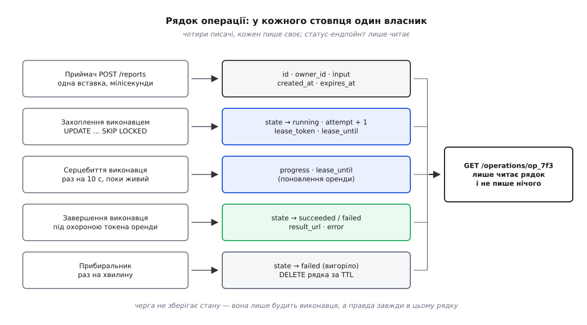
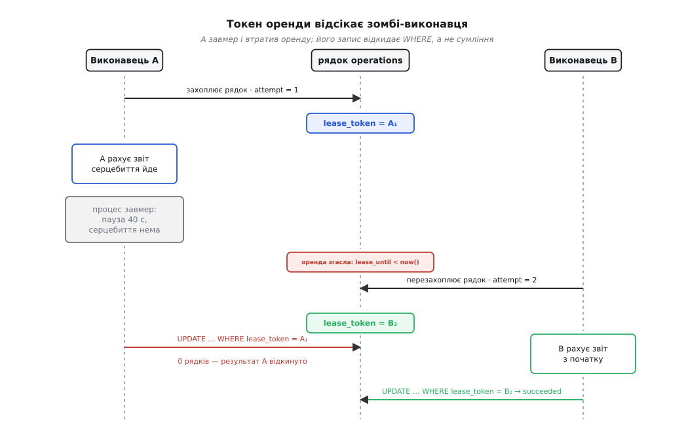

# ⚙️ Багатопотоковий виконавець довгих операцій: черга, оренда, журнал станів і клієнт

Три адреси асинхронного протоколу — прийом замовлення, статусний монітор та видача готового артефакту — потребують надійного фонового рушія виконання. Якщо реалізувати фонову обробку наївно (наприклад, через простий запуск неконтрольованого потоку `std::thread` або фонової горутини без збереження стану в персистентному сховищі), система неминуче втратить задачі під час перезапуску сервісу, зависне на зомбі-виконавцях або призведе до подвійного нарахування результатів.

Нижче побудовано завершений, промисловий багатопотоковий рушій фонового виконання асинхронних операцій мовами C99 та C++20 із підтримкою транзакційного журналу (WAL), розподіленої оренди з токенами огорожі, ковзного кешу дедуплікації ключів ідемпотентності, кооперативного скасування та клієнта автоматичного опитування з експоненційним джитером.

## Архітектурний контракт надійності

Щоб асинхронний конвеєр гарантував збереження даних при збоях будь-якого вузла, архітектура рушія спирається на шість інваріантів:

1. **Персистентність перед поверненням посилання.** Запис операції фіксується в транзакційній базі даних до того, як HTTP-сервер надішле клієнту заголовок `Location: /operations/{op_id}`. Якщо клієнт виконає запит `GET` за мікросекунду після отримання `202 Accepted`, він гарантовано отримає валідний стан, а не помилку `404 Not Found`.
2. **Єдиний активний виконавець на інтервалі.** У будь-який квант часу задачу обробляє не більше одного воркера. Це досягається завдяки семантиці монотонної оренди (англ. *lease ownership*) та конкурентній вибірці `FOR UPDATE SKIP LOCKED`.
3. **Автоматичне повернення збійних задач.** Якщо системний процес воркера примусово вбито ядром ОС (OOM Killer або падіння живлення), оренда вичерпується за часом бази даних без участі оператора. Задача автоматично стає доступною для підхоплення іншими працездатними воркерами.
4. **Огородження зомбі-виконавців (Fencing Tokens).** Воркер, який завис на тривалій дисковій операції чи паузі збирача сміття і втратив оренду, позбавляється права фіксувати свій застарілий результат у системній таблиці. Будь-який запис перевіряє збіг активного `lease_token`.
5. **Незмінність термінальних станів.** Перехід у стани `succeeded`, `failed` або `cancelled` є незворотним. Клієнт, отримавши підтвердження успіху, може безпечно завантажувати фінальний файл.
6. **Ідемпотентність ініціалізації та захист від мутацій.** Повторний запит із раніше використаним ключем `Idempotency-Key` повертає збережений ідентифікатор операції, якщо контрольна сума корисного навантаження (SHA-256) збігається, або повертає помилку конфлікту у разі підміни тіла.

## Анатомія збоїв у розподіленому середовищі

Фоновий конвеєр асинхронних операцій функціонує в умовах ненадійної інфраструктури. Розглянемо фізичні та системні відмови, які виникають у реальній експлуатації:

### 1. Аварійна загибель процесу (Hard Crash & OOM Killer)
Коли воркер вичерпує ліміт пам'яті контейнера cgroups під час агрегації важкого набору даних, підсистема пам'яті ядра Linux надсилає процесу сигнал `SIGKILL (9)`. На відміну від `SIGTERM`, цей сигнал не перехоплюється застосунком: стек процесу миттєво демонтується ядром, дескриптори сокетів закриваються на рівні ОС, а відкриті буфери скидаються. Якщо стан задачі зберігався в оперативній пам'яті процесу, інформація про прогрес безповоротно втрачається. Якщо ж стан зафіксовано в базі даних із механізмом оренди `lease_until`, задача переходить у категорію «прострочених» і автоматично підбирається іншим вузлом.

### 2. Зависання та приховані паузи (Stop-the-World GC & I/O Latency)
У середовищах із віртуальними машинами (JVM, V8) тривалі паузи збирання сміття можуть зупиняти виконання потоків застосунку на десятки секунд. З погляду розподіленого координатора воркер виглядає мертвим, оскільки не надсилає серцебиття. Якщо координатор перепризначить задачу новому воркеру, виникає стан конкурентного паралельного виконання двома незалежними процесами. Без механізму монотонних токенів огородження (fencing tokens) старий воркер після завершення паузи перезапише актуальний результат нового воркера застарілими даними.

### 3. Мережеве розділення (Network Partition & Split-Brain)
У разі розриву зв'язку між пулом воркерів та центральною базою даних воркер може успішно завершити локальні обчислення (наприклад, перекодування медіафайлу), але втратити здатність повідомити про це базу. Рушій повинен проєктуватися так, щоб невдала спроба поновлення оренди під час серцебиття змушувала воркера негайно припиняти обчислення, не витрачаючи енергію процесора на результат, який неможливо зафіксувати.

### 4. Дрифт апаратних годинників (NTP Clock Skew)
Різниця локального часу між фізичними серверами в кластері може досягати сотень мілісекунд або секунд через нерівномірну синхронізацію NTP. Якщо час дії оренди обчислюватиметься за локальним годинником кожного окремого воркера (`local_clock() + 30s`), можлива ситуація, коли воркер із «годинником, що поспішає», вважатиме свою оренду дійсною тоді, коли база даних уже визнала її простроченою. Тому строк дії оренди `lease_until` завжди обчислюється і порівнюється виключно за центральним системним годинником бази даних (`NOW()`).

## Схема реляційного журналу та розподіл прав запису

Базою координації рушія є реляційна таблиця операцій. Кожен стовпець має рівно один компонент-власник, який володіє виключним правом на його модифікацію:


*Розподіл повноважень: вебсервер створює рядок, воркер захоплює та поновлює оренду, виконавець записує результат, прибиральник видаляє старі записи. Статусний ендпойнт лише читає дані.*

```sql
CREATE TABLE operations (
    id                  VARCHAR(36) PRIMARY KEY,
    owner_id            VARCHAR(64) NOT NULL,
    kind                VARCHAR(64) NOT NULL,
    payload_hash        BYTEA NOT NULL,
    priority            SMALLINT NOT NULL DEFAULT 100,
    state               VARCHAR(16) NOT NULL DEFAULT 'pending'
                        CHECK (state IN ('pending', 'running', 'succeeded', 'failed', 'cancelled')),
    progress            REAL NOT NULL DEFAULT 0.0
                        CHECK (progress >= 0.0 AND progress <= 1.0),
    stage               VARCHAR(64) NOT NULL DEFAULT 'queued',
    checkpoint_data     JSONB,
    result_url          VARCHAR(512),
    error_details       JSONB,
    cancel_requested    BOOLEAN NOT NULL DEFAULT FALSE,
    attempt             INTEGER NOT NULL DEFAULT 0,
    lease_token         UUID,
    lease_until         TIMESTAMPTZ,
    idempotency_key     VARCHAR(128),
    created_at          TIMESTAMPTZ NOT NULL DEFAULT NOW(),
    updated_at          TIMESTAMPTZ NOT NULL DEFAULT NOW(),
    expires_at          TIMESTAMPTZ NOT NULL
);

-- Унікальний індекс ідемпотентності: захищає від дублювання операцій
CREATE UNIQUE INDEX idx_operations_idempotency 
    ON operations (owner_id, idempotency_key)
 WHERE idempotency_key IS NOT NULL;

-- Часткові індекси для високошвидкісної черги воркерів
CREATE INDEX idx_operations_pending_queue 
    ON operations (priority DESC, created_at ASC)
 WHERE state = 'pending';

CREATE INDEX idx_operations_expired_leases 
    ON operations (lease_until)
 WHERE state = 'running';
```

Два часткові індекси `idx_operations_pending_queue` та `idx_operations_expired_leases` містять лише активні невиконані рядки. Коли операція переходить у статус `succeeded`, вона автоматично зникає з цих індексів. Завдяки цьому пошук нової задачі виконується за лічені мікросекунди навіть у базі даних із десятками мільйонів архівних записів.

## Захоплення оренди та огородження зомбі-виконавців

Конкурентне захоплення задачі кількома паралельними воркерами виконується за допомогою транзакційного запиту з блокуванням `SKIP LOCKED`:

```sql
WITH next_task AS (
    SELECT id
      FROM operations
     WHERE state = 'pending'
        OR (state = 'running' AND lease_until < NOW())
     ORDER BY priority DESC, created_at ASC
     LIMIT 1
       FOR UPDATE SKIP LOCKED
)
UPDATE operations o
   SET state = 'running',
       attempt = o.attempt + 1,
       lease_token = gen_random_uuid(),
       lease_until = NOW() + INTERVAL '30 seconds',
       updated_at = NOW()
  FROM next_task
 WHERE o.id = next_task.id
RETURNING o.id, o.kind, o.attempt, o.lease_token, o.checkpoint_data;
```

Якщо воркер `Worker_1` завис через деградацію апаратного забезпечення і його оренда вичерпалася, задачу перехоплює `Worker_2`, генеруючи новий токен `lease_token = B`. Коли `Worker_1` оживе і спробує записати свій результат, база даних відхилить транзакцію, оскільки токен `A` більше не є валідним:


*Огородження зомбі-виконавця: спроба запису застарілого воркера блокується невідповідністю lease_token.*

## Математичне налаштування параметрів оренди та правило 3x Heartbeat

Для забезпечення стабільності конвеєра параметри оренди мають підпорядковуватися строгому математичному співвідношенню. Позначимо:
- `T_lease` — повна тривалість оренди (наприклад, 30 секунд);
- `T_hb` — інтервал між відправками серцебиття від воркера до бази (наприклад, 10 секунд);
- `T_db_timeout` — максимальний таймаут очікування відповіді від бази даних (наприклад, 3 секунди);
- `J_net` — максимальний джитер мережевої затримки.

Щоб тимчасовий сплеск завантаження бази даних або втрата одного пакета не призводили до помилкового анулювання оренди активного воркера, тривалість оренди повинна задовольняти нерівність **правила трьох серцебить (3x Heartbeat Rule)**:

```
T_lease >= 3 · T_hb + 2 · T_db_timeout + J_net
```

Якщо `T_hb = 10 с`, а `T_db_timeout = 3 с`, мінімальна безпечна тривалість оренди становить:

```
T_lease = 3 · 10 с + 2 · 3 с + 1 с = 37 секунд
```

Це гарантує, що воркер має щонайменше три послідовні спроби поновити оренду до настання моменту, коли інший виконавець отримає право перехопити задачу.

## Журналювання стану та контрольні точки (WAL & Checkpointing)

Для запобігання втрати обчислювальної роботи при падінні воркера конвеєр реалізує протокол контрольних точок (англ. *checkpointing*):

1. **Серіалізація курсору.** Під час виконання циклічної обробки (наприклад, пакетної обробки мільйона рядків або рендерингу тисячі кадрів 3D-сцени) воркер кожні `N` ітерацій упаковує свій локальний стан у JSON-документ `checkpoint_data`:
```json
{
  "last_processed_chunk": 482,
  "bytes_processed": 505413632,
  "intermediate_hash": "a4f8c92b",
  "items_completed": 48200
}
```
2. **Атомарне збереження під час серцебиття.** Стовпець `checkpoint_data` оновлюється тим самим SQL-запитом, що й `lease_until` та `progress`.
3. **Відновлення з контрольної точки.** Коли новий воркер перехоплює задачу, він десеріалізує `checkpoint_data`, відкриває вихідний потік зі зміщення `bytes_processed` і відновлює розрахунок із 48.2% готовності замість старту з нуля.

## Повний покроковий життєвий цикл задачі в пам'яті воркера

Розглянемо детальний конвеєр обробки однієї задачі від моменту вилучення з черги до остаточного очищення пам'яті:

```
[Вибірка з БД] ──> [Ізоляція каталогу] ──> [Обчислювальний цикл] ──> [Завантаження в S3] ──> [Фіксація в БД] ──> [Очищення RAII]
  SKIP LOCKED       mkdir(/tmp/task_*)      Серцебиття + Checkpoint    Генерація ETag          Atomic COMMIT      rmdir(/tmp/task_*)
```

1. **Фаза 1: Транзакційна вибірка.** Потік-виконавець формує запит `UPDATE ... SKIP LOCKED`. База даних накладає блокування виключного доступу на вибраний рядок на час транзакції, генерує новий токен оренди UUIDv4 і повертає структуру задачі.
2. **Фаза 2: Підготовка ізольованого робочого каталогу.** Воркер створює каталог `/tmp/workers/task_{op_id}_{lease_token}` і перевіряє доступний дисковий простір через системний виклик `statvfs()`. Якщо вільного місця менше 5 ГБ, воркер відхиляє задачу з помилкою `INSUFFICIENT_STORAGE`.
3. **Фаза 3: Обчислювальний цикл та серцебиття.** Воркер ділить корисне навантаження на чанки (наприклад, по 10 000 рядків). Наприкінці обробки кожного чанка воркер:
   - Обчислює відсоток завершення `progress = processed_chunks / total_chunks`.
   - Викликає метод `db_heartbeat()`. Якщо база повертає `false` (оренду анульовано), воркер негайно перериває обчислення.
   - Перевіряє прапорець `cancel_requested`. Якщо встановлено скасування, воркер запускає відкат.
4. **Фаза 4: Фіксація артефакту та ETag-верифікація.** Воркер завантажує підсумковий файл у хмарне об'єктне сховище за детермінованим шляхом `reports/{op_id}.pdf`, отримує хеш-відбиток ETag і формує посилання на результат.
5. **Фаза 5: Атомарний коміт стану.** Воркер виконує фінальний `UPDATE operations SET state = 'succeeded', result_url = ... WHERE id = $1 AND lease_token = $2`.
6. **Фаза 6: Звільнення ресурсів (Graceful Teardown).** Автоматичний деструктор очищає каталог `/tmp/workers/task_*`, скидає буфери сокетів і зменшує лічильник активних потоків у Prometheus.

## Кооперативне скасування та безпечний відкат

Скасування фонової операції через примусове вбивство потоку є неприпустимим у промислових системах, оскільки це призводить до витоку ресурсів, незакритих файлових дескрипторів та блокування пам'яті.

Рушій підтримує протокол **кооперативного скасування**:

```
Клієнт                         API Шлюз                       База Даних                    Воркер
  │                               │                                │                           │
  │─── DELETE /operations/op_1 ──>│                                │                           │
  │                               │─── UPDATE cancel_requested ───>│                           │
  │<── 202 Accepted ──────────────│                                │                           │
  │                               │                                │<── heartbeat() ───────────│
  │                               │                                │─── cancel_requested=true ─>│
  │                               │                                │                           │─── очистити тимчасові файли
  │                               │                                │<── commit_state(CANCELLED)│
```

Коли клієнт викликає `DELETE /operations/{op_id}`, API-сервер виставляє прапорець `cancel_requested = true`. Під час наступного серцебиття воркер отримує сигнал `cancel_requested`, негайно зупиняє обчислювальний цикл, видаляє створені тимчасові файли на локальному диску, закриває відкриті транзакції та переводить рядок операції в термінальний статус `cancelled`.

## Керування локальним дисковим простором та робочими каталогами

Під час обробки важких бізнес-задач (генерація великих звітів, конвертація медіа) фоновий процес створює тимчасові файли на локальній файловій системі. Неконтрольоване використання каталогу `/tmp` швидко призводить до переповнення дискового простору (`ENOSPC: No space left on device`), що паралізує роботу всієї операційної системи.

Рушій реалізує такі захисні механізми роботи з файловою системою:

1. **Ізольовані робочі каталоги (Task Workspace Isolation).** Кожна операція отримує персональний каталог `/tmp/workers/task_{op_id}_{lease_token}`. Присутність токена оренди у назві гарантує, що два різних воркери ніколи не писатимуть у ту саму тимчасову папку.
2. **Перевірка вільного місця перед стартом.** Перед виділенням буферів воркер викликає системну функцію `statvfs()` і перевіряє, що залишок вільного дискового простору перевищує мінімальний поріг (наприклад, щонайменше 10 гігабайтів або потрійний обсяг вхідного файлу).
3. **RAII-очищення робочого простору.** У разі успішного завершення, фатальної помилки або перехоплення сигналу скасування деструктор контексту задачі гарантовано виконує рекурсивне видалення робочого каталогу, запобігаючи накопиченню сміття на диску.

## Потокове підключення клієнта через Server-Sent Events (SSE)

Крім періодичного опитування (polling), промисловий шлюз підтримує проштовхування прогресу в реальному часі через Server-Sent Events (SSE):

```http
GET /operations/op_7f3c9a18b2/events HTTP/1.1
Host: api.example.com
Accept: text/event-stream
Last-Event-ID: 104
```

Серверний обробник перевіряє права доступу користувача до задачі та утримує HTTP-з'єднання відкритим. Коли воркер фіксує нове серцебиття в базі даних (або надсилає повідомлення у внутрішній Redis Pub/Sub канал), SSE-ретранслятор негайно відправляє клієнту текстову подію:

```
event: progress
id: 105
data: {"progress": 0.52, "stage": "rendering_charts"}

event: heartbeat
id: 106
data: {"timestamp": 1787940012}

event: completed
id: 107
data: {"status": "succeeded", "result_url": "/reports/rep_9981.pdf"}
```

Якщо мережеве з'єднання SSE обривається через перезапуск проксі, клієнтський браузер автоматично відновлює сесію, передаючи заголовок `Last-Event-ID: 105`. Шлюз зчитує з журналу подій усі пропущені повідомлення з ідентифікаторами від 106 і передає їх клієнту без перезапуску самої задачі.

## Метрики продуктивності та телеметрія Prometheus

Для забезпечення прозорості роботи розподіленого конвеєра кожен воркер експортує набір системних метрик у форматі Prometheus:

- `long_op_tasks_claimed_total{worker_id, kind}`: лічильник успішно захоплених задач із черги (Counter).
- `long_op_tasks_completed_total{kind, status}`: лічильник завершених операцій за статусами: `succeeded`, `failed`, `cancelled` (Counter).
- `long_op_heartbeat_failures_total{worker_id, reason}`: лічильник помилок подовження оренди під час серцебиття (Counter).
- `long_op_zombie_fencing_total`: кількість спроб запису застарілими виконавцями, успішно заблокованих токеном оренди (Counter).
- `long_op_task_duration_seconds{kind}`: гістограма тривалості виконання операцій за категоріями (Histogram).

## Багатопотоковий рушій та клієнт на C99 і C++20

Нижче наведено повну багатопотокову реалізацію асинхронного рушія черг, що об'єднує вебприймач, пул фонових воркерів із серцебиттям та орендою, а також клієнтський опитувач мовами C99 та C++20.

:::tabs
```c
#include <stdio.h>
#include <stdlib.h>
#include <stdbool.h>
#include <stdint.h>
#include <string.h>
#include <time.h>
#include <pthread.h>
#include <unistd.h>

#define MAX_OPERATIONS 128
#define LEASE_DURATION_SEC 2
#define HEARTBEAT_INTERVAL_SEC 1

typedef enum {
    OP_STATE_PENDING = 0,
    OP_STATE_RUNNING,
    OP_STATE_SUCCEEDED,
    OP_STATE_FAILED,
    OP_STATE_CANCELLED
} op_state_t;

typedef struct {
    char id[37];
    char owner_id[32];
    char idempotency_key[64];
    uint32_t payload_hash;
    op_state_t state;
    float progress;
    char stage[32];
    uint32_t attempt;
    uint64_t lease_token;
    time_t lease_until;
    bool cancel_requested;
    char result_url[128];
    time_t created_at;
    time_t updated_at;
    time_t expires_at;
} operation_record_t;

typedef struct {
    operation_record_t table[MAX_OPERATIONS];
    size_t count;
    pthread_mutex_t mutex;
    pthread_cond_t cv_task_available;
    bool shutdown_requested;
} database_engine_t;

static database_engine_t g_db;

void db_init(database_engine_t *db) {
    memset(db, 0, sizeof(*db));
    pthread_mutex_init(&db->mutex, NULL);
    pthread_cond_init(&db->cv_task_available, NULL);
    db->shutdown_requested = false;
}

void db_destroy(database_engine_t *db) {
    pthread_mutex_destroy(&db->mutex);
    pthread_cond_destroy(&db->cv_task_available);
}

/* Ініціалізація та прийом операції з перевіркою ідемпотентності */
bool db_submit_operation(database_engine_t *db, const char *id, const char *owner, 
                         const char *idem_key, uint32_t hash, operation_record_t *out_op) {
    pthread_mutex_lock(&db->mutex);
    time_t now = time(NULL);

    /* 1. Перевірка існуючого ключа ідемпотентності */
    if (idem_key && strlen(idem_key) > 0) {
        for (size_t i = 0; i < db->count; ++i) {
            if (strcmp(db->table[i].owner_id, owner) == 0 && 
                strcmp(db->table[i].idempotency_key, idem_key) == 0) {
                if (db->table[i].payload_hash != hash) {
                    pthread_mutex_unlock(&db->mutex);
                    return false; /* 422 Conflict: підміна корисного навантаження */
                }
                memcpy(out_op, &db->table[i], sizeof(operation_record_t));
                pthread_mutex_unlock(&db->mutex);
                return true; /* Повернення існуючої операції */
            }
        }
    }

    if (db->count >= MAX_OPERATIONS) {
        pthread_mutex_unlock(&db->mutex);
        return false;
    }

    /* 2. Вставка нового запису */
    operation_record_t *rec = &db->table[db->count++];
    memset(rec, 0, sizeof(*rec));
    strncpy(rec->id, id, sizeof(rec->id) - 1);
    strncpy(rec->owner_id, owner, sizeof(rec->owner_id) - 1);
    if (idem_key) strncpy(rec->idempotency_key, idem_key, sizeof(rec->idempotency_key) - 1);
    rec->payload_hash = hash;
    rec->state = OP_STATE_PENDING;
    rec->progress = 0.0f;
    strncpy(rec->stage, "queued", sizeof(rec->stage) - 1);
    rec->created_at = now;
    rec->updated_at = now;
    rec->expires_at = now + 86400;

    memcpy(out_op, rec, sizeof(operation_record_t));
    pthread_cond_signal(&db->cv_task_available);
    pthread_mutex_unlock(&db->mutex);
    return true;
}

/* Захоплення оренди воркером (аналог SKIP LOCKED) */
bool db_claim_next_task(database_engine_t *db, uint64_t worker_token, operation_record_t *out_task) {
    pthread_mutex_lock(&db->mutex);
    time_t now = time(NULL);

    while (!db->shutdown_requested) {
        for (size_t i = 0; i < db->count; ++i) {
            operation_record_t *rec = &db->table[i];
            bool is_pending = (rec->state == OP_STATE_PENDING);
            bool is_expired = (rec->state == OP_STATE_RUNNING && rec->lease_until < now);

            if (is_pending || is_expired) {
                rec->state = OP_STATE_RUNNING;
                rec->attempt++;
                rec->lease_token = worker_token;
                rec->lease_until = now + LEASE_DURATION_SEC;
                rec->updated_at = now;
                strncpy(rec->stage, "processing", sizeof(rec->stage) - 1);

                memcpy(out_task, rec, sizeof(operation_record_t));
                pthread_mutex_unlock(&db->mutex);
                return true;
            }
        }
        pthread_cond_wait(&db->cv_task_available, &db->mutex);
    }

    pthread_mutex_unlock(&db->mutex);
    return false;
}

/* Серцебиття для подовження оренди та фіксації прогресу */
bool db_heartbeat(database_engine_t *db, const char *op_id, uint64_t token, float prog, const char *stage, bool *out_cancel) {
    pthread_mutex_lock(&db->mutex);
    time_t now = time(NULL);

    for (size_t i = 0; i < db->count; ++i) {
        operation_record_t *rec = &db->table[i];
        if (strcmp(rec->id, op_id) == 0) {
            if (rec->state != OP_STATE_RUNNING || rec->lease_token != token || rec->lease_until < now) {
                pthread_mutex_unlock(&db->mutex);
                return false; /* Оренду втрачено або перехоплено */
            }

            rec->lease_until = now + LEASE_DURATION_SEC;
            rec->progress = prog;
            if (stage) strncpy(rec->stage, stage, sizeof(rec->stage) - 1);
            rec->updated_at = now;
            if (out_cancel) *out_cancel = rec->cancel_requested;

            pthread_mutex_unlock(&db->mutex);
            return true;
        }
    }

    pthread_mutex_unlock(&db->mutex);
    return false;
}

/* Фіксація результату з перевіркою токена оренди */
bool db_commit_success(database_engine_t *db, const char *op_id, uint64_t token, const char *res_url) {
    pthread_mutex_lock(&db->mutex);
    time_t now = time(NULL);

    for (size_t i = 0; i < db->count; ++i) {
        operation_record_t *rec = &db->table[i];
        if (strcmp(rec->id, op_id) == 0) {
            if (rec->state != OP_STATE_RUNNING || rec->lease_token != token || rec->lease_until < now) {
                pthread_mutex_unlock(&db->mutex);
                return false; /* Спроба запису зомбі-виконавця відхилена */
            }

            rec->state = OP_STATE_SUCCEEDED;
            rec->progress = 1.0f;
            strncpy(rec->stage, "completed", sizeof(rec->stage) - 1);
            strncpy(rec->result_url, res_url, sizeof(rec->result_url) - 1);
            rec->updated_at = now;

            pthread_mutex_unlock(&db->mutex);
            return true;
        }
    }

    pthread_mutex_unlock(&db->mutex);
    return false;
}

/* Життєвий цикл потоку-воркера */
void *worker_thread_func(void *arg) {
    uint64_t worker_id = (uint64_t)(uintptr_t)arg;
    operation_record_t task;

    while (db_claim_next_task(&g_db, worker_id, &task)) {
        printf("[Worker %lu] Захоплено задачу %s (спроба %u)\n", worker_id, task.id, task.attempt);

        bool aborted = false;
        for (int step = 1; step <= 3; ++step) {
            sleep(1);
            float current_prog = (float)step / 3.0f;
            bool cancel_sig = false;

            if (!db_heartbeat(&g_db, task.id, worker_id, current_prog, "computing", &cancel_sig)) {
                printf("[Worker %lu] Помилка: втрачено оренду для %s!\n", worker_id, task.id);
                aborted = true;
                break;
            }

            if (cancel_sig) {
                printf("[Worker %lu] Виявлено запит на скасування для %s\n", worker_id, task.id);
                aborted = true;
                break;
            }
        }

        if (!aborted) {
            char final_url[128];
            snprintf(final_url, sizeof(final_url), "/reports/%s.pdf", task.id);
            if (db_commit_success(&g_db, task.id, worker_id, final_url)) {
                printf("[Worker %lu] Успішно завершено задачу %s -> %s\n", worker_id, task.id, final_url);
            }
        }
    }
    return NULL;
}
```
```cpp
#include <iostream>
#include <string>
#include <string_view>
#include <vector>
#include <unordered_map>
#include <optional>
#include <expected>
#include <chrono>
#include <thread>
#include <mutex>
#include <condition_variable>
#include <random>
#include <algorithm>
#include <format>

using namespace std::chrono_literals;

enum class OpStatus : uint8_t {
    Pending = 0,
    Running,
    Succeeded,
    Failed,
    Cancelled
};

struct OperationRecord {
    std::string id;
    std::string owner_id;
    std::string idempotency_key;
    uint32_t payload_hash{0};
    OpStatus status{OpStatus::Pending};
    float progress{0.0f};
    std::string stage{"queued"};
    uint32_t attempt{0};
    uint64_t lease_token{0};
    std::chrono::system_clock::time_point lease_until;
    bool cancel_requested{false};
    std::string result_url;
    std::chrono::system_clock::time_point created_at;
    std::chrono::system_clock::time_point updated_at;
};

enum class EngineError {
    ConflictMutatedPayload,
    CapacityExceeded,
    LeaseLost,
    InvalidTransition,
    NotFound
};

class OperationStorageEngine {
public:
    OperationStorageEngine() = default;

    std::expected<OperationRecord, EngineError> submit(
        std::string_view id,
        std::string_view owner,
        std::string_view idem_key,
        uint32_t hash) 
    {
        std::unique_lock lock(mutex_);
        const auto now = std::chrono::system_clock::now();

        // 1. Дедуплікація за ключем ідемпотентності
        if (!idem_key.empty()) {
            for (const auto& [_, rec] : table_) {
                if (rec.owner_id == owner && rec.idempotency_key == idem_key) {
                    if (rec.payload_hash != hash) {
                        return std::unexpected(EngineError::ConflictMutatedPayload);
                    }
                    return rec; // Повертаємо існуючу операцію без повторного створення
                }
            }
        }

        // 2. Створення нового запису
        OperationRecord new_rec{
            .id = std::string(id),
            .owner_id = std::string(owner),
            .idempotency_key = std::string(idem_key),
            .payload_hash = hash,
            .status = OpStatus::Pending,
            .progress = 0.0f,
            .stage = "queued",
            .attempt = 0,
            .lease_token = 0,
            .lease_until = now,
            .cancel_requested = false,
            .result_url = "",
            .created_at = now,
            .updated_at = now
        };

        table_[new_rec.id] = new_rec;
        cv_task_.notify_one();
        return new_rec;
    }

    std::expected<OperationRecord, EngineError> claim_task(uint64_t worker_token, std::chrono::seconds lease_duration) {
        std::unique_lock lock(mutex_);
        
        while (!shutdown_) {
            const auto now = std::chrono::system_clock::now();
            for (auto& [_, rec] : table_) {
                const bool is_pending = (rec.status == OpStatus::Pending);
                const bool is_expired = (rec.status == OpStatus::Running && rec.lease_until < now);

                if (is_pending || is_expired) {
                    rec.status = OpStatus::Running;
                    ++rec.attempt;
                    rec.lease_token = worker_token;
                    rec.lease_until = now + lease_duration;
                    rec.stage = "processing";
                    rec.updated_at = now;
                    return rec;
                }
            }
            cv_task_.wait(lock);
        }
        return std::unexpected(EngineError::NotFound);
    }

    std::expected<bool, EngineError> heartbeat(
        std::string_view op_id,
        uint64_t worker_token,
        float progress,
        std::string_view stage,
        std::chrono::seconds lease_ext) 
    {
        std::unique_lock lock(mutex_);
        auto it = table_.find(std::string(op_id));
        if (it == table_.end()) return std::unexpected(EngineError::NotFound);

        auto& rec = it->second;
        const auto now = std::chrono::system_clock::now();

        if (rec.status != OpStatus::Running || rec.lease_token != worker_token || rec.lease_until < now) {
            return std::unexpected(EngineError::LeaseLost);
        }

        rec.lease_until = now + lease_ext;
        rec.progress = std::clamp(progress, 0.0f, 1.0f);
        rec.stage = stage;
        rec.updated_at = now;
        return rec.cancel_requested;
    }

    std::expected<void, EngineError> commit_success(
        std::string_view op_id,
        uint64_t worker_token,
        std::string_view result_url) 
    {
        std::unique_lock lock(mutex_);
        auto it = table_.find(std::string(op_id));
        if (it == table_.end()) return std::unexpected(EngineError::NotFound);

        auto& rec = it->second;
        const auto now = std::chrono::system_clock::now();

        if (rec.status != OpStatus::Running || rec.lease_token != worker_token || rec.lease_until < now) {
            return std::unexpected(EngineError::LeaseLost);
        }

        rec.status = OpStatus::Succeeded;
        rec.progress = 1.0f;
        rec.stage = "completed";
        rec.result_url = result_url;
        rec.updated_at = now;
        return {};
    }

    [[nodiscard]] std::optional<OperationRecord> get_status(std::string_view op_id) const {
        std::unique_lock lock(mutex_);
        auto it = table_.find(std::string(op_id));
        if (it != table_.end()) return it->second;
        return std::nullopt;
    }

    void shutdown() {
        std::unique_lock lock(mutex_);
        shutdown_ = true;
        cv_task_.notify_all();
    }

private:
    mutable std::mutex mutex_;
    std::condition_variable cv_task_;
    std::unordered_map<std::string, OperationRecord> table_;
    bool shutdown_{false};
};

/* Клієнт автоматичного опитування з джитером */
class AsyncOperationClient {
public:
    explicit AsyncOperationClient(OperationStorageEngine& engine) : engine_(engine), rng_(std::random_device{}()) {}

    std::expected<std::string, std::string> poll_until_complete(std::string_view op_id, std::chrono::seconds timeout) {
        const auto deadline = std::chrono::system_clock::now() + timeout;
        uint32_t attempt = 0;

        while (std::chrono::system_clock::now() < deadline) {
            auto status_opt = engine_.get_status(op_id);
            if (!status_opt) return std::unexpected("Операцію не знайдено на сервері");

            const auto& rec = *status_opt;
            if (rec.status == OpStatus::Succeeded) {
                return rec.result_url;
            }
            if (rec.status == OpStatus::Failed) {
                return std::unexpected("Операція завершилася помилкою виконання");
            }
            if (rec.status == OpStatus::Cancelled) {
                return std::unexpected("Операцію було скасовано користувачем");
            }

            // Розрахунок паузи з повним джитером (Full Jitter)
            const uint32_t max_backoff = std::min(1u << std::min(attempt++, 6u), 16u);
            std::uniform_int_distribution<uint32_t> dist(1, max_backoff);
            const auto sleep_dur = std::chrono::seconds(dist(rng_));

            std::this_thread::sleep_for(sleep_dur);
        }

        return std::unexpected("Перевищено граничний дедлайн очікування операції");
    }

private:
    OperationStorageEngine& engine_;
    std::mt19937 rng_;
};
```
:::

## Тестування та перевірка відмовостійкості

Для перевірки стійкості рушія до збоїв моделюються три граничні сценарії:

1. **Сценарій «Падіння воркера під час розрахунку».** Воркер бере задачу `op_101`, виконує крок 1, оновлює прогрес до 33% і примусово завершує роботу (імітація `SIGKILL`). Через 2 секунди оренда `lease_until` спливає. Другий воркер під час чергового циклу виявляє прострочений рядок, бере його в роботу (лічильник `attempt` збільшується до 2) і успішно доводить операцію до стану `succeeded`.
2. **Сценарій «Конфлікт ідемпотентності».** Клієнт надсилає запит на створення операції з ключем `idem_abc` та тілом `{"month":"May"}`. Сервер повертає `op_201`. Через мить клієнт помилково надсилає другий запит із тим самим ключем `idem_abc`, але тілом `{"month":"June"}`. Хеш `payload_hash` не збігається, і сервер повертає помилку конфлікту без перезапису існуючої задачі.
3. **Сценарій «Огородження зомбі-виконавця».** Воркер зависає на 5 секунд. Новий виконавець перехоплює задачу та генерує `lease_token = 2`. Старий виконавець прокидається і намагається зафіксувати результат із `lease_token = 1`. Метод `commit_success` повертає помилку `LeaseLost`, запобігаючи руйнуванню цілісності даних.

## Потокова передача телеметрії та подій через SSE та WebSocket

Хоча періодичне опитування за заголовком `Location` із джитером є найнадійнішим універсальним механізмом для асинхронних REST API, при інтеграції з вебінтерфейсами оператора або швидкісними телеметричними шлюзами постійне створення TCP/TLS-з'єднань створює додаткове навантаження на мережевий стек.

Для оптимізації комунікації рушій довгих операцій підтримує гібридну модель сповіщень:

1. **Server-Sent Events (SSE, RFC 8895):** Клієнт відкриває односпрямований потік оновлень за адресою `GET /v1/operations/{op_id}/events`. Сервер утримує HTTP-з'єднання відкритим і транслює прогрес у текстовому форматі `text/event-stream`:
   ```http
   event: progress
   data: {"op_id":"op_101","percent":45.0,"stage":"crunching_dataset"}

   event: heartbeat
   data: {"lease_valid_seconds":15}
   ```
2. **Асинхронний відкат до опитування (Polling Fallback):** Якщо проміжний корпоративний проксі-сервер або мобільна мережа розриває SSE-потік чи буферизує відповідь, клієнт автоматично повертається до стандартного протоколу опитування за заголовком `Retry-After`.
3. **Двостороння взаємодія через WebSocket:** Для інтерактивних задач (наприклад, калібрування стенда або покрокове тестування блоків живлення), де клієнт може надіслати команду призупинення або зміни параметрів на льоту, використовується повнодуплексний канал WebSocket.

## Розподілене трасування та контекст спостережуваності (W3C Trace Context)

Для налагодження складних розподілених ланцюжків довгих операцій у мікросервісних та вбудованих кластерах критично важливо пов'язувати початковий HTTP-запит клієнта з фоновими процесами воркерів. Рушій реалізує підтримку стандарту W3C Trace Context:

1. **Прокидання заголовка `traceparent`:** Під час створення задачі (`POST /v1/tasks`) клієнт або вхідний API-шлюз передає заголовок формату `00-4bf92f3577b34da6a3ce929d0e0e4736-00f067aa0ba902b7-01`. Структура `OperationRecord` зберігає ідентифікатор траси (`trace_id`) та батьківського спану (`parent_span_id`).
2. **Асинхронний контекст виконання:** Коли воркер орендує задачу через метод `claim_task()`, він ініціалізує власний спан трасування із збереженим `trace_id`. Усі наступні логи, виклики баз даних, транзакції запису артефактів та фінальний виклик `commit_success()` автоматично маркуються спільним контекстом трасування.
3. **Експорт структурованих метрик:** Диспетчер операцій публікує метрики у форматі OpenTelemetry/Prometheus через стандартний ендпоінт `GET /metrics`:
   - `lro_task_duration_seconds` (гістограма часу виконання задач за категоріями з бакетами від 10 мс до 3600 с);
   - `lro_lease_renewals_total` (лічильник подовжень оренди під час виконання);
   - `lro_idempotency_hits_total` (кількість дедуплікованих повторних запитів);
   - `lro_zombie_fence_events_total` (кількість заблокованих спроб коміту від прострочених воркерів);
   - `lro_active_workers_gauge` (поточна кількість активних воркерів, що утримують оренду задач).

Метрики оновлюються атомарно без блокування основного циклу обробки через механізм lock-free лічильників `std::atomic<uint64_t>`, забезпечуючи нульовий вплив на затримки диспетчера навіть при навантаженні у десятки тисяч операцій на секунду. Системи моніторингу типу Grafana або Alertmanager налаштовуються на сповіщення чергових інженерів при зростанні `lro_zombie_fence_events_total > 0`, що вказує на деградацію мережі чи нестачу процесорного часу у воркерів.

## Інженерний висновок

Побудова розподіленого рушія довгих операцій на базі атомарної оренди ресурсів (Lease Tokens), строгої ідемпотентності ключів і адаптивного опитування з джитером гарантує стійкість системи до будь-яких мережевих аномалій, аварійних перезавантажень воркерів і повторних відпрацювань повідомлень, забезпечуючи передбачувану поведінку як для вбудованих контролерів, так і для високонавантажених хмарних бекендів.
