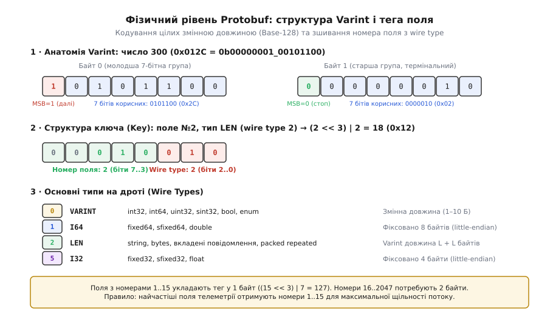
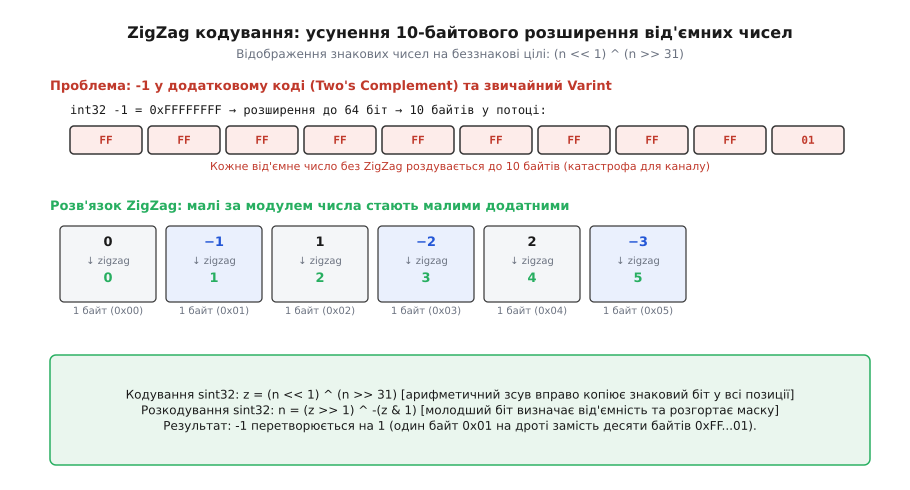
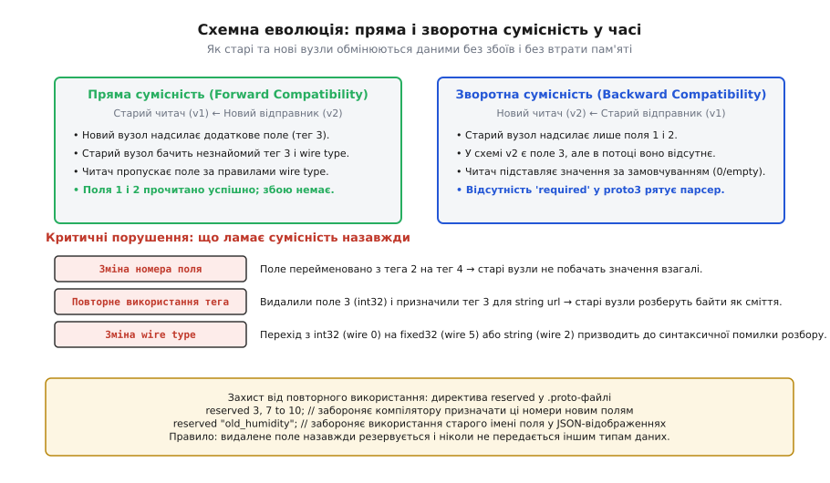
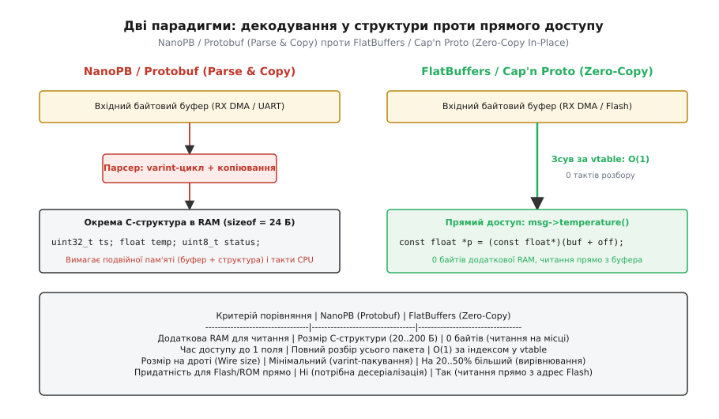
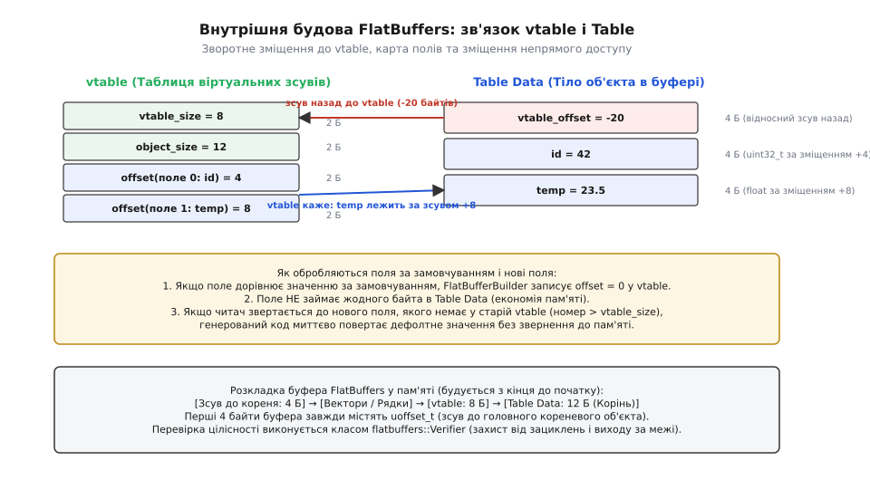

# Protocol Buffers і схемні формати

<preknowlist>
- [Серіалізація даних](root:com-protocol/data-serialization) — навіщо дані пакують у плаский двійковий потік і як фіксована розкладка відрізняється від самоопису.
- [Біти, байти та порядок байтів](root:sf-algorithms/bits-bytes-endianness) — двійкові зсуви, маски, ендіанність та подання цілих чисел зі знаком у додатковому коді.
- [Пакування двійкових форматів](root:com-protocol/wire-format-packing) — побітове укладання полів, вирівнювання та ціна розбору на процесорах із різною архітектурою.
</preknowlist>

Мережа з десяти тисяч промислових контролерів передає покази давачів на центральний сервер через стільниковий зв'язок. У першій версії прошивки пакет складався з трьох 32-бітних полів: ідентифікатора, часу та температури — разом 12 байтів сирого двійкового образу пам'яті. Коли в наступній ревізії пристрою додали четверте поле — вологість, розмір кадру зріс до 16 байтів. Сервер, який ще не встигли оновити, очікував 12 байтів і прочитав новий 16-байтовий потік зі зміщенням: значення вологості потрапило на місце ідентифікатора наступного повідомлення, а база даних за кілька хвилин наповнилася спотвореними записами.

Спроба розв'язати проблему переходом на текстовий JSON вимагає передавати назви полів у кожному пакеті (`"temperature_c100": 2450`), що роздуває корисне навантаження з 16 до 120 байтів. Для бездротового каналу це означає восьмикратне зростання витрат трафіку, а для мікроконтролера з 16 КБ оперативної пам'яті — сотні змарнованих тактів процесора на текстовий розбір чисел і ризик фрагментації динамічної пам'яті.

Схемні двійкові формати — **Protocol Buffers**, **FlatBuffers** та **Cap'n Proto** — усувають цю суперечність: повний опис структури даних зберігається в окремому файлі схеми на етапі компіляції, а фізичним каналом передаються лише компактні числові ідентифікатори або вирівняні двійкові зміщення.

## Фізичний рівень Protocol Buffers: Varint та Wire Types

У Protocol Buffers повідомлення не має загального заголовка фіксованого розміру. Воно являє собою неперервну послідовність пар «Ключ — Значення» (Key-Value), де ключ визначає як номер поля в схемі, так і спосіб його фізичного кодування на дроті.

Ключ пакується в одне беззнакове ціле число за формулою:

```
Key = (field_number << 3) | wire_type
```

Три молодші біти відводяться під тип на дроті (*wire type*), а всі старші біти містять числовий номер поля (*field number*).

```
 7   6   5   4   3   2   1   0   (біти ключа)
[   field_number   ] [ wire_type ]
```

Оскільки три біти дозволяють закодувати вісім комбінацій (від 0 до 7), специфікація стандарту фіксує шість базових типів представлення:

| Код | Назва типу | Призначення у схемі | Фізичний формат у потоці |
|---|---|---|---|
| `0` | **VARINT** | `int32`, `int64`, `uint32`, `uint64`, `sint32`, `sint64`, `bool`, `enum` | Змінна довжина (1–10 байтів), MSB як прапорець продовження |
| `1` | **I64** | `fixed64`, `sfixed64`, `double` | Рівно 8 байтів у порядку little-endian |
| `2` | **LEN** | `string`, `bytes`, вкладені повідомлення, `packed repeated` | Varint довжини `L`, після якого йде рівно `L` байтів даних |
| `3` | **SGROUP** | Застарілі групи proto2 (Start group) | Не використовується в proto3 |
| `4` | **EGROUP** | Застарілі групи proto2 (End group) | Не використовується в proto3 |
| `5` | **I32** | `fixed32`, `sfixed32`, `float` | Рівно 4 байти у порядку little-endian |

Будь-який парсер Protocol Buffers, навіть не маючи файлу схеми, знає, скільки байтів займає поточне поле. Якщо зустрічається `wire_type = 0`, парсер читає байти до першого байта з нульовим старшим бітом. Якщо `wire_type = 1`, пропускає 8 байтів; якщо `wire_type = 5` — 4 байти; якщо `wire_type = 2` — читає Varint довжини і пропускає відповідну кількість байтів.


*Анатомія двійкового представлення Protobuf: укладання числа 300 у 2 байти Base-128 Varint (молодша група 0x2C зі встановленим MSB=1 та термінальна група 0x02 із MSB=0). Структура ключа (Key): зсув номера поля на 3 біти ліворуч та побітове додавання wire type. Зведення основних типів представлення на дроті.*

### Механізм кодування цілих змінною довжиною (Base-128 Varint)

Стандартні цілі типи в мовах C/C++ (`uint32_t`, `uint64_t`) займають фіксовані 4 або 8 байтів незалежно від збереженого значення. Проте в телеметрії та мережевих протоколах більшість лічильників, розмірів і статусів є малими додатними числами (від 0 до 127).

Кодування Varint розбиває двійкове число на 7-бітні групи. Кожна група зберігається в окремому байті, де старший біт (біт 7, або MSB) слугує ознакою продовження (*continuation bit*):
* `MSB = 1`: за поточним байтом слідують наступні байти цього ж числа;
* `MSB = 0`: поточний байт є останнім (термінальним).

Байти укладаються в потік у порядку від молодшої 7-бітної групи до старшої (*little-endian 7-bit groups*).

Розгляньмо кодування числа `300`:
1. У двійковому вигляді: `300 = 0b00000001_00101100` (9 значущих бітів).
2. Розбиття на 7-бітні блоки: молодші 7 бітів — `0101100` (`0x2C`), старші біти — `0000010` (`0x02`).
3. Перший байт отримує `MSB = 1`: `0b10101100` = `0xAC`.
4. Другий байт є останнім і отримує `MSB = 0`: `0b00000010` = `0x02`.
5. Результат на дроті: два байти `0xAC 0x02` замість чотирьох байтів `0x2C 0x01 0x00 0x00`.

Завдяки формулі `Key = (field_number << 3) | wire_type`, якщо номер поля лежить у діапазоні від 1 до 15, числове значення ключа не перевищує `(15 << 3) | 7 = 127`, що повністю вкладається в **один байт** Varint. Номери полів від 16 до 2047 потребують двох байтів для ключа. Звідси випливає фундаментальне правило проєктування схем: найчастіші поля повідомлення повинні отримувати номери від 1 до 15.

### Пастка додаткового коду та перетворення ZigZag

Коли звичайний тип `int32` зі значенням `-1` потрапляє у Varint-кодек, виникає небезпечний побічний ефект. У комп'ютерній арифметиці від'ємні числа записуються в [додатковому коді](root:sf-algorithms/bits-bytes-endianness) (*two's complement*): `-1` представляється як `0xFFFFFFFF` (для 32 бітів) або `0xFFFFFFFFFFFFFFFF` (для 64 бітів).

Оскільки протокол Protobuf стандартизує сумісність між 32- та 64-бітними типами, знаковий `int32` перед кодуванням у Varint завжди розширюється знаком до 64 бітів. Число з усіма встановленими одиничними бітами вимагає рівно десять 7-бітних блоків:

```
-1 (int32/int64) -> 0xFF 0xFF 0xFF 0xFF 0xFF 0xFF 0xFF 0xFF 0xFF 0x01 (10 байтів!)
```

Одне від'ємне число `−1` створює на дроті максимальне навантаження у 10 байтів.

Для усунення цієї проблеми в Protocol Buffers введено типи `sint32` та `sint64`, які застосовують попереднє перетворення **ZigZag**. Воно «просіює» числову вісь, по черзі відображаючи від'ємні та додатні числа на ряд додатних цілих:

```
Початкове n:   0   -1    1   -2    2   -3    3   -4    4 ...
Після ZigZag:  0    1    2    3    4    5    6    7    8 ...
```


*Проблема 10-байтового розширення додаткового коду для від'ємних чисел у стандартному Varint та її розв'язання через бієкцію ZigZag. Малі за модулем від'ємні значення перетворюються на малі непарні числа й упаковуються в 1 байт.*

Побітове перетворення виконується без умовних переходів за рахунок арифметичного зсуву знака:

```
sint32:  z = (n << 1) ^ (n >> 31)
sint64:  z = (n << 1) ^ (n >> 63)
```

Арифметичний зсув `n >> 31` копіює знаковий біт у всі 32 розряди: для `n >= 0` виходить маска `0x00000000`, а для `n < 0` — маска `0xFFFFFFFF`. Операція XOR з цією маскою інвертує біти для від'ємних чисел.

Зворотне відновлення знака під час десеріалізації виконується за молодшим бітом:

```
n = (z >> 1) ^ -(z & 1)
```

Повне математичне обґрунтування та доведення бієкції наведено в окремому матеріалі про [математичне виведення ZigZag кодування](root:com-protocol/protocol-buffers-i-skhemni-formaty/math-zigzag-encoding.md).

### Упаковані числові масиви (Packed Repeated Fields)

У класичному форматі proto2 кожен елемент списку `repeated int32` серіалізувався як окрема пара «Ключ — Значення». Для масиву з тисячі чисел це означало передачу тисячі однакових ключів по 1 байту, що збільшувало накладні витрати на 1000 байтів.

У стандарті `proto3` всі числові масиви примітивних типів (`int32`, `float`, `enum` тощо) за замовчуванням кодуються як `packed`. Увесь масив записується як одне поле типу `wire_type = 2` (Length-delimited):
1. Записується один ключ поля `(field_number << 3) | 2`.
2. Записується загальна довжина корисних даних масиву у байтах (Varint).
3. Виписуються всі елементи масиву один за одним упритул без повторення ключів.

Декодер читає довжину `L`, обмежує вхідний потік рівно `L` байтами та розбирає числа до вичерпання цього ліміту.

### Словники та відображення (Map Fields)

У Protobuf поля типу `map<key_type, value_type>` є синтаксичним цукром над звичайними масивами вкладених повідомлень. Оголошення:

```protobuf
map<string, int32> attributes = 1;
```

компілюється в еквівалентний опис:

```protobuf
message AttributesEntry {
    string key   = 1;
    int32  value = 2;
}
repeated AttributesEntry attributes = 1;
```

Кожен запис словника передається як вкладене повідомлення типу `wire_type = 2`. Це гарантує повну зворотну сумісність: парсер, який не підтримує тип `map`, сприймає його як звичайний список структур.

### Варіантні типи (Oneof Fields)

Конструкція `oneof` дозволяє оголосити набір взаємовиключних полів, які поділяють одну й ту саму область пам'яті:

```protobuf
message CommandPayload {
    oneof action {
        uint32 reboot_delay_s = 1;
        string firmware_url   = 2;
        bool   factory_reset  = 3;
    }
}
```

На фізичному рівні `oneof` не додає жодних спеціальних тегів чи маркерів: у потік записується рівно одне поле з трьох, яке було встановлене відправником. У пам'яті C++ згенерований клас зберігає поле `union` для даних та одне перелічувальне поле (*discriminant tag*), що вказує, яке саме значення зараз активне. Якщо під час розбору зустрічається інше поле з цього самого блоку `oneof`, парсер автоматично звільняє попереднє значення й замінює його новим.

## Схемна сумісність: правила еволюції без деградації

Головна перевага схемних форматів над ручними двійковими структурами полягає у здатності підтримувати два вектори сумісності одночасно:
1. **Пряма сумісність (Forward Compatibility)**: старий код читає повідомлення, згенеровані новою версією програми, і не падає.
2. **Зворотна сумісність (Backward Compatibility)**: новий код успішно читає повідомлення, записані роками раніше старою версією програми.


*Механізм підтримки прямої та зворотної сумісності: старий вузол пропускає незнайомі поля завдяки TLV-структурі wire types, новий вузол застосовує значення за замовчуванням для пропущених полів. Захист видалених номерів через директиву reserved.*

### Як старий читач обробляє нові поля

Коли старий вузол отримує повідомлення версії 2, де додано нове поле з номером `3` та типом `wire_type = 0` (Varint), парсер виконує такі кроки:
1. Читає ключ поля `Key`.
2. Виділяє номер поля `3` та з'ясовує, що в його локальній версії компільованої схеми такого номера немає.
3. Виділяє `wire_type` (у даному випадку `0`).
4. На основі `wire_type` парсер знає точну довжину поля: він вичитує байти Varint до термінального байта й відкидає їх.
5. Парсер переходить до наступного поля без аварійного завершення (`crash`) і без зсуву вказівника на потік.

У стандарті `proto3` невідомі поля за замовчуванням зберігаються у спеціальному буфері об'єкта (*unknown fields representation*), завдяки чому проміжний вузол (наприклад, маршрутизатор або проксі) може прийняти повідомлення, розібрати відомі йому заголовки, змінити їх і відправити далі, не втративши нових полів, призначених кінцевому отримувачу.

### Як новий читач обробляє старі повідомлення

Якщо новий вузол очікує поле `humidity = 3`, але отримує старе повідомлення від вузла версії 1, де цього поля ще не існувало:
1. Потік завершується без тега `3`.
2. Парсер ініціалізує поле `humidity` системним значенням за замовчуванням (*default value*): `0` для числових полів, `false` для булевих, порожнім рядком `""` для `string` та нульовим покажчиком або прапорцем відсутності для вкладених повідомлень.

Саме тому в синтаксисі `proto3` повністю відмовилися від модифікатора `required`: будь-яке поле, оголошене як обов'язкове, унеможливлює еволюцію протоколу, оскільки старі клієнти ніколи не зможуть його надіслати, а видалення такого поля гарантовано ламає старих читачів.

### Особливості еволюції переліків (Enum Evolution)

У переліках `enum` перше значення обов'язково повинно мати числовий код `0` і виступати значенням за замовчуванням:

```protobuf
enum DeviceState {
    DEVICE_STATE_UNSPECIFIED = 0;
    DEVICE_STATE_IDLE        = 1;
    DEVICE_STATE_ACTIVE      = 2;
    DEVICE_STATE_ERROR       = 3;
}
```

Якщо в новій версії схеми додається значення `DEVICE_STATE_SLEEP = 4`, а старий клієнт proto3 отримує код `4`, він не скидає обробку помилкою, а зберігає число `4` у числовому полі об'єкта. У згенерованому коді C++ функція доступу повертає або збережене ціле число, або значення `DEVICE_STATE_UNSPECIFIED`, що забезпечує стійкість системи до появи нових статусів.

### Заборона повторного використання тегів (Reserved Fields)

Найнебезпечніша помилка під час зміни `.proto`-файлу — видалення застарілого поля з подальшим призначенням його номера іншому полю:

```protobuf
// Версія 1
message SensorData {
    int32 temperature = 1;
    int32 error_code  = 2; // застаріло
}

// Помилкова Версія 2: номер 2 віддали новому полю іншого типу!
message SensorData {
    int32  temperature = 1;
    string device_name = 2; // КАТАСТРОФА: старий клієнт надішле сюди Varint error_code,
                            // а новий спробує розібрати його як LEN string!
}
```

Щоб запобігти випадковому призначенню старого номера майбутніми розробниками, стандарт вимагає використовувати ключове слово `reserved`:

```protobuf
message SensorData {
    int32 temperature = 1;

    reserved 2, 5 to 8;
    reserved "error_code", "legacy_status";
}
```

Компілятор `protoc` видасть помилку компіляції, якщо хтось спробує використати зарезервований числовий тег або текстове ім'я в нових полях.

### Класифікація змін схеми за рівнем небезпеки

| Дія зі схемою | Статус сумісності | Наслідки для системи |
|---|---|---|
| Додавання нового поля з новим номером | **Повністю сумісно** | Старі читачі ігнорують поле; нові підставляють `default`. |
| Видалення поля з додаванням у `reserved` | **Повністю сумісно** | Старі читачі отримують `default`; нові ігнорують залите поле. |
| Зміна імені поля (при збереженні номера) | **Двійково сумісно** | Двійковий потік не містить імен; ламається лише JSON-мапінг. |
| Зміна `int32` на `int64` (обидва wire 0) | **Умовно сумісно** | Працює, поки значення вкладаються у 32 біти. |
| Зміна `int32` на `sint32` | **НЕСУМІСНО** | Обидва wire 0, але біти закодовані за різними алгоритмами. |
| Зміна wire type (наприклад, `int32` -> `string`) | **НЕСУМІСНО (Breaking)** | Парсер падає з помилкою формату. |
| Зміна номера поля | **НЕСУМІСНО (Breaking)** | Втрата зв'язку між даними відправника й отримувача. |

## Декодування у структури проти доступу без розбору в пам'яті

Існує дві принципово різні парадигми організації двійкових протоколів, які визначають архітектуру обробки даних на пристрої.


*Архітектурне порівняння: підхід Parse-and-Copy (NanoPB/Protobuf), де байти з вхідного буфера читаються циклом і копіюються в окрему структуру пам'яті, проти Zero-Copy In-Place (FlatBuffers/Cap'n Proto), де прикладний код читає поля прямо з буфера DMA/Flash через вказівники vtable за O(1).*

### Парадигма 1: Розбір і матеріалізація (Parse-and-Copy) — NanoPB / Protobuf

У класичному Protocol Buffers та його вбудованій версії **NanoPB** процес обробки складається з повної десеріалізації:
1. Приймальний буфер утримує сирий вхідний потік байтів.
2. Декодер у циклі вичитує кожен тег, декодує Varint, аналізує номер поля через `switch-case` або таблицю дескрипторів.
3. Декодовані значення копіюються у виділені поля цільової C-структури в оперативній пам'яті.

**Переваги**:
* Максимальна щільність на дроті: відсутні набивки вирівнювання, цілі числа стиснуті Varint.
* Результуючі дані лежать у звичайній C-структурі, доступ до якої звичний для компілятора.

**Недоліки**:
* Подвійна витрата пам'яті: одночасно існують і вхідний мережевий буфер, і цільова C-структура в RAM.
* Висока ціна процесорного часу: щоб прочитати одне поле з кінця повідомлення, необхідно повністю розібрати всі попередні поля.

### Парадигма 2: Прямий доступ без копіювання (Zero-Copy In-Place) — FlatBuffers / Cap'n Proto

У **FlatBuffers** (розробка Google для високопродуктивних ігор) та **Cap'n Proto** (автор Кентіон Варда, колишній провідний розробник Protobuf v2) етап десеріалізації відсутній як поняття.

Формат даних на дроті ідентичний формату даних в оперативній пам'яті. Всі поля зберігаються з природним машинним вирівнюванням (4 байти для `uint32_t`/`float`, 8 байтів для `double`), а зв'язки між об'єктами організовані через відносні зміщення (*relative offsets*).


*Внутрішня розкладка пам'яті FlatBuffers: таблиця віртуальних зміщень vtable містить зсуви полів відносно початку тіла таблиці. Якщо поле відсутнє або має дефолтне значення, зсув дорівнює 0, і дані не займають місця в буфері. Доступ до будь-якого поля виконується за 2 операції розіменування за O(1).*

#### Внутрішня будова FlatBuffers: vtable та Table Data

Кожна таблиця FlatBuffers складається з двох компонентів у буфері:
1. **vtable (Virtual Table)**: масив 16-бітних беззнакових чисел:
   * `vtable[0]`: розмір самої vtable у байтах (`vtable_size`).
   * `vtable[1]`: розмір тіла об'єкта в байтах (`object_size`).
   * `vtable[2..N]`: зміщення полів у байтах від початку тіла таблиці.
2. **Table Data**: безпосередньо дані об'єкта:
   * Перші 4 байти: від'ємне 32-бітне зміщення назад до відповідної `vtable`.
   * Наступні байти: значення полів за зафіксованими у `vtable` зміщеннями.

Якщо значення поля збігається зі значенням за замовчуванням (наприклад, `battery_mv = 3300`), воно взагалі не записується в `Table Data`, а у відповідній комірці `vtable` записується зміщення `0`.

Алгоритм доступу до поля `reading->temperature()` мовою C++:
```
1. Отримати покажчик на Table Data T.
2. Прочитати int32_t vt_offset = *(reinterpret_cast<const int32_t*>(T)).
3. Знайти vtable V = T - vt_offset.
4. Прочитати uint16_t field_offset = V[field_index].
5. Якщо field_offset == 0: повернути default_value.
6. Інакше повернути *(reinterpret_cast<const float*>(T + field_offset)).
```

Час доступу становить строго O(1) незалежно від розміру повідомлення чи кількості полів у ньому. Пристрій може зчитувати поля безпосередньо з кільцевого буфера DMA або навіть із Flash-пам'яті, не виділяючи жодного додаткового байта RAM.

#### Механізм дедуплікації віртуальних таблиць (Vtable Deduplication)

Під час побудови складного графа об'єктів `FlatBufferBuilder` веде внутрішній пул уже записаних `vtable`. Якщо нова таблиця має ідентичний набір заповнених полів та зміщень, Builder не виділяє нову `vtable` у вихідному буфері, а записує у `Table Data[0]` зміщення на вже наявну таблицю. Це усуває надлишкове дублювання метаданих, скорочуючи розмір буфера при передачі масивів однотипних об'єктів.

#### Особливості підходу Cap'n Proto

Cap'n Proto використовує схожу ідею нульового копіювання, але відмовляється від `vtable` на користь 64-бітних слів (*words*) фіксованої структури. Повідомлення розбивається на сегменти, де кожен покажчик є 64-бітним описувачем зміщення (*struct pointer* або *list pointer*). Це спрощує адресацію на 64-бітних серверах, але робить формат важчим для 32-бітних мікроконтролерів.

## Бюджети пам'яті та швидкодії на мікроконтролерах Cortex-M

Вибір формату для мікроконтролерів сімейства ARM Cortex-M (Cortex-M0+, M3, M4, M7, M33) визначається жорсткими обмеженнями ресурсів.

### Порівняльний інженерний аналіз

| Характеристика | NanoPB (Protobuf) | FlatBuffers | Cap'n Proto |
|---|---|---|---|
| **Обсяг Flash (розмір коду бібліотеки)** | 2–4 КБ | 6–15 КБ | 15–35 КБ |
| **Витрата RAM при читанні (десеріалізація)** | Розмір C-структури (30–256 Б) | **0 байтів** (Zero-Copy) | **0 байтів** (Zero-Copy) |
| **Витрата RAM при записі (серіалізація)** | 20–40 Б (стан потоку) | 256–1024 Б (буфер Builder) | 512–2048 Б (сегменти) |
| **Такти CPU на доступ до 1 поля** | 500–2500 тактів (розбір усього кадру) | **5–15 тактів** (прямий зсув) | **4–12 тактів** |
| **Накладні витрати на каналі (розмір пакета)** | **Мінімальні** (Varint + packed) | На 20–50% більші (вирівнювання) | На 30–70% більші |
| **Підтримка читання прямо з Flash / ROM** | Неможлива (потрібен розбір) | **Ідеальна** (mmap / Flash pointer) | **Ідеальна** |
| **Потокова передача (Streaming)** | Природна (побайтовий потік) | Складна (будується з кінця) | Потребує обрамлення сегментів |

### Апаратні пастки вирівнювання пам'яті на Cortex-M0/M0+

Ядра ARM Cortex-M3, M4 та M7 підтримують невирівняний доступ до пам'яті на рівні інструкцій процесора (за рахунок виконання кількох шинних транзакцій). Проте дешеві мікроконтролери початкового рівня **Cortex-M0 та Cortex-M0+** (наприклад, STM32C0, STM32G0, RP2040) **не підтримують невирівняний доступ апаратно**.

Спроба виконати 32-бітне читання `ldr r0, [r1]` за непарною або не кратною 4 адресою на Cortex-M0 негайно генерує апаратне переривання `HardFault` / `UsageFault`.

Під час роботи з FlatBuffers на Cortex-M0 необхідно дотримуватися двох правил:
1. Початок вхідного буфера в RAM повинен бути вирівняний на 4 або 8 байтів (`alignas(4)` або атрибут `__attribute__((aligned(4)))`).
2. Читання полів у коді повинно виконуватися через безпечні функції копіювання `memcpy`, які компілятор транслює в побайтові інструкції `ldrb`, або через спеціальний макрос вирівнювання.

### Енергоефективність на автономних давачах

На батарейних IoT-пристроях енергія витрачається на дві задачі: роботу радіомодуля під час передачі та роботу процесорного ядра під час підготовки даних.
1. Якщо пристрій передає дані через енергоємний канал (LoRaWAN або NB-IoT), кожен додатковий байт вимагає міліват-секунд радіовипромінювання. У таких системах **NanoPB є безальтернативним лідером**, оскільки Varint-пакування скорочує час активності радіотракту.
2. Якщо ж дані передаються через швидкісний локальний інтерфейс (SPI або внутрішню шину на 500 Гц), енергетичний баланс зміщується в бік процесора: сотні тисяч тактів на декодування Protobuf швидше виснажать батарею, ніж передача трохи більшого буфера FlatBuffers.

### Обрамлення потоку та делімітація (Framing Layer)

Ні Protocol Buffers, ні FlatBuffers не містять вбудованих маркерів початку чи кінця повідомлення при передачі побайтовим каналом (UART, TCP). Якщо в лінію передати два повідомлення Protobuf поспіль, парсер прочитає їх як одне склеєне повідомлення, де поля другого перекриють поля першого.

Для відокремлення повідомлень у реальних системах поверх схемного формату накладають шар обрамлення:
* **Префікс довжини (Length-Prefix Framing)**: перед кожним повідомленням відправляється 2 або 4 байти його розміру (або Varint).
* **Байт-стаффінг (COBS / Consistent Overhead Byte Stuffing)**: повідомлення кодується так, щоб байт `0x00` ніколи не зустрічався всередині тіла, а сам `0x00` використовується як маркер межі пакета.

## Практична реалізація: C та C++ приклади

Розгляньмо еталонну реалізацію серіалізації та розбору повідомлення телеметрії за двома підходами.

### 1. Реалізація на NanoPB (Protobuf)

Повідомлення описується схемою `telemetry.proto`:

```protobuf
syntax = "proto3";

message TelemetryReading {
    uint32 timestamp_s      = 1;
    uint32 sensor_id        = 2;
    sint32 temperature_c100 = 3;
    uint32 battery_mv       = 4;
}
```

:::tabs
:::code protocol-buffers-i-skhemni-formaty-d/c/1-realizatsiia-na-nanopb.c
:::code protocol-buffers-i-skhemni-formaty-d/cpp/1-realizatsiia-na-nanopb.cpp
:::

Повний проект інтеграції NanoPB із генератором коду `nanopb_generator` та підтримкою вкладених повідомлень винесено в окремий [код-проєкт NanoPB](root:com-protocol/protocol-buffers-i-skhemni-formaty/proj-nanopb-codec.md).

### 2. Реалізація на FlatBuffers (Zero-Copy)

Схема `telemetry.fbs`:

```flatbuffers
namespace Telemetry;

table Reading {
    timestamp_s: uint32;
    sensor_id: uint32;
    temperature_c100: int32;
    battery_mv: uint32 = 3300;
}

root_type Reading;
```

:::tabs
:::code protocol-buffers-i-skhemni-formaty-d/c/2-realizatsiia-na.c
:::code protocol-buffers-i-skhemni-formaty-d/cpp/2-realizatsiia-na.cpp
:::

Повний приклад побудови буферів та перевірки цілісності через `flatbuffers::Verifier` наведено в окремому [код-проєкті FlatBuffers](root:com-protocol/protocol-buffers-i-skhemni-formaty/proj-flatbuffers-parser.md).

## Інженерний вибір та критерії застосування

Вибір між Protocol Buffers та FlatBuffers/Cap'n Proto не є вибором «кращого» формату: це компроміс між **пропускною здатністю каналу зв'язку** та **обчислювальною потужністю процесора**.

1. **Обирайте Protocol Buffers (NanoPB)**:
   * Канал передачі вузький або платний (LoRaWAN, супутниковий зв'язок Iridium, стільниковий NB-IoT/LTE-M).
   * Дані передаються неперервним побайтовим потоком через UART або TCP-сокет.
   * Розмір коду у Flash критично обмежений (потрібно вкластися у 2–4 КБ).

2. **Обирайте FlatBuffers або Cap'n Proto**:
   * Дані передаються всередині системи через спільну пам'ять (Shared Memory IPC) або високошвидкісну шину (PCIe, SPI DMA, USB High Speed).
   * Необхідно вичитувати окремі поля з великих архівів або Flash-пам'яті без завантаження всього масиву в RAM.
   * Частота оновлення становить сотні чи тисячі герц (наприклад, контур керування БПЛА чи рендеринг графіки), де такти CPU на десеріалізацію неприпустимі.
