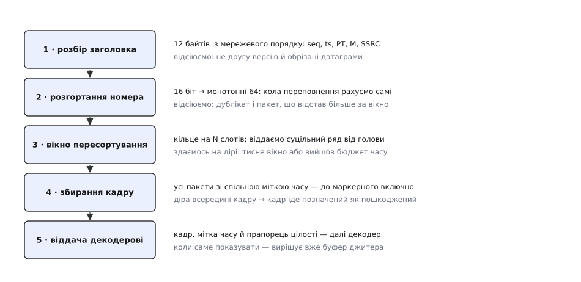
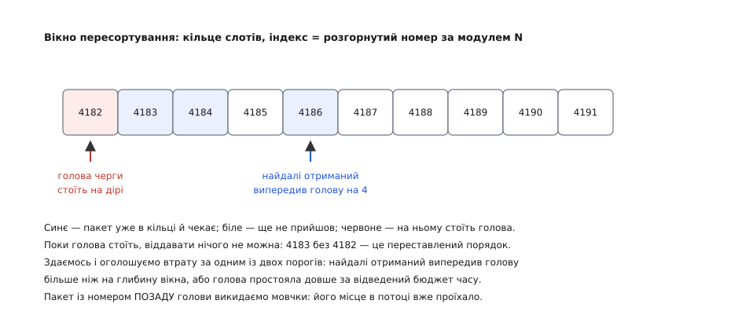

# ⚙️ Приймач RTP: від датаграми до кадру

Тут ми напишемо ту частину медіаприймача, яку не описує жоден стандарт: код, що перетворює безладний потік UDP-датаграм на рівний ряд кадрів із чесною позначкою «цей цілий, а цей пошкоджений». Заголовок RTP каже, **що** в пакеті; усе інше — порядок, межі кадру, момент здатися й визнати втрату — доводиться будувати руками, і саме там ламаються реалізації.

## Задача, якої не видно з розкладки заголовка

Здається, роботи на пів години: прочитати дванадцять байтів, узяти номер і мітку часу, скласти пакети з однаковою міткою в купку, дочекатися маркера — і кадр готовий. Цей код працює на столі й розсипається на першому справжньому каналі, бо мовчки припускає чотири речі, жодна з яких не правда.

Він припускає, що **пакети приходять по порядку**. Насправді 1002 легко обжене 1001: пакети пішли різними маршрутами, або проміжний вузол переставив їх у своїй черзі. Купка «за міткою часу» тоді збереться правильно, але шматки кадру ляжуть у неправильному порядку, і декодер отримає перемішані байти.

Він припускає, що **номер росте**. Насправді номер шістнадцятибітовий: після 65535 іде 0. При дев'ятистах пакетах на секунду це трапляється кожні сімдесят дві секунди — і наївне порівняння `seq > last` перетворює кожен такий момент на «загублено 65 тисяч пакетів».

Він припускає, що **кожен пакет прийде**. Насправді частина не прийде ніколи, і питання не в тому, чекати чи ні, а в тому, **скільки** чекати: чекати вічно — заморозити відео; не чекати зовсім — оголосити втратою кожне переставляння.

І він припускає, що **потік один і той самий**. Насправді посеред сеансу може змінитися SSRC — джерело перезапустилося, сервер перемкнув камеру, у ту саму пару портів прилетів чужий потік. Уся накопичена статистика в цю мить стає брехнею.

Отже, справжня задача звучить так: **з потоку датаграм, що приходять у довільному порядку, з дірами, дублікатами й перезапусками джерела, зібрати послідовність кадрів так, щоб кожен кадр вийшов у правильному порядку, з правдивою позначкою цілості й із обмеженою згори доданою затримкою**. Останнє — не примха: приймач, який заради повноти кадру готовий чекати необмежено довго, живому відео шкодить більше, ніж утрата.


*Приймач — це не «розбір заголовка», а конвеєр рішень. Кожна сходинка щось відсіює, і саме перелік відсіяного пояснює, навіщо вона потрібна: без другої в потоці з'являються фантомні втрати на кожному колі лічильника, без третьої декодер отримує перемішані байти, без четвертої він не знає, де кадр закінчився.*

## Ідея: дві осі, одна голова й один бюджет часу

Увесь приймач тримається на трьох спостереженнях.

**Перше: номер і мітка часу — це дві незалежні осі, і плутати їх не можна.** Номер відповідає за порядок і за виявлення дір; мітка часу відповідає за межі кадру й за момент показу. Пакети одного кадру мають різні номери й **однакову** мітку. Тому пересортування ведемо тільки за номером, а кадр складаємо тільки за міткою — і жодна операція не заглядає в чужу вісь.

**Друге: пересортування — це черга з однією головою.** Не потрібно нічого сортувати. Потрібно тримати змінну «наступний номер на видачу» — голову — і віддавати пакети суцільним рядом від неї. Прийшов пакет із номером голови — віддали й посунули голову; наступний уже лежить у черзі — віддали й посунули ще раз. Голова застрягла на порожньому місці — стоїмо. Уся структура даних зводиться до масиву зі слотами й одного лічильника.

**Третє: рішення «пакет утрачено» — це рішення про час, а не про факт.** Приймач ніколи не дізнається напевно, що пакет не прийде; він лише в якийсь момент перестає чекати. Тож у коді має бути не перевірка «чи прийшов», а **бюджет**: скільки часу голові дозволено стояти й наскільки далеко за нею дозволено накопичитися решті. Два пороги, обидва явні, обидва налаштовні — це і є вся політика приймача.

## Крок перший: дванадцять байтів і три пастки за ними

Заголовок читаємо з мережевого порядку байтів **побайтово**, а не накладанням структури на буфер. Причин три, і кожна вже колись коштувала комусь ночі: [порядок байтів](root:hw-arch/endianness) у мережі старшим уперед, а на процесорі частіше молодшим; поле в датаграмі може лежати за адресою, не кратною своєму розмірові, і невирівняне читання на частині архітектур падає; а сам доступ до чужого буфера через покажчик на `uint16_t` — це порушення правил псевдонімів, яке оптимізатор має право використати проти вас.

:::code proj-depacketizer/cpp/krok-pershyi-dvanadtsiat.cpp

Три пастки тут заховані в порядку дій. **CSRC ідуть до розширення**, тож зсув треба рахувати саме в цій черзі — інакше на потоці з мікшера навантаження зсунеться на чотири байти за кожен зведений голос. **Довжина розширення міряється словами, а не байтами**, і чотири байти самого підзаголовка в неї не входять — класична помилка на множник чотири. **Набивку зрізають із хвоста, і лічильник у ній рахує сам себе**, тож `k == 0` — це не «нема набивки», а зіпсований пакет: нуль означав би, що байт-лічильник не рахує навіть себе.

Кожна перевірка меж тут не про акуратність, а про безпеку: `cc`, `words` і `k` приходять із мережі, і кожне з них — це число, яким чужа сторона вказує вашому коду, куди дивитися в буфері.

## Крок другий: шістнадцять бітів у монотонні шістдесят чотири

Далі нам треба порівнювати номери, а порівнювати шістнадцятибітові числа з переповненням не можна: 0x0002 і 0xFFFE — це або «на чотири вперед», або «на 65 532 назад», і сама пара чисел відповіді не містить. Відповідь дає припущення, без якого приймача взагалі не побудувати: **справжня відстань між сусідніми пакетами мала**. Переставляння в мережі — це одиниці й десятки позицій, а не десятки тисяч.

Отже, з двох тлумачень різниці ми завжди беремо **коротше**. Це і є [модульна арифметика](root:sf-lang/unsigned-overflow) в чистому вигляді: різницю рахуємо за модулем 2¹⁶, а тоді половину кола, більшу за 32767, читаємо як рух назад.

:::code proj-depacketizer/cpp/krok-druhyi-shistnadtsiat.cpp

**Розгортання через межу переповнення**

```
опора ref = 0x0001_FFFE   (розгорнутий номер найдальшого баченого пакета)
прийшов пакет із seq = 0x0002   (шістнадцять бітів, уже після кола)

ref16 = ref & 0xFFFF                       = 0xFFFE
raw   = (uint16_t)(0x0002 − 0xFFFE)        = 0x0004
raw < 0x8000  →  d = +4
ext = 0x0001_FFFE + 4                      = 0x0002_0002   ← уперед на чотири

а тепер спізнілий пакет seq = 0xFFFD
raw   = (uint16_t)(0xFFFD − 0xFFFE)        = 0xFFFF
raw ≥ 0x8000  →  d = 0xFFFF − 0x10000      = −1
ext = 0x0001_FFFE − 1                      = 0x0001_FFFD   ← назад на один
```

Коло переповнення тут ніде не згадане й ніде не полічене — воно **випало саме собою** з модульної арифметики. Це головна причина писати саме так: код, який рахує кола явним лічильником, має окрему гілку на межі, а окрема гілка на межі — це окремий баг раз на сімдесят дві секунди.

Три деталі роблять цей клас робочим. **Опора рухається лише вперед** — інакше спізнілий пакет потягнув би її назад і наступний нормальний пакет розгорнувся б на ціле коло не туди. **Зсув `BIAS`** рятує від того, що перші ж пакети прийдуть трохи не по порядку: без нього перший пакет із номером на одиницю меншим за опору дав би від'ємне число там, де ми домовилися про беззнакове. І **проміжний тип `int64_t`** — щоб додавання від'ємного зсуву не робилося в беззнаковій арифметиці.

Знавці впізнають коротший запис того самого: `(int16_t)(uint16_t)(seq - ref16)`. Він робить рівно те, що гілка вище, але покладається на перетворення завеликого беззнакового значення в знаковий тип — а це стандарт визначив аж у C++20 (разом із вимогою доповняльного коду); до того воно було на розсуд реалізації. Явна гілка працює скрізь і читається без виносок.

## Крок третій: вікно пересортування

Тепер сама черга. Її роль легко описати неправильно: вона **не сортує**. Вона тримає голову — розгорнутий номер наступного пакета на видачу — і має відповісти лише на одне питання: коли перестати на неї чекати.

Пакети складаємо в [кільцевий буфер](root:sf-algorithms/ring-buffer) на `N` слотів, де індекс — це розгорнутий номер за модулем `N`. Розмір беремо степенем двійки, щоб модуль звівся до маски. Розподілу пам'яті в гарячому шляху нема взагалі: жодних дерев і жодних вставок у середину.


*Стан, заради якого черга й існує. Пакет 4182 не прийшов, а 4183, 4184 і 4186 уже лежать. Віддавати їх не можна — це переставлений порядок, а не потік. Але й чекати вічно теж не можна, тож два пороги — за глибиною й за часом — вирішують, коли визнати 4182 утраченим і рушити далі.*

Ключова вигода індексації за номером: **дублікат виявляється безкоштовно**. Оскільки в кільці одночасно живуть лише номери з проміжку `[голова, голова + N)`, два різні номери ніколи не потраплять в один слот. Тому зайнятий слот означає рівно одне — той самий пакет уже лежить, і це повтор. Ніяких порівнянь, ніякого пошуку.

:::code proj-depacketizer/cpp/krok-tretii-vikno.cpp

Дві речі в цьому коді варті окремого погляду.

Рядок `if (target <= head_) return;` виглядає зайвою обережністю, а насправді тримає весь бюджет часу. Без нього виклик `advance_to_(head_)`, який нічого не робить, усе одно скидав би `stalled_` — і лічильник простою переставав би на щось стояти: кожен новий пакет починав би відлік спочатку, поріг за часом не спрацював би ніколи, і приймач висів би на дірі, поки її не проштовхне поріг за глибиною.

Другу річ видно в `drain`: після виклику `out_` пакет одразу звільняється, а голова рушає далі **в тому ж циклі**. Це і є амортизація: один пакет, що закрив діру, може вивільнити десяток тих, які чекали за ним, і всі вони підуть суцільним рядом за один прохід.

> 🔧 **Навіщо це.** Три лічильники — `late`, `dup`, `lost` — це не прикраса, а вбудований діагност, і читати їх треба разом. Багато `lost` при нулі в `late` — канал справді губить пакети. Багато `late` — пакети приходять, але після того, як їхнє місце проїхало: вікно замале або мережа переставляє сильніше, ніж ви заклали; лікується глибиною, а не заміною каналу. Багато `dup` — або джерело шле повтори, або той самий потік доходить двома шляхами. Без цих трьох чисел «відео гальмує» лишається скаргою; з ними це діагноз.

**Глибина вікна — це прямо додана затримка**

```
відео 30 кадрів/с, кадр іде 30 пакетами     → 900 пакетів/с
проміжок між пакетами = 1 / 900             ≈ 1.11 мс

глибина depth = 32 пакети
затримка в найгіршому разі = 32 · 1.11 мс   ≈ 35.6 мс
бюджет часу hold = 40 мс — той самий порядок, і це не збіг

пам'ять: N = 128 слотів · 1400 байтів       ≈ 180 КБ на потік
```

Ці два пороги мусять бути одного порядку. Якщо бюджет часу набагато більший за глибину, спрацьовуватиме тільки глибина, і поведінка приймача залежатиме від бітрейта: на тихій сцені, де пакетів мало, він чекатиме секундами. Якщо навпаки — глибина стане мертвою настройкою. Тримати їх узгодженими означає, що приймач поводиться однаково і на статичній картинці, і на бурхливій.

## Крок четвертий: збирання кадру

Тепер пакети йдуть суцільним рядом за номерами, а між ними — заяви про діри. Складання кадру стає простим, і вся його тонкість — в одному операторі порівняння.

Межу кадру дає **зміна мітки часу**, а не її зростання. Різниця принципова: мітка RTP — це момент **показу**, а пакети йдуть у порядку **кодування**. Коли кодек уживає двонапрямлені кадри, ці порядки не збігаються, і мітка часу законно **йде назад**. Стандарт це прямо передбачає: послідовні пакети можуть нести немонотонні мітки, якщо дані передано не в тому порядку, у якому їх узято, — тоді як номери лишаються монотонними завжди. Тому порівняння тут тільки `!=`; будь-яке `>` перетворить приймач на такий, що псує картинку рівно на складному матеріалі, де вона й так на межі.

:::code proj-depacketizer/cpp/krok-chetvertyi-zbyrannia.cpp

Обробка діри тут навмисно песимістична. Коли діра трапилася між кадрами, ми не знаємо, чиї байти пропали — хвіст попереднього чи голова наступного, — і не вгадуємо: підозра переходить на наступний кадр. Хибно позначений кадр коштує одного зайвого спрацювання [приховування втрат](root:com-signal/packet-loss-concealment); неправдиво позначений цілим кадр коштує декодерові розсипаної картинки на всю групу зображень.

Прапорець `damaged` — це весь вихід приймача назовні, і саме заради нього все й будувалося. Декодер, який отримує кадри без цього прапорця, змушений упізнавати пошкодження по своїх помилках розбору, тобто вже після того, як з'їв зіпсовані байти. Що конкретно робити з позначкою, залежить від кодека: як шматки навантаження складаються назад у одиниці потоку, розібрано на прикладі [будови NAL у H.264](root:com-signal/h264-nal-structure).

## Крок п'ятий: чий це взагалі потік

Лишилося зв'язати все докупи — і закрити останню діру: SSRC може змінитися посеред сеансу. Наївна перевірка `if (ssrc != cur_) reset()` тут гірша за відсутність перевірки: коли в ту саму пару портів прилітають два потоки (стороннє відлуння, невдало налаштований мікшер, залишки старого сеансу), приймач скидатиме весь стан на кожному пакеті й не збере жодного кадру.

Ліки — випробування. Нове джерело мусить довести, що воно справді потік, а не поодинокий пакет: показати **два номери поспіль**. Число два — з приписів самого стандарту, там воно зветься `MIN_SEQUENTIAL`.

:::code proj-depacketizer/cpp/krok-piatyi-chyi-tse.cpp

І весь приймач:

:::code proj-depacketizer/cpp/krok-piatyi-chyi-tse-2.cpp

Метод `tick` — не зручність, а необхідність, і його забувають частіше за все. Уся логіка бюджету часу живе в `drain`, а `drain` кликається з `push`. Отже, поки не прийде наступний пакет, застигла голова не зрушить із місця. Саме той випадок, коли час найдорожчий, — канал провалився й пакети припинилися, — це випадок, у якому приймач без таймера мовчить нескінченно. Той самий `now_ns` мусить бути [показом монотонного годинника](root:sf-apps/monotonic-vs-wall-time), а не годинника доби: перевід стрілок або підтягування часу службою синхронізації робить різницю від'ємною, а в беззнаковому `uint64_t` від'ємна різниця — це величезне додатне число, тобто миттєве спрацювання порогу на всьому, що чекало.

## Складність і ціна

**За пакет — стала робота.** Розбір заголовка — фіксована кількість дій; розгортання номера — кілька арифметичних; вкладання в кільце — одна маска й одне присвоєння. Видача амортизовано стала: кожен слот віддається рівно раз, тож цикл у `drain` за весь час зробить стільки кроків, скільки було пакетів.

Одне місце виламується з цієї сталості навмисно — примусовий зсув голови при розриві. Він обмежений згори `MAX_DROPOUT` кроками, тобто трьома тисячами; далі приймач не бреде по одному, а пересинхронізовується одним стрибком і повідомляє про діру однією заявою. Це і є сенс тієї константи. Без неї джерело, яке перезапустилося з новим випадковим номером, змусило б приймача пройти пішки до тридцяти з гаком тисяч кроків усередині обробки **однієї** датаграми — рівно тієї миті, коли потік і так щойно зламався. Верхня межа тут не випадкова: розгортання завжди бере коротшу відстань, тож стрибок уперед фізично не буває більшим за пів кола, 32 767.

**Пам'ять — `N` слотів на потік**, приблизно 180 КБ при 128 слотах і типовому розмірі пакета. Кільце виділяється раз; у гарячому шляху розподілів не лишається жодного, якщо повторно вживати вже виділені вектори замість того, щоб чистити їх до нуля. Копіювання навантаження з буфера сокета — єдина неусувна витрата в цьому коді, і саме її прибирають першою, коли впираються в межу: замість `std::vector` у слот кладуть посилання на буфер із заздалегідь виділеного пулу, а сам сокет читають одразу в цей пул.

**Затримка — рівно глибина вікна**, і це не побічний ефект, а ручка керування. Тому приймач і не варто робити «розумнішим»: він свідомо не вирішує, коли показувати кадр. Він лише віддає його з міткою часу й позначкою цілості, а компроміс між плавністю й затримкою розв'язують далі, у [буфері джитера](root:com-signal/jitter-buffer), де для цього є повна картина нерівності приходу.

## Пастки, на яких ламаються приймачі

**Перший пакет несе випадкові номер і мітку.** Обидва початкові значення стандарт радить обирати непередбачуваними — щоб сторонньому було важче підсунути в потік свої пакети, — і на практиці так і роблять. Отже, жодне з них не має абсолютного змісту: сенс мають лише різниці. Код, який десь порівнює мітку з нулем або чекає, що перший номер буде малий, зламається на першому ж справжньому сеансі.

**Мітка часу теж переповнюється.** Про шістнадцять бітів номера пам'ятають усі, про тридцять два біти мітки — майже ніхто, бо на столі до цього не доживають.

```
відео, годинник 90 000 Гц
2³² / 90000 = 4294967296 / 90000 = 47721.9 с   ≈ 13 год 15 хв
звук, годинник 8000 Гц
2³² / 8000  = 536870.9 с                       ≈ 6.2 доби
```

Камера спостереження, що працює безперервно, доходить до цієї межі щодня. Мітку треба розгортати тим самим прийомом, що й номер, — тільки з півколом 2³¹ замість 2¹⁵.

**Частота годинника не з коду, а з опису сеансу.** Тип навантаження в заголовку каже, який кодек і яка частота, але для динамічних номерів (96–127) відповідність узгоджують заздалегідь — найчастіше [описом сеансу](root:com-protocol/rtsp-sdp). Зашитий у код «90 000» тихо працює на відео й тихо ж бреше, щойно потрапить на потік з іншою частотою: тривалості, обчислені з міток, поїдуть у ціле число разів, а разом із ними — і всі оцінки затримки.

**У межах одного SSRC номери спільні для всіх типів навантаження.** Це ловить тих, хто відсіює пакети за типом навантаження **до** черги пересортування: у звуковому потоці поряд із мовою йдуть пакети сигналів тонового набору й комфортного шуму зі своїми номерами навантаження, але з тієї самої [нумерації пакетів](root:com-transport/sequence-numbering). Викинули їх раніше часу — і на кожному викинутому дістали фантомну діру. Відсівати за типом навантаження можна лише після того, як черга віддала пакет по порядку.

**Дублікат — це нормальний стан, а не аномалія.** Повтори з'являються від вибіркових перезапитів, від багатоадресних петель, від двох маршрутів до того самого приймача. Приймач, який їх не відсіює, побачить у кадрі повторений шматок; приймач, який відсіює їх лічильником замість слота, помилиться на першому ж переставлянні.

**Дуже спізнілий пакет треба викидати мовчки — але рахувати вголос.** Він уже нікому не потрібен: його місце віддано, кадр зібрано. Проте кількість таких пакетів — найточніший показник того, що вікно замале: коли `late` росте, а `lost` при цьому не падає, ви ріжете живі пакети власним порогом, а не втрачаєте їх у мережі.

**Зміна SSRC скидає геть усе.** Не лише кільце: новий потік має нову базу номерів, нову базу міток, можливо, інший кодек і, майже напевно, іншу частоту годинника. Стан, який переживе цю мить, — це стан, що бреше. Тому в коді вище `Switched` веде рівно туди ж, куди `First`: усе спочатку.
