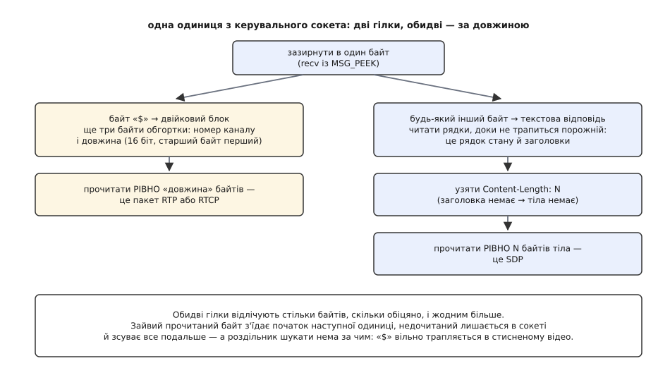

# 🛠 Мінімальний клієнт RTSP: від рядка адреси до першого пакета RTP

Ось повний код програми, яка з рядка `rtsp://192.168.1.64/Streaming/Channels/101` доходить до живих пакетів медіа на власному сокеті: відкриває з'єднання, проводить чотири команди, витягає з опису те, без чого не обійтися, і тримає сеанс живим, доки її не спинять. Близько двохсот рядків на C — і в них уміщається все, що бібліотека робить за вас мовчки, разом із місцями, де камера відповідає не так, як у прикладі з документації.

**Задум.** Порядок команд не довільний: результат кожної є входом для наступної. Перелік можливостей каже, чи розмовляє пристрій узагалі. Опис дає номер типу навантаження, частоту годинника й **адресу доріжки** — без неї немає куди слати наступний запит. Налаштування домовляється про порти й повертає ідентифікатор сеансу з терміном життя. Відтворення повертає опорну точку, від якої мітки часу в пакетах набувають сенсу. Плюс одна дія, яка не є командою й мусить статися раніше за свій результат: прив'язка UDP-сокетів.

### Каркас: один лічильник і одне правило читання

Клієнт починається з двох дрібниць, на яких валиться більшість саморобних реалізацій.

Перша — лічильник `CSeq`. Кожен запит несе власний номер, сервер повертає той самий номер у відповіді, і це єдиний спосіб зіставити відповідь із запитом. Номер зростає на **кожен** запит без винятку — зокрема на повторений після відмови 401 і на кожен пінг підтримання. Камера, що двічі побачила той самий номер, має право вважати другий запит дублікатом і мовчки його проковтнути; симптом — клієнт вічно чекає відповіді, якої не буде.

Друга — читання. Відповідь закінчується порожнім рядком, а за ним може стояти тіло, довжину якого називає `Content-Length`. Прочитати «скільки прийшло» не можна: у змішаному режимі за відповіддю в тому самому сокеті одразу лежить двійковий блок медіа, і зайвий узятий байт з'їсть його початок. Тому заголовки читають байт за байтом до порожнього рядка, тоді беруть рівно `Content-Length` байтів тіла — і зупиняються.


*Обидві гілки читають за оголошеною довжиною, а не за пошуком роздільника. Один зайвий байт зсуває межу назавжди — і далі клієнт бачить у потоці сміття, хоч мережа працює бездоганно.*

:::code proj-rtsp-client/c/rtspcli.c

### Опис: узяти з SDP рівно чотири значення

З усього опису клієнтові потрібно чотири речі на доріжку, і жодної більше: рід матеріалу (щоб знайти потрібний блок `m=`), номер типу навантаження, частоту годинника з `a=rtpmap` і адресу з `a=control`. Решта рядків — для декодера, для журналу або взагалі ні для чого.

Розбір робиться одним проходом і без буфера, бо формат саме на це й розрахований: блок `m=` відкриває доріжку, наступний `m=` її закриває, усе між ними належить їй.

Адреса доріжки — єдине місце, де є вибір. `a=control:trackID=1` треба дописати до базової адреси, `a=control:rtsp://cam/stream/trackID=1` уже повна, `a=control:*` означає сам сеанс. Базова адреса — не та, яку ви набрали: якщо у відповіді є `Content-Base` або `Content-Location`, чинним є він. Камери за проміжним сервером саме так і переадресовують потік, і клієнт, що склеїв хвіст із адресою запиту, отримає на налаштуванні відмову «не знайдено».

:::code proj-rtsp-client/c/opys-uziaty-z-sdp-rivno.c

### Спершу сокети, тоді запит

У заголовку транспорту клієнт називає серверові конкретні числа: «слатимеш на мій порт 5000, звіти на 5001». Назвати їх можна тільки тоді, коли вони вже твої. Спокуса зробити навпаки — попросити налаштування, глянути на відповідь і аж тоді прив'язатися — коштує дорого: між запитом і прив'язкою порт може забрати інша програма, а сервер уже цілий сеанс слатиме в нікуди. Тому [сокети](root:sf-os/sockets-tcp-udp) — пару UDP, парний для медіа й наступний непарний для звітів — беруть **до** відправлення запиту.

> 🔧 **Навіщо це.** Симптом переплутаного порядку впізнаваний і оманливий: команди проходять, сервер відповідає 200, `RTP-Info` приходить — а пакетів немає. Мережа ціла, протокол відпрацював бездоганно, просто камера сумлінно шле медіа на порт, який дістався чужій програмі. Перевіряють це не в коді, а знадвору: чи справді той порт тримає ваш процес.

:::code proj-rtsp-client/c/spershu-sokety-todi-zapyt.c

Доріжок буває більше за одну, і кожна налаштовується окремим запитом на **свою** адресу зі своєю парою портів. Друга дрібниця тут важить більше за першу: ідентифікатор сеансу з відповіді на перше налаштування треба покласти в заголовок другого запиту — саме так сервер розуміє, що це та сама розмова, а не два незалежні сеанси. Код вище робить це сам: `rtsp_send` додає `Session`, щойно поле заповнилося. Забути про нього — і камера віддасть другий ідентифікатор, після чого відтворення запустить рівно половину того, що ви замовили. Сама ж команда відтворення йде вже не на доріжку, а на спільну адресу сеансу — ту, яку в описі позначає `a=control:*`.

### Грати, тримати, відпустити

Далі все складається в один прохід. Після відтворення клієнт шле в бік камери дві порожні датаграми з того самого порту, куди чекає медіа: [трансляція адрес і фаєрвол](root:com-transport/nat-traversal) пропускають вхідний UDP лише туди, звідки щойно щось виходило, і без цього поштовху в багатьох мережах картинки не буде взагалі.

Таймер підтримання ставлять на **половині** оголошеного терміну — щоб один загублений пінг не вбив сеанс. Метод підтримання не вгадують: найперша команда, перелік можливостей, повертає заголовок `Public` з переліком того, що камера вміє, і звідти видно, чи є серед методів запит параметра. Відмову на нього все одно обробляють — трапляються пристрої, що перелічують метод і відповідають на нього помилкою, — але тоді це друга лінія оборони, а не спосіб дізнатися правду.

Опорна точка з `RTP-Info` потрібна вже на першому пакеті: номер `seq0` відділяє новий діапазон від залишків старого. Усе з меншим номером клієнт відкидає без вагань — це те, що грало до перемотування й доїхало із запізненням.

:::code proj-rtsp-client/c/hraty-trymaty-vidpustyty.c

Розбір самого пакета — зняти дванадцятибайтову шапку, врахувати список джерел і зібрати кадр із частин — це вже робота [депакетизатора RTP](root:com-protocol/rtp-rtcp), і вона починається рівно там, де закінчується цей клієнт.

### Чого коштує читання по байту

Читати по одному байту виглядає марнотратно, тож варто порахувати, де ця марнотратність справді щось важить.

**Виклики ядра на кожному шляху**

```
відповідь RTSP                        ≈ 400 байтів  → 400 викликів recv
пінгів за хвилину при timeout = 60 с  = 2
керувальний канал за хвилину          ≈ 2 · 400      = 800 викликів/хв ≈ 13/с

змішаний режим, 4 Мбіт/с, пакет 1044 Б
пакетів за секунду                    ≈ 4e6 / (1044·8) ≈ 479
якби тіло читали по байту             ≈ 479 · 1044     ≈ 500 000 викликів/с
```

Різниця в чотири порядки й вирішує все. На керувальному каналі кілька десятків викликів на секунду не помітить ніхто, зате точна межа гарантована задарма. На шляху медіа так робити не можна: там читають чотири байти обгортки, а тоді **одним** запитом рівно `len` байтів тіла.

І одна пастка, яку байт-за-байтом обходить, а один великий `recv` — ні: у потоці TCP `recv` має право повернути менше, ніж просили, навіть коли решта в дорозі. Тому запит на `len` байтів мусить бути циклом, який добирає залишок, доки не набере рівно стільки, скільки сказала обгортка. Один недочитаний хвіст — і всі дальші межі поїхали.

### Що ламається насправді

**Відмова 401.** Камери майже завжди просять автентифікації, і майже завжди — у формі, до якої RTSP відсилає прямо: механізми HTTP чинні як є. У відповіді приходить `WWW-Authenticate: Digest realm="…", nonce="…"`; з неї беруть два значення й рахують відповідь трьома [обчисленнями геша](root:sf-security/cryptographic-hash) MD5. Заголовок після цього ставлять у **кожен** дальший запит, а поле `uri` в ньому — адреса саме цього запиту: для налаштування це адреса доріжки, а не базова, і переплутати їх — типова причина того, що перша команда проходить, а друга ні.

:::code proj-rtsp-client/c/shcho-lamaietsia-naspravdi.c

**Пакетів немає, хоч усе відповіло 200.** Спершу поштовх у бік камери, потім фаєрвол вашої ж машини, і аж тоді — запасний перехід у змішаний режим: повторити налаштування з `Transport: RTP/AVP/TCP;unicast;interleaved=0-1`. Тоді медіа поїде тим самим з'єднанням, що й команди, а читач із першого коду вже готовий: він зазирає в перший байт і розрізняє гілки.

**Правило межі.** У змішаному режимі блок медіа знаходять **лише** за полем довжини з обгортки. Шукати в потоці байт `$` не можна: він вільно трапляється всередині стисненого відео, і один такий «знайдений» початок зсуває розбирач назавжди — далі клієнт бачить сміття, хоч жоден байт не загублено.

**Сеанс, що обривається на тій самій хвилині.** Це не мережа й не камера: це відсутній таймер підтримання. Поки медіа йде окремими датаграмами, керувальне з'єднання простоює, і сервер має повне право вважати клієнта мертвим.

**Дрібне, що коштує годин.** Заголовки шукають без урахування регістру. `timeout` шукають у межах свого рядка. `Content-Length` буває відсутній — тіла тоді просто немає, а не «нуль байтів чекаємо вічно». Частота годинника береться з опису, ніколи не зашивається числом 90000: потік зі своїм годинником дасть тривалості, помилкові рівно в стільки разів, у скільки розходяться частоти.
