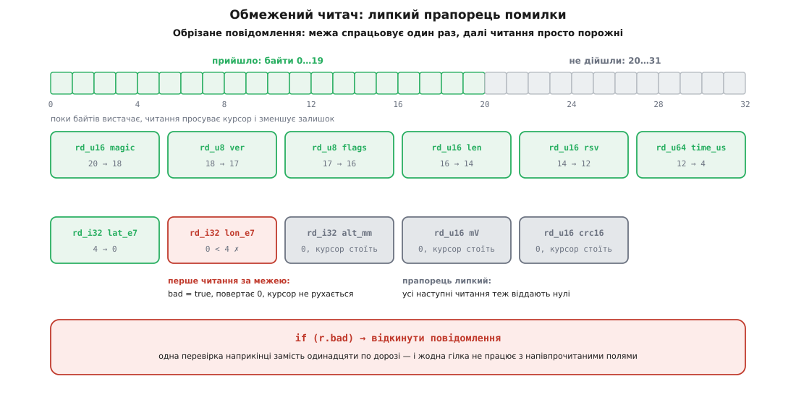

# ⚙️ Кодек телеметричного повідомлення на C: писар, читач і еталонний вектор

Тут зібрано кодек одного повідомлення цілком — тридцять два байти за таблицею формату, писар, читач, контрольна сума й тест, — щоб було видно не уривки, а весь шлях від полів структури до байтів у дроті й назад. Код нижче складається в один файл і компілюється як є (`-std=c11 -Wall -Wextra`); наприкінці стоїть еталонний вектор у шістнадцятковому вигляді — саме він, а не опис словами, є остаточним арбітром між двома реалізаціями.

## Завдання

Пристрій щосекунди відправляє позицію, висоту й напругу батареї. Приймач — інший процесор, інша мова, інший порядок байтів. Формат зафіксовано таблицею:

```
зсув  розмір  поле      тип       зміст
  0     2     magic     uint16    0xA5C3 — мітка «це наше повідомлення»
  2     1     ver       uint8     версія формату, поки 1
  3     1     flags     uint8     бітові ознаки стану
  4     2     len       uint16    довжина ВСЬОГО повідомлення = 32
  6     2     rsv       uint16    нулі, місце під майбутнє поле
  8     8     time_us   uint64    мікросекунди від увімкнення
 16     4     lat_e7    int32     широта × 10⁷ градуса
 20     4     lon_e7    int32     довгота × 10⁷ градуса
 24     4     alt_mm    int32     висота відносно точки зльоту, мм
 28     2     mV        uint16    напруга батареї, мілівольти
 30     2     crc16     uint16    контрольна сума над байтами 0…29
```

Усі багатобайтові поля — старшим байтом уперед. Координата в десятимільйонних частках градуса — те саме кодування, що в MAVLink: цілий тип замість `float` дає точність близько сантиметра при однозначному поданні й без питань про заокруглення.

## Ідея: два курсори, одна перевірка, липка помилка

Кодек будується не як набір присвоєнь за зсувами, а як два маленькі курсори — **писар** і **читач**. Кожен тримає три речі: де стоїть, скільки байтів лишилося, і чи вже сталася біда. Уся арифметика меж живе в одній-єдиній функції на курсор; решта — тонкі обгортки, які просто розкладають число на байти.

Звідси три властивості, яких простий набір присвоєнь за зсувами не дає.

Перша — **межу неможливо забути**. Не існує способу записати поле, обійшовши перевірку: щоб отримати місце під байти, треба спитати курсор, а він відповідає або покажчиком, або відмовою.

Друга — **помилка липка**. Щойно курсор пішов за межу, він піднімає прапорець і більше нічого не рухає: усі подальші читання повертають нулі, усі подальші записи нічого не пишуть. Тому перевіряти доводиться один раз наприкінці, а не після кожного поля.

Третя — **зсуви не пишуть руками**. Кожне поле стає туди, куди його поставив попередній запис. Зсуви з таблиці існують лише як константи для перевірок, і саме тому їх можна звірити на етапі компіляції.


*Прийшло 20 байтів із 32. Шість перших читань проходять, `lat_e7` забирає останні чотири байти, `lon_e7` уже не має чого читати — прапорець піднято. Далі курсор не рухається взагалі, а розбір закінчується одним `if`.*

> 🔧 **Навіщо це.** Класична вада саморобного розбору — перевірка після кожного поля. Її пишуть на перших трьох полях, а на дев'ятому забувають, і саме дев'яте стає дірою. Липкий прапорець прибирає спокусу: після нього код розбору читається як пряма послідовність полів, без жодного `if` між ними, і при цьому не має жодного шляху вийти за буфер.

## Специфікація в коді

Спершу — константи. Зсуви не набирають числами: кожен виводиться з попереднього, а числа з таблиці стоять окремо, у перевірках.

:::code proj-wire-codec/c/stdint.h

Ці рядки нічого не коштують у машинному коді й нічого не роблять у роботі — вони [ламають збирання](root:sf-lang/static-assert), щойно хтось додасть поле посередині або переставить два рядки місцями. Перевірка часу компіляції — це твердження про програму, а не про її запуск: вона не вимагає тесту, який до неї дійде, і не мовчить на платформі, де її не запускали.

Останні дві перевірки варті окремої уваги: вони не про формат, а про **межі застосовності кодека**. Ширина байта й розмір `float` у C не гарантовані, і замість того щоб мовчки зламатися на дивному цільовому процесорі, кодек відмовиться збиратися. Ознака `__STDC_IEC_559__`, якщо платформа її оголошує, додатково означає, що біти `float` — це IEEE 754; без неї про кодування дробових доводиться домовлятися словами в специфікації.

## Писар

:::code proj-wire-codec/c/pysar.c

Порівняння написане саме так — `(end - p) < n`, а не `p + n > end` — і це не стилістика. Другий варіант спершу утворює покажчик за межами масиву, а це в C невизначена поведінка, навіть якщо його ніколи не розіменувати; на 32-бітних адресах з великим `n` він ще й може загорнутися й дати «правда, місця вистачає» на порожньому буфері. Різниця двох покажчиків усередині одного масиву визначена завжди й ніде не переповнюється, бо `p` за побудовою ніколи не переходить `end`.

Далі — самі поля. Кожне з них однакове до нудьги, і це добре:

:::code proj-wire-codec/c/pysar-2.c

Три деталі, які легко проґавити.

`wr_i32` не робить нічого, окрім приведення: перетворення знакового в беззнакове визначено стандартом як зведення за модулем 2³², тобто −1250 стає 0xFFFFFB1E — рівно [доповняльний код](root:hw-arch/twos-complement), рівно те, чого чекає приймач. Зворотний бік не такий безхмарний, і про нього — у читачі.

`wr_f32` ходить через `memcpy` не з обережності, а тому, що це єдиний спосіб у C законно подивитися на ті самі байти крізь інший тип: [правила аліасування](root:sf-lang/strict-aliasing) забороняють читати `float` як `uint32_t` через приведення покажчика. Виклику функції тут не буде — компілятор із оптимізацією бачить фіксований розмір наскрізь.

`wr_str` перевіряє `n > 255` **до** будь-якої арифметики й ставить прапорець сам: інакше `(uint8_t)n` тихо обрізало б довжину, і в дріт пішло б повідомлення, де префікс каже одне, а байтів записано інше. І охорона `if (b && n)`: `memcpy` із нульовою довжиною й порожнім покажчиком формально невизначена, хоч практично й нешкідлива. Рядки в дроті — це байти [UTF-8](root:sf-data/ascii-utf8) із префіксом довжини, і довжина рахується саме в байтах, а не в символах.

## Читач

Дзеркальна пара, з однією відмінністю: там, де писар нічого не пише, читач віддає нуль.

:::code proj-wire-codec/c/chytach.c

Приведення `(uint32_t)b[0]` перед зсувом — не прикраса. Без нього `b[0]` за [правилами просування типів](root:sf-lang/integer-promotion) стає звичайним знаковим `int`, і зсув на 24 для будь-якого байта від 0x80 переповнює знаковий тип — тобто [невизначена поведінка](root:sf-lang/undefined-behavior) на цілком робочих даних. Компілятор мовчить, а оптимізатор має право припустити, що такого не буває. Байт, зведений до `uint32_t`, зсувається однозначно.

`rd_i32` копіює біти замість приведення `(int32_t)u`. Приведення беззнакового в знаковий, коли значення не влазить у знаковий діапазон, у C лишається визначеним реалізацією; фактично всі компілятори роблять очевидне, але кодек протоколу — не те місце, де варто спиратися на «фактично всі». Копія бітів дає доповняльний код за побудовою й після оптимізації не коштує жодної команди.

І головне про `rd_str`: він повертає покажчик **усередину прийомного буфера**. Це найдешевший розбір з можливих — нуль виділень пам'яті, нуль копіювань, — але він накладає обов'язок: розібраний рядок живий рівно доти, доки живий буфер. Якщо ім'я треба зберегти надовго, його копіюють явно, і саме тут, а не всередині кодека.

## Контрольна сума

Беремо CRC-16/IBM-3740: ширина 16, многочлен 0x1021, початкове значення 0xFFFF, без відображення бітів, без завершального XOR. Каталог параметризованих CRC (RevEng) подає для нього псевдоніми CRC-16/CCITT-FALSE і CRC-16/AUTOSAR — під ними його й зустрічають у бібліотеках, — і контрольне значення 0x29B1 на рядку `"123456789"`. Ця одна константа й перевіряє реалізацію: під назвою «CRC-CCITT» ходить щонайменше чотири різні алгоритми, і сплутати їх легше, ніж помилитися в коді.

:::code proj-wire-codec/c/kontrolna-suma.c

Це побітовий варіант: вісім операцій на байт, нуль пам'яті. Для тридцяти байтів раз на секунду цього досить із величезним запасом; там, де байтів тисячі, ту саму суму рахують за таблицею на 256 записів — один пошук на байт коштом півкілобайта сталої пам'яті, або за таблицею на 16 записів — два пошуки на байт коштом тридцяти двох байтів. Числа не змінюються від способу: [контрольна сума](root:com-protocol/crc-in-firmware) визначена многочленом, а таблиця — лише спосіб порахувати те саме швидше.

Порядок один і той самий на обох боках: суму рахують над **усіма байтами повідомлення, крім двох останніх**, і записують у ці два останні. Приймач рахує над тим самим діапазоном і порівнює.

## Збирання й розбір повідомлення

:::code proj-wire-codec/c/zbyrannia-i-rozbir.c

Ранній вихід перед підрахунком суми — єдине місце в писарі, де перевірка стоїть посеред роботи, і вона там обов'язкова. `crc16(buf, OFF_CRC)` читає тридцять байтів. Якщо буфер був коротший і писар зупинився на середині, ці тридцять байтів просто не існують — сума порахувалася б над чужою пам'яттю. Прапорець `bad` тут не про правильність результату, а про право взагалі торкатися буфера.

:::code proj-wire-codec/c/zbyrannia-i-rozbir-2.c

Тут варто помітити три рішення.

Читач обмежують `TELEM_SIZE`, а не `n`. Якщо в буфері лежить кілька повідомлень поспіль, розбір усе одно не вийде за своє — а виділенням кадрів із потоку займається окремий шар, [кадрування](root:com-protocol/tcp-message-framing).

Поле `len` **звіряють, а не слухають**. Читанням керує таблиця формату, `len` лише мусить із нею збігтися. Це головна різниця між «розібрати» і «зробити те, що сказали байти».

Суму перевіряють **до** того, як хоч одне змістове поле потрапить у `out`. Порядок тут важить: якщо спершу розкласти поля, а потім відхилити повідомлення, десь обов'язково знайдеться гілка, яка встигне подивитися на висоту з битого пакета. І фінальний `r.bad` не може спрацювати за нинішньої довжини — але він переживе редагування, коли до формату додадуть поле, а перевірку розміру забудуть підправити.

## Змінна частина: рядок і дробове

Резервне поле `rsv` існує не для краси. У другій версії формату воно стає `msg_id`, зсуви не рухаються, і в тому самому заголовку з'являється друге повідомлення — з ім'ям вузла й напругою в вольтах:

:::code proj-wire-codec/c/zminna-chastyna-riadok-i.c

Рядок `if (len < STATUS_MIN || len > n)` робить дві різні роботи одним виразом. Права половина не дає повірити чужому числу: заявлена довжина не може перевищувати кількість байтів, які справді прийшли. Ліва половина рятує наступний рядок — без неї `len - 2` для `len == 1` не дало б −1, а дало б величезне число, бо `size_t` беззнаковий і [загортається за модулем](root:sf-lang/unsigned-overflow). Довжина, узята з дроту, стає безпечною лише після того, як її затиснули з обох боків.

## Круговий тест і еталонний вектор

:::code proj-wire-codec/c/kruhovyi-test-i-etalonnyi.c

Ось ці тридцять два байти в шістнадцятковому вигляді — той самий еталон, розкладений по полях:

```
A5 C3        magic   = 0xA5C3
01           ver     = 1
05           flags   = 0b0000_0101
00 20        len     = 32
00 00        rsv     = 0
00 04 62 D5 3C 8A BA C0   time_us = 1234567890123456
1E 12 13 08  lat_e7  =  504501000  →  50.4501°
12 31 88 20  lon_e7  =  305236000  →  30.5236°
FF FF FB 1E  alt_mm  =      -1250  →  -1.250 м
2E 42        mV      =      11842  →  11.842 В
03 87        crc16   = 0x0387 над байтами 0…29
```

Це і є **специфікація, яку неможливо витлумачити двояко**. Опис словами кожен читає по-своєму; тридцять два конкретні байти — ні. Реалізація іншою мовою вважається сумісною тоді й лише тоді, коли з цих самих полів дає цю саму послідовність, і з цієї послідовності — ці самі поля. Від'ємна висота в еталоні стоїть навмисно: саме на ній ламаються реалізації, де знакове поле випадково закодували як беззнакове.

Другий вектор — повідомлення `STATUS` з іменем `esc1` і напругою 11.842 В (двадцять сім байтів):

```
A5 C3 02 05 00 1B 00 02      magic, ver=2, flags, len=27, msg_id=2
00 04 62 D5 3C 8A BA C0      time_us
04 65 73 63 31               довжина 4, байти "esc1"
41 3D 78 D5                  vbat_v = 11.842f  (біти IEEE 754)
AF 06                        crc16
```

Перевірка четверта — перекидання одного біта — проходить не випадково: CRC із многочленом, у якому більше одного члена, ловить **усі** однобітові помилки, бо сума лінійна, а многочлен однієї помилки на такий многочлен не ділиться. Перевірка третя цінна іншим: вона проганяє розбір по всіх довжинах від нуля до тридцяти одного, тобто по всіх точках, де писар чи читач могли б вийти за буфер. Це вже майже [фаззинг](root:sf-release/fuzzing) — а справжній фаззер на цьому кодеку варто запустити окремо, під `-fsanitize=address,undefined`, згодувавши йому випадкові байти й дивлячись не на результат, а на відсутність падінь.

## Складність і ціна

Збирання й розбір повідомлення сталого розміру — стала робота: тридцять записів або читань байтів. Контрольна сума — лінійна від довжини, вісім бітових кроків на байт у побітовому варіанті, один пошук у таблиці на байт у табличному. Пам'яті кодек не виділяє взагалі: обидва курсори — три поля на стеку, розбір рядка не копіює нічого.

Головне ж стосується не швидкодії, а страху перед нею. Ланцюжок зсувів і `memcpy` фіксованого розміру після `-O2` не лишають по собі ні викликів, ні циклів: у GCC є окремий прохід (`pass_optimize_bswap`), що впізнає складання числа з байтів як перестановку й замінює її однією командою — `bswap` на x86, `rev` на ARM; `memcpy` малого сталого розміру перетворюється на одне завантаження або збереження. Тобто «байт за байтом» — це опис вихідного тексту, а не машинного коду. Плата за правильність тут нульова, і в жодного профілювальника до неї не буває питань.

## Пастки, які цей код закриває

**Довіра до заявленої довжини.** Приймач читає `len`, і далі копіює або зчитує стільки, скільки там написано. Байти прийшли ззовні — а отже, число теж прийшло ззовні. Ліки одні: `len` спершу звіряють із тим, скільки байтів справді є (`len > n` — відмова), і лише потім використовують. Пропущена саме ця перевірка колись [дала світові Heartbleed](root:sf-security/buffer-overflow-security): запитувана довжина відповіді була більша за отримані дані, і в мережу поїхала суміжна пам'ять процесу.

**Часткове повідомлення.** У потоці межі повідомлень не зберігаються, тож «прийшло 20 байтів із 32» — не аварія, а звичайний вівторок. Кодек має відповісти на це відмовою й нічого не зіпсувати: перевірка `n < TELEM_SIZE` до першого читання плюс липкий прапорець дають рівно це. Зібрати повний кадр — робота шару вище.

**Переповнення при обчисленні меж.** Три способи промахнутися одним виразом: `p + n > end` утворює покажчик за межами масиву; `off + n > size` завертається, якщо `off` чи `n` прийшли з дроту; `len - 2` завертається знизу для `len < 2`. Правильні форми не додають, а віднімають від відомого: `(end - p) < n`, `size - off < n`, і затиснута знизу довжина перед будь-яким відніманням. Правило просте — **арифметика над числами з дроту небезпечна доти, доки числа не затиснуто з обох боків**.

**Страх перед байтовим кодуванням.** Найпоширеніша «оптимізація» — покласти на буфер структуру й читати поля напряму. Вона одночасно ламає переносність розкладки, ігнорує порядок байтів і припускає вирівнювання, якого прийомний буфер не обіцяв. При цьому вона нічого не виграє: після оптимізації правильний код згортається в ті самі одну-дві команди. Швидкість тут не конкурує з правильністю — конкурує звичка.
