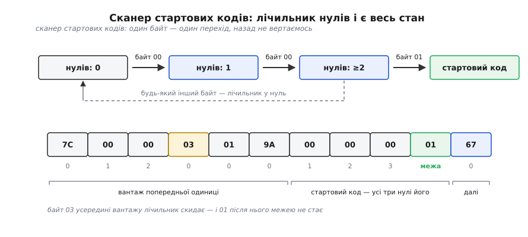
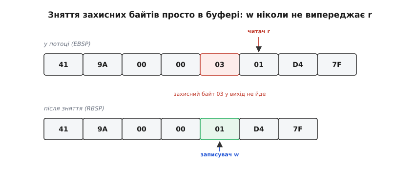

# ⚙️ Розбирач потоку H.264 на C: від сирих байтів до справжньої роздільності

Ось повний робочий розбирач: він бере файл із потоком H.264, проходить його один раз і каже, де починається кожна NAL-одиниця, якого вона типу, яка справжня ширина й висота картинки, де межі кадрів і де перша точка, з якої взагалі можна почати дивитися. Приблизно триста рядків, жодної зовнішньої залежності — і жодного знання про те, як влаштоване стиснення зображення всередині.

Це та сама програма, яку доводиться писати кожному, хто робить пакувальник для стрімінгу, записувач із камери, аналізатор потоку чи просто хоче зрозуміти, чому декодер мовчить. Мова — C, і не з упертості: код працює з сирими байтами й бітовими зсувами, живе під декодером на гарячому шляху й мусить витримувати ворожі дані, не падаючи. Демультиплексори всіх медіабібліотек написані саме так.

## Задача

Уточнімо умову, бо від неї залежить уся будова.

**На вході** — байти потоку Annex B: NAL-одиниці, розділені стартовими кодами `00 00 01` або `00 00 00 01`. Не файл MP4, не пакети RTP — сирий потік, який пише `ffmpeg -f h264` або віддає камера через RTSP після розпакування.

**На виході** — рядок на кожну одиницю: зсув у файлі, тип, розмір; для SPS ще й розібрані роздільність, профіль і рівень; для слайсів — позначка початку нового кадру й окремо позначка IDR. Наприкінці — скільки всього кадрів, скільки серед них точок входу й де перша.

**Обмеження, які й роблять задачу задачею.** Один прохід по байтах: потік може бути гігабайтним, вертатися назад нікуди. Жодного припущення про коректність входу: файл може бути обрізаний посередині, зіпсований мережею або навмисно ворожий — програма мусить сказати «не розібрав», а не вийти за межі масиву. І жодного розпакування картинки: усе, що нам треба, лежить у кількох десятках бітів на початку одиниць.

## Три рівні, які не можна змішувати

Головна ідея всієї конструкції — не в алгоритмі пошуку, а в тому, що байти потоку **тричі міняють значення** дорогою до розбору. Плутанина між цими трьома уявленнями і є причиною майже всіх зламаних розбирачів.

**Рівень перший — потік байтів.** Тут існують лише межі. Ми шукаємо стартові коди й нарізаємо потік на шматки. Що всередині шматка — байти, і крапка.

**Рівень другий — байти одиниці.** Усередині шматка є службові вставки, яких у справжніх даних немає: захисні байти `0x03`, що не дають випадковій комбінації підробити стартовий код. Їх треба зняти. Те, що вийде, стандарт зве RBSP.

**Рівень третій — біти.** Поля синтаксису не вирівняні по байтах узагалі: прапорець займає біт, номер набору параметрів — змінну кількість бітів, і наступне поле починається просто там, де скінчилося попереднє.

Кожен рівень має власну «абетку» — байти потоку, байти RBSP, біти — і власну арифметику зсувів. Спроба зекономити й, наприклад, прочитати ширину кадру бітовим читачем просто по байтах потоку, не знявши `0x03`, дає код, який працює на дев'яти файлах із десяти й видає безглузді числа на десятому. Тому три рівні тут — це три окремі шматки коду, які нічого не знають один про одного.

Почнімо з першого.

## Рівень байтів: сканер стартових кодів

Наївне рішення напрошується саме: на кожній позиції подивитися три байти й порівняти з `00 00 01`. Воно правильне, але приховує тонкість, на якій спотикаються майже всі — **хвостові нулі**.

Стандарт дозволяє перед стартовим кодом скільки завгодно нульових байтів. Чотирибайтна форма `00 00 00 01` — це і є трибайтний код із одним зайвим нулем попереду, а кодувальник має право дописати їх і більше, вирівнюючи одиницю на зручну межу. Питання: кому належать ці нулі — попередній одиниці чи наступній? Відповідь: **нікому**, вони поза одиницями. І розбирач, який знайшов `00 00 01` і оголосив, що попередня одиниця скінчилася рівно тут, віддасть у неї зайвий нуль — а іноді й десяток.

Тому сканер тримає лічильник підряд-нулів і вміє відняти їх назад.


*Увесь стан сканера — це одне число: скільки нулів поспіль щойно пройшло. Байт `03` усередині вантажу скидає лічильник, тому `01` одразу за ним межею не стає. А коли межа знайдена, усі три (чи п'ять) нулів перед `01` треба відняти від попередньої одиниці — вони частина коду, а не вантажу.*

:::code proj-nal-parser/c/h264scan.c

Два місця тут варті погляду. У другому циклі `end = i - 1 - zeros`: `i-1` — це індекс байта `01`, а перед ним лежить рівно `zeros` нулів, тож відняти треба всі. Якщо потік урвався без наступного коду, `end = n - zeros` робить те саме для хвоста файлу — нулі в кінці теж не вантаж.

І `it->pos = end`, а не `i`. Наступний виклик знову пройде по тому ж рядку нулів — свідома дрібна плата за те, що вся логіка «де починається код» живе в одному місці, а не дублюється в двох. Кожен байт потоку буде переглянуто щонайбільше двічі.

Порожні одиниці (два стартові коди підряд) сканер віддає чесно, з `len == 0`; відсіювати їх — робота того, хто читає.

## Рівень байтів: зняти захист, не роблячи копії

Тепер треба викинути захисні байти. Правило зворотне до кодувальникового: побачив `00 00 03` — викинь трійку, і лічильник нулів починай спочатку.

Копіювати одиницю в новий буфер немає потреби, і ось чому. Записувач іде за читачем крок у крок і **відстає** щоразу, коли викидається байт; випередити він не може ніколи. Отже, писати можна просто поверх джерела.


*Інваріант, який дозволяє працювати без копії: `w ≤ r` на кожному кроці, бо записувач або встигає за читачем, або відстає. Тому джерело й приймач можуть бути тим самим буфером.*

:::code proj-nal-parser/c/riven-baitiv-zniaty.c

Скидання `zeros = 0` після викинутої трійки — не косметика. Без нього послідовність `00 00 03 00 00 03 01` перетворилася б на щось інше, ніж вихідні `00 00 00 00 01`: другу трійку розбирач би не впізнав. Правило мусить бути точним дзеркалом кодувальникового, інакше воно необоротне.

Параметр `cap` перетворює ту саму функцію на другий, значно важливіший різновид.

> 🔧 **Навіщо це.** Слайс IDR-кадру в 1080p важить сотню кілобайтів, звичайний — десятки. А з усього цього нам потрібні перші два десятки байтів заголовка: номер набору параметрів, лічильник кадрів, кілька прапорців. Розбирач, який знімає захист із **усього** слайса, щоб прочитати три поля, переганяє через пам'ять увесь потік замість сотої його частини — і на тридцяти кадрах за секунду це помітно навіть на настільному процесорі. Тому для слайсів ми знімаємо захист лише з початку одиниці, у маленький буфер на стеку: `cap` обриває роботу рівно там, де вона перестає бути потрібною. Для наборів параметрів — навпаки, знімаємо все й на місці: вони короткі, а розбирати їх треба до кінця.

## Рівень бітів: читач і код Голомба

Далі — біти. Полів фіксованої довжини в H.264 небагато; майже все закодовано [експоненційним кодом Голомба](root:com-signal/exp-golomb), у якого довжина слова залежить від самого значення: спочатку рядок нулів, потім одиничка, потім стільки ж бітів залишку. Тому пропустити невідоме поле не можна — його доводиться прочитати, щоб узнати, де воно скінчилося. Розбирач мусить пройти всі поля до потрібного, навіть ті, що йому байдужі.

Ключове рішення тут — **як поводитися з виходом за межі**. Перевіряти повернене значення на кожному з тридцяти викликів неможливо, код перетвориться на лабіринт. Тому читач тримає прапорець `bad`: щойно біти скінчилися, він піднімається й далі не гасне, а всі наступні читання чесно повертають нулі. Розбір іде до кінця по сміттю, нікуди не виходячи за буфер, і рішення ухвалюється один раз наприкінці.

:::code proj-nal-parser/c/riven-bitiv-chytach-i-kod.c

Обмеження `lead > 31` — не педантизм, а захист. У зіпсованому потоці рядок нулів може тягнутися тисячами бітів; без обмеження `1u << lead` дає невизначену поведінку, а лічильник довжини — сміття, за яким розбір піде читати неіснуючу пам'ять. Тридцять два нулі поспіль у справжньому SPS не трапляються ніколи, тож поріг безпечний і водночас достатній.

## SPS: як із макроблоків виходить 1920×1080

Набір параметрів послідовності — найцінніша одиниця в потоці й найпоказовіша для розбирача: майже всі поля треба прочитати лише для того, щоб дійти до чотирьох чисел наприкінці.

:::code proj-nal-parser/c/sps-iak-iz-makroblokiv.c

Перелік профілів на початку — не таблиця «гарних» кодеків, а точний список тих [профілів](root:sf-visual/h264-profiles-levels), у чиєму SPS взагалі є поля формату кольору й глибини бітів. Базовий і головний профілі їх не мають, і 4:2:0 з вісьмома бітами там мається на увазі. Розбирач, який читає ці поля завжди, зсуне все далі за ними й отримає безглузду роздільність саме на найпоширеніших потоках. Значення 144 у списку — застарілий номер старого профілю High 4:4:4, який стандарт скасував, але в реальних файлах він досі трапляється, і серйозні декодери його терплять.

Найцікавіше — останні рядки. Розмір записано в макроблоках, а одиниця обрізання залежить від формату кольору, бо зсуви рахуються в **комірках вибірки кольору**, не в пікселях. Ось що з цього виходить для трьох поширених випадків:

```
формат      SubWidthC  SubHeightC   CropUnitX   CropUnitY (кадр без полів)
4:2:0            2          2           2           2
4:2:2            2          1           2           1
4:4:4            1          1           1           1
монохром         —          —           1           1
```

Тому та сама четвірка `frame_crop_bottom_offset = 4` зріже вісім рядків у потоці 4:2:0 і лише чотири в 4:2:2. Розбирач, який жорстко припише двійку, помилиться на половині кадрів у першому ж потоці з відеокамери, що знімає в 4:2:2.

## Слайси: де кінчається кадр

Щоб прочитати заголовок слайса, потрібен PPS, а щоб прочитати PPS — знати, який SPS він називає. Тому розбирач тримає обидві таблиці: тридцять два SPS і двісті п'ятдесят шість PPS, як дозволяє стандарт.

З PPS нам потрібні лише чотири перші поля — далі його синтаксис нас не обходить.

:::code proj-nal-parser/c/slaisy-de-kinchaietsia.c

Прапорець `cabac` тут — той самий біт, що перемикає весь спосіб читання решти потоку між [контекстно-адаптивним арифметичним кодуванням](root:com-signal/cabac) і простішою табличною CAVLC. Нам він потрібен лише для звіту, але саме він показує, чому набори параметрів мусять приходити раніше за слайси: без цього біта наступні дані не «неповні», а взагалі нечитні.

Заголовок слайса читаємо рівно до тих полів, які потрібні, щоб відрізнити один кадр від іншого.

:::code proj-nal-parser/c/slaisy-de-kinchaietsia-2.c

Тепер саме порівняння. Стандарт у пункті 7.4.1.2.4 перелічує ознаки, за якими перший слайс нового кадру відрізняється від слайса попереднього; досить одного розходження.

:::code proj-nal-parser/c/slaisy-de-kinchaietsia-3.c

Порівняння лічильників порядку показу в цьому переліку виглядає надлишковим поруч із `frame_num` — але саме воно рятує в одному конкретному випадку, про який нижче, у пастках.

## Усе разом

Лишилося зчитати файл і прогнати цикл. Тип і важливість одиниці лежать у першому ж байті: старший біт має бути нулем, наступні два — важливість, молодші п'ять — тип.

:::code proj-nal-parser/c/use-razom.c

На звичайному потоці з камери це дає приблизно таке:

```
        4  тип  7  ref 3        28 Б  SPS  →  1920x1080 (кодовано 1920x1088), профіль 100, рівень 4.0
       36  тип  8  ref 3         4 Б  PPS  →  SPS 0, CABAC
       44  тип  6  ref 0       620 Б  SEI
      668  тип  5  ref 3     98431 Б  слайс IDR   mb 0, frame_num 0   ← кадр 1  (IDR — точка входу)
    99103  тип  1  ref 2     11274 Б  слайс   mb 0, frame_num 1   ← кадр 2
   110381  тип  1  ref 2      4038 Б  слайс   mb 0, frame_num 2   ← кадр 3
   ...
кадрів: 300, з них IDR: 3; перша точка входу на зсуві 668
```

Рядок про SPS і є той випадок, заради якого пишеться половина розбирача: кодовано 1088 рядків, показувати треба 1080. Різниця в вісім рядків — це не помилка кодувальника, а обов'язкова набивка до цілого числа макроблоків, яку поля обрізання просять відкинути.

## Скільки це коштує

Складність — лінійна за розміром потоку, і варто побачити, чому саме.

Сканер стартових кодів переглядає кожен байт щонайбільше двічі: один раз під час пошуку межі, другий — коли наступний виклик перечитує рядок нулів. Зняття захисту торкається лише наборів параметрів (короткі) і перших шістдесяти чотирьох байтів кожного слайса. Бітовий розбір читає десятки бітів на одиницю, а одиниць на два порядки менше, ніж байтів. Разом — під `2n` дотиків до пам'яті, тобто [лінійна складність](root:computability/asymptotic-complexity) з малою сталою.

А наївний варіант — «на кожній позиції порівняти три байти» — теж лінійний, хоч виглядає квадратним. Причина в тому, що зразок має **сталу** довжину: наївний пошук підрядка коштує O(n·m), а тут m = 3, отже O(3n). Ніякого повернення назад по буферу немає й бути не може, бо повертатися нікуди — довше за три байти зразок не буває. Лічильник нулів просто прибирає ці зайві порівняння: він і є автомат для цього конкретного зразка, у якого стан — кількість уже зібраних нулів, а перехід — один порівняльний тест на байт.

Чи варто йти далі й ловити нулі векторними інструкціями? Порахуймо.

```
потік 1080p, 10 Мбіт/с          = 1.25 МБ/с
скалярний прохід по байтах      ≈ 1 ГБ/с на ядро (порядок величини)
частка ядра на один потік       = 1.25·10⁶ / 10⁹  ≈ 0.13 %

сервер, що приймає 400 потоків  = 500 МБ/с       ≈ 50 % ядра
пошук нулів через memchr (SIMD) ≈ 10–20 ГБ/с     ≈ 3 % ядра
```

Висновок чесний: для одного потоку різниці немає взагалі, і писати щось складніше за наведений цикл — марна робота. А от у пакувальнику, що приймає сотні потоків, скалярний сканер справді з'їдає половину ядра, і тоді має сенс шукати нулі бібліотечним `memchr`, який всередині [векторизований](root:hw-arch/simd-vectorization) і дивиться на шістнадцять-тридцять два байти за раз, а трибайтну перевірку робити лише навколо знайдених нулів. Додаткова причина, чому скалярний цикл повільніший за наївні очікування, — перехід за значенням байта: він майже завжди «не нуль», але зрідка нуль, і [передбачувач переходів](root:hw-arch/branch-prediction) на цих зрідка платить десятками тактів.

## Пастки, на які натикаються всі

**Забутий захисний байт.** Найпоширеніша помилка, і найпідступніша, бо потік із нею розбирається правильно доти, доки в SPS випадково не трапиться `00 00 03`. Симптом упізнаваний: роздільність раптом виходить неправдоподібною (`1920×272`, `4096×16`), профіль — незнайомим числом, а на сусідньому файлі все гаразд. Правило просте: **жоден** бітовий читач не має права дивитися на байти потоку напряму, лише на RBSP.

**Потік із префіксами довжини замість стартових кодів.** Байти, витягнуті з MP4, виглядають майже так само, але замість `00 00 00 01` перед кожною одиницею стоїть її довжина. Сканер стартових кодів на такому потоці або не знаходить нічого, або — гірше — знаходить випадкові збіги всередині вантажу й видає купу «одиниць» зі сміттям. Розрізнити формати дешево:

:::code proj-nal-parser/c/pastky-na-iaki.c

**Наборів параметрів на початку немає.** Потік, підхоплений посеред трансляції, або файл, записаний із середини, починається зі слайсів, чиї заголовки нема чим розбирати — саме тому наш `parse_slice` чесно повертає нуль замість того, щоб вгадувати. Правильна поведінка: не викидати одиниці, а притримати їх, доки не прийде SPS із PPS (у Annex B вони повторюються перед кожним IDR), або взяти набори з опису сеансу — у RTSP їх передають окремим полем, у MP4 вони лежать у заголовку доріжки. Розбирач, який на це не розрахований, показує порожній звіт на цілком справному потоці.

**Хвіст RBSP — не дані.** Синтаксис одиниці закінчується посеред байта, і після нього стоїть одиничка `rbsp_stop_one_bit`, а за нею нулі до межі. Розбирач, який читає «поки не скінчиться буфер», з'їсть цю набивку як значуще поле — і поламається саме там, де синтаксис має необов'язкову хвостову частину, як-от VUI у кінці SPS. Правильна перевірка «чи є ще дані» шукає ту одиничку:

```c
/* Чи лишилися ще ЗНАЧУЩІ біти? Хвіст — це rbsp_stop_one_bit
   і нулі до межі байта; даними вони не є. */
static int more_rbsp_data(const bits_t *br)
{
    if (br->bad || br->pos >= br->nbits) return 0;
    long last = br->nbits - 1;
    while (last > br->pos && !((br->data[last >> 3] >> (7 - (last & 7))) & 1u)) last--;
    return br->pos < last;
}
```

**Лічильник кадрів, що стоїть на місці.** `frame_num` зростає не на кожному кадрі, а лише на **опорних**: два неопорні кадри поспіль матимуть однаковий номер. Розбирач меж, побудований на самому лише `frame_num`, злипає такі кадри в один — і звіт про тридцять кадрів за секунду перетворюється на двадцять чотири на потоці з B-кадрами. Саме тому в переліку ознак поруч із `frame_num` стоїть лічильник порядку показу: він відрізняється завжди.
