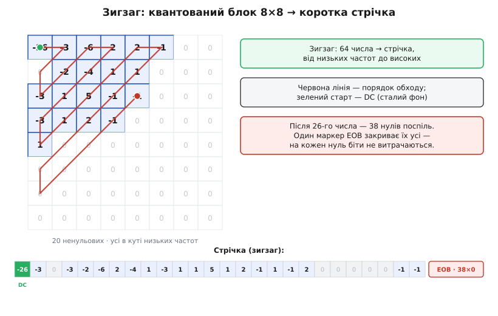
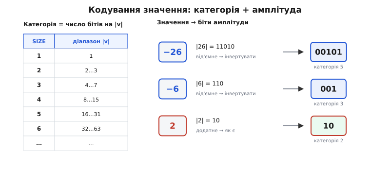

# ⚙️ Кодер блока JPEG: від пікселів до бітів

Одне діло — знати, ЧОМУ JPEG стискає; інше — написати кодер, що це робить. Тут ми беремо **один** блок 8×8 яскравості й женемо його крізь кодер до останнього біта, не пропускаючи жодного кроку. Мова — **C**: кодек живе в гарячому циклі (мільйони блоків на кадр), і кожен такт на рахунку. А щоб не вірити коду на слово, проженемо крізь нього **канонічний блок** — той самий, на якому JPEG показують усюди, — і наприкінці звіримо кожне число.

Ось блок: 64 відліки яскравості з фотографії, кожен у діапазоні 0…255.

:::code proj-jpeg-encode/c/part.c

### Крок 0. Зсув рівня: −128

Найперше кодер віднімає 128 від кожного відліку. Навіщо? Відліки додатні (0…255), із середнім десь посередині. Наступний крок — DCT — розкладе блок на «сталий фон плюс коливання навколо нього». Якщо фон висить на ~128, найперший коефіцієнт (той сталий фон) вийде велетенським, а решта — дрібні коливання. Зсунувши діапазон у [−128, 127], ми ставимо нуль у центр: числа стають симетричні навколо нуля, а їхні модулі на вході DCT — удвічі менші. Це не втрата (зсув оборотний — декодер додасть 128 назад), а гігієна: менші числа означають менший ризик переповнення й трохи компактніші коефіцієнти.

```c
double f[8][8];
for (int x = 0; x < 8; x++)
    for (int y = 0; y < 8; y++)
        f[x][y] = pix[x][y] - 128;      /* [0..255] → [-128..127] */
```

### Крок 1. Пряме DCT: пікселі → частоти

DCT виражає блок як зважену суму 64 сталих косинусних візерунків — від рівного фону до дрібної ряботини (це та сама ідея, що будь-який сигнал є [сумою хвиль різної частоти](root:math-analysis/fourier-idea)). Коефіцієнт F(u,v) каже, скільки візерунка (u,v) є в блоці. Порахувати всі 64 «в лоб» — то чотирикратна сума: для кожного з 64 коефіцієнтів пробігти всі 64 пікселі, разом 4096 множень.

Та DCT **роздільна**: двовимірне перетворення дорівнює одновимірному по кожному рядку, а тоді по кожному стовпцю. У матричній формі це `F = A · f · Aᵀ`, де `A` — косинусна матриця 8×8. Два матричні добутки — це 2·512 = 1024 множення замість 4096. Матрицю будуємо один раз:

:::code proj-jpeg-encode/c/krok-1-priame-dct-pikseli.c

Найлівіший-горішній коефіцієнт F(0,0) — це DC, сталий фон блока. З нашим нормуванням `A[0][n] = √(1/8)`, тож F(0,0) = (1/8)·(сума зсунутого блока). Сума зсунутих відліків нашого блока — рівно −3323, отже:

```
F(0,0) = -3323 / 8 = -415.375
```

Решта 63 коефіцієнти — це амплітуди косинусних брижів. Майже всі виходять крихітними: реальні блоки гладкі, тож їхня енергія збирається в жменьку низькочастотних чисел у горішньому-лівому куті. Саме на цьому й тримається весь стиск.

### Крок 2. Квантування: єдина втрата

Тепер кожен коефіцієнт ділимо на відповідне число з **таблиці квантування** й округлюємо. Таблиця тут — стандартна приклад-таблиця яскравості з JPEG (додаток K.1 стандарту): великі дільники стоять на високих частотах, тож ті коефіцієнти після округлення обертаються на нулі.

:::code proj-jpeg-encode/c/krok-2-kvantuvannia-iedyna.c

Для нашого блока виходить:

```
-26  -3  -6   2   2  -1   0   0
  0  -2  -4   1   1   0   0   0
 -3   1   5  -1  -1   0   0   0
 -3   1   2  -1   0   0   0   0
  1   0   0   0   0   0   0   0
  0   0   0   0   0   0   0   0
  0   0   0   0   0   0   0   0
  0   0   0   0   0   0   0   0
```

DC: −415.375 / 16 = −25.96 → **−26**. Із 64 коефіцієнтів ненульовими лишилися лише **20**; решта 44 обнулилися. Це єдиний крок, що губить інформацію, — усе далі буде точна перепаковка.

> 🔧 **Навіщо це.** Уся «ручка якості» кодера сидить у таблиці `Q`. Помнож її на 2 — нулів побільшає, файл схудне, картинка згрубіє; поділи — навпаки. Решта коду (DCT, зигзаг, ентропія) не міняється ні на рядок. Тому «якість 90» проти «якості 10» — це буквально інша таблиця з 64 чисел, а не інший алгоритм.

### Крок 3. Зигзаг: 2D → стрічка

Ненульові числа купчаться в горішньому-лівому куті. Якби читати блок рядками, нулі чергувалися б із числами. А зигзаг іде по діагоналях — від низьких частот до високих — і всі нулі вишиковуються в один довгий хвіст. Порядок обходу зберігаємо як таблицю з 64 індексів (у порядку рядків):

:::code proj-jpeg-encode/c/krok-3-zyhzah-2d-strichka.c

Стрічка нашого блока:

```
-26 | -3 0 -3 -2 -6 2 -4 1 -3 1 1 5 1 2 -1 1 -1 2 | 0 0 0 0 0 | -1 -1 | 0 0 … 0
```

Остання ненульова стоїть на 26-й позиції; після неї — 38 суцільних нулів. Ось де зигзаг окупається: довгий хвіст нулів дасться закодувати майже задарма.


*Зигзаг перетворює 2D-блок на 1D-стрічку. Ненульові (сині) числа тримаються кута низьких частот; обхід по діагоналях (червона лінія) стягує їх на початок стрічки, а всі нулі — у хвіст. Після 26-го числа — 38 нулів поспіль, і кодер закриє їх одним маркером EOB, не витрачаючи бітів на кожен.*

### Крок 4. Категорія й амплітуда

Перш ніж пакувати число в біти, треба знати його розмір. JPEG кодує кожне значення двома частинами: **категорія** (SIZE) — скільки бітів треба на його модуль — і самі **біти амплітуди**.

:::code proj-jpeg-encode/c/krok-4-katehoriia-i.c

Категорія — це просто позиція старшого значущого біта: |1| має 1 біт (категорія 1), |2|…|3| — 2 біти (категорія 2), |4|…|7| — 3, і так далі. А ось трюк зі знаком. У полі з `size` бітів рівно 2^size значень: половина під'ємні, половина від'ємні. Додатні `v` (від 2^(size−1) до 2^size−1) кладемо як є — їхній старший біт дорівнює 1, тобто верхня половина діапазону. Від'ємні кладемо як `v−1` — це та сама «одиничне доповнення до модуля», нижня половина, зі старшим бітом 0. Отже старший біт амплітуди **сам** несе знак, окремий біт не потрібен, а поле займає рівно `size` розрядів. Декодер відновлює навпаки: якщо старший біт 0, значення від'ємне й дорівнює `амплітуда − (2^size − 1)`.

Проженімо крізь це кілька чисел зі стрічки:

```
 -26  → |26| = 11010  → від'ємне: інвертувати біти → 00101   (категорія 5)
  -6  → |6|  = 110    → від'ємне: інвертувати       → 001     (категорія 3)
   2  → |2|  = 10     → додатне: як є                → 10      (категорія 2)
```

Перевірка для −26: амплітуда 00101 = 5, старший біт 0 → від'ємне, значення = 5 − (2⁵−1) = 5 − 31 = −26. Сходиться.


*Кодування значення в біти. Категорія (SIZE) — скільки бітів треба на модуль. Додатне число пишуть його ж бітами (старший біт 1, верхня половина); від'ємне — інвертованим модулем (старший біт 0, нижня половина). Так знак сидить у старшому біті амплітуди, і жодного зайвого біта.*

### Крок 5. DC — різницею із сусідом

DC-коефіцієнти сусідніх блоків майже однакові: сусідні клаптики картинки схожі за яскравістю. Тому JPEG зберігає не сам DC, а його **різницю** з DC попереднього блока (DIFF) — маленьке число, якому треба мало бітів. Для першого блока попередній DC вважаємо нулем, тож DIFF = −26 − 0 = −26. Категорію DIFF кодуємо кодом [Гаффмана](root:math-information/huffman-coding) за стандартною DC-таблицею, тоді дописуємо біти амплітуди:

```
DIFF = -26  →  категорія 5  →  код Гаффмана "110"  →  амплітуда "00101"
DC у потоці:  110 00101
```

### Крок 6. AC — парами (довжина серії, розмір)

Тепер 63 AC-коефіцієнти. Довгі [серії нулів](root:sf-algorithms/rle) тут — норма, тож кожен ненульовий AC кодують парою: **довжина серії нулів** перед ним (RUNLENGTH, 0…15) і **категорія** (SIZE), запаковані в один байт `RRRRSSSS`, закодований Гаффманом, а за ним — біти амплітуди. Плюс два особливі байти: **EOB** = 0x00 («усі решта нулі — стоп») і **ZRL** = 0xF0 («16 нулів поспіль» — на серії, довші за 15).

:::code proj-jpeg-encode/c/krok-6-ac-paramy-dovzhyna.c

Ось як розкладається наша стрічка по порядку — серія нулів перед числом, категорія, саме число та його біти амплітуди:

```
 1.  серія 0 · розмір 2 · v=-3  → amp 00
 2.  серія 1 · розмір 2 · v=-3  → amp 00     ← 1 нуль перед числом
 3.  серія 0 · розмір 2 · v=-2  → amp 01
 4.  серія 0 · розмір 3 · v=-6  → amp 001
 5.  серія 0 · розмір 2 · v=2   → amp 10
 6.  серія 0 · розмір 3 · v=-4  → amp 011
 7.  серія 0 · розмір 1 · v=1   → amp 1
 8.  серія 0 · розмір 2 · v=-3  → amp 00
 9.  серія 0 · розмір 1 · v=1   → amp 1
10.  серія 0 · розмір 1 · v=1   → amp 1
11.  серія 0 · розмір 3 · v=5   → amp 101
12.  серія 0 · розмір 1 · v=1   → amp 1
13.  серія 0 · розмір 2 · v=2   → amp 10
14.  серія 0 · розмір 1 · v=-1  → amp 0
15.  серія 0 · розмір 1 · v=1   → amp 1
16.  серія 0 · розмір 1 · v=-1  → amp 0
17.  серія 0 · розмір 2 · v=2   → amp 10
18.  серія 5 · розмір 1 · v=-1  → amp 0      ← 5 нулів перед числом!
19.  серія 0 · розмір 1 · v=-1  → amp 0
     EOB                                     ← далі 38 нулів
```

Зверни увагу на 18-ту пару: `серія 5`. Ті п'ять нулів перед −1 не коштували п'яти окремих символів — вони згорнулися в одне число 5 усередині байта `RRRRSSSS`. А фінальні 38 нулів не коштували взагалі нічого: один EOB, і блок закрито.

### Усе разом

Для повноти — код Гаффмана й побитовий запис (у готовому файлі ці означення стоять **перед** `encode_block`, бо він на них спирається). Таблиці JPEG стандартні; їх будують із двох масивів — `BITS` (скільки кодів кожної довжини) і `VALS` (символи в порядку зростання коду). Це «бойлерплейт», його можна пробігти очима:

:::code proj-jpeg-encode/c/use-razom.c

І головна функція, що проганяє весь блок:

:::code proj-jpeg-encode/c/use-razom-2.c

Друкує:

```
DC F[0][0] = -415.375  ->  квант -26
Потік блока: 93 біт -> 12 байт
C5 4D 8B 0B 46 50 99 4B 02 1B D0 57
```

Ось і вся арифметика стиску: блок, що сирим важив 64 байти, ліг у **12** — приблизно вп'ятеро менше, і це лише один блок, без виграшу від різниці DC між блоками на всьому кадрі.

### Складність і дзеркальний декодер

На блок усе — **O(1)**: розмір 8 фіксований, тож DCT це 1024 множення, квантування — 64 ділення, ентропія — один прохід по 64 числах. Для кадру з N пікселів це N/64 блоків, разом **O(N)** — лінійно від кількості пікселів. (Швидкі DCT на кшталт AAN зводять ті 1024 множення до кількох, але на блок це все одно стала.)

Декодер дзеркальний, у зворотному порядку: ентропійно розшифрувати біти назад у стрічку → розкласти зигзаг у блок 8×8 → **де**квантувати (помножити на Q — але округлення вже втрачене, тож точні коефіцієнти не повернути) → обернене DCT (`f = Aᵀ · F · A`) → додати 128. Єдиний необоротний крок — квантування; решта перетворень чесно обертаються.

### Пастки

- **Переповнення в DCT.** Ми рахуємо в `double`, тож проблеми нема. Але швидкі кодери роблять DCT у цілих (фіксована кома), і там проміжні суми легко вилазять за 16 бітів — треба накопичувати в `int32` і стежити за масштабом косинусних сталих, інакше тихе переповнення зіпсує коефіцієнти.
- **Округлення.** Квантування має бути `round` (до найближчого), а не відкидання дробу: `(int)(F/Q)` відкидає до нуля й зсуває кожен коефіцієнт — картинка попливе. І округлення від'ємних мусить бути симетричним (тому `lround`, а не приведення до `int`).
- **Порядок обходу.** `ZZ[k]` — це індекс у порядку **рядків**; переплутати з порядком стовпців (транспонувати u↔v) — і стрічка вийде безладом, а декодер відновить сміття. Кодер і декодер мусять мати ту саму таблицю зигзагу.
- **Стан DC між блоками.** `prevDC` живе між викликами й скидається в нуль на початку кадру (і на кожному рестарт-маркері). Загубити цей стан — і всі DC поїдуть.
- **Набивання байта 0xFF.** У справжньому потоці будь-який байт 0xFF мусить супроводжуватися 0x00, інакше декодер сплутає його з маркером. Наш поблоковий приклад цього не робить — це вже турбота повного файлового записувача.
