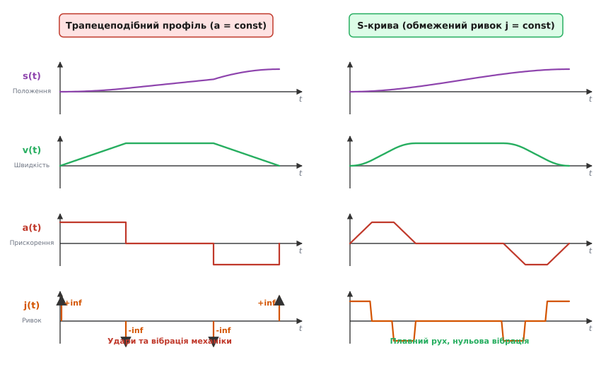
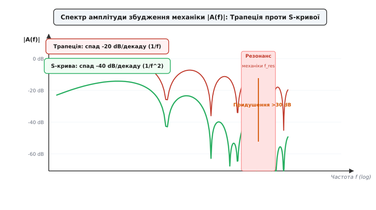
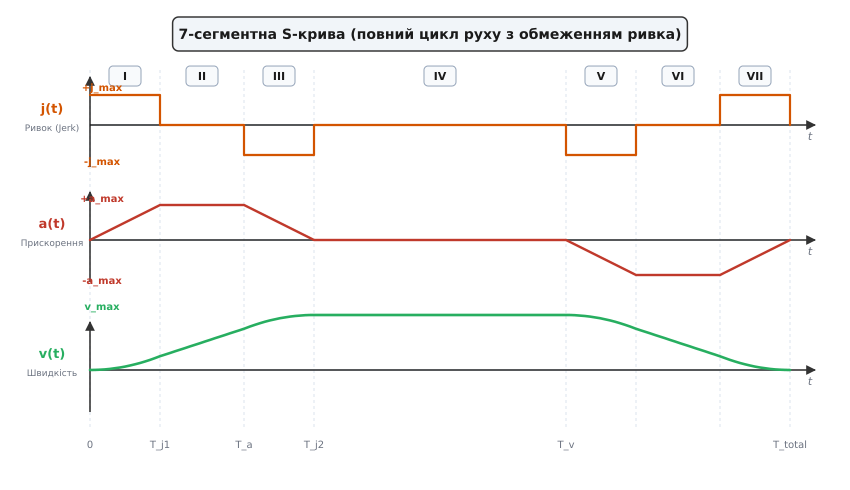
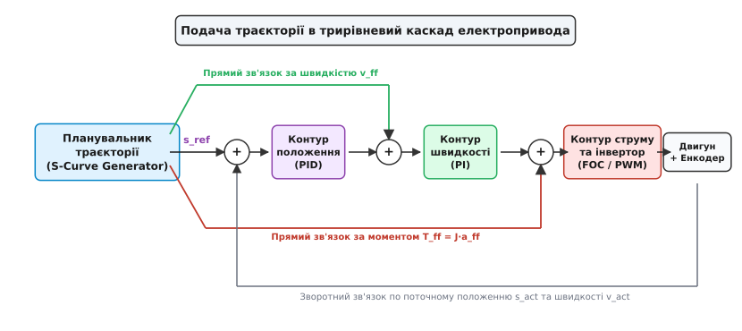

# Профілі руху

<preknowlist>
- [Трирівневий каскад (положення–швидкість–струм)](root:com-signal/three-loop-cascade) — каскадна архітектура приводів, якій генератор профілю задає цільові значення.
- [Дискретний ПІД](root:com-signal/discrete-pid) — дискретне обчислення регулятора зворотного зв'язку за фіксованого кроку часу.
- [Прямий зв'язок (feedforward)](root:math-analysis/feedforward) — подача очікуваної швидкості й прискорення в обхід помилки положення для мінімізації відставання.
- [Похідна](root:math-analysis/derivative) — швидкість як перша похідна положення, прискорення як друга, ривок як третя.
</preknowlist>

Коли мікроконтролер керування приводом подає на контур положення сходинковий сигнал нової координати, помилка позиціювання миттєво зростає від нуля до повної величини переміщення. Пропорційно-інтегрально-диференціальний регулятор негайно насичує свій вихід, вимагаючи від двигуна миттєвого стрибка швидкості й нескінченного прискорення. На практиці силовий інвертор впирається в апаратне обмеження струму, електромагнітний момент мотора різко переходить у стан насичення, а механічна передача отримує жорсткий кінематичний удар. У крокових приводах цей імпульс призводить до миттєвого зриву синхронізації ротора та втрати кроків, а в сервоприводах — до зрізання зубів ременів, люфтових вібрацій, підвищеного зносу кульково-гвинтових пар і тривалого коливального перерегулювання.

Фізична механіка завжди має скінченну жорсткість і володіє розподіленою пружністю. Будь-який неконтрольований стрибок прискорювального зусилля збуджує власні пружні коливання всієї системи — від вала двигуна до кінцевого робочого органу робота чи каретки верстата. Щоб переміщення відбувалося за мінімальний час, але без ударних навантажень і вібрацій, закон зміни координати в часі повинен формуватися штучно з урахуванням динамічних обмежень виконавчого механізму. Такий закон зміни цільових координат, швидкостей та прискорень у часі називають **профілем руху** (англ. *motion profile*, або планувальником траєкторії — від лат. *trajectus*, переміщення).

### Трапецеподібний профіль швидкості: механіка та обмеження

Найпростішим способом усунення нескінченного прискорення є обмеження максимального значення прискорювальної сили: `|a(t)| ≤ a_max`. У такому разі процес переміщення розбивається на три послідовні інтервали: розгін із постійним максимальним прискоренням `+a_max`, рух із постійною крейсерською швидкістю `v_max` та гальмування з постійним уповільненням `−a_max`. Оскільки графік зміни швидкості `v(t)` на часовій осі має вигляд симетричної трапеції, цей закон називають **трапецеподібним профілем швидкості** (англ. *trapezoidal velocity profile*).


*Порівняння трапецеподібного профілю швидкості (ліворуч) та S-кривої (праворуч). У трапецеподібному профілі прискорення змінюється стрибком, що породжує нескінченні дельта-сплески ривка j(t) = da/dt на межах фаз і провокує механічні удари. В S-кривій ривок жорстко обмежений (|j| ≤ j_max), прискорення змінюється неперервно, а швидкість набуває гладкої форми, усуваючи збудження резонансних коливань.*

Кінематичні рівняння трапецеподібного профілю отримують послідовним інтегруванням кусково-постійного прискорення `a(t)` за часом:

```
Фаза 1 (Розгін, 0 ≤ t < t₁):
a(t) = +a_max
v(t) = v₀ + a_max·t
s(t) = s₀ + v₀·t + (1/2)·a_max·t²

Фаза 2 (Крейсерський рух, t₁ ≤ t < t₂):
a(t) = 0
v(t) = v_max
s(t) = s(t₁) + v_max·(t − t₁)

Фаза 3 (Гальмування, t₂ ≤ t ≤ t₃):
a(t) = −a_max
v(t) = v_max − a_max·(t − t₂)
s(t) = s(t₂) + v_max·(t − t₂) − (1/2)·a_max·(t − t₂)²
```

Тривалості інтервалів розгону `t_a` та гальмування `t_d` залежать виключно від різниці швидкостей та встановленого граничного прискорення:

```
t_a = (v_max − v₀) / a_max
t_d = (v_max − v₁) / a_max
```

Відстань, що її долає привід за час розгону `s_a` та гальмування `s_d`:

```
s_a = (v_max² − v₀²) / (2·a_max)
s_d = (v_max² − v₁²) / (2·a_max)
```

Повний шлях перехідних процесів дорівнює `s_trans = s_a + s_d`. Якщо задана повна відстань переміщення `S = s_target − s₀` перевищує `s_trans`, привід встигає повністю набрати задану швидкість `v_max`, і тривалість фази рівномірного руху становить:

```
t_cruise = (S − s_trans) / v_max
```

Якщо ж повне переміщення замале (`S < s_trans`), привід не встигає досягти швидкості `v_max`: крейсерська фаза вироджується (`t_cruise = 0`), а профіль стає **трикутним** (англ. *triangular velocity profile*). У цьому випадку розгін припиняється раніше, і пікова досяжна швидкість `v_peak` обчислюється з балансу шляху розгону й гальмування:

```
S = (v_peak² − v₀²)/(2·a_max) + (v_peak² − v₁²)/(2·a_max)
  = (2·v_peak² − v₀² − v₁²) / (2·a_max)

2·a_max·S = 2·v_peak² − v₀² − v₁²
v_peak = √((2·a_max·S + v₀² + v₁²) / 2)                   [пікова швидкість трикутного профілю]
```

Для окремого випадку старту й зупинки з нульовими швидкостями (`v₀ = 0, v₁ = 0`) вираз спрощується до класичного співвідношення `v_peak = √(a_max·S)`.

Незважаючи на простоту обчислень, трапецеподібний профіль має фундаментальний фізичний недолік. У моменти часу `t = 0`, `t = t₁`, `t = t₂` та `t = t₃` функція прискорення `a(t)` зазнає стрибкоподібного розриву першого роду. Оскільки швидкість зміни прискорення в часі визначає **ривок** (англ. *jerk*):

```
j(t) = da(t)/dt = d²v(t)/dt² = d³s(t)/dt³
```

на межах фаз ривок стає нескінченно великим: `j(t) → ±∞`. Нескінченний ривок означає, що електромагнітний момент двигуна повинен змінитися миттєво. Оскільки в реальній електричній системі швидкість наростання струму в обмотках обмежена індуктивністю (`dI/dt = (U − E)/L`), а механічні вали та паси діють як торсійні пружини, на кожному стрибку прискорення система зазнає пружного удару, який трансформується у високочастотні вібрації.

### Ривок і механічний резонанс

Щоб зрозуміти, чому стрибки прискорення призводять до вібрацій, розглянемо механічну передачу як коливальну систему другого порядку: пружний елемент із жорсткістю `k` та демпфуванням `b`, що переміщує навантаження масою `m`. Власна резонансна частота такої конструкції становить `f_res = (1 / 2π)·√(k / m)`.

Коли на масу діє прискорювальна сила `F(t) = m·a(t)`, швидка зміна сили збуджує коливання на частоті `f_res`. Амплітуда залишкових коливань робочого органу після завершення фази розгону безпосередньо залежить від спектрального складу керуючого сигналу прискорення.


*Амплітудно-частотний спектр збудження механіки |A(f)|. Трапецеподібний профіль має сходинкове прискорення, що спадає в спектрі зі швидкістю −20 дБ/декаду (пропорційно 1/f) і накачує енергію у високочастотні резонанси механіки. S-крива зі згладженим ривком забезпечує спад −40 дБ/декаду (пропорційно 1/f²), знижуючи збудження резонансних частот на десятки децибелів.*

З математичного аналізу перетворення Фур'є відомо: чим більше неперервних похідних має функція в часовій області, тим швидше спадає її амплітудний спектр на високих частотах. Сходинкова функція прискорення прямокутної форми (трапецеподібна швидкість) має розриви нульового порядку, тому її гармоніки спадають зі швидкістю лише `1 / f` (тобто `−20` дБ на декаду частоти). Це означає, що спектральна густина енергії на високих частотах залишається значною і неминуче потрапляє в резонансну смугу механіки.

Якщо ж обмежити похідну прискорення — ривок — фіксованою константою `|j(t)| ≤ j_max`, прискорення набуває форми трапеції, а швидкість згладжується у вигляді сигмоїдних ділянок (S-подібних кривих). Такий профіль називають **S-кривою** (англ. *S-curve profile*).

Спектр трапецеподібного імпульсу прискорення є добутком двох функцій відліків: він формується як згортка двох прямокутних вікон тривалістю `T_a` (час постійного прискорення) та `T_j` (час зміни ривка). У частотній області це відповідає спаданню спектральних складових зі швидкістю `1 / f²` (тобто `−40` дБ на декаду). Завдяки цьому амплітуда збудження на власних частотах механіки `f_res` знижується на `20`–`40` дБ (у `10`–`100` разів) порівняно з трапецеподібним профілем. Крім того, якщо час зміни ривка `T_j = a_max / j_max` вибрати рівним періоду власного коливання конструкції `T_res = 1 / f_res`, у спектрі прискорення утворюється точний нуль (глибокий спектральний провал), що повністю нейтралізує збудження даної резонансної моди.

Таке частотне придушення має і відчутний тепловий ефект: відсутність високочастотних гармонік у сигналі моменту знижує середньоквадратичний струм обмоток `I_RMS` та втрати на вихрові струми у сталі статора, зменшуючи нагрів двигуна й силових транзисторів інвертора.

### 7-сегментний профіль S-кривої

Повний цикл позиційного переміщення з обмеженням швидкості, прискорення та ривка розбивається на **сім окремих інтервалів часу** (фази I–VII). На кожному інтервалі ривок підтримується постійним: `j(t) ∈ {+j_max, 0, −j_max}`.


*Сім сегментів повного профілю S-кривої. Фази I–III реалізують плавний вихід на крейсерську швидкість із лінійним наростанням та спаданням прискорення. Фаза IV — рух з постійною швидкістю. Фази V–VII забезпечують плавне гальмування без ударного навантаження на привод.*

Розглянемо фізичний зміст і поведінку системи на кожному із семи сегментів:

1. **Фаза I (наростання прискорення / Jerk-up):** `j(t) = +j_max`. Привід плавно нарощує зусилля від нуля до `+a_max`. Прискорення зростає лінійно, швидкість зростає за квадратичним законом, координата положення — за кубічною параболою. На цьому етапі вибираються механічні люфти й плавно натягуються пружні елементи редуктора без динамічного удару.
2. **Фаза II (постійне прискорення / Constant acceleration):** `j(t) = 0`. Прискорення підтримується на граничному рівні `a(t) = +a_max`. Швидкість зростає строго лінійно, мотор розвиває максимальний корисний момент для швидкого набору кінетичної енергії.
3. **Фаза III (спадання прискорення / Jerk-down):** `j(t) = −j_max`. Привід плавно знижує прискорення від `+a_max` до нуля, точно наближаючись до бажаної крейсерської швидкості `v_max`. Швидкість виходить на плато за інвертованою параболою з нульовим кутом нахилу.
4. **Фаза IV (крейсерський рух / Cruise):** `j(t) = 0, a(t) = 0`. Привід рухається з постійною швидкістю `v(t) = v_max`, прискорення нульове, положення змінюється лінійно. Мотор долає лише сили сухого та в'язкого тертя.
5. **Фаза V (наростання сповільнення / Deceleration jerk-down):** `j(t) = −j_max`. Привід плавно входить у режим гальмування: прискорення лінійно спадає від нуля до негативного значення `−a_max`. Швидкість починає спадати за плавною опуклою параболою.
6. **Фаза VI (постійне сповільнення / Constant deceleration):** `j(t) = 0`. Привід гальмує з постійним максимальним негативним прискоренням `a(t) = −a_max`. Швидкість лінійно зменшується.
7. **Фаза VII (вихід у точку зупинки / Landing jerk-up):** `j(t) = +j_max`. Гальмівне прискорення плавно повертається від `−a_max` до нуля в момент точного приходу в цільову точку `s_target` із нульовою кінцевою швидкістю.

Для розрахунку траєкторії в реальному часі на кожному сегменті `k` тривалістю `T_k` використовують рекурентні аналітичні вирази відносно локального часу `τ = t − t_k` (`0 ≤ τ < T_k`):

```
a(τ) = a_k + j_k·τ
v(τ) = v_k + a_k·τ + (1/2)·j_k·τ²
s(τ) = s_k + v_k·τ + (1/2)·a_k·τ² + (1/6)·j_k·τ³
```

де `(s_k, v_k, a_k)` — граничні значення вектора стану наприкінці попереднього сегмента `k−1`.

Базовий час наростання прискорення до максимуму визначається обмеженнями за прискоренням та ривком:

```
T_j = a_max / j_max
```

Зміна швидкості за час однієї фази зміни ривка (фаза I або III) становить:

```
Δv_j = (1/2)·j_max·T_j² = a_max² / (2·j_max)
```

Щоб досягти максимального прискорення `a_max`, загальна різниця швидкостей розгону повинна перевищувати суму приростів на двох ділянках ривка: `(v_max − v₀) > 2·Δv_j = a_max² / j_max`. Якщо ця умова виконується, тривалість фази II постійного прискорення становить:

```
T_a = (v_max − v₀)/a_max − a_max / j_max
```

Якщо ж `(v_max − v₀) ≤ a_max² / j_max`, привід не встигає розвинути повне прискорення: фаза II зникає (`T_a = 0`), а прискорення досягає лише пікового значення `a_peak = √((v_max − v₀)·j_max)` за скорочений час `T_j1 = √((v_max − v₀) / j_max)`.

Аналогічно обчислюються інтервали ділянки гальмування `T_j2` та `T_d`. Повні математичні викладки для інтегрування шляху, аналізу переходів та точного аналітичного розв'язання вироджених випадків коротких переміщень, коли крейсерська фаза відсутня (`T_v = 0`), винесено в [детальне математичне виведення 7-сегментних рівнянь та розв'язання вироджених випадків](root:com-signal/motion-profiles/math-scurve-kinematics.md).

### Архітектура каскадного керування та прямий зв'язок

У сучасних високоточних сервоприводах генератор траєкторії не просто видає сигнал бажаного положення `s_ref(t)` на контур позиціювання. Сам по собі контур положення зі зворотним зв'язком має обмежену смугу пропускання: якщо керувати тільки за координатною помилкою `e(t) = s_ref(t) − s_act(t)`, система неминуче рухатиметься з динамічним відставанням (англ. *tracking lag*), амплітуда якого зростає зі збільшенням швидкості та прискорення.

Щоб звести помилку стеження практично до нуля, планувальник траєкторії формує одночасно **три узгоджені сигнали керування**:

1. Задане положення `s_ref(t)` — опорний сигнал для контуру позиції.
2. Випереджальну швидкість `v_ff(t) = ds_ref/dt` — сигнал прямого зв'язку за швидкістю (англ. *velocity feedforward*), що додається безпосередньо на вхід контуру швидкості в обхід регулятора положення.
3. Випереджальне прискорення `a_ff(t) = d²s_ref/dt²` — сигнал прямого зв'язку за моментом/струмом `T_ff = J_total · a_ff(t)` (англ. *torque feedforward*), що подається безпосередньо на вхід контуру струму.


*Подача згенерованої траєкторії в трирівневий каскад електропривода. Планувальник одночасно генерує три узгоджені сигнали: цільове положення s_ref для контуру позиції, випереджальну швидкість v_ff для контуру швидкості та динамічний момент T_ff = J·a_ff для контуру струму, зводячи динамічну помилку стеження майже до нуля.*

Завдяки сигналам прямого зв'язку контури швидкості та струму отримують команду на прискорення маси навантаження ще до того, як виникне будь-яке фізичне розузгодження за положенням. Зворотному зв'язку (ПІД-регуляторам) залишається компенсувати лише невраховані зовнішні збурення, гравітаційне навантаження та похибки моделі тертя. Оскільки траєкторія S-кривої гарантує неперервність `v_ff(t)` та `a_ff(t)`, сигнали прямого зв'язку залишаються гладкими й не спричиняють сплесків напруги в силовому інверторі.

Для узгодження динаміки контурів існує практичне емпіричне правило: еквівалентна частота зрізу профілю за ривком `f_jerk = 1 / (2π · T_j)` повинна бути як мінімум у `3`–`5` разів нижчою за смугу пропускання контуру струму `f_bw_current`. Це гарантує, що силовий перетворювач встигає фізично відпрацювати задану швидкість наростання електромагнітного моменту без динамічного фазового запізнення.

### Дискретна генерація кроків у реальному часі на мікроконтролері

У вбудованих системах генерація траєкторії реалізується в один із двох способів залежно від типу привода та фізичного інтерфейсу:

#### 1. Синхронна інтерполяція за фіксованого кроку часу (`Δt = const`)

У сервоприводах зі зв'язком через промислові польові шини (EtherCAT, CANopen, CAN/DroneCAN) або у внутрішньому ядрі керування FOC інтерполятор викликається періодично з фіксованою частотою сервоциклу — наприклад, `f_s = 1` кГц (`Δt = 1` мс) або `10` кГц (`Δt = 100` мкс).

На кожному такті `k` алгоритм виконує швидке обчислення полінома:
- Поточний глобальний час: `t = k · Δt`.
- За часом `t` визначається поточний сегмент `m ∈ {1 … 7}` та локальний час `τ = t − t_start[m]`.
- Обчислюються миттєві значення `s_ref`, `v_ff`, `a_ff` за аналітичними формулами сегмента.

Цей підхід вимагає фіксованого числа операцій множення та додавання на кожному такті (`O(1)` за часом виконання) і легко реалізується на процесорах із апаратним блоком плаваючої коми (FPU), таких як ARM Cortex-M4F/M7.

#### 2. Асинхронна генерація імпульсів крокового двигуна за таймером

У крокових приводах інтерфейс керування є дискретним імпульсним: кожен імпульс на вході драйвера `STEP` переміщує вал на один мікрокрок `Δs = const`. Швидкість обертання визначається частотою проходження імпульсів `f_step = v / Δs`, а інтервал часу між сусідніми імпульсами змінюється за законом:

```
Δt_n = 1 / f_step = Δs / v_n
```

Для генерації таких імпульсів мікроконтролер використовує апаратний таймер у режимі переривання по збігу (англ. *Output Compare*). У кожному перериванні таймер формує короткий строб на виводі `STEP` і перезаписує свій регістр автоперезавантаження `ARR` значенням затримки до наступного кроку `c_n`:

```
c_n = f_timer · Δt_n = (f_timer · Δs) / v_n
```

Обчислення точного значення затримки через зворотну швидкість або видобування квадратного кореня `t_n = √(2·n / a)` у високочастотному перериванні таймера (частота кроків може досягати `100`–`200` кГц) є занадто ресурсомістким для 32-бітних мікроконтролерів без високої тактової частоти.

У класичному інженерному алгоритмі Остіна (англ. *Austin's step generation algorithm*) використовують розклад функції затримки в ряд Тейлора. Для руху з постійним прискоренням `a` час між `(n−1)`-м та `n`-м кроком зв'язаний рекурентним співвідношенням першого порядку:

```
c_n = c_{n-1} − (2·c_{n-1}) / (4·n + 1)                   [рекурентна формула затримки кроку]
```

де початкова затримка першого кроку `c₀` обчислюється перед початком руху за формулою:

```
c₀ = 0.676 · f_timer · √(2·Δs / a)
```

Коефіцієнт `0.676` є поправкою першого кроку, що компенсує похибку лінеаризації ряду Тейлора на старті з нульової швидкості.

Завдяки цьому переривання таймера потребує лише однієї операції множення та ділення на ціле число без операцій із плаваючою комою. Для запобігання накопиченню похибки округлення в тривалих переміщеннях змінну `c_n` ведуть у форматі з фіксованою комою (англ. *fixed-point*, наприклад `Q24.8` або `Q32.32`).

#### Джиттер переривань та апаратне DMA-розвантаження

Коли мікроконтролер виконує інші критичні завдання (обмін по шинах UART/CAN, розрахунок фільтрів, обробку АЦП), виникає явище джиттера переривань (англ. *interrupt latency jitter*). Якщо обробник переривання таймера кроку затримується хоча б на `3`–`5` мкс за частоти кроків `100` кГц (період імпульсу `10` мкс), миттєва фазова похибка сягає `30`–`50%`. Це спричиняє мікрострибки миттєвої швидкості ротора, акустичний свист і резонансне тремтіння привода.

Для усунення джиттера у високопродуктивних контролерах ЧПК (наприклад, у прошивках 3D-принтерів та сервоконтролерах) застосовують **генерацію кроків через прямий доступ до пам'яті (DMA)**. Періодичний планувальник на низькій частоті (`1` кГц) розраховує пачки інтервалів кроків і заповнює кільцевий буфер DMA. Апаратний таймер зчитує чергові значення періодів безпосередньо з оперативної пам'яті через канал DMA без участі процесора, що гарантує нульовий джиттер і точність часових інтервалів до одного такту системного кварцового генератора (частки наносекунди).

### Багатоосьова координація траєкторій

У реальних робототехнічних маніпуляторах, портальних фрезерних верстатах і плотерах рух відбувається одночасно за кількома осями `(X, Y, Z, A, B, C)`. Кінцевий інструмент повинен рухатися вздовж прямої лінії або просторової кривої в декартовому просторі, що вимагає суворої синхронізації всіх приводів.

Якщо кожна вісь виконуватиме рух за власним незалежним профілем швидкості, осі з меншим переміщенням закінчать рух раніше за інші. У результаті траєкторія інструмента скривиться, спотворюючи геометричну форму деталі.

Для забезпечення прямолінійного руху застосовують **параметризацію через довжину просторового шляху** (англ. *path parameter s(t)*):

```
S_total = √(Δx² + Δy² + Δz²)
```

Планувальник розраховує єдиний 1D-профіль `s(t)` для всього просторового переміщення `S_total`, після чого координати окремих осей обчислюються як проекції через постійні напрямні косинуси:

```
x(t) = x₀ + (Δx / S_total)·s(t)
y(t) = y₀ + (Δy / S_total)·s(t)
z(t) = z₀ + (Δz / S_total)·s(t)
```

При цьому фізичні обмеження просторового руху `(v_max, a_max, j_max)` визначаються як мінімум із масштабованих обмежень кожної окремої осі, що бере участь у русі:

```
v_max = min_i (v_max,i · S_total / |Δs_i|)
a_max = min_i (a_max,i · S_total / |Δs_i|)
j_max = min_i (j_max,i · S_total / |Δs_i|)
```

Такий підхід гарантує, що жодна з фізичних осей не перевищить свої паспортні ліміти за швидкістю, струмом чи моментом, а часові інтервали всіх семи сегментів S-кривої `T₁ … T₇` залишатимуться абсолютно ідентичними для всіх приводів системи.

### Повний планувальник траєкторії руху на C та C++

Нижче наведено закінчену виробничу реалізацію 7-сегментного планувальника траєкторії S-кривої. Модуль містить функції конфігурації фізичних обмежень, аналітичного розрахунку інтервалів для довільних переміщень (включаючи деградацію до трикутних профілів прискорення та швидкості) та швидкої дискретної оцінки стану в довільний момент часу `t`.

:::tabs
:::code motion-profiles-d/c/scurve_planner.c
:::code motion-profiles-d/cpp/scurve_planner.hpp
:::

### Практичні крайові випадки та пастки реалізації

Під час проектування систем числового програмного керування (ЧПК / CNC), робототехнічних маніпуляторів і 3D-принтерів інженер стикається з низкою критичних крайових умов, які не вкладаються в базову схему руху між двома фіксованими точками з нульової швидкості:

#### 1. Зміна цільової координати «на льоту» (On-the-fly target repositioning)

У реальних системах керування нова цільова координата може надійти від супервізора чи системи технічного зору саме в той момент, коли привід уже рухається на високій швидкості `v_curr ≠ 0` або виконує розгін із прискоренням `a_curr ≠ 0`. Спроба перезапустити планувальник «із нуля» викличе миттєвий стрибок прискорення й механічний удар.

Коректне перепланування вимагає розв'язання граничної задачі з поточного ненульового фазового стану `(s_curr, v_curr, a_curr)`:
- Якщо нова цільова точка лежить попереду за напрямком руху, але дистанції недостатньо для безпечної зупинки за обмежень `a_max` і `j_max`, привід зобов'язаний спочатку виконати плавне гальмування з виходом у точку реверсу (англ. *overshoot by design*), після чого повернутися назад до нової цілі без порушення обмеження за ривком.
- Якщо нова ціль дозволяє продовжити рух, планувальник будує асиметричну S-криву, де тривалості фаз розгону `T_j1` та `T_a` обчислюються відносно початкового ненульового прискорення `a_curr`.

#### 2. Буфер випереджального перегляду (Lookahead) та швидкість на стиках траєкторії

У верстатах ЧПК траєкторія інструмента складається з тисяч коротких лінійних відрізків (G-code G1). Якби привід зупинявся в нуль наприкінці кожного відрізка, середня швидкість обробки впала б у десятки разів, а на поверхні деталі утворилися б припали.

Щоб проходити стики без зупинки, планувальник використовує чергу блоків із випереджальним аналізом (англ. *lookahead buffer*):
- Для кожного кута зламу траєкторії `θ` між сусідніми відрізками визначається максимально допустима швидкість проходження стику `v_junction`. Вона обчислюється з умови обмеження нормального (доцентрового) прискорення `a_n = v² / R ≤ a_max` або через допустиме відхилення від кута (англ. *junction deviation* `δ`):

```
v_junction = √((a_max · δ · sin(θ / 2)) / (1 − sin(θ / 2)))
```

- Планувальник виконує зворотний прохід (англ. *backward pass*) по черзі буфера від останнього блока до першого, обмежуючи вхідні швидкості сегментів так, щоб привід гарантовано встиг загальмувати перед небезпечним гострим кутом. Потім прямим проходом (англ. *forward pass*) формуються прискорювальні інтервали S-кривої вздовж усього ланцюжка сегментів.

#### 3. Числова стабільність в арифметиці з плаваючою комою

При тривалому русі або інтегруванні траєкторії на мікроконтролерах із 32-бітною плаваючою комою (`float` IEEE 754) пряме обчислення кубічного члена `s(t) = s₀ + v₀·t + (1/2)·a₀·t² + (1/6)·j·t³` призводить до катастрофічної втрати точності (англ. *catastrophic cancellation*).

Коли глобальний час `t` досягає десятків або сотень секунд, величина `t³` стає величезною (`100³ = 10⁶`), тоді як доданок `(1/6)·j` може бути малим. Додавання великих чисел до малих призводить до втрати молодших бітів мантиси, викликаючи стрибки цільової координати та дрижання привода.

Щоб повністю усунути числовий дрейф, оцінку траєкторії завжди виконують відносно **локального часу поточного сегмента** `τ = t − t_seg_start`, де `0 ≤ τ ≤ T_k` (зазвичай не перевищує часток секунди). При переході через межу сегмента стан кінцевої точки фіксується як точна база `s_start[k+1] = s_end[k]`, що гарантує абсолютну неперервність координат при будь-якій тривалості роботи верстата.

> 🔧 **Навіщо це.** Завжди передавайте з планувальника в сервоконтур не лише координату `s_ref`, але й похідні `v_ff` та `a_ff`. Тільки за наявності випереджального моменту `T_ff = J·a_ff` контур струму створить необхідне електромагнітне зусилля в ту саму мікросекунду, коли починається рух, зводячи динамічну помилку відставання до нуля.
