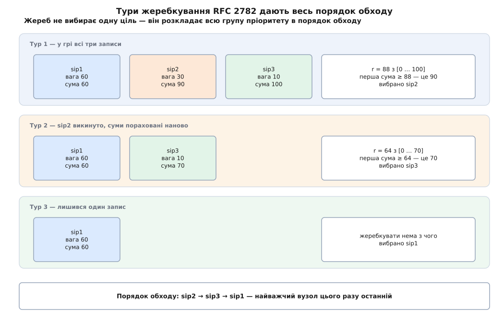

# ⚙️ Пошуковець служби: від імені домену до впорядкованого списку цілей

На вході — саме лише ім'я домену, на виході — черга адрес із портами, яку клієнт обходить згори вниз, доки котрась не пустить його всередину. Ланцюг із трьох запитів DNS пишеться за півгодини; решту часу з'їдають дві речі, на яких помиляються майже всі: жеребкування за вагою, помилку в якому статистика ховає роками, і питання, що робити з готовим планом, коли перша ціль мовчить.

---

## План окремо, з'єднання окремо

Найважливіше рішення ухвалюється ще до першого рядка коду: **пошук і з'єднання — це дві різні функції**, і між ними лежить незмінний список.

Спокуса зробити інакше сильна. Клієнт узяв першу ціль, вона не відповіла — здається природним просто перепитати DNS і взяти наступну. Так робити не можна, і причин три. Відповідь майже напевно прийде з кешу резолвера, тобто набір записів буде той самий — а новий жереб цілком може знову вказати на мертвий вузол. Навіть якщо викинути невдаху вручну, ваги решти вже перекошені: RFC 2782 розписує пропорції для **повного** набору, а не для набору мінус один. І врешті кожне перепитування коштує ще один обмін із резолвером тоді, коли користувач і так уже чекає.

Тому `Resolve` викликають рівно раз на серію спроб. Він повертає **план** — увесь порядок обходу, розіграний наперед. Далі `Dial` іде цим планом, і DNS у ньому вже не з'являється жодного разу.

## Серце: порядок за RFC 2782

Уся тонкість зосереджена в одній функції.

:::tabs
:::code proj-srv-resolver/go/sertse-poriadok-za-rfc.go
:::code proj-srv-resolver/cpp/sertse-poriadok-za-rfc.cpp
:::

Три місця тут виглядають як дрібниці, а насправді кожне з них — окремий спосіб зіпсувати розподіл.

**Перемішування групи.** Специфікація дозволяє розкласти записи «у будь-якому порядку» — і саме це формулювання доводиться читати як обов'язок. Коли всі ваги в групі нульові, сума теж нуль, жереб щоразу дає нуль, а нуль завжди влучає в перший запис списку. Без перемішування «будь-який порядок» перетворюється на «порядок, у якому їх поклав резолвер», і весь потік іде на один вузол. Ваги 0 при цьому цілком законні: їх ставлять, коли ділити нема чого й усі сервери рівні.

**Нульові ваги на початок.** Правило здається примхою, доки не порахувати. Наростальна сума нульового запису дорівнює сумі попереднього, тож вибирають його тільки за точного влучання в межу. Опинившись у кінці списку, він має ту саму суму, що й повна сума ваг, — але шукають **першу** суму, не меншу за жереб, і знаходять сусіда ліворуч. Такий запис не вибереться ніколи. На початку списку його сума дорівнює нулю, і жереб `r = 0` дістається саме йому: один шанс із «сума ваг плюс один». Нуль означає не «ніколи», а «поки решта жива» — це підмінний вузол.

**Межа проміжку включно.** `rand.IntN(sum)` замість `sum+1` виглядає безневинно, а насправді краде одне-єдине значення — найбільше. Платить за нього останній запис списку: його вибирає будь-який жереб, більший за передостанню суму, і таких значень рівно стільки, скільки він важить. Відрізали верхнє — лишилося на одне менше.

**Умова: у пріоритеті три записи з вагами 60, 39 і 1; сума ваг 100.**

```
наростальні суми:            60          99         100

правильно, r з [0 … 100] — 101 значення:
  третій запис бере r = 100         →   1 зі 101   ≈ 0.99 %

помилково, r з [0 … 99] — 100 значень:
  третій запис не бере жодного      →   0 зі 100   =  0 %
```

Вузол із вагою 1 зникає з ротації назавжди. Це найгірший різновид помилки: запасний сервер, який усі вважають робочим, роками не бачить жодного з'єднання, а різниця в статистиці — один відсоток — тоне в добовому шумі й спливає аж тоді, коли на цей сервер довелося покластися.


*Жеребкування повторюють, доки група не спорожніє. Тому на виході стоїть увесь порядок обходу, а не одна ціль, — і вузол із найбільшою вагою цілком може опинитися останнім.*

## Ланцюг: три запити

Тепер обгортка. Перший запит перетворює домен на ім'я служби, другий — ім'я служби на цілі, третій — цілі на адреси.

:::tabs
:::code proj-srv-resolver/go/lantsiuh-try-zapyty.go
:::code proj-srv-resolver/cpp/lantsiuh-try-zapyty.cpp
:::

> 🔧 **Навіщо це.** Тут ховається розрив, який коштує найдорожче: **порожня відповідь і ціль `.` — не одне й те саме**. Коли записів немає зовсім, домен просто нічого не оголосив, і клієнт має право піти старим шляхом — адресний запис на сам домен плюс загальновідомий порт. Коли ж прийшла ціль `.`, домен сказав уголос: цієї служби тут немає. Клієнт, який на це відповідає відкатом на вшитий порт, стукає туди, куди йому щойно заборонили, — і найчастіше потрапляє на зовсім інший сервіс, що випадково слухає на тому числі. Тому прапорець `denied` тягнеться крізь усю функцію: він відрізняє мовчання від відмови.

Фільтр NAPTR теж не випадковий. Прапорець `S` означає, що результат — ім'я із записами SRV; порожній `regexp` вимагає S-NAPTR, і саме тому в коді немає жодного регулярного виразу. Сортування — за `order`, а за рівності — за `preference`; наш власний перелік умінь у цьому сортуванні не бере участі взагалі. Він працює лише як сито: домен вирішує, що краще, ми — лише що нам під силу.

## Обхід із відкатом

План готовий, і далі все просто рівно доти, доки не подумати про межі.

:::tabs
:::code proj-srv-resolver/go/obkhid-iz-vidkatom.go
:::code proj-srv-resolver/cpp/obkhid-iz-vidkatom.cpp
:::

Ані RFC 2782, ані RFC 3263 не кажуть, скільки цілей вільно перебрати. Це навмисно: межу ставить не протокол, а той, хто чекає на відповідь. Зона з двадцятьма записами і таймаутом дві секунди на кожен — це сорок секунд, за які встигне здатися й користувач, і зовнішній таймаут навколо. Тому бюджет спроб і [спільний бюджет часу](root:sf-distributed/timeouts-deadlines) — не прикраса, а те, що взагалі робить обхід придатним до вжитку. Коли з'єднання не постало, наступна спроба вимірюється по-різному: [відмова з'єднання](root:com-transport/tcp-connection-lifecycle) приходить за один обмін і майже нічого не коштує, а мовчання з'їдає весь таймаут — і саме воно з'їдає бюджет.

Порядок адрес усередині однієї цілі тут спрощено: код бере їх так, як віддав резолвер. Справжній клієнт цим не задовольняється — він чергує родини й пускає спроби навперейми, щоб зламаний IPv6 не коштував секунд очікування ([Happy Eyeballs](root:com-transport/happy-eyeballs)).

## Складність і пастки

Жеребкування — це `O(n²)` на групу: після кожного вибору суми рахують наново. Для реальних зон, де в пріоритеті одиниці записів, різниця з розумнішими структурами губиться в шумі, і переписувати цикл на дерево часткових сум — марна витрата уваги.

Решта — те, на чому справді горять.

**Ціль-псевдонім.** RFC 2782 прямо забороняє ставити ціллю ім'я, яке насправді `CNAME`. Резолвер такий псевдонім усе одно розгорне, і код працюватиме, — але сервер уже не покладе адресу в додаткову секцію тієї самої відповіді, і кожна ціль коштуватиме зайвого запиту. Чужі зони цієї заборони не дотримуються, тому клієнт мусить бути готовим: покладатися на додаткову секцію можна, вимагати її — ні.

**Порядок міток.** `_sips._tcp.example.com`: спершу служба, потім транспорт. Переставлені місцями мітки дають ім'я, якого просто немає, — а це для коду виглядає точнісінько як «домен нічого не оголосив». Помилка мовчазна: клієнт відкочується на вшитий порт і роками працює «майже правильно».

**Термін життя плану.** План живе не вічно, і не безкінечно мало: його можна тримати доти, доки не мине найменший [TTL](root:com-transport/dhcp-dns) серед записів SRV, з яких він складений. Раніше — марно перепитувати, пізніше — можна не помітити, що адміністратор уже перевів службу на інший вузол. Новий жереб має право статися тільки після того, як план застарів; усередині однієї серії спроб порядок незмінний.

**Повтори понад планом.** Коли план вичерпано, наступним кроком керує вже не DNS: тут вступають [паузи між повторами](root:sf-distributed/retries-backoff). Без них клієнт, що втратив зв'язок разом із тисячею інших, повернеться до відновленого сервера всі разом і покладе його вдруге.

**Ім'я для TLS.** Найкоротший рядок і найдорожча помилка. Сертифікат звіряють із доменом, якого клієнт питав, а не з ім'ям цілі, куди його привів SRV. Підставити `t.Host` у `ServerName` — це зробити підміну відповіді DNS непомітною: чужий вузол пред'явить чесний сертифікат на власне ім'я, перевірка мовчки пройде, і клієнт піде розмовляти не з тим, з ким збирався.
