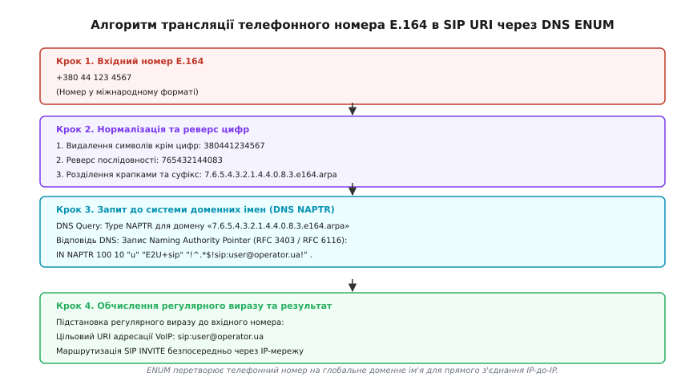

# ⚙️ Реалізація DNS ENUM-резолвера для трансляції номерів E.164 у SIP URI

Протокол **ENUM** (англ. *Telephone Number Mapping*, RFC 6116) визначає стандартизований механізм використання глобальної інфраструктури системи доменних імен (DNS) для трансляції телефонних номерів міжнародного формату ITU-T E.164 у мережеві адреси протоколів інтернету (Uniform Resource Identifiers, URI). Базуючись на архітектурі динамічного виявлення делегування (**DDDS**, англ. *Dynamic Delegation Discovery System*, RFC 3401–3404), ENUM дає змогу абонентам та операторам зв'язку маршрутизувати виклики безпосередньо через IP-мережі за протоколом SIP, оминаючи транзитні комутатори PSTN та застарілі магістральні канали TDM.

Нижче наведено математичну модель та алгоритмічний конвеєр трансляції, детальний аналіз двійкового формату та синтаксису записів NAPTR, правила обробки регулярних виразів SED-стилю, безпекові вимоги DNSSEC, взаємодію з переносимістю номерів (MNP), асинхронну архітектуру для високонавантажених Softswitch, практичні крайові випадки та робочу реалізацію резолвера мовами C та C++.

---

### Алгоритмічний конвеєр трансляції номера (RFC 6116)

Процедура перетворення вхідного номера в адреси інтернет-сервісів складається з шести послідовних кроків:

```
[ Вхідний номер: «+380 (44) 123-4567» ]
                   │
                   ▼ (1. Санітизація та перевірка формату)
[ Очищений рядок: «380441234567» ]
                   │
                   ▼ (2. Реверс послідовності цифр)
[ Перевернутий рядок: «765432144083» ]
                   │
                   ▼ (3. Інтерполяція крапок та додавання кореневого суфікса)
[ Доменне ім'я FQDN: «7.6.5.4.3.2.1.4.4.0.8.3.e164.arpa.» ]
                   │
                   ▼ (4. Надсилання DNS-запиту типу NAPTR / QTYPE=35)
[ Набір повернутих ресурсних записів NAPTR ]
                   │
                   ▼ (5. Сортування за Order/Preference та фільтрація за Service)
[ Відсортований список записів для сервісу «E2U+sip» ]
                   │
                   ▼ (6. Обчислення регулярного виразу з підстановкою груп)
[ Цільовий SIP URI: «sip:user@operator.ua» ]
```


*Конвеєр трансляції телефонного номера E.164 в SIP URI через дерево доменів DNS e164.arpa.*

#### 1. Нормалізація та формування доменного імені

Формування доменного запиту вимагає суворого дотримання чотирьох перетворень:

1. **Очищення (Sanitization):** із вхідного рядка видаляються всі пробіли, круглі дужки, дефіси, косі риски та початковий символ `+`. Алгоритм перевіряє умову довжини: кількість десяткових цифр має перебувати в межах від 1 до 15 відповідно до стандарту E.164. Якщо рядок містить сторонні символи або його довжина перевищує 15 цифр, алгоритм повертає помилку `INVALID_NUMBER_FORMAT`.
2. **Інверсія порядку (Reversal):** послідовність цифр перевертається зліва направо: молодша (остання) цифра номера абонента стає першою, а старша цифра коду країни — останньою. Це зумовлено ієрархічною природою DNS: найбільш специфічна частина домену розташовується ліворуч (наприклад, `host.subdomain`), а коренева зона — праворуч, тоді як у плані нумерації E.164 найбільш загальна частина (код країни CC) стоїть на початку.
3. **Пунктуація (Dotted Notation):** між кожною цифрою перевернутого рядка вставляється символ крапки `.`. Кожна цифра стає окремим рівнем піддомену в системі DNS.
4. **Суфікс дерева (Root Domain):** у кінець рядка додається спеціалізована коренева зона електрозв'язку `.e164.arpa.`.

Наприклад, для київського телефонного номера `+380 44 123 4567`:
* Очищення: `380441234567` (12 цифр);
* Інверсія: `765432144083`;
* Розділення крапками: `7.6.5.4.3.2.1.4.4.0.8.3.`;
* Додавання суфікса: `7.6.5.4.3.2.1.4.4.0.8.3.e164.arpa.`.

---

### Структура ресурсного запису DNS NAPTR (RFC 3403)

Запис **NAPTR** (англ. *Naming Authority Pointer*, тип 35 у системі DNS) є фундаментальним елементом архітектури DDDS. Він містить інструкції щодо перетворення вихідного імені на новий ідентифікатор служби або наступний вузол делегування:

```
[Order] [Preference] [Flags] [Service] [Regexp] [Replacement]
```

#### Двійковий формат RDATA запису NAPTR у мережевому кадрі DNS:

У сирому DNS-пакеті (Wire Format) корисне навантаження NAPTR кодується такою послідовністю байтів:

```
+--+--+--+--+--+--+--+--+--+--+--+--+--+--+--+--+
|                    ORDER                      |  (2 байти, big-endian)
+--+--+--+--+--+--+--+--+--+--+--+--+--+--+--+--+
|                  PREFERENCE                   |  (2 байти, big-endian)
+--+--+--+--+--+--+--+--+--+--+--+--+--+--+--+--+
| FLAGS-LEN |             FLAGS ...             |  (1 байт довжини + ASCII символи)
+--+--+--+--+--+--+--+--+--+--+--+--+--+--+--+--+
| SERV-LEN  |            SERVICES ...           |  (1 байт довжини + ASCII рядок)
+--+--+--+--+--+--+--+--+--+--+--+--+--+--+--+--+
| REGEXP-LEN|             REGEXP ...            |  (1 байт довжини + ASCII рядок)
+--+--+--+--+--+--+--+--+--+--+--+--+--+--+--+--+
|                  REPLACEMENT                  |  (Незжате доменне ім'я DNS)
+--+--+--+--+--+--+--+--+--+--+--+--+--+--+--+--+
```

#### Декодування полів запису NAPTR:

1. **`Order` (16-бітне ціле без знаку, 0–65535):** визначає черговість застосування правил DDDS. Записи з меншим числовим значенням `Order` повинні оброблятися строго раніше за записи з більшим значенням. Якщо на поточному рівні `Order` знайдено відповідне правило і воно успішно оброблено, клієнт не повинен переходити до записів із вищим значенням `Order`.
2. **`Preference` (16-бітне ціле без знаку, 0–65535):** вага правила всередині однакового значення `Order`. Використовується для визначення пріоритету між кількома еквівалентними альтернативами (наприклад, якщо оператор надає два різні SIP-сервери для одного номера з однаковим `Order`). Записи з меншим `Preference` мають перевагу.
3. **`Flags` (символьний рядок):** керує подальшим циклом резолвінгу в архітектурі DDDS:
   * `"u"` — **Terminal Rule (URI):** термінальне правило. Обчислення регулярного виразу дає остаточний URI (наприклад, `sip:user@domain.com` або `mailto:user@domain.com`), який одразу передається застосунку. Подальші запити DNS не потрібні.
   * `"s"` — **SRV Terminal Rule:** результатом є доменне ім'я, для якого резолвер повинен виконати додатковий DNS-запит типу SRV для визначення порту і хоста служби (наприклад, `_sip._udp.domain.com`).
   * `"a"` — **Address Terminal Rule:** вимагає виконання наступного DNS-запиту типу A або AAAA для отримання прямої IP-адреси.
   * `""` (порожній рядок) — **Non-Terminal Rule:** проміжне правило переписування. Результатом є нове доменне ім'я, для якого необхідно виконати повторний запит типу NAPTR.
4. **`Service` (символьний рядок):** вказує тип сервісу та протокол передачі. Для ENUM стандартизовано службовий префікс `E2U` (*E.164 to URI*):
   * `E2U+sip` — прямий телефонний зв'язок за протоколом SIP (RFC 3261);
   * `E2U+h323` — мультимедійний зв'язок за протоколом ITU-T H.323;
   * `E2U+email` — маршрутизація на адресу електронної пошти `mailto:`;
   * `E2U+web:http` або `E2U+web:https` — перехід на веб-сайт або візитівку абонента;
   * `E2U+pstn:tel` — зворотна маршрутизація в телефонну мережу через схему `tel:`.
5. **`Regexp` (шаблон підстановки):** рядок формату `!pattern!replacement!flags`. Розділювачем виступає перший символ рядка (традиційно знак оклику `!`). Шаблон `pattern` є розширеним регулярним виразом POSIX ERE, який зіставляється з вихідним рядком номера E.164 (включаючи обов'язковий початковий знак `+`), а `replacement` — рядком заміни, де послідовності `\1`, `\2`, ... замінюються значеннями відповідних груп захоплення.
6. **`Replacement` (доменне ім'я):** використовується для нетермінальних правил (`Flags` не дорівнює `"u"`). Для термінальних правил із прапорцем `"u"` це поле обов'язково містить крапку `.`.

---

### Архітектура Public ENUM проти Carrier (Infrastructure) ENUM

У практичному телекомунікаційному середовищі протокол ENUM розгортається у двох принципово різних моделях:

1. **Публічний ENUM (Public / User ENUM, RFC 6116):**
   * Використовує глобальне офіційне дерево доменів `e164.arpa`, делеговане організацією ICANN/IAB під контролем ITU-T.
   * Керується національними регуляторами зв'язку: кожен код країни (наприклад, `0.8.3.e164.arpa` для України) делегується національному реєстратору.
   * Абонент самостійно реєструє свої SIP-контакти через публічний веб-інтерфейс провайдера.
   * **Проблеми впровадження:** низька популярність через ризики конфіденційності (публікація персональних SIP URI у відкритому DNS відкриває двері для спаму та парсингу баз номерів) та небажання традиційних операторів втрачати доходи від платного PSTN-термінації.
2. **Операторський ENUM (Carrier / Infrastructure ENUM, RFC 5067 / RFC 6117):**
   * Працює всередині приватних закритих мереж IPX (IP eXchange) та контурів сигналізації операторів зв'язку (IMS / VoLTE).
   * Використовує внутрішні або альтернативні кореневі зони (наприклад, `e164.carrier.net` або `e164.org`).
   * Застосовується операторами для прямого SIP-пірингу між мобільними мережами: якщо абонент оператора А дзвонить на номер оператора Б, комутатор Softswitch робить внутрішній ENUM-запит. Якщо обидва оператори підключені до спільного IPX-хабу, виклик спрямовується безпосередньо у форматі HD-Voice (кодек AMR-WB / Opus) через IP, оминаючи застарілі TDM-шлюзи E1 та кодування G.711.

---

### Взаємодія з послугою переносимості номерів (MNP / LNP)

У сучасних телекомунікаціях абонент може змінити оператора зв'язку, зберігши свій номер E.164 (Mobile Number Portability, MNP). Це створює проблему для статичної ієрархічної маршрутизації за кодом NDC:

1. **Конфлікт класичного DNS та MNP:** Якщо номер `+380 67 123 4567` спочатку належав оператору Kyivstar, але був перенесений до Vodafone, публічне дерево `e164.arpa` не може оновлюватися автоматично без залучення центральної бази перенесених номерів (CDB / NPDB).
2. **Дворівневий резолвінг у Carrier ENUM:**
   * Перед відправкою виклику Softswitch звертається до локальної копії бази MNP через протокол SS7 TCAP/MAP або ENUM-розширення RFC 4769 (Routing Number, RN).
   * Відповідь MNP повертає префікс мережі реципієнта (наприклад, `RN = 050`).
   * Softswitch формує модифікований ENUM-запит із урахуванням RN (наприклад, `7.6.5.4.3.2.1.0.5.0.rn.e164.arpa`), що повертає коректний прикордонний контролер сесій (SBC) поточного оператора абонента.

---

### Безпека та верифікація через DNSSEC (RFC 4033)

Оскільки дані ENUM безпосередньо керують маршрутизацією телефонних викликів, підміна DNS-відповідей (DNS Spoofing / Cache Poisoning) створює загрозу перехоплення дзвінків, крадіжки банківських SMS-паролів або перенаправлення на платні номери.

Для захисту дерева `e164.arpa` обов'язково застосовується протокол **DNSSEC**:
* Кожен вузол доменного імені підписується цифровим підписом RRSIG за допомогою асиметричного ключа ZSK (Zone Signing Key).
* Батьківська зона (наприклад, `arpa.`) містить геш-запис DS (Delegation Signer), що підтверджує автентичність ключа KSK дочірньої зони `e164.arpa.`.
* Клієнтський ENUM-резолвер перевіряє криптографічний ланцюг довіри від кореневих серверів DNS (Root Trust Anchor) до кінцевого запису NAPTR. Якщо підпис недійсний, резолвер відкидає результат і переходить до резервного PSTN-маршруту.

---

### Продуктивність, транспортні особливості та асинхронний резолвінг

Відповіді на запити NAPTR часто містять кілька довгих регулярних виразів, сигнатур DNSSEC RRSIG та ключів DNSKEY. Розмір UDP-пакета відповіді часто перевищує класичний ліміт 512 байтів:

1. **Розширення EDNS0 (RFC 6891):** Клієнтський резолвер зобов'язаний встановлювати опцію EDNS0 з розміром буфера прийому 1220–4096 байтів, щоб запобігти примусовому обрізанню пакета (Truncated Flag `TC=1`).
2. **Перехід на TCP:** Якщо розмір відповіді перевищує розмір EDNS0-буфера, резолвер автоматично повторює запит через TCP-сокет на порт 53.
3. **Асинхронний неблокуючий I/O:** У промислових шлюзах Session Border Controller (SBC), що обробляють десятки тисяч викликів на секунду (10 000+ CPS), синхронний виклик `getaddrinfo()` неприпустимий, оскільки він блокує робочий потік на час мережевого RTT. Резолвінг будується на базі асинхронних подієвих бібліотек (`c-ares`, `libuv`, `epoll`), де тисячі паралельних ENUM-запитів очікують відповідей на неблокуючих UDP-сокетах без деградації затримки.
4. **Швидкість встановлення зв'язку:** Запит ENUM через локальний DNS-кеш займає 1–5 мс (проти 800–1500 мс для класичного захоплення каналу TDM через SS7 IAM/ACM). Це скорочує затримку Post-Dial Delay (PDD) до мінімуму.

---

### Інтеграція з SIP User Agent та обробка резервних маршрутів

Після успішного обчислення SIP URI за алгоритмом ENUM клієнтський Softswitch виконує формування сигнального пакета `INVITE` (RFC 3261):

1. **Формування Request-URI:** Отриманий рядок `sip:user@operator.ua` записується в стартовий рядок запиту `INVITE sip:user@operator.ua SIP/2.0`.
2. **Формування заголовка To:** Заголовок `To` отримує значення `<sip:user@operator.ua>`.
3. **Ідентифікація абонента А (CLI):** Початковий номер E.164 абонента А записується в заголовок `From: <sip:+380442345678@source.net>` та захищений заголовок `P-Asserted-Identity: <tel:+380442345678>`.
4. **Обробка відмов (Failover to PSTN):** Якщо спроба з'єднання за отриманим SIP URI повертає помилки `404 Not Found`, `480 Temporarily Unavailable` або `503 Service Unavailable`, комутатор Softswitch автоматично активує резервне правило (Fallback Rule) і спрямовує виклик на медійний шлюз TDM через інтерфейс ISDN PRI (Q.931) або транк SS7 ISUP.

---

### Пастки та крайові випадки реалізації резолвера

Під час програмної реалізації парсера та обробника записів NAPTR необхідно враховувати низку критичних крайових випадків:

1. **Формат вхідного рядка для регулярного виразу:**
   Згідно з RFC 6116, регулярний вираз запису NAPTR застосовується **не до доменного імені DNS** (`7.6.5...e164.arpa`), а до **повного нормалізованого номера E.164 з початковим знаком `+`** (наприклад, `+380441234567`). Якщо резолвер передасть рядок без плюса, типові правила вигляду `!^\\+38044(.*)$!...` не спрацюють.
2. **Динамічний символ розділювача в Regexp:**
   Хоча в більшості конфігурацій використовується знак оклику `!`, стандарт RFC 3403 дозволяє будь-який друкований символ як розділювач, якщо він не є зворотним слешем чи цифрою (наприклад, `/^\\+(.*)$/sip:\\1@domain.com/`). Парсер повинен динамічно зчитувати перший символ поля `Regexp` і шукати наступні два входження саме цього символу.
3. **Екранування розділювача всередині шаблону:**
   Якщо розділювач зустрічається всередині регулярного виразу або рядка заміни (наприклад, `!^.*$!sip:admin!user@domain.com!`), він повинен бути екранований послідовністю `\!`. Простий виклик функції `strchr()` сприйме такий екранований знак за кінець поля, що призведе до аварійного завершення парсингу.
4. **Захист від нескінченної рекурсії (Loop Detection):**
   Якщо DNS-сервер повертає нетермінальні записи NAPTR (без прапорця `"u"`), резолвер виконує послідовні запити. Некоректна конфігурація DNS може створити кільце (домен А посилається на домен Б, а домен Б — на домен А). Реалізація зобов'язана обмежувати глибину переходів (максимум 5 ітерацій) та скидати виклик із кодом помилки `LOOP_DETECTED`.
5. **Обробка однакових Order та Preference:**
   Якщо кілька записів мають повністю ідентичні значення `Order` та `Preference`, клієнт повинен застосовувати алгоритм випадкового вибору (Random Load Balancing) або послідовного опитування (Round-Robin), щоб рівномірно розподіляти навантаження між еквівалентними серверами.
6. **Кешування та обробка негативних відповідей (RFC 2308):**
   Якщо DNS повертає помилку `NXDOMAIN` (номер не зареєстрований в ENUM), відповідь повинна кешуватися згідно з параметром `MINIMUM TTL` запису SOA, щоб уникнути повторного навантаження на кореневі сервери під час кожного набору номера.
7. **Управління пам'яттю та звільнення компільованих виразів:**
   При використанні POSIX `regcomp()` у мові C кожен успішно скомпільований регулярний вираз `regex_t` виділяє внутрішні таблиці станів автомата в динамічній пам'яті. Функція парсингу зобов'язана викликати `regfree(&re)` у всіх гілках повернення (зокрема при помилках зіставлення або переповненні буфера), щоб уникнути витоків пам'яті в довготривалих процесах Softswitch.

---

### Робоча реалізація: C та C++

Нижче наведено модульну бібліотеку для парсингу номерів E.164, генерації доменного імені ENUM та обчислення регулярних виразів NAPTR. Реалізація на мові C використовує безпечні буферні операції, строгу перевірку меж пам'яті та стандартну бібліотеку регулярних виразів POSIX `regex.h`. Реалізація на C++ використовує ідіоматичний підхід: сучасні типи `std::string_view`, контейнери STL, регулярні вирази `std::regex` та безпечну обробку опціональних результатів через `std::optional`.

:::tabs
:::code proj-enum-resolver/c/main.c
:::code proj-enum-resolver/cpp/main.cpp
:::

---

### Приклад покрокової трансляції виклику

Розглянемо практичний приклад обробки телефонного виклику для українського номера `+380 44 123 4567` корпоративним Softswitch-сервером:

1. **Вхідний номер:** користувач набирає `+380 (44) 123-45-67`.
2. **Формування запиту до локального DNS-кешу:**
   * Резолвер нормалізує номер до `380441234567`;
   * Виконує інверсію та генерацію FQDN: `7.6.5.4.3.2.1.4.4.0.8.3.e164.arpa.`;
   * Відправляє DNS-пакет із запитом `QTYPE = 35 (NAPTR)`.
3. **Отримана відповідь DNS:**

```
7.6.5.4.3.2.1.4.4.0.8.3.e164.arpa. IN NAPTR (
    100 10 "u" "E2U+sip"
    "!^\\+38044(.*)$!sip:\\1@voip.kyiv.ua!" .
)
7.6.5.4.3.2.1.4.4.0.8.3.e164.arpa. IN NAPTR (
    100 20 "u" "E2U+email"
    "!^.*$!mailto:support@kyiv.ua!" .
)
7.6.5.4.3.2.1.4.4.0.8.3.e164.arpa. IN NAPTR (
    200 10 "u" "E2U+pstn:tel"
    "!^.*$!tel:+380441234567!" .
)
```

4. **Алгоритмічна обробка відповідей:**
   * Резолвер відбирає записи з найменшим значенням `Order = 100`. Запис із `Order = 200` (резервний маршрут у PSTN) відкладається в чергу низького пріоритету.
   * Серед записів з `Order = 100` фільтруються записи з сервісом `E2U+sip`. Знаходиться запис із `Preference = 10`.
   * Береться шаблон ERE `^\+38044(.*)$` та рядок заміни `sip:\1@voip.kyiv.ua`.
   * Вихідний ключ `+380441234567` успішно зіставляється з виразом. Перша група захоплення `\1` отримує значення `1234567`.
   * Результат підстановки: `sip:1234567@voip.kyiv.ua`.

5. **Фінал маршрутизації:**
   Softswitch надсилає запит `INVITE sip:1234567@voip.kyiv.ua SIP/2.0` безпосередньо на IP-адресу SIP-проксі оператора призначення через інтернет. Виклик проходить у цифровому вигляді з кодеком HD-Voice без перетворення в TDM і без нарахування міжоператорської плати за приєднання ліній PSTN.
