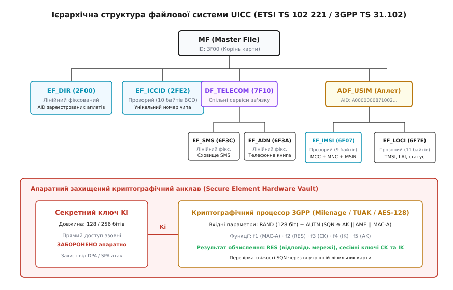
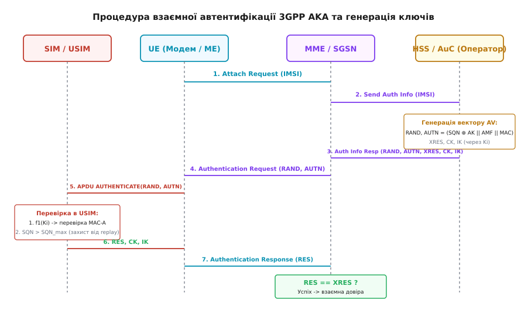
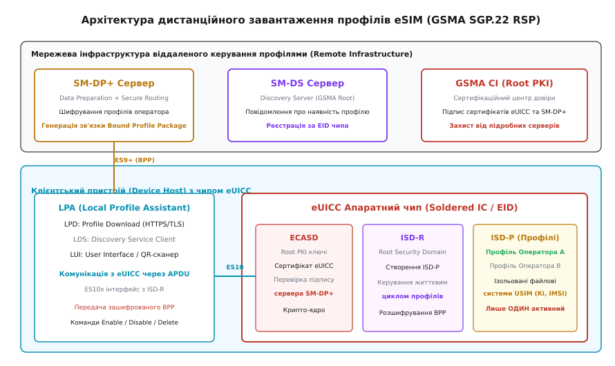
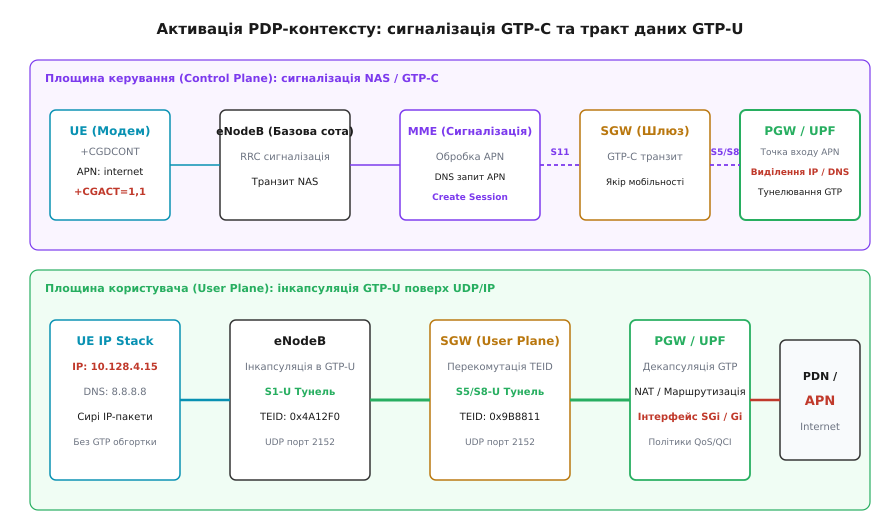

# SIM, IMSI, APN: як пристрій входить у мережу оператора

<preknowlist>
- [Покоління: від GSM до 5G і що з них лишилося пристроям](root:com-transport/pokolinnia) — еволюція архітектури радіодоступу та ядра мережі від комутації каналів до автономного пакетного ядра.
- [Комутація каналів проти комутації пакетів](root:com-transport/circuit-vs-packet-switching) — фундаментальні відмінності між виділеним фізичним трактом та дейтаграмною передачею даних.
- [IP-маршрутизація](root:com-transport/ip-routing) — просування пакетів у мережах за префіксами адрес та таблицями маршрутизації.
- [Транспортні протоколи TCP і UDP](root:com-transport/tcp-vs-udp) — встановлення надійного потокового з'єднання проти дейтаграмного протоколу без встановлення з'єднання.
- [Джерело ентропії (TRNG)](root:sf-security/entropy-source) — генерація непередбачуваних випадкових чисел для криптографічних протоколів.
</preknowlist>

Коли автономний контролер або мобільний термінал подає живлення на вбудований стільниковий модем, радіомодуль не може просто вийти в ефір і надіслати IP-пакет у бік найближчої базової станції. Стільникова інфраструктура побудована за принципом нульової довіри до радіообладнання: ефір загальнодоступний, радіосигнали можуть перехоплюватися або імітуватися зловмисниками, а ресурси базових станцій і магістральних маршрутизаторів оператора вимагають суворого обліку та білінгу.

Щоб пристрій отримав можливість маршрутизувати трафік у глобальний інтернет або ізольовану корпоративну мережу, він повинен подолати чотири послідовні бар'єри:
1. Апаратно довести свою автентичність криптографічному центру мережі без передачі секретного ключа у відкритий ефір.
2. Повідомити оператору глобальні ідентифікатори абонента та визначити права на обслуговування в домашній мережі або в роумінгу.
3. Вказати логічну точку входу (**APN**) для вибору цільового шлюзу пакетних даних.
4. Узгодити параметри сесії (**PDP-контекст**), отримати мережеву адресу (IPv4/IPv6) та підняти інкапсульований тунель крізь опорну мережу оператора.

---

### Апаратна та файлова архітектура смарт-карти SIM/UICC

Фізична SIM-карта (англ. *Subscriber Identity Module*) є повноцінним захищеним мікрокомп'ютером особливого класу — смарт-картою стандарту **UICC** (*Universal Integrated Circuit Card*, стандарти ETSI TS 102 221 та 3GPP TS 31.102). 

Кристал UICC містить 8-, 16- або 32-бітний мікроконтролер із гарвардською або модифікованою фон-нейманівською архітектурою, захищене апаратне ядро з криптографічним співпроцесором (AES, 3DES, SHA, RSA, ECC), генератор випадкових чисел (TRNG), невеликий обсяг оперативної пам'яті (RAM, 8–32 КБ) для виконання обчислень та енергонезалежну пам'ять (Flash/EEPROM, 64–512 КБ), у якій зберігається операційна система смарт-карти (наприклад, Java Card OS), аплети та файлова система.

```
                    Зовнішній інтерфейс ISO/IEC 7816-3
          (Контакти: VCC, GND, RST, CLK, I/O, VPP/SWP)
                                │
                                ▼
┌────────────────────────────────────────────────────────────────────────┐
│ Смарт-карта UICC (Universal Integrated Circuit Card)                   │
│                                                                        │
│  ┌──────────────────────┐  ┌────────────────────────────────────────┐  │
│  │ Контролер I/O (UART) │  │ Захищене ядро CPU (ARM SecurCore / 8051)│  │
│  └──────────┬───────────┘  └───────────────────┬────────────────────┘  │
│             │                                  │                       │
│  ┌──────────▼───────────┐  ┌───────────────────▼────────────────────┐  │
│  │ Оперативна RAM       │  │ Апаратний криптопроцесор (AES, TRNG)   │  │
│  │ (Тимчасові змінні)   │  │ (Захист від DPA, SPA та Fault Injection)│  │
│  └──────────────────────┘  └───────────────────┬────────────────────┘  │
│                                                │                       │
│  ┌─────────────────────────────────────────────▼────────────────────┐  │
│  │ Енергонезалежна пам'ять Flash / EEPROM                            │  │
│  │ ┌──────────────────────────────────────────────────────────────┐ │  │
│  │ │ Секретний ключ Ki (128/256 бітів) — АПАРАТНО НЕ ЧИТАЄТЬСЯ    │ │  │
│  │ ├──────────────────────────────────────────────────────────────┤ │  │
│  │ │ Файлова система: MF (3F00) ──> ADF_USIM ──> EF_IMSI, EF_LOCI │ │  │
│  │ └──────────────────────────────────────────────────────────────┘ │  │
│  └──────────────────────────────────────────────────────────────────┘  │
└────────────────────────────────────────────────────────────────────────┘
```

Фізичний інтерфейс зв'язку між модемом і картою стандартизовано за стандартом **ISO/IEC 7816-3**. Обмін даними відбувається через послідовний напівдуплексний асинхронний канал (контакт `I/O`) за допомогою командно-відповідних пакетів **APDU** (*Application Protocol Data Unit*).

#### Ієрархія файлової системи ETSI/3GPP

Файлова система карти організована у вигляді дерева каталогів та файлів, де кожен об'єкт ідентифікується 2-байтним шістнадцятковим числом (File ID):


*Ієрархічна організація файлів на смарт-карті UICC. Кореневий каталог MF містить службові таблиці реєстрації та веде до спеціалізованих каталогів додатків ADF_USIM і DF_TELECOM з елементарними файлами ідентифікації та налаштувань.*

1. **MF (Master File, ID: `3F00`):** корінь файлової системи, аналог кореневого каталогу `/` в Unix.
2. **DF (Dedicated File):** проміжний каталог, що групує файли певної функціональності. Наприклад, `DF_TELECOM` (`7F10`) містить загальні телекомунікаційні служби (телефонна книга, SMS), а історичний `DF_GSM` (`7F20`) містив файли для мереж 2G.
3. **ADF (Application Dedicated File):** спеціалізований каталог повноцінного телекомунікаційного застосунка. У сучасних мережах LTE та 5G цим застосунком є **ADF_USIM** (Universal SIM Application, AID `A0000000871002...`).
4. **EF (Elementary File):** кінцеві файли даних, що безпосередньо зберігають параметри.

За внутрішньою структурою елементарні файли (EF) поділяються на три типи:
* **Transparent (Прозорі):** неструктурований масив байтів із прямим доступом за зміщенням (Offset) та довжиною. У такому форматі зберігаються `EF_ICCID` (`2FE2`) та `EF_IMSI` (`6F07`).
* **Linear Fixed (Лінійні фіксовані):** послідовність записів однакової фіксованої довжини з індексацією від 1 до N. Застосовуються для списків контактів (`EF_ADN`, `6F3A`) та сховища SMS-повідомлень (`EF_SMS`, `6F3C`).
* **Cyclic (Циклічні):** кільцевий буфер фіксованих записів, де запис нового елемента автоматично витісняє найстаріший. Використовуються для журналу останніх викликів або лічильників вартості.

#### Захищений апаратний анклав та ключ `Ki`

У захищеній зоні EEPROM, доступ до якої заблоковано на рівні мікрокоду карти для будь-яких зовнішніх команд зчитування, зберігається головний криптографічний секрет абонента — **ключ `Ki`** (*Individual Subscriber Authentication Key*). Ключ має довжину 128 бітів (у 3G/4G) або 256 бітів (у 5G TUAK).

Копія цього ключа зберігається виключно в апаратному центрі автентифікації домашнього оператора (**AuC**, *Authentication Centre*, у складі баз даних HSS/UDM). За жодних обставин ключ `Ki` не може бути прочитаний через контакти карти: контролер UICC виконує криптографічні перетворення виключно всередині кристала й видає назовні лише результат обчислення функцій. 

Кристали смарт-карт оснащуються фізичним захистом від зондування мікроманіпуляторами, сенсорами виявлення перепадів напруги, тактової частоти та лазерного опромінення (захист від *Fault Injection Attacks*), а також схемами маскування енергоспоживання для нейтралізації атак за сторонніми каналами (DPA/SPA — *Differential/Simple Power Analysis*).

---

### Глобальні ідентифікатори: ICCID та IMSI

У процесі ідентифікації та входу в мережу використовуються два фундаментальні ідентифікатори різного призначення: апаратний номер фізичного чипа (**ICCID**) та логічний ідентифікатор мобільного абонента (**IMSI**).

```
Ідентифікатори термінала та підписки:
┌────────────────────────────────────────────────────────────────────────┐
│ ICCID (Integrated Circuit Card ID, ITU-T E.118) — 19-20 цифр           │
│ [ 89 ] [ 380 ] [ 01 ] [ 1234567890 ] [ 4 ]                             │
│   │      │       │           │         └─ Контрольна сума Луна (Luhn)  │
│   │      │       │           └─────────── Індивідуальний номер карти   │
│   │      │       └─────────────────────── Код оператора-емітента       │
│   │      └─────────────────────────────── Телефонний код країни (380)  │
│   └────────────────────────────────────── MII: 89 = Телекомунікації    │
└────────────────────────────────────────────────────────────────────────┘

┌────────────────────────────────────────────────────────────────────────┐
│ IMSI (International Mobile Subscriber Identity, ITU-T E.212) — до 15 ц.│
│ [ 255 ] [ 01 ] [ 1234567890 ]                                          │
│    │      │           └────────────────── MSIN: Номер абонента в мережі│
│    │      └────────────────────────────── MNC: Код мобільної мережі    │
│    └───────────────────────────────────── MCC: Мобільний код країни    │
│ └──────────────────── PLMN-ідентифікатор ────────────────────────────┘ │
└────────────────────────────────────────────────────────────────────────┘
```

#### ICCID (Integrated Circuit Card Identifier)

Стандартизований рекомендацією **ITU-T E.118**, номер ICCID є постійним серійним номером фізичної смарт-карти або чипа. Він наноситься лазером на пластиковий корпус карти та записується у файл `EF_ICCID` (`2FE2`).

Структура ICCID (до 20 десяткових цифр):
* **MII (Major Industry Identifier, 2 цифри):** значення `89` резервує карту за галуззю телекомунікацій.
* **Country Code (1–3 цифри):** міжнародний телефонний код країни за стандартом ITU-T E.164 (наприклад, `380` для України, `1` для США, `49` для Німеччини).
* **Issuer Identifier (1–4 цифри):** код оператора зв'язку, що випустив карту.
* **Individual Account Identification:** унікальний серійний номер чипа, згенерований виробником.
* **Checksum (1 цифра):** контрольний розряд, розрахований за класичним алгоритмом Луна (*Luhn algorithm*).

ICCID не використовується для маршрутизації викликів або пакетного трафіку в стільниковій мережі. Його призначення — облік на складі, логістичне прив'язування чипа до контракту в BSS/CRM оператора та ідентифікація апаратного кристала при віддаленій ініціалізації.

#### IMSI (International Mobile Subscriber Identity)

Номер IMSI стандартизовано рекомендацією **ITU-T E.212** і є головним маршрутизованим ідентифікатором підписки абонента у світовій стільниковій інфраструктурі. Він зберігається у файлі `EF_IMSI` (`6F07`) всередині каталогу `ADF_USIM`.

Структура IMSI складається з трьох числових блоків загальною довжиною не більше 15 цифр:
1. **MCC (Mobile Country Code, 3 цифри):** код країни розташування мережі (наприклад, `255` — Україна, `262` — Німеччина, `310` — США).
2. **MNC (Mobile Network Code, 2 або 3 цифри):** код конкретного оператора всередині країни (наприклад, `255 01` — Vodafone UA, `255 03` — Kyivstar, `255 06` — lifecell).
3. **MSIN (Mobile Subscription Identification Number, до 10 цифр):** унікальний ідентифікатор абонентського запису в базі даних конкретного оператора.

Комбінація `MCC + MNC` формує унікальний глобальний ідентифікатор мережі **PLMN ID** (*Public Land Mobile Network Identifier*).

#### Двійкове пакування BCD у файлі `EF_IMSI`

У файлі `EF_IMSI` дані зберігаються у двійково-десятковому форматі (**Packed BCD**, *Binary Coded Decimal*) з перестановкою напівбайтів (Nibbles), що мінімізує обсяг сховища.

Структура 9-байтного запису `EF_IMSI`:
* **Байт 0:** Довжина даних IMSI (кількість значущих байтів).
* **Байт 1:** Молодший напівбайт (Bits 0..3) містить прапорець парності та першу цифру IMSI; старший напівбайт (Bits 4..7) містить другу цифру.
* **Байти 2..8:** Кожна пара цифр записується у зворотному порядку напівбайтів (`Digit N+1 || Digit N`). Якщо кількість цифр непарна, невикористаний напівбайт заповнюється значенням `0xF`.

```
Приклад кодування IMSI "255011234567890" (15 цифр):
Байт 0: 0x08 (довжина 8 байтів)
Байт 1: 0x52 (Bits 0..3: прапорець/цифра 2, Bits 4..7: цифра 5)
Байт 2: 0x05 (цифра 5, цифра 0)
Байт 3: 0x11 (цифра 1, цифра 1)
Байт 4: 0x32 (цифра 2, цифра 3)
Байт 5: 0x54 (цифра 4, цифра 5)
Байт 6: 0x76 (цифра 6, цифра 7)
Байт 7: 0x98 (цифра 8, цифра 9)
Байт 8: 0xF0 (цифра 0, напівбайт заповнення 0xF)
```

#### Роумінг та маршрутизація: HPLMN проти VPLMN

Коли модем вмикає радіоприймач, він сканує доступні частотні канали та зчитує системну інформацію (System Information Blocks, SIB), яку транслюють довколишні базові станції. У блоці SIB1 станція передає свій `PLMN ID` (`MCC + MNC`).

Модем порівнює отриманий PLMN ID з даними власної карти:
* Якщо `MCC + MNC` збігаються з домашнім ідентифікатором карти, мережа визначається як **HPLMN** (*Home PLMN*).
* Якщо ідентифікатори відрізняються, термінал переходить у режим роумінгу у гостьовій мережі **VPLMN** (*Visited PLMN*).

Гостьова базова станція та вузол керування мобільністю (MME у LTE або SGSN у 3G) виділяють блок `MCC + MNC` з надісланого терміналом IMSI і за міжнародними сигнальними маршрутами (протоколи Diameter або SS7/MAP через шлюзи IPX/GRX) звертаються до домашнього сервера HSS оператора-емітента карти. Гостьова мережа не володіє ключем `Ki` — вона лише запитує у домашньої мережі разові вектори автентифікації.

---

### Криптографічний механізм автентифікації: 3GPP AKA та Milenage

В історичних мережах 2G GSM застосовувалася одностороння автентифікація (алгоритми COMP128): мережа перевіряла справжність термінала, але термінал не мав можливості перевірити, чи є базова станція справжньою. Це створювало критичну вразливість перед фальшивими базовими станціями (*IMSI-Catchers*, комплекси Stingray), які могли примусово знизити шифрування до нульового (A5/0) і перехоплювати трафік.

Починаючи з покоління 3G UMTS і в усіх наступних стандартах (4G LTE, 5G NR), впроваджено протокол **3GPP AKA** (*Authentication and Key Agreement*, 3GPP TS 33.102), який реалізує **взаємну автентифікацію**: термінал підтверджує свої права оператору, а оператор доводить терміналу, що він володіє ключем `Ki` та автентичним лічильником послідовності `SQN`.


*Послідовність сигналізації протоколу 3GPP AKA. Центр HSS генерує 5-елементний вектор автентифікації, термінал верифікує токен AUTN всередині апаратного ядра USIM та повертає відгук RES, одночасно виробляючи сесійні ключі шифрування CK та контролю цілісності IK.*

Криптографічною основою протоколу AKA є алгоритмічний набір **Milenage** (3GPP TS 35.205 / TS 35.206), побудований на блочному шифрі AES-128. Повний математичний розбір функцій `f1..f5`, обчислення масок та правила ресинхронізації лічильників винесено в окремий [алгоритмічний розбір Milenage та протоколу AKA](root:com-transport/sim-imsi-apn/math-milenage-aka.md).

#### Етапи процедури AKA

1. **Запит реєстрації (Attach Request):** модем передає свій IMSI (або тимчасовий псевдонім TMSI/GUTI) вузлу MME/SGSN.
2. **Отримання вектора автентифікації:** MME звертається до домашнього HSS. Центр AuC/HSS генерує 128-бітне псевдовипадкове число `RAND`, бере поточне значення лічильника послідовності `SQN` і запускає функції Milenage на базі секретного ключа `Ki`:
   * Функція `f1` обчислює 64-бітний код автентифікації мережі `MAC-A = f1(Ki, SQN, RAND, AMF)`.
   * Функція `f5` генерує 48-бітний ключ анонімності `AK = f5(Ki, RAND)`, який маскує лічильник: `SQN ⊕ AK`.
   * Формується токен мережі `AUTN = (SQN ⊕ AK) || AMF || MAC-A`.
   * Функції `f2`, `f3`, `f4` обчислюють очікувану відповідь `XRES` та 128-бітні сесійні ключі шифрування `CK` і контролю цілісності `IK`.
   * Кортеж `(RAND, AUTN, XRES, CK, IK)` передається назад вузлу MME.
3. **Виклик термінала (Authentication Request):** MME надсилає модему пару `(RAND, AUTN)`.
4. **Апаратне обчислення в USIM:** модем транслює `RAND` та `AUTN` у карту командою APDU `AUTHENTICATE`. Карта обчислює `AK`, знімає маску з лічильника `SQN`, розраховує свій `XMAC` і порівнює його з `MAC-A`.
   * Якщо `XMAC ≠ MAC-A`, карта відхиляє мережу (*MAC Failure* — спроба перехоплення фальшивою станцією).
   * Якщо `SQN` застарілий, карта генерує токен ресинхронізації `AUTS` (*Synch Failure*).
   * При успіху карта обчислює `RES`, `CK`, `IK` і повертає `RES` модему.
5. **Верифікація відповіді:** модем передає `RES` вузлу MME. MME порівнює `RES` з `XRES`. При збігу взаємна автентифікація вважається завершеною, а ключі `CK` та `IK` завантажуються в апаратні прискорювачі шифрування радіотракту.

---

### Програмні профілі та архітектура eSIM / eUICC

Зі зростанням вимог до мініатюризації пристроїв інтернету речей (IoT), герметичності корпусів та потреби віддаленої зміни оператора без заміни пластикової карти було розроблено стандарт **eSIM** (архітектура **eUICC**, специфікації GSMA SGP.02 для M2M та GSMA SGP.22 для споживчих пристроїв Consumer RSP).

Чип eUICC є незнімною мікросхемою у формфакторі MFF2 (5×6 мм) або WLCSP, припаяною безпосередньо на друковану плату пристрою. Головна відмінність eUICC від класичної UICC полягає у здатності безпечно зберігати **декілька незалежних операторських профілів** і перемикати їх за програмною командою.


*Архітектура GSMA SGP.22 Remote SIM Provisioning. Віддалені сервери SM-DP+ та SM-DS взаємодіють із локальним помічником LPA на пристрої для криптографічно захищеного завантаження операторських профілів у внутрішні домени безпеки eUICC.*

#### Компоненти архітектури Remote SIM Provisioning (RSP)

1. **eUICC (Embedded UICC):** апаратний крипточип, який має глобальний унікальний ідентифікатор **EID** (32 цифри). Внутрішній простір eUICC поділено на домени безпеки:
   * **ECASD (eUICC Controlling Authority Security Domain):** кореневий домен, що містить сертифікати довіри GSMA Root CI та заводські приватні ключі чипа для верифікації сертифікатів серверів.
   * **ISD-R (Issuer Security Domain Root):** системний домен, що відповідає за створення нових контейнерів, завантаження, активацію, деактивацію та видалення профілів.
   * **ISD-P (Issuer Security Domain Profile):** ізольований захищений контейнер, всередині якого розміщується окремий операторський профіль зі своєю файловою системою, ключем `Ki` та аплетом USIM. У кожен момент часу активним може бути лише один профіль ISD-P (або декілька при підтримці Multiple Enabled Profiles, MEP).
2. **LPA (Local Profile Assistant):** програмний компонент на хості або всередині модема (LPAd), що керує інтерфейсом завантаження:
   * **LPD (Profile Download):** здійснює HTTPS/TLS з'єднання із сервером завантаження;
   * **LDS (Discovery Service Client):** періодично опитує сервер сповіщень SM-DS;
   * **LUI (Local User Interface):** взаємодіє з користувачем або приймає команди сканування QR-коду (рядок activation code).
3. **SM-DP+ (Subscription Manager Data Preparation +):** сервер оператора, що генерує зашифрований пакет профілю (**BPP**, *Bound Profile Package*), підписаний власним сертифікатом і зашифрований на відкритому ключі конкретного чипа eUICC.
4. **SM-DS (Subscription Manager Discovery Server):** глобальний маршрутизатор сповіщень GSMA, де оператор реєструє наявність готового профілю для вказаного EID.

Завдяки наскрізному асиметричному шифруванню (PKI) пакет BPP розшифровується виключно всередині домену ISD-R цільового кристала eUICC: ні хост-процесор пристрою, ні проміжний інтернет-провайдер не мають доступу до ключів `Ki` та параметрів профілю.

---

### Точка доступу APN: шлюз у зовнішні мережі

Після того як термінал успішно зареєструвався в соті й пройшов взаємну автентифікацію, він перебуває у стані радіозв'язку, але не має доступу до IP-маршрутизації. Для передачі пакетних даних необхідно вказати точку доступу — **APN** (*Access Point Name*).

APN — це текстовий рядок, структурований за правилами доменних імен DNS (RFC 1035 / 3GPP TS 23.003), який ідентифікує пакетний шлюз (**PGW** у 4G LTE, **UPF** у 5G, **GGSN** у 2G/3G) та визначає правила маршрутизації й ізоляції трафіку.

```
Структура повного FQDN APN:
[ internet.kyivstar.net ] . [ mnc003.mcc255.gprs ]
           │                               │
           │                               └─ Operator Identifier (Опціонально)
           └───────────────────────────────── Network Identifier (Обов'язково)
```

1. **Network Identifier (NI):** обов'язкова частина, що визначає цільову зовнішню мережу (наприклад, `internet`, `ims`, `mms`, `iot.telekom.de`, `vpn.company.corp`).
2. **Operator Identifier (OI):** опціональний суфікс виду `mnc<MNC>.mcc<MCC>.gprs`, який однозначно визначає приналежність до конкретного оператора. Якщо термінал передає лише `internet`, вузол MME автоматично підставляє домашній OI для резолвінгу IP-адреси шлюзу через внутрішній DNS оператора.

#### Маршрутизація: Публічний інтернет проти корпоративного VRF

Залежно від конфігурації APN у профілі підписки HSS, шлюз PGW/UPF направляє трафік користувача за одним із двох принципово різних маршрутів:

```
                  ┌────────────┐   APN: "internet"   ┌────────────────────────┐
                  │            ├────────────────────>│ Глобальний Інтернет    │
                  │  Шлюз PGW  │ (Динамічний CGNAT)  │ (Публічні адреси)      │
[ Мобільний UE ] ─┤    UPF     ├─────────────────────┼────────────────────────┤
                  │   (SGi)    │   APN: "corp.iot"   │ Корпоративний VPN / VRF│
                  │            ├────────────────────>│ (Ізольований L3 контур,│
                  │            │ (Статичні IP/IPsec) │  без доступу ззовні)   │
                  └────────────┘                     └────────────────────────┘
```

* **Публічний APN (Default Internet):** шлюз PGW виділяє модему динамічну приватну IP-адресу з пулу CGNAT (RFC 6598, префікс `100.64.0.0/10` або `10.0.0.0/8`) і виконує трансляцію адрес у публічний інтернет. Вхідні з'єднання ззовні блокуються міжмережевим екраном оператора.
* **Корпоративний приватний APN (Private APN / VPN):** трафік термінала термінується в ізольованій таблиці віртуальної маршрутизації (**VRF**, *Virtual Routing and Forwarding*) або передається безпосередньо в корпоративний дата-центр через заздалегідь піднятий тунель IPsec чи виділений L2/L3 MPLS VPN канал.
  * Пристроям призначаються статичні або фіксовані адреси з корпоративного адресного простору.
  * Дозволяється двостороння пряма адресація: сервер диспетчеризації може ініціювати TCP/UDP з'єднання до IoT-датчика без сторонніх NAT-проксі.
  * Трафік фізично ізольований від загального інтернету, що усуває загрозу DDoS-атак та сканування портів ззовні.

---

### Активація PDP-контексту та створення тунелів GTP

Для створення сесії передачі даних модем надсилає запит на активацію контексту протоколу пакетних даних — **PDP-контексту** (*Packet Data Protocol Context*, у термінології LTE — *EPS Bearer*, у 5G — *PDU Session*).


*Розподіл сигнальної площини та площини передачі пакетів під час активації PDP-контексту. Протокол GTP-C узгоджує параметри тунелювання між MME, SGW та PGW, після чого відкривається тунель GTP-U з ідентифікаторами TEID для передачі користувацького IP-трафіку.*

#### Послідовність сигналізації створення сесії

1. Модем надсилає повідомлення сигналізації бездротового рівня NAS: `Activate PDP Context Request` (у 3G) або `PDN Connectivity Request` (у LTE). Запит містить числовий номер контексту (`cid`), тип протоколу (`IPv4`, `IPv6` або `IPv4v6`), назву `APN` та контейнер параметрів `PCO` (*Protocol Configuration Options*).
2. Вузол керування MME отримує запит, перевіряє права абонента в базі HSS і за допомогою внутрішнього DNS оператора знаходить IP-адресу найближчого шлюзу PGW, що обслуговує цей APN.
3. MME надсилає повідомлення протоколу керування **GTP-C** (*GPRS Tunneling Protocol Control Plane*, 3GPP TS 29.274) `Create Session Request` до шлюзу обслуговування SGW, а той транслює його до PGW.
4. PGW резервує для абонента IP-адресу, виділяє ідентифікатор кінцевої точки тунелю **TEID** (*Tunnel Endpoint Identifier*) для прийому трафіку користувача та повертає `Create Session Response` з адресами DNS-серверів та значенням MTU в блоці PCO.
5. Між базовою станцією eNodeB та SGW (інтерфейс `S1-U`), а також між SGW та PGW (інтерфейс `S5/S8`) підіймається тунель протоколу площини користувача **GTP-U** (порт UDP `2152`).

Кожен IP-пакет, згенерований операційною системою пристрою, обгортається модемом і базовою станцією в заголовок GTP-U, що містить призначений `TEID`, та передається магістральними маршрутизаторами оператора як стандартна UDP-дейтаграма. Шлюз PGW знімає заголовки GTP/UDP і спрямовує чистий вихідний IP-пакет у бік підключеної мережі APN (інтерфейс `SGi`).

#### Default Bearer проти Dedicated Bearer

* **Default Bearer (Канал за замовчуванням):** створюється автоматично під час первинної активації PDP-контексту. Він залишається активним протягом усього часу перебування пристрою в мережі, забезпечує доставку пакетів за принципом найкращих зусиль (*Best Effort*) і не гарантує мінімальної пропускної здатності.
* **Dedicated Bearer (Виділений вторинний канал):** створюється динамічно за ініціативою мережі поверх наявного Default Bearer для специфічного трафіку, що вимагає суворих параметрів якості обслуговування (**QoS**). Визначається класом обслуговування **QCI** (*QoS Class Identifier* у LTE) або **5QI** (у 5G). Використовується для передачі голосу високої чіткості (**VoLTE**, QCI=1 з гарантованим бітрейтом GBR та пріоритетною затримкою < 100 мс) або відеоконференцій (QCI=2).

---

### Програмне керування модемом через стек AT-команд

Керування процесом ініціалізації SIM, конфігурації профілів APN та активації PDP-контекстів з боку мікроконтролера або хост-системи виконується через асинхронний послідовний порт (UART, USB CDC-ACM або PCIe virtual serial) за допомогою стандартизованих команд 3GPP TS 27.007.

Детальний опис усіх параметрів команд, форматів відповідей та числових кодів помилок `+CME ERROR` наведено в окремому [довіднику інтерфейсу AT-команд для PDP](root:com-transport/sim-imsi-apn/api-at-cellular-pdp.md).

#### Машина станів ініціалізації з'єднання

Надійна реалізація модемного драйвера повинна базуватися на детермінованій машині станів (FSM), яка послідовно проходить кроки підготовки:

```
[ Стан 0: Очікування готовності модема (AT -> OK) ]
                       │
                       ▼
[ Стан 1: Перевірка та розблокування SIM (AT+CPIN? -> READY) ]
                       │
                       ▼
[ Стан 2: Опитування реєстрації в мережі (AT+CEREG? -> stat=1 або 5) ]
                       │
                       ▼
[ Стан 3: Запис профілю APN (AT+CGDCONT=1,"IP","internet.apn") ]
                       │
                       ▼
[ Стан 4: Активація PDP-контексту (AT+CGACT=1,1) ]
                       │
                       ▼
[ Стан 5: Зчитування виділеної IP-адреси (AT+CGPADDR=1) ]
                       │
                       ▼
[ Стан 6: З'єднання встановлено (DATA_ROUTING_ACTIVE) ]
```

Нижче наведено практичну реалізацію модуля керування модемом мовами C та ідіоматичним C++20. Модуль реалізує повний цикл ініціалізації SIM, очікування реєстрації в мережі, конфігурації APN, активації PDP-контексту та зчитування виділеної IP-адреси з надійним синтаксичним аналізом відповідей та обробкою таймаутів.

:::tabs
:::code sim-imsi-apn-d/c/modem_controller.c
:::code sim-imsi-apn-d/cpp/modem_controller.cpp
:::

---

### Діагностика типових несправностей при вході пристрою в мережу

У процесі експлуатації вбудованих терміналів (IoT-трекери, промислові контролери, телеметричні шлюзи) інженери стикаються з відмовами з'єднання, локалізація яких вимагає аналізу відповідей модема на кожному кроці протоколу:

```
┌────────────────────────────────────────────────────────────────────────┐
│ Дерево діагностики стільникового з'єднання:                           │
│                                                                        │
│ 1. [ AT+CPIN? ] ────────> Не READY ─────> Апаратна помилка слота / PIN │
│        │                                                               │
│        ▼ READY                                                         │
│ 2. [ AT+CSQ / CESQ ] ───> RSSI < 5 ─────> Проблема антени / Зона тіні  │
│        │                                                               │
│        ▼ Сигнал є                                                      │
│ 3. [ AT+CEREG? ] ───────> stat=3 ───────> Реєстрацію відхилено (HSS)  │
│        │                                                               │
│        ▼ stat=1 або 5                                                  │
│ 4. [ AT+CGACT=1,1 ] ────> CME ERROR 149 > Помилка автентифікації APN   │
│        │             ───> CME ERROR 133 > APN не входить у підписку    │
│        ▼ OK                                                            │
│ 5. [ AT+CGPADDR=1 ] ────> IP отримано ──> Проблема DNS або MTU         │
└────────────────────────────────────────────────────────────────────────┘
```

1. **Відмови ініціалізації SIM (`+CPIN: NOT INSERTED` або `+CME ERROR: 10`):**
   * *Причина:* окиснення контактів тримача, механічна вібрація в транспорті, просідання напруги живлення карти під час передачі струмового імпульсу або некоректний рівень напруги (сучасні карти працюють при 1.8 В, застарілі — при 3.0 В).
   * *Дія:* перевірка ліній живлення SIM VCC осцилографом, використання напаюваних чипів eUICC/MFF2 для вібронавантажених систем.
2. **Відхилення реєстрації в соті (`+CEREG: 0,3` — Registration Denied):**
   * *Причина:* операторська база HSS заблокувала абонента через несплату, закінчення терміну дії контракту або заборону роумінгу в цій локації; пристрій внесено до чорного списку обладнання EIR за недійсний IMEI.
   * *Дія:* зчитування коду причини відхилення (*Reject Cause*) через команду `AT+CEER` (Extended Error Report).
3. **Помилка активації PDP-контексту (`+CME ERROR: 133` — Service option not subscribed):**
   * *Причина:* помилка в імені APN. Якщо оператор вимагає `iot.kyivstar.net`, а в конфігурації вказано стандартний `internet`, PGW відхиляє створення GTP-тунелю.
4. **Помилка автентифікації APN (`+CME ERROR: 149` — PDP authentication failure):**
   * *Причина:* невідповідність протоколу перевірки пароля (сервер вимагає CHAP, а модем надіслав PAP) або помилка в рядках логіна/пароля в командах `AT+CGAUTH` / `AT$QCPDPP`.
5. **Проблема MTU Blackhole при передачі великих TCP-пакетів:**
   * *Причина:* інкапсуляція призначених для абонента пакетів усередину тунелю GTP-U додає оверхед транспортних заголовків зовнішньої мережі оператора. Складовими цього оверхеду є зовнішній заголовок IPv4 (20 байтів; або 40 байтів для IPv6), транспортний заголовок UDP на порт 2152 (8 байтів) та базовий заголовок протоколу GTP-U (8 байтів; за наявності опційних полів розширення Sequence Number чи Extension Header додається ще 4 байти):

```text
# Розрахунок мінімального оверхеду GTP-U тунелю (IPv4 + UDP + GTP-U):
20 + 8 + 8 = 36 байтів

# Ефективний розмір MTU для корисного навантаження (Standard Ethernet MTU 1500):
1500 - 36 = 1464 байти
```

     З урахуванням можливих опцій заголовків, додаткового шифрування PDCP/IPsec або транспорту IPv6 сумарний оверхед може сягати 40–80 байтів, через що ефективний розмір MTU стільникового каналу зменшується з 1500 до `1420–1460` байтів. Якщо хост намагається передавати пакети розміром 1500 байтів із встановленим прапорцем DF (*Don't Fragment*), а проміжні вузли блокують повідомлення ICMP `Fragmentation Needed`, сесія зависає при спробі передачі великих порцій даних.
   * *Дія:* примусове обмеження MTU на локальному мережевому інтерфейсі термінала до `1420` байтів або активація механізму TCP MSS Clamping (`MSS = 1380`).

---

### Підсумок

Процес підключення пристрою до мережі оператора є строго детермінованим криптографічним та мережевим протоколом:
* Смарт-карта UICC виступає захищеним апаратним сховищем секретного ключа `Ki` та обчислювальним анклавом для алгоритмічного набору Milenage.
* Номер ICCID ідентифікує кремнієвий чип у логістичних базах, тоді як номер IMSI є глобальною маршрутизованою адресою абонента для ініціалізації взаємної автентифікації 3GPP AKA між терміналом та домашнім HSS.
* Технологія eSIM / eUICC перетворює апаратні профілі на зашифровані програмні контейнери, дозволяючи оновлювати підписки по повітрю (RSP) зі збереженням криптографічної ізоляції.
* Рядок APN виконує роль маршрутного покажчика до цільового пакетного шлюзу PGW/UPF, розподіляючи потоки між публічним інтернетом та ізольованими корпоративними контурами VRF.
* Активація PDP-контексту розгортає тунелі GTP-U площини користувача, виділяє IP-адресу й сервери DNS та переводить модем у стан активного обміну мережевими пакетами.
