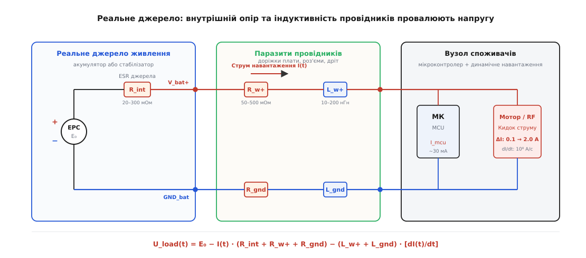
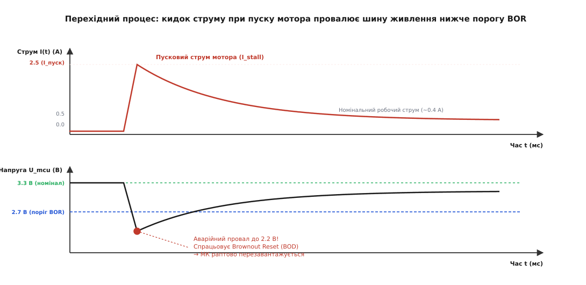
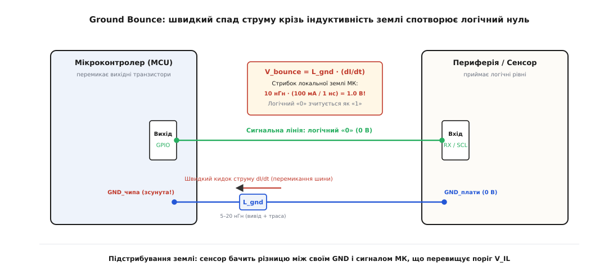
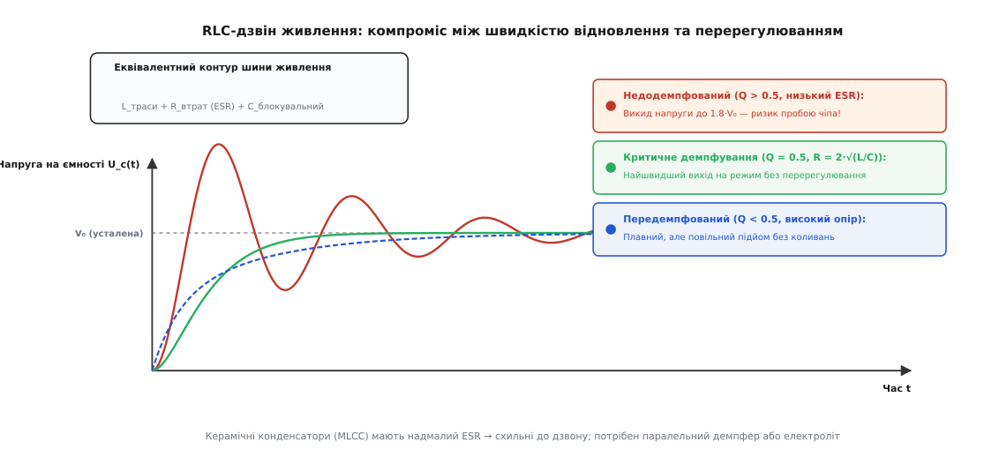
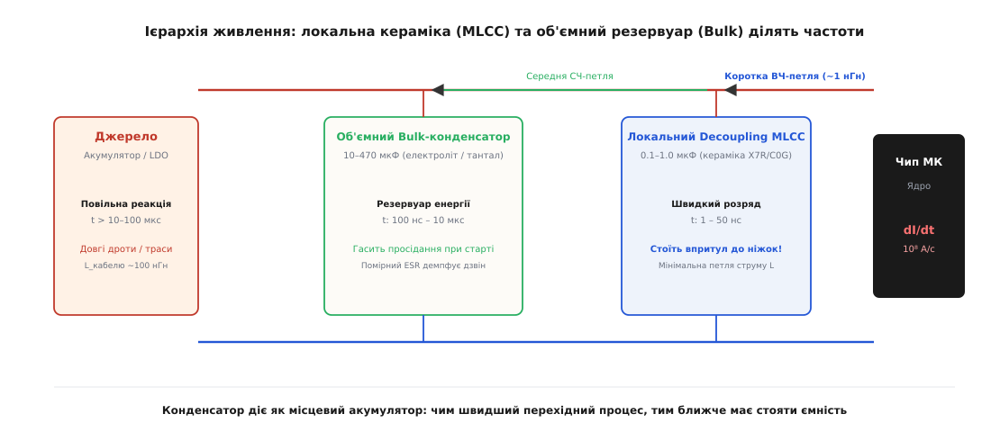

# Коло під навантаженням

<preknowlist>
- [Закон Ома](root:hw-analog/ohms-law) — спад напруги на провіднику прямо пропорційний струму та активному опору: `U = I · R`.
- [Закони Кірхгофа](root:hw-analog/kirchhoff-laws) — алгебраїчна сума струмів у вузлі дорівнює нулю, а сума спадів напруг у замкненому контурі дорівнює сумі ЕРС.
- [Теорема Тевеніна](root:hw-analog/thevenin) — будь-яке лінійне активне електричне коло можна замінити еквівалентним джерелом напруги з послідовним внутрішнім опором.
- [Стала часу RC](root:hw-analog/rc-time-constant) — швидкість заряджання та розряджання ємності через опір з характерним часом `τ = R · C`.
</preknowlist>

Коли на макетній платі збирають схему з мікроконтролером і підключають до неї колекторний двигун або радіомодуль, вимірювання мультиметром у стані спокою показують ідеальну картину: стабілізатор видає рівно 3.30 В, процесор споживає свої звичні 25 мА, усі світлодіоди світяться рівно. Але щойно прошивка подає сигнал увімкнути двигун чи передати радіопакет, мікроконтролер миттєво зависає, скидає свій стан і починає завантажуватися спочатку. На екрані осцилографа видно, що в момент комутації напруга на виводах живлення мікроконтролера не залишається сталою: вона на частки мілісекунди падає до 2.1 В, провалюючись значно нижче мінімального порогу працездатності кремнієвих вентилів. Спроба пояснити це явище за підручниковими схемами з «ідеальним джерелом напруги» заходить у глухий кут, бо в реальному фізичному світі жодне джерело не здатне віддати нескінченний струм за нульовий час, а кожен провідник, роз'єм і доріжка друкованої плати мають власний опір та індуктивність.

### Міф про ідеальне джерело та статичний спад напруги

У теоретичному розрахунку джерело напруги зображають як незмінний потенціал: скільки б амперів не вимагало навантаження, на вихідних клемах завжди діє рівно `U_0`. Проте будь-яке реальне хімічне джерело (Li-Ion акумулятор, лужна батарейка) або електронний регулятор (LDO, імпульсний понижувач) підпорядковується [теоремі Тевеніна](root:hw-analog/thevenin) і еквівалентно складається з ідеальної електрорушійної сили (ЕРС) `E_0` та послідовно увімкненого внутрішнього опору джерела `R_int`.

До цього внутрішнього опору неминуче додається опір провідників підключення: мідні дроти шлейфа, контактні переходи роз'ємів живлення, опір контактних пружин макетної плати та геометрія доріжок друкованої плати `R_wire`. Струм, що тече від джерела до плати й повертається назад, проходить дві гілки провідника — пряму (шину живлення) та зворотну (шину землі).


*Еквівалентна схема живлення реального пристрою: між ідеальною ЕРС джерела `E₀` та виводами мікроконтролера увімкнені внутрішній опір джерела `R_int`, активний опір провідників `R_w+` і `R_gnd`, а також їхня паразитна індуктивність `L_w+` і `L_gnd`. Будь-який струм споживачів створює спад напруги на цих паразитах, зменшуючи напругу `U_load` безпосередньо на мікроконтролері.*

Коли через коло протікає постійний струм навантаження `I_load`, за [законом Ома](root:hw-analog/ohms-law) на кожному омічному елементі виникає спад потенціалу. Властивість провідника чи середовища створювати падіння напруги при проходженні струму називають **електричним опором** (лат. *resistere* — «чинити опір, протистояти»). Для всього кола живлення сумарний активний опір становить `R_total = R_int + R_w+ + R_gnd`.

Напруга, яка фактично доходить до споживача на платі, обчислюється як різниця між ЕРС джерела та сумою всіх статичних втрат у провідниках:

```
U_load
= E_0 - I_load · R_total                          [закон Ома для повного кола]
= E_0 - I_load · (R_int + R_w+ + R_gnd)           [деталізація втрат на джерелі та проводах]
```

Цей статичний спад напруги називають резистивним спадом або `IR-drop` (від англ. *IR drop* — добуток струму `I` на опір `R`). Поки струм споживання малий, втрати непомітні. Але якщо до плати під'єднано навантаження з високим споживанням, цифри стають критичними.

**Оцінка статичного просідання шини.** Літій-іонний акумулятор формату 18650 має внутрішній опір свіжого елемента `R_int ≈ 0.05 Ом` (50 мОм), а зношеного — до `0.25 Ом`. Живлення подано через два стандартні гнучкі проводи довжиною 20 см і макетні роз'єми Dupont, сумарний опір яких разом із контактами становить `R_wire = 0.35 Ом`. Загальний опір петлі живлення: `R_total = 0.05 + 0.35 = 0.40 Ом`.

Якщо мікроконтролер перебуває у стані спокою зі струмом `I_mcu = 25 мА` (0.025 А), спад напруги становить:

```
ΔU_idle
= 0.025 · 0.40                                    [підстановка струму спокою та повного опору]
= 0.010 В = 10 мВ                                 [спад напруги у стані спокою]
```

Напруга падає з 3.30 В лише до 3.29 В, що повністю вкладається в допустиму похибку живлення мікроконтролера (зазвичай `±5 %`, тобто від 3.135 до 3.465 В). Проте коли запускається колекторний двигун або спалахує вихідний підсилювач Wi-Fi зі струмом `I_load = 1.8 А`, спад напруги різко зростає:

```
ΔU_load
= 1.8 · 0.40                                      [розрахунок спаду під повним струмом]
= 0.72 В                                          [спад напруги на провідниках і батареї]

U_load
= 3.30 - 0.72                                     [віднімання втрат від напруги живлення]
= 2.58 В                                          [фактична напруга на мікроконтролері]
```

Напруга 2.58 В виявляється нижчою за критичну межу більшості 3.3-вольтових мікроконтролерів.

> 🔧 **Навіщо це.** Вбудований апаратний блок стеження за напругою всередині мікроконтролера називають детектором просідання живлення або **Brownout Reset** (англ. *brownout* — «сутінки, часткове згасання світла», на противагу *blackout* — «повне знеструмлення»). Коли живильна шина падає нижче запрограмованого порогу (наприклад, 2.70 В для STM32 або 2.80 В для ESP32), блок BOR негайно примусово переводить ядро процесора в стан апаратного скидання (Reset). Це захищає флеш-пам'ять і регістри від спотворення даних через збій логічних вентилів, але призводить до спонтанного перезапуску системи саме в момент увімкнення сильного навантаження.

### Динамічний удар: паразитна індуктивність та стрибок L · (dI/dt)

Якби струм у колі змінювався повільно, резистивний спад був би єдиною проблемою. Проте цифрова електроніка та імпульсні комутатори принципово працюють на швидких перехідних процесах:
- Вихідні CMOS-транзистори логічних вентилів перемикаються за 1–3 наносекунди.
- Радіомодулі перемикають режим прийому на режим передачі за сотні наносекунд, піднімаючи споживання від 15 мА до 350 мА.
- ШІМ-ключі керування двигунами чи соленоїдами відкриваються за 10–50 наносекунд.

Швидкість зміни струму в часі позначають похідною `dI/dt` (відхилення струму `ΔI` за проміжок часу `Δt`). Для сучасних цифрових систем швидкість наростання струму досягає колосальних величин:

```
dI/dt
= 0.5 / (5 · 10⁻⁹)                                [ділення стрибка струму на час наростання]
= 10⁸ А/с                                         [сто мільйонів амперів за секунду]
```

Кожен провідник у просторі створює навколо себе магнітне поле. Здатність провідника накопичувати енергію магнітного поля при проходженні струму називають **індуктивністю** (лат. *inductio* — «наведення, введення»). Навіть прямий мідний провід чи доріжка на платі без жодних котушок має розподілену **паразитну індуктивність**: прямий дріт має питому індуктивність близько `1 нГн/мм` (1 мкГн на метр), а друкована доріжка над суцільним шаром землі — близько `0.3–0.6 нГн/мм`.

За законом електромагнітної індукції Фарадея та правилом Ленца, будь-яка зміна струму крізь індуктивність викликає в ній ЕРС самоіндукції, яка чинить опір цій зміні:

```
U_L = L · (dI/dt)
```

Ця індуктивна напруга віднімається від напруги джерела під час наростання струму (`dI/dt > 0`) і додається до неї під час спаду струму (`dI/dt < 0`).

**Розрахунок динамічного індуктивного спайка.** Розглянемо звичайний дріт довжиною 15 см між стабілізатором і платою. Його паразитна індуктивність становить `L_wire ≈ 150 нГн = 150 · 10⁻⁹ Гн`. При стрибку струму радіомодуля на `ΔI = 0.3 А` за час `Δt = 10 нс`:

```
dI/dt
= 0.3 / (10 · 10⁻⁹)                               [обчислення швидкості зміни струму]
= 3 · 10⁷ А/с                                     [тридцять мільйонів амперів за секунду]

U_L
= 150 · 10⁻⁹ · (3 · 10⁷)                          [множення індуктивності на похідну струму]
= 4.5 В                                           [індуктивний спад напруги на проводі]
```

Індуктивний спад напруги `4.5 В` перевищує всю напругу живлення схеми `3.3 В`. У результаті на виводах мікроконтролера виникає глибокий миттєвий провал напруги (до 0 В або навіть короткочасної від'ємної величини), який триває лічені наносекунди, але цього достатньо для повного збою логіки та скидання процесора через внутрішні тригери.


*Осцилограма перехідного процесу під час пуску навантаження: у момент відкриття ключа пусковий струм стрибає вгору з високою швидкістю `dI/dt`. Індуктивність кабелю створює різкий негативний викид напруги, за яким іде затяжне просідання через опір джерела. Коли напруга перетинає поріг BOR, мікроконтролер скидається.*

### Підстрибування землі (Ground Bounce) та перекіс логічних рівнів

Паразитна індуктивність присутня не лише у плюсовій шині живлення, а й у зворотній земляній лінії (GND). Це породжує один із найпідступніших ефектів у цифровій схемотехніці — **підстрибування землі** (англ. *ground bounce*).

Земля на платі часто сприймається інженером як ідеальний нульовий потенціал `0 В`. Проте коли мікроконтролер перемикає одночасно 8 або 16 виводів шини даних із логічної одиниці в логічний нуль, ємності навантаження ліній розряджаються через нижні ключі вихідних каскадів мікроконтролера в його внутрішню шину `GND_chip`. Увесь цей сумарний струм розряду `I_discharge` з величезною швидкістю `dI/dt` витікає через один або кілька виводів корпусу мікроконтролера та друковану доріжку до спільної землі плати `GND_pcb`.


*Механізм Ground Bounce: струм швидкого перемикання цифрової шини тече крізь паразитну індуктивність виводу землі `L_gnd`. Внутрішній потенціал землі мікроконтролера `GND_чипа` підстрибує відносно стабільної землі плати `GND_плати`. Зовнішній приймач фіксує помилковий логічний перепад на сигнальній лінії.*

Індуктивність ніжки мікросхеми та її доріжки `L_gnd` створює напругу зміщення локальної землі:

```
V_bounce
= L_gnd · (dI_discharge / dt)                     [стрибок потенціалу локальної землі чипа]
```

У цей момент внутрішній потенціал «нуля» всередині мікроконтролера підскакує вгору відносно землі плати на 0.8–1.5 В. Якщо в цей час мікроконтролер утримує на якійсь іншій ніжці стабільний логічний нуль (0 В), зовнішній пристрій (наприклад, датчик по шині SPI чи I2C) бачить на цій лінії не 0 В, а `+1.2 В`. Якщо цей рівень перевищує максимальний поріг логічного нуля приймача `V_IL_max` (який для 3.3 В логіки зазвичай становить `0.8 В`), приймач фіксує фальшивий тактовий імпульс або бітову помилку в пакеті.

Так само виникає зворотний ефект — **просідання живлення ядра** (*VCC Sag*), коли верхні ключі відкриваються і внутрішній потенціал шини живлення чіпа провалюється вниз відносно зовнішнього живлення.

### RLC-дзвін: як паразити перетворюють коло живлення на коливальний контур

Поєднання індуктивності кабелю чи доріжок `L_wire`, активного опору втрат `R_total` та блокувальних конденсаторів на платі `C_load` утворює еквівалентний послідовний коливальний контур (RLC-ланцюг). Здатність системи підсилювати коливання на певних частотах називають **електричним резонансом** (лат. *resonare* — «відгукуватися, лунати, відлунювати»).

Коли в такому контурі відбувається стрибок струму, виникає перехідний процес, характер якого визначається **добротністю** контуру `Q` (англ. *Quality factor* — показник відношення накопиченої енергії до втрат за період) та **демпфуванням** (нім. *dämpfen* — «глушити, гасити, послаблювати»):

```
Q = (1 / R_total) · √(L_wire / C_load)
```

Характер перехідного процесу описується трьома режимами:

1. **Недодемпфований режим (`Q > 0.5` або `R_total < 2 · √(L/C)`):**
   Опір у колі занадто малий, щоб швидко розсіяти енергію, накопичену в магнітному полі індуктивності. Після стрибка струму напруга на шині здійснює серію високочастотних затухаючих коливань — так званий **дзвін шини живлення** (*ringing*).
   
   Найнебезпечніший наслідок недодемпфованого контуру — **перерегулювання за напругою (overshoot)**. При різкому підключенні живлення (гаряче підключення роз'єму, Hot-Plug) або різкому вимкненні струму напруга на конденсаторі може підскочити до подвоєного значення вхідного живлення:
   
   ```
   U_peak ≈ 2 · U_in
   ```
   
   Якщо плату з максимально допустимою напругою мікросхем 5.5 В під'єднати довгим кабелем до джерела 5.0 В з малим опором, RLC-дзвін створить сплеск до 9–10 В, що миттєво пробиває підзатворний діелектрик вхідних MOSFET-транзисторів стабілізатора або мікроконтролера.

2. **Критично демпфований режим (`Q = 0.5` або `R_total = 2 · √(L/C)`):**
   Ідеальний інженерний компроміс. Напруга відновлюється максимально швидко без жодного перерегулювання та коливального дзвону.

3. **Передемпфований режим (`Q < 0.5` або `R_total > 2 · √(L/C)`):**
   Опір великий, коливань немає, але відновлення напруги відбувається повільно за експоненційним законом, а постійний спад напруги `I · R` стає надмірним.


*Перехідні характеристики шини живлення при стрибку струму: недодемпфований контур із наднизьким ESR спричиняє небезпечний високочастотний дзвін і викиди перенапруги. Критичне демпфування забезпечує швидкий перехід без коливань.*

> 🔧 **Пастка керамічних конденсаторів (MLCC).** Сучасні багатошарові керамічні конденсатори (MLCC, англ. *Multi-Layer Ceramic Capacitor*) мають винятково малий власний послідовний опір `ESR ≈ 2–10 мОм`. Якщо на вході плати поставити лише чисту кераміку `10 мкФ` без демпфування і підключити її через дріт довжиною 30 см (`L ≈ 300 нГн`), добротність такого контуру злетить до `Q ≈ 15–30`. При вмиканні виникає потужний резонансний сплеск, який часто випалює стабілізатори живлення. Для приборкання дзвону паралельно з керамікою завжди ставлять електролітичний або танталовий конденсатор із природним помірним `ESR ≈ 0.2–0.5 Ом`, який гасить коливання.

Детальний математичний аналіз паразитних антирезонансів та формули розрахунку демпферів наведено у вставці [розрахунок цільового імпедансу шини живлення](root:embedded-ultra/circuit-under-real-load/math-pdn-impedance.md).

### Електромеханічні навантаження: пусковий струм та проти-ЕРС двигуна

Серед усіх споживачів у вбудованих системах електродвигуни постійного струму, сервоприводи, електромагніти та реле створюють найважче навантаження на коло живлення.

У момент подачі напруги на колекторний двигун його якір нерухомий: кутова швидкість обертання ротора `ω = 0`. Усередині двигуна діє закон електромагнітної індукції: якір, що обертається в магнітному полі статора, працює як генератор і виробляє власну напругу, спрямовану проти напруги живлення. Цю напругу називають **проти-електрорушійною силою** або **проти-ЕРС** (нім. *Gegen-EMK*, англ. *Back-EMF*):

```
E_back = k_e · ω                                  [проти-ЕРС пропорційна швидкості обертання]
```

де `k_e` — конструктивна стала двигуна (вольт на рад/с).

Струм, що протікає крізь обмотку якоря, визначається різницею між напругою живлення та проти-ЕРС:

```
I_motor(t) = (U_supply - E_back(t)) / R_coil
```

де `R_coil` — активний опір мідного дроту обмотки якоря (зазвичай від 0.5 до 3 Ом для малопотужних моторів).

У першу мить пуску (`t = 0`, `ω = 0`, `E_back = 0`), обмотка двигуна для джерела є звичайним низькоомним резистором. Струм стрибає до максимального значення — **струму короткого замикання (пускового струму або струму застопорення, stall current)**:

```
I_stall = U_supply / R_coil
```

**Порівняння робочого та пускового струму.** Мініатюрний двигун із напругою 6 В має опір обмотки `R_coil = 1.5 Ом`. У сталому режимі холостого ходу двигун споживає всього `0.15 А`. Проте в момент пуску:

```
I_stall
= 6.0 / 1.5                                       [ділення напруги на опір обмотки]
= 4.0 А                                           [пусковий струм у 26 разів вищий за робочий!]
```

Цей струм 4.0 А тече крізь коло живлення доти, доки ротор двигуна механічно не розігнається під дією електромагнітного моменту. Тривалість цього розгону визначається механічною сталою часу `τ_mech`, яка залежить від моменту інерції ротора `J` та тертя:

```
τ_mech = (J · R_coil) / (k_e · k_m)
```

Для невеликих моторів `τ_mech` становить від 5 до 50 мілісекунд, а для масивних механізмів з редуктором — сотні мілісекунд. Упродовж усього цього часу коло живлення перебуває під перевантаженням у кілька амперів, що неминуче просаджує загальну живильну шину.

Коли ж двигун або реле раптово вимикають закриттям транзисторного ключа, струм в обмотці переривається за мікросекунди (`dI/dt` набуває величезного від'ємного значення). Індуктивність обмотки `L_coil` відповідає зворотним індуктивним викидом `U = -L · (dI/dt)` амплітудою в десятки й сотні вольт, що загрожує пробоєм комутуючого транзистора. Для гасіння цього викиду паралельно обмотці обов'язково встановлюють зворотний діод (Flyback diode) або захисний TVS-супресор.

### Ієрархія розподільчої мережі живлення (PDN)

Для захисту чутливої електроніки від просідань і завад створюють багаторівневу **розподільчу мережу живлення** (Power Distribution Network, PDN). Жоден універсальний конденсатор не може одночасно запасти багато енергії та віддати її за наносекунди. Тому стабілізацію шини живлення будують як розподілену ієрархію ємностей за частотними діапазонами.


*Ієрархія шини живлення (PDN): джерело повільно постачає постійний струм через довгий кабель; об'ємний конденсатор (Bulk) компенсує мілісекундні просідання при розгоні двигунів; швидкий керамічний конденсатор (MLCC), встановлений впритул до виводів мікроконтролера, замикає наносекундні струмові петлі перемикання вентилів ядра.*

Ієрархія складається з трьох ключових ланок:

1. **Локальні блокувальні конденсатори (Decoupling MLCC):**
   Керамічні конденсатори ємністю `0.1–1.0 мкФ` (типорозмірів 0402, 0603 з діелектриком X7R або C0G). Їх встановлюють на відстані не більше 1–2 мм від виводів живлення `VDD/GND` кожної мікросхеми. Вони мають мінімальний власний послідовний опір (`ESR < 10 мОм`) та індуктивність виводів (`ESL < 1 нГн`), забезпечуючи струм для наносекундних перемикань логічних вентилів ядра (діапазон від 10 до 200 МГц). Завдяки мінімальній площі струмової петлі високочастотний струм не виходить у довгі доріжки плати і не створює електромагнітних завад.

2. **Проміжні накопичувальні конденсатори (Bulk Capacitors):**
   Танталові, полімерні або електролітичні конденсатори ємністю `10–470 мкФ`. Їх розташовують біля входу живлення плати та біля силових драйверів двигунів. Вони працюють як локальні енергетичні резервуари в діапазоні від 10 кГц до 1 МГц, утримуючи напругу шини під час розгону моторів чи запуску радіопередавача, поки стабілізатор джерела живлення не встигне зреагувати на зміну струму через петлю зворотного зв'язку.

3. **Топологічна ізоляція (Зіркова розводка, Star Routing):**
   Силові доріжки живлення двигунів, реле та сервоприводів прокладають окремими товстими лініями безпосередньо від клем акумулятора, не змішуючи їх із доріжками живлення мікроконтролера та чутливих аналогових сенсорів. Земляні лінії розділяють на «силову землю» (Power GND) та «цифрову/аналогову землю» (Signal GND), з'єднуючи їх в одній точці (зіркою) біля виходу джерела або вхідного фільтра.

**Інженерний розрахунок накопичувальної ємності.** Нехай час реакції стабілізатора джерела живлення становить `t_resp = 20 мкс` (20 · 10⁻⁶ с), максимальний стрибок струму навантаження `ΔI = 1.5 А`, а максимально допустиме просідання напруги `ΔU_max = 0.15 В` (150 мВ). Мінімальна необхідна ємність об'ємного конденсатора:

```
C_min
= (ΔI · t_resp) / ΔU_max                          [формула розрахунку необхідного заряду ємності]
= (1.5 · 20 · 10⁻⁶) / 0.15                        [підстановка значень струму, часу та допустимого спаду]
= 200 · 10⁻⁶ Ф = 200 мкФ                          [мінімальна необхідна накопичувальна ємність]
```

Вибираємо найближчий стандартний номінал ємності — `220 мкФ` із допустимою робочою напругою не менше ніж у 1.5–2 рази вище напруги шини.

### Діагностика та вимірювання перехідних процесів на столі

Виміряти короткочасні просідання напруги та високочастотний дзвін звичайним цифровим мультиметром неможливо: мультиметр здійснює від 2 до 5 вимірювань за секунду, інтегруючи сигнал за сотні мілісекунд, тому він показує лише середнє значення напруги і повністю приховує 5-мікросекундний провал до 2.0 В.

Для достовірного аналізу кола під навантаженням використовують цифровий [осцилограф](root:hw-sensing/oscilloscope) із дотриманням таких правил:

1. **Режим синхронізації (Trigger):** Осцилограф переводять у режим одиничного захоплення (*Single Shot*) за спадом напруги (*Falling Edge*) на живильній шині, встановивши рівень запуску трохи нижче номіналу (наприклад, 3.10 В для 3.3 В шини).
2. **Мінімізація земляного щупа:** Стандартний довгий провідник із «крокодилом» маси щупа осцилографа має власну індуктивність близько `100–150 нГн`. Утворюючи велику контурну петлю, він уловлює електромагнітні наводки від комутації ключів і спотворює форму сигналу. Для точного вимірювання використовують пружинну земляну насадку (*ground spring*), що торкається землі безпосередньо біля виводу конденсатора.
3. **Вимірювання струму через вимірювальний шунт:** Для спостереження форми струму `I(t)` у розрив шини вмикають прецизійний безіндуктивний низькоомний резистор (шунт `10–50 мОм`), вимірюючи спад напруги на ньому диференційним щупом.

### Програмне моделювання та практичний розрахунок

Для практичної оцінки поведінки кола живлення під навантаженням використовують розрахункові алгоритми, що обчислюють комбінований спад напруги з урахуванням активного опору, індуктивності та динаміки пуску.

У коді нижче реалізовано розрахунок перехідного процесу при пуску електродвигуна з перевіркою спрацьовування детектора Brownout Reset (BOR) та автоматичним визначенням мінімальної ємності накопичувального конденсатора.

:::tabs
:::code circuit-under-real-load-d/c/main.c
:::code circuit-under-real-load-d/cpp/main.cpp
:::

Повний програмний симулятор перехідних процесів у часовій області з розрахунком ESR та ESL наведено у вставці [чисельне моделювання динамічного навантаження](root:embedded-ultra/circuit-under-real-load/proj-load-step-sim.md).

### Практичні правила проєктування стійкого кола живлення

Підсумовуючи фізичні закономірності поведінки кола під навантаженням, інженер керується шістьма обов'язковими правилами:

1. **Мінімізація площі контурів струму:**
   Провід живлення та провід землі завжди прокладають парою поруч (вита пара або сусідні шари друкованої плати над суцільним полігоном GND). Що менша площа петлі між прямим і зворотним струмом, то менша її паразитна індуктивність `L` і тим слабший динамічний викид `L · (dI/dt)`.

2. **Індивідуальна кераміка для кожної мікросхеми:**
   Кожен вивід живлення мікроконтролера чи мікросхеми логіки повинен мати власний керамічний конденсатор `0.1 мкФ`, встановлений якомога ближче до ніжки чіпа з прямим перехідним отвором у полігон землі.

3. **Комбінування типів діелектриків:**
   Ніколи не обмежуються лише керамічними конденсаторами на довгих шинах живлення. Паралельно з керамікою завжди встановлюють електролітичний або танталовий конденсатор, власний помірний ESR якого пригнічує паразитний RLC-дзвін.

4. **Розділення силових і сигнальних кіл:**
   Двигуни, потужні світлодіоди, нагрівачі та реле живляться окремими доріжками безпосередньо від джерела. Земля силових драйверів з'єднується із землею процесора лише в одній спільній точці біля вхідного роз'єму.

5. **Зворотні діоди на всіх індуктивних елементах:**
   Кожна котушка реле, соленоїд чи двигун шунтується швидкодіючим діодом Шотткі у зворотному напрямку для зливу енергії самоіндукції під час вимикання струму.

6. **Врахування напруги BOR при конфігурації мікроконтролера:**
   У прошивці мікроконтролера рівень спрацьовування детектора Brownout Reset налаштовують із запасом відносно очікуваних просідань живлення, уникаючи граничних режимів напруги ядра.
