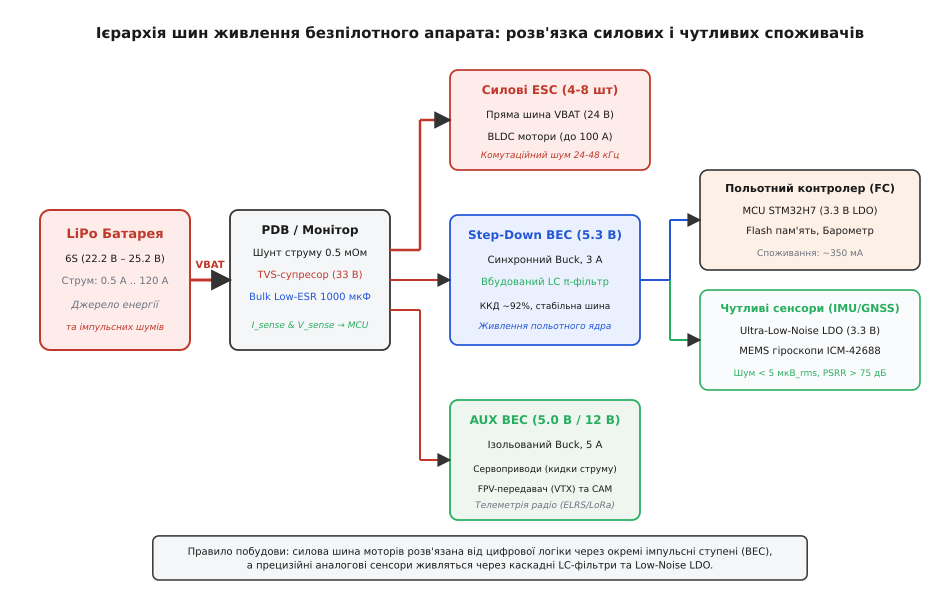
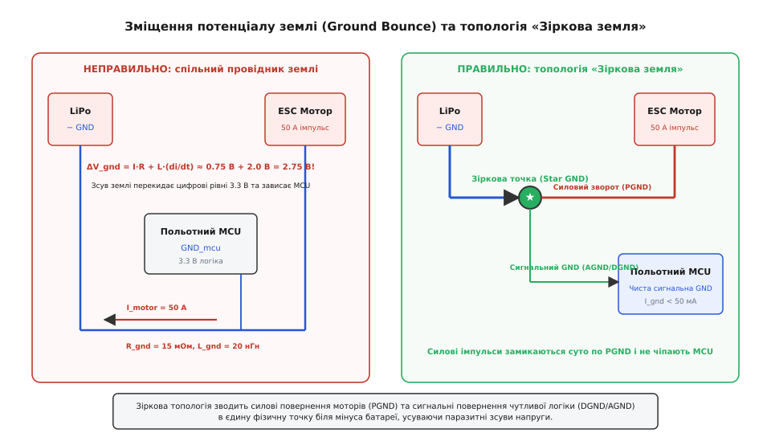
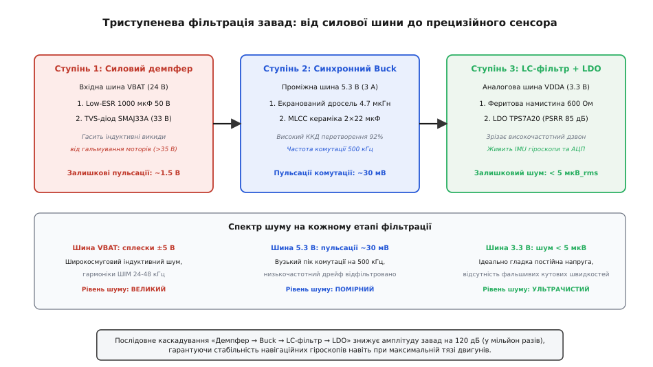
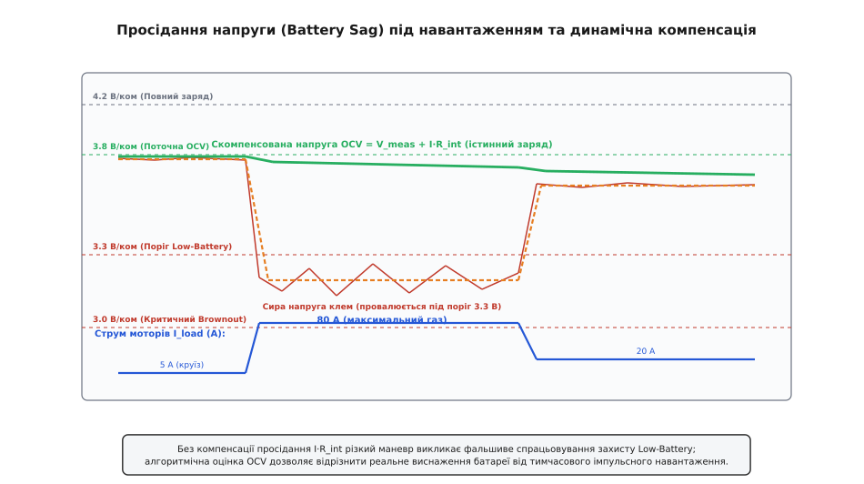

# Живлення апарата як ціле: архітектура бортового дерева, розв'язка завад і моніторинг

<preknowlist>
- [Buck-перетворювач](root:hw-power/buck) — імпульсний стабілізатор, що знижує напругу з високим коефіцієнтом корисної дії за рахунок комутації енергії в дроселі.
- [LDO](root:hw-power/ldo) — лінійний стабілізатор із малим падінням напруги, що зрізає високочастотний шум ціною розсіювання надлишку в тепло.
- [Кидок струму при вмиканні](root:hw-power/inrush-current) — короткочасний сплеск струму в момент підмикання розряджених конденсаторів до джерела живлення.
- [Зміщення землі](root:hw-pcb/ground-bounce) — падіння напруги на паразитному опорі та індуктивності провідника повернення струму під дією швидких імпульсів.
- [Просадка під навантаженням](root:hw-power/battery-sag) — зниження напруги на клемах хімічного джерела через його внутрішній омічний опір та електрохімічну поляризацію.
</preknowlist>

Чотири або вісім ходових безколекторних двигунів безпілотного апарата споживають імпульсний струм у десятки й сотні ампер із крутизною наростання фронтів `di/dt` у мільйони ампер за секунду. Коли силові транзистори [електронних регуляторів ходу](root:hw-motion/esc) (англ. *Electronic Speed Controller*, ESC, від лат. *regulare* — впорядковувати) комутують індуктивне навантаження обмоток [BLDC-моторів](root:hw-motion/bldc-motor) на частотах 24–48 кГц, на шинах живлення виникають сплески електрорушійної сили самоіндукції амплітудою в десятки вольтів. Поруч на тій самій рамі працює польотний контролер: 32-розрядний мікроконтролер із напругою ядра 3.3 В, прецизійні аналого-цифрові перетворювачі, вимірювальні мікроелектромеханічні сенсори (MEMS-гіроскопи й акселерометри) та приймач супутникової навігації з чутливістю кращою за -130 дБм.

Якщо з'єднати ці вузли прямими проводами до єдиного акумулятора без продуманої структури, апарат виходить з ладу в перші ж секунди польоту. Потужні імпульси споживання провалюють напругу батареї нижче порогу перезавантаження процесора, струмові повернення через спільний мінусовий дріт зміщують рівень логічного нуля та генерують помилки на шинах SPI й I2C, а високочастотний комутаційний шум засліплює радіоприймачі. 

Щоб апарат зберігав керованість і стабільність навігації у будь-яких режимах тяги, бортову електричну мережу організовують як **дерево живлення** (англ. *power tree*, від лат. *arbor* — розгалужена структура) — ієрархічну систему шин, перетворювачів, каскадних фільтрів і захисних вузлів. Правила [читання та аналізу дерева живлення](root:embedded/power-tree-reading) дозволяють розібрати будь-яку готову схему, але проєктування власного борту вимагає розуміння фізичних процесів у кожній точці розгалуження.

### Конфлікт двох світів: силова тяга проти прецизійної логіки

Усі споживачі безпілотного апарата поділяються на дві несумісні за електричними вимогами групи:

1. **Силові виконавчі механізми (м'язи):** регулятори ESC, ходові двигуни та потужні сервоприводи рулів. Їм потрібна величезна миттєва потужність (сотні й тисячі ватів), вони толерантні до значних коливань напруги (±20%), але самі є найпотужнішими генераторами електромагнітних завад (англ. *Electromagnetic Interference*, EMI).
2. **Обчислювальні та вимірювальні вузли (мозок і органи чуття):** мікроконтролер польотного комп'ютера, гіроскопи й акселерометри інерційного блоку (IMU), барометр, магнітометр, радіолінк телеметрії та модуль GNSS. Вони споживають усього одиниці ватів, проте вимагають жорсткої стабільності живильної напруги (долі відсотка) і надзвичайно низького рівня шумів: амплітуда пульсацій понад 10–20 мВ на шині IMU безпосередньо транслюється у фальшиві кутові швидкості, спричиняючи автоколивання контурів стабілізації апарата.

Розв'язання цього конфлікту полягає у фізичному розведенні потоків енергії за топологією спадного дерева.


*Ієрархічне дерево живлення: розв'язка силових ESC від польотного контролера (FC) через 5.3 В BEC та відокремлене живлення сервоприводів через допоміжний BEC.*

### Ієрархія шин: від батареї до аналогового кристала

Головна магістраль починається від хімічного джерела — зазвичай багатобаночного літій-полімерного (LiPo) або літій-іонного акумулятора конфігурації від 4S (14.8 В номінал, 16.8 В максимум) до 12S (44.4 В номінал, 50.4 В максимум). Ця нерегульована лінія має позначення `VBAT_RAW`.

#### Корінь дерева: плата розподілу живлення (PDB)

Безпосередньо на вході акумулятора розташовується **плата розподілу живлення** (англ. *Power Distribution Board*, PDB) або модуль живлення (англ. *Power Module*). Цей вузол виконує чотири первинні функції:

1. **Вимірювання струму та напруги:** низькоомний вимірювальний резистор — **шунт** (англ. *shunt*, від середньоангл. *schunten* — відхиляти вбік) номіналом від 0.2 мОм до 1 мОм у плюсовому або мінусовому проводі. Падіння напруги на ньому підсилюється [спеціалізованим монітором струму](root:hw-sensing/current-monitor) або заводиться на прецизійний АЦП.
2. **Захист від перехідних процесів:** [TVS-діод](root:hw-power/transient-suppression) (англ. *Transient Voltage Suppressor*, від лат. *supprimere* — придушувати), розрахований на напругу трохи вищу за максимальну напругу свіжозарядженого акумулятора (наприклад, супресор на 33 В для 6S батареї). Він зрізає високовольтні голки, що виникають при підмиканні роз'єму через [кидок струму при вмиканні](root:hw-power/inrush-current) та при активному гальмуванні двигунів.
3. **Первинна ємнісна підтримка:** масивний електролітичний або полімерний конденсатор ультранизького еквівалентного послідовного опору (Low-ESR) ємністю 470–1000 мкФ з робочою напругою 35–50 В. Він розташовується максимально близько до силових контактів, забезпечуючи локальне замикання високочастотних струмів комутації ключів.
4. **Обмеження пускового струму:** сумарна ємність вхідних фільтрів усіх чотирьох регуляторів ходу становить від 1000 до 4000 мкФ. У момент стикування силового роз'єму (наприклад, XT60) розряджені конденсатори еквівалентні короткому замиканню: піковий струм `I_peak = V_batt / R_loop` досягає 500–1200 А. Цей струм випалює контакти роз'єму і створює індуктивний стрибок напруги `L · (di/dt)`, здатний пробити напівпровідники. Тому застосовують роз'єми з вбудованим антиіскровим резистором (англ. *anti-spark*) або схеми плавного пуску на польових транзисторах.

#### Перший ступінь перетворення: бортовий BEC

Від кореневої шини `VBAT` живляться силові регулятори моторів, а також перший ступінь пониження напруги — бортовий імпульсний перетворювач, який за усталеною традицією називають **BEC** (англ. *Battery Eliminator Circuit*, від лат. *eliminare* — усувати). Про те, чому перетворювач отримав таку назву, розповідає [історія появи схеми BEC](root:embedded-ultra/device-power-design/hist-bec-origins.md).

Сучасний польотний BEC — це високочастотний [синхронний Buck-перетворювач](root:hw-power/buck), що знижує 16–50 В до проміжного сервісного рівня **5.3 В**. 

Чому саме 5.3 В, а не класичні 5.0 В? Польотні контролери авіаційного стандарту Pixhawk мають на вході схеми вибору джерела живлення (Power Path / OR-ing) на базі польових транзисторів або діодів Шотткі, а за ними — вторинні стабілізатори LDO. Рівень 5.3 В компенсує падіння напруги на ключах комутації та забезпечує гарантований запас (англ. *dropout headroom*) для отримання чистих 5.0 В і 3.3 В навіть при пікових навантаженнях периферії.

#### Розділення вторинних шин: чому сервоприводи ізолюють від обчислювача

Типова помилка проєктування — повісити на один вихід 5.3 В і польотний комп'ютер, і сервоприводи елеронів чи поворотного підвісу камери.

Електродвигун сервопривода в момент рушання або упору в механічний обмежувач споживає струм блокування (англ. *stall current*), який у 5–10 разів перевищує струм спокою й досягає 2–4 А на одну машинку. Коли кілька сервоприводів спрацьовують одночасно, напруга на шині 5 В миттєво просідає на сотні мілівольтів. Якщо від цієї ж лінії живиться мікроконтролер, він зазнає апаратного скидання за низькою напругою — **браунауту** (англ. *brownout*, від англ. *brown* — потьмяніння ламп при падінні напруги в мережі).

Крім того, при зворотному ході або різкій зупинці індуктивність двигуна сервопривода викидає в лінію живлення імпульс напруги зворотної полярності амплітудою до 10–15 В.

Тому стандарт бортового дерева вимагає щонайменше двох незалежних імпульсних перетворювачів:

```text
Батарея (VBAT) ──┬──> Силові регулятори ESC ──> Двигуни тяги
                 │
                 ├──> FC BEC (5.3 В, 2-3 А) ──> Польотний контролер, сенсори, приймач RC
                 │
                 └──> AUX BEC (5.0 / 6.0 / 12 В, 5-10 А) ──> Сервоприводи, FPV-відеопередавач (VTX)
```

Такий поділ гарантує: навіть якщо підвіс камери заклинить і він спалить запобіжник вторинного перетворювача AUX BEC, головний польотний контролер не відчує коливань напруги й продовжить стабілізацію та керування апаратом.

#### Третій ступінь: ультрачисті шини для аналогових сенсорів

Усередині польотного контролера напруга 5.3 В знижується до **3.3 В** для живлення ядра процесора, оперативної та Flash-пам'яті. Це робить або внутрішній імпульсний Buck-стабілізатор, або потужний лінійний [LDO](root:hw-power/ldo).

Однак живити від цієї самої шини 3.3 В аналогові блоки й MEMS-сенсори не можна: перемикання десятків тисяч логічних вентилів ядра Cortex-M7 на частоті 480 МГц створює на цифровій шині `VDD_3V3` високочастотний цифровий шум із розмахом 50–100 мВ.

Для ізоляції сенсорів застосовують окрему третю гілку — аналогову шину `VDDA_3V3` або виділені LDO ультранизького шуму (наприклад, мікросхеми класу TPS7A20 або LP5907):

* Вони мають власний коефіцієнт придушення пульсацій живлення (англ. *Power Supply Rejection Ratio*, [PSRR](root:hw-power/psrr)) понад 75–85 дБ на частотах 100 кГц – 1 МГц.
* Власний інтегральний шум стабілізатора не перевищує 4–10 мкВ (RMS).
* Перед входом LDO обов'язково встановлюється феритова намистина (англ. *ferrite bead*) або мініатюрний дросель, що відсікає гігагерцові гармоніки цифрового ядра.

> 🔧 **Навіщо це.** MEMS-акселерометр вимірює зміщення мікроскопічної кремнієвої маси за зміною ємності в частки фемтофарада (`10⁻¹⁵ Ф`), яку вбудований аналоговий підсилювач перетворює в мілівольти. Пульсація живлення в 10 мВ на частоті 500 кГц (робота сусіднього перетворювача) накладається на вихідний сигнал сенсора. Цифровий фільтр польотного контролера сприймає цей шум як реальну вібрацію рами, алгоритм орієнтації інтегрує похибку, а регулятор положення намагається компенсувати неіснуючий нахил — мотори починають шалено грітися й свистіти, а дрон стає некерованим.

---

### Фізика завад: земляні петлі, паразитна індуктивність та зміщення потенціалів

Найпідступніша проблема живлення складного апарата криється не в плюсових провідниках, а в провідниках повернення струму — **землі** (англ. *ground*, GND).

У реальній схемі друкована доріжка або силіконовий дріт не є ідеальним провідником з нульовим опором. Вони мають активний омічний опір `R_GND` та розподілену паразитну індуктивність `L_GND` (типово близько 1 нГн на кожен міліметр довжини прямого дроту).


*Зміщення потенціалу землі при спільному провіднику повернення струму порівняно з топологією зіркової землі (Star Ground).*

#### Механізм виникнення зміщення землі (Ground Bounce)

Коли ESC відкриває силові польові транзистори для подачі імпульсу на обмотку мотора, струм `I_motor` зростає від 0 до 50 А за час `Δt = 50 нс`. По провіднику повернення землі тече струм із шаленою швидкістю наростання:

```text
di/dt = 50 А / (50 · 10⁻⁹ с) = 1 · 10⁹ А/с  (один мільярд ампер за секунду)
```

Падіння напруги на ділянці земляного провідника між мінусом батареї та точкою підключення польотного контролера визначається сумою омічного та індуктивного компонентів:

```text
ΔV_GND = R_GND · I_motor + L_GND · (di/dt)
```

Якщо спільний провідник землі має опір `R_GND = 10 мОм` та індуктивність усього `L_GND = 5 нГн` (п'ять сантиметрів провідника):

```text
Омічне падіння:    0.010 Ом · 50 А = 0.5 В
Індуктивний викид: 5 · 10⁻⁹ Гн · 1 · 10⁹ А/с = 5.0 В
Сумарний стрибок:  ΔV_GND = 0.5 В + 5.0 В = 5.5 В!
```

Напруга на мінусовому виводі польотного контролера підкидається на 5.5 В угору відносно мінуса батареї.

Якщо мікроконтролер живиться від 3.3 В, його локальна «земля» на мить стає вищою за його лінію живлення `VDD`. Логічні нулі керуючих сигналів ШІМ або DShot миттєво перетворюються на хибні логічні одиниці, внутрішні захисні діоди кристала мікроконтролера відкриваються в прямому напрямку, пропускаючи струм короткого замикання, і процесор зависає або фізично вигорає через стан тиристорного защіпання (англ. *latch-up*).

#### Топологія «Зіркова земля» (Star Ground)

Щоб унеможливити цей ефект, застосовують топологію **зіркової землі** (англ. *star ground*, від лат. *stella* — зірка).

Принцип зіркової топології полягає у фізичному розділенні шляхів повернення:

1. **Силова земля (PGND):** силові контури з великими струмами (`I > 10 А`) та швидкими фронтами виділяються в окремий суцільний шар або масивні шини. Вони з'єднують вихідні ключі ESC безпосередньо з мінусовою клемою батарейного шунта та вхідного Low-ESR конденсатора.
2. **Сигнальна та цифрова земля (DGND/AGND):** чутлива логіка польотного контролера, радіоприймача та давачів має власну ізольовану площину повернення струму. Струми в цій системі становлять лише десятки або сотні міліампер і позбавлені різких стрибків `di/dt`.
3. **Єдина зіркова точка (Star Point):** площини `PGND` та `DGND` з'єднуються **в одній фізичній точці** — безпосередньо на мінусовому контакті шунта PDB. Силові зворотні струми замикаються по власному контуру і фізично не протікають крізь сигнальні доріжки контролера.

Для передачі цифрових команд керування між контролером і ESC застосовують диференційні лінії зв'язку (наприклад, шину CAN) або цифрові протоколи DShot із виділеним земляним провідником витої пари, що замикає вхідний оптрон регулятора безпосередньо на порт мікроконтролера.

---

### Каскадна фільтрація завад: від демпфера до LDO

Зниження амплітуди комутаційних завад на 100–120 дБ (у мільйон разів) неможливо досягти одним фільтром. Застосовують послідовний триступеневий каскад.


*Каскад фільтрації шумів: силовий демпфер на вході, синхронний імпульсний перетворювач (Step-Down), LC π-фільтр та ультрамалошумний LDO для чутливих сенсорів.*

#### Ступінь 1: Силовий демпфер вхідної шини

На первинній шині `VBAT` головне завдання — поглинути енергію рекуперації при гальмуванні двигунів. Коли алгоритм керування ESC застосовує активне демпфування (англ. *active freewheeling / damped light*), мотор працює як генератор, повертаючи магнітну енергію обмоток назад у лінію живлення.

Якщо на борту немає локальної ємності, напруга на шині `VBAT` миттєво підскакує на 10–20 В вище номіналу батареї, що пробиває силові польові транзистори перетворювачів. 

Вхідний демпфер складається з:
1. **Low-ESR електроліту або полімерного конденсатора** (наприклад, серії Rubycon ZLH або Panasonic FR) ємністю `C ≥ 470 мкФ`.
2. **TVS-супресора**, що бере на себе надлишок енергії при аварійних викидах, зрізаючи їх до безпечного рівня.

#### Ступінь 2: Синхронний Step-Down з оптимізованим контуром комутації

Імпульсний перетворювач BEC транслює високу напругу в 5.3 В із ККД 90–94%. Але сам процес комутації породжує завади на двох характерних частотах:
* **Частота комутації (200 кГц – 1 МГц):** трикутні пульсації напруги на виході амплітудою 20–50 мВ, зумовлені зарядом/розрядом вихідних керамічних конденсаторів та їхнім еквівалентним послідовним опором (ESR).
* **Високочастотний комутаційний дзвон (50–200 МГц):** ультракороткі коливальні процеси, викликані резонансом між паразитною індуктивністю виводів транзисторів і вихідною ємністю діода/ключа. Саме цей спектр створює завади для GPS-приймачів (частота L1 = 1575.42 МГц) та радіолінків.

Щоб мінімізувати дзвон, на виході Buck-стабілізатора встановлюють екранований феритовий дросель і керамічні конденсатори типу X7R з мінімальною паразитною індуктивністю ESL.

#### Ступінь 3: LC π-фільтр та лінійний LDO

Між виходом 5.3 В BEC та аналоговими блоками встановлюють симетричний `π`-фільтр, що складається з двох керамічних конденсаторів (10 мкФ і 100 нФ) та феритової намистини (англ. *ferrite bead*), яка на високих частотах працює як частотно-залежний резистор із великим опором (300–600 Ом на 100 МГц).

Резонансна частота такого LC-ланцюга розраховується за формулою:

```text
f_0 = 1 / (2 · π · √(L · C))
```

Для індуктивності `L = 2.2 мкГн` та сумарної ємності `C = 20 мкФ` резонансна частота становить:

```text
f_0 = 1 / (2 · 3.14159 · √(2.2 · 10⁻⁶ · 20 · 10⁻⁶)) ≈ 24.0 кГц
```

Оскільки резонансна частота лежить значно нижче частоти комутації перетворювача (500 кГц), фільтр забезпечує ослаблення завади понад 40 дБ на октаву вище `f_0`.

Завершує ланцюг [лінійний регулятор LDO](root:hw-power/ldo). Оскільки перепад напруги між проміжними 5.3 В і вихідними 3.3 В невеликий:

```text
ΔV = 5.3 В - 3.3 В = 2.0 В
```

При споживанні блоку сенсорів `I = 150 мА` теплова потужність, що розсіюється на кристалі LDO, становить усього:

```text
P_heat = 2.0 В · 0.15 А = 0.3 Вт
```

Це абсолютно безпечна величина для стандартного корпусу SOT-23 або WDFN, натомість на виході формується ідеально чиста живильна напруга із залишковим рівнем шумів менше 5 мкВ (RMS).

---

### Моніторинг батареї: вимірювання струму, напруги та компенсація просідання

Надійність безпілотного апарата критично залежить від точності інформації про стан залишкового заряду (англ. *State of Charge*, [SoC](root:hw-power/state-of-charge)). Якщо алгоритм неправильно оцінить залишок енергії, апарат або не встигне повернутися на точку старту, або впаде через аварійний вимикач.


*Просідання напруги на клемах під час різкого маневру (червона лінія) та алгоритмічне відновлення напруги розімкненого кола OCV (зелена лінія) для уникнення фальшивого захисту.*

#### Фізика просідання напруги під навантаженням (Battery Sag)

Хімічне джерело струму має внутрішній омічний опір `R_int` (сума опору електроліту, електродів і контактних з'єднань). Реальна напруга, яку вимірює АЦП на зовнішніх клемах батареї `V_meas`, відрізняється від її справжньої електрорушійної сили розімкненого кола `V_ocv` (англ. *Open-Circuit Voltage*):

```text
V_meas = V_ocv - I_load · R_int
```

Розглянемо типовий 6S LiPo акумулятор ємністю 5000 мАг. Внутрішній опір однієї якісної банки становить близько `r_cell = 3 мОм`, тобто для 6 банок послідовно:

```text
R_int = 6 · 0.003 Ом = 0.018 Ом (18 мОм)
```

Нехай акумулятор розряджений наполовину: напруга кожної банки становить 3.80 В, сумарна `V_ocv = 22.8 В`.

Коли пілот дає команду на різкий маневр або набір висоти (англ. *throttle punch-out*), струм моторів стрибає до `I_load = 90 А`. Напруга на клемах миттєво провалюється:

```text
V_sag = I_load · R_int = 90 А · 0.018 Ом = 1.62 В
V_meas = 22.80 В - 1.62 В = 21.18 В (тобто 3.53 В на банку)
```

Якщо опір батареї зріс через зношування або холодну погоду до `35 мОм`:

```text
V_sag = 90 А · 0.035 Ом = 3.15 В
V_meas = 22.80 В - 3.15 В = 19.65 В (тобто 3.275 В на банку!)
```

Якщо прошивка польотного контролера наївно орієнтується на напругу клем, спрацьовує поріг критичного розряду (Low Battery Warning / Critical Failsafe): апарат аварійно скидає газ, глушить мотори або вмикає примусову посадку посеред лісу, маючи всередині ще 50% невикористаної енергії!

#### Алгоритмічна динамічна компенсація просідання та підрахунок кулонів

Щоб уникнути хибних спрацьовувань, драйвер живлення реалізує триконтурну систему оцінки стану:

1. **Експоненційне згладжування (EMA / цифровий фільтр низьких частот):**
   Сирі виміри напруги й струму містять шум комутації ESC. Перед обробкою їх пропускають через однополюсний IIR-фільтр:

```text
y[k] = α · x[k] + (1 - α) · y[k-1]
```

   де коефіцієнт згладжування `α` обирається за періодом дискретизації `Δt` та бажаною сталою часу фільтра `τ`:

```text
α = Δt / (τ + Δt)
```

2. **Оцінка напруги розімкненого кола (OCV):**
   Маючи синхронно відфільтровані значення напруги `V_filt` та струму `I_filt`, драйвер відновлює істинну напругу батареї без навантаження:

```text
V_ocv_est = V_filt + I_filt · R_int_est
```

3. **Інтегрування ампер-годин (Coulomb Counting):**
   Паралельно з оцінкою напруги драйвер підраховує фактично спожитий заряд шляхом чисельного інтегрування струму в часі:

```text
Q_consumed[k] = Q_consumed[k-1] + I_filt[k] · (Δt / 3600)
```

   де `Q_consumed` вимірюється в міліампер-годинах (мАг), а `Δt` — період дискретизації в секундах. Поєднання кулонівського лічильника та відновленої напруги OCV забезпечує безпомилкове визначення залишку ємності навіть на пологих ділянках розрядної кривої Li-ion.

4. **Багаторівневий автомат захисту з гістерезисом:**
   Переходи між станами батареї (NORMAL → WARNING → CRITICAL → EMERGENCY_BROWNOUT) здійснюються з часовим та напруговим гістерезисом. Для переходу в стан тривоги напруга повинна залишатися нижче порогу протягом часу дебаунсу (наприклад, не менше 3 секунд поспіль).

---

### Програмний комплекс моніторингу: C та C++ драйвер

Нижче наведено промисловий вбудований драйвер моніторингу батареї безпілотного апарата. Він реалізує синхронне зчитування вимірів, цифрове фільтрування завад, інтегрування спожитих міліампер-годин, динамічну компенсацію омічного просідання `I·R_int` та скінченний автомат захисту від браунауту.

:::tabs
:::code device-power-design-d/c/main.c
:::code device-power-design-d/cpp/main.cpp
:::

---

### Практичний аудит і проєктування: чекліст бортової мережі

При компонуванні та трасуванні бортової мережі нового апарата перевіряють шість обов'язкових інженерних правил:

1. **Баланс потужностей та тепловий бюджет LDO:**
   Для кожного лінійного стабілізатора перевіряють розсіювану потужність `P_diss = (V_in - V_out) · I_out`. Якщо потужність перевищує 0.5 Вт, живлення LDO переводять на проміжний імпульсний ступінь (наприклад, 5.3 В замість прямого живлення від `VBAT`).

2. **Частотна сумісність перетворювачів:**
   Частота комутації імпульсних BEC повинна знаходитися поза робочим діапазоном чутливих сенсорів. Наприклад, частоти 24–48 кГц збігаються з частотою оновлення деяких MEMS-фільтрів, а гармоніки перетворювачів на 1.5 МГц можуть створювати перешкоди супутниковому каналу GPS L1. Обирають фіксовану частоту комутації (наприклад, 500 кГц або 2.2 МГц) з екранованими котушками індуктивності.

3. **Розміщення силового демпфера (Low-ESR Cap):**
   Електролітичний конденсатор встановлюють безпосередньо в місці паяння силових дротів батареї до плати PDB. Довжина виводів конденсатора повинна бути мінімальною (< 3 мм), оскільки кожен сантиметр додає ~10 нГн індуктивності, зводячи нанівець його здатність гасити наносекундні сплески `di/dt`.

4. **Розрив земляних петель між силовими регуляторами та контролером:**
   Керуючі сигнальні дроти від польотного контролера до ESC (лінії ШІМ/DShot) повинні мати виту пару зі своєю сигнальною землею, яка підмикається безпосередньо біля вхідного оптрона або сигнального процесора ESC, а не до силового мінуса батареї.

5. **Тест на максимальний струм блокування (Stall Test):**
   Усі сервоприводи перевіряють в упорі: вимірюють просідання шини 5 В при максимальному зусиллі на кермах. Якщо просідання перевищує 0.3 В, збільшують ємність вихідних конденсаторів вторинного BEC або встановлюють потужніший модуль перетворювача.

6. **Апаратний Brownout Reset (BOR) мікроконтролера:**
   У регістрах опцій мікроконтролера (Option Bytes) обов'язково активують апаратний супервізор BOR на рівні не нижче 2.7–2.9 В. Це запобігає неконтрольованому виконанню пошкодженого коду (англ. *code runaway*) під час аварійного провалу напруги, гарантуючи коректне утримання ядра в стані скидання до повного відновлення стабільного живлення.
