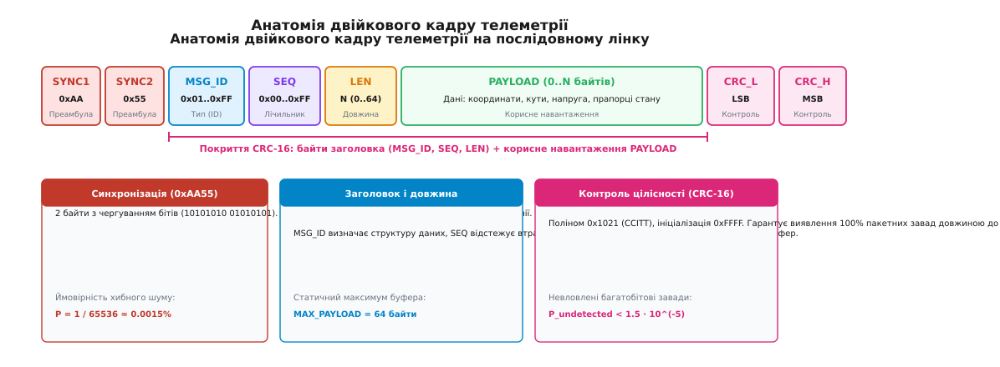
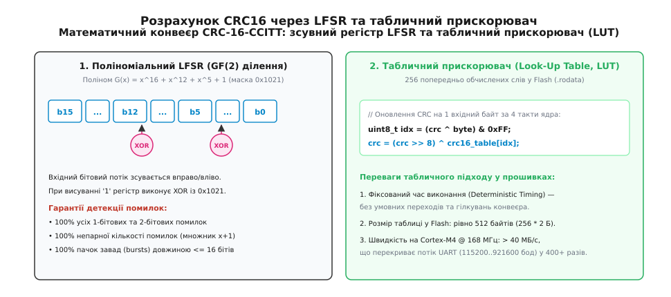
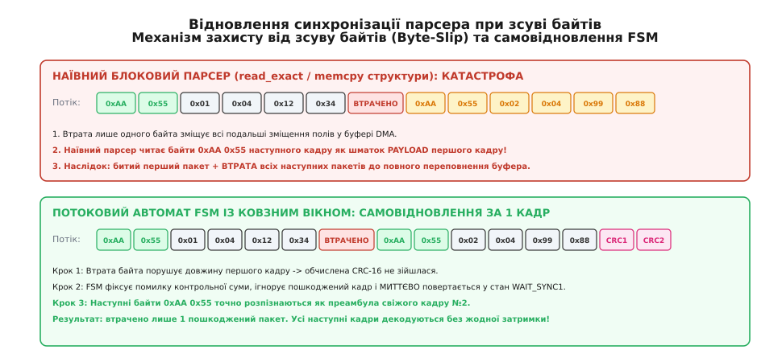
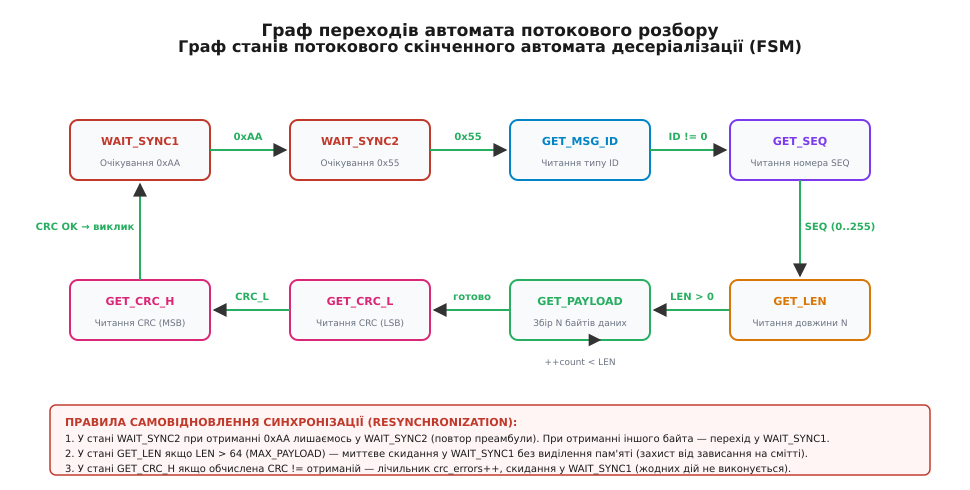

# Свій пакет на лінку

<preknowlist>
- [Кадрування повідомлень у потоці TCP](root:com-protocol/tcp-message-framing) — виділення меж повідомлень у неперервному байтовому потоці.
- [Пакування бінарного протоколу](root:com-protocol/wire-format-packing) — серіалізація структур без вирівнювання та залежності від компілятора.
- [CRC — циклічний надлишковий код](root:com-modulation/crc) — детекція канальних бітових помилок та пакета завад.
- [Потоковий розбір протоколів](root:com-protocol/stream-parser) — скінченні автомати для обробки фрагментованих даних.
- [Порядок байтів (endianness)](root:hw-arch/endianness) — узгодження представлення багатобайтових чисел у мережі та на кристалі.
</preknowlist>

Коли безпілотний літальний апарат або наземний робот передає телеметрію (кути орієнтації, координати, напругу силової батареї) через радіомодем на частоті 915 МГц або через асинхронний послідовний порт UART на швидкості 115 200 бод, апаратний трансивер мікроконтролера бачить лише неперервний потік байтів. У цьому фізичному середовищі немає вбудованих понять «початок повідомлення», «довжина пакета» чи «кінець кадру». Радіоефір є нестабільним: комутаційні завади від силових ключів регуляторів безколекторних двигунів (ESC) із крутизною фронтів понад 5 В/нс інвертують окремі біти, інтерференційні завмирання сигналу під час маневрів призводять до випадання цілих груп байтів, а підключення кабелів або перехідні процеси живлення впорскують у лінію випадкове цифрове сміття.

Якщо розробник намагається передавати дані простим копіюванням оперативної пам'яті компілятора (`memcpy(&struct, buffer)`), система стикається з трьома неминучими аваріями. По-перше, вирівнювання структур у пам'яті (компіляторні байти заповнення `padding`) відрізняється між 32-бітним мікроконтролером ARM Cortex-M на борті та 64-бітним комп'ютером наземної станції x86-64, викликаючи спотворення числових значень або апаратні винятки `HardFault` при спробі непарного вирівнювання пам'яті. По-друге, втрата хоча б одного байта зміщує всі зміщення в буфері, через що приймач починає інтерпретувати байти даних із середини структури як службові поля, відкидаючи сотні наступних валідних пакетів. По-третє, поодинока завада в каналі здатна непомітно змінити команду польотного контролера з безпечного вимкнення двигунів на запуск на максимальні оберти, якщо в протоколі відсутній математично доведений контроль цілісності.

Щоб забезпечити детермінований і безвідмовний зв'язок без затримок і без використання динамічної пам'яті (`malloc`/`free`), у вбудованих системах проєктують власний бінарний протокол. Він спирається на три взаємопов'язані механізми: жорстке кадрування з унікальною двобайтовою преамбулою, циклічний надлишковий код (CRC-16) для виявлення пачок канальних завад і потоковий скінченний автомат (FSM), здатний миттєво самовідновлювати синхронізацію при будь-якому зсуві байтів.


*Анатомія двійкового кадру телеметрії: службові поля заголовка, корисне навантаження та межі розрахунку контрольної суми CRC-16.*

---

## Фізичний рівень радіолінка та UART: чому байтовий потік є ворожим середовищем

У польових умовах бортовий мікроконтролер зв'язується з наземною станцією не через ідеальний провідник у лабораторії, а через каскад апаратних перетворювачів:
1. Апаратний периферійний модуль USART польотного контролера (наприклад, STM32F405 або STM32H743).
2. Фізичні лінії `TX`/`RX` логічних рівнів TTL (0–3.3 В).
3. Зовнішній радіомодем телеметрії (SiK Radio 915/433 МГц, модуль ExpressLRS або трансивер LoRa RFM95).
4. Бездротовий радіоефір із перевідбиттями від рельєфу та поглинанням перешкодами.
5. Приймальний радіомодем на землі та мікросхема USB-UART мосту (CP2102 або FT232R), підключена до комп'ютера оператора.

У кожній ланці цього ланцюга діють фізичні фактори спотворення інформації.

### Електромагнітні завади та пачки помилок (Burst Noise)
Силова електроніка безпілотного апарата комутує струми 50–200 А на напругах 16–50 В із частотою ШІМ 24–48 кГц. Коли силові польові транзистори регулятора ESC відкриваються або закриваються за лічені наносекунди, швидкість наростання напруги `dV/dt` та струму `dI/dt` породжує потужні високочастотні гармоніки. Ці гармоніки наводяться на сигнальні кабелі UART та антенні фідери, викликаючи короткочасні пачки завад, що спотворюють від 2 до 16 сусідніх бітів у фізичній лінії.

### Температурний дрейф тактових резонаторів
Асинхронний зв'язок UART вимагає збігу швидкостей передавача та приймача з точністю не гірше ніж 2–3%. Якщо польотний контролер нагрівається на сонці до +60°C, а радіомодем охолоджується зустрічним потоком повітря до 0°C, їхні кварцові резонатори зазнають температурного розбігу частот. Це спричиняє накопичення фазового зсуву всередині 10-бітового символьного інтервалу (стартовий біт, 8 бітів даних, стоповий біт), що за наявності шуму на лінії періодично призводить до помилок кадрування на фізичному рівні (UART Framing Error) та втрати окремих байтів.

### Фатальна пастка `memcpy` та вирівнювання пам'яті (Memory Alignment)
Поширеною практикою програмістів-початківців є пряме надсилання структури в буфер:

:::tabs
```c
/* НАЇВНИЙ І НЕБЕЗПЕЧНИЙ ПІДХІД (мовою C) */
struct BadTelemetry {
    uint8_t  flag;       /* 1 байт */
    /* Компілятор вставляє 3 байти невидимого padding! */
    float    roll_angle; /* 4 байти (вирівняно за адресою кратною 4) */
    uint16_t voltage_mv; /* 2 байти */
    /* Компілятор вставляє 2 байти padding! */
};
```
```cpp
// НАЇВНИЙ І НЕБЕЗПЕЧНИЙ ПІДХІД (мовою C++)
struct alignas(4) BadTelemetry {
    std::uint8_t  flag;       // 1 байт + 3 байти прихованого padding
    float         roll_angle; // 4 байти
    std::uint16_t voltage_mv; // 2 байти + 2 байти прихованого padding
};
```
:::

Цей код несе дві критичні вади:
1. **Несумісність між компіляторами та платформами**: компілятор GCC для ARM Cortex-M та MSVC/Clang для x86-64 мають різні правила вирівнювання полів та вставки порожніх байтів заповнення (`padding`). Розмір структури та зміщення полів змінюються залежно від версії компілятора та прапорців оптимізації.
2. **Апаратний збій ядра (HardFault)**: на мікроконтролерах із ядрами ARM Cortex-M0 або Cortex-M0+ інструкції завантаження `LDR` та збереження `STR` не підтримують непарного доступу до пам'яті (unaligned memory access). Якщо при розборі пакета накласти покажчик на непарну адресу в сирому буфері DMA, перша ж спроба прочитати 32-бітне число з рухомою комою викликає апаратне зависання ядра `HardFault`.

Тому надійний бінарний протокол вимагає строгого кадрування, незалежної побайтової серіалізації та стійкого контролю цілісності.

---

## Анатомія двійкового кадру на лінку

Послідовний інтерфейс передає інформацію байт за байтом. Якщо передавач надсилає три пакети поспіль, приймач отримує їх як єдиний безперервний масив чисел у своєму кільцевому буфері або буфері прямого доступу до пам'яті (DMA). Щоб виділити з цього масиву окремі логічні порції даних, протокол потребує чіткого правила визначення меж — від фр. *cadre* (рама, обрамлення, межа), яким називають процес упакування даних у відокремлені блоки із заголовком і перевіркою цілісності: **кадрування** (framing).

### Чому одного байта преамбули недостатньо

Першим елементом кадру є фіксована сигнальна послідовність — від лат. *praeambulus* (той, що йде попереду, від *prae-* — попереду + *ambulare* — іти, ступати): **преамбула** (preamble або magic bytes).

Якщо використати однобайтову преамбулу (наприклад, `0xAA`), у реальному потоці телеметрії виникає висока ймовірність хибного спрацьовування. Байт `0xAA` (`170` у десятковій системі) може бути звичайним значенням температури процесора, молодшим байтом лічильника мілісекунд або частиною числа з рухомою комою IEEE-754. У потоці випадкових даних імовірність зустріти байт `0xAA` становить:

```
P_single = 1 / 256 ≈ 0.39%
```

За швидкості потоку 10 000 байтів на секунду приймач фіксуватиме близько 39 хибних спроб розбору кадру щосекунди.

Використання двобайтової преамбули з чергуванням бітів `0xAA 0x55` (`0b10101010 0b01010101`) кардинально змінює ситуацію:
1. Ймовірність випадкової появи двох конкретних байтів поспіль у шумі падає до:
   ```
   P_double = 1 / (256 · 256) = 1 / 65536 ≈ 0.0015%
   ```
2. Патерн `10101010 01010101` створює максимальну кількість перепадів напруги на фізичній лінії UART (0-1-0-1-0-1), що допомагає системі фазового автопідстроювання частоти (PLL) та вузлу оверсемплінгу приймача надійно синхронізувати внутрішній таймер вибірки бітів навіть за наявності температурного дрейфу кварцового резонатора.

### Розподіл службових полів і накладні витрати

Повний двійковий кадр нашого протоколу складається з фіксованого 5-байтового заголовка, змінного корисного навантаження (від 0 до 64 байтів) і 2 байтів контрольної суми CRC-16:

```
+---------+---------+---------+--------+--------+------------------+---------+---------+
| SYNC_1  | SYNC_2  | MSG_ID  |  SEQ   |  LEN   | PAYLOAD (0..N)   |  CRC_L  |  CRC_H  |
|  0xAA   |  0x55   | 1 байт  | 1 байт | 1 байт |    N байтів      | 1 байт  | 1 байт  |
+---------+---------+---------+--------+--------+------------------+---------+---------+
|<--- Преамбула --->|<------- Заголовок ------->|<-- Навантаження ->|<-- Контроль CRC -->|
```

Призначення кожного поля суворо розмежоване:
- `SYNC_1` (`0xAA`) та `SYNC_2` (`0x55`): апаратні маркери початку кадру.
- `MSG_ID` (1 байт): числовий тип повідомлення (`0x01..0xFF`). Визначає, як саме наземна станція чи польотний контролер повинні декодувати сирі байти поля `PAYLOAD`.
- `SEQ` (1 байт, від англ. *sequence* — послідовність): порядковий номер пакета (циклічний лічильник від 0 до 255). Дозволяє отримувачу обчислювати відсоток втрачених у радіоефірі пакетів у реальному часі за формулою:
  ```
  packets_lost = (current_seq - last_seq - 1) mod 256
  ```
- `LEN` (1 байт): точна кількість байтів у полі `PAYLOAD`. Жорстко обмежується зверху константою `MAX_PAYLOAD_SIZE = 64`. Якщо приймач отримує значення `LEN > 64`, кадр негайно вважається пошкодженим без виділення додаткової пам'яті.
- `PAYLOAD` (0..64 байти): упаковані структури даних (координати, напруга, кути, коди команд).
- `CRC_L` та `CRC_H` (2 байти): молодший і старший байти поліноміального коду CRC-16-CCITT, обчисленого для полів `MSG_ID`, `SEQ`, `LEN` та всього масиву `PAYLOAD`.

Сумарний розмір службової надлишковості становить рівно 7 байтів на кадр. При передачі стандартного телеметричного повідомлення орієнтації `MSG_ATTITUDE` (12 байтів корисних даних) повний кадр займає 19 байтів. Коефіцієнт корисного використання пропускної здатності каналу становить:

```
Efficiency = PayloadSize / TotalFrameSize = 12 / 19 ≈ 63.1%
```

Для максимального кадру навантаження (64 байти) ефективність сягає `64 / 71 ≈ 90.1%`. Повний перелік типів повідомлень, їхніх числових ідентифікаторів та бітових розкладок задокументовано у вставці [Специфікація бінарного протоколу телеметрії та контракти API](root:embedded-ultra/own-packet-over-the-link/api-packet-protocol.md).

### Пакування полів без вирівнювання (Wire Format Packing)

Щоб гарантувати абсолютну переносимість і безпеку, серіалізатор формує кадр за допомогою явних побайтових операцій зсуву:

:::tabs
:::code own-packet-over-the-link-d/c/pakuvannia-poliv-bez.c
:::code own-packet-over-the-link-d/cpp/pakuvannia-poliv-bez.hpp
:::

Такий підхід повністю захищає код від комбінаторних пасток вирівнювання компілятора і дозволяє передавати дані між мікроконтролерами з різним порядком байтів без жодного накладного розширення пам'яті.

---

## Порівняння підходів до кадрування: чому саме Length-Prefix

В інженерній практиці розробки послідовних протоколів існує три альтернативні підходи до кадрування потоку даних:

1. **Текстові роздільники (Delimiter-based, як у NMEA 0183 / JSON)**:
   - Кадр починається зі спеціального символу (наприклад, `$`) і закінчується символами переносу рядка `\r\n`.
   - *Недоліки*: низька щільність пакування (число з рухомою комою `12.3456` займає 7 байтів замість 4), повільний парсинг за допомогою важких функцій `sscanf`/`strtod`, що викликають затримки та вимагають динамічної пам'яті.
2. **Байт-стафінг (Byte Stuffing, як у SLIP / COBS)**:
   - Спеціальний байт-роздільник (наприклад, `0x00` у COBS або `0xC0` у SLIP) позначає кінець кадру. Якщо такий самий байт трапляється всередині корисних даних, алгоритм екранує його (вставляє escape-послідовність).
   - *Недоліки*: змінна довжина кадру (залежно від кількості байтів, що вимагають екранування), необхідність виконання двох проходів по буферу (спершу кодування COBS, потім передача), що додає затримку обробки.
3. **Префікс фіксованої довжини (Length-Prefix Frame, наш вибір)**:
   - Кадр має фіксований заголовок із полем `LEN`, що прямо вказує кількість наступних байтів.
   - *Переваги*: однопрохідний потоковий розбір за один такт на байт, повністю фіксований розмір заголовка, відсутність потреби в модифікації тіла навантаження та найвища енергоефективність на слабких мікроконтролерах.

---

## Контроль цілісності: чому прості суми не працюють

У бездротовому каналі зв'язку збурення електромагнітного поля від роботи силових перетворювачів викликають не лише поодинокі інверсії бітів, а й пачки завад (burst errors), коли 5–15 сусідніх бітів у лінії виявляються спотвореними. Механізм перевірки цілісності зобов'язаний виявляти такі дефекти з максимальною достовірністю.

### Чому 8-бітний XOR та сума байтів є дірявими

У багатьох застарілих протоколах (зокрема текстовому NMEA 0183 для GPS-модулів) застосовують просту контрольну суму на базі побітового «виключального АБО» (XOR) або додавання байтів за модулем 256.

Цей підхід має три критичні вразливості:
1. **Інваріантність до перестановки байтів**: операція додавання та XOR є комутативними:
   ```
   A ^ B = B ^ A,   A + B = B + A
   ```
   Якщо через вібрацію кабелю або збій буфера FIFO байти поміняються місцями (`0x12 0x34` перетвориться на `0x34 0x12`), контрольна сума залишиться абсолютно незмінною, і спотворені дані надійдуть у систему керування.
2. **Взаємна компенсація подвійних бітових помилок**: якщо завада змінила нульовий біт першого байта на одиницю (`+1`), а нульовий біт другого байта — з одиниці на нуль (`-1`), операція додавання дасть точно такий самий результат.
3. **Нечутливість до нульових байтів**: вставка або випадання нулів (`0x00`) не змінює ані арифметичну суму, ані результат XOR.

### Алгебраїчна надійність CRC-16-CCITT

Для гарантованого захисту вбудованих систем використовують алгоритм циклічного надлишкового кодування — від лат. *cyclus* (коло, оберт, від грец. *kyklos*) + *redundantia* (надлишок, надмірність): **CRC** (Cyclic Redundancy Check).

CRC інтерпретує весь потік переданих бітів як коефіцієнти велетенського полінома над скінченним полем Галуа `GF(2)` і ділить його на спеціально обраний незвідний породжувальний поліном степеня 16. У нашому протоколі використовується міжнародний стандарт **CRC-16-CCITT**:

```
G(x) = x^16 + x^12 + x^5 + 1      [маска 0x1021, ініціалізація 0xFFFF]
```


*Конвеєр обчислення CRC-16: лінійний зсувний регістр зі зворотним зв'язком (LFSR) та його швидкісна таблична оптимізація (LUT) у Flash-пам'яті.*

Математичні властивості ділення в полі `GF(2)` надають такі залізобетонні гарантії:
- **100% виявлення всіх 1-бітових та 2-бітових помилок**: породжувальний поліном не може ділити одночлени чи біноми меншого степеня.
- **100% виявлення будь-якої непарної кількості пошкоджених бітів**: поліном `G(x)` містить множник `(x + 1)`, що робить неможливим ділення на поліноми помилок із непарним числом одиниць.
- **100% виявлення пачок завад (burst errors) довжиною до 16 бітів включно**.
- **99.9985% виявлення випадкових довгих пачок завад**: імовірність пропуску дефекту становить `1 / 2^16 = 1 / 65536 ≈ 0.0015%`.

### Табличний прискорювач розрахунку (Look-Up Table)

Побітове обчислення CRC вимагає виконання циклу на 8 ітерацій із перевіркою старшого біта та операцією XOR для кожного байта. На мікроконтролері з частотою 168 МГц це забирає близько 30–40 машинних тактів на байт.

Оскільки результат 8 зсувів залежить лише від поточного старшого байта CRC та вхідного байта даних, операцію оптимізують за допомогою заздалегідь обчисленої таблиці з 256 значень:

```
table_index = ((crc >> 8) ^ in_byte) & 0xFF
crc_next = (crc << 8) ^ crc16_table[table_index]
```

Таблиця займає рівно 512 байтів у Flash-пам'яті (`.rodata`) і зводить розрахунок CRC до 3–4 асемблерних інструкцій процесора, забезпечуючи швидкість обробки понад 40 мегабайтів на секунду. Повне математичне виведення, доведення властивостей поля Галуа та алгоритм генерації таблиці наведено у вставці [Математика CRC-16: поліноми над GF(2), зсувні регістри та табличне обчислення](root:embedded-ultra/own-packet-over-the-link/math-crc16-polynomial.md).

---

## Наскрізний числовий приклад: шлях кадру телеметрії від датчика до екрана

Щоб простежити роботу механізму серіалізації, передачі та десеріалізації, розглянемо формування реального телеметричного кадру орієнтації `MSG_ATTITUDE`:

1. **Вихідні фізичні дані з фільтра стану (AHRS)**:
   - Крен (Roll): `+15.20°` -> у форматі цілого числа з фіксованою комою: `1520` (`0x05F0`).
   - Тангаж (Pitch): `-3.40°` -> у форматі додаткового коду: `-340` (`0xFEAC`).
   - Курс (Yaw): `180.50°` -> у форматі фіксованої коми: `18050` (`0x4682`).
   - Кутові швидкості: `gyro_x = 0`, `gyro_y = 0`, `gyro_z = 0`.
2. **Формування масиву навантаження (12 байтів Little-Endian)**:
   ```
   PAYLOAD = [0xF0, 0x05,  0xAC, 0xFE,  0x82, 0x46,  0x00, 0x00,  0x00, 0x00,  0x00, 0x00]
   ```
3. **Формування заголовка кадру (5 байтів)**:
   - `SYNC_1 = 0xAA`, `SYNC_2 = 0x55`.
   - `MSG_ID = 0x02` (тип `MSG_ATTITUDE`).
   - `SEQ = 0x2A` (номер пакета `42`).
   - `LEN = 0x0C` (довжина навантаження `12` байтів).
4. **Обчислення контрольної суми CRC-16-CCITT**:
   - Початковий стан накопичувача: `0xFFFF`.
   - Послідовне оновлення табличним методом через 15 байтів (`MSG_ID`, `SEQ`, `LEN`, `PAYLOAD[0..11]`).
   - Підсумкове значення CRC-16: `0x8B3A`.
   - Розбиття на молодший та старший байти: `CRC_L = 0x3A`, `CRC_H = 0x8B`.
5. **Фінальний кадр у фізичній лінії UART (19 байтів)**:
   ```
   [0xAA, 0x55, 0x02, 0x2A, 0x0C, 0xF0, 0x05, 0xAC, 0xFE, 0x82, 0x46, 0x00, 0x00, 0x00, 0x00, 0x00, 0x00, 0x3A, 0x8B]
   ```
6. **Прийом та обробка кінцевим автоматом наземної станції**:
   - Автомат послідовно проходить стани: `WAIT_SYNC1` -> `WAIT_SYNC2` -> `GET_MSG_ID` -> `GET_SEQ` -> `GET_LEN` -> накопичення 12 байтів у `GET_PAYLOAD` -> зчитування `CRC_L` (`0x3A`) та `CRC_H` (`0x8B`).
   - Накопичене автоматом значення CRC точно збігається з прийнятим `0x8B3A`. Автомат повертає `PARSER_PACKET_OK`, а наземна станція відновлює дійсні значення кутів крену, тангажу й курсу і миттєво повертає 3D-модель літака на моніторі оператора.

---

## Пастка розсинхронізації: зсув байтів і самовідновлення

Найбільш підступною проблемою послідовного зв'язку є зміщення меж повідомлень — від грец. *syn-* (разом) + *chronos* (час) та лат. *de-* (відокремлення, руйнування): **розсинхронізація** (desynchronization).

Якщо через фізичну заваду в лінії загубиться рівно один байт (наприклад, байт `SEQ`), виникає явище, відоме як **зсув байтів** (byte-slip, від англ. *slip* — ковзання, прослизання).


*Порівняння реакції на зсув байтів: фатальна втрата пакетів у наївному парсері проти миттєвого відновлення синхронізації в потоковому FSM.*

### Як наївний парсер ковтає валідні пакети

Розглянемо типову помилку початківців: спробу накопичити фіксовану кількість байтів у буфері та розібрати їх суцільним шматком:

1. Передавач надсилає Кадр №1 довжиною 15 байтів і одразу за ним — Кадр №2 довжиною 15 байтів.
2. Внаслідок завади 4-й байт Кадру №1 втрачається на лінії.
3. Наївний приймач чекає рівно 15 байтів. Оскільки одного байта бракує, він захоплює перший байт (`0xAA`) наступного Кадру №2 як останній байт Кадру №1.
4. Контрольна сума Кадру №1 не сходиться — приймач відкидає його.
5. Тепер у буфері приймача першим лежить байт `0x55` (другий байт преамбули Кадру №2). Приймач шукає комбінацію `0xAA 0x55`, але бачить лише `0x55` і продовжує зчитувати потік із постійним зсувом на один байт!
6. Система втрачає не лише пошкоджений Кадр №1, а й абсолютно цілий Кадр №2, Кадр №3 і всі наступні кадри, доки випадково в потоці даних не трапиться нова комбінація преамбули або буфер переривання не переповниться.

### Принцип ковзного вікна в потоковому автоматі

Правильно спроєктований десеріалізатор діє за принципом **потокового ковзного вікна** (streaming sliding window):
- Приймач не чекає наповнення буфера фіксованого розміру, а обробляє кожен байт індивідуально в міру його надходження з регістру UART чи кільцевого буфера.
- Якщо кадр виявився битим (помилка CRC або неприпустима довжина `LEN`), автомат не блокується і не викидає весь буфер. Він миттєво повертається у стан пошуку преамбули `0xAA`.
- Наступні байти `0xAA 0x55` наступного кадру розпізнаються бездоганно, забезпечуючи відновлення повноцінного прийому рівно за 1 кадр.

---

## Архітектура потокового скінченного автомата (FSM)

Поведінка десеріалізатора описується математичною моделлю, здатною перебувати в одному з чітко визначених станів і змінювати свій стан під дією вхідних символів — від лат. *finitus* (обмежений, визначений) та грец. *automatos* (самодіючий): **скінченний автомат** (Finite State Machine, FSM).

Автомат нашого протоколу реалізує 8 дискретних станів:


*Повний граф переходів потокового скінченного автомата: стани зчитування полів, перевірка меж та правила повернення при помилках.*

### Алгоритм переходів між станами

1. `STATE_WAIT_PREAMBLE_1`: Автомат перебуває в стані очікування першого байта преамбули. Будь-які байти, відмінні від `0xAA`, просто ігноруються. Щойно надійшов байт `0xAA`, автомат переходить у стан `STATE_WAIT_PREAMBLE_2`.
2. `STATE_WAIT_PREAMBLE_2`: Очікується другий байт `0x55`.
   - Якщо надійшов `0x55`: преамбула повністю підтверджена. Автомат скидає накопичувач `crc_accum = 0xFFFF` і переходить у стан `STATE_GET_MSG_ID`.
   - Якщо надійшов повторний байт `0xAA`: автомат залишається у стані `STATE_WAIT_PREAMBLE_2` (обробка послідовностей на кшталт `0xAA 0xAA 0x55`).
   - Якщо надійшов будь-який інший байт: скидання в `STATE_WAIT_PREAMBLE_1`.
3. `STATE_GET_MSG_ID`: Байт зберігається як `msg_id`, додається до контрольної суми CRC, автомат переходить у `STATE_GET_SEQ`.
4. `STATE_GET_SEQ`: Байт зберігається як `seq`, додається до CRC, перехід у `STATE_GET_LEN`.
5. `STATE_GET_LEN`: Отримується довжина навантаження `LEN`:
   - Якщо `LEN > MAX_PAYLOAD_SIZE` (наприклад, > 64): зафіксовано помилку кадрування. Автомат миттєво переходить у `STATE_WAIT_PREAMBLE_1`, запобігаючи виходу за межі статичного буфера в SRAM.
   - Якщо `LEN == 0` (повідомлення без корисного навантаження): байт додається до CRC, перехід одразу в `STATE_GET_CRC_LOW`.
   - Якщо `0 < LEN <= 64`: байт додається до CRC, скидається внутрішній лічильник `rx_index = 0`, перехід у `STATE_GET_PAYLOAD`.
6. `STATE_GET_PAYLOAD`: Байти записуються в масив `payload[rx_index++]` і паралельно додаються до CRC. Коли `rx_index == LEN`, автомат переходить у стан `STATE_GET_CRC_LOW`.
7. `STATE_GET_CRC_LOW`: Отримується молодший байт контрольної суми `CRC_L`, перехід у `STATE_GET_CRC_HIGH`.
8. `STATE_GET_CRC_HIGH`: Отримується старший байт `CRC_H`, після чого отримане 16-бітне число порівнюється з `crc_accum`:
   - Якщо CRC збігається: автомат викликає обробник готового пакета (або повертає статус `PARSER_PACKET_OK`).
   - Якщо CRC не збігається: лічильник помилок `crc_errors++`, пакет відкидається.
   - В обох випадках автомат безумовно повертається у стан `STATE_WAIT_PREAMBLE_1` для прийому наступного кадру.

---

## Програмна реалізація серіалізатора та десеріалізатора

У вбудованих системах критичного призначення заборонено динамічне виділення пам'яті (`malloc`/`free` у C, `new`/`delete` або `std::vector` у C++), оскільки фрагментація оперативної пам'яті та недетермінований час роботи алокатора можуть призвести до зависання автопілота під час польоту.

Всі структури розміщуються статично, а функції мають складність `O(1)` за часом і пам'яттю.

:::tabs
:::code own-packet-over-the-link-d/c/tele_protocol.c
:::code own-packet-over-the-link-d/cpp/prohramna-realizatsiia.cpp
:::

---

## Інтеграція в архітектуру автопілота: DMA, кільцеві буфери та діагностика

У реальній польотній прошивці десеріалізатор не викликається безпосередньо всередині обробника апаратного переривання UART (ISR). Виконання обчислення CRC та логіки станів у перериванні затримує обслуговування контурів стабілізації гіроскопа та оновлення широтно-імпульсної модуляції (ШІМ) моторів.

Архітектура взаємодії будується за схемою **Single-Producer Single-Consumer (SPSC)**:
1. **Рівень драйвера (ISR або DMA)**: апаратний блок прямого доступу до пам'яті (DMA) або обробник переривання `USART_IRQHandler` записує байти, що надходять із радіомодема, у статичний безблокувальний кільцевий буфер в оперативній пам'яті.
   - *Оптимізація через UART IDLE Line*: налаштування циклічного режиму DMA разом із перериванням простою лінії (`USART_CR1_IDLEIE`) дозволяє прокидати ядро процесора лише тоді, коли радіомодем завершив передачу повної пачки байтів кадру. Процесор зчитує залишковий лічильник трансферів DMA `NDTR` (Number of Data to Transfer), обчислює кількість щойно прийнятих байтів і переміщує покажчик голови кільцевого буфера за одну швидку операцію, заощаджуючи десятки тисяч викликів ISR щосекунди.
2. **Основний цикл (Super-loop або таска RTOS)**: періодично (наприклад, із частотою 100–250 Гц) вичитує накопичені байти з кільцевого буфера через вказівник `tail` і побайтово передає їх у метод `parser_consume_byte()`.
3. **Диспетчеризація повідомлень**: щойно автомат повертає `PARSER_PACKET_OK`, функція-диспетчер перевіряє `msg_id` і копіює розпаковані поля у глобальний стан польотного контролера (`VehicleState`).

### Метрики стану каналу зв'язку

Надійний протокол не лише передає корисні байти, а й безперервно збирає статистику якості фізичного середовища:
- `rx_bytes_total`: загальна кількість зчитаних байтів із фізичного лінка.
- `rx_packets_valid`: кількість успішно декодованих кадрів із валідною контрольною сумою CRC-16.
- `rx_crc_errors`: кількість пакетів, відкинутих через спотворення бітів електромагнітними завадами.
- `rx_len_errors`: кількість випадків фіксації некоректної довжини `LEN > 64`.
- `rx_packet_loss`: відсоток пропущених пакетів за лічильником `SEQ`.

Якщо відношення `rx_crc_errors / rx_packets_valid` перевищує 5–10%, автопілот завчасно фіксує деградацію радіоканалу й сигналізує наземній станції про необхідність набору висоти або переходу в аварійний режим повернення на точку старту (FailSafe).

Повний автономний проект кодека з тестовим стендом симуляції апаратних збоїв наведено у практичній вставці [Практична реалізація кодека пакетів телеметрії на C та C++](root:embedded-ultra/own-packet-over-the-link/proj-packet-codec.md).
