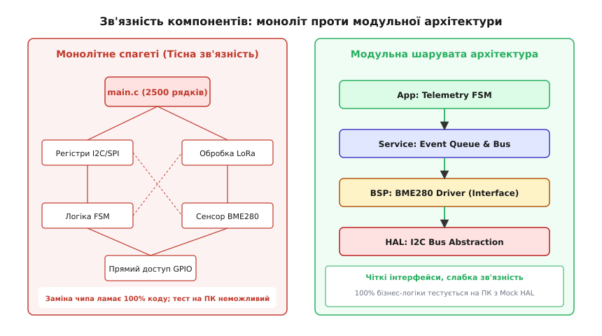
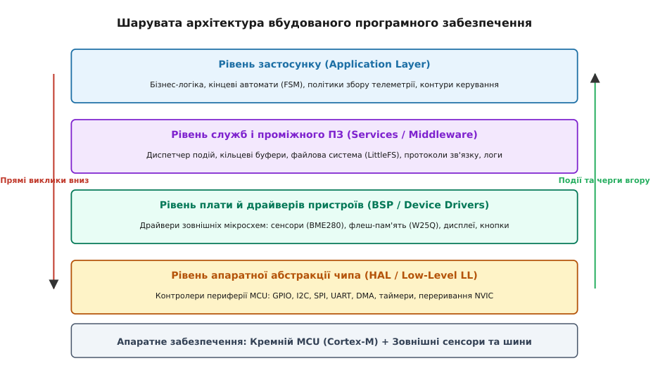
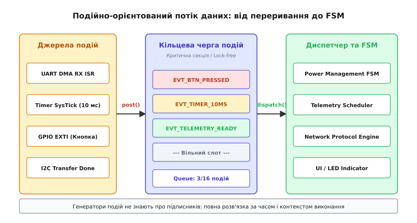

# Архітектура прошивки: шари, події, межі модулів

<preknowlist>
- [Super-loop](root:embedded/super-loop-limits) — межі лінійного неблокуючого циклу з millis(), комбінаторне зростання спагеті-прапорців.
- [Регістри периферії та HAL](root:embedded/hal-ll-registers) — прямий доступ до регістрів мікроконтролера проти переносних апаратних абстракцій.
- [Модель модуля](root:sf-devices/module-model) — відокремлення інтерфейсу від реалізації, приховування внутрішнього стану та інкапсуляція.
- [Шарова архітектура](root:sf-apps/layered-architecture) — організація коду за ієрархічними рівнями відповідальності з односпрямованим потоком залежностей.
- [Порти й адаптери](root:sf-apps/hexagonal-architecture) — інверсія залежностей та ізоляція бізнес-логіки від деталей периферійних інтерфейсів.
</preknowlist>

Команда інженерів готує до серійного виробництва промисловий логер вібрації та мікроклімату для насосних станцій. Прототип працює бездоганно: один файл `main.c` на 3000 рядків ініціалізує тактування `RCC`, напряму конфігурує регістри `I2C1->CR1`, зчитує покази акселерометра всередині головного циклу, розраховує середньоквадратичне відхилення, формує пакет і записує його у зовнішню флеш-пам'ять через виклики `HAL_SPI_Transmit(&hspi2, ...)`. Коли через дефіцит компонентів фабрика змінює апаратну ревізію — мікроконтролер STM32F401 замінюють на ESP32-S3, а замість давача температури SHT30 встановлюють BME280 на іншій шині — проєкт раптово зупиняється на чотири місяці.

Прямі виклики вендорних функцій та звернення до регістрів конкретного чипа виявляються розмазаними по всіх 3000 рядках. Математика розрахунку спектра вібрації намертво прив'язана до формату буфера DMA конкретного АЦП. Спроба протестувати логіку аварійного вимкнення при критичному перегріві вимагає фізичного нагрівання плати термофеном на лабораторному столі, бо скомпілювати цей код на комп'ютері розробника під керуванням x86-64 Linux чи Windows неможливо: компілятор GCC вимагає апаратних заголовків `stm32f4xx.h`.

Ця катастрофа — класичний наслідок «монолітної спагеті-прошивки». Єдиний спосіб захистити вбудований продукт від апаратних змін, забезпечити безперервне автоматичне тестування (CI/CD) та зберегти керованість кодової бази при зростанні команди — це сувора **шарувата архітектура** (*Layered Firmware Architecture*) з чіткими межами модулів та подійно-орієнтованою взаємодією.


*Ліворуч — монолітний код із хаотичними зв'язками між бізнес-логікою, регістрами та драйверами, де зміна будь-якого компонента руйнує всю систему. Праворуч — модульна архітектура з односпрямованим потоком викликів, яка дозволяє тестувати 100% логіки на хостовому ПК.*

---

### Анатомія монолітного коду: чому спагеті вбиває вбудовані проєкти

У типовому монолітному проєкті весь життєвий цикл системи концентрується в одній точці — нескінченному циклі `while(1)`. Усередині цього циклу одночасно вирішуються чотири принципово різні завдання, які за своєю природою належать до різних інженерних доменів:
1. **Низькорівневе маніпулювання апаратурою**: встановлення бітів у регістрах `GPIOA->BSRR`, перевірка прапорців готовності `USART_SR_RXNE`, керування лініями Chip Select (CS) через пряме смикання виводів.
2. **Протокольний обмін з мікросхемами**: надсилання послідовностей ініціалізаційних байтів у регістри конфігурації датчика, розрахунок контрольних сум CRC-8, очікування стабілізації живлення через блокуючі затримки `HAL_Delay()`.
3. **Обробка та фільтрація даних**: відсікання шумів, калібрувальні коефіцієнти, перетворення «сирих» кодів АЦП у градуси Цельсія, паскалі чи g-сили.
4. **Бізнес-правила системи**: ухвалення рішень про перехід у глибокий сон, генерація аварійних тривог, протоколи зв'язку з хмарою, збереження налаштувань.

```
┌─────────────────────────────────────────────────────────────────┐
│ Смертельний клубок монолітного коду (main.c):                   │
│                                                                 │
│ ┌─────────────────────────────────────────────────────────────┐ │
│ │ void loop() {                                               │ │
│ │   HAL_I2C_Mem_Read(&hi2c1, 0x68<<1, 0x3B, 1, raw, 6, 100);  │ │
│ │   int16_t ax = (raw[0]<<8)|raw[1]; // Сирі байти датчика    │ │
│ │   float g = (float)ax / 16384.0f;  // Математика сенсора    │ │
│ │   if (g > 2.5f) {                  // Бізнес-політика       │ │
│ │       HAL_GPIO_WritePin(GPIOB, GPIO_PIN_0, GPIO_PIN_SET);   │ │
│ │       Flash_Write_Alert(&g);       // Робота з носієм       │ │
│ │   }                                                         │ │
│ │ }                                                           │ │
│ └─────────────────────────────────────────────────────────────┘ │
└─────────────────────────────────────────────────────────────────┘
```

Коли ці рівні перемішані, виникають три фундаментальні проблеми:

#### 1. Апаратне замкнення (Hardware Lock-in)
Програмна логіка виявляється жорстко «припаяною» до конкретної розводки друкованої плати та конкретної моделі мікроконтролера. Якщо інженер-схемотехнік переніс лінію `CS` флеш-пам'яті з піна `PA4` на `PB12` для оптимізації трасування швидкісних ліній, розробник прошивки змушений вручну шукати та редагувати магічні макроси в десятках файлів.

#### 2. Неможливість модульного тестування (Unit Testing)
У сучасній розробці надійність гарантується автоматичними тестами, які запускаються при кожному коміті в репозиторій (CI/CD пайплайн). У монолітній прошивці функцію розрахунку аварійного стану неможливо протестувати без фізичного мікроконтролера, бо вона всередині викликає `HAL_I2C_Mem_Read`. Спроба скомпілювати цей файл локальним компілятором `gcc` на комп'ютері розробника завершується помилкою: компілятор не знає типів `I2C_HandleTypeDef` та адрес периферійних регістрів.

#### 3. Непередбачувані перегони в перериваннях (ISR Race Conditions)
Коли обробники переривань від таймерів чи UART починають напряму змінювати глобальні змінні бізнес-логіки або викликати важкі функції обчислень, система стає вразливою до важковловлюваних помилок пошкодження пам'яті. Переривання спрацьовує посеред оновлення багатобайтної структури даних, викликаючи випадкові збої під час роботи пристрою у польових умовах.

> 🔧 **Навіщо це.** Шарувата архітектура розриває цей моноліт на незалежні пласти. Кожен шар вирішує виключно одну задачу і надає сусідам чіткий абстрактний інтерфейс. Зміна заліза зачіпає лише найнижчий шар (HAL), зміна моделі сенсора — лише драйвер (BSP), а вся бізнес-логіка, алгоритми фільтрації та протоколи зв'язку залишаються на 100% недоторканими й продовжують виконуватися на будь-якому новому чипі.

Детальніше про те, як індустрія вбудованих систем проходила шлях від монолітних лінійних програм до промислових стандартів OSEK, MISRA та AUTOSAR, читайте у вставці [Еволюція архітектури прошивок: від спагеті 8051 до модульних стандартів](root:embedded/arkhitektura-proshyvky/hist-firmware-spaghetti-to-layers.md).

---

### Чотири канонічні рівні прошивки: HAL, BSP, Services, Application

Канонічна архітектура професійного вбудованого програмного забезпечення поділяється на чотири строго визначені шари з односпрямованим потоком викликів згори донизу.


*Чотири рівні абстракції прошивки: прямі виклики функцій відбуваються суворо згори донизу, а сповіщення про події та готовність даних піднімаються вгору через черги та механізми зворотних викликів.*

#### Шар 1: Рівень апаратної абстракції чипа (Hardware Abstraction Layer / HAL & LL)
Шар HAL ізолює мікроконтролерне ядро та його внутрішню периферію.
- **Що робить**: керує регістрами GPIO, контролерами шин I2C, SPI, UART, блоками прямого доступу до пам'яті (DMA), системними таймерами (TIM), аналого-цифровими перетворювачами (ADC) та контролером переривань (NVIC).
- **Головний принцип**: HAL абстрагує **кремній мікроконтролера**, а не зовнішню плату. HAL для шини I2C вміє лише передати масив байтів на задану 7-бітну адресу й прийняти відповідь.
- **Суворе табу**: HAL **нічого не знає** про те, що саме підключено до шини (чи це давач BME280, чи мікросхема годинника реального часу DS3231). HAL не містить жодних формул перетворення температур чи бізнес-логіки.

#### Шар 2: Пакет підтримки плати та драйвери пристроїв (Board Support Package / BSP)
Шар BSP знає конкретну електричну схему вашої друкованої плати та мікросхеми, що на ній розпаяні.
- **Що робить**: реалізує драйвери конкретних зовнішніх компонентів (давачі температури, гіроскопи, мікросхеми Flash-пам'яті, РК-індикатори, контролери заряду батареї, кнопки та реле).
- **Головний принцип**: драйвер BSP приймає як аргумент інтерфейс шини (наприклад, дескриптор `hal_i2c_bus_t`) і спілкується з фізичною мікросхемою за її протоколом регістрів, описаним у datasheet.
- **Рівень абстракції**: шар BSP транслює сирі байти мікросхеми у зрозумілі **фізичні величини**: замість коду АЦП `0x4FA2` функція повертає структуру з температурою `23.85f` у градусах Цельсія або тиском `1013.25f` гПа.
- **Суворе табу**: драйвер BSP не ухвалює рішень, що робити з цими даними (не вмикає обігрівач і не надсилає SMS про аварію).

#### Шар 3: Системні служби та проміжне програмне забезпечення (Services / Middleware)
Рівень служб надає загальносистемні алгоритмічні інструменти, повністю абстраговані від апаратного забезпечення.
- **Що робить**:
  - Кільцеві буфери (*Ring Buffers*) та черги повідомлень (*Event Queues*);
  - Файлові системи для Flash-носіїв (LittleFS, FatFS);
  - Протоколи пакування, серіалізації та контролю цілісності (COBS, CBOR, Protocol Buffers, CRC32);
  - Криптографічні модулі (AES-128, SHA-256, mbedTLS);
  - Диспетчери завдань і планувальники сну (або ядро FreeRTOS / Zephyr);
  - Менеджер енергонезалежних налаштувань (NVM key-value storage) та підсистема журналювання (Logger).
- **Головний принцип**: шар служб є **100% переносним платформонезалежним кодом**. Він однаково компілюється і працює як на 32-бітному ARM Cortex-M4, так і на 64-бітному процесорі x86 чи серверному ARM64.

#### Шар 4: Рівень застосунку та бізнес-логіки (Application Layer)
Вершина піраміди, де зосереджена вся унікальна цінність продукту.
- **Що робить**: реалізує сценарії використання пристрою:
  - Кінцеві автомати режимів роботи (*Application State Machines*);
  - Алгоритми автоматичного регулювання (PID-регулятори температури, стабілізація польоту дрона);
  - Логіку збору, фільтрації та відправки телеметрії за розкладом;
  - Політику реагування на аварії та інтерфейс користувача (HMI).
- **Головний принцип**: застосунок оперує виключно сутностями високого рівня. Він викликає методи BSP (`sensor_read()`, `led_set_mode()`) та користується службами Middleware (`event_queue_post()`, `storage_save_record()`). Застосунок не містить жодного рядка, що згадує регістри процесора чи апаратні адреси шин.

```
┌────────────────────────────────────────────────────────────────────────┐
│                        APPLICATION LAYER                               │
│  (Telemetry FSM, PID Controller, Alarm Policies, User Workflows)       │
└───────────────────────────────────┬────────────────────────────────────┘
                                    │ виклики вниз (Services / BSP)
                                    ▼
┌───────────────────────────────────┴────────────────────────────────────┐
│                       SERVICES & MIDDLEWARE                            │
│  (Event Queue, LittleFS, Packet Serializer, RingBuffer, Crypto, Logs)  │
└───────────────────────────────────┬────────────────────────────────────┘
                                    │ виклики вниз (BSP API)
                                    ▼
┌───────────────────────────────────┴────────────────────────────────────┐
│                    BOARD SUPPORT PACKAGE (BSP)                         │
│  (BME280 Driver, W25Q Flash Driver, SSD1306 OLED, Power Gauge, Buttons)│
└───────────────────────────────────┬────────────────────────────────────┘
                                    │ виклики вниз (HAL Bus Ops)
                                    ▼
┌───────────────────────────────────┴────────────────────────────────────┐
│                HARDWARE ABSTRACTION LAYER (HAL / LL)                   │
│  (GPIO Pins, I2C Master Ops, SPI DMA Engine, UART Driver, NVIC, Clocks)│
└───────────────────────────────────┬────────────────────────────────────┘
                                    │ доступ до регістрів
                                    ▼
┌───────────────────────────────────┴────────────────────────────────────┐
│                         PHYSICAL HARDWARE                              │
│       (ARM Cortex-M Silicon, Off-chip Sensors, Flash ICs, Buses)       │
└────────────────────────────────────────────────────────────────────────┘
```

---

### Патерни інкапсуляції в C та C++: як будувати непробивні межі

Архітектура залишається лише малюнком на папері, якщо мова програмування не підтримує примусової ізоляції модулів. Мови C та C++ надають класичні інструменти для побудови жорстких кордонів між шарами: **непрозорі покажчики** (*Opaque Pointers*), **таблиці віртуальних операцій** (*Interface Function Tables*) та **інтерфейсні класи**.

#### 1. Патерн непрозорого покажчика (Opaque Pointer / Handle Pattern) у C
Принцип приховування інформації за Девідом Парнасом (*David Parnas, 1972*) стверджує: модуль повинен відкривати у своєму заголовному файлі лише те, що необхідно для взаємодії, і повністю приховувати структури даних, які можуть змінитися при зміні внутрішньої реалізації.

У мові C заголовочний файл експортує лише неповне оголошення типу структури (Incomplete Type) та покажчик на неї. Вся внутрішня будова структури (адреси шини, проміжні змінні калібрування, дескриптори таймерів) декларується виключно у файлі реалізації `.c`.

:::tabs
:::code arkhitektura-proshyvky-d/c/bsp/bsp_accel.h
:::code arkhitektura-proshyvky-d/cpp/bsp/accelerometer.hpp
:::

У файлі реалізації C структура отримує повне визначення:

:::tabs
:::code arkhitektura-proshyvky-d/c/bsp/bsp_accel.c
:::code arkhitektura-proshyvky-d/cpp/bsp/accelerometer.cpp
:::

#### 2. Таблиця операцій віртуальної шини (Interface Ops / Dependency Inversion)
Щоб драйвер пристрою (BSP) не залежав від конкретного вендорного HAL, драйвер підключається до шини не через виклики функцій на кшталт `HAL_I2C_Master_Transmit()`, а через **структуру покажчиків на функції** (таблицю операцій):

:::tabs
:::code arkhitektura-proshyvky-d/c/hal/hal_i2c_ops.h
:::code arkhitektura-proshyvky-d/cpp/hal/i2c_bus.hpp
:::

Завдяки такій структурі драйвер давача стає **чистим компонентом**: йому байдуже, чи функція `ops->write` смикає апаратний контролер I2C1 мікроконтролера STM32, чи програмний емулятор I2C Bit-Banging на мікроконтролері PIC, чи заповнює масив у пам'яті комп'ютера розробника під час виконання юніт-тесту.

---

### Подійно-орієнтований обмін між шарами (Event-Driven Decoupling)

Традиційний синхронний виклик (коли функція переривання UART викликає парсер, парсер викликає збереження у Flash, а Flash викликає перемальовування дисплея) створює глибокий стек викликів, блокує процесор і призводить до переповнення пам'яті вбудованого чипа.

У подійно-орієнтованій архітектурі (*Event-Driven Architecture*) шари розв'язуються за **часом** і **контекстом виконання**.


*Генератори подій (переривання від кнопок, таймери, прийом пакетів по UART) публікують компактні події в чергу. Головний цикл послідовно витягує події та викликає зареєстровані диспетчери автоматів станів.*

#### Структура універсальної події
Подія є легковаговим об'єктом фіксованого розміру (зазвичай 8–16 байтів), що складається з ідентифікатора типу події, часової мітки та об'єднання (*union*) корисного навантаження:

:::tabs
:::code arkhitektura-proshyvky-d/c/include/event_types.h
:::code arkhitektura-proshyvky-d/cpp/app/events.hpp
:::

#### Потік подій між шарами
1. **Генерація події в ISR**: коли на ніжці мікроконтролера спрацьовує переривання від кнопки, обробник переривання `EXTI0_IRQHandler()` не виконує затримок і не малює графіку на дисплеї. Він лише формує подію `EVT_ID_BUTTON_CLICK` і записує її в потокобезпечну кільцеву чергу за 20–30 тактів процесора:

:::tabs
:::code arkhitektura-proshyvky-d/c/ports/stm32f4/stm32_exti_isr.c
:::code arkhitektura-proshyvky-d/cpp/ports/stm32f4/stm32_exti_isr.cpp
:::

2. **Диспетчеризація в головному циклі**: головний цикл застосунку витягує події з черги й передає їх у кінцевий автомат:

:::tabs
:::code arkhitektura-proshyvky-d/c/main.c
:::code arkhitektura-proshyvky-d/cpp/main.cpp
:::

Така схема гарантує:
- **Часову розв'язку**: швидкі апаратні переривання ніколи не затримуються тривалою обробкою логіки.
- **Відсутність блокувань**: прошивка не марнує енергію акумулятора в порожніх циклах `delay()`, а спить за інструкцією `__WFI()`, коли черга подій порожня.
- **Ізоляцію модулів**: модуль обробки радіозв'язку не знає, хто згенерував телеметричний пакет — таймер, кнопка користувача чи сигнал аварії. Він лише слухає свій тип подій.

---

### Повний архітектурний каркас модульної прошивки для Cortex-M

Розглянемо реальну структуру проєкту комерційного рівня, призначеного для збірки як під мікроконтролери STM32/Cortex-M через кроскомпілятор `arm-none-eabi-gcc`, так і для запуску модульних тестів на комп'ютері розробника через `gcc`/`clang`.

```
project_root/
├── include/                   [Загальносистемні типи та конфігурація]
│   └── sys_config.h
├── hal/                       [Абстрактні інтерфейси апаратних шин]
│   ├── hal_gpio.h
│   └── hal_i2c.h
├── bsp/                       [Драйвери компонентів плати]
│   ├── bsp_led.h / bsp_led.c
│   └── bsp_bme280.h / bsp_bme280.c
├── services/                  [Платформонезалежні системні служби]
│   ├── event_queue.h / event_queue.c
│   └── ring_buffer.h / ring_buffer.c
├── app/                       [Прикладна бізнес-логіка та FSM]
│   ├── app_fsm.h / app_fsm.c
│   └── app_telemetry.h / app_telemetry.c
└── ports/                     [Платформозалежні реалізації HAL]
    ├── stm32f4/               [Реалізація для реального заліза]
    │   ├── stm32_hal_gpio.c
    │   ├── stm32_hal_i2c.c
    │   └── startup_stm32f401xe.s
    └── host_mock/             [Тестові заглушки для ПК]
        ├── mock_hal_gpio.c
        └── mock_hal_i2c.c
```

#### Крок 1: Оголошення абстракції шини I2C у шарі HAL

:::tabs
:::code arkhitektura-proshyvky-d/c/hal/hal_i2c.h
:::code arkhitektura-proshyvky-d/cpp/hal/i2c_device.hpp
:::

#### Крок 2: Драйвер давача температури в шарі BSP

Драйвер BME280 використовує таблицю операцій `hal_i2c_bus_t`. Він виділяє всю пам'ять статично (без виклику `malloc`), що критично для вбудованих систем із жорсткими вимогами до надійності:

:::tabs
:::code arkhitektura-proshyvky-d/c/bsp/bsp_bme280.h
:::code arkhitektura-proshyvky-d/cpp/bsp/bme280.hpp
:::

#### Крок 3: Реалізація координатора застосунку (Application)

Застосунок зв'язує сенсор з диспетчером подій і реалізує бізнес-правила:

:::tabs
:::code arkhitektura-proshyvky-d/c/app/app_coordinator.c
:::code arkhitektura-proshyvky-d/cpp/app/coordinator.cpp
:::

Повну робочу збірку цього каркаса з можливістю запуску юніт-тестів на хостовому комп'ютері та детальною інжекцією помилок шини I2C дивіться у практичній вставці [Каркас модульної прошивки для Cortex-M із хостовим тестуванням](root:embedded/arkhitektura-proshyvky/proj-layered-firmware-skeleton.md).

---

### Інженерний компроміс: ціна абстракцій проти ціни негнучкості

У вбудованих системах кожне архітектурне рішення має фізичну ціну у кілобайтах пам'яті Flash, байтах RAM та тактах процесора. Розглянемо реальні накладні витрати шаруватого підходу:

| Параметр | Монолітне спагеті (Прямий доступ) | Шарувата архітектура (HAL + Ops) | Різниця та вплив на систему |
|---|---|---|---|
| **Витрата Flash-пам'яті** | Базова (100%) | +1.5–3.5 КБ | Витрачається на структури дескрипторів та проміжні функції викликів |
| **Витрата RAM** | Базова (глобальні змінні) | +64–256 байтів | Екземпляри дескрипторів `handle` та кільцеві буфери черг подій |
| **Затримка виклику шини** | 1 пряма інструкція `BL` (1–2 такти) | Непрямий виклик `BLX` через покажчик (3–5 тактів) | Різниця < 0.05 мкс при тактовій частоті ядра Cortex-M 72–168 МГц |
| **Час портування на новий чип** | 4–12 тижнів тотального переписування | 1–3 дні на написання нового драйвера HAL | Економія 95% часу інженерної команди |
| **Покриття автоматичними тестами** | 0% (тести лише на платі з осцилографом) | До 95% бізнес-логіки на Host PC (CI/CD) | Усунення 90% прихованих регресійних помилок до виробництва |

#### Правила вибору межі абстракції:
1. **Для швидкісних контурів керування (DSP / FOC-керування двигунами на 50 кГц)**:
   Тут затримка непрямого виклику функції через покажчик у таблиці `ops` є неприпустимою. У таких критичних вузлах використовують **статичний поліморфізм** на етапі компіляції (C++ шаблони або макроси прямого доступу в ізольованому HAL-модулі).
2. **Для стандартних датчиків, шин зв'язку, файлових систем і бізнес-логіки**:
   Накладні витрати у 4 такти процесора на фоні передачі байта по повільній шині I2C (де один біт передається сотні мікросекунд) становлять менше 0.001% загального часу. Тут динамічна абстракція через покажчики є абсолютно виправданою і необхідною.

Шарувата архітектура перетворює розробку прошивки з хаотичного підганяння коду під регістри конкретної плати на професійне конструювання надійних, масштабованих та довговічних інженерних систем.
