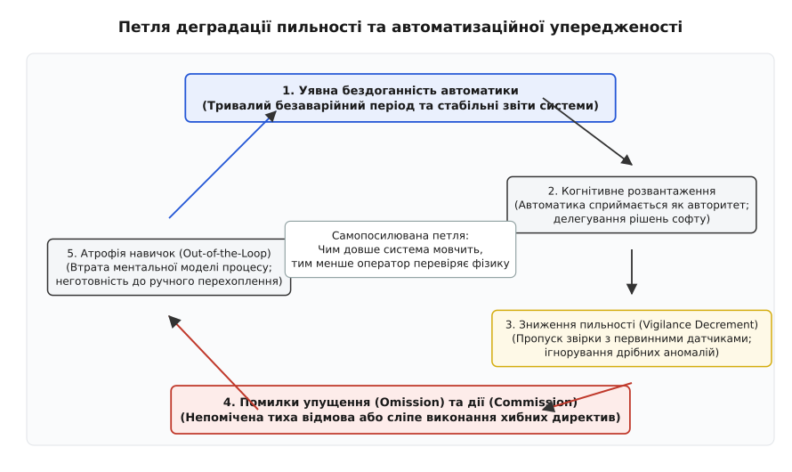
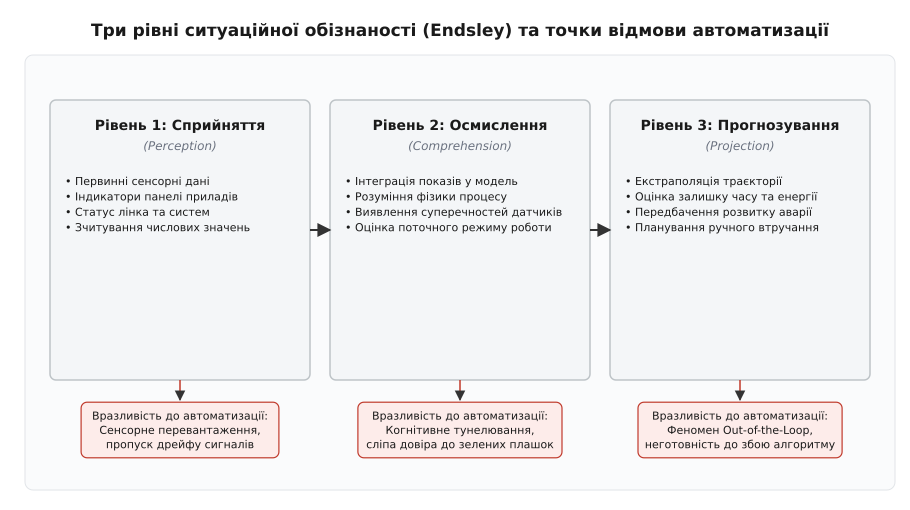
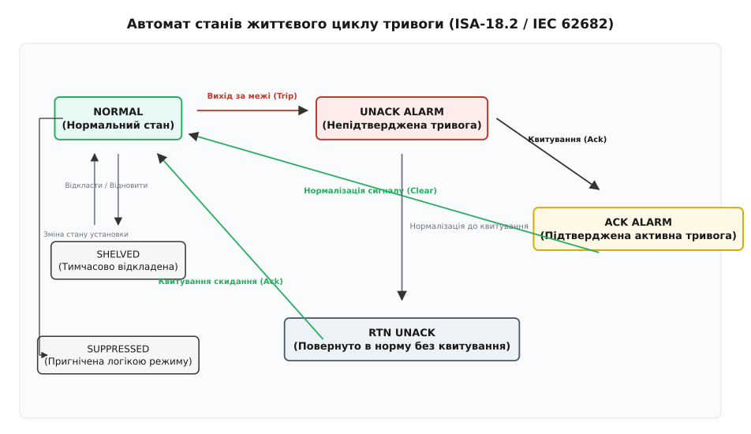
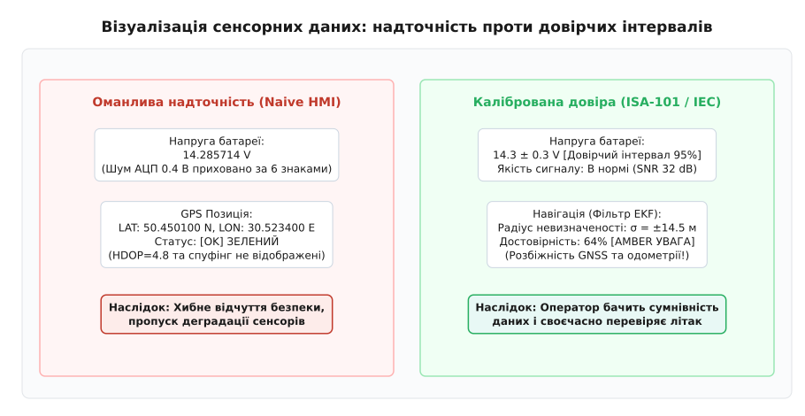

# Автоматизаційна упередженість: сліпа довіра до дисплея

<preknowlist>
- [Людина в контурі: чому затримка руйнує керування](root:embedded/liudyna-v-konturi) — затримки реакції, когнітивний цикл та фазовий зсув оператора.
- [Тривога, яку помічають: пріоритет, звук, потік тривог](root:embedded/tryvoha-iaku-pomichaiut) — ергономіка сповіщень, усунення втоми від сигналізації.
- [Що мусить бути видно завжди: стан, режим, здоров'я, зв'язок](root:embedded/shcho-musyt-buty-vydno-zavzhdy) — візуальна ієрархія та первинні індикатори HMI.
- [Плутанина режимів: коли людина думає одне, а апарат в іншому](root:embedded/plutanyna-rezhymiv) — неузгодженість ментальної моделі оператора та стану автомата.
- [Чому людина не бачить того, що на екрані](root:embedded/chomu-liudyna-ne-bachyt-toho-shcho-na-ekrani) — когнітивне тунелювання, зміна сліпоти та візуальне захаращення.
- [Старі дані: як показати, що на екрані вже неправда](root:embedded/stari-dani) — візуалізація деградації телеметрії та втрати актуальності.
</preknowlist>

Коли на пульті керування оператор бачить рівний ряд зелених індикаторів, мозок автоматично припиняє перевіряти фізичну дійсність. Напруга в шині живлення відображається числом `28.000 V`, положення кермових поверхонь позначене як номінальне, а на мапі безпілотний літак рухається суворо за заданою лінією маршруту. Проте якщо через замерзання трубки повного тиску або збій шини CAN контролер починає транслювати синтетичні застиглі координати, людина не помічає катастрофічного відхилення до моменту фізичного зіткнення із землею. Оператор дивиться не на літак, не на струм двигунів і не на горизонт — він дивиться на ідеальний дисплей, який переконує його, що все гаразд.

Цей феномен в інженерній психології та ергономіці критичних систем отримав назву **автоматизаційної упередженості** (*Automation Bias*). Це систематична когнітивна помилка, за якої людина розглядає автоматизовану систему як непомильний авторитетний оптимізатор, віддаючи перевагу показам цифрового інтерфейсу перед суперечливими сигналами первинних фізичних приладів, власними відчуттями та здоровим інженерним глуздом.

---

## 1. Когнітивна природа та нейроекономіка прийняття рішень

Людська психіка еволюційно оптимізована на мінімізацію енергетичних витрат під час обробки інформації. Мозок дорослої людини, що становить приблизно 2% від маси тіла, у стані активного аналізу та прийняття рішень споживає понад 20% усієї метаболічної енергії організму. Щоб уникнути виснаження нейронних ресурсів, когнітивна система застосовує евристики — спрощені ментальні шаблони, що дозволяють ухвалювати швидкі рішення на основі обмежених даних (модель обмеженої раціональності Герберта Саймона).

Коли оператор працює зі складною автоматикою, алгоритм розглядається не просто як інструмент вимірювання, а як когнітивний протез. Якщо система демонструє стабільну безпомилкову роботу протягом десятків чи сотень годин польоту чи чергування, у свідомості людини формується стійке переконання: «Комп'ютер швидший за мене, точніший за мене і має доступ до всіх внутрішніх сенсорів. Якщо на екрані немає червоної тривоги, значить аварії немає».


*Петля деградації пильності: уявна бездоганність автоматики веде до когнітивного розвантаження, пропуску аномалій та атрофії навичок.*

Цей ефект підсилюється соціально-психологічним феноменом авторитетного градієнта (*Authority Gradient*). Люди схильні довіряти математичним алгоритмам більше, ніж іншим людям або власним суб'єктивним оцінкам. Цифровий дисплей, що видає значення з високою розрядністю, сприймається як об'єктивна істина найвищої інстанції.

Для аналізу глибини проникнення алгоритмів у процес прийняття рішень застосовують таксономію рівнів автоматизації (LOA — *Levels of Automation* за Шеріданом і Верпланком):

1. **Рівні 1–2 (Низька автоматизація):** Комп'ютер виконує лише прямі механічні дії за командами людини або пропонує повний набір сирих даних. Ризик автоматизаційної упередженості тут мінімальний, проте навантаження на оператора максимальне.
2. **Рівні 3–5 (Помірна автоматизація):** Комп'ютер звужує вибір до кількох варіантів або пропонує одне оптимальне рішення, яке людина повинна явно схвалити. На цьому етапі з'являються перші помилки дії (комісії), коли оператор автоматично погоджується із запропонованим вибором.
3. **Рівні 6–8 (Висока автоматизація):** Комп'ютер виконує обрану дію автоматично, якщо людина не накладе вето протягом визначеного таймуату (наприклад, 5 секунд). Тут різко зростає кількість помилок упущення: оператор перестає стежити за таймером і не встигає скасувати помилкову дію.
4. **Рівні 9–10 (Повна автономія):** Комп'ютер діє цілком самостійно і навіть не інформує людину про проміжні рішення. За такої архітектури оператор повністю випадає з контуру керування.

У чотирифазній моделі автоматизації Парасурамана, Шерідана та Вікенса (*Information Acquisition → Information Analysis → Decision Selection → Action Implementation*) автоматизаційна упередженість проявляється найсильніше на стадіях вибору рішення та виконання дій. Якщо алгоритм формує готову дію замість надання структурованого аналізу, критичне мислення оператора відключається.

Британська дослідниця Лізанна Бейнбрідж (*Lisanne Bainbridge*) сформулювала класичний парадокс під назвою «Іронії автоматизації» (*Ironies of Automation*): чим надійнішою та досконалішою стає автоматична система, тим менше практики отримує людина для ручного пілотування, і тим менш підготовленою вона виявляється в той єдиний критичний момент, коли автоматика ламається і передає керування людині. Автоматизація усуває прості рутинні завдання, залишаючи людині виключно непередбачувані аварійні надзвичайні ситуації, для вирішення яких у оператора вже немає свіжого практичного досвіду.

Крім того, людській увазі притаманний закон деградації пильності під час монотонного спостереження (класичний годинниковий тест Нормана Макворта, *Mackworth Clock Test*). Експериментально доведено, що під час пасивного моніторингу дисплея здатність людини помічати рідкісні аномалії експоненційно згасає вже через 20–30 хвилин безперервної роботи:

```
V(t) = V_min + (V_0 - V_min) · exp(-t / τ_v)
```

де:
- `V_0` — початкова пильність оператора на старті зміни,
- `V_min` — залишковий рівень фонової уваги у стані втоми,
- `τ_v` — постійна часу когнітивного згасання (типово 15..25 хвилин).

В автоматизаційній упередженості виділяють дві фундаментальні категорії помилок, що мають різну природу, але однаково катастрофічні наслідки:

### 1.1. Помилки упущення (Omission Errors)

Помилка упущення виникає тоді, коли у фізичній системі розвивається відмова (протікання гідравліки, перегрів ключа інвертора, заклинювання сервоприводу), але автоматична діагностика з певної причини не формує явної тривоги: наприклад, через збій датчика, помилку в уставці або непередбачений граничний випадок.

Оскільки на екрані не з'являється яскравого вікна чи звукового сповіщення, оператор не здійснює активного пошуку інформації. Людина не перевіряє тиск за стрілочним манометром, не контролює споживання струму за аналоговим амперметром і не звіряє візуальний горизонт. Оператор пропускає критичний розвиток аварії виключно через те, що автоматика про неї промовчала. Людина делегувала відповідальність за моніторинг алгоритму, припинивши виконувати власну функцію контролера вищого рівня.

### 1.2. Помилки дії або комісії (Commission Errors)

Помилка дії є ще більш показовою: вона виникає, коли автоматизована система дає хибну команду або некоректну директиву дій (наприклад, автопілот вимагає віддати штурвал від себе при зближенні із землею або система дозування медичного препарату пропонує ввести десятикратну дозу).

Незважаючи на те, що зовнішні ознаки прямо суперечать цій директиві (висотомір показує наближення землі, пацієнт скаржиться на слабкість, амперметр зашкалює), оператор сліпо погоджується з комп'ютером і підтверджує небезпечну дію. Авторитет цифрового розрахунку виявляється вищим за критичне мислення. Якщо людина змушена обирати між власною фізичною інтуїцією та зеленим повідомленням на дисплеї, у більшості випадків перемагає дисплей.

---

## 2. Історичні катастрофи: коли дисплей обдурив людину

Історія техніки наповнена трагічними інцидентами, розслідування яких відкрило один і той самий ланцюжок: надійна автоматика заколисала пильність операторів, перший же нетиповий збій створив розрив між дисплеєм і фізичною реальністю, а людина до останньої секунди вірила екрану, а не приладам.

### 2.1. Авіація: Зацикленість на індикаторі та політ у темряву

Катастрофа літака Lockheed L-1011 TriStar рейсу Eastern Air Lines 401 у болотах Еверглейдс (1972 рік) стала класичним підручниковим прикладом помилки упущення. Під час заходження на посадку в Маямі на панелі приладів не загорілася зелена лампочка випуску передньої стійки шасі. Усі три члени екіпажу (командир, другий пілот та бортінженер) повністю зосередилися на згорілій лампочці вартістю десять доларів.

Увімкнувши автопілот на висоті 600 метрів для утримання горизонтального польоту, екіпаж почав по черзі розбирати плафон індикатора. Командир, повертаючись до бортінженера, випадково зачепив штурвал, приклавши зусилля по осі тангажу, яке перевищило поріг утримання (близько 6.8 кг). Автопілот тихо відключив канал висоти, перейшовши в режим стабілізації крену.

Оскільки літак летів у суцільній нічній темряві над болотом без візуальних орієнтирів, а звуковий сигнал зміни ешелону пролунав тихо на пульті бортінженера, ніхто не глянув на висотомір. Екіпаж був переконаний, що автопілот тримає висоту 600 метрів. Лише за секунду до удару другий пілот помітив покази барометра, але було запізно: літак на повній швидкості врізався в болото. Сліпа довіра до автоматичного утримання висоти заблокувала регулярний контроль базового приладового сканування.

Катастрофа аеробуса A330 рейсу Air France 447 над Атлантичним океаном (2009 рік) продемонструвала інший бік проблеми — розпад ситуаційної обізнаності при переході в ручний режим. Під час прольоту через зону тропічної грози кристали льоду забили всі три трубки Піто (давачі динамічного тиску). Бортові комп'ютери втратили узгоджені дані щодо приладової швидкості, і система керування автоматично перейшла з основного закону керування (*Normal Law*) у деградований (*Alternate Law*), вимкнувши автопілот та автомат тяги.

Пілоти, які роками літали на літаках із високим рівнем автоматизації та звикли до захисту від виходу на критичні кути атаки (*Flight Envelope Protection*), виявилися когнітивно не готовими до прямого ручного пілотування. Не розуміючи причини зникнення швидкості на дисплеях, молодший пілот рефлекторно потягнув сайдстік на себе, задерши ніс літака. Машина вийшла на критичний кут атаки понад 35 градусів і увійшла в глибокий аеродинамічний зрив потоку (*Stall*).

Через те що літак падав зі швидкістю понад 50 м/с, а кут атаки був настільки великим, що флюгери кута атаки видавали значення, які комп'ютер вважав фізично неможливими (швидкість за потоком менше 60 вузлів), звуковий сигналізатор звалювання автоматично замовк. Коли пілот трохи віддавав ручку від себе, зменшуючи кут, сигналізація вмикалася знову. Ця некоректна логіка сигналізації остаточно заплутала екіпаж: пілоти продовжували тягнути ручку на себе, сподіваючись, що автоматика врятує літак, доки апарат не впав в океан. Базове правило авіації «якщо прилади брешуть — тримай фіксований тангаж і тягу» (*Pitch and Power*) було повністю витіснене автоматизаційною розгубленістю.

Катастрофи літаків Boeing 737 MAX 8 авіакомпаній Lion Air (2018 рік) та Ethiopian Airlines (2019 рік) розкрили небезпеку прихованих систем корекції. Система MCAS (*Maneuvering Characteristics Augmentation System*) була розроблена для компенсації зміни аеродинамічних характеристик через встановлення більших двигунів CFM LEAP-1B. Вона мала автоматично перекладати стабілізатор на пікірування при польоті з великими кутами атаки.

Проте архітектура MCAS отримувала дані лише від одного з двох датчиків кута атаки (AoA). При механічному пошкодженні флюгера або збої резольвера софт отримував фіктивне значення `AoA = 35°` і починав агресивно опускати ніс літака за допомогою електроприводу стабілізатора. Пілоти намагалися тягнути штурвал на себе, але система кожні кілька секунд повторно вмикала перекладку стабілізатора з кроком 2.5 градуса.

Оскільки компанія приховала наявність MCAS з експлуатаційної документації, екіпажі намагалися боротися з літаком через інтерфейс ручного тримування, але аеродинамічні зусилля на штурвалі на високій швидкості перевищували фізичні можливості людини. Автоматика з єдиною точкою відмови виявилася сильнішою за екіпаж.

Катастрофа літака Boeing 777 авіакомпанії Asiana Airlines рейсу 214 в аеропорту Сан-Франциско (2013 рік) показала небезпеку прихованої зміни режимів автомату тяги. Під час візуального заходження на посадку пілот вручну перевів селектор висоти на вищий рівень, через що автомат тяги непомітно перейшов із режиму підтримки швидкості `SPEED` у пасивний режим очікування `HOLD`. Екіпаж був переконаний, що комп'ютер автоматично підтримує мінімальну швидкість 137 вузлів, і припинив контролювати покажчик швидкості. Літак уповільнився до 103 вузлів, втратив підйомну силу і вдарився об дамбу перед злітною смугою.

### 2.2. Енергетика: Ілюзія замкненого контакту на АЕС Три-Майл-Айленд

Аварія на атомній електростанції Три-Майл-Айленд (1979 рік) стала найбільшою катастрофою в історії комерційної ядерної енергетики США і хрестоматійним прикладом того, як неправильна архітектура HMI провокує помилку комісії.

Аварія почалася з відмови живильних насосів другого контуру охолодження. Тиск у реакторі першого контуру почав стрімко зростати. Для запобігання аварії автоматично відкрився електромагнітний скидний клапан компенсатора тиску (PORV — *Pilot-Operated Relief Valve*). Після зниження тиску до норми контролер зняв напругу з електромагнітного приводу, щоб клапан закрився під дією поворотної пружини.

Однак пружину заклинило в напіввідкритому стані через механічний дефект сідла. На пульті операторів загорілася зелена індикаторна лампа з написом «Клапан PORV закрито». Оператори не знали, що цей індикатор був підключений не до кінцевого вимикача на штоку клапана (якого фізично не було встановлено), а до реле подачі струму на соленоїд. Тобто зелене світло показувало лише команду знеструмлення, а не фізичний стан механізму.

Через відкритий клапан теплоносій першого контуру продовжував викидатися в дренажний резервуар. Тиск продовжував падати, а рівень води в компенсаторі тиску парадоксально зростав через утворення парових бульбашок у реакторі. Оператори, дивлячись на зелену лампочку «клапан закрито» та високий рівень у компенсаторі, зробили фатальний висновок: теплоносія забагато. Вони вручну вимкнули насоси системи аварійного охолодження активної зони (ECCS), вважаючи, що рятують реактор від гідравлічного удару.

Внаслідок відключення охолодження активна зона реактора оголилася, ядерне паливо розігрілося до 2700 °C і наполовину розплавилося. Якби оператори перевірили покази термопари на виході зі скидної труби клапана (яка показувала високу температуру гарячої пари), вони б зрозуміли, що клапан відкритий. Проте сліпа довіра до зеленого індикатора на головному щиті заблокувала будь-який сумнів.

### 2.3. Медичні прилади: Therac-25 та інфузійні помпи

Трагедія радіотерапевтичного апарата Therac-25 (1985–1987 роки) показала, як автоматизаційна упередженість призводить до загибелі людей у цивільній медицині. Нова модель апарата повністю покладалася на програмне забезпечення замість електромеханічних релейних блокувань безпеки, які стояли в попередніх моделях Therac-6 та Therac-20.

Через стан гонитви (*Race Condition*) у модулі опитування клавіатури на асемблері PDP-11, якщо оператор дуже швидко виправляв помилку вибору режиму (перемикав із потужного рентгенівського випромінювання на електронне за менш ніж 8 секунд), коліматор і вольфрамова мішень залишалися у відведеному положенні, а електронна гармата вмикалася на повну потужність 25 МеВ замість мікроамперних струмів.

Пацієнти отримували прямий удар пучком електронів, доза якого перевищувала допустиму в 100 разів (близько 20 000 рад). Люди кричали від нестерпного болю, описуючи відчуття як удар струмом або гарячим металом. Проте на моніторі оператора з'являвся короткий напис `Malfunction 54` або `Dose input error`. В інструкції користувача цей код описувався як незначна помилка дози, яку можна скинути натисканням клавіші `P` (*Proceed*).

Оператори настільки вірили в непомильність комп'ютерного апарата, що переконували пацієнтів, ніби їм це «здалося», і повторювали опромінення знову. Шестеро людей отримали важкі променеві опіки і загинули в муках. Довіра персоналу до монітора повністю затьмарила прямі свідчення постраждалих.

Сучасні автоматичні інфузомати та дозатори інсуліну стикаються з аналогічною проблемою у формі упередженості підтвердження за замовчуванням (*Default Confirmation Bias*). Якщо система пропонує розрахункову швидкість інфузії із запропонованим значенням, медсестри автоматично тиснуть `OK`, не перевіряючи, чи кома не змістилася на один розряд унаслідок збою клавіатури.

### 2.4. Автономні дрони та робототехніка: EKF-галюцинації та оптичний потік

У сучасних безпілотних літальних апаратах і наземних роботах головним джерелом автоматизаційної упередженості є навігаційні фільтри EKF (*Extended Kalman Filter*). Фільтр об'єднує покази супутникової навігації GNSS, інерційного блоку IMU, магнітометра та оптичного потоку в єдину оцінку стану.

Коли безпілотник потрапляє в зону дії станцій радіоелектронної боротьби, які транслюють спуфінгові сигнали GNSS (плавне зміщення координат зі збереженням структури сузір'я), швидкість наростання помилки підбирається такою, щоб не викликати миттєвого зриву фільтра. На екрані наземної станції керування (GCS) оператор бачить зелену позначку літака, що летить за ідеальним маршрутом над полем.

Насправді ж літак летить у бік високовольтної лінії електропередач або житлового кварталу. Якщо оператор не контролює первинні показники — співвідношення сигнал/шум супутників, курс магнітометра, відповідність зображення з камери мапі рельєфу, — він зберігає повний спокій до моменту втрати відеосигналу.

Аналогічні збої виникають у системах комп'ютерного зору (ADAS та автопілоти автомобілів). Алгоритми виявлення об'єктів на базі згорткових нейромереж навчаються пригнічувати хибні спрацювання від мостів і дорожніх знаків. Коли біла вантажівка перетинає шосе на тлі яскравого сонячного неба, класифікатор сприймає її як дорожній вказівник. Водій, покладаючись на зелену піктограму активного автопілота, не дивиться на дорогу і не натискає педаль гальма.

---

## 3. Ситуаційна обізнаність за моделлю Міки Ендслі

Для аналізу того, як автоматизація руйнує здатність людини контролювати складні динамічні процеси, доктор Міка Ендслі (*Mica Endsley*) розробила трьохрівневу модель ситуаційної обізнаності (Situation Awareness, SA).


*Три рівні ситуаційної обізнаності (SA) та вразливості кожного рівня до надмірної автоматизації.*

Ситуаційна обізнаність — це не просто знання окремих чисел телеметрії; це безперервний динамічний процес формування адекватної ментальної моделі навколишнього середовища:

### 3.1. Рівень 1: Сприйняття елементів середовища (Perception)

Перший рівень полягає у фізичному сприйнятті статусів, сигналів, геометричних параметрів, швидкостей та звуків. Наприклад: «Висота польоту становить 120 метрів, напруга на акумуляторі 22.4 В, індикатор супутників показує 8 супутників, швидкість вітру 7 м/с».

**Як автоматизація руйнує Рівень 1:** Сенсорне перевантаження та приховування первинних даних. Якщо HMI ховає сирі сенсорні канали за інтегральними зеленими плашками «SYSTEM OK», оператор взагалі втрачає контакт із фізичними показниками. Коли виникає дрейф сенсора, людина не має доступу до сигналу, щоб вчасно помітити аномалію.

### 3.2. Рівень 2: Осмислення поточної ситуації (Comprehension)

Другий рівень — це інтеграція розрізнених даних першого рівня в єдину фізичну картину та розуміння причинно-наслідкових зв'язків. Наприклад: «Напруга падає швидше за розрахункову при незмінному струмі моторів, отже, одна з банок акумулятора деградувала або температура повітря викликала просідання хімічного джерела; поточної енергії не вистачить на повернення проти зустрічного вітру».

**Як автоматизація руйнує Рівень 2:** Когнітивне тунелювання та хибна інтерпретація. Коли автоматика бере на себе інтерпретацію ситуації, але робить це за спрощеною моделлю, оператор перестає будувати власну фізичну модель. Людина бачить напис «Залишок батареї: 45%» і не співвідносить його зі збільшенням зустрічного вітру.

### 3.3. Рівень 3: Прогнозування майбутнього стану (Projection)

Третій, найвищий рівень — це здатність екстраполювати розвиток подій у часі на основі розуміння динаміки системи. Наприклад: «Якщо швидкість зниження становить 3 м/с, а тяги не вистачає для гальмування через відмову одного гвинта, через 18 секунд апарат торкнеться землі з перевищенням міцності шасі; необхідно негайно активувати парашутну систему».

**Як автоматизація руйнує Рівень 3:** Феномен випадання з контуру керування (*Out-of-the-Loop, OOTL*). Коли комп'ютер здійснює керування протягом тривалого часу, людина втрачає відчуття інерції системи та її динамічного відгуку. Якщо автоматика раптово вимикається через збій, оператору потрібно від 5 до 30 секунд лише на те, щоб відновити Рівень 1 і Рівень 2, тоді як для прийняття рішення на Рівні 3 часу вже не залишається.

---

## 4. Стандарти сигналізації: ANSI/ISA-18.2 та усунення лавини тривог

Для того щоб сигналізація була інструментом порятунку, а не джерелом когнітивного паралічу, Міжнародне товариство автоматизації розробило стандарт ANSI/ISA-18.2 (*Management of Alarm Systems for the Process Industries*, еквівалент IEC 62682).


*Автомат станів сигналізації за стандартом ISA-18.2 / IEC 62682 із обов'язковим квитуванням та динамічним пригніченням.*

Стандарт встановлює строгий життєвий цикл системи сигналізації, що складається з десяти етапів: філософія, ідентифікація, раціоналізація, детальний дизайн, впровадження, експлуатація, технічне обслуговування, моніторинг ефективності, управління змінами та аудит.

У функціональній безпеці (стандарти IEC 61508 та IEC 61511) система сигналізації розглядається як незалежний шар захисту (IPL — *Independent Protection Layer*). Проте кредит зниження ризику (імовірність відмови за вимогою, `PFD = 0.1`) сигналізації дозволяється зараховувати лише за умови, що система повністю відповідає стандартам раціоналізації ISA-18.2:

1. **Нормативний розподіл пріоритетів тривог:**
   - Низький пріоритет (`Low`): приблизно 80% від загальної кількості сконфігурованих тривог.
   - Середній пріоритет (`Medium`): приблизно 15%.
   - Високий пріоритет (`High`): приблизно 5%.
   - Критичний пріоритет (`Critical`): менше 1% (лише загрози катастрофи чи загибелі).

2. **Боротьба зі стоячими тривогами (Standing Alarms):**
   Стояча тривога — це повідомлення, що перебуває в активному стані понад 24 години без усунення фізичної причини. Стоячі тривоги створюють фоновий шум, на тлі якого оператори звикають бачити постійно заповнений список несправностей. Стандарт вимагає регулярного аудиту стоячих тривог з їх виведенням у ремонтний статус `OUT_OF_SERVICE`.

3. **Алгоритмічна фільтрація надокучливих тривог (Nuisance Alarms):**
   Усунення брязкотливих (*Chattering*), швидкоплинних (*Fleeting*) та некоректно сконфігурованих (*Bad-Actor*) сигналів за допомогою гістерезису та затримок On/Off-Delay.

Головним практичним інструментом боротьби з лавиною тривог є впровадження детерміністичного автомата станів, який реалізує три обов'язкові інженерні механізми:

### 4.1. Динамічне пригнічення за станом системи (State-Based Suppression)

Будь-яка складна система має різні експлуатаційні режими: консервація, передпольотна підготовка, зліт, автономний круїз, аварійна посадка. У кожному з цих режимів фізичні межі параметрів є різними.

Наприклад, коли безпілотний літак стоїть на землі з вимкненими двигунами, низький тиск масла в двигуні, відсутність обертів генератора та нульова швидкість повітряного потоку є абсолютно нормальними станами. Наївна система сигналізації, що використовує статичні уставки, видасть 10 аварійних повідомлень червоного кольору. Стандарт ISA-18.2 вимагає застосування бітових масок режимів: якщо режим позначений як `SYS_STATE_STANDBY`, усі тривоги, пов'язані з динамікою польоту, автоматично переходять у стан `SUPPRESSED_BY_DESIGN` і не навантажують екран.

### 4.2. Маскування вторинних тривог за деревом першопричин (Root-Cause Suppression)

Коли виходить з ладу базовий живильний або обчислювальний вузол, це породжує ланцюгову реакцію відмов периферії. Якщо на шині 28 В зникла напруга, немає сенсу показувати окремі тривоги про втрату зв'язку з кожним із чотирьох сервоприводів елеронів, збій камери та зупинку радіомодема.

Диспетчер тривог зв'язує дочірні повідомлення через параметр `parent_alarm_id`. Як тільки первинна тривога `PWR_MAIN_BUS_UV` переходить в активний стан, усі дочірні тривоги автоматично блокуються від виведення на головний екран. Оператор бачить на дисплеї єдину пріоритетну тривогу та чітку інструкцію з її ліквідації.

### 4.3. Відкладення тривог (Alarm Shelving)

Якщо сенсор вийшов з ладу і починає видавати безперервний брязкіт сигналізації, оператор повинен мати санкціонований інструмент тимчасового пригнічення сповіщення (`SHELVED`). На відміну від небезпечного ручного вимкнення звуку, стандарт ISA-18.2 вимагає обов'язкового обмеження тривалості відкладення таймером. Після закінчення встановленого часу (наприклад, через 15 хвилин) тривога автоматично відновлює свій статус, що унеможливлює виникнення забутих прихованих несправностей.

Детальна програмна реалізація диспетчера та раціоналізатора тривог за стандартом ISA-18.2 на C99 та C++20 наведена у вставці [Диспетчер та раціоналізатор тривог за стандартом ISA-18.2](root:embedded/automation-bias/proj-hmi-alarm-rationalizer.md).

---

## 5. Ергономічний HMI: Візуалізація довірчих інтервалів замість оманливої надточності

Одним із головних драйверів виникнення автоматизаційної упередженості є оманлива надточність цифрових інтерфейсів (*Spurious Precision*).

Коли мікроконтролер зчитує напругу з 12-бітного АЦП і виводить на екран значення `14.285714 V`, у людини підсвідомо формується ілюзія, що напруга відома з точністю до мікровольта. Насправді ж температурний дрейф джерела опорної напруги, шуми комутації імпульсного перетворювача та розрядність дають реальну похибку вимірювання ±0.3 В. Виведення шести знаків після коми є інженерним обманом оператора.


*Порівняння наївного інтерфейсу з надточковими числами та ергономічного HMI з візуалізацією довірчих інтервалів.*

Стандарт ANSI/ISA-101 (*Human Machine Interfaces for Process Automation Systems*) та концепція каліброваної довіри (*Calibrated Trust* за Лі та Сі) вимагають дотримання таких принципів побудови графічних панелей:

### 5.1. Відображення довірчих інтервалів та дисперсії

Кожна фізична величина повинна виводитися з графічним відображенням її невизначеності. Якщо напруга вимірюється з похибкою, значення виводиться як `14.3 ± 0.3 V` або у вигляді графічної шкали з напівпрозорим інтервалом 95% довіри (±1.96·σ).

На карті наземної станції позиція літака повинна позначатися не точковим пікселем, а еліпсом коваріації помилки EKF. Якщо супутниковий сигнал погіршується, еліпс візуально розширюється, що дає оператору миттєвий сигнал: автоматична траєкторія стає непевною.

Аналогові шкали мають суттєву когнітивну перевагу перед числовими полями. Для зчитування цифрового значення людині необхідно сфокусувати центральний зір (фовеальна фіксація), розпізнати символи у префронтальній корі та зіставити їх з уставкою пам'яті, що займає понад 300 мілісекунд. Аналоговий стовпчик із затіненим діапазоном норми зчитується периферійним зором за 80 мілісекунд: оператор миттєво бачить положення стрілки відносно червоної межі, не витрачаючи ресурсів свідомої уваги.

### 5.2. Чотирирівнева ієрархія дисплеїв HMI (Display Hierarchy)

Стандарт ISA-101 встановлює чотири рівні графічного інтерфейсу для запобігання інформаційному перевантаженню:

- **Рівень 1 (Загальний огляд установки / місії):** Єдиний екран із ключовими інтегральними показниками здоров'я комплексу, картою та статусом безпеки. Тут немає дрібних перемикачів чи графіків налагодження.
- **Рівень 2 (Контур керування підсистемою):** Панель конкретного функціонального вузла (наприклад, силова установка або навігаційний комплекс), де згруповані пов'язані контури регулювання.
- **Рівень 3 (Детальна схема вузла):** Схематичне зображення з'єднань, клапанів, ключів живлення та первинних датчиків із довірчими інтервалами.
- **Рівень 4 (Діагностика та блокування):** Сервісні вікна налаштування ПІД-коефіцієнтів, аналізу шумів АЦП, логів переривань та калібрування.

Оператор проводить 90% часу на Рівні 1 і переходить на нижчі рівні лише за наявності чіткого діагностичного виклику.

### 5.3. Колір як маркер винятку (Color as an Exception)

У традиційних наївних інтерфейсах розробники зловживають яскравими кольорами: зелений для всього, що працює, синій для телеметрії, жовтий для підписів. У результаті екран перетворюється на барвистий килим, на якому неможливо виділити аварійний сигнал.

За стандартом ISA-101 усе робоче поле HMI повинно проектуватися в спокійній, нейтрально-сірій палітрі (*Muted Gray*). Яскраві кольори суворо резервуються для аномалій:
- **Жовтий (Amber):** Попередження, деградація достовірності, необхідність підвищеної уваги.
- **Червоний (Red):** Критична тривога, що вимагає негайної дії.
- **Пурпуровий (Magenta):** Повна недостовірність сенсорних даних або обрив зв'язку.

Якщо на сірому екрані спалахує жовтий або червоний віджет, спрацьовує безумовний ефект візуального виринання (*Visual Pop-Out*), що привертає увагу оператора за менш ніж 50 мілісекунд.

### 5.4. Акустична ергономіка сповіщень

Звукова сигналізація повинна розроблятися з урахуванням психоакустики:

1. **Запобігання переляку (Acoustic Startle Mitigation):** Раптовий гучний звук понад 85 дБА спричиняє фізіологічний спазм м'язів та короткочасну дезорієнтацію оператора. Звук тривоги повинен наростати плавно протягом 1.5 секунди.
2. **Тембральна диференціація:** Сигнали різного пріоритету повинні відрізнятися не лише частотою повторення, а й гармонійним спектром. Для тривог пріоритету `Critical` застосовується тритональний інтервал із різкими гармоніками, для `Medium` — м'який синусоїдальний гонг.
3. **Автоматичне приглушення після фіксації:** Як тільки оператор торкнувся миші або ввів команду, звук тривоги повинен знижувати гучність на 12 дБ, не заважаючи переговорам екіпажу чи голосовим командам.

---

## 6. Програмне розділення контуру керування та моніторингу достовірності

Для забезпечення абсолютної стійкості до автоматизаційної упередженості архітектура бортового програмного забезпечення повинна будуватися на патерні незалежного моніторингу достовірності (Plausibility Checker / Truth-Maintenance Engine).

У наївних системах розрахунок законів керування та формування тривог виконуються в одному й тому самому потоці одним і тим самим алгоритмом. Якщо фільтр EKF або нейромережевий класифікатор починає «галюцинувати», він не може зафіксувати власну помилку, оскільки з його точки зору всі внутрішні коваріації залишаються узгодженими.

Архітектура з розділенням контурів реалізує паралельний незалежний перевірочний механізм:

```
+-------------------------------------------------------------------------+
|                  СЕНСОРНІ СИГНАЛИ ТА СТАТУСИ ПЕРИФЕРІЇ                  |
+-------------------------------------------------------------------------+
                    |                                 |
                    v                                 v
+------------------------------------+  +---------------------------------+
| ОСНОВНИЙ КОНТУР КЕРУВАННЯ (CONTROL)|  | МОДУЛЬ ДОСТОВІРНОСТІ (CHECKER)  |
| - Розрахунок EKF-навігації         |  | - Фізичні інваріанти            |
| - Траєкторні оптимізатори          |  | - Енергетичний баланс           |
| - ПІД-регулятори приводів          |  | - Кінематичні нев'язки          |
+------------------------------------+  +---------------------------------+
                    |                                 |
                    v                                 v
+-------------------------------------------------------------------------+
|         АРБІТР БЕЗПЕКИ ТА ДИСПЕТЧЕР ТРИВОГ (SAFETY ARBITER)             |
|   - Порівняння рішень контролера з фізичними обмеженнями чекера         |
|   - Генерація тривог ISA-18.2 та передача довірчих інтервалів на HMI    |
|   - Переведення системи в безпечний деградований стан (Safe State)      |
+-------------------------------------------------------------------------+
```

### 6.1. Перевірка фізичних інваріантів та аналітична надлишковість

Модуль перевірки достовірності оперує базовими фізичними законами та співвідношеннями аналітичної надлишковості (ARR — *Analytical Redundancy Relations*), які не залежать від складності програмних моделей:

1. **Закон збереження енергії:** Миттєва електрична потужність, що відбирається від акумулятора `P_elec = U · I`, повинна з урахуванням ККД інвертора відповідати сумарній механічній потужності тяги `P_mech = Σ(τ_i · ω_i)` та тепловим втратам:
   ```
   P_elec = P_mech / η + I² · R_internal + P_parasitic
   ```
   Якщо струм зростає втричі, а тяга не змінюється, чекер фіксує коротке замикання або заклинювання підшипника незалежно від показів датчиків обертів.
2. **Кінематичні обмеження:** Прискорення апарата не може перевищувати тяговооруженості двигунів, а швидкість зміни кутів тангажу та крену обмежена моментами інерції конструкції. Якщо супутниковий приймач показує зміну швидкості на 50 м/с за 100 мс, чекер відкидає ці координати як супутниковий спуфінг.
3. **Аеродинамічний кворум:** Зміна висоти за барометричним тиском повинна суворо корелювати з інтегралом вертикальної швидкості за оптичним потоком та лазерним далекоміром:
   ```
   r_alt = |Δh_baro - ∫ v_z_imu · dt|
   ```
4. **Простори паритету (Parity Space Methods):** Для групи взаємопов'язаних вимірювань формується вектор паритету `p = W · y`, де матриця `W` проектує шум вимірювань у підпростір, ортогональний до номінальної динаміки системи. Якщо норма вектора `||p||` перевищує поріг виявлення, алгоритм не лише сигналізує про відмову, а й однозначно локалізує пошкоджений канал датчика.

При виявленні розбіжності між контуром автоматичного керування та чекером достовірності арбітр безпеки знижує статус довіри на HMI, вмикає діагностичну тривогу `SENSOR_PLAUSIBILITY_WARN` і переводить безпілотник у деградований режим (наприклад, утримання висоти за прямими датчиками тиску з вимкненням супутникової навігації).

### 6.2. Двофазна валідація дій та безпечне перехоплення керування (Arm-and-Execute)

Для запобігання помилкам комісії критичні дії оператора (запуск двигунів, скидання корисного навантаження, перемикання аварійного реле, зміна польотного плану) ніколи не повинні виконуватися в один клік миші або дотик до сенсорного екрана.

Інтерфейс HMI реалізує двофазний шаблон підтвердження:

1. **Фаза підготовки (Arm):** Оператор обирає команду. Інтерфейс виводить не стандартне сухе вікно «Ви впевнені? ТАК/НІ», а візуальну модель очікуваного фізичного наслідку: «Увага: увімкнення контактора 28V подасть напругу на високовольтні інвертори. Струм зросте на 45 А. Тяга двигунів активується через 1.5 секунди».
2. **Фаза підтвердження (Execute):** Оператор зобов'язаний виконати просторово розділену дію: утримувати механічний перемикач протягом 2 секунд, провести слайдер на сенсорному екрані або натиснути дві фізичні кнопки двома руками.

Це розриває автоматичний рефлекс згоди, примушуючи мозок переключитися з автоматичної інтуїтивної Системи 1 (за Даніелем Канеманом) на аналітичну, критичну Систему 2.

---

## 7. Верифікація та тестування надійності людино-машинного контуру

Для гарантії того, що система стійка до автоматизаційної упередженості, програмний комплекс повинен проходити спеціальні випробування методом ін'єкції несправностей (*Fault Injection Testing*):

1. **Тест тихої відмови (Silent Sensor Freeze):** Під час симуляції автономного польоту значення одного з критичних сенсорів (наприклад, датчик висоти чи температури) штучно заморожується на ідеальному номінальному рівні, тоді як фізична модель апарата починає знижуватися. Випробування перевіряє, чи виявить чекер достовірності зупинку дисперсії шуму сенсора і чи сформує попередження для оператора.
2. **Тест дрейфу зміщення (Slow Bias Drift Injection):** До сигналу кутової швидкості гіроскопа додається лінійний дрейф 0.05 град/с кожну хвилину. Тест перевіряє, чи помітить модуль розбіжність інтеграла гіроскопа з вектором гравітації акселерометра до виходу з ладу контуру стабілізації.
3. **Тест лавини тривог (Stress Flood Rig):** В апаратний симулятор подається сигнал знеструмлення головної шини. Перевіряється, що за перші 5 секунд після збою кількість нових тривог на дисплеї оператора не перевищить трьох раціоналізованих сповіщень, а всі 40 вторинних повідомлень будуть коректно переведені в стан `SUPPRESSED_BY_DESIGN`.

---

## 8. Підсумковий інженерний синтез

Автоматизаційна упередженість — це не дефект окремого оператора, а закономірний наслідок непродуманої архітектури людино-машинного інтерфейсу. Щоб побудувати надійний вбудований комплекс, інженер зобов'язаний закладати захист від сліпої довіри до дисплея на всіх рівнях розробки:

1. **Раціоналізація сигналізації:** Жодне повідомлення не має права з'являтися на екрані, якщо воно не вимагає конкретної дії оператора і не має визначеного наслідку бездії.
2. **Динамічне пригнічення:** Застосування автомата станів ISA-18.2 з бітовими масками режимів та маскуванням вторинних симптомів за деревом першопричин ліквідує лавину тривог.
3. **Калібрована довіра:** Відмова від оманливої надточності на користь візуалізації довірчих інтервалів, дисперсій та колірного кодування за стандартом ISA-101.
4. **Незалежна перевірка достовірності:** Відокремлення контуру керування від незалежного монітора фізичних інваріантів гарантує вчасне розпізнавання сенсорних збоїв та безпечне повернення керування людині.
