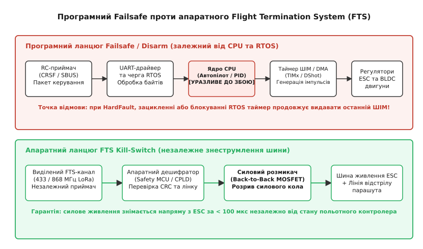
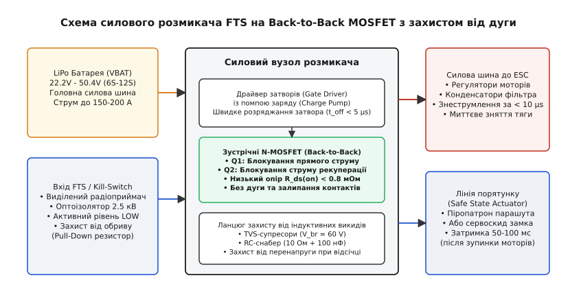
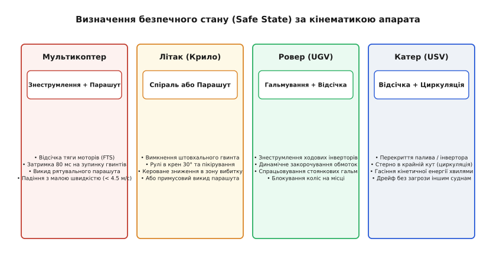

# Аварійна зупинка: kill-switch, безпечний стан і те, що софт не скасує

<preknowlist>
- [Failsafe в автопілотах](root:sys-dron/failsafe) — програмна реакція системи керування на втрату зв'язку, навігації або просідання батареї.
- [Режими failsafe RC](root:sys-dron/rc-failsafe-modes) — поведінка приймача радіокерування при втраті радіосигналу (No Pulses проти утримання останнього значення).
- [Регулятори ESC та протокол DShot](root:embedded/esc-bldc-driver) — передача цифрових пакетів газу, телеметрія й таймінги обробки команд зупинки.
- [Апарат, який рушив сам](root:embedded/aparat-iakyi-rushyv-sam) — чому пробій силового ключа або апаратне зависання ядра призводить до некерованого обертання приводу.
- [Сторожовий таймер](root:sf-devices/watchdog) — межі можливостей сторожового таймера та чому збійний стек або завислий DMA не знеструмлюють силове коло.
</preknowlist>

Важкий гексакоптер злітною масою 16 кг несе вимірювальний лідар на швидкості 12 м/с. На висоті 45 метрів через електромагнітну наводку від силової шини під час різкого маневру в ядрі STM32F7 стається збій шини `BusFault` під час запису черги завдань FreeRTOS. Процесор миттєво входить у нескінченний цикл обробника `HardFault_Handler` із забороненими перериваннями. Проте апаратний таймер `TIM1`, тактований від внутрішньої шини APB2 на частоті 216 МГц, не знає про стан ядра: його регістри захоплення-порівняння `CCR1`–`CCR6` зафіксовані в попередньому положенні, а генератор комплементарних виходів продовжує безперервно видавати імпульси DShot600 із шпаруватістю 70% тяги. Оператор б'є по тумблеру вимкнення на пульті, але польотний контролер більше не читає пакетів UART. Некерований апарат на повній швидкості летить у бік промислової установки.

Ця ситуація демонструє фундаментальну межу автоматики: **програмна логіка не здатна скасувати власну апаратну смерть**. Апаратний таймер, мікросхема прямого доступу до пам'яті (DMA) та силові ключі регуляторів ESC є повністю автономними апаратними вузлами. Якщо ядро процесора зависло, виник взаємний замок задач (*deadlock*) або пошкоджено таблицю векторів переривань, софт фізично не може згенерувати команду зупинки.

Функція аварійної зупинки (*Emergency Stop*, *Kill-Switch*) та система припинення польоту (*Flight Termination System*, FTS) будуються як ієрархія з двох рубежів: швидкого програмного роззброєння (*Software Disarm / Fast Cutoff*) для штатних польотних інцидентів та повністю незалежного апаратного знеструмлення (*Hardware Kill-Switch*), що вимикає живлення силових ключів в обхід будь-якого софту.

## Межа між програмним Failsafe та апаратною відсічкою

У побудові безпілотних апаратів та автономних роботів часто виникає плутанина між термінами *Failsafe* та *Emergency Stop / Flight Termination*. Це принципово різні механізми, призначені для різних класів відмов.

Програмний Failsafe — це штатний алгоритм поведінки прошивки у відповідь на передбачувані зовнішні збої:
- втрата зв'язку з пультом керування (RC Loss);
- відсутність навігаційних даних GNSS або деградація оцінки EKF;
- просідання напруги батареї нижче критичного порогу;
- вихід за межі встановленої геометричної зони (Geofence).

У всіх цих випадках обчислювальне ядро автопілота залишається повністю працездатним. Алгоритм Failsafe перемикає політний автомат станів у режим повернення додому (Return to Launch, RTL), автоматичної посадки (Land) або утримання позиції (Hold). Софт продовжує вираховувати кути крену, керувати диференціальною тягою моторів та стабілізувати апарат.

Аварійна зупинка (Kill-Switch / FTS) вступає в дію тоді, коли **сам обчислювач або контур стабілізації зазнав краху**.

```
Параметр               Програмний Failsafe              Апаратний FTS / Kill-Switch
───────────────────────────────────────────────────────────────────────────────────
Стан процесора         Працездатний, обчислює навігацію Завислий, збійний або згорілий
Керування моторами     Активне регулювання тяги         Миттєве знеструмлення або нуль
Канал передачі         Головний телеметрійний / RC лінк Виділений резервний радіоканал
Виконавчий орган       ШІМ/DShot команди регулятору ESC Силовий розмикач (MOSFET/SSR)
Час спрацьовування     50–500 мс (затримка фільтрів)    < 100 мкс (апаратне зняття)
Наслідок для апарата   М'яка посадка або повернення     Втрата висоти / падіння / парашут
```


*Порівняння ланцюгів проходження сигналу аварійної зупинки: програмний Failsafe залежить від працездатності ядра CPU та черг RTOS, тоді як апаратний FTS знеструмлює силову шину живлення ESC напряму.*

### Чому сторожовий таймер (Watchdog) не рятує в польоті

Поширене хибне уявлення полягає в тому, що апаратний сторожовий таймер (IWDG або WWDG) захищає від некерованого польоту при зависанні софту. Сторожовий таймер дійсно виявить відсутність скидання лічильника та перезавантажить мікроконтролер через 100–250 мс. Проте для літального апарата або швидкісного робота перезапуск процесора під час руху є катастрофою:

1. **Час ініціалізації апаратури (Boot Time):** Після апаратного скидання виконується код завантажувача (Bootloader), ініціалізуються тактові генератори PLL, налаштовуються виводи GPIO, зчитуються калібрування з EEPROM/Flash. Цей процес триває від 50 до 300 мс.
2. **Перекалібрування та сходимість фільтрів навігації:** Сенсорам IMU (акселерометр, гіроскоп) потрібен час на прогрів цифрових фільтрів і стабілізацію зміщення нуля (*gyro bias*). Алгоритм орієнтації (Madgwick, Mahony або Extended Kalman Filter) потребує від 500 мс до 2 секунд стабільного надходження даних для сходження оцінки кватерніона орієнтації.
3. **Стан виводів під час Reset:** У момент перезавантаження виводи мікроконтролера скидаються у стан високого імпедансу (`Floating Input`). Сигнальні лінії ESC підтягуються внутрішніми або зовнішніми резисторами. Якщо регулятор ESC втрачає сигнал на 50 мс, він переходить у власний стан Failsafe (якщо він налаштований) або блокується.

Якщо квадрокоптер летить зі швидкістю 15 м/с і зазнає перезавантаження польотного контролера, він перевертається за 80–120 мс через асиметрію аеродинамічного моменту. Жоден автопілот не здатен підхопити стабілізацію падаючого і безладно обертового апарата після перезавантаження посеред польоту. Єдиний безпечний наслідок фатального збою — негайне переведення в детермінований безпечний стан (*Safe State*).

## Програмний Kill-Switch: миттєве скидання ШІМ та DShot у нуль

Програмний Kill-Switch — це найвищий пріоритет у програмному стеку автопілота. На відміну від штатної процедури `Disarm`, яка перевіряє безпеку (чи торкнувся апарат землі, чи опущено ручку газу, чи немає заборони роззброєння в повітрі), аварійний програмний Kill-Switch зобов'язаний:
- повністю проігнорувати будь-які логічні блокування польоту;
- обнулити вихідні керуючі дії швидше, ніж завершиться поточний крок ПІД-регулятора;
- примусово вимкнути апаратні виходи таймерів.

### Апаратне вимкнення виходів таймера (TIM Break / MOE)

У мікроконтролерах сімейств STM32 (а також NXP LPC, TI C2000) розширені таймери керування двигунами (`TIM1`, `TIM8`, `TIM20`) містять спеціальний регістр `BDTR` (*Break and Dead-Time Register*) та біт головного дозволу виходів `MOE` (*Main Output Enable*).

У разі активації програмного Kill-Switch недостатньо просто записати 0 у масив завдання швидкості `motor_setpoint[i] = 0`. Якщо задача ПІД-регулятора зависне у черзі, таймер продовжуватиме генерацію. Програма повинна виконати прямий апаратний скид біта `MOE`:

:::tabs
```c
/* Миттєве апаратне вимкнення всіх виходів розширеного таймера TIM1 */
TIM1->BDTR &= ~TIM_BDTR_MOE;
```
```cpp
// Апаратне скидання біта MOE через регістровий інтерфейс
auto& timer = *reinterpret_cast<TIM_TypeDef*>(TIM1_BASE);
timer.BDTR &= ~TIM_BDTR_MOE;
```
:::

Коли біт `MOE` скидається в 0, усі комплементарні виходи каналів `CH1`–`CH4` та `CH1N`–`CH3N` миттєво переходять у пасивний стан, визначений бітами `OIS1`–`OIS4` (зазвичай низький рівень 0 В). Сигнал зникає на виводах за один такт таймера (менше 5 наносекунд).

Для стандартних таймерів загального призначення (`TIM2`–`TIM5`), де біт `MOE` відсутній, програма вимикає канали шляхом очищення бітів дозволу виходів у регістрі `CCER` (*Capture/Compare Enable Register*):

:::tabs
```c
/* Примусове вимкнення генерації ШІМ на каналах 1-4 таймера TIM2 */
TIM2->CCER &= ~(TIM_CCER_CC1E | TIM_CCER_CC2E | TIM_CCER_CC3E | TIM_CCER_CC4E);
```
```cpp
// Примусове вимкнення каналів генерації ШІМ
auto& timer = *reinterpret_cast<TIM_TypeDef*>(TIM2_BASE);
constexpr uint32_t allChannelsMask = TIM_CCER_CC1E | TIM_CCER_CC2E | TIM_CCER_CC3E | TIM_CCER_CC4E;
timer.CCER &= ~allChannelsMask;
```
:::

### Протокол DShot і команда аварійного гальмування

Якщо привід використовує цифровий протокол [DShot](root:embedded/esc-bldc-driver), пакети передаються через DMA потоки з фіксованою частотою (наприклад, DShot600 передає 16-бітний кадр за 26.7 мкс).

Протокол DShot визначає спеціальні службові команди (значення від 1 до 47), які надсилаються замість значення газу (значення від 48 до 2047):
- Значення `0`: сигнал зупинки моторів (*Motor Stop* / нульова тяга). Регулятор знімає живлення з обмоток або активує пасивне гальмування.
- Команда `1..5`: службові команди DShot (зокрема `DSHOT_CMD_BEEP`, `DSHOT_CMD_SPIN_DIRECTION`).

При програмному Kill-Switch конвеєр DMA негайно зупиняється (`DMA_Stream->CR &= ~DMA_SxCR_EN`), буфер DMA заповнюється нулями, і запускається генерація пакетів DShot зі значенням `0`:

:::tabs
:::code avariina-zupynka-d/c/protokol-dshot-i-komanda.c
:::code avariina-zupynka-d/cpp/protokol-dshot-i-komanda.cpp
:::

## Апаратний вимикач (Hardware Kill-Switch / FTS)

Якщо польотний контролер повністю знеструмлений, спалений коротким замиканням або заблокований у нескінченному перериванні, єдиним дієвим засобом зупинки залишається **апаратне знеструмлення силової шини** регуляторів ESC напряму від тягової батареї.

Система аварійного припинення польоту (FTS) проектується як повністю ізольований автономний пристрій, що не ділить із польотним контролером ані обчислювальних ресурсів, ані радіоканалу, ані кіл живлення.

### Архітектура системи FTS

1. **Виділений радіоканал керування:** Застосовується вузькосмуговий трансивер на частотах 433 МГц або 868 МГц (модуляція LoRa або FSK). На відміну від основного каналу 2.4 ГГц, низька частота забезпечує значно більшу енергетику радіолінка (*link budget*) та стійкість до затінення корпусом апарата чи перешкодами.
2. **Власне аварійне живлення:** Модуль FTS живиться від окремого невеликого акумулятора (наприклад, 2S LiPo 300 мАг) або гальванічно ізольованого DC-DC перетворювача з накопичувальним конденсатором великої ємності. Навіть якщо головна батарея закорочена силовими інверторами і напруга шини впала до нуля, FTS зберігає працездатність для спрацьовування рятувальної системи.
3. **Силовий розмикач:** Силовий блок комутує постійний струм від батареї (напруга від 22.2 В для 6S до 50.4 В для 12S LiPo, робочий струм 80–200 А, піковий струм до 400 А).


*Принципова архітектура силового розмикача батареї: зустрічно увімкнені N-канальні MOSFET блокують прямий струм розряду та зворотний струм рекуперації, а оптоізольований вхід забезпечує швидке зняття заряду із затворів.*

### Чому електромеханічні реле неприпустимі на літальних апаратах

У наземних шафах автоматики аварійний стоп комутується контакторами. У мобільних та авіаційних системах застосування електромеханічних реле прямо заборонене або вкрай небажане з трьох фізичних причин:

1. **Вібраційне брязкотіння контактів (*Contact Chatter*):** Авіаційні мотори та гвинти створюють вібраційні прискорення від 5g до 25g на частотах 50–500 Гц. Під дією вібрації пружина якоря механічного реле зазнає резонансу, викликаючи мікророзмикання контактів. Це призводить до обривів струму силових ключів та збоїв живлення.
2. **Зварювання контактів постійною дугою:** При напрузі понад 30 В постійного струму (DC) розмикання контакту під навантаженням 100 А запалює стійку електричну дугу. На відміну від змінного струму (AC), де напруга переходить через нуль 100 разів на секунду і дуга гасне сама, у колі постійного струму дуга не гасне до повного вигоряння контактної групи. Срібні контакти реле плавляться і зварюються за частки мілісекунди.
3. **Пусковий струм заряду конденсаторів (*Inrush Current*):** На вході кожного регулятора ESC встановлено електролітичні конденсатори низького імпедансу загальною ємністю від 1000 до 4700 мкФ. У момент замикання реле струм заряду досягає 300–600 А, що миттєво зварює контакти звичайного реле ще до зльоту.

### Силові комутатори на польових транзисторах (MOSFET Switch)

Надійне апаратне вимкнення реалізується на твердотільних напівпровідникових ключах — силових N-канальних польових транзисторах (N-MOSFET) або інтегрованих контролерах «електронного запобіжника» (*eFuse / Hot Swap Controller*).

Особливості схемотехніки силового MOSFET-розмикача:

- **Зустрічне включення транзисторів (Back-to-Back N-MOSFET):** Кожен польовий транзистор має внутрішній паразитний антипаралельний діод (*body diode*). Якщо поставити лише один транзистор, то при його вимкненні струм рекуперативного гальмування від моторів або зарядні струми протікатимуть через діод. Два транзистори включаються послідовно із зустрічно спрямованими витоками (`Source-to-Source`) або стоками, що гарантує повне двонаправлене блокування струму при знятті напруги з затворів.
- **Драйвер верхнього плеча з помпою заряду (*High-Side Charge Pump Driver*):** Для комутації плюсової шини живлення `VBAT` (наприклад, +48 В) на затвор N-MOSFET необхідно подати напругу `VBAT + 10 В` (+58 В). Спеціалізовані мікросхеми (наприклад, LTC4368, LM5060, MAX1614) містять інтегровану помпу заряду та надшвидкий драйвер розряду затвора.
- **Час відсічки струму:** При надходженні сигналу FTS драйвер замикає затвори транзисторів на витік струмом до 2–4 А. Час повного вимкнення `t_off` становить від 1.5 до 5 мікросекунд, що унеможливлює перегрів кристала транзистора в лінійному режимі.
- **Захист від індуктивного викиду (*Inductive Kickback*):** Силові дроти від батареї до розмикача мають власну індуктивність (близько 1 мкГн на метр джгута). При розриві струму 150 А за 2 мкс виникає сплеск ЕРС самоіндукції `U = L · (di/dt) = 10^-6 · (150 / 2·10^-6) = 75 В`. Для поглинання цієї енергії на вході та виході розмикача встановлюються потужні TVS-діоди (супресори) та RC-снабери.

## Визначення безпечного стану (Safe State) для різних типів апаратів

У функційній безпеці стандарти (зокрема ISO 26262 для наземного транспорту та DO-178C / DO-254 / SORA EASA для авіації) визначають **безпечний стан** (*Safe State*) як стан системи, що досягається після спрацьовування захисного механізму, за якого ризик травмування людей чи пошкодження майна мінімізовано.

Безпечний стан не є універсальним: дія, яка є безпечною для одного типу транспорту, призводить до катастрофи для іншого.

```
Тип платформи          Первинна дія Kill-Switch         Фінальний Safe State
──────────────────────────────────────────────────────────────────────────────────
Квадрокоптер / Дрон    Знеструмлення моторів + Парашут   Керований спуск на куполі
Літак (Fixed-Wing)     Зупинка тяги + Спіральний спуск   Планування в зону безпеки
Ровер / Наземний робот Знеструмлення + Затискання гальм  Повна зупинка на місці
Катер / USV            Відсічка палива/тяги + Стерно вбок Дрейф / циркуляція на воді
```


*Безпечний стан залежить від фізики руху платформи: для мультикоптера це відсічка тяги з викидом парашута, для літака — полога спіраль або парашут, для ровера — затискання гальм, а для катера — циркуляція.*

### Мультикоптери (квадрокоптери, гексакоптери)

Мультикоптер утримується в повітрі виключно за рахунок неперервного створення вертикальної тяги. При відмові керування існують два варіанти Safe State:

1. **Миттєве балістичне падіння (Flight Termination без парашута):** Якщо апарат перебуває у закритій зоні (наприклад, полігон або зона відчуження), а некерований політ створює ризик вльоту в пасажирський літак або за межі полігону, безпечним станом є миттєве знеструмлення двигунів. Апарат припиняє горизонтальний рух і падає на землю по балістичній траєкторії безпосередньо в межах контрольованої зони.
2. **Аварійний спуск на парашуті:** Для польотів над людьми або промисловими об'єктами обов'язковою є парашутна рятувальна система з піропатроном або механічною пружиною.
   - **Фаза 1 (t = 0 мс):** Апаратне вимкнення живлення моторів (FTS).
   - **Фаза 2 (t = 60–100 мс):** Захисна часова пауза. Необхідно зачекати, доки кутова швидкість обертання карбонових гвинтів впаде нижче небезпечного рівня під дією опору повітря. Якщо викинути парашут миттєво, стропи або купол намотаються на працюючі пропелери зі швидкістю 6000 об/хв, що призведе до розриву тканини та нерозкриття купола.
   - **Фаза 3 (t = 100 мс):** Подача імпульсу струму на піропатрон або сервопривід замка скидання купола.
   - **Фаза 4:** Спуск апарата з вертикальною швидкістю не більше 3.5–4.5 м/с.

### Літаки класичної схеми та «літаюче крило» (Fixed-Wing)

На відміну від коптера, літак має аеродинамічну якість (*glide ratio*) від 8:1 до 20:1. Просте вимкнення тяги призведе до того, що апарат продовжуватиме планувати вперед на відстань у кілька кілометрів, потенційно залишаючи межі дозволеної зони польотів.

Безпечний стан для літака реалізується комбінацією дій:
1. **Знеструмлення тягового електродвигуна або перекриття клапана палива ДВЗ.**
2. **Переведення керма напрямку та елеронів у режим спірального спуску (*Spiral Dive / Controlled Spin*):** Автономний контролер FTS (або механічні пружинні відтяжки сервоприводів при знеструмленні) фіксує кермо висоти на пікірування, а елерони — на крен 30–45 градусів. Літак починає знижуватися по спіралі малого радіуса без набору критичної швидкості, залишаючись у межах циліндра безпеки радіусом 100–200 метрів.
3. **Випуск рятувального парашута:** Якщо літак обладнано парашутом, перед викидом купола тяговий штовхальний гвинт обов'язково знеструмлюється та зупиняється гальмом ESC.

### Наземні роботи (UGV) та ровери

Для наземної колісної або гусеничної платформи безпечним станом є **негайна зупинка руху та фіксація позиції**:
1. **Знеструмлення тягових інверторів:** Зняття напруги з силових H-мостів або контролерів BLDC.
2. **Динамічне гальмування проти-ЕРС:** Якщо редуктор платформи є зворотним, під дією інерції або на схилі ровер може котитися далі. Апаратні драйвери двигунів замикають усі нижні ключі інвертора на землю (`Low-Side Braking`), що перетворює мотор на генератор, навантажений на власні обмотки, створюючи потужний гальмівний момент.
3. **Активація електромеханічних стоянкових гальм:** На важких платформах застосовуються пружинні гальма зворотного принципу дії (*Power-off Brakes*). Під час нормального руху на електромагніт подається напруга, яка утримує гальмівні колодки розведеними проти зусилля пружини. При спрацьовуванні аварійного стопу (або перебиванні кабелю живлення) котушка знеструмлюється, і пружини миттєво притискають фрикційні диски до валу, блокуючи колеса.

## Схеми надійних двоканальних ланцюгів аварійного відключення

Щоб виключити випадкове спрацьовування системи FTS від одиночної перешкоди в ефірі і водночас гарантувати 100% спрацьовування при реальній загрозі, вхідні ланцюги безпеки будуються за архітектурними принципами функційної безпеки:

1. **Принцип безпеки при обриві (*Fail-Safe by De-Energization*):** Сигнал дозволу роботи передається високим потенціалом або активним струмом. Обрив дроту, випадання роз'єму або розрядка керуючого акумулятора розцінюється як команда аварійної зупинки.
2. **Гальванічна розв'язка:** Силова земля ESC під час роботи двигунів зазнає імпульсних сплесків напруги амплітудою в кілька вольт через паразитні індуктивності силових шин. Вхідні кола FTS обов'язково ізолюються швидкодіючими оптронами (наприклад, FOD817 або 6N137) або цифровими ізоляторами на ємнісному/магнітному бар'єрі (TI ISO7721, ADuM1201).
3. **Двоканальна логіка (1oo2 / 2oo2):** 
   - Архітектура 1oo2 (*1 out of 2* — спрацьовування при тривозі в будь-якому з каналів): забезпечує максимальну безпеку людей. Якщо хоча б один канал (радіолінк FTS або внутрішній монітор сторожа польотного контролера) виявив аварію, силове коло розмикається.
   - Захист від помилкового розкриття парашута на високій швидкості будується за схемою 2oo2 (підтвердження від двох незалежних сенсорів: радіокоманда + підтвердження відсутності обертання гвинтів або падіння напруги шини).

## Драйвер FTS та модуля обробки аварійної зупинки на C та C++

Нижче наведено повний модуль керування підсистемою аварійної зупинки та Flight Termination System. Драйвер підтримує:
- декодування виділених пакетів аварійного радіоканалу з перевіркою 16-бітної контрольної суми CRC;
- сторожовий таймер радіозв'язку (Heartbeat Loss Watchdog);
- миттєвий апаратний розрив силових ключів MOSFET;
- програмне скидання виходів таймерів польотного контролера;
- послідовне безпечне розгортання парашута з фіксованою затримкою на зупинку гвинтів.

:::tabs
:::code avariina-zupynka-d/c/draiver-fts-ta-modulia.c
:::code avariina-zupynka-d/cpp/draiver-fts-ta-modulia.cpp
:::

## Інженерний чеклист інтеграції системи аварійної зупинки

1. **Перевірка ізоляції кіл:** Опір ізоляції між мікроконтролером FTS, польотним контролером та силовою шиною ESC має становити не менше 100 МОм при випробувальній напрузі 500 В DC.
2. **Тестування часу відсічки:** Примусове розмикання FTS на повному газі під навантаженням на гальмівному стенді має знеструмлювати двигуни менш ніж за 5 мікросекунд без виникнення перенапруги вище граничної напруги транзисторів `V_ds(max)`.
3. **Тест захисної паузи парашута:** Вимірювання часової затримки від моменту падіння напруги на силовій шині до подачі напруги на піропатрон повинно давати стабільні 80 мс ± 5 мс у всьому робочому температурному діапазоні від −20 °C до +60 °C.
