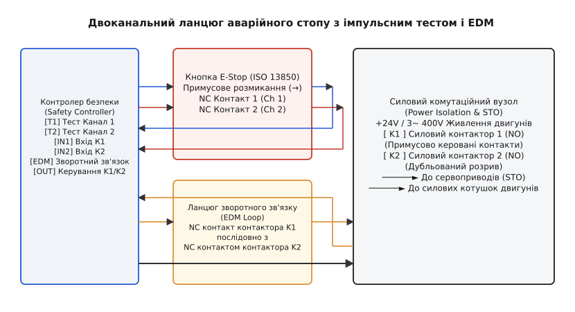
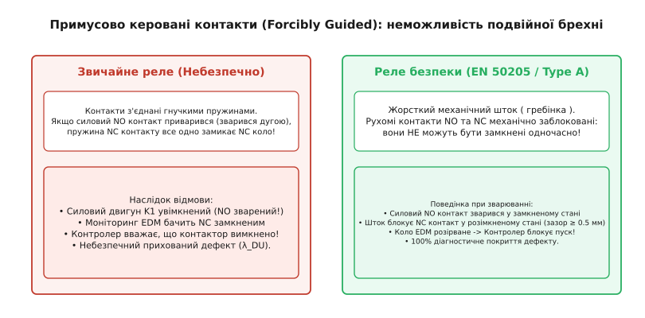
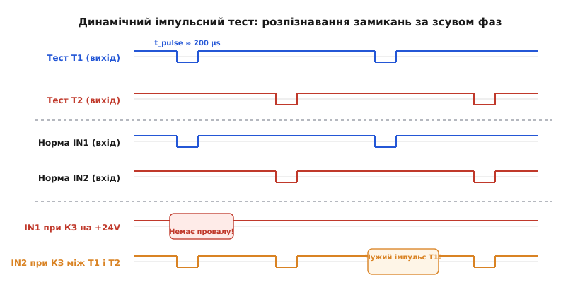
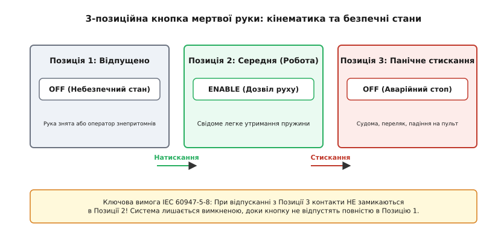

# Аварійний стоп і мертва рука

<preknowlist>
- [Функційна безпека: огляд стандартів](root:embedded/functional-safety-overview) — архітектурні категорії (Cat 1–4), рівні повноти безпеки (SIL / PL) та поділ відмов на випадкові й систематичні.
- [FMEA у вбудованих системах](root:embedded/fmea-embedded) — аналіз режимів відмов «що зламається → наслідок», моделювання залипання контактів і коротких замикань ліній.
- [Апарат, який рушив сам](root:embedded/aparat-iakyi-rushyv-sam) — чому пробій силового ключа чи апаратне зависання ядра призводить до некерованого обертання приводу.
- [Дуга на реле й снабер](root:hw-components/arc-suppression) — фізика зварювання контактів при комутації індуктивних навантажень та необхідність демпфування.
- [Сторожовий таймер](root:sf-devices/watchdog) — межі можливостей програмного нагляду й необхідність апаратного знеструмлення при фатальних збоях.
</preknowlist>

Фрезерний шпиндель потужністю 5.5 кВт на швидкості 18 000 об/хв захоплює рукав оператора. Людина б'є долонею по червоному грибку аварійного стопу. Кнопка підключена до одного виводу GPIO мікроконтролера через підтягувальний резистор. Проте за дві мілісекунди до натискання в ядрі мікроконтролера через стрибок напруги стався збій пам'яті, процесор перейшов у `HardFault_Handler` із забороненими перериваннями (`__disable_irq()`), або металевий пил замкнув сигнальну доріжку на шину +3.3 В. Програма не отримала переривання, таймер ШІМ продовжує видавати імпульси на затвори силових транзисторів, і мотор не зупиняється. Ця ситуація ілюструє головну аксіому промислової автоматики: **програмна логіка загального призначення неспроможна гарантувати безпеку там, де відмова загрожує життю**.

Аварійний стоп (англ. *Emergency Stop*, E-Stop) і пристрої контролю присутності — «мертва рука» (англ. *Dead Man's Switch*, *Enabling Device*) — проектуються як апаратно замкнені контури знеструмлення. Їхнє завдання — гарантовано перевести виконавчі механізми в безпечний стан, навіть якщо мікроконтролер повністю згорів, прошивка зависла, сигнальний кабель перебито або замкнуто на стороннє джерело напруги.

## Стандарти безпеки та архітектурні рівні зупинки

Міжнародні стандарти IEC 60204-1 (безпека машин, електрообладнання), ISO 13850 (функція аварійного стопу) та ISO 13849-1 (елементи систем керування, пов'язані з безпекою) визначають функцію аварійної зупинки не як звичайну команду вимкнення, а як безумовний пріоритет над усіма робочими режимами.

Стандарт IEC 60204-1 класифікує зупинку обладнання за трьома категоріями:

1. **Категорія зупинки 0 (Stop Category 0):** Некерована зупинка шляхом негайного знеструмлення приводів машини. Електромеханічні контактори розривають ланцюг живлення або активується вхід апаратного блокування затворів (англ. *Safe Torque Off*, STO). Двигун зупиняється за рахунок власного тертя, механічного гальма або вільного вибігу.
2. **Категорія зупинки 1 (Stop Category 1):** Керована зупинка зі збереженням енергії на приводах. Сервопідсилювач активно гальмує двигун (рекуперативне гальмування чи динамічне закорочування обмоток) за мінімальний час, після чого живлення знімається автоматично за таймером або за сигналом нульової швидкості (перехід у Категорію 0). Цей режим потрібен для важких маховиків, пилок чи центрифуг, де вільний вибіг тривав би хвилини, а кероване гальмування зупиняє вал за пів секунди.
3. **Категорія зупинки 2 (Stop Category 2):** Керована зупинка, при якій живлення з приводів не знімається, а замкнений контур регулювання утримує нульову позицію чи швидкість (англ. *Safe Operating Stop*, SOS).

За стандартом ISO 13850 аварійний стоп має реалізовувати **виключно Категорію 0 або Категорію 1**. Застосування Категорії 2 для аварійного стопу прямо заборонено: при збої системи позиціонування мотор може розвинути повний крутний момент.

> 🔧 **Навіщо це.** Якщо система повинна відповідати категоріям надійності Cat 3 або Cat 4 за ISO 13849-1 (еквівалент SIL 2 / SIL 3 за IEC 62061), вона зобов'язана мати апаратну відмовостійкість HFT = 1 (англ. *Hardware Fault Tolerance*). Це означає: **жодна одинична відмова** (обрив проводу, замикання на живлення, залипання контакту реле, відмова виводу МК) не повинна призводити до втрати захисної функції, а в Категорії 4 накопичення прихованих дефектів також не має блокувати зупинку.

Фундаментальний принцип побудови таких систем — **робота на знеструмлення** (англ. *de-energize to trip* або *fail-safe*). У робочому стані струм безперервно тече через захисний контур, утримуючи реле безпеки під напругою. Будь-який розрив — фізичне натискання кнопки, падіння напруги живлення, перебитий дріт — автоматично розмикає силові контактори під дією зворотних пружин.

```
Клас зупинки       Механізм дії                    Стан живлення приводу
─────────────────────────────────────────────────────────────────────────
Категорія 0        Миттєве знеструмлення           Повністю відключено
Категорія 1        Кероване гальмування → вимк     Знеструмлення після зупинки
Категорія 2        Активне утримання позиції       Під напругою (НЕ для E-Stop)
```

## Електромеханіка E-Stop: примусове розмикання та реле безпеки

Звичайна кнопка без фіксації або стандартний тумблер неприпустимі як аварійний орган. Кнопка аварійного стопу (грибок) за стандартом IEC 60947-5-5 має червоний колір на жовтому тлі, грибоподібну форму, механічну фіксацію в натиснутому стані (скидання лише поворотом або ключем) та контакти з **примусовим механічним розмиканням** (англ. *positive opening operation* за IEC 60947-5-1, маркуються міжнародним символом стрілки в колі `(→)`).

У звичайних кнопках контакти розмикаються пружиною. Якщо через імпульсний струм заряду конденсаторів або коротке замикання контакти зварилися (утворився металевий місток розплавленого срібла), сили внутрішньої пружини недостатньо для розриву. Кнопка з примусовим розмиканням влаштована так, що натискання на грибок передає зусилля руки безпосередньо на контактну групу через жорсткий шток: сила натискання оператора фізично зрізає зварені мікроконтакти.


*Повна схема безпечного вимкнення за стандартами Cat 4 / SIL 3. Два незалежні нормально замкнені канали опитуються імпульсними тестовими виходами T1/T2. Силовий розрив здійснюється двома послідовними контакторами K1 та K2, а їхні додаткові NC-контакти утворюють петлю моніторингу EDM.*

Для досягнення Cat 4 кнопка аварійного стопу містить **два незалежні нормально замкнені контакти (2×NC)**. Опитування цих контактів здійснюється або спеціалізованим реле безпеки (англ. *Safety Relay*), або подвійним безпечним мікроконтролером (2oo2 — 2 out of 2 architecture).

### Примусово керовані контакти (EN 50205 / IEC 61810-3)

Чому не можна комутувати навантаження звичайним промисловим реле? У звичайному реле рухомі язички контактів NO (нормально розімкнені) та NC (нормально замкнені) з'єднані гнучкими струмопровідними пластинами. Якщо контакт NO зварився у замкненому стані, при знятті напруги з котушки NC контакт під дією своєї пружини все одно замкнеться. Якщо система намагається діагностувати стан реле за його NC-контактом, вона отримає хибний сигнал: «реле вимкнено», тоді як силовий контакт NO продовжує подавати 400 В на двигун.

У реле безпеки застосовуються **примусово керовані контакти** (англ. *forcibly guided contacts*, за стандартом EN 50205 — контакти типу A). Усі рухомі контакти механічно зафіксовані в єдиному жорсткому ізоляційному гребінці (штоку):

- Якщо хоча б один NO контакт зварився у замкненому положенні, шток фізично блокується й **не дає жодному NC контакту замкнутися** при знеструмленні котушки. Мінімальний повітряний зазор між розімкненими NC контактами гарантовано становить не менше 0.5 мм.
- Якщо зварився NC контакт, жоден NO контакт не зможе замкнутися при подачі живлення на котушку.


*Механічне блокування контактів у реле безпеки: при зварюванні силового NO контакту жорсткий шток блокує діагностичний NC контакт у розімкненому стані, виключаючи приховану відмову зворотного зв'язку.*

### Моніторинг зовнішніх пристроїв (EDM — External Device Monitoring)

Силовий розрив трифазної мережі чи шини живлення двигунів виконується двома послідовно з'єднаними контакторами (K1 і K2). Обидва контактори оснащуються додатковими дзеркальними NC-контактами з примусовим веденням (англ. *mirror contacts* за IEC 60947-4-1).

Ці додаткові NC контакти з'єднуються послідовно і підключаються до діагностичного входу контролера безпеки — ланцюга EDM (або ланцюга скидання/зворотного зв'язку):

1. **Перед запуском:** Контактори K1 і K2 знеструмлені. Їхні силові NO контакти розімкнені, а діагностичні NC контакти замкнені. Ланцюг EDM замкнений. Контролер бачить логічну одиницю на вході EDM і дозволяє подати сигнал запуску.
2. **Під час роботи:** Контролер подає струм на котушки K1 і K2. Силові NO контакти замикаються, NC контакти розмикаються. Ланцюг EDM переходить у стан «розімкнено» (0).
3. **Виявлення аварійного зварювання:** При аварійному стопі котушки K1 і K2 знеструмлюються. Якщо контакти контактора K1 приварилися через дугу, його NC контакт не зможе замкнутися. Контактор K2 успішно розриває живлення двигуна (захист спрацював завдяки резервуванню HFT = 1). Але коли оператор відіжме кнопку E-Stop і спробує перезапустити систему, ланцюг EDM залишиться розімкненим. Контролер зафіксує несправність контактора K1 і заблокує повторний пуск машини до проведення технічного обслуговування.

## Динамічний імпульсний моніторинг цілісності ліній (Pulse Testing)

У реальних виробничих умовах кабельні траси прокладаються у гнучких кабель-каналах, зазнають вібрації, тертя, впливу мастил і металевої стружки. Статичне зчитування логічних рівнів (+24 В / 0 В) на входах контролера має три критичні вразливості:

1. **Коротке замикання на живлення (Short to +24V):** Якщо сигнальний провід перетерся і торкнувся сусідньої шини +24 В, на вході контролера постійно присутній високий рівень. Натискання кнопки E-Stop розімкне контакти, але струм від шини живлення продовжуватиме надходити на вхід контролера. Система «осліпне».
2. **Коротке замикання на землю (Short to GND):** Призводить до хибного спрацьовування (перехід у безпечний стан), що не створює прямої загрози, але блокує роботу.
3. **Міжканальне замикання (Cross-circuit fault):** Якщо провід каналу 1 закоротився на провід каналу 2, то при розмиканні контакту 1 (наприклад, через механічний перекіс кнопки чи обрив) напруга з каналу 2 потрапляє у канал 1. Контролер бачить замкнений стан і втрачає здатність виявити відмову одного з каналів.

Для захисту від цих дефектів застосовується **динамічне тестування імпульсами** (англ. *Pulse Testing* або *Clocked Test Outputs*).


*Часові діаграми імпульсного тестування. Тестові виходи T1 і T2 генерують короткі стробувальні імпульси (провали напруги тривалістю ~200 мкс) зі зсувом фаз. Коротке замикання на +24 В або між каналами миттєво спотворює імпульсний малюнок на входах.*

### Механізм роботи імпульсного тесту

Замість підключення контактів кнопки до постійної напруги +24 В, контролер безпеки живить кожен канал від власного програмованого тестового виходу: Канал 1 живиться від виходу `T1`, а Канал 2 — від виходу `T2`.

1. Виходи `T1` і `T2` постійно утримують високий рівень напруги (+24 В), але періодично з інтервалом `T_test` (зазвичай 10–50 мс) генерують короткочасний тестовий провал напруги в нуль тривалістю `t_pulse` (100–500 мкс).
2. Імпульси `T1` та `T2` формуються зі **зсувом фази**: коли `T1` падає в нуль, `T2` знаходиться на високому рівні, і навпаки. Одночасна генерація імпульсів суворо заборонена.
3. Вхідні каскади `IN1` та `IN2` контролера мають цифрові приймачі, які синхронізовані з генератором імпульсів і перевіряють форму сигналу:

- **Нормальний стан:** На вході `IN1` спостерігається постійна напруга з періодичними провалами, що точно збігаються з імпульсами виходу `T1`. На `IN2` спостерігаються провали, синхронні з `T2`.
- **Замикання на +24 В:** Коли `T1` формує провал у нуль, напруга на вході `IN1` не падає нижче порогу логічної одиниці, оскільки струм підживлюється від місця замикання. Контролер фіксує відсутність тестового імпульсу протягом кількох мікросекунд і негайно переходить в аварійний стан.
- **Міжканальне замикання (Ch1 ↔ Ch2):** Коли `T1` формує нульовий імпульс, високий рівень із лінії `T2` через місце замикання підтримує напругу на `IN1`. Крім того, коли `T2` формує свій імпульс, він з'являється одночасно і на `IN1`, і на `IN2`. Контролер бачить «чужі» імпульси на каналах і за частки мілісекунди фіксує міжканальне замикання.

Чому механічні реле не вимикаються під час тестових імпульсів? Механічна інерція котушок та якорів контакторів має постійну часу відпускання `τ` у діапазоні 10–30 мс, а вхідні кола оснащуються невеликими RC-фільтрами. Провал напруги тривалістю 200 мкс відфільтровується силовими котушками, але надійно фіксується швидкодіючим компаратором мікроконтролера.

### Контроль дискордансу (Discrepancy Time Monitoring)

При натисканні або відпусканні дводіапазонної кнопки контакти ніколи не перемикаються в одну й ту саму наносекунду через механічні допуски й брязкіт контактів. Контролер безпеки впроваджує вікно розбіжності — **час дискордансу** (англ. *discrepancy time*, `t_disc`, зазвичай 50–200 мс):

- Якщо один контакт розімкнувся, а другий залишається замкненим: контролер запускає таймер дискордансу і негайно вимикає силові виходи (безпека не чекає).
- Якщо другий контакт розмикається до спливу `t_disc`, подія класифікується як штатне натискання E-Stop.
- Якщо час `t_disc` вичерпано, а другий контакт так і не змінив стан: контролер реєструє фатальну апаратну помилку розбіжності каналів (англ. *Discordance Fault*), блокує перезапуск і вимагає втручання персоналу для перевірки проводки або заміни блоку контактів.

## Кнопка мертвої руки: 3-позиційні перемикачі та захист від обходу

Під час налагодження робототехнічних комплексів, сервісного обслуговування ЧПК-верстатів чи керування потягами оператор змушений перебувати безпосередньо в небезпечній зоні з увімкненими приводами (режим ручного навчання, англ. *Teach Mode*). У цій ситуації кнопка аварійного стопу на стаціонарному пульті недосяжна, а реакція людини уповільнена. Для захисту персоналу застосовується орган ручного підтвердження присутності — **кнопка мертвої руки** (англ. *Dead Man's Switch*, *Enabling Device* або *Vigilance Device*).


*Кінематика трипозиційного перемикача дозволу. Дозвіл руху формується лише в проміжній Позиції 2. Панічне стискання (Позиція 3) аварійно блокує систему, а зворотний рух у Позицію 1 не викликає повторного вмикання.*

### Фізіологія панічного рефлексу та 3-позиційний механізм

Ранні системи мертвої руки використовували звичайну кнопку: натиснув — машина рухається, відпустив — зупинилася (2-позиційна кнопка: OFF-ON). Експлуатація виявила смертельний дефект такої конструкції: **людський рефлекс паніки та судом**.

Коли людина стикається з раптовою небезпекою (маніпулятор робота рухається в її бік, удар електричним струмом або втрата свідомості під час падіння), м'язи кисті рефлекторно стискаються в кулак (тетанічний спазм). Оператор мертвою хваткою затискає 2-позиційну кнопку, і некерований верстат продовжує рух, наносячи травму.

Для вирішення цієї проблеми стандарт IEC 60947-5-8 встановлює вимоги до **3-позиційних перемикачів дозволу** (англ. *3-position enabling switches*):

1. **Позиція 1 (Відпущено / Released):** Кнопка не натиснута. Силовий ланцюг розімкнено (OFF). Безпечний стан при втраті свідомості чи випаданні пульта з рук.
2. **Позиція 2 (Робоче положення / Mid-point / Enabled):** Кнопка плавно натиснута до чіткого тактильного клацання і утримується з помірним зусиллям (зазвичай 8–15 Н). Ланцюг безпеки замкнено (ON). Приводи дозволено активувати додатковими кнопками переміщення (JOG).
3. **Позиція 3 (Панічне стискання / Fully Pressed):** Кнопка продавлена із зусиллям (> 25–30 Н) до упору. Контакти примусово розмикаються (OFF), активується негайна зупинка Категорії 0.

> ⚠️ **Критична вимога кінематики IEC 60947-5-8:** При відпусканні кнопки з Позиції 3 (коли оператор оговтався і розтискає руку) контакти **не повинні замикатися під час зворотного проходження через Позицію 2!** Внутрішній храповий або кулісний механізм розмикає ланцюг у Позиції 3 і тримає його розімкненим увесь шлях назад, доки кнопка повністю не повернеться у вихідну Позицію 1. Лише після повного повернення в Позицію 1 механізм зводиться наново і дозволяє увімкнення при повторному натисканні.

### Циклічний контроль пильності (Vigilance Monitoring)

Ще одна поширена проблема пристроїв мертвої руки — спроби операторів обійти систему: заклинити педаль цеглиною, перетягнути ручний перемикач ізоляційною стрічкою або стяжкою.

Для запобігання несанкціонованому блокуванню в залізничному транспорті, важких кар'єрних самоскидах та автоматизованих кранах впроваджується **циклічний контроль пильності** (англ. *Cyclic Vigilance Device*):

```
Стан спокою        Оптичний сигнал         Звуковий сигнал        Аварійне гальмування
(T_cycle = 30-60 с)  (T_warn = 2.5 с)        (T_alarm = 2.5 с)      (Категорія 0 / Stop)
───────────────────►───────────────────────►──────────────────────►────────────────────►
    Оператор не        Блимає лампа           Вмикається зумер       Знеструмлення
    робить дій         на панелі              90 дБ                  тягових двигунів
```

1. **Динамічний контроль фронтів (Edge Detection):** Система не сприймає постійний високий логічний рівень як доказ присутності людини. Контролер вимагає періодичної зміни стану (перепадів `0 → 1 → 0` або натискання додаткової кнопки підтвердження). Якщо контакт залишається замкненим довше встановленого інтервалу (наприклад, понад 60 секунд без жодного руху маніпулятора чи перемикання), система вважає, що пристрій заблоковано штучно, і зупиняє механізм.
2. **Адаптивний часовий цикл:** Якщо протягом робочого інтервалу `T_cycle` (30–60 с) оператор взаємодіє з основними органами керування (рухає джойстик, перемикає швидкості, крутить штурвал), таймер пильності автоматично перезапускається.
3. **Ескалація тривоги:** Якщо керуючих дій не було, система вмикає світловий сигнал на панелі (тривалість `T_warn` ≈ 2.5 с). Якщо оператор натиснув кнопку підтвердження — таймер скидається. Якщо реакції немає — додається гучний звуковий сигнал (`T_alarm` ≈ 2.5 с). Відсутність підтвердження після сигналу тривоги ініціює аварійне знеструмлення і накладання пневматичних гальм.

## Драйвер контролю аварійних ланцюгів на C та C++

Нижче наведено промисловий модуль діагностики аварійного стопу та 3-позиційної кнопки мертвої руки. Модуль реалізує:
- генерацію тестових імпульсів зі зсувом фаз для двох каналів;
- розпізнавання замикань на живлення та міжканальних замикань;
- фільтрацію брязкоту контактів і контроль часу дискордансу;
- кінцевий автомат захисту з перевіркою петлі EDM перед повторним запуском;
- контроль циклічної активності кнопки мертвої руки з захистом від затискання.

:::tabs
:::code avariinyi-stop-i-mertva-ruka-d/c/estop_channels.c
:::code avariinyi-stop-i-mertva-ruka-d/cpp/channel_monitor.cpp
:::

:::tabs
:::code avariinyi-stop-i-mertva-ruka-d/c/deadman.c
:::code avariinyi-stop-i-mertva-ruka-d/cpp/enabling_device.cpp
:::

:::tabs
:::code avariinyi-stop-i-mertva-ruka-d/c/safety.c
:::code avariinyi-stop-i-mertva-ruka-d/cpp/supervisor.cpp
:::

:::tabs
:::code avariinyi-stop-i-mertva-ruka-d/c/main.c
:::code avariinyi-stop-i-mertva-ruka-d/cpp/main.cpp
:::

## Інженерний контрольний список проектування ланцюгів безпеки

При розробці та аудиті апаратних систем аварійного знеструмлення використовується контрольний чекліст відповідності вимогам стандартів ISO 13849 та IEC 60204-1:

1. **Орган аварійної зупинки:**
   - [ ] Застосовано кнопку з механічною фіксацією грибоподібної форми (червоний грибок на жовтому фоні).
   - [ ] Контактні блоки мають пряме примусове розмикання з маркуванням `(→)`.
   - [ ] Використано мінімум два незалежні нормально замкнені контакти (2×NC).
2. **Комутація живлення:**
   - [ ] Застосовано два послідовні силові контактори (K1, K2) або сертифікований модуль STO.
   - [ ] Контактори мають релейні примусово керовані NC-контакти (EN 50205 Type A) для ланцюга EDM.
   - [ ] Передбачено захисні RC-снабери або варистори паралельно індуктивним котушкам для виключення зварювання контактів дугою ([демпфування дуги](root:hw-components/arc-suppression)).
3. **Діагностика ліній:**
   - [ ] Канали E-Stop живляться від незалежних фазозсунутих тестових генераторів імпульсів (Pulse Testing).
   - [ ] Контролер виявляє міжканальні замикання та замикання на шину живлення швидше ніж за 10 мс.
   - [ ] Налаштовано контроль часу дискордансу контактів (50–100 мс) із фатальним блокуванням при розбіжності.
4. **Контроль присутності (Мертва рука):**
   - [ ] Застосовано 3-позиційний перемикач (OFF-ON-OFF) за IEC 60947-5-8.
   - [ ] Кінематика унеможливлює активацію Позиції 2 при відпусканні з Позиції 3 (паніка).
   - [ ] Реалізовано таймер циклічної пильності з вимогою перепадів рівнів для захисту від блокування стяжками.
