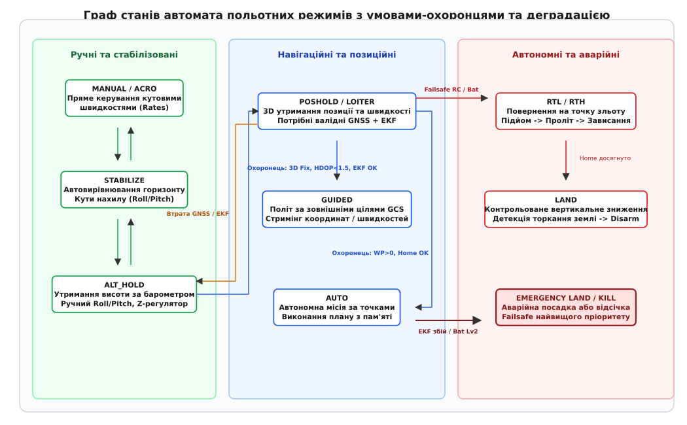
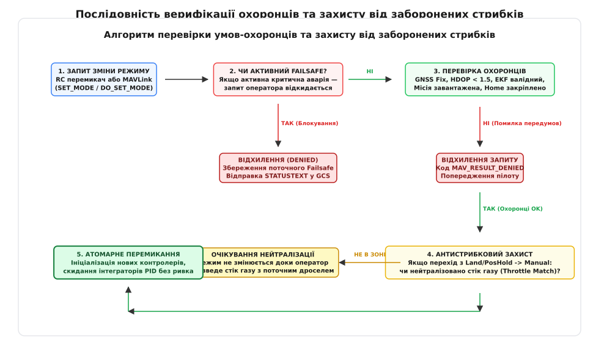
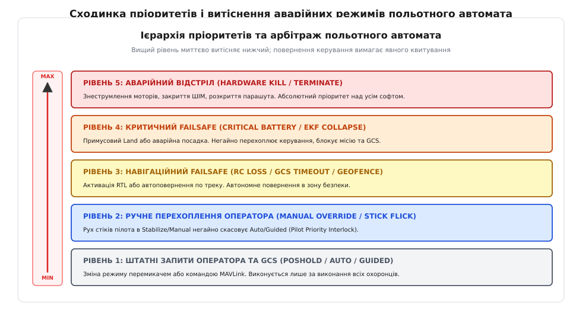

# Автомат режимів: переходи, охоронці, заборонені стрибки

<preknowlist>
- [Ручні режими](root:sys-dron/manual-stabilized-modes) — відмінності між прямим керуванням кутовими швидкостями, автогоризонтом та утриманням висоти.
- [Режими з позицією](root:sys-dron/position-modes) — побудова каскадних контурів регулювання швидкості й координат за супутниковими та інерційними даними.
- [Команди MAVLink](root:embedded/mavlink-commands) — транспорт і протокол запиту зміни польотного режиму через команди SET_MODE та COMMAND_LONG.
- [Failsafe](root:sys-dron/failsafe) — логіка реагування бортового автопілота на апаратні збої та втрату каналів зв'язку.
- [RC-лінк](root:sys-dron/rc-link) — передача позицій тумблерів вибору режиму та стіків керування з пульта оператора.
</preknowlist>

Політ мультиротора чи безпілотного літака — це безперервна взаємодія каскадних контурів зворотного зв'язку, де кожен вищий рівень автоматизації надбудовує власні регулятори над базовими контурами стабілізації. Якщо оператор перемикає трипозиційний тумблер на пульті з режиму стабілізації горизонту в режим утримання позиції, коли супутниковий приймач ще не зафіксував надійного просторового положення або розширений фільтр Калмана має розбіжність оцінки швидкості у кілька метрів на секунду, система не має права сліпо активувати навігаційний контур. Наївне перемикання прапорця стану призведе до того, що інтегратор позиційного PID-регулятора спробує миттєво скомпенсувати уявну помилку координат, видасть граничний кут нахилу в 45 градусів і кине апарат у землю на повній тязі. Щоб виключити катастрофічні стани, перемикання між алгоритмами керування довіряють не простим змінним, а детермінованому скінченному автомату польотних режимів (англ. *Flight Mode Finite State Machine*, FSM).

Автомат польотних режимів — це програмне ядро автопілота, яке визначає, які саме сенсори опитуються, які контури регулювання активні в поточну мілісекунду, звідки надходять цільові уставки (зі стіків пульта, від планувальника автономної місії чи від алгоритмів аварійного порятунку) і за яких умов дозволено змінити цей стан.

## Ієрархія режимів: від сирих кутових швидкостей до автономної навігації

Кожен польотний режим являє собою конкретну конфігурацію замкнених контурів регулювання. Усі режими можна розділити на три фундаментальні класи за ступенем автономності та вимогами до сенсорного забезпечення:

1. **Ручні та стабілізовані режими (Manual / Angular Control):**
   - `Manual / Acro` (акробатичний режим): найнижчий рівень програмного втручання. Стіки пульта напряму задають цільові кутові швидкості обертання навколо осей крену, тангажу та рискання (градуси за секунду). Працює виключно внутрішній контур демпфування кутових швидкостей (Rate PID) за даними гіроскопа. За відсутності впливу на стіки апарат зберігає поточний кутовий нахил, не намагаючись повернутися до горизонту.
   - `Stabilize` (автогоризонт): над контуром кутових швидкостей замикається зовнішній контур кутового положення (Attitude PID) за даними акселерометра та гіроскопа. Відхилення стіка задає цільовий кут нахилу (наприклад, до ±35°), а нейтральне положення стіка автоматично повертає апарат у горизонтальне положення. Вертикальний канал (тяга моторів) залишається під прямим пропорційним контролем ручки газу пілота.
   - `AltHold` (утримання висоти): над контуром стабілізації горизонту активується вертикальний регулятор положення (Z-axis PID). Висота та вертикальна швидкість оцінюються за даними барометра, вертикального каналу акселерометра або далекоміра (LiDAR / ультразвук). Нейтральне положення ручки газу (центральна мертва зона 40–60%) означає нульову вертикальну швидкість (утримання поточної висоти), а відхилення вгору або вниз задає швидкість підйому чи спуску (наприклад, ±2.5 м/с). Канали крену й тангажу залишаються в режимі `Stabilize`.

2. **Навігаційні та позиційні режими (Position / Velocity Control):**
   - `PosHold / Loiter` (утримання позиції): над контурами стабілізації горизонту та утримання висоти активуються горизонтальні регулятори швидкості та просторових координат (XY-axis PID). Для роботи режиму критично необхідні достовірні дані глобальної супутникової навігації (GNSS) або оптичного потоку (Optical Flow) у поєднанні з магнітометром та інерціальною системою. Нейтральні стіки переводять дрон у режим зависання в точці з активним протистоянням вітровому зносу; відхилення стіків транслюються у вектори горизонтальної швидкості польоту (м/с).
   - `Guided` (керований / напівавтономний): апарат утримує просторову орієнтацію та висоту самостійно, але цільові точки (Setpoints) або просторові вектори швидкостей надходять у реальному часі через зовнішні інтерфейси зв'язку — від наземної станції керування (GCS) або бортового супровідного комп'ютера (Companion Computer) за протоколом MAVLink.

3. **Автономні та аварійні режими (Autonomous / Failsafe):**
   - `Auto` (автономна місія): повний автономний політ за попередньо завантаженим у пам'ять польотного контролера списком навігаційних точок (Waypoints). Автопілот сам розраховує траєкторію, кутові швидкості, швидкість польоту та висоту, керуючи корисним навантаженням і виконуючи просторові маневри.
   - `RTL / RTH` (повернення додому, Return-To-Launch / Return-To-Home): автономна рятувальна процедура. Апарат піднімається на безпечну заздалегідь налаштовану висоту повернення (`RTL_ALT`, наприклад 30 метрів), розвертається за курсом до збереженої точки зльоту (`Home Position`), летить по прямій лінії або записаному зворотному треку, зависає над точкою ініціалізації та переходить у режим посадки.
   - `Land` (автоматична посадка): контрольований вертикальний спуск із фіксованою швидкістю (наприклад, 0.7 м/с біля землі). Спеціальний алгоритм детекції торкання землі (Land Detector) фіксує зупинку зниження за показниками барометра/акселерометра разом із падінням споживаного струму та автоматично знеструмлює мотори (Disarm).
   - `Emergency Land / Terminate` (аварійна посадка або відсічка): примусове зниження при відмові сенсорів навігації або аварійне вимкнення силової установки при катастрофічних руйнуваннях.


*Граф станів польотного автомата: горизонтальна ієрархія від сирих ручних режимів до автономних місій та аварійних процедур із виділеними переходами деградації*

З графа станів видно ключову закономірність: будь-який рух зліва направо (від ручних режимів до позиційних та автономних) підвищує вимоги до працездатності сенсорного стека і накладає суворі обмеження на можливість здійснення переходу.

## Умови-охоронці: математичний бар'єр перед зміною стану

Перехід між станами скінченного автомата не може відбуватися лише за фактом отримання сигналу зміни положення тумблера чи отримання мережевого пакету. Між подією запиту (Event) та безпосередньою зміною стану стоїть логічний предикат — **умова-охоронець** (англ. *Guard Condition*).

Умова-охоронець — це детермінована функція без побічних ефектів, яка аналізує поточний вектор стану системи (телеметрію, стан сенсорів, оцінки фільтра Калмана, наявність місії) і повертає булеве значення: `true`, якщо перехід безпечний і допустимий, або `false`, якщо умови не виконані.

```
                    ┌─────────────────────────┐
                    │  Поточний стан: AltHold │
                    └────────────┬────────────┘
                                 │
                 Подія: Запит переходу в PosHold
                                 │
                                 ▼
                    ┌─────────────────────────┐
                    │ Умова-охоронець guard() │
                    └────────────┬────────────┘
                                 │
               ┌─────────────────┴─────────────────┐
               │                                   │
      Умова виконана (true)              Умова провалена (false)
               │                                   │
               ▼                                   ▼
┌─────────────────────────────┐     ┌─────────────────────────────┐
│  Новий стан: PosHold        │     │  Збереження стану: AltHold  │
│  Атомарний запуск XY-PID    │     │  Генерація MAV_RESULT_DENIED│
└─────────────────────────────┘     └─────────────────────────────┘
```

Розглянемо параметричні критерії основних умов-охоронців, які застосовуються у промислових автопілотах (зокрема ArduPilot та PX4).

### 1. Охоронець переходу в PosHold / Loiter

Для активації утримання координат автопілот повинен гарантувати, що контур позиційного регулювання володіє достовірною абсолютною оцінкою положення у тривимірному просторі. Охоронець перевіряє такі умови:

- **Фіксація супутникового сигналу (GNSS Fix):** статус супутникового приймача повинен бути не нижчим за `3D Fix` (або `RTK Fixed/Float` для високоточних систем). Кількість захоплених супутників повинна задовольняти умові:

```
N_satellites ≥ 6
```

- **Геометричний фактор зниження точності (HDOP / VDOP):** горизонтальний фактор розмиття точності взаємного розташування супутників повинен бути в межах норми. При високому значенні HDOP навіть за наявності багатьох супутників похибка обчислення координат може сягати десятків метрів:

```
HDOP < 1.5
VDOP < 2.0
```

- **Сходження оцінок розширеного фільтра Калмана (EKF Innovations):** формальної наявності GPS-фіксу недостатньо — сам модуль GNSS може видавати зашумлені або запізнілі дані під час міських каньйонів чи супутникового дрейфу. Фільтр Калмана EKF обчислює нев'язку (інновацію) між інерціальним інтегруванням акселерометра та вимірами супутника. Математично нормалізований квадрат інновацій (Normalized Innovation Squared, NIS) визначається як:

```
NIS = y · S⁻¹ · y
```

де `y` — вектор нев'язки між вимірами GNSS та прогнозом моделі, а `S` — коваріаційна матриця інновації. Охоронець перевіряє, щоб нормалізовані інновації швидкості та положення перебували в допустимому гейті:

```
EKF_innov_pos_norm < 0.3
EKF_innov_vel_norm < 0.5
```

Якщо інновація перевищує 1.0, фільтр вважає виміри взаємно суперечливими (EKF Variance Glitch), і охоронець безумовно блокує перехід у `PosHold`.

- **Достовірність магнітометра (Compass Heading Healthy):** без знання точного кута курсу (Yaw) автопілот не здатний перетворити вектор зміщення в системі координат Північ-Схід (NED) у внутрішню систему координат апарата (Body Frame). Розбіжність між оцінкою компаса та гіроскопа повинна бути менше порогового значення (зазвичай < 15°).

### 2. Охоронець переходу в Auto

Автономний режим вимагає виконання всіх охоронців позиційного режиму (`PosHold`), а також додаткової перевірки стану місії:

- **Кількість точок місії:** навігаційний буфер повинен містити валідну польотну програму:

```
mission_items_count > 0
```

- **Контрольна сума та валідність плану:** список точок повинен бути верифікований за CRC, містити коректні висоти та досяжні координати в межах дозволеного радіуса польотів.
- **Фіксація точки повернення (Home Position Set):** точка зльоту мусить бути коректно зафіксована в оперативній пам'яті автопілота до переходу в автономний рух, щоб апарат мав можливість виконати аварійне повернення.

### 3. Охоронець переходу в Guided

- **Наявність живого джерела цілевказівок:** вік останнього отриманого пакету MAVLink з цільовою позицією (`SET_POSITION_TARGET_GLOBAL_INT` або `SET_POSITION_TARGET_LOCAL_NED`) або серцебиттям від бортового супровідного комп'ютера не повинен перевищувати тайм-аут:

```
t_now - t_last_guided_heartbeat < 1.0 s
```

- **EKF Status:** повна валідність просторових оцінок положення та швидкості.

### 4. Охоронець переходу в RTL

- **Наявність зафіксованої точки Home:** якщо точка старту не була зафіксована через відсутність GPS перед зльотом у ручному режимі, перехід у RTL неможливий (у цьому випадку охоронець відхиляє запит і перенаправляє автопілот у режим `Land`).
- **Стійкість навігації:** наявність робочого горизонтального оцінювача положення.

### Протокол поведінки при відхиленні переходу

Якщо оператор або автоматика надсилає команду зміни режиму, але відповідна умова-охоронець повертає `false`:

1. **Атомарність відмови:** поточний режим залишається незмінним. Не відбувається жодного переривання поточної генерації керуючих сигналів на виконавчі механізми (ESC / сервоприводи).
2. **MAVLink-квитування:** на команду `COMMAND_LONG (MAV_CMD_DO_SET_MODE)` станції повертається пакет `COMMAND_ACK` із кодом результату `MAV_RESULT_DENIED` або `MAV_RESULT_FAILED`.
3. **Текстова діагностика:** у канал телеметрії негайно відправляється високопріоритетне інформаційне повідомлення `STATUSTEXT` із зазначенням точної причини блокування, наприклад:
   - `Mode change failed: PosHold requires 3D Fix & HDOP < 1.5`
   - `Mode change failed: Auto requires loaded mission`
   - `Mode change failed: RTL requires Home position`

## Заборонені та неприпустимі переходи

Окрім перевірки наявності сенсорних даних, автомат польотних режимів повинен гарантувати захист від несумісних динамічних стрибків та людських помилок у критичні фази польоту.

```
       ┌──────────────────────────────┐
       │     Заборонений перехід      │
       │    Land ───► Manual (Acro)   │
       │  (при спущеному стіку газу)  │
       └──────────────┬───────────────┘
                      │
                      ▼
     Стрибок сигналу тяги PWM: 48% ──► 0%
                      │
                      ▼
      Миттєва втрата підйомної сили,
     перекидання та некероване падіння!
```

### Динамічний стрибок газу (Throttle Jump Disaster)

У режимах `AltHold`, `PosHold`, `Auto` або `Land` керування вертикальною тягою здійснюється автоматичним Z-регулятором. Для утримання сталої висоти або контрольованого спуску регулятор підтримує шпаруватість сигналів двигунів, близьку до точки висіння (наприклад, 45–55% тяги).

При цьому положення фізичного стіка газу на пульті оператора може перебувати в довільній точці: наприклад, під час автоматичної посадки (`Land`) пілоти часто за звичкою скидають ручку газу в крайнє нижнє положення (0%).

Якщо в цей момент оператор помилково або навмисно перемкне тумблер у режим прямого керування `Manual / Acro`, де вихідна тяга моторів жорстко прив'язана до положення стіка, станеться наступне:

1. Z-регулятор миттєво вимикається.
2. Значення тяги на моторах стрибкоподібно падає з 48% до 0% за 2–4 мілісекунди (один цикл розрахунку контуру).
3. Пропелери втрачають оберти, дрон втрачає стабілізуючий момент, перекидається і розбивається об землю за частки секунди.

Аналогічно, якщо стік перебував у положенні 100%, перехід у `Manual` викликає вибуховий стрибок тяги, який може вивести апарат на закритичні швидкості або спалити силові ключі регуляторів швидкості (ESC).

### Захисні інтерлоки: узгодження заслінки газу (Throttle Interlock)

Щоб унеможливити подібний сценарій, у FSM закладається механізм блокування переходу за рівнем газу (**Throttle Matching Guard**):

- Перехід з будь-якого режиму з автоматичним утриманням висоти (`AltHold`, `PosHold`, `Auto`, `Guided`, `Land`) у режим прямого керування тягою (`Manual`, `Stabilize`, `Acro`) блокується доти, доки фізичне положення стіка газу на пульті не потрапить у зону узгодження з поточним віртуальним дроселем:

```
|Stick_Throttle - Current_Auto_Throttle| ≤ Throttle_Deadband
```

де `Throttle_Deadband` зазвичай обирається в діапазоні 0.10–0.15 (10–15% шкали).

- Поки оператор не зведе ручку у відповідну позицію, автопілот ігнорує запит тумблера, видає звуковий сигнал зумера, сповіщення на екран наземної станції і залишається в поточному автоматичному стабілізованому режимі.
- Додатково в системі реалізується алгоритм обмеження швидкості наростання сигналу тяги (**Throttle Slew Rate Limiter**), який усуває східчасті стрибки навіть після проходження охоронця.

### Блокування випадкового роззброєння в польоті (In-Flight Disarm Prevention)

У стані польоту перехід автомата з підсистеми `Armed` у `Disarmed` (повна зупинка генерації сигналів керування моторами) суворо заборонений:

- Будь-які комбінації стіків роззброєння (наприклад, стік газу вниз і рудер ліворуч) ігноруються FSM, якщо детектор польоту (`In-Air Detector`) сигналізує, що апарат перебуває у повітрі.
- Детектор польоту аналізує інтегральну динаміку: перевищення висоти над точкою старту (> 1.5 м), швидкість обертання двигунів вище холостого ходу та наявність ненульових прискорень відриву.
- Єдиним винятком є виділений апаратний тумблер аварійної відсічки (**Emergency Kill Switch**), який функціонує в обхід софтового автомата польотних режимів на рівні апаратного таймера або мікроконтролера захисту введення-виведення (I/O Co-processor).


*Алгоритм перевірки: відхилення аварійних запитів, перевірка параметричних охоронців та блокування заслінки газу перед зміною стану*

## Детектор посадки (Land Detector) і завершення автономного циклу

Окремою критичною фазою роботи автомата є фінал польоту в режимах `Land` та `RTL`. Автопілот не може просто вимкнути мотори на заданій висоті за барометром, оскільки зміна атмосферного тиску під час польоту або завихрення повітряного потоку під пропелерами біля самої землі (ефект екрана, Ground Effect) створюють похибку висоти у 1–3 метри.

Вимкнення моторів на висоті 1.5 метра призведе до жорсткого удару об землю і пошкодження рами. Навпаки, спроба продовжувати спуск після фактичного торкання землі призведе до того, що регулятор крену й тангажу спробує вирівняти дрон, опершись пропелерами об ґрунт, накопичить інтегральну помилку I-терма і перекине апарат.

Щоб вийти з цієї дилеми, FSM містить внутрішній трирівневий детектор посадки:

1. **Фаза зниження (Descent):** вертикальна швидкість стабілізується на рівні `LAND_SPEED` (0.5–0.7 м/с).
2. **Фаза контакту з поверхнею (Ground Contact):**
   - Вертикальна швидкість наближається до нуля: `|Vz| < 0.2 м/с`.
   - Вихід Z-регулятора тяги падає до мінімального порогу `LAND_THR_MIN` (15–20% від тяги висіння), оскільки апарат більше не просідає.
   - Дисперсія акселерометра по осі Z падає нижче порогу вібрацій.
   - Стан фіксується таймером витримки (Debounce Timer, тривалість 1.0 с).
3. **Фаза остаточної посадки (Landed):**
   - Усі три умови утримуються стабільно протягом 1.5–2.0 секунд.
   - Автомат переводить двигуни на мінімальний холостий хід (Spin When Armed).
   - FSM відправляє подію `EVENT_DISARM`, мотори повністю зупиняються, а поточний режим перемикається в безпечний стан очікування на землі.

## Пріоритети аварійних режимів: витіснення та каскадна деградація

Коли на борту виникає аварійна ситуація (розряджання батареї нижче критичного рівня, втрата зв'язку з пультом, збій супутникової навігації під час виконання автономної місії), рішення про вибір режиму більше не може залежати від оператора чи поточної місії. FSM повинен реалізувати механізм **пріоритетного витіснення** (англ. *Failsafe Preemption*).

### Сходинка пріоритетів (Preemption Hierarchy)

Усі джерела запитів на зміну режиму поділяються на 5 рівнів пріоритету:

```
╔═══════════════════════════════════════════════════════════════════════════════╗
║ Рівень 5 (Абсолютний): Hardware Kill / Emergency Terminate                   ║
║ Знеструмлення двигунів, відстріл піропатрона парашута.                        ║
╠═══════════════════════════════════════════════════════════════════════════════╣
║ Рівень 4 (Критичний Failsafe): Battery Stage 2 / Critical EKF Crash           ║
║ Примусовий Land або керований спуск. Блокує всі команди оператора та місію.   ║
╠═══════════════════════════════════════════════════════════════════════════════╣
║ Рівень 3 (Навігаційний Failsafe): RC Loss / GCS Loss / Geofence Breach        ║
║ Активація RTL або повернення по треку. Може бути перехоплений пілотом.       ║
╠═══════════════════════════════════════════════════════════════════════════════╣
║ Рівень 2 (Ручне перехоплення пілота): Pilot Stick Override                   ║
║ Рух стіків у Stabilize негайно скасовує Auto/Guided (пріоритет людини).      ║
╠═══════════════════════════════════════════════════════════════════════════════╣
║ Рівень 1 (Штатні запити): RC Switch / MAVLink Mode Change                     ║
║ Звичайне перемикання оператором, вимагає виконання всіх охоронців.            ║
╚═══════════════════════════════════════════════════════════════════════════════╝
```

Якщо активується умова вищого рівня, автомат польотних режимів негайно призупиняє поточний режим і переводить апарат у відповідний захисний стан:

1. **Критичне розряджання акумулятора (Battery Failsafe Stage 2):** якщо напруга на комірці падає нижче 3.3 В під навантаженням або розрахований залишковий заряд падає нижче 10%, FSM негайно витісняє поточний режим `Auto` чи `PosHold` і переходить у `Land`. Будь-які спроби перемкнути режим назад в `Auto` блокуються.
2. **Втрата сигналу радіокерування (RC Failsafe):** якщо приймач не отримує валідних пакетів довше порогового часу (наприклад, 1.5 секунди), активується Failsafe рівня 3 (`RTL`). Якщо водночас відсутній GPS-фікс, FSM каскадно переводить дрон у режим `Land` або утримання висоти зі спуском.


*Сходинка арбітражу польотного автомата: вищі рівні безумовно блокують виконання нижчих запитів*

### Каскадна деградація (Graceful Degradation)

Що відбувається, коли відмова сенсорів стається прямо під час польоту у високорівневому режимі?

Припустимо, апарат виконує місію в режимі `Auto` або завис у точці в режимі `PosHold`. Раптово супутниковий приймач зазнає радіозавад: кількість супутників падає до 3, інновації EKF виходять за межі допустимого. Залишатися в `Auto` чи `PosHold` неможливо — регулятор положення позбавлений зворотного зв'язку. Переходити в `Manual` смертельно небезпечно.

FSM запускає алгоритм **керованої каскадної деградації**:

```
[Політ у режимі AUTO / POSHOLD]
             │
             ▼ (Втрата GNSS Fix / Збій EKF)
[Деградація до режиму ALT_HOLD]
- Вимикаються XY-PID регулятори
- Залишається активним Z-баро регулятор
- Повна стабілізація кутів горизонту
- Звуковий сигнал тривоги та сповіщення GCS
             │
             ▼ (Відмова барометра / LiDAR)
[Деградація до режиму STABILIZE]
- Перехід на ручне керування тягою
- Збереження автогоризонту за IMU
             │
             ▼ (Повна відмова IMU)
[Аварійне розкриття парашута / Апаратна відсічка]
```

Автомат не панікує і не скидає керування в нуль, а покроково спускається на той рівень ієрархії, сенсорне забезпечення якого залишається повністю працездатним.

## Повна реалізація відмовостійкого автомата польотних режимів

Нижче наведено промисловий варіант реалізації відмовостійкого автомата польотних режимів. Код містить повну структуру перевірки сенсорного стану, логіку умов-охоронців, алгоритм детекції посадки (Land Detector), механізм пріоритетного витіснення аварійними режимами та захист від стрибків газу.

:::tabs
:::code avtomat-rezhymiv-d/c/fsm.c
:::code avtomat-rezhymiv-d/cpp/src/fsm.cpp
:::

## Зміна режимів без удару по регуляторах: безривковий перехід

Фіксація нового стану всередині скінченного автомата — це лише половина завдання. У момент, коли змінна стану перемикається, наприклад, з `Stabilize` на `AltHold`, внутрішні контролери системи не повинні викликати ривка виконавчих механізмів (англ. *Bumpless Transfer*).

Якщо в момент активації `AltHold` інтегральна складова PID-регулятора висоти дорівнюватиме нулю, вихідна тяга миттєво просяде до значення пропорційного члена, викликаючи просідання дрона на 1–2 метри. Щоб перехід відбувався плавно:

1. **Ініціалізація цільових уставок (Setpoint Latching):** у момент входу в `AltHold` цільова висота `Z_target` прирівнюється до поточного значення висоти `Z_current`, зафіксованого саме в мілісекунду перемикання. Аналогічно для `PosHold` цільові просторові координати `(X_target, Y_target)` фіксуються в момент зупинки стіків пілота.
2. **Передустановка інтегратора (Integrator Pre-loading):** інтегратор Z-каналу ініціалізується поточним значенням тяги висіння, що запобігає будь-яким розривам першої похідної керуючого сигналу.
3. Докладний математичний розбір синхронізації станів інтеграторів та фільтрів подано в темі [Перехід без ривка](root:embedded/perekhid-bez-ryvka).

## Правила проектування надійного польотного автомата

При створенні та тестуванні автомата режимів автономного засобу слід дотримуватися чотирьох інженерних заповідей:

1. **Жодного невизначеного стану:** переходи в FSM мають бути абсолютно вичерпними. Будь-яка невідома подія чи некоректний вхідний код повинні оброблятися дефолтною гілкою з поверненням у безпечний базовий режим (`Stabilize` або `AltHold`).
2. **Атомарність верифікації:** оцінка стану сенсорів, EKF та положення органів керування здійснюється до зміни внутрішнього покажчика стану. Неприпустимо частково ініціалізувати новий режим і лише потім з'ясовувати, що супутниковий сигнал втрачено.
3. **Пріоритет фізичної безпеки над планом місії:** програмний автомат ніколи не повинен блокувати аварійні протоколи порятунку заради продовження виконання завдань місії.
4. **Відсутність циклічного деренчання переходів (Hysteresis):** якщо якість сенсорів балансує на межі порогового значення (наприклад, `HDOP` коливається між 1.49 та 1.51), автомат повинен застосовувати часову затримку (Debouncing, наприклад 1–2 секунди стійкого стану) перед дозволом зворотного переходу, щоб виключити високочастотне перемикання режимів.
