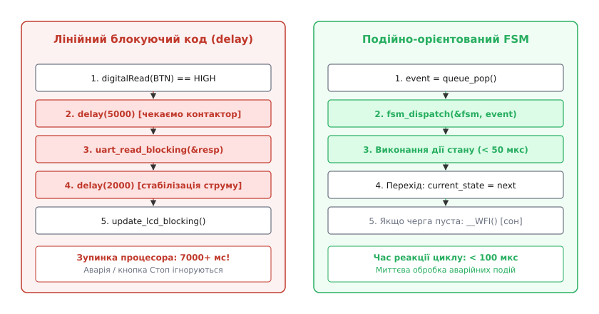
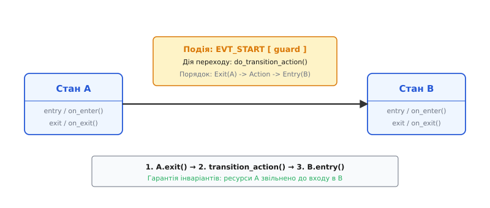
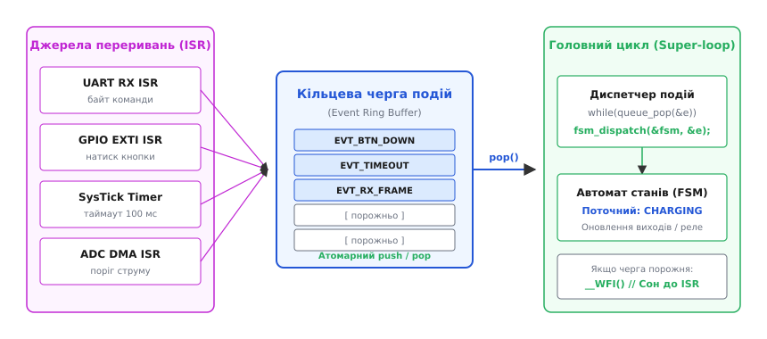
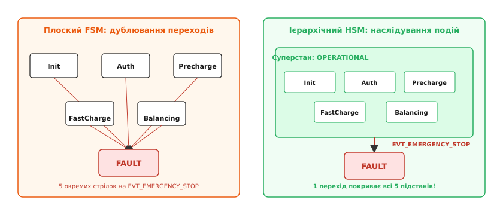
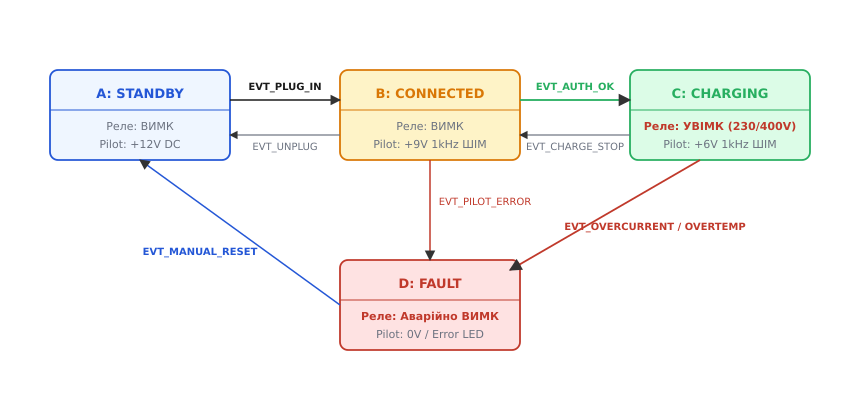

# Автомат станів і черга подій у прошивці: детально

<preknowlist>
- [Super-loop](root:embedded/super-loop-limits) — межі лінійного неблокуючого циклу з millis(), затинка та комбінаторне зростання заплутаності перевірок.
- [Блокуючий і неблокуючий ввід-вивід](root:sf-tasks/blocking-vs-nonblocking-io) — чому delay() заморожує процесор і як розбивати операції на неподільні кроки.
- [Переривання](root:hw-arch/interrupts) — апаратні джерела сигналів, вимоги до мінімального часу виконання ISR та атомарність змінних.
- [Виробник–споживач](root:sf-tasks/producer-consumer) — організація кільцевої передачі даних між перериваннями та основним потоком виконання.
</preknowlist>

Уявімо контролер зарядної станції для електромобілів (EVSE). Пристрій комутує трифазну мережу 400 В струмом 32 А через силовий контактор, одночасно опитує аналоговий рівень лінії контрольного пілота (Control Pilot, CP), слухає зчитувач RFID-карток по шині UART, вимірює струм витоку трансформатором нульової послідовності та тримає на окремому вході кнопку аварійного вимкнення «Грибок». У наївному лінійному коді замикання силового контактора супроводжується паузою `delay(3000)` для очікування завершення перехідних процесів іскрогасіння та стабілізації напруги від лічильника енергії. У ці три секунди водій помічає задимлення зарядного кабелю і натискає кнопку аварійної зупинки. Але процесор мікроконтролера застряг усередині мертвого лічильного циклу: сигнал кнопки ігнорується, силове реле лишається замкненим, а через пошкоджений роз'єм продовжує текти струм у десятки ампер, спричиняючи відкриту пожежу.

Спроба «полагодити» цю проблему за допомогою розсипу глобальних змінних-прапорців (`bool is_authorized`, `bool relay_closed`, `bool timer_running`, `uint32_t t_start`) перетворює головний цикл на заплутане спагеті з вкладених умов `if-else`. Додавання лише одного нового режиму — наприклад, очікування зниженого нічного тарифу або вентиляції акумуляторного відсіку — вимагає переписування десятків взаємопов'язаних перевірок. Прошивка починає непередбачувано «залипати» в проміжних режимах, коли одна з двадцяти умов спрацьовує невчасно через електромагнітну заваду чи деренчання контактів.

Подійно-орієнтована архітектура (**Event-Driven Architecture**) на основі скінченних автоматів (**Finite State Machine**, FSM) та кільцевої черги подій докорінно змінює структуру програми: замість лінійного сценарію «що виконувати далі» прошивка формулюється як сукупність дискретних **станів**, які очікують на надходження асинхронних **подій** і реагують на них неподільними діями з фіксованим часом виконання.


*Ліворуч — лінійний код із затримками, де процесор марнує час у delay() та пропускає аварійні події. Праворуч — неблокуючий цикл автомата, де кожна подія з черги виконується за лічені мікросекунди, забезпечуючи миттєву реакцію системи.*

---

### Чому спагеті з delay() та прапорців знищує надійність

Коли розробник викликає функцію `delay(5000)`, процесор мікроконтролера виконує мільйони порожніх інструкцій `NOP` у нескінченному лічильному циклі. Протягом цього інтервалу система залишається абсолютно сліпою до навколишнього світу, якщо не брати до уваги апаратні переривання. Але навіть якщо апаратне переривання від кнопки аварійної зупинки виставить прапорець `g_emergency_pressed = true`, головний потік виконання все одно не перевірить цей прапорець, доки не спливе весь 5-секундний інтервал затримки.

Найгірша затримка реакції системи (`L_worst`) у такій архітектурі дорівнює не часу опитування окремого давача, а сумі всіх блокуючих затримок та кроків обчислень усередині циклу:

```
L_worst = C_сенсори + delay(3000) + delay(2000) + C_дисплей ≈ 5000+ мс
```

Спроба позбутися `delay()` шляхом переходу на періодичні перевірки лічильника `millis()` або `SysTick` усуває затримку процесора, проте швидко виявляє іншу фундаментальну ваду — **комбінаторне розбухання простору станів**.

Якщо поведінка системи залежить від `M` незалежних булевих змінних-прапорців, кількість теоретично можливих конфігурацій становить:

```
Кількість конфігурацій = 2ᴹ
```

Уже при 8 прапорцях (`is_connected`, `is_charging`, `is_paused`, `is_fault`, `card_read`, `timer_active`, `overcurrent_latched`, `cable_locked`) прошивка має $2^8 = 256$ потенційних станів. Розробник здатний утримати в голові й протестувати від сили 10–15 типових сценаріїв. Решта 240 станів є «сірою зоною» — недокументованими конфігураціями, куди пристрій неминуче потрапляє через деренчання контактів, наведені електромагнітні завади чи несподіваний порядок надходження байтів з UART.

Скінченний автомат усуває цей хаос через примусове звуження простору станів: система **в будь-яку мить часу перебуває рівно в одному явно визначеному стані** зі строго обмеженого переліку.

---

### Математична модель скінченного автомата (FSM)

Формально скінченний автомат у дискретних вбудованих системах визначається як кортеж із п'яти елементів:

```
FSM = (S, E, δ, S₀, F)
```

де:
- `S` — скінченна множина взаємовиключних станів (`States`);
- `E` — скінченна множина вхідних сигналів або подій (`Events`);
- `δ` — функція переходів `δ : S × E → S`, що однозначно визначає наступний стан за парою «поточний стан + вхідна подія»;
- `S₀` — початковий стан системи (`Initial State`), у який вона переходить після скидання (Reset);
- `F` — множина кінцевих станів (для неперервно працюючих прошивок зазвичай порожня).

```
┌─────────────────────────────────────────────────────────────┐
│ Класичні типи автоматів:                                    │
│                                                             │
│ 1. Автомат Мура (Moore Machine):                            │
│    Вихідні сигнали залежать виключно від поточного стану:   │
│    Out = λ(S). Дія виконується протягом усього стану.       │
│                                                             │
│ 2. Автомат Мілі (Mealy Machine):                            │
│    Вихідні сигнали залежать від стану та вхідної події:     │
│    Out = λ(S, E). Дія прив'язана до моменту переходу.        │
│                                                             │
│ 3. Автомат з діями входу та виходу (Statecharts / UML FSM): │
│    Entry: гарантоване захоплення ресурсу при вході у стан.  │
│    Exit:  гарантоване звільнення ресурсу при виході зі стану│
└─────────────────────────────────────────────────────────────┘
```

#### Небезпека глітчів у моделі Мілі проти стабільності дій входу/виходу

У класичних автоматах Мілі дія виконується безпосередньо під час переходу між станами. Якщо апаратний вхідний сигнал зазнає короткочасного перешкодного сплеску (глітча), автомат може виконати дію (наприклад, подати імпульс на котушку контактора), навіть якщо перехід у новий стан не зафіксувався.

Найбільш надійною модифікацією для вбудованих систем є автомати з діями входу (**Entry Action**) та виходу (**Exit Action**). 

Уявімо стан `CHARGING`. Його апаратний інваріант простий: *силовий контактор замкнений, працює вентилятор охолодження*. Якщо перехід у стан аварії `FAULT` може статися через перегрів, перевищення струму, обрив пілота або натискання кнопки «Стоп», у класичному автоматі Мілі розробник мусив би прописати виклик `Relay_Open()` на **кожному окремому переході**. Забули вставити відключення реле в одному з п'яти обробників помилок — і в системі з'явилася смертельна дірка.

Дія виходу `Exit Action` виконується **завжди**, коли автомат покидає стан `CHARGING`, незалежно від того, яка саме подія спровокувала перехід. Дія входу `Entry Action` виконується **завжди**, коли автомат переходить у стан, гарантуючи правильну ініціалізацію апаратних вузлів.


*Порядок виконання операцій під час спрацьовування події EVT_START: спочатку відпрацьовує Exit-дія стану A, потім дія самого переходу, і нарешті Entry-дія стану B.*

Суворий порядок кроків під час переходу між станами:
1. Викликається `on_exit()` поточного стану `S_cur`;
2. Виконується дія самого переходу `action(e)` (якщо вона визначена);
3. Змінна поточного стану оновлюється: `current_state = S_next`;
4. Викликається `on_enter()` нового стану `S_next`.

Цей порядок гарантує збереження **інваріантів стану**: ресурси старого стану звільняються до того, як новий стан почне захоплювати свої ресурси.

---

### Три патерни реалізації автомата на C та C++

У практичній розробці мікроконтролерного ПЗ існує три основні способи реалізації FSM, кожен із яких має чіткий баланс між обсягом пам'яті, швидкодією та масштабованістю.

```
┌─────────────────┬────────────┬────────────┬─────────────────────────────┐
│ Патерн          │ Flash      │ RAM        │ Головна перевага            │
├─────────────────┼────────────┼────────────┼─────────────────────────────┤
│ 1. Switch-Case  │ Мінімальний│ 1 байт     │ Нульовий оверхед, простота  │
│ 2. Таблиця      │ Середній   │ 0 байтів   │ Декларативність, O(1) час   │
│ 3. Покажчики    │ Мінімальний│ 4-8 байтів │ Ідеальна інкапсуляція дій   │
└─────────────────┴────────────┴────────────┴─────────────────────────────┘
```

#### Патерн 1: Вкладений switch-case

Найбільш очевидний та розповсюджений підхід. Зовнішній `switch` перемикає стани, внутрішній — обробляє події.

:::tabs
:::code avtomat-staniv-i-cherha-podii-u-proshyvtsi-d/c/patterns/fsm_switch.c
:::code avtomat-staniv-i-cherha-podii-u-proshyvtsi-d/cpp/include/evse/patterns/switch_fsm.hpp
:::

*Переваги:* мінімальний розмір двійкового коду, висока швидкість (компілятор зазвичай оптимізує плоский switch у пряму таблицю переходів асемблера `TBB`/`TBH` на ARM Cortex-M), відсутність непрямих викликів.
*Недоліки:* погана масштабованість. Коли автомат налічує понад 6 станів і десяток подій, функція перетворюється на нечиткий моноліт на сотні рядків, де складно контролювати парність дій Entry/Exit.

---

#### Патерн 2: Таблиця переходів (Декларативна матриця)

У цьому патерні граф переходів виноситься у статичну таблицю в Flash-пам'яті (через `const` або `constexpr`). Таблиця містить кортежі `[Поточний стан, Подія] -> [Наступний стан, Функція дії]`.

:::tabs
:::code avtomat-staniv-i-cherha-podii-u-proshyvtsi-d/c/patterns/fsm_table.c
:::code avtomat-staniv-i-cherha-podii-u-proshyvtsi-d/cpp/include/evse/patterns/table_fsm.hpp
:::

*Переваги:* повна декларативність і наочність; граф переходів можна перевіряти статичними аналізаторами безпосередньо з матриці. Час обробки фіксований і становить O(1).
*Недоліки:* якщо матриця розріджена (багато станів ігнорують більшість подій), 2D-таблиця витрачає Flash-пам'ять на порожні клітинки.

---

#### Патерн 3: Покажчики на функцію стану (State-Handler Pattern)

У цьому патерні кожен стан є окремою самостійною функцією. Поточний стан автомата зберігається як звичайний покажчик на функцію (`StateFn`).

:::tabs
:::code avtomat-staniv-i-cherha-podii-u-proshyvtsi-d/c/patterns/fsm_handler.c
:::code avtomat-staniv-i-cherha-podii-u-proshyvtsi-d/cpp/include/evse/state_machine.hpp
:::

*Переваги:* найкраща інкапсуляція. Логіка одного стану (включно з його входом, виходом та обробкою подій) повністю локалізована в одній функції. Немає роздутих таблиць та гігантських `switch`.

---

### Кільцева черга подій та розв'язка з перериваннями (ISR)

Головне правило систем реального часу: **обробник переривання (ISR) ніколи не повинен виконувати бізнес-логіку або переходи автомата станів**.

Якщо викликати диспетчеризацію FSM всередині ISR, виникають три критичні загрози:
1. **Блокування інших переривань:** тривалість переходу в автоматі (зчитування давачів, оновлення дисплея) може перевищити сотні мікросекунд, що призведе до пропуску термінових імпульсів або переповнення буфера UART.
2. **Порушення реентрабельності:** якщо одне переривання витіснить інше і спробує змінити стан того самого автомата, внутрішні змінні FSM опиняться у розірваному, невалідному стані (data race).
3. **Невизначений порядок дій:** якщо кілька джерел переривань спрацювали одночасно, без черги події оброблятимуться у випадковому пріоритетному порядку контролера NVIC, а не в хронологічній послідовності їхнього виникнення.

Правильне інженерне рішення — **асинхронна розв'язка**: ISR лише формує компактний запис події (2–8 байтів) і розміщує його в атомарній кільцевій черзі (**Event Ring Buffer**). Головний цикл `super-loop` витягує події по одній і передає їх автомату за принципом **Run-To-Completion (RTC)** — кожна дія гарантовано завершується до того, як розпочнеться наступна.


*Апаратні переривання (кнопки, таймери, DMA) лише пакують події в кільцеву чергу. Головний цикл послідовно витягує події, передає їх автомату, а за відсутності подій переводить мікроконтролер у режим сну через __WFI().*

#### Реалізація потокобезпечної черги подій без блокувань

Для взаємодії одного джерела (або багатьох ISR) з одним споживачем (головним циклом) застосовується кільцевий буфер фіксованого розміру, де довжина буфера є ступенем двійки (це замінює повільну операцію взяття залишку `%` на швидку бітову маску `& (SIZE - 1)`).

:::tabs
:::code avtomat-staniv-i-cherha-podii-u-proshyvtsi-d/c/src/event_queue.c
:::code avtomat-staniv-i-cherha-podii-u-proshyvtsi-d/cpp/include/evse/event_queue.hpp
:::

#### Диспетчер та енергозбереження

Головний цикл перетворюється на елегантну конструкцію з трьох рядків:

:::tabs
:::code avtomat-staniv-i-cherha-podii-u-proshyvtsi-d/c/src/main.c
:::code avtomat-staniv-i-cherha-podii-u-proshyvtsi-d/cpp/src/main.cpp
:::

Коли подій немає, процесор не крутить мільйони порожніх ітерацій, а засинає за інструкцією `__WFI()`. Струм споживання кристала падає з 25 мА до лічених мікроампер. Перше ж переривання (таймер або кнопка) будить ядро, обробник кладе подію в чергу, і головний цикл негайно виконує диспетчеризацію.

---

### Ієрархічні автомати станів (HSM / Statecharts)

У міру розвитку функціоналу прошивки плоский автомат неминуче стикається з проблемою **дублювання переходів**. Якщо система має робочі підстани `Init`, `Authenticating`, `Precharge`, `FastCharging` та `Balancing`, і в **кожному** з них при натисканні аварійної кнопки слід переходити у стан `FAULT`, у плоскому автоматі доводиться малювати п'ять ідентичних стрілок.

Девід Гарель у 1984 році запропонував розширення автоматів під назвою **Statecharts** (докладніше про [історію винаходу Statecharts для авіоніки](root:embedded/avtomat-staniv-i-cherha-podii-u-proshyvtsi/hist-statecharts.md)), де стани можуть бути вкладені один в один.


*Ліворуч — плоский автомат із комбінаторним дублюванням переходів на кожну аварійну подію. Праворуч — ієрархічний автомат, де суперстан Operational перехоплює подію аварії один-єдиний раз для всіх внутрішніх підстанів.*

Принцип роботи HSM базується на **поведінковому наслідуванні**:
1. Подія надходить до найбільш глибокого активного підстану (Leaf State);
2. Якщо підстан знає, як обробити подію, він обробляє її і повертає `HANDLED`;
3. Якщо підстан не містить обробника для цієї події, вона **автоматично піднімається** до суперстану (Parent State);
4. Процес повторюється вгору до кореня ієрархії (`Top`).

Це дозволяє локалізувати специфічні реакції у підстанах, а всі загальні правила поведінки (таймаути бездіяльності, помилки живлення, аварії) описати один раз у суперстані. Повну інженерну реалізацію та алгоритм обчислення LCA дивіться у вставці [готовий рушій ієрархічного автомата станів](root:embedded/avtomat-staniv-i-cherha-podii-u-proshyvtsi/proj-hierarchical-fsm.md).

---

### Наскрізний інженерний приклад: Контролер зарядної станції EVSE

Розглянемо реальну систему керування зарядною станцією електромобілів змінного струму за міжнародним стандартом **IEC 61851-1 / SAE J1772**.

#### Фізика процесу та лінія Control Pilot (CP)
Станція спілкується з автомобілем через одну аналогову лінію зв'язку CP:
- **Стан A (Очікування):** Станція видає постійну напругу +12 В. Кабель не підключений.
- **Стан B (Підключено):** Автомобіль підключив штекер. Вхідний резистор автомата просаджує напругу до +9 В. Станція вмикає ШІМ 1 кГц (шпаруватість задає максимальний допустимий струм).
- **Стан C (Заряджання):** Автомобіль замикає внутрішній ключ, просаджуючи напругу пілота до +6 В (запит енергії). Станція замикає силове трифазне реле 400 В.
- **Стан D (Аварія):** Корозія, пробій ізоляції або обрив пілота (напруга ≤ 0 В або відхилення частоти). Реле аварійно розмикається.


*Повний граф станів зарядної станції EVSE: штатні переходи A-B-C та аварійні переходи у Fault із примусовим відключенням силового контактора.*

Нижче наведено повний робочий каркас прошивки на базі скінченного автомата та диспетчера подій.

:::tabs
:::code avtomat-staniv-i-cherha-podii-u-proshyvtsi-d/c/src/evse.c
:::code avtomat-staniv-i-cherha-podii-u-proshyvtsi-d/cpp/include/evse/controller.hpp
:::

---

### Підсумки: чекліст побудови надійної подійної архітектури

Щоб вбудована система ніколи не зависала і мала гарантований час відгуку, керуйтеся чотирма залізними правилами:

1. **Жодних delay() у коді виконання:** Тривалість будь-якого кроку обробки події в автоматі має вимірюватися мікросекундами. Тривалі затримки реалізуються виключно через таймерні події `EVT_TIMEOUT`.
2. **Нуль важкої логіки в ISR:** Переривання лише фіксують апаратну зміну, заповнюють поля структури `Event` і штовхають її в кільцеву чергу.
3. **Атомарний життєвий цикл через Entry/Exit:** Ресурси безпеки (вимикання нагрівачів, знеструмлення високовольтних реле) прив'язуються до `Exit Action` стану, а не розпорошуються по окремих гілках `if`.
4. **Сон у порожній черзі:** Якщо черга подій порожня, процесор викликає інструкцію енергозбереження `__WFI()`, знижуючи споживання енергії на 99%.
