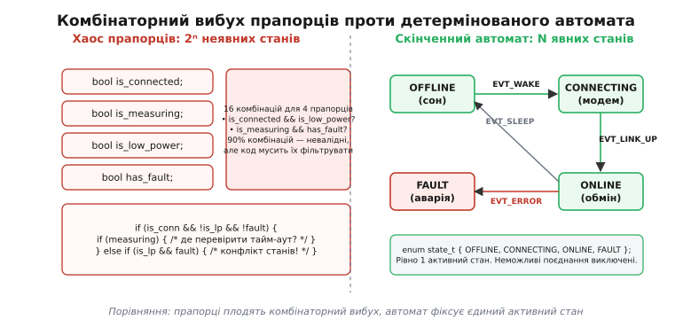
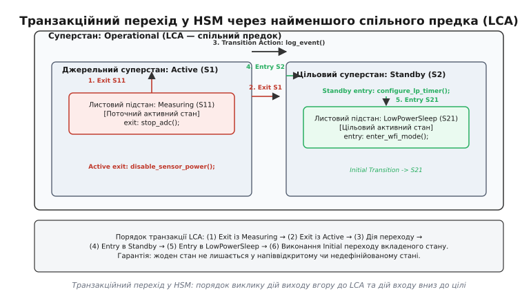
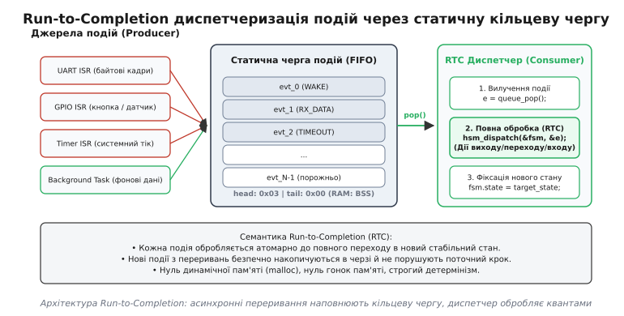
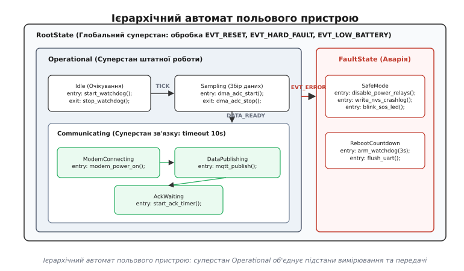

# Автомат станів і черга подій у системі пристроїв

<preknowlist>
- [Шарова архітектура](root:sf-apps/layered-architecture) — поділ системи на ізольовані горизонтальні рівні з односпрямованим потоком керування.
- [Кільцевий буфер](root:sf-algorithms/ring-buffer) — статична безблокуюча структура даних FIFO без динамічного виділення пам'яті.
- [Виклик проти повідомлення](root:embedded/vyklyk-proty-povidomlennia) — принципова різниця між синхронним блокуючим RPC-викликом та асинхронним обміном повідомленнями.
- [Критична секція](root:embedded/krytychna-sektsiia) — захист спільних структур даних від перегонів між перериваннями та основним циклом виконання.
</preknowlist>

Коли автономний польовий контролер керує лише одним світлодіодом і кнопкою, його логіка вміщується у десяток рядків лінійного коду. Але щойно пристрій виходить у реальний світ, кількість одночасних процесів зростає: треба періодично опитувати сенсори по шині I²C, тримати TCP-з'єднання через стільниковий модем, реагувати на команди користувача, слідкувати за напругою літієвого акумулятора, записувати телеметрію у флешпам'ять та безпечно знеструмлювати силові кола при аварії.

Перша інтуїтивна спроба зв'язати ці асинхронні процеси в єдину прошивку виглядає як набір булевих прапорців у глобальній пам'яті: `is_connected`, `is_measuring`, `has_data`, `is_low_battery`, `in_fault`. Через кілька місяців розробки такий код неминуче перетворюється на заплутані хащі вкладених умовних операторів, де кожен обробник переривання змінює окремий прапорець, а головний цикл намагається вгадати, що саме зараз відбувається з апаратом. Пристрій починає зависати в непередбачуваних проміжних станах, які виникають раз на тиждень у польових умовах і ніколи не відтворюються на столі налагодження під JTAG-адаптером.

## Проблема хаосу станів та обмеження простих FSM

Головна вада керування логікою через незалежні змінні-прапорці полягає у математичній природі комбінаторики. Кожен новий булевий прапорець, доданий у структуру стану пристрою, подвоює розмір теоретичного простору станів системи. Для пристрою, що має `N` незалежних булевих прапорців, загальна кількість можливих конфігурацій пам'яті описується співвідношенням:

```
S = 2ⁿ      [комбінаторний простір станів для n незалежних булевих прапорців]
```

Якщо система використовує 4 прапорці, процесор може опинитися у 16 станах. Якщо ж прапорців стає 10 (що є типовим для будь-якого промислового трекера чи контролера доступу), кількість можливих комбінацій сягає 1024:

```
S = 2¹⁰
  = 1024    [розмір простору станів при 10 прапорцях]
```

У реальній фізичній роботі пристрою зі всієї цієї тисячі комбінацій змістовними є лише 15–20 режимів. Решта 98% — це заборонені, суперечливі або фізично руйнівні поєднання. Наприклад, стан, де одночасно `is_connected == true` та `is_sleeping == true`, або де `in_fault == true` під час активного калібрування сенсорів `is_calibrating == true`.

Коли стан системи «розмазаний» по окремих прапорцях, компілятор та процесор нічого не знають про ці заборонені комбінації. Відповідальність за фільтрацію покладається на плечі програміста, через що кожна функція прошивки обростає громіздкими багатоповерховими перевірками:

:::tabs
:::code avtomat-staniv-i-cherha-podii-u-systemi-d/c/problema-khaosu-staniv-ta.c
:::code avtomat-staniv-i-cherha-podii-u-systemi-d/cpp/problema-khaosu-staniv-ta.cpp
:::

Цей ефект у теорії надійності вбудованих систем називають **комбінаторним вибухом станів** (англ. *state explosion*). Його головна руйнівна сила — утворення **прихованих станів** (англ. *implicit states*).

Уявімо типову польову ситуацію: пристрій виконує збір даних по шині I²C з активним прапорцем `is_measuring = true`. Раптово напруга живлення короткочасно просідає через увімкнення зовнішнього реле, і стільниковий модем перезавантажується. Переривання від UART скидає прапорець `is_connected = false`. Якщо розробник забув додати окрему перевірку комбінації `!is_connected && is_measuring` у кожному місці прошивки, функція `process_telemetry()` більше ніколи не зайде в гілку відправки телеметрії й водночас не зможе перезапустити цикл опитування сенсорів, бо вважає, що вимір усе ще триває. Контролер перетворюється на «зомбі»: процесор працює, переривання клацають, але логіка назавжди зависла в мертвій точці.

Окрім логічної плутанини, прапорці створюють апаратні гонки пам'яті (англ. *race conditions*). На 32-бітних процесорах ARM Cortex-M операція читання-модифікації-запису над окремим байтом або бітовим полем не є атомарною. Якщо основний цикл зчитує `is_connected` у регістр `R0`, а в цей момент переривання UART змінює сусідній прапорець `is_transmitting`, зворотний запис `R0` в пам'ять затирає щойно встановлене значення переривання.


*Зліва: незалежні прапорці плодять неявні стани та заплутані умовні оператори, де важко передбачити суперечності. Справа: скінченний автомат у кожен момент часу перебуває строго в одному явному стані з фіксованого переліку.*

Фундаментальним інженерним рішенням цієї проблеми є перехід до концепції **скінченного автомата** (англ. *Finite State Machine*, FSM; від латин. *finitus* — визначений, обмежений та грец. *automatos* — саморухомий).

У скінченному автоматі весь поточний стан системи згортається в єдину дискретну величину з фіксованого переліку `enum`. Система позбавляється неявних проміжних комбінацій: вона перебуває строго в одному стані в кожен момент часу. Усі зміни відбуваються виключно як реакція на дискретні події:

:::tabs
:::code avtomat-staniv-i-cherha-podii-u-systemi-d/c/problema-khaosu-staniv-ta-2.c
:::code avtomat-staniv-i-cherha-podii-u-systemi-d/cpp/problema-khaosu-staniv-ta-2.cpp
:::

Плаский скінченний автомат гарантує, що пристрій не може одночасно перебувати в стані `STATE_OFFLINE` та `STATE_ONLINE`. Змінна стану однозначно визначає поведінку всієї системи.

В теорії автоматів розрізняють два класи таких машин:
- **Автомат Мура** (англ. *Moore machine*): вихідні сигнали та дії залежать виключно від поточного стану системи.
- **Автомат Мілі** (англ. *Mealy machine*): вихідні дії залежать як від поточного стану, так і від вхідної події, що викликала перехід.

У вбудованих системах чисті автомати Мура та Мілі мають суттєві обмеження. У міру зростання функціональності прошивки класичні пласкі автомати розбиваються об іншу стіну складності — **вибух переходів** (англ. *transition explosion*).

Уявімо, що в систему з 15 станами додаються три глобальні події аварійного характеру:
1. `EVT_LOW_BATTERY` — напруга акумулятора впала нижче 3.1 В (необхідно терміново вимкнути всі споживачі струму та заснути).
2. `EVT_EMERGENCY_STOP` — натиснуто апаратну кнопку аварійної зупинки.
3. `EVT_WATCHDOG_ALERT` — підсистема моніторингу зафіксувала збій зв'язку.

Оскільки подія `EVT_LOW_BATTERY` може статися в будь-який момент часу (під час вимірювання, передачі даних, очікування відповіді сервера, калібрування), розробник змушений вручну додати обробку `case EVT_LOW_BATTERY:` у кожен із 15 станів:

```
T = N_states · M_events     [розмір повної матриці переходів плаского автомата]
```

Для 15 станів і 10 подій матриця переходів містить 150 потенційних стрілок. Якщо під час рефакторингу з'являється 16-й стан, і програміст забуде прописати в ньому обробку аварійного живлення, пристрій при розряді батареї зависне саме в цьому стані й висадить літієвий елемент нижче допустимої межі глибокого розряду.

Плаский автомат принципово не має механізму **успадкування поведінки**: кожен стан ізольований і змушений заново описувати реакцію на загальні системні події.

> 🔧 **Навіщо це.** Спроба обійти дублювання коду в плаських автоматах через «зовнішній фільтр» на кшталт `if (evt == EVT_LOW_BATTERY) { state = STATE_OFFLINE; } else { fsm_dispatch(evt); }` створює ще небезпечніший дефект — порушення інваріантів очищення. Якщо система перебувала в стані `STATE_MEASURING` і ми примусово перезаписали `state = STATE_OFFLINE`, ніхто не вимкнув опорну напругу АЦП і не знеструмив аналогові підсилювачі. Як наслідок, у «сплячому» режимі плата продовжує споживати 15 мА замість 15 мкА, і батарея сідає за дві доби.

## Математика та семантика ієрархічних автоматів (Statecharts / HSM)

Для подолання проблеми повторення переходів у складних системах ізраїльський математик Девід Гарель (David Harel) у 1987 році запропонував математичний формалізм **Statecharts**. Його фундаментальне нововведення полягало у введенні **ієрархії станів** (вкладеності), семантики дій входу/виходу, псевдостанів історії та ортогональних компонентів. Програмну реалізацію цих ідей у вбудованому коді називають **ієрархічним автоматом станів** (англ. *Hierarchical State Machine*, HSM).

В ієрархічному автоматі стани організуються у вигляді орієнтованого дерева. Стан вищого рівня називають **суперстаном** (або композитним станом), а стан, вкладений у нього, — **підстаном** (або листовим станом):

```
RootState (корінь ієрархії)
 ├── FaultState (аварійний режим)
 └── Operational (робочий суперстан)
      ├── Idle (підстан очікування)
      ├── Sampling (підстан збору даних)
      └── Communicating (композитний суперстан зв'язку)
           ├── ModemConnecting (підстан авторизації в мережі)
           └── DataPublishing (підстан передачі пакетів)
```

Головний закон диспетчеризації HSM формулюється так: **вхідна подія спочатку доставляється поточному активному листовому стану. Якщо листовий стан не знає, як обробити цю подію, вона автоматично передається (спливає) до його суперстану, і так далі вгору по дереву ієрархії аж до досягнення кореня.**

Завдяки цьому правилу обробка сигналу `EVT_LOW_BATTERY` записується рівно один раз — у суперстані `Operational`. Усі дочірні стани (`Idle`, `Sampling`, `ModemConnecting`, `DataPublishing`) автоматично успадковують цей перехід без жодного рядка дубльованого коду. Математично кількість необхідних переходів у системі зменшується від квадратичної залежності `O(N · M)` до лінійної `O(N + M)`.

### Вхідні та вихідні дії (Entry / Exit Actions)

Стан у Statecharts є не просто абстрактною міткою на графі переходів, а **контекстом володіння апаратними ресурсами**. Аби гарантувати детермінованість захоплення та вивільнення ресурсів, кожен стан наділяється двома обов'язковими діями життєвого циклу:

1. **Дія входу** (англ. *Entry Action*) — процедура, що викликається автоматично при вході в стан. Її призначення — налаштувати апаратуру, запустити таймери, виділити буфери, увімкнути живлення периферії.
2. **Дія виходу** (англ. *Exit Action*) — процедура, що викликається автоматично перед тим, як стан перестане бути активним. Її призначення — зупинити перетворення, вимкнути передавачі, деініціалізувати DMA, скинути черги.

Ієрархічна природа автоматів накладає суворий топологічний порядок на виконання цих дій під час зміни стану:
- Дії виходу (`Exit`) виконуються **знизу вгору** (від найглибшого поточного підстану вгору до спільного суперстану).
- Дії входу (`Entry`) виконуються **згори вниз** (від спільного суперстану вниз до цільового підстану).

### Внутрішні переходи проти переходів на себе

У семантиці Statecharts розрізняють два типи переходів у межах одного стану:
- **Внутрішній перехід** (англ. *Internal Transition*): стан реагує на подію (наприклад, оновлює лічильник або фільтрує шум), але не змінює поточний стан. При цьому **жодні Exit чи Entry дії не викликаються**. Це зберігає ресурси процесора та не скидає апаратні таймери стану.
- **Перехід на самого себе** (англ. *Self-Transition*, `S → S`): стан явно перезапускається. При цьому рушій примусово викликає `Exit(S)`, виконує дію переходу, і знову викликає `Entry(S)`. Це необхідно для скидання локальних лічильників спроб та повного перезапуску апаратної периферії стану.

### Алгоритм транзакційного переходу через LCA

Коли ієрархічний автомат виконує перехід між двома станами `Source` та `Target`, рушій повинен знайти точку розвороту в дереві ієрархії. Ця точка називається **найменшим спільним предком** (англ. *Lowest Common Ancestor*, LCA; від латин. *antecessor* — попередник).

LCA — це найглибший суперстан у дереві ієрархії, який одночасно є предком як для стану `Source`, так і для стану `Target`.


*Транзакційний перехід у HSM: вихідні дії виконуються вгору від листового стану S11 до LCA, після чого виконується дія переходу, а вхідні дії розгортаються вниз від LCA до цільового листового стану S21.*

Повний транзакційний цикл переходу `Source → Target` виконується за строгим шестикроковим протоколом:

```
Крок 1. Обчислення шляху виходу: побудова ланцюга від Source вгору до LCA (не включаючи LCA).
Крок 2. Почерговий виклик Exit-дій для кожного стану на шляху виходу (знизу вгору).
Крок 3. Виконання атомарної дії самого переходу (Transition Action, якщо вона задана).
Крок 4. Обчислення шляху входу: побудова ланцюга від LCA вниз до Target (не включаючи LCA).
Крок 5. Почерговий виклик Entry-дій для кожного стану на шляху входу (згори вниз).
Крок 6. Якщо стан Target є композитним, виконання його початкового переходу за замовчуванням
        (Initial Transition) рекурсивно вниз до досягнення базового листового стану.
```

Цей протокол виключає виникнення неініціалізованих або напіввідкритих апаратних станів. Якщо перехід відбувається з глибини `ModemConnecting` (всередині `Communicating`, всередині `Operational`) у стан `FaultState` (на рівні `RootState`), LCA є сам `RootState`. Автомат послідовно виконає:
1. `Exit(ModemConnecting)` — зупинить очікування відповіді модема.
2. `Exit(Communicating)` — надішле команду апаратного знеструмлення модема.
3. `Exit(Operational)` — вимкне стабілізатор 3.3 В сенсорної шини.
4. `Entry(FaultState)` — увімкне аварійний світлодіод і переведе ядро в безпечний сон.

Жоден крок не може бути пропущений або виконаний у неправильному порядку, навіть якщо аварійний сигнал надійшов асинхронно посеред складного обміну даними.

> 🔧 **Навіщо це.** Без формалізму LCA та Entry/Exit дій у прошивках виникають підступні апаратні конфлікти: наприклад, коли перехід у стан сну викликається безпосередньо з обробника переривання, таймер генерації ШІМ двигуна залишається активним на рівні регістрів мікроконтролера. Силові транзистори інвертора продовжують перебувати у відкритому стані, через що обмотки двигуна перегріваються й горять під час «сну» пристрою. Entry/Exit дії перетворюють коректне вимикання периферії на непорушний інваріант структури програми.

## Принцип Run-to-Completion (RTC) та детермінізм черг подій

Математична коректність ієрархічного автомата базується на моделі виконання **Run-to-Completion** (RTC; від англ. *run to completion* — виконання до повного завершення).

Семантика RTC декларує: **після того як подія вилучена з черги та передана автомату, вона повинна бути оброблена повністю (включаючи всі дії виходу, переходу, входу та початкової ініціалізації), перш ніж рушій почне обробляти будь-яку іншу подію з черги.**

```
Подія e₁ з черги ──► [ Exit(S₁) ──► Action ──► Entry(S₂) ] ──► Фіксація нового стану (S₂)
                                                                       │
Наступна подія e₂ ─────────────────────────────────────────────────────┘
```

Семантику RTC часто хибно сприймають як синхронне блокування процесора, проте між ними є кардинальна різниця:

| Параметр | Блокуючий код (Superloop / Delay) | Подієвий автомат на базі RTC |
|---|---|---|
| **Очікування події** | `while (!flag)` або `delay_ms(100)` | Відсутнє. Обробник миттєво повертає керування |
| **Зміна стану** | У довільній точці всередині вкладеного циклу | Строго в кінці кванту обробки поточної події |
| **Глибина стека** | Росте пропорційно глибині викликів функцій | Повертається до нуля після кожного кроку RTC |
| **Витрати RAM** | Окремий стек на кожен потік (RTOS) | Один єдиний системний стек для всіх автоматів |
| **Гонки пам'яті** | Високий ризик через асинхронний доступ | Повністю відсутні всередині кроку обробки події |

В архітектурі RTC функція стану ніколи не зупиняє ядро процесора в очікуванні відповіді від заліза. Якщо датчику температури потрібно 50 мс для завершення аналого-цифрового перетворення, стан `SamplingState` не викликає функцію затримки. Замість цього він запускає таймер на 50 мс і миттєво повертає керування диспетчеру:

```
[Подія: SIG_TRIGGER] ──► Sampling::Entry ──► timer_start(50ms) ──► Повернення в диспетчер
                                                                           │
                                              (процесор спить або          │
                                               обробляє інші події)        │
                                                                           ▼
[Подія: SIG_TIMEOUT] ◄───────────────────────────────────────────── Таймер спрацював
        │
        └──► Sampling::Handle(SIG_TIMEOUT) ──► Читання регістрів ──► Перехід у Ready
```

### RTC проти витісняльної багатопотоковості RTOS

У класичних операційних системах реального часу (RTOS, наприклад FreeRTOS або Zephyr) для кожного асинхронного завдання створюється окремий потік (`Task`). Кожен потік вимагає виділення власного блоку стека пам'яті (зазвичай від 1 до 4 КБ RAM).

Якщо на мікроконтролері з 32 КБ RAM функціонує 8 потоків, лише на підтримку стеків витрачається половина всієї оперативної пам'яті. Крім того, взаємодія між потоками вимагає використання блокуючих примітивів синхронізації (м'ютексів, бінарних семафорів, моніторів), що відкриває двері для класичних багатопотокових патологій: дедлоків (англ. *deadlocks*), інверсії пріоритетів (англ. *priority inversion*) та гонок даних.

HSM у поєднанні з чергами подій реалізує архітектурний шаблон **активних об'єктів** (англ. *Active Objects* або модель акторів). Кожен активний об'єкт інкапсулює всередині себе ієрархічний автомат і власну подієву чергу. Об'єкти не мають спільного змінного стану й спілкуються виключно асинхронними повідомленнями. Вся система функціонує в єдиному циклі диспетчеризації на одному системному стеку, що дає змогу будувати наднадійні прошивки на мікроконтролерах із мінімальним обсягом оперативної пам'яті.

## Безпечна статична черга подій для мікроконтролера

Фундаментом архітектури Run-to-Completion є **статична черга подій** (англ. *Event Queue*). Черга забезпечує безпечну розв'язку між швидкими апаратними перериваннями (виробниками подій) та автоматом станів (споживачем подій).

В інженерії вбудованих систем діє залізне правило надійності: **повна відмова від динамічного виділення пам'яті (zero `malloc`/`free`) після завершення фази стартової ініціалізації**. Використання динамічної купи на мікроконтролерах неминуче призводить до фрагментації оперативної пам'яті, непередбачуваного часу виконання операцій та фатальних помилок вичерпання пам'яті після місяців безперервної експлуатації.

Подія у подієвій системі представляється як компактна типізована структура фіксованого розміру:

:::tabs
:::code avtomat-staniv-i-cherha-podii-u-systemi-d/c/bezpechna-statychna-cherha.c
:::code avtomat-staniv-i-cherha-podii-u-systemi-d/cpp/bezpechna-statychna-cherha.cpp
:::

Черга подій організовується як кільцевий буфер фіксованої довжини, розташований у статичній секції пам'яті `.bss` або `.data`.


*Архітектура подій: асинхронні переривання (ISR) та фонові завдання кладуть події у статичний кільцевий буфер, звідки RTC-диспетчер послідовно вилучає їх і транслює в активний стан автомата.*

### Захист на межі переривань: модель MPSC

У реальній прошивці події в чергу надсилають одночасно кілька різних джерел: переривання таймера, переривання UART DMA, зовнішні переривання від кнопок, фонові задачі перевірки живлення (багато виробників — Multiple Producers). Споживачем же є єдиний цикл диспетчеризації автомата (один споживач — Single Consumer). Така топологія називається моделлю **MPSC** (англ. *Multiple-Producer Single-Consumer*).

Оскільки переривання може виникнути в довільний момент часу (зокрема всередині іншого менш пріоритетного переривання під час модифікації покажчиків черги), операція додавання події (`push`) повинна бути атомарною. Для цього на мікроконтролерах із ядром ARM Cortex-M застосовують ультракороткі критичні секції, що блокують глобальні переривання лише на час оновлення індексів (2–3 машинних цикли):

:::tabs
:::code avtomat-staniv-i-cherha-podii-u-systemi-d/c/zakhyst-na-mezhi-pereryvan.c
:::code avtomat-staniv-i-cherha-podii-u-systemi-d/cpp/zakhyst-na-mezhi-pereryvan.cpp
:::

Для передачі великих масивів даних (наприклад, 512-байтових блоків спектрального аналізу вібрації чи буферів Ethernet) передача за значенням через кільцеву чергу є неефективною. У таких сценаріях застосовують **статичні пули пам'яті фіксованого розміру** (англ. *Zero-Copy Static Block Pools*). Виробник виділяє блок із пулу за константний час `O(1)`, записує дані через DMA і передає в чергу подій лише типізований вказівник. Після завершення обробки споживач повертає блок назад у пул.

## Повний компактний рушій HSM на C та C++

Щоб реалізувати ієрархічний автомат на мові C без використання динамічної пам'яті, віртуальних методів компілятора чи зовнішніх важких бібліотек, використовують патерн **вказівників на функції-обробники станів** (англ. *State Handler Function Pointer*).

Кожен стан у системі моделюється як функція зі строго стандартизованою сигнатурою:

:::tabs
```c
typedef enum {
    Q_RET_HANDLED,    // Сигнал успішно оброблено цим станом
    Q_RET_IGNORED,    // Сигнал проігноровано (подальший підйом зупинено)
    Q_RET_TRAN,       // Замовлено транзакційний перехід у новий стан
    Q_RET_SUPER       // Сигнал не оброблено; передати його суперстану
} q_result_t;

typedef struct hsm_tag hsm_t;
typedef q_result_t (*state_handler_t)(hsm_t *me, const event_t *e);
```
```cpp
enum class Result : uint8_t {
    Handled,
    Ignored,
    Transition,
    Super
};

template <typename Derived>
class HierarchicalStateMachine;
```
:::

### Службові сигнали життєвого циклу

Для керування внутрішньою семантикою Statecharts рушій надсилає функціям станів чотири зарезервовані **системні сигнали**:
- `Q_SIG_ENTRY` — надсилається стану в момент його активації для виконання дій входу.
- `Q_SIG_EXIT` — надсилається стану перед виходом для деініціалізації та звільнення ресурсів.
- `Q_SIG_INIT` — надсилається композитному суперстану для запуску його початкового підстану за замовчуванням.
- `Q_SIG_EMPTY` — службовий порожній сигнал, що використовується внутрішнім алгоритмом рушія для опитування батьківського суперстану під час динамічного обчислення LCA.

### Структура та архітектура рушія

Структура `hsm_t` зберігає поточний активний стан системи (`state`) та тимчасовий вказівник (`temp`), який використовується для передачі цільового стану під час переходу:

:::tabs
:::code avtomat-staniv-i-cherha-podii-u-systemi-d/c/hsm_engine.h
:::code avtomat-staniv-i-cherha-podii-u-systemi-d/cpp/hsm_engine.hpp
:::

### Реалізація динамічного обчислення LCA на C

На мові C алгоритм знаходження LCA використовує виклик обробника з подією `Q_SIG_EMPTY`. За цим викликом функція стану повертає макрос `Q_SUPER(parent_handler)`, що дозволяє рушію динамічно пройти вгору по ланцюгу батьків без необхідності виділяти пам'ять під статичні таблиці ієрархії у флешпам'яті:

:::tabs
:::code avtomat-staniv-i-cherha-podii-u-systemi-d/c/hsm_engine.c
```cpp
// hsm_engine.cpp — Реалізація ядра для C++ версії
#include "hsm_engine.hpp"

// У C++ версії вся логіка реалізована за допомогою шаблону CRTP (Curiously Recurring
// Template Pattern) у файлі hsm_engine.hpp. Це забезпечує прямий виклик методів класу
// без накладних витрат віртуальних таблиць (vtable) і з нульовим динамічним оверхедом.
```
:::

## Практичний приклад: Контролер автономного польового вузла

Аби продемонструвати надійність HSM на практиці, реалізуємо прошивку автономного вимірювального вузла IoT із батарейним живленням.

Архітектура станів пристрою:
1. `RootState` (кореневий суперстан): ловить системні події `SIG_LOW_BATTERY` та аварійні скидання, переводячи всю систему в `FaultState`.
2. `Operational` (робочий суперстан): при вході вмикає стабілізатор живлення сенсорів 3.3 В, при виході — гарантовано вимикає його.
3. `IdleState` (підстан `Operational`): вузол спить і очікує системного таймера або натискання кнопки.
4. `SamplingState` (підстан `Operational`): запускає перетворення АЦП по DMA і збирає пакет вимірів.
5. `Communicating` (композитний суперстан): керує стільниковим зв'язком. При вході вмикає модем, при виході — вимикає його. Містить підстани `ModemConnecting` (реєстрація в мережі) та `DataPublishing` (відправка MQTT-пакета). Якщо на будь-якому етапі зв'язку спливає таймаут `SIG_NET_TIMEOUT`, суперстан `Communicating` автоматично повертає систему в `IdleState`.


*Діаграма ієрархічного автомата: суперстан Operational об'єднує підстани Idle, Sampling та Communicating. Подія SIG_LOW_BATTERY переводить систему у FaultState з будь-якого стану Operational з гарантованим вимкненням датчиків та радіомодуля.*

:::tabs
:::code avtomat-staniv-i-cherha-podii-u-systemi-d/c/node_fsm.c
:::code avtomat-staniv-i-cherha-podii-u-systemi-d/cpp/node_fsm.cpp
:::

### Покроковий аналіз виконання та очищення ресурсів

Простежимо роботу тестової програми, яка емулює штатний робочий цикл та раптове аварійне падіння напруги під час підключення модема:

:::tabs
:::code avtomat-staniv-i-cherha-podii-u-systemi-d/c/pokrokovyi-analiz.c
:::code avtomat-staniv-i-cherha-podii-u-systemi-d/cpp/pokrokovyi-analiz.cpp
:::

Лог виконання програми демонструє повну відповідність семантиці Statecharts:

```text
[Operational] Entry: Enable 3V3 sensor power rail
[Idle] Entry: Arm periodic wakeup timer

--- Подія 1: Спрацював таймер пробудження ---
[Idle] Exit: Disarm wakeup timer
[Sampling] Entry: Start ADC conversion over DMA

--- Подія 2: АЦП завершив вимірювання ---
[Sampling] Acquired 16 samples! Transition to Connect
[Sampling] Exit: Stop ADC DMA
[Communicating] Entry: Power on cellular modem
[ModemConnecting] Entry: Send AT+CREG? check network

--- Подія 3: Аварійне падіння напруги під час зв'язку ---
[Root] Low battery (2800 mV)! Emergency shutdown.
[Communicating] Exit: Send AT+CPOWD power down to modem
[Operational] Exit: Disable 3V3 rail, ensure radio OFF
[Fault] Entry: Disconnect relays, write crashlog, sleep.
```

На кроці 3 відбувається вирішальний момент: сигнал аварійного розряду батареї надійшов, коли автомат перебував у листовому стані `ModemConnecting`. Оскільки ані `ModemConnecting`, ані `Communicating`, ані `Operational` не перехопили цей сигнал, він сплив до кореневого суперстану `RootState`.

Рушій визначив, що LCA між `ModemConnecting` та `FaultState` — це сам `RootState`. Відповідно, рушій автоматично виконав вихідні дії:
1. `Exit(Communicating)` — вимкнув радіомодуль.
2. `Exit(Operational)` — знеструмив сенсорну шину.
3. `Entry(FaultState)` — увійшов у режим аварії.

Жоден периферійний блок не залишився ввімкненим, а логіка вимкнення модема та сенсорів не була продубльована в обробнику `ModemConnecting`.

## Типові пастки проєктування подієвих систем

Незважаючи на високу надійність архітектури HSM, при її практичній реалізації у вбудованих системах розробники часто припускаються кількох критичних помилок:

1. **Блокуючі виклики всередині обробника стану**. Найнебезпечніша помилка — використання `delay_ms()` або тривалого очікування прапорця апаратного регістра всередині функції стану. Оскільки автомат підпорядковується семантиці Run-to-Completion, будь-яка затримка блокує всю чергу подій системи. Інші критичні сигнали (наприклад, аварійні кінцевики або скидання сторожового таймера) не зможуть бути оброблені вчасно.
2. **Виконання дій під час замовлення переходу**. Модифікація апаратних регістрів безпосередньо в гілці `case`, яка повертає `Q_TRAN()`, порушує порядок транзакції. Усі дії очищення зобов'язані знаходитися виключно у виклику `Q_SIG_EXIT`, а дії ініціалізації — у `Q_SIG_ENTRY`.
3. **Надмірна глибина дерева станів**. Побудова ієрархій глибиною понад 4–5 рівнів робить поведінку пристрою важкою для аналізу людиною та збільшує витрати стека на трасування шляхів LCA. Якщо складності не уникнути, розбивайте систему на кілька паралельних ортогональних автоматів, що взаємодіють через статичну чергу повідомлень.
4. **Нехтування контролем переповнення черги**. Якщо розмір черги подій вибрано замалим, а частота генерації подій перериваннями перевищує швидкість їх обробки диспетчером, виникає переповнення (англ. *Queue Overflow*). У надійній прошивці факт переповнення обов'язково повинен викликати аварійний запис у журналі помилок ([NVS Crash Log](root:embedded/chorna-skrynka)) для коригування розмірів буферів або оптимізації швидкодії обробників.
5. **Небезпечна стратегія скидання сторожового таймера (Watchdog)**. Фатальний антипатерн — скидати сторожовий таймер (`watchdog_pet()`) усередині апаратного переривання системного таймера (SysTick). Якщо головний цикл диспетчеризації зависне через нескінченний цикл чи дедлок, апаратне переривання таймера продовжить скидати сторожа, маскуючи катастрофу від апаратного скидання. Правильний патерн — **токен життєздатності**: сторожовий таймер скидається лише тоді, коли всі активні автомати в системі успішно підтвердили проходження свого кванту RTC-диспетчеризації.

---
