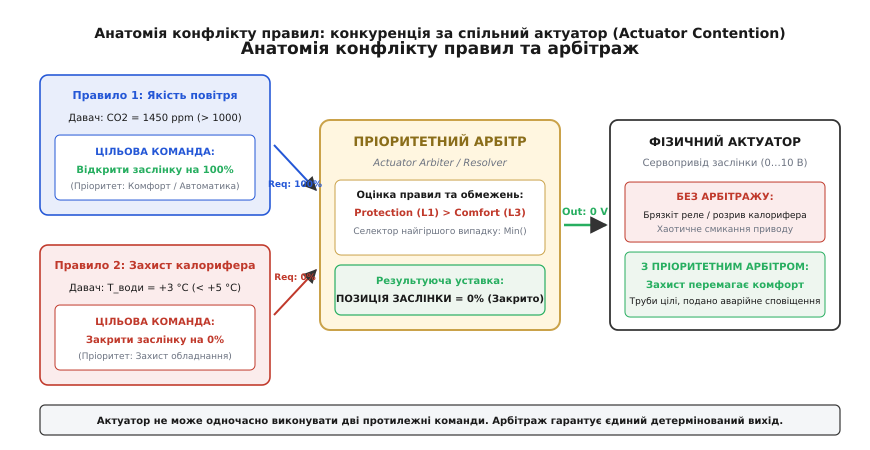
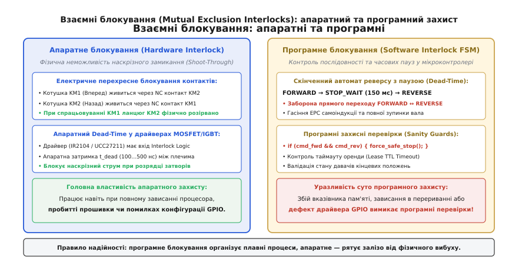
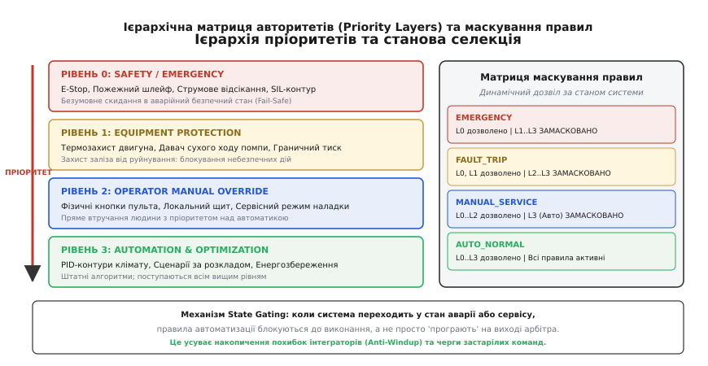
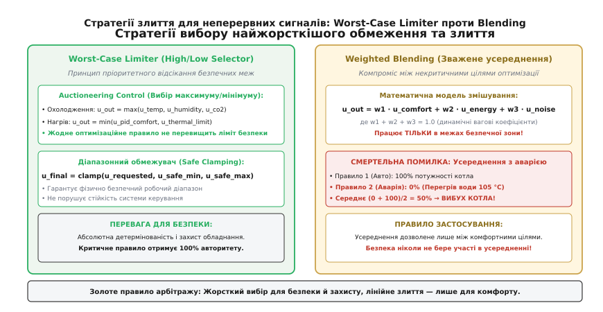

# Блокування й пріоритет: коли два правила тягнуть у різні боки

<preknowlist>
- [Поріг і гістерезис](root:embedded/porih-i-histerezys) — відсікання брязкання й формування стійких станів правил.
- [Правило, а не рішення](root:embedded/pravylo-a-ne-rishennia) — декларативні правила автоматизації проти імперативного коду.
- [Автомат режимів](root:embedded/avtomat-rezhymiv) — стани системи, охоронні умови й заборонені переходи.
- [Аварійна зупинка](root:embedded/avariina-zupynka) — небезпечні стани актуаторів і те, що софт не має права скасовувати.
- [Критична секція](root:embedded/krytychna-sektsiia) — захист спільних ресурсів від одночасного доступу в мікроконтролері.
</preknowlist>

У припливно-витяжній вентиляційній установці серверного приміщення за зовнішньої температури повітря мінус 22 °C одночасно спрацьовують два незалежні програмні правила. Перше правило, відповідальне за якість повітря, фіксує концентрацію вуглекислого газу 1500 ppm і надсилає команду сервоприводу: «Відкрити заслінку припливного повітря на 100%». Друге правило, відповідальне за захист водяного калорифера від замерзання, фіксує падіння температури зворотної води на виході теплообмінника до плюс 4 °C і надсилає тому самому сервоприводу команду: «Негайно перекрити заслінку на 0%». Якщо система автоматизації просто виконує останню отриману команду або чергує їх у циклі опитування, заслінка починає хаотично відкриватися й закриватися, припливне крижане повітря охолоджує теплообмінник до точки замерзання води, і за півтори хвилини тиск льоду розриває мідні трубки калорифера, затоплюючи стійки з обладнанням.

Ця аварія — класичний прояв конкуренції за виконавчий механізм (англ. *Actuator Contention*). У складній системі автоматизації жоден актуатор не належить одному правилу монопольно. За право керувати реле нагрівача, клапаном подачі пари, заслінкою повітропроводу чи напрямком обертання силового двигуна постійно змагаються різні підсистеми: алгоритми підтримки мікроклімату, контури енергозбереження, сценарії розкладу, прямі команди оператора з пульта та контури захисту обладнання. Коли ці підсистеми формують суперечливі команди, система не має права покладатися на випадковість черги виконання чи час надходження пакетів шиною зв'язку. Щоб запобігти руйнуванню заліза та непередбачуваній поведінці пристрою, у прошивку вбудовують механізми взаємного блокування (Interlocks) та пріоритетного арбітражу (Priority Arbitration).

## Анатомія конфлікту правил

Конфлікт правил виникає щоразу, коли два або більше незалежних алгоритмічних блоків видають керівний вплив на один і той самий фізичний вихід, не маючи прямого зв'язку між собою. Автоматизація прагне модульності: розробник контуру якості повітря пише просте локальне правило «якщо CO2 вище норми — провітрити», а розробник контуру опалення пише «якщо теплоносій остигає — перекрити приплив». Кожне з цих правил окремо є логічно бездоганним, проте їхня одночасна дія на спільний сервопривід створює небезпечну невизначеність.


*Конкуренція за спільний актуатор: незалежні правила видають взаємовиключні запити, які пріоритетний арбітр зводить до єдиної безпечної уставки.*

За характером взаємодії виконавчих сигналів розрізняють два класи конфліктів:

1. **Дискретні конфлікти протилежних станів (Discrete State Contention):** Ситуація, де актуатор підтримує обмежений набір несумісних дискретних станів. Наприклад, трифазний реверсивний двигун може обертатися вперед (`FORWARD`), назад (`REVERSE`) або бути знеструмленим (`STOP`). Одночасна вимога увімкнути прямий і зворотний хід є фізично забороненим станом.
2. **Неперервні конфлікти неузгоджених уставок (Continuous Setpoint Contention):** Ситуація, де кілька регуляторів замкнутого циклу (PID-контурів) формують різні числові значення для аналогового виходу (напруги 0…10 В, струмової петлі 4…20 мА чи коефіцієнта заповнення ШІМ). Наприклад, контур вологості вимагає 80% обертів витяжного вентилятора, контур тиску в каналі — 60%, а контур шумопоглинання вимагає не перевищувати 40%.

Якщо в архітектурі системи відсутній спеціальний шар арбітражу, виникає явище релейного брязкання (англ. *Actuator Chattering*). У головному циклі мікроконтролера правило «А» записує в регістр GPIO одиницю на початку ітерації, а правило «Б» через 5 мілісекунд записує туди нуль. Контактор або електромагнітне реле починає перемикатися з частотою кілька десятків герц.

Наслідки такого брязкання катастрофічні:
- **Електрична ерозія контактів:** Кожне розмикання контактора під індуктивним навантаженням супроводжується електричною дугою з температурою плазми понад 3000 °C. За кілька хвилин брязкання вольфрамово-срібні напайки контактів плавляться і зварюються між собою (Contact Welding), переводячи силовий ланцюг у некерований постійно замкнений стан.
- **Електромагнітні завади (EMI):** Комутація індуктивності електродвигуна генерує високовольтні викиди напруги амплітудою до кількох кіловольт по шинах заземлення та живлення, що призводить до скидання мікроконтролера сторожовим таймером або збою передачі даних по шинах SPI/I2C.
- **Механічний знос редукторів:** Сервоприводи заслінок і регулювальних клапанів мають пластикові або латунні шестерні. Постійна зміна знака крутного моменту з високою частотою розбиває зуби редуктора і призводить до заклинювання штока клапана у випадковому положенні.

Додатково ситуацію ускладнюють розподілені польові шини (CAN, Modbus, BACnet). Якщо кілька мережевих майстрів або незалежних контролерів мають право записувати команди в один і той самий вихідний регістр виконавчого модуля, черговість команд визначається джитером мережевого стека та затримками арбітражу шини. Хто останнім надіслав пакет — той і перезаписав регістр. Управління за принципом «Last Writer Wins» у силових установках неприпустиме.

## Взаємні блокування (Mutual Exclusion Interlocks)

Найжорсткіша категорія конфліктів — це ситуації, коли одночасне увімкнення двох виходів спричиняє миттєве фізичне руйнування апаратної частини. Класичний приклад — керування електродвигуном через транзисторний H-міст або реверсивну пару контакторів трифазної мережі 400 В.


*Взаємні блокування: перехресні NC-контакти й апаратний dead-time захищають від фізичного замикання, а програмний FSM керує безпечною послідовністю перемикання.*

У силовому H-мості навантаження підключено між двома стійками транзисторних ключів. Якщо через програмну помилку, випадковий збій вказівника або перешкоду на шині одночасно відкриються верхній (High-Side) та нижній (Low-Side) транзистори однієї й тієї самої стійки, напруга живлення виявиться закороченою на землю через надмалий опір відкритих каналів. Виникає наскрізний струм (англ. *Shoot-Through*), який за частки мікросекунди сягає сотень ампер і випаровує кристали MOSFET або IGBT-транзисторів з фізичним руйнуванням корпусу.

Аналогічно, у схемі реверсу асинхронного двигуна зміна напрямку обертання досягається зміною чергування двох фаз за допомогою двох окремих контакторів (KM1 для ходу вперед, KM2 для ходу назад). Одночасне замикання силових контактів KM1 і KM2 створює пряме міжфазне коротке замикання силової мережі.

### Фізика наскрізного замикання та ефект Міллера

Навіть якщо програма коректно вимикає один транзистор перед увімкненням іншого, замикання може виникнути через фізичні процеси всередині напівпровідника. 

По-перше, польовий транзистор не закривається миттєво: ємність затвор-витік `C_gs` розряджається через опір затворного драйвера `R_gate` з характерною сталою часу. Доки напруга на затворі не впаде нижче порогової напруги `V_th`, канал залишається частково провідним. 

По-друге, в момент швидкого відкриття верхнього транзистора напруга в середній точці стійки наростає з високою швидкістю `dV/dt` (до 50 В/нс). Цей стрибок напруги через паразитну ємність затвор-стік `C_gd` (ємність Міллера) інжектує струм зміщення безпосередньо в затвор нижнього транзистора:

```
I_miller = C_gd · (dV / dt)
V_gate_spike = I_miller · R_gate_pull_down
```

Якщо сплеск напруги `V_gate_spike` перевищить поріг `V_th`, нижній транзистор паразитно відкриється на кілька десятків наносекунд саме в той момент, коли верхній ключ уже повністю відкритий. Результат — короткий імпульс наскрізного струму, який розігріває кристал, викликає деградацію затворного оксиду та зрештою призводить до теплового пробою.

Тому мінімальна тривалість захисного мертвого часу (Dead-Time) розраховується з урахуванням часу вимкнення транзистора `t_off`, часу відновлення зворотного діода `t_rr` та запасу на температурний дрейф:

```
t_dead >= t_off_max + t_rr_max + t_driver_skew + t_margin
```

Для сучасних MOSFET-транзисторів цей час становить від 100 до 500 нс, для потужних IGBT-модулів — від 1.5 до 5 мкс, а для електромеханічних контакторів — від 100 до 300 мілісекунд (через інерцію якоря та час горіння дуги).

Для захисту від таких аварій використовують принцип багаторівневого взаємного блокування (Interlocking).

### Апаратне електричне блокування (Cross-Interlocking)

Перший і головний бар'єр безпеки реалізується на рівні електричної схеми без участі мікроконтролера. 

У релейних схемах застосовують перехресне підключення через нормально замкнені (NC, Normally Closed) допоміжні контакти:
- Ланцюг живлення котушки контактора KM1 пропускається через NC-контакт контактора KM2;
- Ланцюг живлення котушки контактора KM2 пропускається через NC-контакт контактора KM1.

Коли контактор KM1 спрацьовує і притягує свій якір, його допоміжний NC-контакт фізично розмикається. Навіть якщо мікроконтролер подасть напругу на вихід реле KM2, струм через його котушку не піде, оскільки електричне коло розірване залізом KM1. Додатково між корпусами контакторів установлюють механічне коромисло (Mechanical Interlock), яке блокує переміщення штока другого контактора суто механічним упором.

У напівпровідниковій електроніці для керування затворами застосовують інтегральні драйвери напівмостів (наприклад, IR2104, UCC27211 або DRV8301) із вбудованою логікою апаратного блокування. Драйвер містить вхідну логіку, яка фізично не пропускає комбінацію відкриття обох ключів, а також автоматично вставляє апаратний мертвий час (Dead-Time Insertion).

Про те, як залізничні катастрофи XIX століття змусили інженерів винайти механічні блокування та чому спроба перенести весь захист у софт у 1970-х роках призвела до важких уроків, читайте в [історії розвитку блокувань](root:embedded/blokuvannia-i-priorytet/hist-interlock-evolution.md).

### Програмне взаємне блокування та Dead-Time

Хоча апаратне блокування гарантує збереження транзисторів від вибуху, воно не вирішує динамічних проблем приводу. Якщо миттєво зняти команду з ходу вперед і подати хід назад, двигун, що обертається на повній швидкості, почне працювати в режимі протиувімкнення (Dynamic Braking / Plug Reversal). Струм ротора стрибає у 7–10 разів вище номінального, виникає сильний механічний удар по редуктору, зрізає шпонки вала або вибиває вхідні автомати захисту.

Тому програмне блокування в мікроконтролері реалізують у вигляді скінченного автомата з обов'язковим проміжним станом вибігу (Coast State) та таймером витримки:

```
[FORWARD] ──(Команда REVERSE)──> [STOP_COAST (Пауза T_dead)] ──(Таймаут вийшов)──> [REVERSE]
```

Програмний автомат перехоплює будь-які запити на реверс і забороняє прямий перехід між напрямками. Вихідні сигнали обох напрямків скидаються в нуль, запускається таймер витримки (наприклад, 200–500 мс для гасіння ЕРС самоіндукції в обмотках двигуна та повного гальмування вала), і лише після закінчення відліку активується протилежний напрямок.

Чому не можна обмежитися тільки програмним FSM? Якщо в мікроконтролері станеться збій живлення, переповнення стека чи помилка в обробнику переривання, процесор може зависнути з довільними логічними рівнями на виводах GPIO. Програмний автомат перестає працювати, і єдиним бар'єром між напругою живлення та коротким замиканням залишається апаратний інтерлок.

## Матриця пріоритетів та станова селекція

Коли актуатор керується десятком різних правил, просте правило «перемагає той, хто надіслав команду останнім» призводить до катастрофи. Для вирішення суперечностей система автоматизації повинна спиратися на формалізовану ієрархію авторитетів.


*Ієрархія рівнів авторитету: аварійний захист безумовно перемагає оптимізаційні алгоритми, а маска стану відсікає непотрібні правила ще до обчислення.*

В інженерній практиці вбудованих систем виділяють чотири обов'язкові рівні авторитету (Priority Layers), від найвищого до найнижчого:

### 1. Рівень 0: Аварійна безпека (Safety / Emergency)
Найвищий пріоритет. Сюди належать сигнали фізичної кнопки аварійної зупинки (E-Stop), пожежні шлейфи, спрацьовування апаратних датчиків граничного струму чи витоку газу, а також сигнали систем функціональної безпеки (SIL3/SIL4). Команда цього рівня має абсолютний авторитет: вона негайно знеструмлює силові ланцюги, переводить актуатори у визначений безпечний стан (Fail-Safe State, наприклад, закриває газовий клапан або відкриває димовидалення) і блокує будь-які команди всіх нижчих рівнів.

### 2. Рівень 1: Захист обладнання (Equipment Protection)
Захист техніки від саморуйнування у штатних і позаштатних ситуаціях:
- Термореле перегріву обмоток електродвигуна або радіатора силових транзисторів;
- Давач сухого ходу відцентрового насоса (заборона вмикання без рідини);
- Захист калорифера вентиляції від замерзання за низької температури теплоносія;
- Давач граничного тиску в гідравлічній або пневматичній магістралі.
Команди рівня захисту мають безумовне право заблокувати роботу окремого агрегату, навіть якщо оператор або автоматика вимагають його запуску.

### 3. Рівень 2: Пряме ручне керування (Operator Manual Override)
Команди людини-оператора, що подаються з локального щита керування, фізичного пульта, сервісного термінала чи кнопки ручного втручання. Людина має пріоритет над будь-якими автоматичними оптимізаційними алгоритмами: якщо технік натискає кнопку «Зупинити конвеєр для чищення», автоматичний сценарій завантаження бункера не має права перезапустити мотор. Проте ручне керування оператора завжди обмежене рівнями 0 та 1: оператор не може примусово ввімкнути насос у режимі сухого ходу, якщо спрацював захисний термостат, доки аварійне блокування не буде квитовано.

### 4. Рівень 3: Автоматизація та оптимізація (Automation & Optimization)
Штатний режим роботи системи:
- ПІД-регулятори температури, тиску, швидкості та витрати;
- Сценарії автоматизації за розкладом або за подіями датчиків;
- Алгоритми енергозбереження та нічного зниження продуктивності.
Це найнижчий рівень пріоритету: будь-яке правило цього рівня негайно поступається правами, якщо активується вищий рівень.

### Станове маскування правил (State Gating / Rule Masking)

Поширеною помилкою архітектури є схема, за якої всі правила обчислюються постійно, а арбітр лише вибирає переможця на фінальному кроці. Якщо контур автоматичного регулювання температури продовжує інтегрувати помилку у фоновому режимі, коли система перебуває в стані аварійної зупинки чи ручного сервісу, виникає небезпечний ефект накопичення похибки (Integrator Windup). Щойно аварію буде скинуто, регулятор миттєво видасть у вихідний каскад максимальну накопичену уставку 100%, спричинивши різкий динамічний удар.

Щоб запобігти цьому, застосовують механізм станового маскування:

```
+──────────────────+─────────────────────────────────────────+
| Стан системи     | Дозволені рівні правил                  |
+──────────────────+─────────────────────────────────────────+
| STATE_EMERGENCY  | Тільки Level 0 (Safety)                 |
| STATE_FAULT_TRIP | Level 0, Level 1 (Safety, Protection)   |
| STATE_MANUAL     | Level 0, Level 1, Level 2 (Manual)      |
| STATE_AUTO       | Level 0, Level 1, Level 2, Level 3 (Всі)|
+──────────────────+─────────────────────────────────────────+
```

Коли глобальний автомат режимів переходить у стан `STATE_MANUAL`, правила рівня `Level 3` не просто ігноруються арбітром — вони повністю блокуються для обчислення (Gated Off), їхні інтегратори заморожуються або скидаються в нуль, а внутрішні таймери зупиняються. Це усуває приховані черги відкладених дій та забезпечує безривковий перехід (Bumpless Transfer) при поверненні в автоматичний режим.

## Стратегії арбітражу: Лімітер проти усереднення

Для дискретних сигналів (увімкнути/вимкнути) арбітраж базується на жорсткому виборі правила з найвищим пріоритетом. Але як вчинити, коли актуатор має неперервний аналоговий діапазон, і кілька активних правил одного або суміжних рівнів вимагають різних значень?


*Стратегії арбітражу для неперервних величин: вибір найжорсткішого обмеження гарантує безпеку, тоді як усереднення допустиме лише між комфортними цілями.*

В інженерній практиці застосовують два принципово різні підходи:

### 1. Селектор найжорсткішого обмеження (Worst-Case Limiter / Auctioneering Control)

У промисловій автоматизації та теплоенергетиці цей метод відомий як селективне керування (Auctioneering Control або High/Low Selector). Замість компромісів система вибирає екстремум, який забезпечує найвищий рівень захисту:

- **Селектор максимуму (High Selector, `Max`):** Застосовується в контурах охолодження та безпеки повітрообміну. Якщо датчик температури вимагає 30% обертів вентилятора, датчик вологості — 50%, а датчик токсичного газу — 90%, вихідний сигнал обчислюється як:
```
u_out = max(u_temp, u_humidity, u_gas) = 90%
```
Актуатор розганяється до максимальної швидкості, задовольняючи найбільш критичну потребу.

- **Селектор мінімуму (Low Selector, `Min`):** Застосовується в контурах нагріву, подачі палива чи нагнітання тиску. Якщо ПІД-регулятор температури в печі вимагає 100% потужності пальника, але контур захисту за тиском газу вимагає обмеження не більше 40%, результуючий вихід становить:
```
u_out = min(u_pid_heat, u_pressure_limit) = 40%
```
Жодне оптимізаційне правило не здатне перевищити ліміт, накладений контуром захисту.

- **Діапазонне стискання (Safe Clamping):** Будь-яка уставка перед подачею на актуатор пропускається через жорсткий коридор безпеки:
```
u_final = clamp(u_requested, u_safe_min, u_safe_max)
```
Якщо привід заслінки має механічний дефект і заклинює при відкритті понад 85%, арбітр апаратно обмежує уставку діапазоном `[0% … 85%]`, не дозволяючи жодному правилу зламати механічні тяги.

### Слідкуючий анти-віндап (Tracking Anti-Windup) у каскадних селекторах

Коли в системі працює кілька паралельних ПІД-регуляторів, виходи яких об'єднуються селектором `Min` або `Max`, виникає специфічна проблема насичення: регулятор, чий сигнал у поточний момент НЕ вибраний селектором (англ. *Unselected Controller*), продовжує бачити неусувну помилку регулювання. Його інтегральна складова безперервно зростає, намагаючись подолати опір, якого вона не контролює.

Коли ситуація змінюється і неактивний регулятор повинен перехопити керування, на його виході вже накопичено гігантське значення. Виникає запізнення реакції та сильний переліт (Overshoot).

Для усунення цього ефекту неактивні регулятори підключають за схемою зворотного розрахунку (Back-Calculation Tracking). Замість власного інтегратора регулятор відстежує реальний вихідний сигнал актуатора `u_actual`, який пройшов через селектор:

```
e_track = u_actual - u_pid_unconstrained
I_term[k] = I_term[k-1] + Ki · e[k] · dt + Kt · e_track · dt
```
де `Kt` — коефіцієнт стеження (Tracking Gain).

Коли селектор відкидає вихід регулятора, різниця `e_track` миттєво підтягує внутрішній інтегратор до фактичного значення на актуаторі. Перемикання авторитету між контурами стає бездоганно плавним і безривковим.

### 2. Зважене усереднення (Weighted Blending)

Зважене усереднення полягає в обчисленні лінійної комбінації запитів від кількох правил з динамічними ваговими коефіцієнтами:

```
u_out = w1 · u_comfort + w2 · u_energy + w3 · u_noise
```
де сума ваг `w1 + w2 + w3 = 1.0`.

Цей метод широко застосовують у споживчих системах розумного будинку для знаходження балансу між некритичними критеріями: наприклад, знайти компроміс між акустичним шумом кондиціонера, швидкістю виходу на задану температуру та споживанням електроенергії з мережі.

**Смертельна небезпека лінійного усереднення:**
Категорично заборонено застосовувати зважене усереднення між правилами різного рівня критичності! 

Уявімо паровий котел, де автоматика вимагає 100% потужності нагріву для підтримки тиску пари, а термостат захисту від перегріву фіксує аварійну температуру води 105 °C і вимагає 0% (повне вимкнення ТЕНів). Якщо алгоритм спробує знайти «компроміс» через середнє арифметичне:

```
u_out = (100% + 0%) / 2 = 50%
```

Потужність нагріву зменшиться лише вдвічі замість повного вимкнення. Вода закипить, тиск пари перевищить міцність резервуара, і котел вибухне.

**Правило проектування арбітражу:**
Усереднення та компроміси дозволені виключно між правилами рівня автоматизації в межах безпечної зони. Правила безпеки та захисту діють за принципом абсолютної селекції (Worst-Case Limiter) і не беруть участі в жодних усередненнях.

### Оренда авторитету та захист від замовклих джерел (Lease Time / TTL)

Ще одна небезпека розподілених систем керування — зависання або втрата зв'язку з джерелом, яке виставило пріоритетну команду. Якщо зовнішня панель оператора надіслала команду «Увімкнути сервісний режим і відкрити клапан на 100%», а за секунду зависла чи була відключена від шини RS-485 / CAN, актуатор не повинен залишатися заблокованим у цьому положенні назавжди.

Для захисту від застарілих команд арбітр реалізує концепцію оренди авторитету з обмеженим часом життя (Lease Time / TTL, Time-to-Live). Кожен запит на керування супроводжується міткою часу та таймаутом валідності. Джерело команди зобов'язане періодично надсилати пакети підтвердження (Heartbeat / Keep-Alive). Якщо протягом заданого часу (наприклад, 1.0 с) чергове підтвердження не надійшло, арбітр автоматично анулює запит замовклого джерела і плавно повертає актуатор до дефолтного стану автоматичного регулювання.

## Повний модуль пріоритетного арбітра на C та C++

Нижче наведено промислову реалізацію модуля пріоритетного арбітра виконавчих механізмів. Модуль підтримує:
- 4 рівні пріоритету (`SAFETY`, `PROTECTION`, `MANUAL`, `AUTOMATION`);
- Контроль часу життя кожного запиту (TTL / Lease Timeout);
- Взаємне блокування дискретних напрямків з таймером захисного мертвого часу (Dead-Time Delay);
- Селектор найгіршого випадку (Worst-Case High/Low Limiter) для неперервних сигналів;
- Збереження діагностичних кодів причини перемоги запиту (Arbitration Reason Codes) для бортового чорного ящика та телеметрії;
- Повну детермінованість пам'яті без динамічного виділення (`malloc`/`new`) та час виконання `O(N)` за кількістю джерел.

:::tabs
@tab C
:::code blokuvannia-i-priorytet-d/c/main.c
@tab C++
:::code blokuvannia-i-priorytet-d/cpp/main.cpp
:::

## Підсумковий синтез архітектури арбітражу

Побудова надійного вузла автоматизації вимагає чіткого розмежування обов'язків між фізикою, логікою та алгоритмами:

1. **Апаратний шар (Physical Hardware):** Фізичні NC-контакти, механічні блокіратори та апаратні драйвери затворів із dead-time логікою унеможливлюють міжфазне коротке замикання та наскрізний струм за будь-яких помилок чи зависань процесора.
2. **Шар пріоритетного арбітражу (Arbiter Layer):** Детермінований програмний модуль приймає запити від усіх підсистем, фільтрує застарілі команди за таймаутом TTL, гарантує часові паузи реверсу, захищає від релейного брязкання та реалізує селектори найгіршого випадку (Worst-Case Limiters).
3. **Шар прикладних правил (Control Rules):** Модульні правила та ПІД-регулятори обчислюють уставки комфорту й оптимізації, не знаючи про існування інших правил, але підпорядковуючись матриці станового маскування.

Така трирівнева декомпозиція перетворює хаос конкуруючих команд на передбачувану, безпечну та математично стійку систему керування.
