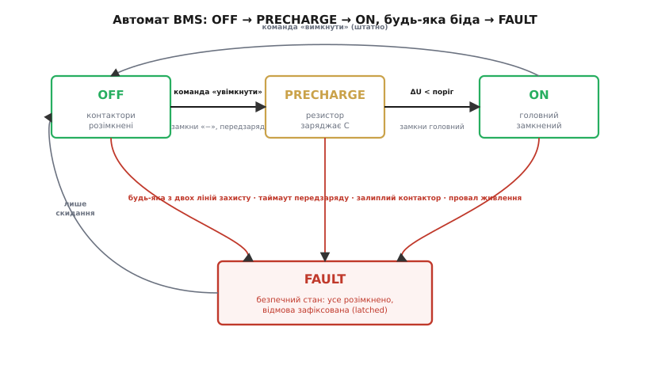
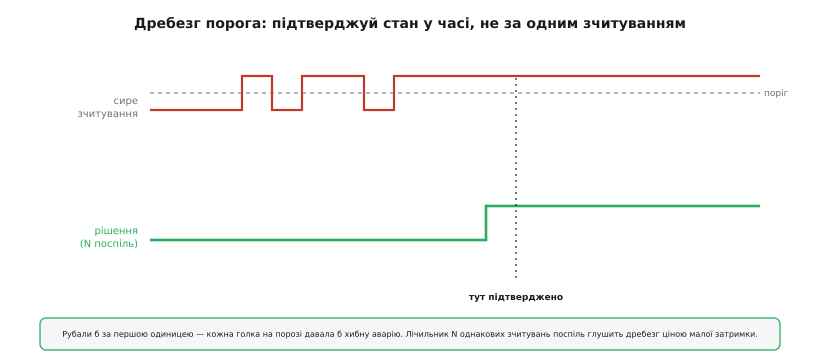

# ⚙️ Скінченний автомат прошивки BMS: контактори, таймаути, фіксація відмови

У самій темі ми вже домовилися, **що** робить BMS: міряє кожну комірку, дублює захист двома лініями за «АБО», і рве коло парою MOSFET-ів або контактором — а високовольтний контактор вмикає не «в лоб», а через передзаряд. Усе це — опис вузлів і правил. Тепер настав час перетворити правила на **код, який реально крутиться в мікроконтролері** й щомиті вирішує, які котушки тримати під напругою. Бо між «знаємо порядок увімкнення» і «прошивка ніколи не зварить контактор і не зависне посеред аварії» лежить ціла прірва інженерних дрібниць, і саме в ній народжуються пожежі.

Це не псевдокод і не блок-схема для звіту. Це той самий шар, який ви впишете в проєкт: справжній C, з реальними проблемами реального заліза — дребезгом, залиплими контактами й гонками при провалі живлення.

## Задача

Сформулюймо точно, чим має керувати прошивка. У неї під рукою три виконавчі органи й кілька джерел правди:

- **три контактори** (для високовольтного пакета): «мінусовий» (англ. *negative*), **передзарядний** (англ. *pre-charge*) із резистором, і головний «плюсовий» (англ. *main*) — кожним вона командує окремою лінією GPIO через драйвер котушки;
- **вимір напруги пакета** `U_pack` (з боку батареї) і **напруги на навантаженні** `U_load` (по той бік контакторів, на вхідній ємності інвертора);
- **сигнал першої лінії захисту** — від розумного монітора з мікроконтролером (точні пороги по кожній комірці, температурі, струму);
- **сигнал другої лінії захисту** — від незалежного грубого вузла з власними «жорсткими» порогами;
- де можливо — **допоміжні контакти** (англ. *auxiliary contacts*, aux) контакторів: окрема пара контактів усередині реле, механічно зв'язана з головними, що каже прошивці, чи контактор **насправді** замкнувся, а не лише отримав команду.

Завдання прошивки: провести систему від «все розімкнено» до «навантаження під повною напругою» **рівно тією хореографією**, яку ми вивели в темі, — і за **будь-якої** негаразди миттєво звести все в безпечний стан і **зафіксувати** відмову, щоб система не «забула» про неї за наступний оберт циклу. При цьому вона мусить:

- не зварити контактор кидком струму на порожню ємність (передзаряд);
- не повірити в успіх передзаряду, якщо навантаження закорочене (таймаут і перевірка ΔU);
- не «осліпнути» через дребезг сигналів на порозі;
- зловити **залиплий** (зварений) контактор, що не послухався команди розімкнутися;
- і — найпідступніше — коректно поводитися, коли під нею самою провалюється живлення.

Звучить як купа окремих перевірок. Сила в тому, що всі вони лягають в **один** компактний автомат.

## Ідея

Серце прошивки BMS — **скінченний автомат** (англ. *finite state machine*, FSM). Чому саме він, ми вже бачили на прикладі [машини станів PD-sink](root:embedded/pd-sink-design/proj-pd-state-machine.md): коли система мусить вести впорядковану послідовність кроків, а будь-якої миті ззовні може прилетіти біда, FSM зводить усе до одного простого правила — «у стані X на подію Y роби Z». Тут ця ідея працює ще гостріше, бо ціна помилки — не «пристрій завис», а зварені контакти під сидінням людини.

Станів усього чотири, і вони буквально повторюють життя контактора:

```text
OFF        — усі контактори розімкнені; спокій, нічого не під напругою
PRECHARGE  — «−» і передзарядний замкнені; резистор заряджає ємність навантаження
ON         — головний замкнений, передзарядний розімкнений; повний струм дозволено
FAULT      — безпечний стан: усе розімкнено, відмова ЗАФІКСОВАНА (latched)
```


*Уперед система йде по три стани: OFF → PRECHARGE (за командою «увімкнути») → ON (коли різниця напруг ΔU впала нижче порога). Штатно вимикається назад в OFF. А вниз веде спільна «червона шина»: будь-яка з двох ліній захисту, таймаут передзаряду, залиплий контактор чи провал живлення кидають автомат у FAULT — безпечний стан, де все розімкнено й відмова зафіксована. Вийти з FAULT можна лише свідомим скиданням, а не «само минулося».*

Тут видно головну рису, яка відрізняє безпечний автомат від навчального. У PD-sink будь-яка проблема відкочувала нас на безпечні 5 В, але потім можна було спокійно пробувати знову. У BMS «безпечний стан» — це **пастка**, з якої немає автоматичного виходу: потрапив у FAULT — лишаєшся там, доки людина (або старший рівень системи) свідомо не скине стан. Це навмисно. Якщо комірка пішла за межу або контактор не послухався, останнє, чого ми хочемо, — щоб прошивка через секунду вирішила «ну, зараз начебто нормально» і знову подала високу напругу. Відмова в живленні має бути **липкою**.

Друга ідея — **поділ обов'язків**, той самий, що рятував нас у PD. Автомат відповідає за *коли* і *в якому порядку* клацати контакторами. Окремо від нього живе **оцінка безпеки** `safety_ok()` — чиста функція, що відповідає на одне питання: «чи безпечно зараз тримати коло замкненим?». Вона зводить докупи обидві лінії захисту за «АБО» (точніше — за «АБО небезпек», тобто «І безпек»), і автомат лише питає її щоразу. Захочете завтра додати третє джерело тривоги — міняєте `safety_ok()`, а перевірена логіка переходів лишається незайманою.

Третя ідея — **подієвість без блокування**. Автомат не має права «спати» в очікуванні, поки ємність зарядиться: поки він чекає, комірки лишаються під наглядом, і будь-якої миті може прилетіти аварія. Тому весь автомат — це функція `bms_step()`, яку головний цикл або таймерне переривання викликає **часто й коротко** (скажімо, раз на мілісекунду). Вона дивиться на поточний стан, читає входи, ухвалює одне рішення й одразу повертається. Жодних циклів очікування всередині. Час вона відстежує не паузами, а **відмітками часу**: «коли я ввійшов у цей стан?» — і порівнянням із поточним `now`.

Розберімо все це кодом, від кістяка до найпідступніших пасток.

## Кістяк: стани, входи, крок автомата

Почнімо з типів і структури стану. Усе, що автомат пам'ятає між викликами, складемо в одну структуру — це не лише охайно, а й критично для гонок, до яких ми ще дійдемо.

:::code proj-bms-state-machine/c/kistiak-stany-vkhody-krok.c

Тепер шар доступу до заліза. Винесемо його за окремі функції — автомат не повинен знати, який це GPIO чи через який драйвер котушки. Це не косметика: завтра те саме коло переїде з контакторів на пару MOSFET-ів, і змінити доведеться лише ці кілька рядків, а не логіку.

:::code proj-bms-state-machine/c/kistiak-stany-vkhody-krok-2.c

Окремо — оцінка безпеки. Тут і живе те саме «АБО» двох ліній із теми. Зверніть увагу: функція не вирішує, що *робити*, — лише чесно каже, чи все гаразд.

```c
// Безпечно тримати коло замкненим? Будь-яка тривога → ні.
// Це і є логіка «АБО» двох незалежних ліній захисту.
static bool safety_ok(void)
{
    if (cell_protect_alarm()) return false;   // 1-ша лінія
    if (secondary_alarm())    return false;   // 2-га лінія
    return true;
}
```

І нарешті — вхід у відмову. Винесемо його в одну функцію, бо в FAULT ми падатимемо з десятка місць, і всюди дія однакова: **спершу знеструмити, тоді запам'ятати**.

:::code proj-bms-state-machine/c/kistiak-stany-vkhody-krok-3.c

Тепер головний крок. Він короткий навмисне: один `switch`, у кожному стані — кілька рядків. Важлива деталь схована в першому ж рядку тіла: **перевірку безпеки робимо в кожному «живому» стані, ще до будь-якої логіки переходу**. Поки коло може бути замкнене, безпека головніша за все.

:::code proj-bms-state-machine/c/kistiak-stany-vkhody-krok-4.c

Команда «увімкнути» — окремий вхід, бо вона не «подія в циклі», а зовнішнє рішення (ключ запалювання, команда по CAN). Вона не вмикає нічого сама — лише дозволяє автомату рушити з OFF, і то лише якщо все гаразд:

:::code proj-bms-state-machine/c/kistiak-stany-vkhody-krok-5.c

Кістяк готовий. Він уже правильно структурований: безпека попереду логіки, відмова липка, час — через мітки. Тепер найцікавіше — наповнити `precharge_step()` справжньою хореографією контакторів.

## Хореографія передзаряду в коді

У темі ми вивели послідовність словами: замкнути «мінус», замкнути передзарядний, дочекатися, поки напруга на навантаженні майже зрівняється з пакетом, замкнути головний, розімкнути передзарядний. Тепер — той самий танець у часі, але вже з годинником і запобіжниками.


*Хто коли замкнений. «Мінусовий» (1) замикається першим і лишається. Передзарядний (2) заряджає вхідну ємність крізь резистор — напруга на навантаженні (нижня крива) пливе вгору за сталою часу R·C. Крок 3 — не пауза за таймером, а очікування виміряної умови: коли ΔU = U_pack − U_load впала нижче порога, замикаємо головний (4) і лише ПОТІМ розмикаємо передзарядний (5). Перекриття на кроках 4–5 навмисне.*

Дві речі тут вартує закарбувати, бо їх легко зробити неправильно навіть знаючи теорію.

**Перше: чекаємо виміряну умову, а не таймер.** Спокуса написати «зачекай 200 мс і вмикай головний» велика — і небезпечна. Стала часу R·C залежить від реальної ємності навантаження, яка може бути різною, старіти, та й резистор має допуск. Якщо чекати фіксований час, то за «жирнішої» ємності ми замкнемо головний, коли вона ще недозаряджена, — і дістанемо той самий кидок струму, від якого передзаряд і рятує. Тому правильний критерій — **різниця напруг**: замикаємо головний лише коли `U_pack − U_load` стала малою (галузева практика — коли навантаження дійшло до ~90–95 % напруги пакета). Таймер тут не критерій успіху, а **запобіжник на невдачу**: якщо за відведений час ΔU так і не впала, щось не так (найімовірніше — коротке в навантаженні, куди весь струм іде в землю, і ємність не набирає напруги), і це привід для FAULT, а не для «почекаю ще».

**Друге: головний замикаємо ПЕРШ, ніж розімкнути передзарядний.** Це тонкість, через яку горять передзарядні резистори. Якби ми спершу розімкнули передзарядний, а тоді замикали головний, то на коротку мить струм навантаження мусив би текти крізь резистор — а він на це не розрахований і згорить. Тому послідовність із перекриттям: замкнули головний (тепер струм має прямий шлях) — і вже потім спокійно прибрали передзарядну вітку.

:::code proj-bms-state-machine/c/khoreohrafiia-peredzariadu.c

Один рядок у цьому блоці забігає наперед. Головний ми замикаємо не прямим `contactor_main(true)`, а через тонку обгортку `cmd_main()` — вона клацає той самий контактор, але заразом запам'ятовує, **що** ми йому наказали. Навіщо потрібна ця пам'ять, стане очевидно в розділі про залиплий контактор; поки досить правила: до головного контактора ми звертаємось **лише** через `cmd_main()`, ніколи прямо повз неї — бо один такий виклик змусить прошивку брехати сама собі.

Завершення переходу — у першому ж проході `on_step()`: щойно ми в ON, прибираємо передзарядну вітку (з невеликою витримкою, щоб головний устиг механічно замкнутися) і далі вже стережемо усталений режим:

:::code proj-bms-state-machine/c/khoreohrafiia-peredzariadu-2.c

Числа в коді не з повітря. Передзаряд у реальних системах укладається в сотні мілісекунд (за п'ять сталих часу `R·C` ємність набирає ~99 % напруги), тож таймаут у пів секунди-секунду дає чесний запас і водночас швидко ловить коротке. Поріг 95 % — це той момент, коли залишковий кидок при замиканні головного вже несуттєвий: різниця напруг мала, тож і стрибок струму `ΔU / R_контактів` малий.

> 🔧 **Навіщо це.** Передзаряд за виміром, а не за таймером — це різниця між «працює на стенді» і «працює з будь-яким навантаженням десять років». Інвертор, який ви чіпляєте сьогодні, має одну вхідну ємність; завтра його поміняють на більший, ємність зросте — і прошивка з фіксованою паузою почне зварювати контактор, бо замикатиме головний на недозаряджену ємність. Прошивка ж, що чекає `U_load ≥ 0.95·U_pack`, підлаштовується сама й заразом безкоштовно ловить коротке в навантаженні: там `U_load` не росте взагалі, спрацьовує таймаут, система йде в FAULT замість того, щоб гнати струм у закорочений інвертор.

## Дребезг: чому не можна рубати за одним зчитуванням

Тепер — перша з трьох пасток, які перетворюють правильну в теорії логіку на джерело хибних спрацювань. Це **дребезг** (англ. *bounce*, *chatter*).

Сигнали захисту й виміри живуть не в ідеальному світі. Напруга комірки, що балансує **рівно на порозі** 4.20 В, через шум АЦП читатиметься то 4.201, то 4.199 — і компаратор (чи наша перевірка) скакатиме «небезпека / норма / небезпека» багато разів за секунду. Механічні контакти aux-сигналу при замиканні теж не клацають чисто: вони кілька мілісекунд **дзеленчать**, даючи серію «замкнено/розімкнено», перш ніж устоятися. Якщо рубати коло за **першим** же «небезпека», ми діставатимемо хибні аварії на рівному місці — а в системі, де FAULT липкий, кожна хибна тривога це зупинка, яку доведеться скидати руками.


*Сире зчитування (вгорі) на порозі дребезжить — серія коротких перескоків. Якби рішення (внизу) повторювало кожен перескок, ми мали б шквал хибних аварій. Натомість рішення міняється лише тоді, коли новий стан протримався N зчитувань поспіль: лічильник однакових результатів глушить дребезг ціною малої, передбачуваної затримки.*

Розв'язок — **підтвердження в часі**: не вір одному зчитуванню, дочекайся, поки той самий стан повториться N разів поспіль. Це додає крихітну затримку (N тактів циклу), зате прибирає весь дребезг. Важливо лише вибрати N **свідомо**: затримка `N · період_циклу` має бути меншою за час, за який реальна біда встигне нашкодити. Для перенапруги комірки прийнятні десятки мілісекунд; це сотні зчитувань на циклі в 1 мс — більш ніж досить, щоб відсіяти шум, і вчасно, щоб устигнути зреагувати.

:::code proj-bms-state-machine/c/drebezh-chomu-ne-mozhna.c

І тоді в «живих» станах перевірку безпеки замінюємо на підтверджену версію:

```c
    case BMS_ON:
        if (alarm_confirmed()) { enter_fault(FAULT_CELL_PROTECT); break; }
        on_step(t);
        break;
```

Тут є тонкий, але важливий вибір **асиметрії**, і він не очевидний. Дребезг ми глушимо лише для **переходу в небезпеку через перевірку самим МК**, де шум на порозі реальний і часто-густо хибний. Але **друга лінія захисту** (незалежний грубий вузол) — то інша річ: вона навмисно тупа й спрацьовує лише за відвертого виходу за грубі межі, де дребезгу майже не буває, а ціна пропустити подію — катастрофа. Тож сигнал другої лінії розумно вести **без** фільтра-підтвердження — повне «не сповільнюй останню стіну». Це ілюструє правило: фільтруй там, де шум дає хиби, і не фільтруй там, де кожна мілісекунда затримки дорожча за випадкову хибу. У безпеці симетрія — не чеснота.

## Залиплий контактор: коли команда не дорівнює реальності

Друга пастка — **залиплий**, тобто зварений контактор (англ. *welded* / *stuck contactor*). Ми вже бачили в темі, **чому** він з'являється: кидок струму на порожню ємність плавить мідь у момент торкання, і контакти спікаються. Передзаряд саме цьому й запобігає. Але передзаряд може дати збій (хтось поставив замалий резистор, була мікротріщина, контактор зносився), і тоді ми отримуємо найгірший можливий відмовний режим: **контактор, який неможливо розімкнути**. Команда `contactor_main(false)` пішла, а коло лишилося замкненим — і весь наш дбайливий захист став декорацією, бо рубати вже нічим.

Прошивка зобов'язана це **виявляти**, інакше вона бреше сама собі. Ключ — той самий допоміжний контакт `aux_main_closed()`: він каже не «що я наказав», а «що сталося насправді». Логіка перевірки — звірити **команду** з **реальністю**:

- наказав замкнути, а aux каже «розімкнено» (за розумний час на спрацювання) → контактор не замкнувся (обрив котушки, застряг механічно);
- наказав розімкнути, а aux каже «замкнено» (за розумний час) → **зварений**, найнебезпечніше.

Друге — справжня катастрофа, бо коло не розірвати. Що тут може зробити прошивка? Вона не всемогутня — зварений головний вона не «відзварить». Але в неї лишається один козир: **інші контактори**. Якщо головний заклинило замкненим, можна розімкнути «мінусовий» — і цим усе одно розірвати коло з іншого боку. Тому навіть у безвиході прошивка робить максимум, а не опускає руки.

:::code proj-bms-state-machine/c/zalyplyi-kontaktor-koly.c

Тепер зрозуміло, чому головний не можна замикати повз `cmd_main()`. Уся ця перевірка тримається на дзеркалі `main_cmd` — на тому, що ми головному *наказали*. Якби передзаряд клацнув головний прямим `contactor_main(true)`, дзеркало лишилося б на `false` ще з моменту старту, де `cmd_main(false)` тримав його розімкненим, — і `watch_stuck_contactor()` побачив би «наказано розімкнути, а aux каже замкнено», тобто прийняв би цілком нормальне, успішне замикання за зварювання й кинув систему в FAULT одразу по кожному вдалому передзаряді. Одна команда повз обгортку — і захист бачить зварені контакти там, де їх немає. Тому обидві штатні команди головному — розмикання на старті через `cmd_main(false)` і замикання наприкінці передзаряду через `cmd_main(true)` — ідуть тільки крізь обгортку; аварійний `enter_fault()` рве контактори напряму й найпершими навмисне, і там дзеркало вже ні на що не впливає, бо у FAULT наглядач мовчить.

Є ще одне місце, де ця перевірка безцінна, — **старт**. Перш ніж починати передзаряд, варто переконатися, що головний контактор **розімкнений насправді**. Бо якщо він зварений ще з минулого разу, а ми про це не знаємо й бадьоро вмикаємо «мінусовий», ми зберемо повне коло на повну напругу без жодного передзаряду. Тому ще в `bms_request_on()` розумно першим ділом спитати aux: якщо головний уже «замкнений», поки ми нічого не вмикали, — це зварений контактор, і єдина правильна реакція — навіть не пробувати, а одразу в FAULT.

:::code proj-bms-state-machine/c/zalyplyi-kontaktor-koly-2.c

> 🔧 **Навіщо це.** Допоміжні контакти — це різниця між прошивкою, що *думає*, ніби керує колом, і прошивкою, що *знає* його справжній стан. Без них зварений контактор лишається невидимим, доки хтось не торкнеться того, що мало б бути знеструмленим. Це не теоретична засторога: у серійних системах розбіжність команди й aux-стану — стандартний привід негайно знеструмити коло й більше не вмикатися до ручного втручання. Якщо у вашому контакторі aux-контактів немає, їхню роль частково грає та сама перевірка ΔU (наприклад, напруга на навантаженні присутня, хоч усе наказано розімкнути, — ознака залипання), але це грубіший і повільніший сурогат.

## Гонки при відмові живлення: найпідступніша пастка

Третя пастка найтонша, бо вона не про залізо кола, а про **саму прошивку під час катастрофи**. Уявімо: система в ON, повний струм тече, і тут провалюється живлення **самого BMS** — просіла та лінія, що годує мікроконтролер і драйвери котушок. Що станеться?

Тут і причаїлася **гонка** (англ. *race condition*). Мікроконтролер при падінні напруги живлення не вимикається чисто й миттєво. Він проходить смугу, де напруга вже нижча за робочу, але ще не нульова, — і в цій смузі він може **поводитися непередбачувано**: виконати кілька інструкцій неправильно, записати в GPIO сміття, зависнути на півдорозі. Якщо саме в цей момент він «вирішить» замкнути не той контактор або, гірше, зробить кидок на ще не готову ємність — наслідки кепські. А ще: контактори тримаються замкненими, **поки на котушку подано струм**. Коли живлення драйвера зникне, котушки відпустять самі — але **в якому порядку** і **наскільки синхронно**, ми не контролюємо. Якщо головний відпустить, поки «мінусовий» ще тримає, чи навпаки — нічого страшного. А от якщо логіка встигне віддати півкоманди й лишити систему в дивному стані — це біда.

Захист тут будується на трьох опорах, і всі три однаково потрібні.

**Опора перша — апаратний наглядач за живленням** (англ. *brown-out detector*, BOD; *brown-out* — «просідання», на відміну від *black-out*, повного зникнення). Це вузол, який стежить за напругою живлення й **тримає мікроконтролер у скиданні**, щойно вона впала нижче безпечного порога. Він робить це **апаратно**, без участі прошивки, тож не залежить від того, чи встигла та зреагувати. Поки напруга низька — процесор у скиданні, його GPIO у відомому (зазвичай високоімпедансному) стані, і він фізично не може віддати помилкову команду. Ми вже торкалися цієї ідеї в кроці про [захист від зникнення живлення: brown-out і рятування стану](root:embedded/power-fail-safety) — тут вона з косметичної стає життєво важливою.

**Опора друга — безпечний стан контакторів за замовчуванням.** Драйвер котушки треба спроєктувати так, щоб **відсутність сигналу означала «розімкнено»**. Котушка контактора тримається замкненою, лише поки прошивка активно подає на неї струм; зник сигнал (бо МК у скиданні чи знеструмлений) — котушка відпускає, контактор розмикається сам. Це принцип «**безпечно при відмові**» (англ. *fail-safe*): за будь-якого збою система валиться в безпечний, а не в небезпечний бік. Прошивці не треба «встигнути розімкнути» контактори при падінні живлення — вони розімкнуться самі, бо тримати їх більше нікому. Якраз тому в `enter_fault()` ми спершу клацаємо контактори, а не навпаки: але навіть якщо `enter_fault()` не встигне виконатися взагалі, fail-safe-драйвер усе одно зробить своє.

**Опора третя — відновлення в безпечний стан після скидання.** Коли живлення повернеться й мікроконтролер перезавантажиться, він **не пам'ятає**, що був у ON: уся структура `bms` в оперативній пам'яті обнулилася. Він стартує заново з `BMS_OFF` — і це **правильно**. Після будь-якого збою живлення єдиний безпечний початок — «все розімкнено, нічого не припускаємо». Не намагайтеся «відновити» ON після перезавантаження, як завабливо це не звучало б: ви не знаєте, що сталося з колом, поки вас не було, тож зберіть його заново через передзаряд. Якщо ж потрібно, щоб **факт** аварійного скидання не загубився (для журналу, для блокування повторних спроб), його зберігають не в RAM, а в незалежній від живлення пам'яті — і читають на старті.

Складемо безпечну ініціалізацію докупи:

:::code proj-bms-state-machine/c/honky-pry-vidmovi.c

> 🔧 **Навіщо це.** Гонка при відмові живлення — це той клас багів, який не ловиться на стенді й вистрілює раз на тисячу циклів у полі, коли просідає бортова мережа. Його не «дописати» логікою — він закривається **архітектурою**: апаратний brown-out тримає процесор у скиданні в небезпечній смузі напруг; fail-safe-драйвер розмикає контактори без участі коду; а старт завжди з OFF не дає прошивці успадкувати небезпечний стан, якого вона не може перевірити. Прошивка, що намагається «акуратно вимкнутися» при падінні живлення, програє гонку процесору, що вже виконує сміття; прошивка, побудована на fail-safe, цю гонку взагалі не біжить.

## Вихід із FAULT і повна картина

Лишилося замкнути коло керування — **скидання**. Ми навмисне зробили FAULT пасткою, тож потрібен свідомий жест, щоб із неї вийти. Важливо, що скидання не має права бути «м'яким»: воно мусить пересвідчитися, що причина відмови зникла, перш ніж пускати систему назад у роботу.

:::code proj-bms-state-machine/c/vykhid-iz-fault-i-povna.c

Тепер зведімо все докупи — як ці частини працюють разом за один реальний сеанс:

```text
старт            → bms_init():    усе розімкнено, стан OFF (або FAULT із NVM)
команда «увімк.» → bms_request_on(): перевір aux головного; замкни «−» і передзарядний; → PRECHARGE
кожну 1 мс       → bms_step():
   PRECHARGE: безпека? → ні: FAULT. таймаут? → так: FAULT (коротке).
              U_load ≥ 95 % U_pack? → замкни головний, → ON
   ON:        безпека (з дребезг-фільтром)? → ні: FAULT.
              зніми передзарядний; стеж за aux (залиплий?) → невідповідність: FAULT
авария         → enter_fault(): СПЕРШУ розімкни все, ТОДІ запам'ятай першу причину; → FAULT
провал живлення→ brown-out тримає МК у скиданні; fail-safe-драйвери самі розмикають котушки
скидання       → bms_reset(): лише якщо безпека ок і головний реально розімкнений → OFF
```

Уся ця конструкція тримається на кількох наскрізних принципах, які варто промовити окремо, бо вони — не про BMS, а про будь-яку прошивку, що керує небезпечною потужністю:

- **Безпека попереду логіки.** Поки коло може бути замкнене, перевірку безпеки робимо першою дією в кожному стані, ще до будь-яких переходів. Логіка переходів зачекає; комірка за межею — ні.
- **Відмова липка.** FAULT — пастка без автоматичного виходу. «Само минулося» в живленні — не привід знову подавати напругу.
- **Спершу знеструмити, тоді думати.** У `enter_fault()` дії над контакторами стоять найперші, до запису кодів і прапорів. Якщо процесор помре посеред функції, коло вже буде розірване.
- **Команда ≠ реальність.** Не вір тому, що наказав, — звіряй із aux і з виміряною напругою. Зварений контактор бачать лише так.
- **Чекай вимір, не таймер.** Перехід уперед — за виміряною умовою (ΔU), таймер — лише запобіжник на невдачу.
- **Fail-safe в залізі, а не в коді.** Відсутність сигналу = безпечний стан. Брон-аут і самовідпускання котушок закривають гонки, які кодом не закрити.

Усе це разом — менше двохсот рядків C, але саме вони стоять між літієвим пакетом і пожежею. Автомат тут не «архітектурна краса заради краси»: він робить **кожен** можливий збій — від дребезгу до зварених контактів і провалу живлення — однією й тією ж подією, що веде в один безпечний стан. А в безпеці передбачуваність дорожча за все.
