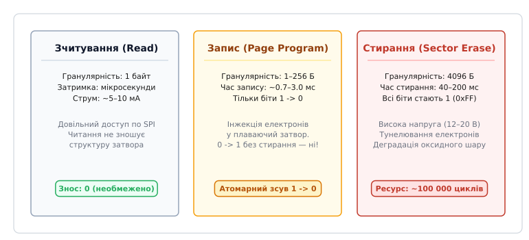
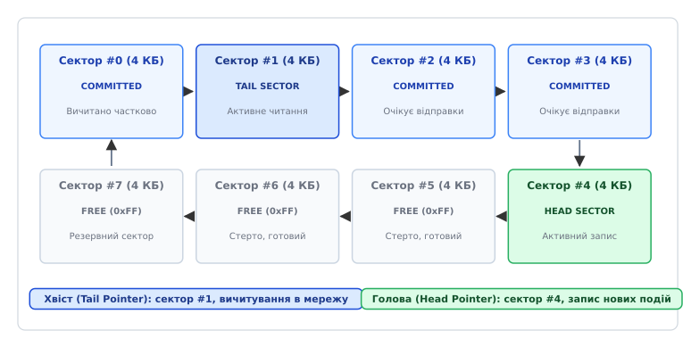
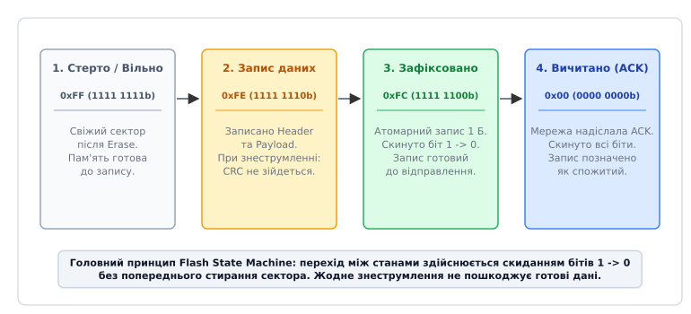
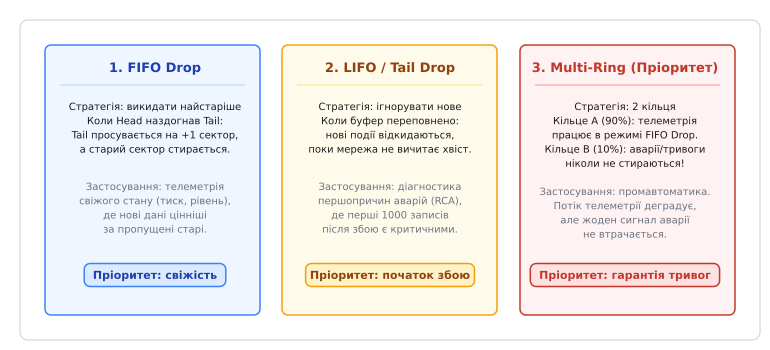

# Буфер на флеші: накопичити й віддати потім

<preknowlist>
- [Гарантії доставки: щонайбільше раз, щонайменше раз, фактично раз](root:sf-distributed/delivery-guarantees) — чому мережевий транспорт втрачає пакети та як рівні доставки визначають необхідність локального буфера.
- [Повтори й експоненційний відступ](root:sf-distributed/retries-backoff) — алгоритми повторних спроб передачі накопичених даних після відновлення зв'язку.
- [Життя без зв'язку: що пристрій вирішує сам](root:embedded/zhyttia-bez-zviazku) — принципи автономної поведінки вузла та розділення контурів швидкого керування й повільної синхронізації.
- [Мертва черга й отруйне повідомлення](root:sf-distributed/dead-letter-queue) — ізоляція пошкоджених пакетів під час розбору черги повідомлень.
</preknowlist>

Автономна телеметрична станція на магістральному газопроводі або сейсмічний датчик у віддаленому гірському районі живляться від сонячної панелі з буферним залізо-фосфатним акумулятором. Під час тривалого бурану стільниковий зв'язок або супутниковий канал зникають на три тижні. Датчики вібрації, тиску й температури продовжують опитуватися кожні десять секунд, генеруючи по 64 байти структурованих вимірювань у кожному циклі опитування. Якщо мікроконтролер зберігає ці дані у динамічній оперативній пам'яті (SRAM), перше ж глибоке просідання напруги батареї (англ. *brownout*) або планове перезавантаження від сторожового таймера (англ. *Watchdog Timer*) миттєво знищує всі накопичені тисячі спостережень.

Спроба розв'язати проблему за допомогою мікросхеми EEPROM стикається з браком ємності: типовий чіп I2C EEPROM має обсяг 4–32 КБ, чого вистачає лише на кілька годин автономного логування. З іншого боку, встановлення дешевої енергонезалежної флеш-пам'яті SPI NOR Flash (наприклад, чіпів серії W25Q32 або MX25L64 на 4–8 МБ) відкриває гігантський простір для сотень тисяч записів, але негайно карає розробника апаратною специфікою кремнію. 

Якщо програміст реалізує на флеш-пам'яті наївний масив або класичний кільцевий буфер з оперативної пам'яті — зі зберіганням покажчиків голови й хвоста у фіксованому нульовому секторі, — цей сектор вичерпує свій ліміт у 100 000 циклів стирання рівно за шість днів безперервної роботи. Якщо ж для збереження повідомлень змонтувати повноцінну файлову систему, то раптове знеструмлення під час модифікації кореневих таблиць FAT або дескрипторів файлів призводить до незворотного пошкодження структури сховища та втрати всієї черги.

Енергонезалежний кільцевий буфер на Flash-пам'яті (англ. *Non-Volatile Flash Sector-Ring FIFO*) проєктується на зовсім інших засадах: нульовий оверхед метаданих, природне кругове вирівнювання зносу (англ. *Wear Leveling*), виведення стану черги без фіксованих покажчиків та гарантована стійкість до знеструмлення (англ. *Power-Cut Resilience*) на рівні окремих бітових переходів.

---

### Фізичні обмеження Flash-пам'яті: чому наївний буфер вбиває кристал

Щоб спроєктувати надійну структуру даних поверх Flash, необхідно розуміти фізичні процеси всередині напівпровідникової комірки з плаваючим затвором (англ. *Floating Gate*) або пасткою заряду (англ. *Charge Trap*).


*Асиметрія операцій читання, програмування та стирання в SPI NOR Flash: читання довільне й не руйнує діелектрик; запис можливий лише скиданням бітів 1 → 0; стирання виконується лише великими секторами по 4 КБ високою напругою.*

В енергонезалежній пам'яті SPI NOR Flash існує сувора ієрархія організації простору:
1. **Сторінка (Page, 256 байтів)** — мінімальна одиниця пакетного програмування. За один сеанс передачі по SPI можна записати від 1 до 256 байтів, але виключно в межах однієї фізичної сторінки (від адреси `0x...00` до `0x...FF`).
2. **Сектор (Sector, 4096 байтів / 4 КБ)** — мінімальна фізична одиниця стирання.
3. **Блок (Block, 32 КБ або 64 КБ)** — група з 8 або 16 секторів, що підтримує прискорене блокове стирання.
4. **Кристал (Chip, 1–32 МБ)** — сукупність усіх блоків.

Головна апаратна властивість NOR Flash полягає у фундаментальній **асиметрії між записом і стиранням**:
- **Читання (Read)** виконується побайтово з довільним доступом на повній частоті SPI (до 50–104 МГц). Читання не викликає деградації діелектрика і має нескінченний ресурс.
- **Програмування (Page Program)** змінює стан бітів **виключно з логічної одиниці в логічний нуль (`1 -> 0`)**. Процес полягає в інжекції електронів у плаваючий затвор під дією помірної напруги. Записати нуль поверх одиниці можна будь-якої миті, але перетворити хоча б один біт із `0` назад у `1` операцією запису фізично неможливо.
- **Стирання (Sector Erase)** скидає **всі біти цілого сектора 4096 байтів назад у логічну одиницю (`0xFF`)**. Для видалення електронів із затворів подається високовольтний імпульс (12–20 В), який викликає тунелювання Фаулера-Нордгейма. Цей імпульс поступово руйнує тонкий шар діоксиду кремнію навколо затвора.

Через деградацію діоксиду виробники гарантують лише близько **100 000 циклів стирання** для кожного сектора. Після вичерпання цього ресурсу комірки втрачають здатність утримувати заряд, з'являються биті біти та спотворення інформації.

#### Катастрофа наївного кільцевого буфера
У класичному RAM-буфері стан черги описується структурою:

:::tabs
```c
struct NaiveRing {
    uint32_t head;       /* Зміщення для запису */
    uint32_t tail;       /* Зміщення для читання */
    uint8_t  data[8192]; /* Кільцевий масив даних */
};
```
```cpp
struct NaiveRing {
    uint32_t head{0};                 // Зміщення для запису
    uint32_t tail{0};                 // Зміщення для читання
    std::array<uint8_t, 8192> data{}; // Кільцевий масив даних
};
```
:::

Якщо перенести цю модель у флеш-пам'ять і оновлювати зміщення `head` у перших байтах сектора `0` при кожній появі нового вимірювання (наприклад, раз на 5 секунд), то кожне оновлення покажчика вимагає:
1. Зчитати поточний сектор 4 КБ у RAM мікроконтролера.
2. Модифікувати значення `head`.
3. Виконати команду стирання сектора (Sector Erase) на флеші (витративши 50–100 мс часу та до 20 мА струму).
4. Записати 4 КБ назад на флеш.

Розрахуймо час до повної фізичної смерті кристала:
```
Кількість операцій стирання на добу = 86400 с / 5 с = 17 280 циклів/добу.
Час до досягнення 100 000 циклів = 100 000 / 17 280 ≈ 5.78 днів.
```
Через менш ніж шість днів роботи сектор `0` флеш-пам'яті буде незворотно спалений, а весь прилад перетвориться на сміття. Коефіцієнт посилення запису (англ. *Write Amplification Factor, WAF*) тут досягає катастрофічного значення: заради оновлення 4 байтів метаданих стирається й перезаписується 4096 байтів флешу (`WAF = 4096 / 4 = 1024`).

#### Апаратні команди та таймінги SPI NOR Flash
Робота з чіпом Flash відбувається через стандартний набір SPI-інструкцій:
- `0x06` — **Write Enable (WREN)**: встановлює апаратний прапорець `WEL` (Write Enable Latch) у регістрі стану чіпа. Без попереднього надсилання цієї команди будь-яка спроба запису або стирання буде проігнорована кремнієм.
- `0x05` — **Read Status Register 1 (RDSR)**: зчитує байт регістру стану. Молодший біт 0 (`BUSY` або `WIP` — Write In Progress) дорівнює `1`, доки чіп зайнятий виконанням внутрішнього циклу програмування або стирання.
- `0x20` — **Sector Erase (4 KB)**: стирає вказаний сектор за адресою. Операція триває від 40 до 200 мс.
- `0x02` — **Page Program (1–256 B)**: записує байти в межах поточної сторінки. Операція триває від 0.7 до 3.0 мс.
- `0x03` / `0x0B` — **Read Data / Fast Read**: пряме читання масиву байтів на частоті до 50–104 МГц.
- `0xB9` / `0xAB` — **Deep Power-Down / Release Deep Power-Down**: переведення мікросхеми в режим наднизького споживання (струм знижується з 15 мкА в Standby до 1 мкА в глибокому сні), що критично для приладів із живленням від автономних батарей.

Оскільки стирання сектора триває до 200 мс, блокуюче очікування прапорця `BUSY` у головному потоці неприпустиме: воно зірве таймінги високошвидкісних контурів опитування датчиків чи регулювання двигунів. Тому підготовка (стирання) наступного вільного сектора повинна виконуватися завчасно у фоновій низькопріоритетній задачі RTOS.

Саме тому надійний буфер на Flash повинен базуватися на **посекційному логовому розподілі** (англ. *Log-Structured Sector Ring*), де операція стирання виконується лише тоді, коли вичерпано весь фізичний об'єм сектора, а покажчики ніколи не перезаписують одні й ті самі комірки.

---

### Архітектура секційного кільцевого буфера (Sector-Ring FIFO)

Секційний кільцевий буфер виділяє у флеш-пам'яті неперервний діапазон із N фізичних секторів (наприклад, 256 секторів по 4 КБ = 1 МБ сховища). Кожен сектор розглядається як окрема неподільна ланка кільцевого ланцюга.


*Архітектура секційного кільцевого буфера: кільце секторів із монотонною нумерацією, активні сектори запису (Head) та вичитування (Tail), послідовне заповнення без фіксованих таблиць покажчиків.*

Кожен фізичний сектор у кільці перебуває в одному з чотирьох логічних станів:
- **FREE / ERASED (`0xFF`)** — сектор повністю стертий, заповнений байтами `0xFF` і готовий до запису нових даних.
- **HEAD (Active Write)** — сектор, у який просто зараз драйвер послідовно дописує нові вхідні повідомлення.
- **QUEUED / COMMITTED** — сектор, повністю заповнений зафіксованими повідомленнями, які очікують відправлення в мережу.
- **TAIL (Active Read)** — найстаріший сектор із накопиченими повідомленнями, з якого мережевий стек вичитує дані для відправлення на сервер.

#### Анатомія сектора
Кожен сектор починається зі структурованого **заголовка сектора (Sector Header)** фіксованого розміру (16 байтів), за яким слідує неперервний потік записів змінної або фіксованої довжини:

```
┌────────────────────────────────────────────────────────────────────────┐
│ СЕКТОР FLASH (4096 байтів)                                             │
├───────────────────┬───────────────────┬───────────────────┬────────────┤
│ Sector Header     │ Record #0         │ Record #1         │ Record #N  │
│ (16 байтів)       │ (Header + Data)   │ (Header + Data)   │ ...        │
└───────────────────┴───────────────────┴───────────────────┴────────────┘
```

Формат заголовка сектора:

:::tabs
```c
typedef struct __attribute__((packed)) {
    uint32_t magic;          /* Магічне число валідності сектора: 0x53454354 ("SECT") */
    uint32_t sector_seq;     /* Глобальний монотонний номер сектора (0, 1, 2, ...) */
    uint8_t  state_flags;    /* Прапорці стану сектора (0xFF -> 0xFE -> 0xFC -> 0x00) */
    uint8_t  reserved[3];    /* Вирівнювання до 4 байтів */
    uint32_t header_crc32;   /* Контрольна сума заголовка */
} flash_sector_header_t;
```
```cpp
struct SectorHeader {
    uint32_t magic{0x53454354U}; // ASCII "SECT"
    uint32_t sector_seq{0};       // Монотонний номер сектора
    uint8_t  state_flags{0xFFU};  // Стан: 0xFF -> 0xFE -> 0xFC -> 0x00
    std::array<uint8_t, 3> reserved{0, 0, 0};
    uint32_t header_crc32{0};
} __attribute__((packed));
```
:::

#### Анатомія запису (Record)
Кожне повідомлення, яке потрапляє в чергу, загортається у власний фрейм із заголовком фіксованої довжини та тілом корисного навантаження (англ. *Payload*):

:::tabs
```c
typedef struct __attribute__((packed)) {
    uint16_t record_magic;   /* Магічне число запису: 0x5243 ("RC") */
    uint16_t payload_len;    /* Довжина корисного навантаження в байтах */
    uint32_t record_seq;     /* Монотонний номер повідомлення */
    uint8_t  status_flag;    /* Атомарний прапорець транзакції: 0xFF -> 0xFE -> 0xFC -> 0x00 */
    uint8_t  priority;       /* Пріоритет: 0 = звичайна телеметрія, 1 = тривога/аварія */
    uint16_t reserved;       /* Резерв / прапорці стиснення */
    uint32_t payload_crc32;  /* CRC32 корисних даних для захисту від спотворень */
} flash_record_header_t;
```
```cpp
struct RecordHeader {
    uint16_t record_magic{0x5243U}; // ASCII "RC"
    uint16_t payload_len{0};
    uint32_t record_seq{0};
    uint8_t  status_flag{0xFFU};    // 0xFF -> 0xFE -> 0xFC -> 0x00
    uint8_t  priority{0};
    uint16_t reserved{0};
    uint32_t payload_crc32{0};
} __attribute__((packed));
```
:::

Правило розміщення записів усередині сектора просте: записи укладаються послідовно один за одним (англ. *Append-Only*). Якщо розмір чергового запису `(sizeof(flash_record_header_t) + payload_len)` перевищує залишок вільного місця у поточному Head-секторі, цей сектор закривається, драйвер переходить до наступного фізичного сектора `(head_sector_idx + 1) % TOTAL_SECTORS`, перевіряє, що він стертий, записує новий `Sector Header` з `sector_seq = prev_seq + 1`, і записує повідомлення на початок нового сектора. 

Завдяки цьому записи ніколи не розриваються між двома секторами, що усуває потребу у складних таблицях фрагментації.

---

### Атомарне фіксування транзакцій та стійкість до раптового знеструмлення

Найнебезпечніша ситуація для вбудованої системи — раптове зникнення живлення або скидання процесора в момент, коли по SPI передаються байти нового запису. Якщо система використовує просту схему «записав довжину і дані», знеструмлення посеред операції призведе до появи «розірваного запису» (англ. *Torn Write*). При наступному старті драйвер прочитає сміття, інтерпретує його як валідні дані, надішле на сервер спотворений пакет або взагалі зависне через некоректне значення довжини.

Для досягнення абсолютної стійкості до аварійного вимкнення живлення використовується **автомат станів на побітовому скиданні (State Transition Machine)**.


*Життєвий цикл байта статусу запису: перехід між станами здійснюється виключно скиданням окремих бітів 1 → 0 без необхідності попереднього стирання сектора.*

Розгляньмо, як змінюється байт `status_flag` у заголовку запису протягом його життя:

1. **Свіжий сектор (FREE / ERASED):**
   Уся область пам'яті заповнена байтами `0xFF` (`1111 1111b`).
2. **Резервування та запис тіла (IN_PROGRESS):**
   Драйвер готує структуру `flash_record_header_t`, де поле `status_flag` встановлено в `0xFE` (`1111 1110b`, скинуто біт 0). Драйвер записує заголовок і корисне навантаження в один або два виклики `Page Program`. 
   *Якщо живлення вимкнеться просто зараз*, під час наступного ввімкнення система побачить статус `0xFE` або пошкоджений CRC. Такий запис вважається незавершеним і безпечно ігнорується!
3. **Атомарний коміт (COMMITTED):**
   Після того як вся довжина корисних даних записана і перевірена, драйвер виконує запис рівно **одного байта** за адресою поля `status_flag`, записуючи туди значення `0xFC` (`1111 1100b`, скинуто біт 1). 
   Оскільки операція скидає біт із `1` в `0`, вона не вимагає стирання сектора і виконується апаратною флешкою гарантовано атомарно. Щойно біт 1 став нулем, запис офіційно вважається зафіксованим (Committed) і стає видимим для читача `Tail`.
4. **Підтвердження вичитування (CONSUMED / DELETED):**
   Коли мережевий стек вичитав повідомлення з буфера, передав його по MQTT/HTTP і отримав від сервера підтвердження прийому (ACK), драйвер перезаписує байт статусу значенням `0x00` (`0000 0000b`). Запис помічається як видалений.

#### Обмеження на часткове програмування сторінки (Page Program Disturb)
У специфікаціях сучасних мікросхем NOR Flash вказується параметр `NOP` (англ. *Number of Partial Program Cycles*) — максимальна кількість послідовних операцій програмування окремих байтів у межах однієї й тієї самої 256-байтної сторінки без проміжного стирання сектора. 

Для більшості індустріальних чіпів SPI Flash параметр NOP ≥ 4 (а для багатьох чіпів NOR Flash дозволено довільне побайтове програмування доти, доки біти змінюються лише з `1` в `0`). У нашій схемі кожен запис викликає рівно **дві** операції програмування:
1. Запис тіла запису зі статусом `0xFE`.
2. Запис байта підтвердження коміту `0xFC`.
Це повністю вкладається в паспорти надійності всіх провідних виробників (Winbond, Macronix, Micron, GigaDevice).

#### Алгоритм відновлення та монтування буфера при старті (Mount Recovery Scan)
Коли прилад вмикається після аварійного знеструмлення або перезавантаження, в оперативній пам'яті немає жодного покажчика. Драйвер виконує швидке сканування флеш-пам'яті:

```
Крок 1. Сканування заголовків усіх N секторів (читання 16 байтів на сектор).
        Для 256 секторів це лише 4096 байтів передачі по SPI (менше 1 мс).
Крок 2. Відбір секторів із валідним magic == 0x53454354 та валідним CRC заголовка.
Крок 3. Пошук Head та Tail:
        - Head Sector = сектор із максимальним монотонним номером sequence.
        - Tail Sector = сектор із мінімальним sequence серед тих, де є невичитані записи.
Крок 4. Сканування Head-сектора:
        - Драйвер крокує по записах від початку сектора.
        - Знаходить останній валідний запис зі статусом COMMITTED (0xFC).
        - Якщо натрапляє на запис зі статусом 0xFE або пошкодженим CRC32 (розірваний запис) — 
          драйвер перезаписує його статус нулями (0x00), анулюючи пошкоджений хвіст.
        - Встановлює вказівник вільного місця write_offset на перші байти 0xFF.
```

Така процедура гарантує детермінований старт за фіксований час без ризику втрати раніше зафіксованих даних.

---

### Політики вирівнювання зносу та деградація при переповненні сховища

Організація черги у вигляді ланцюга секторів забезпечує ідеальне кругове вирівнювання зносу (англ. *Wear Leveling*): кожен сектор стирається рівно один раз за повний оберт кільця.

Порахуймо реальний ресурс флеш-буфера для типового промислового датчика:
- Розмір виділеної пам'яті: **2 МБ (512 секторів по 4096 байтів)**.
- Розмір одного вимірювання: 48 байтів даних + 16 байтів заголовка = **64 байти**.
- Період опитування датчика: **10 секунд**.
- Швидкість генерації даних:
```
Швидкість = 64 байти / 10 с = 6.4 байта/с = 552 960 байтів/добу ≈ 540 КБ/добу.
```
- Час одного повного оберту буфера:
```
Час оберту = 2 097 152 байти / 552 960 байтів/добу ≈ 3.79 доби.
```
- Ресурс флеш-чіпа при гарантованих 100 000 циклах стирання на сектор:
```
Загальний термін служби = 100 000 циклів * 3.79 доби ≈ 379 000 діб ≈ 1038 років!
```
Навіть якщо датчик записуватиме дані щосекунди, ресурсу 2 МБ флешу вистачить на **понад 100 років** безперервної роботи.

#### Стратегії поведінки при переповненні буфера (Buffer Overflow)
Що відбувається, коли зв'язок відсутній тижнями, і кільцевий буфер заповнюється повністю (голова `Head` наздоганяє хвіст `Tail`)? Вибір політики визначається бізнес-вимогами до даних.


*Політики переповнення буфера: витіснення найстаріших записів (FIFO Drop), блокування нових (LIFO Drop) та ізольоване мульти-кільце з гарантованим збереженням аварійних тривог.*

Існує три базові стратегії деградації:

1. **FIFO Drop (Drop Oldest / Ring Overwrite):**
   Коли новий запис не вміщується у вільні сектори, драйвер примусово просуває вказівник `Tail` уперед на один сектор, стирає найстаріший сектор і віддає його під новий `Head`.
   *Застосування:* моніторинг поточної телеметрії (температура, вологість, напруга живлення). Свіжі дані за останні три дні значно цінніші для оператора, ніж тритижневий масив застарілих чисел.

2. **LIFO / Tail Drop (Drop Newest / Preserving Initial Incident):**
   Коли буфер заповнений, драйвер відмовляється приймати нові вимірювання і відкидає їх, зберігаючи первинний накопичений зріз даних.
   *Застосування:* аналіз першопричин аварій (англ. *Root Cause Analysis*). Перші 10 000 подій з моменту аварії містять безпосередню причину катастрофи, тому їх категорично заборонено перезаписувати фоновим шумом.

3. **Пріоритетне мульти-кільце (Priority Multi-Ring Architecture):**
   Фізична флеш-пам'ять ділиться на два незалежні логічні кільцеві буфери:
   - **Кільце телеметрії (Regular Ring, 90% простору)** — працює за політикою *FIFO Drop*, забезпечуючи свіжість графіків.
   - **Кільце тривог та подій (Alarm Ring, 10% простору)** — зберігає спрацьовування кінцевиків, перевищення тиску, відкриття шафи. Це кільце ніколи не затирається автоматично і генерує критичну помилку, якщо пам'ять вичерпано.

#### Агрегація та ущільнення даних на льоту (In-place Data Downsampling)
Для систем із жорстким обмеженням пам'яті можливий гібридний підхід: коли зв'язку немає понад 24 години, фонова задача мікроконтролера вичитує з найстарішого сектора хвилинні вимірювання, обчислює для них агреговані значення (мінімум, максимум, середнє за 1 годину), записує один компактний агрегований запис в архівний сектор і стирає вихідний сектор. Це дозволяє скоротити обсяг застарілих спостережень у 60 разів без втрати ключових трендів.

---

### Повний драйвер енергонезалежної черги на C та C++

Розгляньмо закінчену, безпечну та високоефективну реалізацію Flash Ring Buffer. Драйвер спроєктовано за стандартом zero-allocation (жодних викликів `malloc` або динамічної пам'яті) і спирається на мінімальний апаратний рівень абстракції (HAL) для роботи з SPI Flash.

#### 1. Апаратний інтерфейс (Flash HAL) та структури даних

:::tabs
:::code bufer-na-fleshi-d/c/flash_ring_buffer.h
:::code bufer-na-fleshi-d/cpp/FlashRingBuffer.hpp
:::

#### 2. Реалізація базових операцій (Монтування, Push, Peek, Pop)

:::tabs
:::code bufer-na-fleshi-d/c/flash_ring_buffer.c
:::code bufer-na-fleshi-d/cpp/FlashRingQueue.hpp
:::

#### 3. Патерн безпечної відправки повідомлень (Peek -> Send -> Commit/Pop)
Критична перевага розділення операцій `peek()` та `commit_pop()` полягає у дотриманні гарантії доставки **щонайменше один раз (At-Least-Once Delivery)**:

:::tabs
:::code bufer-na-fleshi-d/c/3-patern-bezpechnoi.c
:::code bufer-na-fleshi-d/cpp/3-patern-bezpechnoi.cpp
:::

Якщо живлення приладу зникне просто посеред виклику `network_send_packet()`, після перезавантаження драйвер знову прочитає цей самий запис під час наступного `peek()` і повторно відправить його на сервер. Сервер, завдяки наявності поля `record_seq`, виконає дедуплікацію пакета за принципом ідемпотентності.

---

### Крайові випадки, апаратні пастки та діагностика

Навіть ідеально вивірений алгоритм логування може дати збій, якщо не враховувати апаратну специфіку зовнішніх мікросхем Flash.

#### 1. Загортання сторінки (Page Wrap-Around Trap)
Усі мікросхеми SPI NOR Flash мають апаратний внутрішній буфер запису розміром рівно 256 байтів. Якщо ви надішлете команду `Page Program` на 64 байти, починаючи з адреси `0x0000FE` (тобто за 2 байти до кінця сторінки), мікросхема запише перші 2 байти за адресами `0x0000FE` та `0x0000FF`, а решту 62 байти **запише не в наступну сторінку, а загорне на початок поточної (`0x000000`..`0x00003D`)**, безповоротно затерши власний заголовок сектора!

*Правило захисту:* Низькорівневий HAL-драйвер запису `write_page` зобов'язаний самостійно розбивати будь-яку транзакцію на шматки, які ніколи не перетинають 256-байтну межу сторінки (`addr & ~0xFFU`).

#### 2. Просідання напруги та поріг апаратного скидання (Brownout Reset vs Flash Vmin)
Більшість мікроконтролерів (STM32, ESP32, nRF52) здатні виконувати код при напрузі живлення аж до 1.7–1.8 В. Натомість більшість чіпів SPI Flash (наприклад, Winbond W25QxxJV) вимагають мінімальної напруги **2.7 В** (або 2.3 В для серій низької напруги). 

Якщо при розряджанні батареї напруга падає до 2.2 В, а в мікроконтролері не налаштовано апаратний детектор просідання напруги (BOR, англ. *Brownout Reset*), контролер продовжує виконувати код і надсилає команди запису по SPI. Flash-пам'ять у цей момент перебуває у непередбачуваному стані: внутрішній помповий перетворювач високої напруги не здатний пробити затвор, запис завершується помилкою або пошкоджує сусідні комірки.

*Правило захисту:* Завжди конфігурувати апаратний BOR мікроконтролера на поріг, вищий за мінімальну паспортну напругу чіпа Flash (типово 2.8–2.9 В). При досягненні цього порогу процесор повинен бути негайно утриманий у стані апаратного скидання.

#### 3. Апаратний прапорець Write Enable (WEL) та біти захисту секторів
Перед кожною операцією програмування чи стирання на чіп Flash необхідно надсилати команду `0x06` (`Write Enable`) і перевіряти біт `WEL` у регістрі стану (Status Register 1). Якщо шина SPI шумить, команда `WREN` може бути спотворена. Запис без перевірки `WEL` призведе до тихого ігнорування операції флешкою.

Крім того, після скидання живлення регістри блокування (Block Protect Bits `BP0..BP3`) повинні бути апаратно сконфігуровані в нуль, інакше спроба очистити сектор викличе відмову.

#### 4. Обробка «отруйного повідомлення» (Poison Pill Packet)
Якщо окремий запис зазнав фізичного пошкодження бітів на флеші (наприклад, через радіаційне випромінювання або деградацію комірки), його CRC32 перестане збігатися під час виклику `peek()`. Якщо драйвер у відповідь на помилку CRC просто поверне код помилки й залишить вказівник `tail_offset` на місці, мережевий стек зациклиться, намагаючись нескінченно перечитувати той самий битий пакет і блокуючи всю чергу відправлення.

*Правило захисту:* При виявленні невідповідності CRC32 драйвер автоматично маркує статус пошкодженого запису як `0x00` (`CONSUMED / INVALID`), збільшує діагностичний лічильник помилок та негайно переходить до наступного запису черги.

---

### Підсумкова архітектурна матриця

| Характеристика | Наївний буфер (FAT/RAM style) | Sector-Ring FIFO (Дана архітектура) |
| :--- | :--- | :--- |
| **Знос Flash (WAF)** | Катастрофічний (WAF = 100–1000) | Ідеальний мінімум (WAF ≈ 1.02) |
| **Термін служби 2 МБ Flash** | 5–10 днів | 100–800 років |
| **Стійкість до знеструмлення** | Вразливий до пошкодження метаданих | 100% атомарність (скидання бітів `1 -> 0`) |
| **Використання RAM** | 4–16 КБ (буфери секторів і таблиці) | < 128 байтів (лише індекси й зміщення) |
| **Час старту пристрою** | Повільне монтування FS | < 1 мс (сканування 16 Б заголовків секторів) |
| **Політика переповнення** | Зависання / помилка виділення місця | FIFO Drop / LIFO Drop / Priority Multi-Ring |
