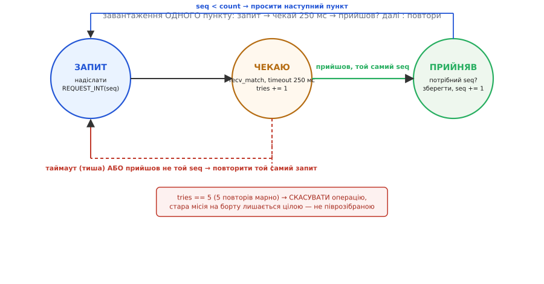
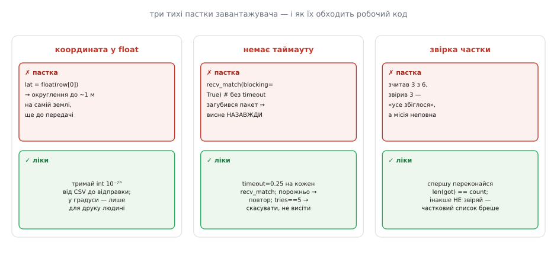

# ⚙️ Завантажити місію, зчитати назад і не збрехати собі: робочий завантажувач на pymavlink і C

## Задача: залити маршрут так, щоб на борту він був саме той

Ти склав місію — п'ять-шість пунктів: злетіти, пройти дві точки, скинути вантаж, повернутися. Тепер її треба **покласти в борт**, а перед першим `arm` — **переконатися**, що борт зберіг рівно те, що ти задумав. Здавалося б, дрібниця: у [pymavlink](root:embedded/pymavlink) є `mav.mission_item_int_send(...)` (а в C — `mavlink_msg_mission_item_int_pack(...)` плюс надіслати буфер) — виклич його для кожної точки, і готово.

Спробуй так — і рано чи пізно апарат полетить не туди. Причина в тому, що між твоїм скриптом і бортом лежить **радіоканал**, а не функція. Пакети губляться, дублюються, приходять не в тому порядку. Якщо ти просто «вистрілиш» шість `MISSION_ITEM_INT` поспіль у сокет, борт може прийняти чотири з них, пропустити пункт #2 через збитий пакет — і зібрати в пам'яті маршрут із дірою. Або, ще підступніше, прийняти всі шість, але не в тому порядку, і покласти точку C туди, де мала бути A. Скрипт відпрацює без єдиної помилки, друкне «готово» — а місія на борту буде спотворена, і ти цього **не побачиш**, поки апарат не рушить.

Тому задача формулюється жорсткіше, ніж «надіслати». Треба:

1. **Завантажити** місію так, щоб борт зібрав її строго по порядку й без дірок, з підтвердженням у кінці.
2. **Зчитати назад** те, що реально лежить у борті (а не те, що ми «мали б» надіслати).
3. **Звірити** кожен пункт із задумом — координати, висоту, систему відліку висоти — до того, як дозволити старт.
4. **Спостерігати** в реальному часі, на якому пункті стоїть місія в польоті.

І кожен із цих кроків мусить бути **стійким до втрати пакета** — інакше перший загублений байт або зіпсує маршрут, або підвісить скрипт назавжди. Базовий крок капстоуна показав, що завантаження місії — це рукостискання; детальний розбір показав, чому воно надійне навіть на дірявому каналі. Тут ми втілюємо це рукостискання в **робочий код**, який ти справді запустиш проти свого борту, — і показуємо його **двома мовами одразу**: на pymavlink (як ти напишеш це на землі за ноутбуком) і на MAVLink C library (як той самий протокол виглядає в прошивці чи на компаньйон-компі, де pymavlink немає). Логіка стан-машини — та сама; різниця лише в тому, скільки чорної роботи бібліотека робить за тебе.

> 🔧 **Навіщо це.** «Залив і полетів» без зчитування назад — це політ наосліп. Дві хвилини звірки на землі економлять годину пошуку «чому дрон полетів не туди» — і, цілком імовірно, сам апарат. Помилка в координаті чи в системі висоти на землі коштує **нуль**; та сама помилка в повітрі коштує апарата й, можливо, чужого вікна. Цей скрипт переносить усі тихі помилки завантаження туди, де вони безпечні, — на екран твого ноутбука перед стартом.

## Ідея: рукостискання — це не «надіслати», а цикл «запит → чекай → підтверди»

Ключовий зсув, без якого код не складеться правильно. Завантаження місії — **не** односторонній потік «GCS → борт». Це **діалог**, у якому провідну роль веде **борт**, а не земля. Земля лише оголошує, скільки буде пунктів, а далі — **борт сам просить** кожен наступний пункт за його номером `seq`, і земля лише **відповідає** на запити.

Порядок такий (він звірений із офіційним [протоколом місій MAVLink](root:embedded/mavlink-from-ground) — деталі механіки й історію переходу на цілочислові координати розібрано в основній статті капстоуна):

```
GCS  → борт : MISSION_COUNT (усього 6)
борт → GCS  : MISSION_REQUEST_INT (дай #0)   ← борт КЕРУЄ темпом
GCS  → борт : MISSION_ITEM_INT   (ось #0)
борт → GCS  : MISSION_REQUEST_INT (дай #1)
GCS  → борт : MISSION_ITEM_INT   (ось #1)
        …    (борт САМ просить кожен наступний)
борт → GCS  : MISSION_ACK (MAV_MISSION_ACCEPTED) — прийняв усі 6
```

Чому це надійно, а «вистрілити потоком» — ні? Бо **надійність тримає той, хто зберігає результат** — борт. Якщо запит на #1 не дійшов до землі, борт **повторить** запит #1 і не рушить далі, доки не отримає пункт. Якщо земля відповість пунктом #3, коли борт чекав #2, борт його **відкине** й перепитає саме #2. Список у пам'яті борту фізично **не може** зібратися з дірками чи не по порядку — він добудовується монотонно, по одному, з явним `MISSION_ACK` наприкінці. Це та сама дисципліна «підтвердь, що дійшло», що й у [надійному циклі команд](root:embedded/mavlink-commands/proj-command-ack-loop.md), який ти вже писав.

Але тут з'являється деталь, від якої залежить, чи скрипт узагалі працездатний: **час**. Борт очікує відповідь не вічно. Протокол задає таймаути явно: на кожен запит пункту — **250 мс** очікування, і **до 5** повторів, після чого операція **скасовується** й місія на борті лишається **попередньою** (не піврозібраною). Симетрично й наш бік мусить мати таймаути: коли ми чекаємо запит від борту або чекаємо пункт при зчитуванні назад, ми **не** можемо блокуватися назавжди — бо тоді один загублений пакет підвисить скрипт мертво.


*Кожен пункт проходить цей цикл. **ЗАПИТ** — надіслати `MISSION_REQUEST_INT(seq)`. **ЧЕКАЮ** — прийняти відповідь із таймаутом 250 мс, збільшивши лічильник спроб. Прийшов потрібний `seq` (зелена стрілка) — зберегти й просити наступний (синя стрілка вгору). Тиша за таймаут або пункт із **не тим** номером (червона стрілка вниз) — повторити **той самий** запит. П'ять марних повторів поспіль — **скасувати** операцію: краще лишити на борті стару цілу місію, ніж півзібрану нову. Уся стійкість до втрати пакетів — у цих трьох стрілках назад.*

Отже, ідея коду в одному реченні: **не «надіслати список», а прокрутити для кожного пункту маленьку стан-машину «запит → чекай із таймаутом → підтвердь або повтори», і симетрично — при зчитуванні назад**. Далі — власне код, який це робить, шматок за шматком.

## Крок 0: зʼєднання і спільні помічники

Почнімо з фундаменту. Підключаємося до борту й чекаємо перший `HEARTBEAT` — доки він не прийшов, ми не знаємо `target_system` (номер системи борту), а без нього всі повідомлення підуть «у нікуди».

І тут одразу видно головну різницю між двома мовами. У Python усю чорну роботу — відкрити сокет, розібрати потік байтів на повідомлення, дочекатися потрібного типу з таймаутом — робить за тебе **pymavlink**, тому Крок 0 короткий. У C цієї бібліотеки-помічника немає: сокет, розбір байтів через `mavlink_parse_char` і очікування з таймаутом на `select` доводиться написати **руками — один раз, у фундаменті**, і далі ними користуватися. Тому C-версія Кроку 0 довша: вона показує те, що pymavlink ховає під капотом. Наш головний помічник — `recv_match`: «чекати повне повідомлення потрібного типу, але не довше за таймаут» — рівно те, що в pymavlink зветься `recv_match(type=..., timeout=...)`.

:::tabs
:::code proj-mission-upload-verify/py/mission_upload_verify.py
:::code proj-mission-upload-verify/cpp/krok-0-z-iednannia-i.cpp
:::

Один нюанс, який ловить новачків: `MISSION_REQUEST_INT` — це запит **від борту до нас**, і його `msgname` у pymavlink — рядок `'MISSION_REQUEST_INT'`. Але деякі прошивки (залежно від версії) шлють запит **старим** повідомленням `MISSION_REQUEST` (без `_INT`). Щоб бути стійким, при очікуванні запиту ми ловитимемо **обидва** типи — у Python перелічимо обидва рядки в `type=[...]`, у C — обидва `MAVLINK_MSG_ID_...` у масиві `want[]`. Це не параноя — це відповідь на реальну неоднорідність польових прошивок, і саме така дрібниця відрізняє скрипт, що «працює в мене на SITL», від скрипта, що працює й на чужому борті.

## Крок 1: завантаження з рукостисканням

Тепер серце. На вхід — список пунктів; кожен пункт я подаю простим записом (у Python — словником, у C — маленькою структурою `wp_t`), щоб не тонути в аргументах:

:::tabs
:::code proj-mission-upload-verify/py/krok-1-zavantazhennia-z.py
:::code proj-mission-upload-verify/cpp/krok-1-zavantazhennia-z.cpp
:::

Зверни увагу на перетворення координати в ціле — `int(round(lat_deg * 1e7))` у Python, `lround(lat_deg * 1e7)` у C — **всередині** `wp`: воно відбувається **один раз**, при складанні пункту, і далі координата живе цілою (`x`, `y`) аж до відправки. Це не косметика — це головний запобіжник від метрової похибки, і ми до нього ще повернемось у пастках.

Тепер сам цикл завантаження. Він точно відтворює стан-машину з рисунка — і в обох мовах структура однакова, бо однаковий протокол:

:::tabs
:::code proj-mission-upload-verify/py/krok-1-zavantazhennia-z-2.py
:::code proj-mission-upload-verify/cpp/krok-1-zavantazhennia-z-2.cpp
:::

Прочитаймо це місце, де ховається краса. Ми **не** женемо пункти потоком у своєму темпі — ми **відповідаємо** на `seq`, який називає борт. Якщо запит на пункт не дійшов до нас (`recv_match` повернув «нічого»), ми не зависаємо: спрацьовує таймаут `0.25` с, ми рахуємо тишу й, щоб зрушити діалог, повторно шлемо `MISSION_COUNT` — це змушує борт заново попросити те, на чому він застряг. Якщо ж борт просить `seq`, який ми вже давали (бо **наш** попередній `ITEM_INT` загубився), ми спокійно віддаємо його **знову** — жодного стану «вже надіслано, більше не дам». Уся стійкість — у тому, що ми віддаємо **те, що просять, стільки разів, скільки просять**, поки не прийде `ACK`.

Порівняй це з наївним «`for it in mission: mission_item_int_send(...)`» (у C — той самий цикл `for` з `..._pack` і `send_msg`). Наївний варіант ігнорує запити борту зовсім, стріляє в порожнечу й сподівається. На SITL по локальному UDP (де втрат немає) він навіть спрацює — і саме тому так багато прикладів у мережі саме такі. Але на реальному радіо 57600 бод із втратами він збирає биту місію. Наш цикл працює **однаково** і там, і там.

## Крок 2: зчитати назад те, що реально в борті

Місію залито. Тепер — **головна страховка**: вивантажити її з борту й побачити на власні очі. Механіка дзеркальна до завантаження, тільки ролі помінялися: тепер **ми** оголошуємо намір читати (`MISSION_REQUEST_LIST`), борт відповідає `MISSION_COUNT`, а далі **ми** просимо кожен пункт і чекаємо `MISSION_ITEM_INT` — з тими самими таймаутами й повторами.

:::tabs
:::code proj-mission-upload-verify/py/krok-2-zchytaty-nazad-te.py
:::code proj-mission-upload-verify/cpp/krok-2-zchytaty-nazad-te.cpp
:::

Тут кожен рядок захисту несе вагу, і найважливіші — три. По-перше, **таймаут** на очікуванні пункту: у Python це `timeout=timeout` на `recv_match`, у C — той самий таймаут усередині `recv_match` через `select`. **Без** нього перший же загублений `ITEM_INT` підвісив би цикл назавжди («чекай, поки не прийде», а він може не прийти ніколи, бо при зчитуванні темп задаємо **ми**, і борт сам не повторить). По-друге, `it.seq == seq` (в обох мовах): борт міг надіслати не той пункт (запізнілу відповідь на попередній запит) — ми беремо **лише** очікуваний, чужий відкидаємо й перепитуємо. По-третє, і найголовніше: якщо після `max_retries` пункт так і не прийшов, ми повертаємо «нічого» (`None` / `0`), **а не** півсписок. Півсписок — це найгірше, що можна віддати наступному кроку: він виглядає як список, у нього можна тицьнути пальцем — і він **бреше** про вміст місії. Про цю пастку — окремо нижче, вона того варта.

## Крок 3: звірити зчитане з задумом

Список у руках. Тепер — момент істини: збігається він із тим, що ми **задумали**? І звіряти треба не з тим, що ми «мали б надіслати» (ту саму помилку, якщо вона в задумі, ми лише повторимо), а з **явним еталоном** — незалежним описом того, куди апарат має летіти.

:::tabs
:::code proj-mission-upload-verify/py/krok-3-zviryty-zchytane-z.py
:::code proj-mission-upload-verify/cpp/krok-3-zviryty-zchytane-z.cpp
:::

Три речі, які ця звірка ловить і які **не видно** на екрані наземної станції. **Координати** — декодовані з цілих назад у градуси й порівняні за реальною відстанню в метрах (а не «чи однакові числа»: два майже однакові числа можуть різнитися на метри). **Система висоти** (`frame`) — бо `30` у кадрі «над стартом» і `30` у кадрі «над рівнем моря» — це різниця в сотні метрів, і плутанина кадрів дає найтихіші, найнебезпечніші помилки (детальний розбір цифри — в основній статті). **Висота** — саме число `alt` (`z`). Порівняння за **відстанню з допуском** `tol_m` замість точної рівності — теж свідоме: після кругообігу через борт число може відрізнятися в останньому знаку, і жорстке `==` дало б хибну тривогу; піврозмаху метра допуску досить, щоб спіймати справжню помилку й не чіплятися до шуму.

Тепер зберімо весь конвеєр в один прохід — саме так ти його й запускатимеш перед польотом. У Python зʼєднання вже стоїть на модульному рівні (Крок 0), тож драйвер — це блок `__main__`; у C воно живе у функціях, тож `main` спершу відкриває сокет і чекає `HEARTBEAT`, а тоді жене той самий ланцюг:

:::tabs
```py
if __name__ == '__main__':
    if not upload_mission(master, mission):
        raise SystemExit("завантаження провалилося — не армимося")

    readback = download_mission(master)
    if not verify_mission(readback, mission):
        raise SystemExit("звірка не збіглася — НЕ армимося, шукаємо різницю")

    print("\nмісія на борті збігається із задумом — можна армитися.")
```
:::code proj-mission-upload-verify/cpp/krok-3-zviryty-zchytane-z-2.cpp
:::

Логіка «або-або» тут не для краси. Провалилося завантаження — виходимо, не читаємо. Не збіглася звірка — виходимо гучно (Python `raise`, C — код повернення `1` і повідомлення в `stderr`), **не** дозволяючи собі жодного `arm`. Скрипт мовчки завершується успіхом **лише** тоді, коли борт підтвердив прийом **і** зчитане назад збіглося з еталоном пункт за пунктом. Оце і є «дві хвилини звірки, що економлять апарат».

## Крок 4: живий монітор прогресу в польоті

Місія залита й звірена, ти армився й дав старт у режимі `AUTO`. Тепер — четвертий шматок, який перетворює спостереження за апаратом здалеку на **читання його думок**: борт сам повідомляє, на якому пункті він зараз. Два повідомлення: `MISSION_CURRENT` (поточний активний `seq`) і `MISSION_ITEM_REACHED` (щойно досягнув пункт — переходить далі).

:::tabs
:::code proj-mission-upload-verify/py/krok-4-zhyvyi-monitor.py
:::code proj-mission-upload-verify/cpp/krok-4-zhyvyi-monitor.cpp
:::

Чому це саме той інструмент, який тобі найбільше знадобиться. Найчастіший збій першої автономної місії — «апарат намотує кола біля точки й не йде далі». Дивлячись на нього в небі, ти не знаєш, він «думає» чи завис. Монітор дає точний діагноз: якщо в консолі `активний пункт #2` застиг і `ITEM_REACHED #2` **не** приходить — значить, умова переходу з #2 недосяжна (класична пастка малого `WP_RADIUS` на швидкому підході, розібрана в основній статті). Ти бачиш не «дрон дурний», а конкретне «перехід #2 → #3 не спрацьовує» — і знаєш, що крутити: радіус влучення чи швидкість підходу.

> 🔧 **Навіщо це.** Пам'ять обманює, монітор — ні. Після прогону ти [розбереш повний лог](root:embedded/flight-log-analysis) — але **під час** прогону саме цей живий потік дає тобі змогу перехопити керування вчасно: бачиш, що місія застрягла чи пішла не туди, — смикаєш перемикач режиму (він [вищий за `AUTO`](root:embedded/mavlink-from-ground)) і повертаєш апарат собі, поки він не наробив біди. Монітор — це твої очі всередині автомата місії в реальному часі.

## Складність і пастки: де це валиться навіть у тих, хто «все зробив»

Скрипт вище виглядає прямолінійно, і в цьому небезпека: кожна його захисна деталь стоїть на місці **загиблого апарата** чи згаяної години. Розберемо чотири пастки, у які провалюються навіть уважні — бо перші три тихі: код без них **працює** на столі й ламається в полі.


*Кожна пастка тиха: код без запобіжника відпрацьовує без помилки на локальному SITL — і зраджує в полі. Ліворуч: координата у `float` округляється до ~метра ще на землі, до будь-якої передачі. Посередині: очікування без `timeout` висне назавжди на першому ж загубленому пакеті. Праворуч: звірка часткового списку «збігається» на тих кількох пунктах, що зчиталися, — і мовчить про решту. Праворуч у кожній колонці — рядок коду, яким робочий скрипт цю пастку знімає.*

### Пастка 1: координата, що побувала в `float`

Найпідступніша, бо вона **не** в протоколі — вона у **твоєму** коді, ще до відправки. Уяви, ти читаєш точки з CSV:

:::tabs
```py
lat = float(row[0])                        # ← float64 Python тут рятує, але...
...
master.mav.mission_item_int_send(..., int(lat * 1e7), ...)
```
```cpp
float lat = atof(row[0]);                  // ← float у C — ПРЯМО 32-бітний: зіпсовано тут
...
mavlink_msg_mission_item_int_pack(..., (int32_t)(lat * 1e7), ...);
```
:::

Здавалося б, ти чесно множиш на `1e7` і віддаєш ціле — `_INT`-протокол дотримано. Але координата **вже** пройшла через `float`. У Python тип подвійної точності (`float64`) тут насправді рятує; а от у C `float` — це прямо той **32-бітний** тип, і саме він усюди, де координата йде через 32-бітну плаваючу кому (а таких бібліотек і форматів повно): крок між представними числами на наших широтах сягає ~метра (детальне виведення цієї цифри — в основній статті капстоуна). Ти вносиш метрову похибку **власноруч**, і жоден `_INT` тебе не врятує: зіпсовано ще до множення. Для точної посадки чи зйомки з перекриттям метр — це катастрофа.

**Ліки** — залізне правило: тримай координату **цілою** в одиницях `1e-7` градуса від зчитування до відправки; у градуси переводь **лише** для друку людині. Саме тому в нашому `wp()` перетворення в ціле (`int(round(...))` / `lround(...)`) стоїть **один раз**, при складанні пункту, а не розсипане по коду; далі `x` уже ціле й таким і летить. Читаєш із CSV, де вже записано цілі, — ще краще: не чіпай їх плаваючою комою взагалі.

### Пастка 2: очікування без таймауту — вічне зависання

Друга пастка вбиває не апарат, а твій вечір. Скрізь, де ти чекаєш відповідь від борту, спокуса написати найпростіше — «просто чекай, поки прийде»:

:::tabs
```py
it = master.recv_match(type='MISSION_ITEM_INT', blocking=True)   # ← без timeout
```
```cpp
uint8_t b; mavlink_message_t msg; mavlink_status_t st;
do { recv(sock, &b, 1, 0); }                      // ← recv без таймауту: блокує вічно
while (!mavlink_parse_char(MAVLINK_COMM_0, b, &msg, &st));   // ← кадр може не прийти НІКОЛИ
```
:::

На SITL по локальному UDP це працює: пакети не губляться, відповідь завжди приходить. Але на реальному радіо один загублений `MISSION_ITEM_INT` — і «чекай, доки прийде» означає саме «чекай вічно»: борт відповів один раз, ти пакет проґавив, борт більше сам не повторить (бо при зчитуванні темп задаєш **ти**). Скрипт висне мертво, апарат стоїть армований, ти дивишся на нерухому консоль і не розумієш, що сталося.

**Ліки** — `timeout` на **кожному** очікуванні, і **лічильник повторів** навколо. У Python це `recv_match(..., timeout=timeout)`; у C — той самий дедлайн через `select` усередині нашого `recv_match`, плюс `tries < max_retries`: тиша за 250 мс — повторюємо запит; п'ять тиш поспіль — здаємося з чесним повідомленням, а не висимо. Таймаут перетворює «зависло назавжди, невідомо чому» на «пункт #3 не приходить за 5 спроб — ось діагноз».

### Пастка 3: звірка часткового списку, яка бреше

Третя пастка — найковарніша, бо вона прикидається **успіхом**. Уяви, зчитування обірвалося на трьох пунктах із шести (радіо просіло), а код звірки написано наївно:

:::tabs
```py
for it, exp in zip(items, expected):       # ← zip мовчки береться за коротший!
    ...                                     # звірили 3 пункти, усі збіглися → «OK»
```
```cpp
for (int i = 0; i < n_read; i++)           // ← циклимо по ЗЧИТАНИХ, а не по задуманих
    compare(items[i], expected[i]);        // звірили 3 з 6 → усі 3 «OK», решту не помітили
```
:::

Механізм тихий в обох мовах, лише спелінг різний. Python-івський `zip` зупиняється на **коротшому** зі списків; C-шний `for` по `n_read` циклить рівно стільки, скільки пунктів реально зчиталося. Зчиталося три — пройде три, усі три збіжаться (бо це справді перші три твоєї місії), і цикл радісно доповість «усе гаразд». А пунктів #3, #4, #5 (зокрема `RTL`!) на борті може не бути зовсім або вони можуть бути старі — і ти цього **не дізнаєшся**. Ти армишся з думкою, що звірив місію, а звірив половину.

**Ліки** — **перш ніж** будь-що звіряти, переконатися, що список **повний**: `len(items) == len(expected)` у Python, `n_read == n_exp` у C (і що список узагалі є). У нашому `verify_mission` це буквально перша перевірка, і при розбіжності — гучна відмова, а не тиха звірка. І в парі з нею — те, що `download_mission` **ніколи** не повертає частковий список: не зміг дочитати — повертає «нічого» (`None` / `0`). Дві ці перевірки замикають діру: частковий результат або не існує, або відсіюється на вході звірки. Звірка бреше рівно тоді, коли ти дозволяєш їй працювати з неповними даними, — тож не дозволяй.

### Пастка 4: неузгоджена система висоти (`frame`)

Четверта пастка не тиха — вона **видима**, якщо дивитися, — але її легко проґавити, бо на екрані наземної станції число висоти виглядає правильним. Пункт містить не лише число `z`, а й поле `frame` — **над чим** ці метри. Три звичні варіанти:

- `MAV_FRAME_GLOBAL_RELATIVE_ALT_INT` — метри над **точкою старту** (найзвичніше; `15` = 15 м над майданчиком).
- `MAV_FRAME_GLOBAL_INT` — метри над **рівнем моря**. Якщо майданчик на 180 м над морем, то `15` тут — це «на 165 м **під** майданчиком», тобто в землю.
- `MAV_FRAME_GLOBAL_TERRAIN_ALT_INT` — метри над **рельєфом** під точкою (за картою висот).

Число однакове — `15`, — а поведінка різниться на сотні метрів. І є ще тонкість, що переслідує чужі приклади: у пунктах місій треба вживати `_INT`-варіанти кадрів (`..._RELATIVE_ALT_INT`, а **не** `..._RELATIVE_ALT`) — інакше координати трактуються як float, і ти вертаєшся в пастку 1.

**Ліки** — саме тому наша `verify_mission` звіряє **і** `alt`, **і** `frame` окремо, а декодування пункту завжди друкує номер кадру. Ти бачиш на землі не лише «висота 15», а «висота 15, кадр 6 (relative)» — і одразу помічаєш, якщо задум був абсолютний, а в борті relative (чи навпаки). Це та перевірка, якої на екрані GCS немає, а в нашому роздруку — є.

---

Збери чотири запобіжники разом — і скрипт із «працює в мене на симуляторі» стає таким, що працює на **реальному** борті через **реальне** радіо й **чесно** каже тобі перед стартом, чи можна армитися. Кожна захисна деталь — ціле замість `float`, `timeout` на кожному очікуванні, `len == len` перед звіркою, окрема перевірка `frame` — стоїть на місці конкретної тихої помилки, яка інакше вилізла б у полі, де вона коштує апарата. І байдуже, якою мовою ти це пишеш: на pymavlink за ноутбуком чи на MAVLink C library у прошивці — стан-машина «запит → чекай із таймаутом → підтвердь або повтори» й чотири запобіжники ті самі. Це і є різниця між кодом, що «надсилає місію», і кодом, якому можна довірити свій капстоун.
