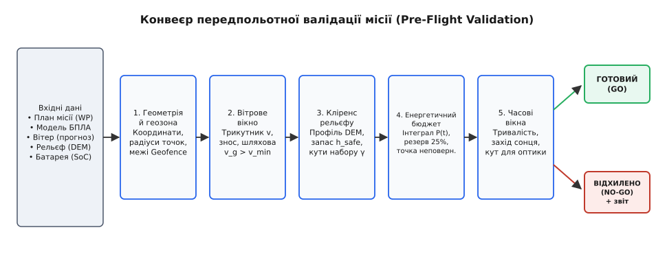
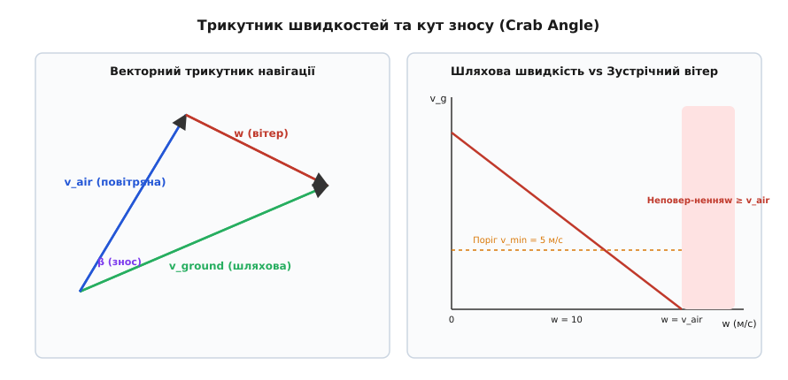
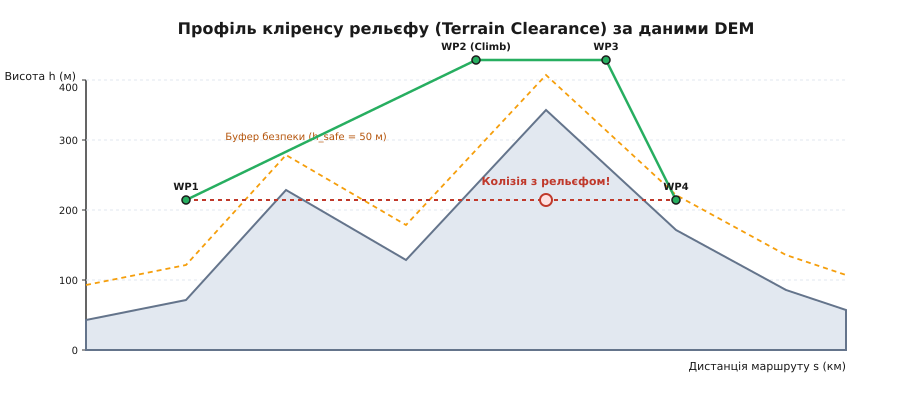
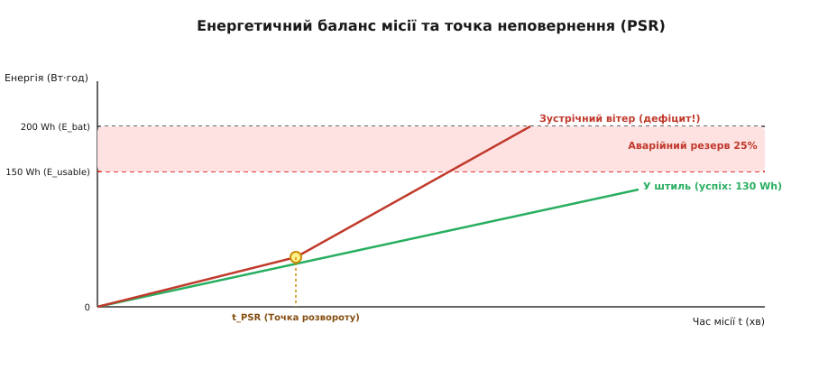

# Чи здійсненна місія: час, енергія, вітер, висота

<preknowlist>
- [Проєктування місії (вейпойнти)](root:embedded/mission-planning) — елементи місії, координати, типи команд та системи відліку висоти.
- [Вітер і знос](root:sys-dron/viter-i-znos) — трикутник швидкостей, повітряна й шляхова швидкість, кут зносу.
- [Рельєф і режими висоти](root:sys-dron/terrain-and-altitude) — висотні системи MSL, AGL та цифрові карти висот.
- [Бюджет батареї](root:hw-power/battery-budget) — ємність акумулятора, розряд під струмом, падіння напруги та розрахунок залишку.
</preknowlist>

Політний план виглядає бездоганно на екрані наземної станції: вісімнадцять кілометрів маршруту над горбистим плато, задана швидкість п'ятнадцять метрів на секунду, розрахунковий час двадцять хвилин, очікувана витрата сімдесят ват-годин із доступних ста. Апарат злітає, проходить перші точки з легким попутним вітром і починає поворот на базу. Зустрічний вітер дванадцять метрів на секунду обвалює швидкість відносно землі до трьох метрів на секунду: зворотний відрізок у дев'ять кілометрів триває вже не десять хвилин, а п'ятдесят. Бортовий комп'ютер намагається компенсувати затримку, збільшує кут атаки й оберти моторів, електрична потужність споживання зростає на сорок відсотків, а напруга батареї під високим струмом просідає швидше звичайного. За чотири кілометри до точки старту акумулятор спустошується до критичного порога, автопілот переходить у вимушену посадку посеред лісового яру.

Ця аварія сталася не через збій апаратури чи помилку в коді польотного контролера. Вона сталася тому, що план перевірили лише на геометричну коректність (чи всі точки лежать у межах карти), але не перевірили на **фізичну здійсненність** (англ. *feasibility*, від лат. *facere* — «робити, виконувати»). Перевірити здійсненність місії — це означає розв'язати систему взаємопов'язаних фізичних рівнянь руху, енергетики, аеродинаміки, рельєфу та часу для кожного відрізка маршруту. Розгляньмо, як влаштований цей аналіз, які закони за ним стоять і як реалізувати модуль валідації місій для вбудованої системи.

### Чому синтаксично правильна місія буває фізично неможливою

У більшості простих систем планування валідація місії зводиться до тривіальних речей: чи не порожній список точок, чи підтримує автопілот передані команди `MAV_CMD`, чи не виходять координати за межі дозволеної геозони ([geofence](root:sys-dron/geofence)). Це перевірка **формату даних**, а не можливості їх виконання.

Справжня фізична валідація оцінює план крізь призму обмежень матеріального світу:

1. **Кінематичні та вітрові обмеження:** чи здатний апарат розвинути достатню швидкість відносно повітря, щоб рухатися вперед уздовж лінії шляху за наявного вітру, чи його знесе вбік?
2. **Просторові обмеження (кліренс рельєфу):** чи проходить пряма лінія між двома точками на безпечній висоті над вершинами пагорбів, деревами та лініями електропередач, і чи вистачає вертикальної швидкопідйомності для набору висоти на крутому схилі?
3. **Енергетичні обмеження:** скільки джоулів або ват-годин енергії потрібно спалити на подолання аеродинамічного опору, набір висоти та живлення бортової електроніки на кожному відрізку з урахуванням зносу й тривалості польоту?
4. **Часові та зовнішні обмеження:** чи вкладеться місія в робоче вікно до заходу сонця або до погіршення погодних умов, і чи забезпечує положення сонця на небосхилі прийнятні кути освітлення для оптичних сенсорів?

Порушення хоча б одного з цих критеріїв робить місію смертельно небезпечною для апарата. Тому передпольотна валідація будується як послідовний конвеєр перевірок із суворим правилом: відхилення на будь-якому кроці зупиняє розрахунок і повертає інженеру точну причину й координати небезпечного місця.


*Конвеєр фізичної валідації польотного завдання. Вхідні дані містять геометрію точок, матрицю висот DEM, векторний прогноз вітру та характеристики батареї. Лише за позитивного проходження всіх п'яти етапів польотне завдання отримує статус допуску до виконання (GO).*

> 🔧 **Навіщо це.** Якщо виконувати перевірку здійсненності на наземній станції, оператор дізнається про небезпеку ще до подачі живлення на мотори. Якщо той самий валідатор працює на бортовому комп'ютері ([companion computer](root:sys-dron/companion-computer)), апарат отримує здатність автономно відхиляти небезпечні завдання, надіслані оператором або зовнішніми планувальниками, і самостійно вимагати корекції маршруту.

---

### Вітрове вікно здійсненності: трикутник швидкостей і градієнт висоти

Вітер є головним збурювальним фактором для будь-якого літального апарата. Повітряна швидкість `v_air` (англ. *airspeed*) — це швидкість руху апарата відносно повітряної маси, яку він створює тягою своїх гвинтів. Вітер `w` (англ. *wind*) — це швидкість руху самої повітряної маси відносно поверхні Землі. Шляхова швидкість `v_ground` (англ. *ground speed*) — це векторна сума швидкості апарата в повітрі та швидкості повітря над землею.

```
v⃗_ground = v⃗_air + w⃗
```

Навігаційний контур автопілота має завдання: вести апарат уздовж відрізка маршруту, що з'єднує дві точки. Лінія між точками задає необхідний кут шляху `ψ` (англ. *track angle*). Якщо дує боковий або зустрічний вітер, ніс апарата не може дивитися строго вздовж лінії шляху: автопілот змушений повернути корпус на кут випередження — **кут зносу** або краб-кут `β` (англ. *crab angle*, від *crab* — боковий рух краба).


*Векторний трикутник швидкостей (ліворуч) та залежність шляхової швидкості від зустрічного вітру (праворуч). За швидкості вітру w ≥ v_air шляхова швидкість стає нульовою або від'ємною — апарат фізично не може подолати вітер і повернення на базу стає неможливим.*

Розкладімо вектор вітру `w` на дві складові відносно лінії шляху `ψ`:
1. **Поздовжній вітер** `w_parallel = w · cos(θ_wind - ψ)`: попутний (додатний) або зустрічний (від'ємний).
2. **Поперечний вітер** `w_perp = w · sin(θ_wind - ψ)`: боковий вітер, що зносить апарат убік від лінії.

Щоб компенсувати боковий знос, поперечна проєкція повітряної швидкості мусить повністю врівноважити поперечний вітер:

```
v_air · sin(β) = w_perp
β = arcsin(w_perp / v_air)
```

Звідси негайно випливає перша фундаментальна межа здійсненності: якщо швидкість бокового вітру перевищує максимальну повітряну швидкість апарата (`|w_perp| ≥ v_air`), аргумент арксинуса стає більшим за одиницю. Рівняння не має дійсного розв'язку. Апарат фізично не здатний утримати лінію шляху — його зносить убік за будь-якого курсу.

Якщо ж `|w_perp| < v_air`, поздовжня складова шляхової швидкості обчислюється як:

```
v_ground = v_air · cos(β) + w_parallel
v_ground = v_air · √(1 - (w_perp / v_air)²) + w_parallel
```

#### Висотний зсув вітру (Wind Shear)

Ще одна небезпечна пастка планування — вимірювання вітру на поверхні землі. Через тертя об ґрунт і рослинність швидкість вітру біля землі завжди суттєво нижча, ніж на висоті польоту (100–300 м). В інженерній метеорології вертикальний профіль швидкості описують степеневим законом Гельмана (англ. *Hellmann wind power law*):

```
w(z) = w_0 · (z / z_0)^α
```

де `w_0` — швидкість вітру на висоті анемометра `z_0` (зазвичай 10 м над землею), `z` — висота польоту, а `α` — коефіцієнт шорсткості поверхні (для відкритого поля `α ≈ 0.14`, для лісу чи пагорбів `α ≈ 0.20...0.28`).

Якщо наземна метеостанція фіксує вітер 7 м/с на висоті 10 м, то на висоті польоту 120 м над пересіченою місцевістю (`α = 0.22`) швидкість вітру складе:

```
w(120) = 7.0 · (120 / 10)^0.22  [закон Гельмана: w0 = 7.0 м/с, z = 120 м, z0 = 10 м, α = 0.22]
       = 7.0 · (12)^0.22        [відношення висоти польоту до висоти виміру]
       = 7.0 · 1.726            [піднесення до степеня шорсткості 0.22]
       = 12.08 м/с              [швидкість вітру на висоті 120 м]
```

Вітер на робочій висоті виявився на 72% сильнішим, ніж на старті. Модуль валідації зобов'язаний масштабувати прогноз вітру відповідно до планової висоти кожного відрізка місії.

Розгляньмо покроковий розрахунок шляхової швидкості для конкретного відрізка місії.

**Розрахунок: Шляхова швидкість і тривалість польоту проти вітру**

Вхідні параметри: довжина відрізка `d = 6000 м`, напрямок лінії шляху `ψ = 90°` (схід), повітряна швидкість `v_air = 15 м/с`. Вітер дме зі сходу на захід: швидкість `w = 10 м/с`, напрямок звідки дує `θ_wind = 90°` (чистий зустрічний вітер).

```
w_parallel = 10 · cos(90° - 90°)
           = 10 · cos(0°)
           = -10.0 м/с       [знак мінус: зустрічний вітер]

w_perp     = 10 · sin(90° - 90°)
           = 0.0 м/с         [чисто зустрічний, бокового зносу немає]

β          = arcsin(0.0 / 15.0)
           = 0°              [кут зносу нульовий]

v_ground   = 15.0 · cos(0°) + (-10.0)
           = 15.0 - 10.0
           = 5.0 м/с         [шляхова швидкість упала втричі]

t_leg      = d / v_ground
           = 6000 / 5.0
           = 1200 с (20 хв)  [у штиль було 6000 / 15 = 400 с (6.6 хв)]
```

Висновок: через зустрічний вітер час перебування апарата в повітрі на цьому відрізку зріс рівно у **три рази**.

Критерій відхилення місії за вітром (Wind Infeasibility Gate):
- Якщо для будь-якого відрізка `v_ground ≤ v_min_threshold` (де безпечний поріг `v_min_threshold` зазвичай обирають на рівні `3.0...5.0 м/с`), місія оголошується нездійсненною. Причина: за надто малої шляхової швидкості найменший порив вітру розвертає апарат назад, а час проходження відрізка прямує до нескінченності, миттєво спалюючи весь запас батареї.

---

### Кліренс рельєфу та профіль висоти (Terrain Clearance)

Другий фатальний фактор — зіткнення з поверхнею Землі (англ. *CFIT — Controlled Flight Into Terrain*, керований політ у рельєф). Поширена помилка початківців: перевірити висоту лише у самих точках повороту (вейпойнтах). Якщо точка A розташована на висоті 100 м над рівнем старту в долині, і точка B — на висоті 100 м, але між ними лежить пагорб висотою 160 м, апарат на прямій траєкторії вріжеться у схил на середині шляху.

Для надійної перевірки використовують **цифрову модель рельєфу** — DEM (англ. *Digital Elevation Model*, від лат. *elevare* — «піднімати»). Найвідоміші відкриті глобальні моделі — SRTM (радарна зйомка з роздільністю 1 кутова секунда, близько 30 метрів на екваторі) та Copernicus DEM (30 м).


*Профіль висоти польоту над рельєфом. Пунктирна лінія позначає межу безпечного кліренсу h_safe. Пряма траєкторія між вейпойнтами перетинає рельєф (колізія). Валідована траєкторія вводить проміжну точку набору висоти з урахуванням допустимого кута підйому γ.*

#### Зберігання та читання матриць DEM у вбудованих системах

Файли рельєфу SRTM поширюються у форматі `.HGT` (сітка розміром 1201×1201 або 3601×3601 16-бітних цілих чисел `int16_t` зі знаком на один географічний градус). Для вбудованого контролера зі скромним обсягом оперативної пам'яті завантаження всього файлу цілком (25 МБ) є неможливим. Замість цього застосовують растрове кешування:
1. За прямокутним охопленням місії `[lat_min, lat_max] × [lon_min, lon_max]` виділяється локальне підвікно рельєфу (наприклад, 64×64 або 128×128 вузлів).
2. Індекс вузла сітки `(row, col)` для географічної координати `(lat, lon)` обчислюється за формулою:
   ```
   col = floor((lon - lon_origin) / cell_size_lon)
   row = floor((lat - lat_origin) / cell_size_lat)
   ```
3. Висоти зберігаються у флеш-пам'яті або завантажуються в компактний кільцевий буфер оперативної пам'яті.

Процедура валідації кліренсу рельєфу складається з чотирьох послідовних операцій:

1. **Дискретизація відрізка маршруту:**
   Відрізок між точками `(lat_A, lon_A)` та `(lat_B, lon_B)` розбивається на послідовність контрольних точок із кроком `Δs`, який обирають меншим або рівним половині просторової роздільності матриці DEM (зазвичай `Δs = 10...15 м`):
   ```
   N_samples = ceil(Distance(A, B) / Δs)
   ```

2. **Білінійна інтерполяція висоти поверхні:**
   Координати кожної проміжної точки `(lat_k, lon_k)` потрапляють усередину комірки матриці DEM між чотирма сусідніми вузлами сітки. Значення абсолютної висоти поверхні `z_terrain(lat_k, lon_k)` обчислюється білінійною інтерполяцією між цими чотирма висотами, що усуває східчасті розриви на межах пікселів:
   ```
   z_top = z_00 · (1 - fx) + z_10 · fx
   z_bot = z_01 · (1 - fx) + z_11 · fx
   z_terrain = z_top · (1 - fy) + z_bot · fy
   ```

3. **Перевірка буфера безпеки (кліренсу):**
   Висота польоту апарата `z_flight(k)` у системі відліку MSL (над рівнем моря) порівнюється з висотою рельєфу:
   ```
   h_clearance(k) = z_flight(k) - z_terrain(k)
   ```
   Якщо для будь-якої точки `h_clearance(k) < h_safe` (де мінімальний буфер безпеки `h_safe` становить 30–50 метрів для компенсації висоти лісу, будівель, дротів ЛЕП та похибки барометра й GNSS), фіксується колізія з рельєфом.

4. **Перевірка допустимого градієнта набору висоти:**
   Літальний апарат має фізичну межу вертикальної швидкості набору `v_z_max` (для літака це визначається тягооснащеністю та кутом підйому, для коптера — лімітом моторів, зазвичай `v_z_max ≈ 3...6 м/с`).
   Кут нахилу траєкторії `γ` на відрізку між двома точками з різницею висот `Δz = z_B - z_A` та горизонтальною відстанню `d`:
   ```
   tan(γ) = Δz / d
   Необхідна вертикальна швидкість: v_z_req = v_ground · tan(γ) = v_ground · (Δz / d)
   ```
   Якщо `v_z_req > v_z_max`, апарат фізично не встигне набрати потрібну висоту до моменту підльоту до точки B і зіткнеться з підніжжям схилу.

> 📐 **Тонкість систем координат висоти.** Моделі DEM (SRTM) зберігають висоту над **геоїдом EGM96** (ортометрична висота MSL). GNSS-приймачі первинно видають еліпсоїдальну висоту над референц-еліпсоїдом WGS-84. Різниця між геоїдом та еліпсоїдом (геоїдальне хвилювання) в Україні сягає від +15 до +35 метрів. Модуль валідації зобов'язаний привести висоти планових точок і рельєфу до єдиної системи відліку, перш ніж віднімати їх одна від одної.

---

### Енергетичний бюджет місії: інтеграл потужності та резерв

Енергетична спроможність — найбільш комплексний параметр здійсненності. Енергія `E` (вимірюється в джоулях `Дж` або ват-годинах `Вт·год`, де `1 Вт·год = 3600 Дж`) — це інтеграл миттєвої споживаної потужності `P(t)` за часом усього польоту:

```
E_total = ∫ P(t) dt
```

Повна електрична потужність `P(t)`, яку батарея віддає бортовій мережі, складається з трьох фізичних компонентів:

```
P(t) = P_aero(v_air) + P_climb(m, v_z) + P_avionics
```

1. **Базова потужність авіоніки та корисного навантаження `P_avionics`:**
   Споживання польотного контролера, навігаційного модуля, радіолінка, камер, бортового комп'ютера та обчислювальних плат. Для розвідувального БПЛА становить від 15 до 80 Вт і є постійною величиною, незалежно від швидкості руху.

2. **Потужність набору висоти `P_climb`:**
   Робота проти сили тяжіння Землі:
   ```
   P_climb = (m · g · v_z) / η_prop
   ```
   де `m` — маса апарата (кг), `g = 9.81 м/с²`, `v_z` — вертикальна швидкість (м/с), `η_prop` — загальний коефіцієнт корисної дії гвинтомоторної групи (зазвичай `0.55...0.70`). При зниженні (`v_z < 0`) ця складова від'ємна (або нульова, якщо регулятори не підтримують рекуперацію).

3. **Аеродинамічна потужність горизонтального польоту `P_aero(v_air)`:**
   - **Для літака (Fixed-Wing):**
     Аеродинамічний опір складається з паразитарного опору корпусу (зростає як `v_air²`) та індуктивного опору крила (спадає як `1 / v_air²`):
     ```
     P_aero(v_air) = A · v_air³ + B / v_air
     ```
     де `A = 0.5 · ρ · S · C_D0` — коефіцієнт паразитарного опору, `B = 2 · (m · g)² / (ρ · π · b² · e)` — коефіцієнт індуктивного опору. Швидкість мінімальної потужності `v_mp = (B / (3 · A))^(1/4)` забезпечує найдовше перебування в повітрі (тривалість), а швидкість максимальної дальності `v_mr = (B / A)^(1/4)` забезпечує найменшу витрату енергії на пройдений кілометр шляху.
   - **Для мультикоптера:**
     Значна частина потужності йде на створення тяги для компенсації ваги в режимі висіння:
     ```
     P_hover = (m · g)^(1.5) / √(2 · ρ · A_disk)
     ```
     де `ρ` — густина повітря (1.225 кг/м³), `A_disk` — сумарна площа обмітання пропелерів. При горизонтальному русі корпус коптера нахиляється вперед, збільшуючи площу лобового опору: `P_aero ≈ P_hover + k_drag · v_air³`.


*Динаміка витрати енергії місії. Повна ємність батареї 200 Вт·год містить 25% аварійного резерву (доступно 150 Вт·год). У штиль місія потребує 130 Вт·год (успіх). При зустрічному вітрі на зворотному шляху витрата перевищує доступну межу задовго до фінішу. Точка неповернення t_PSR позначає останній момент, коли поворот додому гарантує збереження резерву.*

Для дискретного плану місії з `N` відрізків інтеграл перетворюється на суму по кожному сегменту:

```
E_mission = ∑ [ P(v_air_i, v_z_i) · (d_i / v_ground_i) ] + P_hover · t_hover_total + E_takeoff_land
```

Зверніть увагу на дільник `v_ground_i`: саме тут перетинаються вітер та енергія. При зменшенні шляхової швидкості через зустрічний вітер час проходження відрізка `t_i = d_i / v_ground_i` зростає, пропорційно збільшуючи загальну витрачену енергію.

#### Доступна ємність батареї, ефект Пейкерта та закон резерву 25%

Номінальна паспортна ємність батареї `E_nominal = V_nom · Q_Ah` ніколи не доступна на 100% для планування польоту. Доступний енергетичний бюджет `E_usable` обмежується чотирма критичними факторами:

1. **Аварійний резерв безпеки (Safety Margin):**
   Залізне правило авіації та автономної робототехніки — **20–25% ємності батареї є недоторканним запасом**. Цей резерв потрібен для:
   - здійснення повторного заходу на посадку (Go-Around) у разі перешкоди на смузі;
   - компенсації непередбачених поривів вітру та низхідних повітряних потоків;
   - безпечного виходу в режим аварійного повернення додому (RTL).
2. **Температурний коефіцієнт `η_temp`:**
   При температурі навколишнього середовища нижче +10 °C хімічна активність літієвих елементів (LiPo / Li-Ion) падає, їхній внутрішній опір зростає, що зменшує віддачу ємності на 15–30%.
3. **Ефект Пейкерта та втрати на внутрішньому опорі:**
   Під час польоту проти вітру струм розряду `I` подвоюється. За законом Пейкерта фактично віддана ємність акумулятора зменшується зі зростанням струму:
   ```
   Q_effective = Q_nominal · (I_ref / I)^(k_p - 1)
   ```
   де `k_p` — показник Пейкерта (для LiPo `k_p ≈ 1.05...1.10`, для високоємних Li-Ion 18650 `k_p ≈ 1.15...1.25`). Одночасно зростають втрати на нагрівання: `P_loss = I² · R_int`.

Підсумкова доступна енергія для місії:

```
E_usable = E_nominal · η_temp · η_health · (1.0 - Reserve_Margin)
```

Критерій енергетичної здійсненності:

```
E_mission ≤ E_usable
```

Якщо `E_mission > E_usable`, місія категорично відхиляється.

---

### Точка безпечного повернення (Point of Safe Return / Bingo Fuel)

Для лінійних або радіальних місій (розвідка, доставка, патрулювання), де апарат віддаляється від бази на значну відстань, критично важливим є поняття **точки безпечного повернення** — PSR (англ. *Point of Safe Return*) або межі «Bingo Fuel» (термін військової авіації, що позначає мінімальний залишок палива, необхідний для безпечного повернення на аеродром).

У кожній точці маршруту `k` бортовий комп'ютер має порівнювати залишок енергії в батареї `E_remaining(k)` з енергією, необхідною для прямого повернення на домашню точку проти поточного вітру `E_RTL(k)`:

```
E_RTL(k) = P(v_air, 0) · ( Distance_to_Home(k) / v_ground_return(k) ) + E_landing
```

Умова безпечного продовження місії:

```
E_remaining(k) - E_RTL(k) ≥ Reserve_Margin · E_nominal
```

Щойно ця різниця наближається до нуля, апарат зобов'язаний розвернутися і розпочати процедуру повернення. Пропуск точки PSR означає, що продовження польоту вперед навіть на 500 метрів унеможливить повернення на базу через брак енергії.

---

### Часові обмеження та сонячна геометрія

Четвертий стовп валідації — час виконання місії та зовнішнє середовище. Місія може бути повністю забезпечена енергією, але втратити сенс або безпеку через часові рамки.

1. **Загальне часове вікно (Time-to-Target / Mission Deadline):**
   Сумарний час виконання місії `T_total = ∑ (d_i / v_ground_i) + ∑ t_loiter` не може перевищувати дозволене операційне вікно (наприклад, графік відкриття повітряного простору або термін дії прогнозу погоди).

2. **Захід сонця (Sunset Constraint):**
   Для апаратів, що не обладнані нічними тепловізійними або активними сенсорами, посадка має відбутися не пізніше ніж за 30 хвилин до настання навігаційних сутінків:
   ```
   t_start + T_total ≤ t_sunset - 1800 с
   ```

3. **Кут висоти сонця над горизонтом (Solar Elevation Angle):**
   Для місій аерофотозйомки, фотограмметрії або машинного зору на борту критичною є якість освітлення. За низького сонця (менше 20–25° над горизонтом) на знімках з'являються довгі контрастні тіні, які спотворюють роботу нейромереж детекції об'єктів та унеможливлюють побудову ортофотопланів. За висоти сонця понад 75° виникає ефект «гарячої плями» (hotspot / glare).

Кут висоти сонця `α_sun` над горизонтом обчислюється астрономічним алгоритмом на основі географічної широти `ϕ`, схилення сонця `δ` (залежить від дня року `N_day`) та годинного кута `H` (залежить від місцевого сонячного часу `t_solar_hours`):

```
δ = 23.45° · sin( (360° / 365) · (N_day - 81) )
H = 15° · (t_solar_hours - 12.0)
sin(α_sun) = sin(ϕ) · sin(δ) + cos(ϕ) · cos(δ) · cos(H)
α_sun = arcsin( sin(ϕ) · sin(δ) + cos(ϕ) · cos(δ) · cos(H) )
```

Якщо під час виконання ділянки зйомки `α_sun < 25°`, валідатор попереджає про непридатні умови для оптичного навантаження.

---

### Динамічна валідація під час польоту (In-Flight Re-Validation)

Передпольотний розрахунок базується на **прогнозах**: прогноз вітру, номінальна модель розряду батареї, приблизний опір повітря. У реальному польоті параметри неминуче відхиляються від плану: вітер на висоті може виявитися сильнішим на 4 м/с, температура повітря — нижчою, а знос батареї — більшим.

Тому система прийняття рішень автономного апарата запускає цикл валідації **динамічно щосекунди**:

1. Розширений фільтр Калмана (EKF) автопілота безперервно оцінює справжній вектор вітру `w_actual` за різницею між повітряною швидкістю з трубки Піто та шляховою швидкістю з GNSS.
2. Давачі струму й напруги (Power Monitor) вимірюють фактичну інтегральну витрату енергії та поточний стан заряду батареї (SoC).
3. Планувальник перераховує залишок енергії для всіх невиконаних точок місії з урахуванням `w_actual`.
4. Якщо оновлений розрахунок показує, що кінцевий резерв на посадці впаде нижче 15%, автопілот негайно генерує подію `MISSION_FEASIBILITY_LOST` і активує адаптивне рішення: дострокове повернення додому ([RTL](root:sys-dron/povernennia-dodomu)), перехід на найближчий запасний майданчик ([alternate landing site](root:sys-dron/dim-nedosiazhnyi)) або скорочення маршруту.

---

### Модуль валідації місій на C та C++

Перейдемо до інженерного втілення. Розробимо повноцінний вбудований модуль валідації польотного плану. Модуль перевіряє:
1. Синтаксис та ліміти швидкостей;
2. Вітрове вікно здійсненності для кожного відрізка;
3. Кліренс над моделлю рельєфу (з білінійною інтерполяцією);
4. Повний енергетичний інтеграл із перевіркою 25% резерву;
5. Загальний час місії.

Код спроєктовано для роботи на мікроконтролерах та бортових комп'ютерах: він не використовує динамічного виділення пам'яті в критичних циклах і має чітку систему кодів помилок.

:::tabs
:::code chy-zdiisnenna-misiia-d/c/main.c
:::code chy-zdiisnenna-misiia-d/cpp/main.cpp
:::

---

### Підсумок архітектури валідації

Передстартова перевірка здійснюваності перетворює політне завдання зі списку бажань у математично доведений план дій. Архітектурний розподіл обов'язків у системі будується на трьох рівнях:

1. **Рівень планування (GCS / Mission Planner):** повна перевірка за повномасштабною моделлю рельєфу DEM високої роздільності, кліматичним прогнозом вітру та сонячним календарем.
2. **Передстартовий бар'єр (Arming Check на борту):** верифікація залишкової напруги батареї, актуального прогнозу вітру та збереженої в пам'яті моделі висот майданчика перед зняттям запобіжника моторів ([arming](root:sys-dron/arming-checks)).
3. **Динамічний контур у польоті:** щосекундний перерахунок залишку енергії до точки неповернення PSR за фактичними даними EKF. Якщо реальність розходиться з планом — апарат приймає автономне рішення повернутися на базу до вичерпання резерву.
