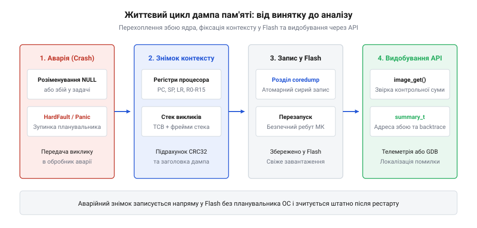

# Посмертний аналіз

<preknowlist>
- [Обробка виключень у процесорі](root:embedded/obrobka-vykliuchen-u-protsesori) — механізм виникнення винятку й передача керування обробнику
- [NOR Flash: комірка, побайтове читання, блокове стирання](root:embedded/nor-flash) — організація пам'яті Flash та обмеження запису
</preknowlist>

## Призначення та архітектура API аварійного дампа

Коли у вбудованій системі виникає критичний апаратний збій — розіменування нульового або невалідного вказівника (англ. *null-pointer dereference*), спроба виконання недозволеної інструкції чи переповнення виділеного стека задачі, — процесор негайно припиняє виконання поточного коду і генерує виняток відмови (англ. *fault exception*), такий як HardFault у ядрах ARM Cortex-M або Panic Handler в архітектурах Xtensa та RISC-V. За звичайних умов стандартний обробник аварії просто виконує апаратне перезавантаження кристала через сторожовий таймер (англ. *watchdog timer*). У результаті пристрій перезапускається із «чистого аркуша», а вся інформація про те, яка саме задача спричинила збій, де знаходився вказівник інструкцій і що лежало на стеку, безповоротно втрачається з енергозалежної оперативної пам'яті (SRAM).

Програмний інтерфейс аварійного дампа (англ. *core dump API*) перетворює аварійну зупинку на джерело діагностичних даних. Замість миттєвого перезапуску спеціалізований перехоплювач паніки фіксує миттєвий стан системи безпосередньо в момент аварії. Цей процес відбувається у вкрай жорстких умовах: планувальник операційної системи реального часу (RTOS) уже не працює, системні переривання примусово заблоковані, а використання стандартних функцій виділення динамічної пам'яті (malloc) чи блокуючих синхронізаційних примітивів (м'ютексів і семафорів) суворо заборонене, оскільки внутрішні структури самої купи (англ. *heap*) можуть бути зіпсовані збоєм.

*Послідовність викликів API від перехоплення HardFault до запису образу у Flash та його видобування після перезавантаження.*

Архітектура API ділить процес фіксації аварії на два ізольовані етапи. На першому етапі, що виконується в контексті обробника винятку, бібліотека збирає регістри процесора (покажчик поточної інструкції PC, регістр повернення LR, стек-покажчик SP та регістри загального призначення), упаковує структури керування задачами (TCB) і записує вміст верхівки стека активної задачі у виділене сховище. На другому етапі, після перезавантаження та ініціалізації базових системних драйверів, прикладний код отримує доступ до безпечного API зчитування збереженого дампа. Це дає змогу передати діагностичний пакет на сервер моніторингу через Wi-Fi, стільникову мережу чи вивести його у діагностичний порт UART для аналізу в налагоджувачі GDB.

Особливу небезпеку для вбудованої системи становить збій, що виникає на етапі ранньої ініціалізації (англ. *boot sequence*) ще до виходу в головний цикл або старту планувальника FreeRTOS. Якщо апаратна помилка HardFault або збій конфігурації шин трапляється під час завантаження, обробник паніки записує дамп і перезавантажує мікроконтролер. Після рестарту та сама стартова послідовність знову натрапляє на фатальну інструкцію, повторно викликає запис дампа і перезапуск. Виникає нескінченний цикл аварійних перезавантажень (англ. *boot loop*). Такий режим не лише повністю паралізує роботу пристрою, позбавляючи можливості оновити прошивку по повітрю або вийти на зв'язок, а й здатний за лічені години фізично зруйнувати сектори енергонезалежної Flash-пам'яті через вичерпання ліміту циклів перезапису.

Для запобігання цій пастці API аварійного дампа спирається на апаратний лічильник аварійних перезапусків (англ. *boot crash counter*), що зберігається в енергонезалежній пам'яті домену низького споживання (RTC SRAM) або у спеціальній секції оперативної пам'яті `.noinit`. На відміну від стандартних секцій `.data` та `.bss`, секція `.noinit` не скидається у нуль стандартним кодом запуску C-рантайму під час програмного рестарту або спрацювання сторожового таймера. При кожному вході в процедуру збереження дампа бібліотека інкрементує цей лічильник. Якщо при черговому старті значення лічильника перевищує заданий поріг (зазвичай 2 або 3 поспіль аварії за короткий часовий інтервал), механізм перехоплення блокує подальші спроби запису у Flash і переводить кристал у захисний аварійний режим (англ. *safe bootloader mode* або зупинка на діагностичному UART-інтерфейсі).

Додатково в самому коді обробника реалізується захист від подвійного винятку (англ. *double fault guard*). Якщо під час спроби зберегти стек або заголовок дампа драйвер Flash сам генерує виняток (наприклад, через спробу доступу до неініціалізованої шини SPI або помилку вирівнювання шини), внутрішній прапорець стану перехоплювача негайно припиняє виконання функцій API. Замість повторної спроби запису формується мінімальне текстове повідомлення про подвійний крах, і система передається під контроль апаратного перезапуску, унеможливлюючи зациклення на рівні ядра процесора. Для систематичного розбору таких збоїв корисні загальні підходи діагностики: [Систематичний пошук несправності](root:embedded/troubleshooting-methodology).

> 🔧 **Навіщо це.**
> Без збереження аварійного дампа діагностика плаваючих помилок у польових умовах зводиться до сліпих здогадок. Core dump API дозволяє видобути повний контекст аварійного збою з реального пристрою замовника без необхідності підключати апаратний програматор-налагоджувач JTAG.

## Ініціалізація та конфігурація цільового носія

Конфігурація підсистеми дампів визначає, куди саме та в якому форматі спрямовуватимуться аварійні байти. У більшості сучасних середовищ (зокрема ESP-IDF або кастомних портах FreeRTOS для STM32) вибір носія здійснюється на етапі статичної конфігурації прошивки. Основними цілями для збереження знімка є спеціальний розділ у Flash-пам'яті або прямий потік у послідовний порт UART.

Пряме потокове виведення в UART застосовується переважно на стенді розробника: процесор при аварії виводить дамп у вигляді шістнадцяткового тексту у консоль, звідки хостова утиліта може перехопити його «на льоту». Проте в автономних пристроях єдиним надійним сховищем виступає енергонезалежна мікросхема Flash. Для цього у системі застосовується [розбиття Flash-пам'яті під аварійні дампи](root:sf-devices/coredump-flash-partitioning): у таблиці розділів пам'яті (англ. *partition table*) виділяється окремий сектор типу data з підтипом coredump. Розмір цього розділу зазвичай становить від 64 до 256 кілобайтів, залежно від глибини збереження стеків та кількості задач у системі.

Бібліотека підтримує два формати генерації аварійного образу:

1. **Бінарний компактний образ (англ. *raw binary format*):** містить мінімальний стандартизований заголовок, збережений масив регістрів та дамп блоку пам'яті стека. Такий формат займає найменше місця і записується найшвидше, проте вимагає обов'язкової наявності точної збірки ELF-файлу прошивки на стороні інженера для ручного або автоматизованого розбору.
2. **Формат ELF Core (англ. *ELF coredump*):** формує повноцінний образ стандарту ELF із сегментами типу PT_NOTE та PT_LOAD. Цей формат напряму підтримується крос-компіляторними версіями gdb, що дозволяє відкрити файл однією командою target core core.elf без додаткових скриптів розпакування.

Запис у Flash-пам'ять під час збою виконується за допомогою прямого низькорівневого доступу до контролера Flash (англ. *ROM SPI Flash API*), минаючи всі кеші та системні драйвери операційної системи. Перед початком запису обов'язково перевіряється цілісність таблиці розділів, а сам блок маркується магічним числом та контрольною сумою CRC32, що унеможливлює зчитування пошкодженого або недописаного образу під час наступного старту.

## Реєстрація користувацьких ділянок пам'яті

За замовчуванням обробник аварійного дампа фіксує лише регістри процесора та локальний стек тієї задачі FreeRTOS, у якій стався фатальний збій. Проте в реальних вбудованих додатках корінь проблеми часто лежить в інших структурах даних: пошкодженій глобальній черзі повідомлень, лічильниках мережевого з'єднання або спеціальних кільцевих буферах системних логів (англ. *circular log buffers*). Якщо ці дані не потраплять в образ дампа, інженер побачить лише наслідок катастрофи, але не її першопричину.

Для збереження таких критичних областей API надає механізм реєстрації користувацьких регіонів пам'яті (англ. *user memory regions*). За допомогою виклику esp_core_dump_user_ring_buffer_set() розробник ще на етапі ініціалізації додатка вказує покажчик на буфер та його розмір. Коли стається збій, система збору дампа автоматично включає зареєстрований блок пам'яті в підсумковий образ як окремий сегмент. Це гарантує, що останні повідомлення бортового логера або стан апаратного кінцевого автомата збережуться у Flash разом із регістрами.

> 🔧 **Навіщо це.**
> Збереження користувацьких буферів дозволяє побачити історію подій, що передували аварії (наприклад, останні 20 отриманих байтів по UART або відправлений JSON-запит), перетворюючи дамп на повноцінний «чорний ящик».

## Зчитування та валідація дампа після старту

Після того як пристрій перезавантажився і штатно пройшов етап початкової ініціалізації завантажувача (bootloader) та операційної системи, прикладний код повинен перевірити наявність збереженого звіту про аварію. Робота з аварійним розділом Flash ніколи не здійснюється через прямий сирий доступ до секторів — для цього використовується надійний високорівневий інтерфейс.

Основною точкою входу є функція esp_core_dump_image_get(). Вона звертається до виділеного розділу Flash, зчитує заголовок і проводить повну перевірку цілісності: звіряє магічні маркери стандарту та обчислює контрольну суму (CRC32 або SHA256). Якщо запис було перервано через раптове зникнення живлення саме в момент аварії, функція повертає статус пошкоджених даних ESP_ERR_INVALID_CRC, запобігаючи передачі «сміття» в аналітичні сервіси.

Якщо образ валідний, API дозволяє отримати компактну структуру зведення esp_core_dump_summary_t за допомогою esp_core_dump_get_summary(). Ця структура містить стислий витяг найважливіших показників: причину паніки (код винятку), лічильник команд PC у момент збою, ім'я винуватої задачі FreeRTOS та перші глибини зворотного трасування (backtrace). Таке компактне резюме розміром у кількасот байтів можна негайно відправити на сервер моніторингу через легковагий протокол MQTT без необхідності вивантажувати весь важкий дамп розміром у 64 КБ.

## Коди повернення та типові збої

Надійне використання API дампів вимагає обов'язкової обробки позаштатних ситуацій:

- ESP_ERR_NOT_FOUND: збереженого образу у виділеному розділі немає (пристрій перезавантажився штатно або після успішного оновлення прошивки). Це нормальний робочий стан після звичайного включення.
- ESP_ERR_INVALID_SIZE: розмір дампа перевищує фізичний простір виділеного Flash-розділу. У такому разі бібліотека записує скорочений заголовок з ознакою усічення. Розробнику слід збільшити розмір розділу coredump у таблиці partitions.csv.
- ESP_ERR_INVALID_STATE: спроба зчитування дампа до ініціалізації контролера Flash або спроба подвійного читання після виклику очищення esp_core_dump_image_erase().

Окрему небезпеку становить так зване зациклене скидання (англ. *crash loop*), коли виняток виникає всередині самого обробника дампа чи процедури стартової діагностики. Сучасне API містить вбудований лічильник рестартів: якщо виявляється більше трьох послідовних аварійних перезапусків без успішного виходу в робочий цикл, система блокує повторний запис дампа і переводить пристрій у безпечний режим відновлення (recovery mode).
