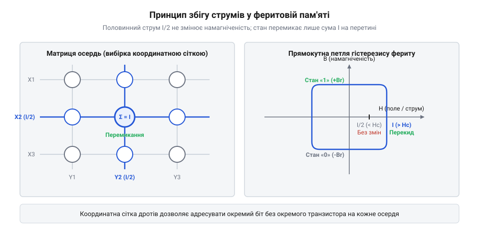

# Посмертний аналіз

<preknowlist>
- [SRAM-комірка](root:embedded/sram-komirka) — розуміння летючості напівпровідникової пам'яті проти магнітного заліза
</preknowlist>

## Проблема летючої пам'яті ранніх ЕОМ

На зламі 1940–1950-х років перші цифрові обчислювальні машини (такі як ENIAC, EDVAC чи британський EDSAC) зіткнулися з фундаментальним бар'єром: відсутністю надійного та швидкого оперативного запам'ятовувального пристрою. У той час як логічні операції вже виконувалися електронними вакуумними лампами за мікросекунди, збереження проміжних даних залишалося повільним і вкрай ламким процесом.

Основними технологіями оперативної пам'яті тоді слугували ртутні лінії затримки (англ. *mercury delay lines*) та електростатичні трубки Вільямса (англ. *Williams-Kilburn tubes*). Ртутна лінія затримки являла собою довгу металеву трубку, наповнену рідкою ртуттю. На одному кінці п'єзоелектричний кристал перетворював електричні імпульси на хвилі механічного тиску — звук, що повільно рухався крізь рідкий метал до приймача на іншому кінці, де знову перетворювався на електричний сигнал, підсилювався і спрямовувався на початок трубки в замкнений цикл регенерації. Будь-яка зміна температури змінювала швидкість звуку в ртуті й розсинхронізовувала біти, а механічна вібрація чи окислення контакту повністю руйнували збережену послідовність.

Трубки Вільямса використовували залишковий електричний заряд на люмінофорі звичайних електронно-променевих трубок (ЕПТ). Проте цей заряд швидко розсіювався: екран вимагав постійного регенераційного сканування променем десятки разів на секунду, а будь-яка зовнішня електромагнітна завада — наприклад, увімкнення потужного електродвигуна в сусідньому приміщенні — безповоротно стирала вміст пам'яті. Якщо машина раптово вимикалася або переривання живлення тривало навіть соту частку секунди, пам'ять миттєво обнулялася. Інженери не мали жодного способу дізнатися, у якому стані перебувала програма за мить до аварії.

> 🔧 **Навіщо це.**
> Розуміння фізичної природи ранньої пам'яті пояснює, чому виникла гостра потреба в енергонезалежному збереженні стану процесора і як з'явився фундамент для сучасних діагностичних дампів.

## Фізичний принцип феритових осердь

Виходом із технологічного глухого кута стало відкриття унікальних властивостей феромагнітних матеріалів із прямокутною петлею гістерезису (англ. *square-loop hysteresis*). У звичайних феромагнетиках намагніченість плавно наростає та спадає разом зі зміною зовнішнього магнітного поля. Натомість спеціально синтезовані керамічні сполуки оксидів заліза з марганцем або магнієм (ферити) виявили властивість стрибкоподібного перемагнічування.

Крихітне тороїдальне кільце з такого матеріалу — магнітне осердя (англ. *magnetic core*) діаметром від 1 до 2 міліметрів — мало лише два стабільні стани залишкової магнітної індукції: за годинниковою стрілкою або проти неї. Ці стани ідеально відповідали логічному нулю та одиниці. Щоб змінити напрямок намагніченості осердя, напруженість зовнішнього магнітного поля мала подолати чітко виражений енергетичний бар'єр — коерцитивну силу матеріалу (англ. *coercive field*).

*Схема матриці феритових осердь зі збігом половинних струмів на перетині ліній X і Y та прямокутна петля гістерезису.*

Вражаючий технологічний контраст виявлявся при порівнянні енергетичного балансу феритової пам'яті з попередніми рішеннями на основі вакуумних електронних ламп. У лампових тригерах або трубках Вільямса для утримання навіть одного біта інформації вимагалося безперервне подавання струму на нитки розжарення катодів. Кожна вакуумна лампа безперервно розсіювала від двох до п'яти ватів тепла просто для підтримки робочої температури термоемісії, незалежно від того, чи виконувалися обчислення, чи пам'ять перебувала у стані спокою. Для зберігання скромного масиву в кілька тисяч бітів лампові ЕОМ споживали десятки кіловатів електроенергії з мережі, перетворюючи обчислювальні зали на гарячі печі, де системи примусової вентиляції та кондиціонування ледве справлялися з відведенням тепла. Через постійний перегрів нитки розжарення ламп деградували й перегорали щодня, перетворюючи пошук несправностей на нескінченний ремонт.

Феритові осердя здійснили справжню енергетичну революцію: вони вимагали струму виключно під час динамічного перемикання стану! У пасивному режимі зберігання замкнений магнітний потік у фериті підтримувався за рахунок внутрішньої енергії орієнтації магнітних доменів кристалічної ґратки, тобто енергоспоживання в стані спокою дорівнювало строго нулю ватів. Для запису або зміни біта був потрібен лише короткий імпульс струму тривалістю кілька мікросекунд з амплітудою в сотні міліампер. Енергія, необхідна для подолання площі петлі гістерезису одиничного кільця, вимірювалася мікроджоулями. У результаті енерговитрати пам'яті скоротилися на кілька порядків, зникла потреба в масивних охолоджувачах, а надійність роботи комп'ютерних комплексів зросла з кількох годин до місяців безперервної експлуатації.

Головна перевага полягала в енергонезалежності (англ. *non-volatility*). Створений магнітний потік у замкненому феритовому кільці циркулював нескінченно довго без будь-якого підведення зовнішньої електроенергії. Якщо живлення ЕОМ раптово зникало, положення магнітних доменів у кожному осерді лишалося незмінним. Фізичний стан обчислювальної машини буквально консервувався в металі, відкриваючи шлях до збереження та зчитування стану системи навіть після аварійного відключення.

## Схема збігу струмів і винахідники

Справжнім інженерним викликом була адресація окремого осердя. Якщо для кожного біта вимагати окрему пару керівних дротів і комутаційних ламп, пам'ять на 4096 слів потребувала б десятків тисяч ламп і перетворилася б на монстра розміром із будинок.

Вирішальний прорив здійснив у 1949–1951 роках Джей Форрестер (англ. *Jay Forrester*) у Массачусетському технологічному інституті (MIT) під час роботи над першим комп'ютером реального часу Whirlwind для системи протиповітряної оборони. Форрестер запропонував елегантну схему збігу струмів (англ. *coincident-current selection*). Осердя нанизувалися на перетин сітки взаємно перпендикулярних дротів координат X та Y. Щоб перемагнітити потрібний біт, на провідник рядка X подавали імпульс струму половинної сили I / 2, і рівно такий самий імпульс I / 2 одночасно подавали на провідник стовпчика Y.

Завдяки прямокутній петлі гістерезису половинний струм I / 2 створював магнітне поле, нижче порогу коерцитивної сили, тож усі осердя вздовж окремої лінії X чи Y залишалися у своєму попередньому стані. Лише в одній єдиній точці перетину, де сумарний струм сягав повної величини I, поріг долався, і кільце миттєво змінювало напрямок намагніченості. Цей принцип дозволив адресувати двовимірну матрицю із N² елементів за допомогою всього лише 2N ліній керування.

Паралельно китаєць за походженням Ан Ванг (англ. *An Wang*) у Гарварді запатентував фундаментальний принцип циклу «руйнівного читання з регенерацією» (англ. *destructive read-write cycle*): під час зчитування осердя примусово скидалося в нуль, і якщо на третьому діагностичному дроті (sense wire) виникав імпульс індукції, це означало, що там зберігалася одиниця, яку негайно записували назад наступним тактом. Ян Райхман (англ. *Jan Rajchman*) із лабораторій RCA довів технологію до масового виробництва, створивши перші феритові матричні пластини.

> 🔧 **Навіщо це.**
> Схема збігу струмів стала першим в історії прикладом матричної адресації пам'яті, принцип якої без змін працює в сучасній динамічній пам'яті (DRAM) та Flash.

## Народження терміна «core dump»

У 1950–1960-х роках пам'ять на магнітних осердях (magnetic-core memory) стала абсолютним стандартом для мейнфреймів IBM (серії 704, 7090 і System/360) та машин DEC (PDP-1, PDP-8). Саме тоді в лексиконі програмістів народився вираз «core dump» (буквально — «скидання осердь»).

Коли обчислювальна машина під час виконання наукової задачі чи розрахунку зарплат раптово зависала або стикалася з невідомою помилкою, оператор ЕОМ зупиняв процесор і перемикав тумблери на панелі керування в режим аварійного скидання. Спеціальна підпрограма послідовно опитувала кожне осердя пам'яті та «скидала» весь її бінарний стан на зовнішній носій: спершу на магнітну стрічку або перфокарти, а згодом друкувала велетенські стоси паперу на барабанному принтері.

Ці роздруківки являли собою нескінченні шпальти вісімкових або шістнадцяткових чисел, що відображали фізичний стан комірок пам'яті. Програміст сідав за стіл із лінійкою та олівцем і вручну розшифровував роздруківку: вираховував, у якому регістрі залишилося число, шукав адресу переходу і знаходив рядок асемблера, що спричинив зависання. Звідси виникло класичне визначення: дамп — це посмертний знімок усієї оперативної пам'яті комп'ютера на момент катастрофи.

## Відлуння заліза через півстоліття

На початку 1970-х років напівпровідникові мікросхеми динамічної пам'яті DRAM (починаючи з легендарного чипа Intel 1103) повністю витіснили феритові осердя завдяки мікроскопічним розмірам і низькій собівартості. Фізичні магнітні кільця назавжди зникли з комп'ютерів.

Проте створений ними термін пережив технологію на десятиліття. Коли розробники операційної системи Unix у Bell Labs створювали механізм фіксації аварійних завершень програм (Segmentation Fault), вони назвали файл образу аварії словом core. Формат файлів ELF coredump досі використовує константи на кшталт NT_PRSTATUS для збереження стану процесора у відповідь на виняток ядра.

Сьогодні розробники вбудованих мікроконтролерів (Cortex-M, ESP32, RISC-V) знову оперують терміном «core dump», коли прошивка записує аварійний стан процесора у внутрішню NOR Flash-пам'ять. Залізо змінилося чотири рази: від керамічних магнітних кілець через кремнієві транзистори до плаваючого затвора Flash-комірок. Але базова інженерна потреба — зафіксувати стан кристала на момент смерті програми заради пошуку істини — лишилася незмінною.
