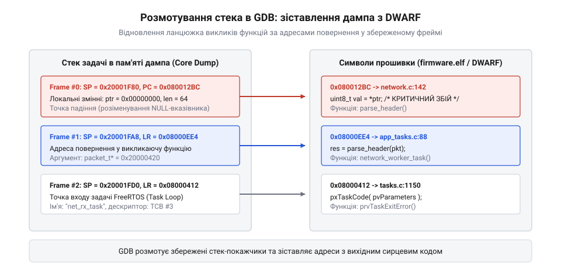

# Посмертний аналіз

<preknowlist>
- [Кодування інструкцій: як команда стає числом](root:embedded/instruction-encoding) — адресація та лічильник команд PC
- [Цикл виконання](root:embedded/execution-cycle) — збереження контексту регістрів процесора
</preknowlist>

## Постановка задачі: збій плаваючого вказівника у FreeRTOS

Найважчими дефектами у вбудованій розробці є плаваючі аварії (англ. *heisenbugs*), що проявляються не на лабораторному столі під час покрокового налагодження через SWD/JTAG, а в реальній експлуатації на пристроях замовника. Типовий сценарій: автономний пристрій під керуванням FreeRTOS успішно працює годинами або днями, пересилаючи телеметрію, аж раптом перезавантажується у непередбачуваний момент. Логи в послідовному порту показують лише сухий рядок про спрацювання HardFault або Panic, після чого система починає роботу спочатку.

Причиною такого збою найчастіше стає розіменування нульового чи випадкового вказівника (англ. *dangling pointer*), пошкодження пам'яті сусідньою задачею через спільну чергу чи некоректне виділення буфера під мережевий пакет нульової довжини. Спроба відтворити помилку на стенді часто зазнає невдачі: підключення апаратного зонда налагоджувача змінює часові інтервали виконання (англ. *timing behavior*), усуваючи стан гонитви (англ. *race condition*).

Єдиним способом дізнатися точну причину катастрофи стає зчитування збереженого у Flash аварійного дампа. За допомогою утиліти прошивання (наприклад, esptool чи скрипта зчитування через UART) інженер вивантажує сирий бінарний образ розділу coredump на хостовий комп'ютер. У результаті ми отримуємо файл знімка (наприклад, coredump.bin), у якому зафіксовано стан процесора та зріз оперативної пам'яті саме в ту частку мікросекунди, коли виник фатальний виняток.


*Схема розмотування стек-фреймів задачі FreeRTOS у пам'яті дампа із зіставленням до адрес інструкцій у коді ELF.*

Для фізичного вилучення збереженого образу з пристрою використовується утиліта низькорівневого програмування Flash-пам'яті `esptool.py`. Першим кроком є визначення точної адреси та розміру розділу аварійного дампа. У файлі розмітки таблиці розділів (`partitions.csv`) для цього виділяється спеціальний блок типу `data` із підтипом `coredump`, розміром зазвичай 64 кілобайти (0x10000 байтів), наприклад зі зміщенням `0x3F0000`.

Команда для прямого вивантаження вмісту розділу Flash через послідовний порт UART у файл на хостовому комп'ютері виглядає так:

```bash
esptool.py --chip esp32 --port /dev/ttyUSB0 --baud 921600 read_flash 0x3F0000 0x10000 coredump.bin
```

Параметр `read_flash` вказує утиліті зчитати шістнадцятковий обсяг байтів, починаючи від стартової базової адреси розділу, і записати їх у бінарний файл `coredump.bin`. Якщо у фреймворку встановлено плагіни збірки, ту саму операцію можна виконати автоматизованою командою:

```bash
espcoredump.py info_corefile -t raw -c coredump.bin firmware.elf
```

Ця утиліта автоматично зіставляє сирі байти дампа із символьною інформацією виконуваного ELF-файла `firmware.elf`, видобуваючи адреси стек-фреймів, стан регістрів процесора та рядок вихідного коду, на якому стався фатальний виняток.

Проєкт складається з чотирьох взаємопов'язаних файлів: заголовка визначення структур даних `crash_handler.h`, реалізації перехоплювача аварії `crash_handler.c`, демонстраційної програми провокації збою `main.c` та сценарію автоматизованого аналізу в налагоджувачі `analyze_core.gdb`.

:::code proj-gdb-core-analysis/c/crash_handler.h
:::code proj-gdb-core-analysis/c/crash_handler.c
:::code proj-gdb-core-analysis/c/main.c
:::code proj-gdb-core-analysis/c/analyze_core.gdb

> 🔧 **Навіщо це.**
> Замість тижнів марних спроб зловити рідкісний збій на стенді, інженер отримує готову «чорну скриньку» з пристрою. Усе подальше розслідування переноситься на потужний хостовий ПК у звичне середовище GDB.

## Підготовка символів збірки: файл firmware.elf та DWARF

Сам по собі файл аварійного дампа — це лише сліпий набір байтів: шістнадцяткові значення регістрів процесора (PC, SP, LR) та сирі байти стека задачі. Щоб перетворити числову адресу на кшталт 0x080012BC на людиночитану назву функції parse_packet() та конкретний рядок сирцевого коду C, потрібен відповідний файл символів прошивки — firmware.elf.

Для успішного аналізу прошивка обов'язково має компілюватися з генерацією розширеної налагоджувальної інформації стандарту DWARF (прапорець компілятора -g або -g3). Під час фінального формування прошивки система збірки відокремлює чистий бінарний образ для запису у мікроконтролер (firmware.bin), відкидаючи таблиці імен, а повнорозмірний файл firmware.elf залишає на комп'ютері.

Критично важливим правилом посмертного аналізу є абсолютний збіг версій: файл firmware.elf повинен бути зібраний із того самого коміту та з тими самими прапорцями оптимізації, що й прошивка, яка впала на пристрої. Якщо код було навіть незначно змінено (додано рядок чи змінено оптимізацію з -O2 на -Og), адреси інструкцій та зміщення локальних змінних на стеку змістяться, і GDB розгорне спотворений, хибний слід викликів. Більшість виробничих систем під час збірки автоматично записують у заголовок образу унікальний SHA256 хеш збірки (англ. *Build ID*), який звіряється перед початком аналізу.

## Запуск крос-GDB та підключення дампа

Маючи на хостовому комп'ютері два ключові файли — скомпільований образ символів firmware.elf та вивантажений з Flash знімок coredump.bin, — інженер переходить до розслідування у крос-налагоджувачі. Для архітектур ARM Cortex-M використовується arm-none-eabi-gdb, для чипів ESP32 — xtensa-esp32-elf-gdb або riscv32-esp-elf-gdb.

Запуск здійснюється передачею файлу символів як першого аргументу:

    xtensa-esp32-elf-gdb build/firmware.elf

Всередині командної оболонки GDB першим кроком підключається аварійний файл. Якщо дамп був збережений у форматі ELF, застосовується стандартна команда:

    (gdb) target core coredump.elf

Для сирого бінарного дампа в середовищі ESP-IDF використовується вбудований python-скрипт помічник espcoredump.py, який автоматично розпаковує структури й генерує скрипт сесії для GDB. У момент підключення дампа налагоджувач переводить свій стан у точку аварії: встановлює віртуальні регістри процесора у значення, зафіксовані обробником збою.

Команда info registers показує стан процесора в момент катастрофи. На архітектурі ARM Cortex-M особливу увагу звертають на регістри r0-r3 (аргументи виклику), sp (верхівка стека) та pc (адреса збійної інструкції). На архітектурі Xtensa ключову роль відіграє механізм вікон регістрів (англ. *register windows*): при кожному виклику функції вікно з 16 робочих регістрів (a0-a15) зміщується, а повернення забезпечується адресою у регістрі a0. Пошкодження вказівника бази вікна або переповнення стека робить неможливим відновлення caller-функції без аналізу дампа пам'яті.

> 🔧 **Навіщо це.**
> Завантаження дампа в GDB імітує зупинку реального процесора на точці зупину (breakpoint) безпосередньо в момент збою, надаючи інженеру повний доступ до аналізу пам'яті без активного заліза.

## Інспекція FreeRTOS задач і розмотування стека

Головна складність систем реального часу полягає у тому, що в пам'яті одночасно співіснують стеки десятків незалежних задач. Задача, яка впала, могла бути безневинною жертвою: наприклад, фоновий обробник телеметрії вичитав вказівник із черги, який за хвилину до того зіпсувала задача зчитування датчиків.

Команда GDB info threads виводить повний перелік задач FreeRTOS, збережених у дампі. Обробник аварії позначає збійну задачу активним потоком (позначеним зірочкою *). Для розслідування інженер перемикається між задачами командою thread <номер>.

Центральною командою аналізу є розгортання зворотного трасування стека:

    (gdb) backtrace full

GDB зчитує збережені на стеку адреси повернення і зіставляє їх із DWARF-таблицями файлу firmware.elf. На екрані постає повний ланцюг стек-фреймів (англ. *stack frames*): від стартової функції задачі FreeRTOS (фрейм #3), через проміжні службові функції розбору заголовків (фрейм #1) до конкретного рядка виклику, у якому сталася аварія (фрейм #0).

Команда frame 0 активує контекст збою. Виклик info locals показує значення всіх локальних змінних функції на момент аварії, а info args виводить передані аргументи. Якщо вказівник pkt->payload має значення 0x00000000, а наступний рядок коду намагається виконати val = pkt->payload[0], інженер отримує неспростовний доказ розіменування нульового вказівника.

## Локалізація винуватця та виправлення

Завершальний крок перетворює шістнадцяткові адреси на виправлення у репозиторії коду. Команда:

    (gdb) list *$pc

виводить блок сирцевого коду з точним зазначенням імені файлу та номера рядка, на якому процесор згенерував виняток. Інженер бачить точну лінію (наприклад, network_worker.c:142).

Аналіз значень змінних, отриманих через print *pkt, нерідко відкриває приховану логічну ваду: наприклад, черга повідомлень повернула тайм-аут, але прикладний код не перевірив статус xQueueReceive() == pdTRUE і продовжив обробку неініціалізованої структури.

Після локалізації дефекту інженер вносить виправлення: додає захисну перевірку if (pkt == NULL || pkt->payload == NULL) return ESP_ERR_INVALID_ARG;, збирає нову версію прошивки та проводить повторне тестування. Тепер замість фатального перезавантаження пристрою система коректно фіксує помилковий пакет, інкрементує лічильник збоїв у діагностичній телеметрії та продовжує стабільну роботу в польових умовах.
