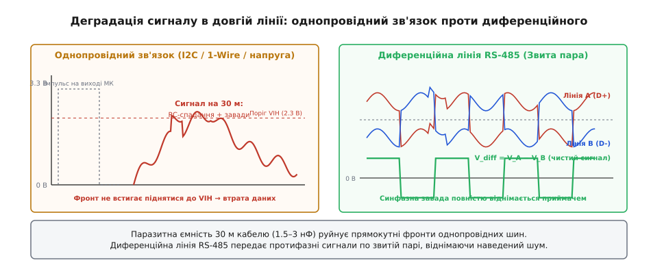
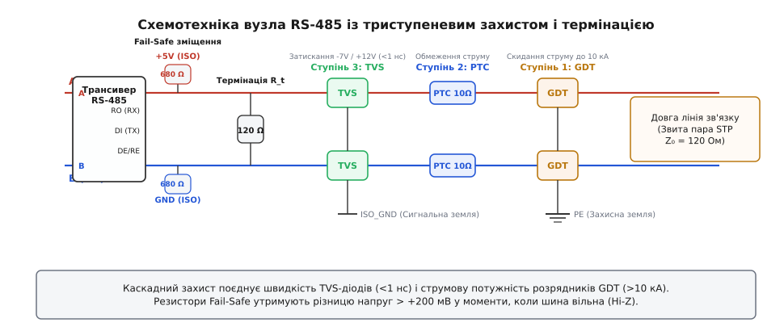
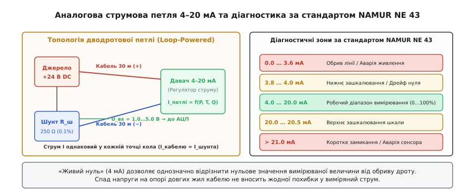
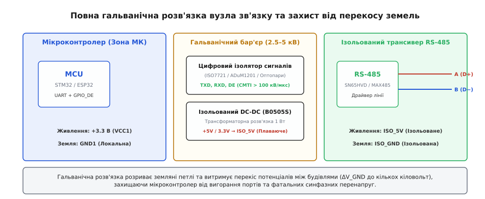

# Давач за тридцять метрів

<preknowlist>
- [Чому давач на дроті бреше](root:com-medium/single-ended-line-limits) — паразитна ємність та опір провідника руйнують круті фронти.
- [Синфазна завада й диференційний вхід](root:hw-analog/common-mode-noise) — чому однаковий шум на двох дротах зникає при відніманні.
- [Земляні петлі](root:hw-pcb/ground-loops) — зрівняльні струми між рознесеними точками заземлення.
- [Струмова петля 4–20 мА](root:hw-analog/current-loop-4-20ma) — сигнал струмом, нечутливий до спаду напруги на довгій лінії.
- [Гальванічна розв'язка вимірювання](root:hw-digital/digital-isolator) — бар'єри оптичної, ємнісної та магнітної ізоляції.
- [Давач як вузол шини](root:com-protocol/modbus) — адресація регістрів, кадри Modbus RTU та контроль помилок CRC16.
</preknowlist>

На монтажному столі давач температури чи тиску під'єднують гнучкими перемичками завдовжки десять сантиметрів. Мікроконтролер щомиті запитує показники по шині I2C або 1-Wire, АЦП зчитує мілівольти, осцилограф показує рівні прямокутні імпульси логічних рівнів, і система працює годинами без жодного збою. Проблема починається в той момент, коли цей самий сенсор виносять із лабораторії в реальний світ: на дах метеостанції, до глибинного насоса в свердловині або в сусідній технологічний цех за тридцять-п'ятдесят метрів.

Звичайний кабель перетворює швидку цифрову лінію на паразитний конденсатор і фільтр низьких частот, опір мідних жил зміщує нульовий рівень опорної напруги, а паралельно прокладений силовий кабель електродвигуна наводить у сигнальному провіднику десятки вольтів імпульсного шуму. Мікроконтролер зависає в очікуванні відповіді від заблокованої шини, замість вимірів повертаються нулі або байти `0xFF`, а під час першої ж грози статичний розряд випалює вхідні діоди кристала.

Виносний давач на довгій лінії — це не просто сенсор із подовженим дротом, а самостійна радіотехнічна та комунікаційна задача. Щоб дані стабільно доходили через десятки метрів промислового простору, інженеру доводиться відмовитися від наївних міжсхемних інтерфейсів і перейти на спеціалізовані фізичні рівні: диференційну передачу сигналів RS-485, аналогову струмову петлю 4–20 мА, багаторівневий захист від перенапруг та обов'язкову гальванічну розв'язку.

## Фізичні обмеження довгих ліній

Перш ніж обирати мікросхеми драйверів та протоколи, розберемо фізику процесів, які руйнують електричний сигнал усередині кабелю. Коли довжина провідника вимірюється сантиметрами, його вважають ідеальним еквіпотенційним з'єднанням із нульовим опором і нульовою ємністю. На відстані у 30 метрів провідник стає розподіленим колом із власним активним опором, погонною ємністю та індуктивністю.

```
Еквівалентна схема довгої лінії (R, L, C на кожен метр):

Вхід МК ───[ R_жили ]───┬───[ L_жили ]───┬─── Давач
                        │                │
                      [ C_кабелю ]     [ R_витоку ]
                        │                │
Земля   ────────────────┴────────────────┴─── Земля
```

### Паразитна ємність та деградація фронтів

Будь-який кабель — це дві або більше паралельних металевих жил, розділених діелектриком (поліетиленом, ПВХ чи тефлоном). Така конструкція за визначенням є конденсатором. Типова погонна ємність звитої пари (наприклад, витої пари Cat5e або екранованого кабелю КВПв) становить від 50 до 100 пФ на один метр довжини.

Для відрізка кабелю завдовжки 30 метрів сумарна паразитна ємність між сигнальним проводом і землею досягає:

```
C_сумарна
= C_погонна · Довжина         [множення питомої ємності на довжину лінії]
= 80 пФ/м · 30 м              [підстановка типового значення витої пари]
= 2400 пФ = 2.4 нФ            [підсумок: значна ємність навантаження]
```

Інтерфейс I2C використовує виходи з відкритим колектором (Open-Drain). Логічний нуль формується відкритим транзистором, який швидко стягує лінію до землі. Логічна ж одиниця формується виключно резистором підтяжки `R_pullup`, який повільно заряджає ємність лінії за експоненційним законом:

```
U(t) = V_CC · (1 − e^(−t / τ)),   де τ = R_pullup · C_кабелю
```

Специфікація I2C жорстко обмежує максимальну сумарну ємність шини значенням `400 пФ` для стандартного режиму (Standard Mode, 100 кГц). На 30 метрах ємність перевищує стандарт у 6 разів. Якщо на платі встановлено типовий резистор підтяжки `4.7 кОм`, стала часу кола `τ` складе:

```
τ
= R_pullup · C_кабелю         [формула сталої часу RC-ланцюга]
= 4700 Ом · 2.4 · 10⁻⁹ Ф      [підстановка параметрів лінії 30 м]
= 11.28 · 10⁻⁶ с ≈ 11.3 мкс   [час одного експоненційного заряду]
```

Період тактового сигналу шини на частоті 100 кГц становить 10 мкс, тобто півперіод високого рівня триває всього 5 мкс. За 5 мкс напруга на лінії ледь встигне піднятися до:

```
U(5 мкс)
= 3.3 В · (1 − e^(−5 / 11.3)) [розрахунок напруги на моменті t = 5 мкс]
= 3.3 В · (1 − e^(−0.442))    [обчислення експоненти]
= 3.3 В · (1 − 0.643)         [проміжний результат]
= 3.3 В · 0.357 ≈ 1.18 В      [напруга значно нижча за поріг логічної 1]
```

Поріг розпізнавання логічної одиниці `V_IH` для 3.3-вольтового контролера становить `0.7 · V_CC = 2.31 В`. Оскільки сигнал досягає лише 1.18 В, приймач узагалі не побачить переходу в високий стан. Зменшення опору резистора підтяжки до 1 кОм збільшує струм розряду через вихідний транзистор мікросхеми понад допустимі 3 мА, викликаючи локальний перегрів кристала і підвищення напруги логічного нуля `V_IL` вище безпечних 0.4 В.

Інтерфейс 1-Wire (наприклад, давачі DS18B20) має подібну Open-Drain природу з жорсткими часовими вікнами стробування (тайм-слотами від 15 до 60 мкс). Затягнуті фронти призводять до збою таймінгів скидання (Reset Pulse) та помилок у контрольних сумах CRC. Швидкісний синхронний інтерфейс SPI із двотактними виходами (Push-Pull) формально здатен перезаряджати ємність кабелю швидше, але створює колосальні імпульсні струми комутації (`I = C · dU/dt`), які викликають дзвін (Ringing), перехресні завади (Crosstalk) на сусідні жили та сильне електромагнітне випромінювання.


*Зліва: однопровідна лінія на 30 метрах перетворює прямокутний тактовий імпульс на згладжену RC-криву через паразитну ємність і додає наведену синфазну заваду. Справа: диференційна пара передає протифазні сигнали по звитій парі; приймач вимірює різницю напруг, повністю віднімаючи наведений спільний шум.*

### Активний опір жил та зміщення нульового потенціалу

Мідний провідник кабелю Cat5e калібру 24 AWG має питомий опір близько `0.085 Ом/м`. Для лінії зв'язку завдовжки 30 метрів загальний опір петлі (пряма жила живлення + зворотна жила землі) складе:

```
R_петлі
= 2 · Довжина · R_питомий      [врахування опору прямого та зворотного проводу]
= 2 · 30 м · 0.085 Ом/м        [підстановка параметрів жили 24 AWG]
= 5.1 Ом                       [активний опір кабельної петлі]
```

Якщо віддалений давач споживає струм 60 мА (наприклад, цифровий газовий сенсор із підігрівачем або плата з радіомодулем у момент передачі), на зворотній жилі землі виникає спад напруги:

```
ΔV_GND
= I_споживання · R_землі       [закон Ома для зворотного провідника землі]
= 0.060 А · (30 м · 0.085 Ом/м) [підстановка струму споживання та опору однієї жили]
= 0.060 А · 2.55 Ом            [обчислення добутку]
= 0.153 В = 153 мВ             [зсув потенціалу віддаленої землі]
```

Земля віддаленого давача виявляється на `153 мВ` вищою за землю керуючого контролера. Якщо давач передає аналогову напругу (наприклад, 10 мВ/°C від термодатчика LM35), зміщення опорної землі на 153 мВ створює миттєву апаратну похибку вимірювання у `+15.3 °C`, яку неможливо усунути програмно, оскільки струм споживання давача пульсує залежно від режиму його роботи.

### Електромагнітні наводки та площа антени

Однопровідна сигнальна лінія разом із віддаленою шиною заземлення утворює замкнений просторовий контур великої площі. За законом електромагнітної індукції Фарадея змінне магнітне поле довкілля (від сусідніх силових кабелів 230/400 В, контакторів, зварювальних апаратів та частотних перетворювачів електроприводів) наводить у цьому контурі ЕРС перешкоди:

```
E_наведена = − dΦ / dt = − S · (dB / dt)
```

Де `S` — геометрична площа між сигнальним проводом і землею. Чим довший кабель, тим більша площа антени і тим вища амплітуда перешкод, що додаються безпосередньо до сигналу.

## Диференційний інтерфейс RS-485

Єдиний спосіб захистити цифровий сигнал від деградації фронтів та магнітних наводок на великих відстанях — перехід від однополярних рівнів відносно землі до **диференційної (балансної) передачі**. Промисловим стандартом для цього є інтерфейс **RS-485** (ANSI/TIA/EIA-485-A).

### Принцип диференційного прийому та віднімання шуму

У стандарті RS-485 сигнал передається двома провідниками, які маркуються літерами **A** (неінвертувальний / D+) та **B** (інвертувальний / D-). Передавач (драйвер) генерує на цих лініях протифазні потенціали:

- Стан **логічної 1 (Mark / Idle)**: лінія A має вищий потенціал, ніж лінія B (`V_A > V_B`), різниця напруг `V_AB = V_A − V_B ≥ +1.5 В`.
- Стан **логічного 0 (Space / Active)**: лінія B має вищий потенціал, ніж лінія A (`V_A < V_B`), різниця напруг `V_AB = V_A − V_B ≤ −1.5 В`.

Диференційний приймач на іншому кінці кабелю вимірює виключно **різницю напруг** між провідниками `V_diff = V_A − V_B`. Поріг чутливості стандартного приймача становить всього `±200 мВ`:

```
V_diff > +200 мВ  ──►  Логічна 1 на виході RO (Receiver Output)
V_diff < −200 мВ  ──►  Логічний 0 на виході RO
−200 мВ ≤ V_diff ≤ +200 мВ  ──►  Невизначений стан (гістерезисна зона)
```

Провідники лінії A та B скручені між собою у звиту пару (Twisted Pair) із постійним кроком скрутки (типово 15–30 витків на метр). Завдяки геометричній симетрії будь-яке зовнішнє електромагнітне поле перетинає обидва провідники практично однаково. Наведена завада `V_noise` стає **синфазною** — вона додається до обох ліній із однаковою амплітудою та фазою:

```
V_A_приймач = V_A_сигнал + V_noise
V_B_приймач = V_B_сигнал + V_noise
```

На вході диференційного каскаду приймача відбувається математичне віднімання:

```
V_diff
= V_A_приймач − V_B_приймач               [визначення різниці напруг]
= (V_A_сигнал + V_noise) − (V_B_сигнал + V_noise) [розкриття складових]
= V_A_сигнал − V_B_сигнал                [взаємне знищення синфазної завади]
```

Синфазна завада зникає. Стандарт RS-485 гарантує придушення синфазної напруги в широкому діапазоні: від `−7 В` до `+12 В` відносно локальної землі приймача.

### Хвильові процеси та термінація 120 Ом

Електричний сигнал поширюється по мідному провіднику зі швидкістю, що визначається діелектричною проникністю ізоляції:

```
v = c / √(ε_r) ≈ 0.66 · c ≈ 200 000 км/с = 200 м/мкс = 0.2 м/нс
```

Затримка проходження сигналу по лінії довжиною 30 метрів в один бік становить:

```
t_prop
= Довжина / v                 [формула часу поширення хвилі]
= 30 м / (0.2 м/нс)           [підстановка довжини та швидкості у кабелі]
= 150 нс                      [час пробігу фронту в один кінець]
```

Повний час проходження лінії туди й назад (Round-Trip Delay) дорівнює `2 · t_prop = 300 нс`. Якщо фронт наростання сигналу трансивера `t_rise` порівнянний із часом подвійного пробігу (`t_rise < 4 · t_prop`), лінію зв'язку необхідно розглядати як **довгу лінію з розподіленими параметрами** (Transmission Line).

Коли електромагнітна хвиля добігає до кінця кабелю з розривом (високий вхідний опір приймача `> 12 кОм`), коефіцієнт відбиття напруги прямує до одиниці:

```
Г = (Z_L − Z_0) / (Z_L + Z_0) ≈ (∞ − 120) / (∞ + 120) = +1
```

Хвиля повністю відбивається від кінця кабелю і повертається назад, накладаючись на корисний сигнал. Відбита хвиля спричиняє паразитний дзвін (Ringing), викиди напруги та фальшиві спрацьовування приймача на середині біта.

Щоб усунути відбиття, лінію необхідно навантажити на її **хвильовий імпеданс** (Characteristic Impedance `Z_0`). Для стандартної промислової звитої пари RS-485 (наприклад, Belden 9841 або КВПв) хвильовий опір становить `120 Ом`.

> ⚠️ **Правило розміщення термінаторів:**
> Резистори термінації `R_t = 120 Ом` встановлюють **виключно на двох фізичних кінцях** магістральної шини. Категорично заборонено ставити термінатори на проміжних вузлах або відводах (шпорах / stubs). Увімкнення трьох і більше термінаторів перевантажує вихідні драйвери трансиверів, знижуючи диференційний розмах нижче порогу 1.5 В.

### Захисне зміщення шини (Fail-Safe Biasing)

Коли всі вузли на шині перебувають у режимі прийому (передавачі вимкнені у стан високого імпедансу Hi-Z), до лінії підключені лише термінатори 120 Ом. За відсутності зовнішнього джерела напруги диференційний потенціал спадає до `0 В`.

Оскільки `0 В` потрапляє точно в зону невизначеності приймача (`−200 мВ … +200 мВ`), навіть незначний тепловий шум або слабка електромагнітна наводка спричиняють хаотичні перемикання виходу RO приймача. UART мікроконтролера сприймає випадковий нульовий перепад як фальшивий START-біт і генерує нескінченні помилки кадрування (Framing Error) або сміттєві байти `0x00`.

Для стабілізації пасивного стану застосовують **коло захисного зміщення (Fail-Safe Bias)**:

```
+5 В (VCC_ISO) ───[ R_pullup (680 Ом) ]───┬─── Лінія A (D+)
                                          │
                                       [ R_t (120 Ом) ]
                                          │
GND (GND_ISO)  ───[ R_pulldown (680 Ом) ]─┴─── Лінія B (D−)
```

Розрахуємо напругу зміщення в режимі спокою шини:

```
V_diff_idle
= V_CC · R_t / (R_pullup + R_t + R_pulldown)  [формула резистивного дільника]
= 5.0 В · 120 / (680 + 120 + 680)              [підстановка номіналів]
= 5.0 В · 120 / 1480                           [обчислення знаменника]
= 600 / 1480 ≈ 0.405 В = +405 мВ               [результуюча напруга зміщення]
```

Отримана напруга `+405 мВ` надійно перевищує поріг `+200 мВ`. Коли шина вільна, на виході всіх приймачів жорстко утримується логічна одиниця (пасивний стан UART).

### Триступеневий захист від перенапруг (Surge Protection)

Довгий кабель поза межами приладового корпусу піддається впливу статичної електрики (ESD за IEC 61000-4-2), швидких комутаційних сплесків (EFT за IEC 61000-4-4) та потужних імпульсів грозових наводок (Surge за IEC 61000-4-5). Окремий напівпровідниковий супресор не здатен поглинути енергію прямого грозового розряду, а повільний розрядник не встигає відкритися до того, як трансивер буде пробитий наносекундним імпульсом.

Надійний промисловий вузол RS-485 будують за схемою **триступеневого каскадного захисту**:


*Повний захисний каскад інтерфейсу RS-485: перша лінія оборони — газорозрядники (GDT) на захисне заземлення PE; друга — самовідновні запобіжники PTC; третя — швидкодіючі супресори TVS (SM712) на сигнальну землю. На кінцях шини встановлено узгоджувальний резистор 120 Ом і резистори захисного зміщення (Fail-Safe Bias).*

Каскад працює скоординовано ззовні всередину плати:

1. **Ступінь 1: Газорозрядники (Gas Discharge Tubes, GDT).** Трьохелектродний газорозрядник (наприклад, Bourns 2026 серії на 90 В) встановлюється безпосередньо на вході роз'єму між лініями A, B та захисним заземленням приладу (PE / Chassis). GDT здатен відвести колосальний імпульсний струм до `10–20 кА` (імпульс форми 8/20 мкс). Час спрацьовування GDT становить близько 100 нс.
2. **Ступінь 2: Координаційні струмообмежувальні елементи (PTC / TBU).** Послідовно в кожну сигнальну лінію вмикають самовідновні полімерні запобіжники (PolySwitch / PTC thermistors) опором 10–20 Ом або швидкодіючі транзисторні блокіратори струму (Bourns TBU). Вони обмежують струм, який проходить далі до напівпровідників, і створюють необхідний спад напруги для вчасного запалювання газорозрядника GDT.
3. **Ступінь 3: Швидкодіючі супресори (TVS-діоди).** Спеціалізована збірка асиметричних TVS-діодів (наприклад, **SM712**) монтується безпосередньо біля виводів трансивера. Її напруги обмеження точно підігнані під стандарт RS-485: `+12 В` для позитивних викидів та `−7 В` для негативних. TVS спрацьовує за частки пікосекунди, жорстко зрізаючи залишковий фронт перенапруги на безпечному для мікросхеми рівні.

## Аналогова струмова петля 4–20 мА

Якщо віддалений пристрій є простим вимірювачем одного параметра (тиск у магістралі, рівень рідини в резервуарі, концентрація газу), організація цифрового вузла з мікроконтролером, трансивером і протоколом обміну може бути надлишковою. Класичним, безвідмовним інженерним рішенням для таких задач залишається **аналогова струмова петля 4–20 мА** (стандарт IEC 60381-1).

### Чому струм перемагає напругу

У колі, з'єднаному послідовно, згідно з першим законом Кірхгофа, значення сили струму є абсолютно однаковим у будь-якій точці провідника. Якщо давач-передавач формує струм величиною 12.00 мА, рівно 12.00 мА пройде через десятки метрів кабелю і вийде через приймальний вимірювальний шунт на боці контролера.

Опір мідних жил, корозія клемних колодок, температурні коливання опору кабелю не створюють жодної похибки вимірювання, доки загальний спад напруги в колі не перевищує вихідну напругу джерела живлення петлі `V_supply`.

```
Бюджет напруги струмової петлі:
V_supply ≥ V_давача_min + (I_max · R_кабелю) + (I_max · R_шунта)
```

**Розрахуємо працездатність петлі на лінії 30 метрів:**

```
Дано:  Кабель 30 м (петля 60 м, 24 AWG)    R_кабелю = 5.1 Ом
       Приймальний шунт                    R_шунта = 250 Ом (0.1%)
       Максимальний струм сигналу          I_max = 20.0 мА = 0.02 А
       Мінімальна напруга живлення давача  V_давача_min = 10.0 В
       Джерело живлення петлі              V_supply = 24.0 В DC

Спад напруги на шунті:
   U_шунта = I_max · R_шунта = 0.02 А · 250 Ом = 5.00 В

Спад напруги на дротах кабелю:
   U_кабелю = I_max · R_кабелю = 0.02 А · 5.1 Ом = 0.102 В = 102 мВ

Мінімально необхідна напруга джерела живлення:
   V_supply_min = 10.0 В + 0.102 В + 5.00 В = 15.102 В

Запас напруги (Headroom):
   V_margin = 24.0 В − 15.102 В = 8.898 В ≈ 8.9 В
```

Запас у 8.9 В означає, що лінію можна спокійно подовжити до 500+ метрів або додати послідовно стрілочний індикатор без найменшої втрати точності.


*Схема струмової петлі 4–20 мА з шунтом перетворення струму в напругу (зліва) та шкала станів сигналу за стандартом NAMUR NE 43 (справа), де зона нижче 3.6 мА однозначно виявляє обрив кабелю, а вище 21 мА — коротке замикання.*

### Магія «живого нуля» та стандарт NAMUR NE 43

Головна концептуальна перевага струмової петлі над інтерфейсом 0–5 В / 0–10 В полягає в наявності **«живого нуля» (Live Zero)**:

- Струм **4.0 мА** відповідає `0%` шкали вимірюваної величини (наприклад, 0 бар або −50 °C).
- Струм **20.0 мА** відповідає `100%` шкали (наприклад, 10 бар або +150 °C).

Оскільки в нормальному стані струм у колі ніколи не падає нижче 4 мА, струм менше 3.5 мА однозначно свідчить про фізичну аварію лінії. Промисловий міжнародний стандарт **NAMUR NE 43** стандартизує діагностичні пороги струму для мікроконтролерних систем автоматики:

| Діапазон струму | Стан системи за NAMUR NE 43 | Дія прошивки мікроконтролера |
|---|---|---|
| `I < 3.6 мА` (типово 0 мА) | **Обрив лінії / Втрата живлення** | Аварійний тривожний сигнал (Wire Break Alarm), блокування виконавчих органів |
| `3.8 мА ≤ I < 4.0 мА` | **Нижнє зашкалювання / Негативний дрейф нуля** | Фіксація 0% шкали, попередження про необхідність калібрування сенсора |
| `4.0 мА ≤ I ≤ 20.0 мА` | **Нормальний робочий діапазон** | Лінійне перерахування у фізичну величину `(I − 4) / 16 · Scale` |
| `20.0 мА < I ≤ 20.5 мА` | **Верхнє зашкалювання** | Фіксація 100% шкали, попередження про перевантаження технологічного процесу |
| `I > 21.0 мА` | **Коротке замикання / Відмова сенсора** | Аварійний тривожний сигнал (Short Circuit / Sensor Failure) |

Завдяки цьому стандартному розподілу прошивка приладу завжди достеменно знає: нульовий тиск у баку чи дріт перебило екскаватором.

### Вхідне перетворення та захист АЦП

Для зчитування струму вбудованим АЦП мікроконтролера струм перетворюють на напругу за допомогою прецизійного шунта:

- Для **5-вольтових систем**: резистор `250 Ом` (0.1%, ТКС ≤ 15 ppm/°C) формує діапазон `1.00 В … 5.00 В`.
- Для **3.3-вольтових систем**: резистор `150 Ом` (0.1%) формує діапазон `0.60 В … 3.00 В` (ідеально лягає у вікно вхідного підсилювача АЦП із запасом до рейок живлення).

```
Схема входу АЦП із фільтрацією та захистом:

Струмова  ───┬───[ R_шунт 150 Ом ]───┬───[ R_фільтра 1 кОм ]───┬───► До піна АЦП МК
петля (+)    │                       │                         │
            === C_шунт 100 нФ       GND                       === C_фільтра 100 нФ
             │                                                 │
            GND                                               [ Діоди Шотткі BAT54S ]
                                                               ├── До +3.3 В
                                                               └── До GND
```

Резистор `1 кОм` та конденсатор `100 нФ` формують RC-фільтр низьких частот із частотою зрізу `f_c = 1 / (2π · 1000 · 100·10⁻⁹) ≈ 1.59 кГц`, який ефективно гасить високовольтні імпульсні перешкоди та радіочастотні наводки. Збірка здвоєних діодів Шотткі **BAT54S** надійно затискає потенціал піна в межах `−0.3 В … +3.6 В`, рятуючи кремній мікроконтролера навіть при прямому короткому замиканні джерела 24 В на вимірювальний шунт.

## Гальванічна розв'язка та різниця потенціалів землі

Найпідступніша небезпека віддаленого підключення — **ілюзія спільної землі**. Інженери-початківці часто вважають, що заземлення в будівлі лабораторії та заземлення насосної станції за 50 метрів мають однаковий потенціал 0 вольтів. У реальності це ніколи не так.


*Повна гальванічна розв'язка вузла зв'язку: цифровий ізолятор розриває сигнальні кола RX/TX/DE, а ізольований DC-DC перетворювач формує плаваюче живлення ISO_5V/ISO_GND, витримуючи кіловольтний перекіс потенціалів між заземленнями вузлів.*

### Механізм виникнення земляних петель

Грунт має власний активний опір. Коли в промисловій зоні працюють потужні трифазні асинхронні двигуни, зварювальні пости або системи фазового регулювання нагрівачів, через захисні шини заземлення протікають зрівняльні та витокові струми величиною від десятків міліампер до сотень ампер.

За законом Ома на опорі грунту між двома точками виникає падіння напруги `ΔV_GND`. Різниця потенціалів між заземленнями двох будівель або різних шаф автоматики у звичайному режимі становить від 2 до 15 вольтів змінного струму 50 Гц, а під час пуску потужного приводу або грози може підскакувати до кількох сотень чи тисяч вольтів.

Якщо з'єднати такі об'єкти неізольованим кабелем, чий екран або земляна жила під'єднані до корпусів з обох боків:

1. Утворюється **замкнена земляна петля (Ground Loop)** із мізерним опором кабелю.
2. Через тонку жилу кабелю або фольгу екрана починає текти зрівняльний струм у кілька ампер.
3. Кабель нагрівається, екран розплавляється, доріжки друкованої плати біля роз'ємів випалюються.
4. Синфазна напруга на входах трансивера виходить за межі діапазону `−7 В … +12 В`, викликаючи тепловий пробій вхідних транзисторів і фатальний вихід плати з ладу.

### Справжній трипровідний RS-485

Широко поширена помилка: «RS-485 — диференційний інтерфейс, отже йому потрібні лише два дроти A і B».

Трансивер RS-485 дійсно вимірює різницю напруг між A і B, але його внутрішній компаратор живиться від локальної напруги `V_CC` і опорної землі `GND` мікросхеми. Якщо віддалений вузол повністю ізольований і не має жодного зв'язку по землі, внаслідок статичної електрики та струмів витоку потенціал шини щодо кристала трансивера плаває і неминуче досягне напруги пробою ізоляції вхідних p-n переходів (типово 20–30 В).

> 🔧 **Правило підключення лінії RS-485:**
> Повноцінна лінія RS-485 завжди вимагає **трьох провідників**: звиту пару для сигналів **A** і **B** та третій спільний провідник (або екран), що з'єднує **ізольовані землі** трансиверів `ISO_GND`.

### Побудова гальванічного бар'єра

Щоб гарантовано розірвати земляну петлю, весь вузол інтерфейсу зв'язку (трансивер, захисні ланцюги, термінатори) повністю гальванічно відрізають від схеми центрального мікроконтролера.

Гальванічний бар'єр складається з двох компонентів:

1. **Ізоляція живлення:** Малопотужний трансформаторний перетворювач (наприклад, **B0505S-1WR3** або **Mornsun WRB** на 1 Вт із напругою пробою ізоляції `3000 В DC`). Він перетворює нестабілізовані +5 В системи на повністю ізольовані, «плаваючі» шини живлення `ISO_5V` та `ISO_GND`.
2. **Ізоляція сигналів:** Швидкодіючі цифрові ізолятори (Digital Isolators).

Історично для розв'язки використовували оптопари (наприклад, 6N137 або HCPL-0600). Проте оптопари мають істотні недоліки: значний струм споживання світлодіода (5–10 мА на канал), поступову деградацію емісії світлодіода з роками експлуатації та обмежену швидкість наростання синфазної напруги.

Сучасна апаратура використовує **кремнієві цифрові ізолятори** нового покоління:

- **Ємнісні ізолятори на базі діоксиду кремнію SiO₂** (наприклад, **TI ISO7721**, **Silicon Labs Si86xx**): витримують ізоляцію до `5 кВ RMS`, мають стійкість до синфазних перешкод (Common Mode Transient Immunity, CMTI) понад `100 кВ/мкс`, споживають менше 1.5 мА і зберігають стабільність параметрів протягом 25+ років.
- **Мікротрансформаторні ізолятори (iCoupler)** (наприклад, **Analog Devices ADuM1201 / ADuM140x**): планарні котушки індуктивності, вирощені безпосередньо на кремнієвому кристалі.
- **Повністю інтегровані ізольовані трансивери** (наприклад, **ADM2483**, **ISO3082**, **MAX1480**): поєднують в одному корпусі SOIC-16 і цифровий ізолятор, і лінійний драйвер RS-485.

На друкованій платі під бар'єром ізоляції обов'язково формують **зазор без міді та полігонів (Creepage / Clearance)** завширшки не менше `6.3–8.0 мм`, що гарантує відсутність поверхневого пробою при вологості до 95%.

## Протокол Modbus RTU: драйвер опитування віддаленого давача

Мати надійний електричний канал — лише половина справи. Потрібен протокол обміну, який гарантує доставку даних, виявляє пошкоджені байти, однозначно адресує конкретний давач на спільній шині та коректно обробляє таймаути при фізичному обриві кабелю. У промисловій електроніці світовим стандартом де-факто є протокол **Modbus RTU**.

### Анатомія кадру Modbus RTU

Modbus RTU — це протокол за принципом «Ведучий — Ведений» (Master — Slave / Client — Server). Тільки один прилад на лінії (Master / Контролер) має право ініціювати обмін. Віддалені давачі (Slaves) мовчать і відповідають виключно на індивідуальні запити з відповідною адресою пристрою.

Кадр запиту читання вимірюваних даних (функція `0x03` — Read Holding Registers або `0x04` — Read Input Registers) має сувору структуру:

```
Формат кадру запиту Master (довжина 8 байтів):
┌───────────┬──────────────┬──────────────────┬─────────────────┬────────────────┐
│ Адреса    │ Код функції  │ Початковий       │ Кількість       │ Контрольна     │
│ давача    │ (0x03/0x04)  │ регістр (Hi, Lo) │ регістрів (H,L) │ сума CRC16     │
│ (1 байт)  │ (1 байт)     │ (2 байти)        │ (2 байти)       │ (2 байти, LSB) │
└───────────┴──────────────┴──────────────────┴─────────────────┴────────────────┘

Формат відповіді Slave при успішному зчитуванні:
┌───────────┬──────────────┬───────────────┬───────────────────┬────────────────┐
│ Адреса    │ Код функції  │ Кількість     │ Байти даних       │ Контрольна     │
│ давача    │ (0x03/0x04)  │ байтів даних  │ (Reg1_Hi, Lo ...) │ сума CRC16     │
│ (1 байт)  │ (1 байт)     │ (1 байт = 2N) │ (N × 2 байти)     │ (2 байти, LSB) │
└───────────┴──────────────┴───────────────┴───────────────────┴────────────────┘

Формат відповіді при помилці (Exception Response):
┌───────────┬────────────────────────┬───────────────────┬────────────────┐
│ Адреса    │ Код помилки            │ Код винятку       │ Контрольна     │
│ давача    │ (Функція | 0x80)       │ (0x01..0x04)      │ сума CRC16     │
│ (1 байт)  │ (1 байт)               │ (1 байт)          │ (2 байти, LSB) │
└───────────┴────────────────────────┴───────────────────┴────────────────┘
```

### Часові інтервали (Таймінги) та пастка напівдуплексу

Modbus RTU не має спеціальних стартових та стопових символів кадру. Межі повідомлення визначаються виключно **інтервалами тиші (Silence Time)** на лінії зв'язку:

- **Інтервал між кадрами `t_3.5`**: лінія повинна залишатися в пасивному стані (тиша) протягом часу передачі щонайменше `3.5 символу` (для швидкості 9600 біт/с один символ із 11 біт триває приблизно 1.146 мс, тобто `t_3.5 ≈ 4.01 мс`; для швидкостей понад 19200 біт/с стандарт фіксує `t_3.5 = 1.75 мс`). Будь-який байт, що прийшов після інтервалу тиші `t_3.5`, вважається початком нового кадру.
- **Інтервал між байтами `t_1.5`**: інтервал між сусідніми байтами всередині одного повідомлення не повинен перевищувати `1.5 символу` (близько 1.72 мс при 9600 біт/с). Якщо пауза довша, кадр вважається пошкодженим і скидається приймачем.

> ⚠️ **Головна програмна пастка мікроконтролерів:**
> Трансивер RS-485 працює в напівдуплексному режимі (Half-Duplex). Керування напрямком передачі здійснюється піном **DE (Driver Enable)**: високий рівень — передача в лінію, низький рівень — прийом із лінії.
> 
> Поширена помилка: у прошивці викликають функцію надсилання буфера UART і відразу наступним рядком скидають пін DE в нуль. Апаратний переривник або прапорець `TXE` (Transmit Data Register Empty) свідчить лише про те, що байт перемістився з буфера процесора в зсувний регістр UART, але він **ще фізично передається в дріт**!
> 
> Передчасне скидання піна DE призводить до того, що останній стоп-біт і старший байт контрольної суми CRC16 фізично обрізаються. Віддалений давач отримує битий кадр і мовчить.
> 
> **Правильне рішення:** перемикати пін DE в режим прийому виключно після встановлення апаратного прапорця **TC (Transmission Complete)**, який гарантує повне завершення виходу останнього біта з лінії.

### Практичний драйвер опитування на C та C++

Нижче наведено завершений, модульний код драйвера опитування давача по протоколу Modbus RTU. Приклад реалізує табличний розрахунок CRC16, коректне формування запиту читання Input-регістрів (функція 0x04), роботу з таймінгами, контроль помилок кадрування та валідацію відповіді.

:::tabs
:::code davach-za-trydtsiat-metriv-d/c/main.c
:::code davach-za-trydtsiat-metriv-d/cpp/main.cpp
:::

## Інженерне дерево рішень: вибір каналу під задачу

Щоб обрати оптимальну схемотехніку для віддаленого давача, скористайтеся покроковим інженерним чеклістом:

```
Яка довжина кабельної лінії до давача?
│
├── До 1.5–2 метрів (у межах одного металевого корпусу/шафи)
│   ├── Потрібна простота та низька вартість ──► I2C / SPI / 1-Wire з підтяжкою 2.2 кОм
│   └── Аналоговий датчик ──► Екранований провід + диференційний буфер ОП перед АЦП
│
├── Від 2 до 15 метрів (всередині однієї будівлі / сухе чисте середовище)
│   ├── Давач із цифровим виходом ──► RS-485 (без ізоляції) + TVS-супресори SM712
│   └── Аналоговий давач ──► Підсилювач із диференційним виходом або локальний АЦП
│
└── Понад 15–30+ метрів (між будівлями / промислова зона / вулична прокладка)
    │
    ├── Одиничний аналоговий показник (тиск, рівень, температура)
    │   └── Струмова петля 4–20 мА (2-wire Loop-Powered)
    │       ├── Діагностика лінії за стандартом NAMUR NE 43 (струм < 3.6 мА = обрив)
    │       └── Захист входу АЦП: шунт 150 Ом 0.1% + RC-фільтр 1.6 кГц + діоди BAT54S
    │
    └── Складний давач / кілька параметрів / багатоточковий збір даних (Multi-drop)
        └── Ізольована шина RS-485 + протокол Modbus RTU
            ├── Гальванічна розв'язка 3 кВ (ізольований DC-DC B0505S + ізолятор ISO7721)
            ├── Каскадний 3-ступеневий захист (GDT розрядники + PTC 10 Ом + TVS SM712)
            ├── Узгодження лінії: термінатори 120 Ом на двох краях магістралі
            ├── Захисне зміщення Fail-Safe (підтяжки 680 Ом до ISO_5V та ISO_GND)
            └── Кабель: звита пара STP у суцільному екрані (заземленому в одній точці)
```

Правильно спроєктований тракт перетворює примхливий датчик на надійне джерело метрологічно точних даних, яке безвідмовно працює десятиліттями за будь-яких електромагнітних завад і погодних умов.
