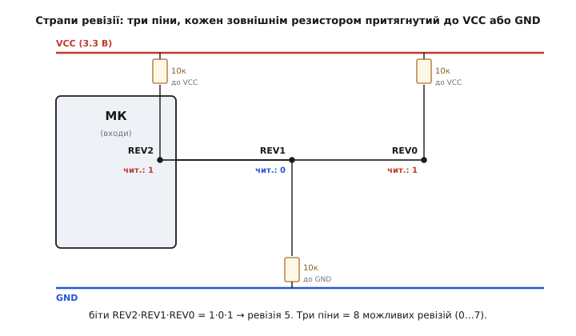
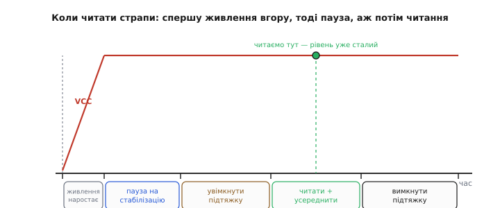

# ⚙️ Плата, що сама себе впізнає: читаємо страпи ревізії в прошивці

У самій темі ми домовилися про ідею: щоб один образ прошивки обслуговував кілька ревізій плати, у **плату** закладають кілька вільних пінів мікроконтролера, кожен через резистор притягнутий до живлення або до землі, — і комбінація нулів та одиниць стає номером ревізії. Ідея звучить на один рядок. А тепер зробимо її насправді — доведемо до коду прошивки, який запускається на реальному контролері й не падає в жодну з тих ям, куди падає наївна реалізація. Бо саме тут, у переході від «плата каже, хто вона» до «прошивка це надійно читає», ховається більше тонкощів, ніж здається: коли читати, чим підтягувати, як не сплутати власну підтяжку із зовнішнім резистором, як не повірити шуму на непідключеному піні. Пройдемо це від першопричини.

## Задача: один образ, кілька ревізій

Уяви, що ти вже випустив партію квадрокоптерних контролерів — ревізію 1. Мине пів року, і життя змусить зробити ревізію 2: постачальник зняв із виробництва барометр, який ти ставив, тож замість `BMP280` тепер стоїть `DPS310`; заразом ти переставив лінію керма з піна `PA0` на `PA1`, бо на `PA0` виявився зручніший таймерний канал. Плати ревізій 1 і 2 виглядають майже однаково, ідуть тим самим конвеєром, лежать в одному ящику на складі. І от на стіл лягає завдання: **залити прошивку**. Яку?

Наївна відповідь — тримати два образи: `firmware_rev1.bin` і `firmware_rev2.bin`. Одразу ж стає видно, чому це погано. По-перше, на заводі хтось муситиме **дивитися очима**, яка перед ним ревізія, і вибирати правильний файл — а сліпий конвеєр, як ми з'ясували в самій темі, очей не має, і людський вибір там — це готова помилка: рано чи пізно на ревізію 2 заллють образ від ревізії 1, барометр `DPS310` мовчатиме (бо код стукає по `BMP280`), керма не буде (бо код смикає `PA0`, а воно тепер на `PA1`), і плата поїде в поле мертва. По-друге, кожне виправлення спільного коду тепер треба вносити **двічі** й збирати **два** образи, а гілки неминуче розповзаються. По-третє, оновлення в полі («прошийте свій апарат новою версією») перетворюється на квест «а яка у вас ревізія?», на який користувач не знає відповіді.

Правильна відповідь: **один образ на всі ревізії**, а який давач опитувати й який пін чим є — вирішує сама прошивка, прочитавши в плати її номер. Це і є той бік DFM, що живе не в міді, а в коді: конструкцію (плату + прошивку) роблять такою, щоб виготовлення й обслуговування серії спростилися. Плата на старті каже прошивці: «я ревізія 2» — і прошивка сама вибирає таблицю: барометр `DPS310`, кермо на `PA1`. Той самий `.bin` тихо працює і на ревізії 1, і на ревізії 2, і на майбутній ревізії 3, для якої ти лише допишеш ще один рядок у таблицю.

> 🔧 **Навіщо це.** Це те, що відрізняє «зробив пристрій» від «випускаєш серію, яка житиме роками й міняється». Серія завжди еволюціонує — компоненти зникають з ринку, вузли перерозводять, знаходяться помилки. Якщо прошивка вміє спитати плату, хто вона, ти платиш за це кількома центами резисторів і кількома пінами один раз — а натомість маєш один образ, який неможливо залити «не на ту плату», і оновлення в полі, що самі підлаштовуються. Без цього кожна нова ревізія множить твій головний біль на заводі й у підтримці.

## Ідея: резистор перетворює пін на біт

Механізм гранично простий, і вся його краса — в тому, що він не коштує майже нічого. Береш кілька **вільних** пінів мікроконтролера — таких, що більше ні для чого не потрібні, — і налаштовуєш їх як цифрові **входи**. До кожного піна на платі припаюєш один резистор: або **вгору**, до шини живлення `VCC`, або **вниз**, до землі `GND`. Пін, притягнутий до `VCC`, читається як логічна **1**; притягнутий до `GND` — як логічний **0**. Комбінація цих нулів та одиниць — це **двійкове число**, і ним ти позначаєш ревізію.


*Три страпи ревізії. Кожен пін через зовнішній резистор 10 кОм притягнутий до однієї з шин: угору до `VCC` — і на вході стійка 1, униз до `GND` — і стійкий 0. Тут REV2 і REV0 підтягнуті вгору, REV1 — вниз, тож біти читаються як 1·0·1, тобто ревізія 5. Розстановкою резисторів на платі під час виготовлення ти «зашиваєш» у залізо її номер, а прошивка його просто зчитує.*

Слово «страп» (англ. *strap* — «перемичка, ремінець») тут означає рівно це: жорстку, назавжди задану на платі перемичку, що каже якийсь один біт налаштування. Скільки бітів — стільки й пінів; **N пінів дають 2ᴺ можливих ревізій**. Порахуймо, бо це визначає, скільки пінів закладати:

```
1 пін  → 2¹ = 2 ревізії  (0, 1)
2 піни → 2² = 4 ревізії  (0…3)
3 піни → 2³ = 8 ревізій  (0…7)
4 піни → 2⁴ = 16 ревізій (0…15)
```

Три піни — типовий розумний вибір: вісім ревізій за очі вистачає на весь життєвий цикл більшості виробів, а коштує це три дешеві резистори й три піни, яких зазвичай не шкода. Ревізію 0 (усі піни до `GND`) інженери часто лишають як «нульову / дослідну» або, навпаки, уникають — бо «усі нулі» — це ще й те, що ти прочитаєш, якщо резистори взагалі забули поставити або живлення просіло; про цю пастку — далі.

Є й багатший варіант тієї самої ідеї, коли пінів обмаль: **резисторний дільник на один АЦП-вхід**. Замість кількох цифрових пінів береш один вхід [аналого-цифрового перетворювача](root:hw-analog/adc) і вішаєш на нього [подільник напруги](root:hw-analog/voltage-divider) — пару резисторів, що ділять `VCC` у певній пропорції. Різні ревізії — різні номінали резисторів, отже різна напруга на вході; прошивка міряє її АЦП і за рівнем визначає ревізію. Один пін — а ревізій стільки, скільки різних рівнів напруги ти можеш надійно розрізнити (реально 8–16 з запасом на розкид резисторів). Ми розберемо обидва підходи: спершу цифрові страпи як основний і найпростіший, тоді АЦП-варіант як відповідь на «пінів немає».

## Робочий C/C++: цифрові страпи на STM32

Писатимемо під `STM32` з бібліотекою `HAL` (плюс покажемо той самий крок «голими» регістрами, бо тонкий момент із підтяжкою видно лише на регістрах). Ідея коду розкладається на чотири кроки, і кожен розберемо окремо: **(1)** налаштувати піни як входи з відомою підтяжкою, **(2)** зачекати, поки живлення й рівні усталяться, **(3)** прочитати піни — з усередненням проти шуму, **(4)** зібрати з бітів число й вибрати за ним таблицю плати.

### Крок 1: піни як входи — і чому підтяжку треба вимкнути

Перше рішення — якою підтяжкою тримати пін. І тут криється найтонший момент усієї теми, тож розберімо його повільно.

У мікроконтролера кожен GPIO-вхід має **внутрішні підтяжкові резистори** — і до живлення (pull-up), і до землі (pull-down), — які можна ввімкнути програмно одним бітом у регістрі. Це зручно: часто зовнішній резистор і не потрібен — ти просто вмикаєш внутрішню підтяжку, і пін тримає відомий рівень. Але у страпах ревізії рівень задає **зовнішній** резистор на платі, і саме тут внутрішня підтяжка стає ворогом.

Уяви пін REV1, який на платі притягнутий зовнішнім резистором **до землі** — ти хочеш прочитати на ньому 0. А в контролері ти помилково лишив увімкненою внутрішню підтяжку **до живлення**. Що на піні? Два резистори тягнуть у різні боки: зовнішній (скажімо, 10 кОм до `GND`) і внутрішній (у STM32 це номінально близько **40 кОм** до `VCC` — усталене значення з документації, діапазон приблизно 25–60 кОм). Виходить звичайний [подільник напруги](root:hw-analog/voltage-divider) між `VCC` і `GND`. Порахуймо, що на середині:

```
внутрішній pull-up:  R_pu ≈ 40 кОм  (до VCC)
зовнішній strap:     R_ext = 10 кОм (до GND)

напруга на піні = VCC · R_ext / (R_ext + R_pu)
               = 3.3 · 10 / (10 + 40)
               = 3.3 · 0.2
               ≈ 0.66 В
```

0.66 В — це низько, і швидше за все контролер прочитає це як 0 (поріг логічного нуля десь біля 0.3·VCC ≈ 1 В). Пощастило. А тепер розверни випадок: зовнішній резистор тягне **вгору** (хочеш 1), а ти лишив увімкненою внутрішню підтяжку **вниз**. Та сама арифметика дасть на піні `3.3 · 40/(40+10) ≈ 2.64 В` — це, мабуть, іще 1, знову пощастило. Але «швидше за все» й «мабуть» — не ті слова, на яких будують серійний виріб. Внутрішня підтяжка в STM32 гуляє від 25 до 60 кОм між екземплярами й температурою; зовнішній резистор має свій допуск; на певному поєднанні напруга на піні заповзе в **сіру зону** між порогами нуля й одиниці — і читання стане випадковим. Плата то впізнає себе, то ні, залежно від температури й конкретного чипа. Це найгидкіший тип бага: він плаває.

Висновок прямий: **щоб чисто прочитати зовнішній резистор страпа, внутрішню підтяжку треба вимкнути**. Тоді на піні панує сам зовнішній резистор — він один тягне пін до `VCC` або `GND`, ніхто йому не заважає, рівень чіткий. Пін налаштовуємо як вхід **без підтяжки** (`GPIO_NOPULL`):

:::code proj-board-rev-strap/c/krok-1-piny-iak-vkhody-i.c

Зверни увагу на перший рядок тіла: `__HAL_RCC_GPIOC_CLK_ENABLE()`. У STM32 кожен периферійний блок, зокрема порт GPIO, за замовчуванням **знеструмлений** заради економії — поки ти не подаси на нього тактовий сигнал, регістри порту мертві, і читання піна поверне сміття або нуль. Забути цей рядок — класична пастка: код виглядає правильно, а пін «не читається». Увімкнув такт — порт ожив.

Той самий крок «голими» регістрами показує, що` GPIO_NOPULL` — це насправді запис нулів у поле підтяжки регістра `PUPDR` (*pull-up/pull-down register*):

:::code proj-board-rev-strap/c/krok-1-piny-iak-vkhody-i-2.c

Ці два біти на пін у `PUPDR`, виставлені в нуль, і є весь секрет: ми фізично від'єднали внутрішні резистори, лишивши сцену зовнішньому. Якщо колись доведеться копати цей код глибше — робота з портом на рівні регістрів `MODER`/`PUPDR`/`IDR` докладно розібрана у [програмуванні GPIO через регістри](root:embedded/hal-ll-registers); тут нам достатньо знати, що `NOPULL` = нулі в `PUPDR`.

> 🔧 **Навіщо це.** Правило, що ловить найпідступніший баг цієї теми: **зовнішній резистор читають лише з вимкненою внутрішньою підтяжкою**. Увімкнена внутрішня підтяжка утворює із зовнішнім резистором подільник, напруга сідає в проміжок між логічними рівнями, і читання починає залежати від температури й конкретного чипа — то 1, то 0. Плата «іноді не впізнає себе». Один біт у `PUPDR` (`GPIO_NOPULL`) знімає цю пастку назавжди: жоден внутрішній резистор не бореться із зовнішнім.

Тут напрошується питання: а якщо внутрішню підтяжку вимкнути, то на **непідключеному** піні (де зовнішнього резистора взагалі немає) що буде? Правильна тривога — і саме про неї друга велика пастка теми, до якої ми ще дійдемо: пін без жодного резистора **плаває** й читається як шум. Тому вимкнена внутрішня підтяжка безпечна **лише за умови**, що зовнішній резистор на платі справді стоїть. Якщо ти хочеш захиститися й від «резистор забули поставити», є витончений прийом із **тимчасовою** внутрішньою підтяжкою — його розберемо окремо в кінці, бо він трохи хитріший.

### Крок 2: не читати, поки живлення не встоялося

Друге рішення — **коли** читати. І тут відповідь не «одразу в `main()`», а «трохи згодом, коли рівні встоялися». Причина фізична.

Коли на плату подають живлення, `VCC` не з'являється миттєво — воно **наростає** за скінченний час, поки регулятор напруги виходить на режим і заряджаються конденсатори (типово одиниці-десятки мілісекунд, залежно від ємностей). Поки `VCC` повзе вгору, «одиниця» на підтягнутому вгору страпі — це ще не 3.3 В, а, скажімо, 1.8 В у якийсь момент; поріг логічної одиниці може бути ще не досягнутий, і пін прочитається як 0 замість 1. Прочитаєш ревізію заскоро — зловиш її напівспеченою.


*Порядок у часі. Спершу `VCC` наростає до полиці — тут читати ще не можна, рівні пливуть. Дочекавшись стабілізації, читаємо страпи на сталому рівні (зелена точка). Смисл паузи один: дати і живленню, і напрузі на страпах вийти на усталене плато, перш ніж вирішувати долю всієї плати за їхнім рівнем.*

Сам мікроконтролер стартує не раніше, ніж `VCC` перейде поріг **скидання по низькій напрузі** (*brown-out reset*, BOR) — вбудований сторож, що тримає чип у скиданні, поки живлення не підніметься до безпечного рівня. Це вже дає певну гарантію: коли твій `main()` почав виконуватися, `VCC` майже напевно вже високий. Але «майже» знову муляє, а страпи — це рішення, яке ти приймаєш **один раз** і на весь сеанс; ціна помилки висока (уся плата поведеться як чужа ревізія), тож коштом кількох мілісекунд паузи ми купуємо певність. Механізм [скидання по низькій напрузі](root:hw-arch/brownout) і взагалі [коректна послідовність подання живлення](root:hw-power/power-sequencing) — окрема важлива тема; тут нам досить одного: **дай живленню встоятися, перш ніж читати долю плати**.

На практиці пауза — це або коротка затримка, або, чистіше, читання страпів **не найпершою дією**, а після базової ініціалізації (такти, годинник, можливо, невеликий `HAL_Delay`), коли від подання живлення вже минули мілісекунди:

```c
// Читаємо страпи не миттєво, а давши живленню й рівням устоятися.
static void rev_straps_settle(void) {
    // Кілька мілісекунд запасу: VCC уже на плато, пороги логіки досягнуті.
    // (HAL_Delay вимагає працездатного SysTick — тож викликаємо ПІСЛЯ HAL_Init.)
    HAL_Delay(5);
}
```

П'ять мілісекунд — з великим запасом для типового живлення; якщо на платі важкі ємності чи повільний регулятор, бери більше. Головне — не читати раніше, ніж рівень на страпах став плоским.

### Крок 3: читати з усередненням, а не одним пострілом

Третє рішення — **як** читати, щоб не повірити випадковому збою. Навіть на добре підтягнутому піні одиничне зчитування може збрехати: наведення від сусідніх доріжок, кидок при перемиканні поруч, дрібна перешкода в момент вимірювання. Для одного піна це рідкість, але страпи ми читаємо один раз і на все — тож перестрахуватися дешево.

Прийом — **усереднення кількома читаннями**: зчитуємо пін кілька разів поспіль із мікропаузами й беремо те значення, яке трапилося **більшість** разів. Це та сама ідея, що й [програмний дебаунс контакту](root:hw-digital/contact-debounce) — не вір першому відліку, дочекайся стабільної згоди кількох, — тільки тут ми боремося не з механічним брязкотом, а з поодиноким наведенням. Кільком читанням поспіль випадковий збій пробитися не дасть: він зіпсує один-два відліки, а решта дадуть правду, і більшість переможе.

Напишімо читання одного піна з мажоритарним голосуванням, а тоді складемо з трьох таких бітів число:

:::code proj-board-rev-strap/c/krok-3-chytaty-z.c

Дрібниці, що несуть вагу. `N` беремо **непарним** (5), щоб більшість завжди була однозначна — не буває 2.5 проти 2.5. Пауза між відліками — коротка (мікросекунди), просто щоб не читати той самий електричний момент; тут вона зроблена простим порожнім циклом навмисне, бо на цьому наймолодшому етапі старту таймери можуть бути ще не заведені. Порівняння `> N/2` (тобто `> 2` для `N=5`) означає «щонайменше 3 з 5» — тверда більшість.

Тепер збираємо з трьох бітів двійкове число. Домовмося про **порядок**: REV2 — старший біт (вага 4), REV1 — середній (вага 2), REV0 — молодший (вага 1). Тоді:

```c
// Зібрати номер ревізії з трьох страпів: REV2·REV1·REV0 як двійкове число.
static uint8_t read_board_revision(void) {
    uint8_t b2 = read_pin_debounced(REV_PORT, REV2_PIN);   // старший біт (×4)
    uint8_t b1 = read_pin_debounced(REV_PORT, REV1_PIN);   // середній (×2)
    uint8_t b0 = read_pin_debounced(REV_PORT, REV0_PIN);   // молодший (×1)

    // Зсуваємо кожен біт на його місце й складаємо в число 0…7.
    return (uint8_t)((b2 << 2) | (b1 << 1) | (b0 << 0));
}
```

Логіка збирання — сама суть двійкового числа: старший біт зсуваємо ліворуч на дві позиції (`<< 2`, вага 4), середній на одну (`<< 1`, вага 2), молодший лишаємо (вага 1), і об'єднуємо їх побітовим АБО. Комбінація 1·0·1 дасть `(1<<2)|(0<<1)|(1<<0) = 4|0|1 = 5` — рівно та ревізія 5 з нашого малюнка. Головне — **зафіксувати порядок бітів раз і назавжди** (у коді й у схемі однаково), бо переплутати старший з молодшим — це прочитати ревізію 5 як ревізію 3, і плата вдягне чужу маску.

### Крок 4: таблиця плати за номером ревізії

Останній крок — власне мета всієї витівки: за прочитаним номером вибрати **конфігурацію плати**. Це таблиця, де для кожної ревізії записано, чим ця ревізія відрізняється: який давач стоїть, на якому піні висить кермо, будь-що інше, що між ревізіями змінилося. Один образ носить у собі **всі** рядки цієї таблиці, а на старті бере той, що відповідає прочитаному номеру.

Оформлюємо це масивом структур, індексованим номером ревізії:

:::code proj-board-rev-strap/c/krok-4-tablytsia-platy-za.c

Уся картина складається докупи у функції ініціалізації плати. Вона читає ревізію, перевіряє, що номер узагалі є в таблиці, бере відповідний рядок і за ним налаштовує решту прошивки:

:::code proj-board-rev-strap/c/krok-4-tablytsia-platy-za-2.c

Тепер уся прошивка **єдина**. Немає `#ifdef REV2` по всьому коду — є одна змінна `g_board`, з якої драйвери й периферія беруть свої параметри під час запуску. Барометр обирається на льоту: якщо `g_board.baro == BARO_DPS310`, ставиться драйвер `DPS310`, інакше `BMP280`. Кермо чіпляється на `g_board.servo_pin` — `PA0` на ревізії 1, `PA1` на ревізії 2. Один `.bin` обслуговує обидві плати й підготовлений під наступні: щоб додати ревізію 3, ти дописуєш один рядок у `BOARD_TABLE` — і той самий образ починає її розуміти, нічого не переписуючи.

## АЦП-варіант: коли пінів немає, один вхід і подільник

Буває, що вільних цифрових пінів під три страпи просто нема — усі зайняті. Тоді рятує згаданий вище прийом: **один** аналоговий вхід і резисторний [подільник напруги](root:hw-analog/voltage-divider) на ньому. Різні ревізії ставлять різні номінали резисторів, тож на вході — різна частка від `VCC`; прошивка міряє її [АЦП](root:hw-analog/adc) і за рівнем визначає ревізію. Один пін замість трьох, а ревізій — стільки, скільки рівнів надійно розрізниш.

Ідея коду: поділити діапазон АЦП на **вікна**, по одному на ревізію, з широкими проміжками між ними, щоб розкид резисторів (типово ±1…5 %) не перекинув вимір із вікна у вікно. Скажімо, для 12-бітного АЦП (0…4095) рознесемо ревізії рівномірно й дамо кожній вікно шириною ±150 кодів:

:::code proj-board-rev-strap/c/atsp-variant-koly-piniv.c

Тут кілька рішень варті слова. По-перше, ми **усереднюємо 16 відліків АЦП** — з тієї ж причини, що усереднювали цифровий пін: аналоговий вхід шумить іще охочіше, і одиничний вимір легко зловить викид. По-друге, вікна рознесені **широко** (зазор між сусідніми центрами ~680 кодів, а вікно лише ±200) — це запас на те, що резистори мають допуск, `VCC` трохи гуляє, а сам АЦП має власну похибку. По-третє, попадання **між** вікнами — це не «округлимо до найближчого», а сигнал тривоги (`0xFF`): якщо вимір заповз у зазор, десь напаяли не той номінал або резистор відпав, і чесніше про це сказати, ніж мовчки вдягти навмання чужу ревізію.

Розмір вікна тримається на простому балансі: сусідні рівні мусять відстояти далі, ніж сумарний розкид від допуску резисторів, дрейфу `VCC` й похибки АЦП. Груба оцінка запасу між ревізіями:

```
крок між ревізіями (5 рівнів на шкалі):  ≈ 4095/6 ≈ 680 кодів  ≈ 0.55 В
розкид від резисторів ±2%:               ≈ ±0.02·VCC ≈ ±66 мВ ≈ ±80 кодів
похибка АЦП + дрейф VCC:                  ще десятки кодів
→ зазор 680 значно більший за сумарний розкид → рівні не сплутати.
```

Тобто крок між ревізіями (≈680 кодів) на порядок більший за весь очікуваний розкид (сотня-дві кодів) — рівні впевнено не налазять один на одного. Якщо схочеш більше ревізій на одному піні, вікна зблизяться, і доведеться або брати точніші резистори (±1 %), або опорну напругу АЦП стабільнішу — але 8 рівнів на 12-бітному АЦП розрізняються легко.

## Складність і пастки

Схема струнка, і на щасливому шляху працює з першого разу. Але страпи ревізії кусають рівно в трьох місцях, і кожне з них колись коштувало комусь кількох годин здивування. Розберімо всі три — це і є справжня цінність теми, бо саме тут наївна реалізація тихо ламається.

- **Плаваючий пін без зовнішнього резистора — читає шум.** Найчастіша й найпідступніша пастка. Ми навмисне вимкнули внутрішню підтяжку (крок 1), щоб не заважати зовнішньому резистору. Але якщо зовнішнього резистора на платі **немає взагалі** — забули поставити, відпав при пайці, обрана «незадіяна» комбінація лишила пін ні до чого не під'єднаним, — то пін висить у **повітрі**. Такий [плаваючий вхід](root:hw-digital/floating-pullups) не має визначеного рівня: його ловить наведення від сусідніх доріжок, від живлення, з ефіру, і він читається то як 0, то як 1, довільно й нестабільно. Ревізія «стрибає» від запуску до запуску. Ліки прямі: **кожен страп мусить мати зовнішній резистор** — це правило розводки, не прошивки. Пін не можна лишати «сам собою» ні за яких комбінацій: навіть та ревізія, де всі біти нулі, тримає нулі **зовнішніми** резисторами до землі, а не відсутністю резисторів. Прошивка ж, зі свого боку, ловить наслідок цієї біди на кроці 4: якщо прочитаний номер випадає з таблиці — це сигнал, що якийсь пін плаває або напаяний не так; тому ми й не вгадуємо, а відкочуємося до відомої ревізії й голосно журналюємо.

  Є витончений компроміс на випадок «а раптом резистор таки забули», який заразом дає **самоперевірку монтажу**. Прийом — прочитати кожен страп **двічі, з різними внутрішніми підтяжками**. Спершу вмикаєш внутрішній pull-up і читаєш; тоді внутрішній pull-down і читаєш знову. Якщо зовнішній резистор **стоїть** (він на порядок сильніший за внутрішні ~40 кОм — зовнішні беруть 4.7–10 кОм саме тому), він **пересилить** обидві внутрішні підтяжки, і пін дасть **однакове** значення в обох читаннях — це його справжній рівень. А якщо зовнішнього резистора **нема**, пін піде за слабкою внутрішньою підтяжкою: з pull-up прочитається 1, з pull-down — 0, тобто **різні** значення. Розбіжність між двома читаннями = «зовнішній резистор відсутній», і ти ловиш непропаяну плату прямо в прошивці:

  :::code proj-board-rev-strap/c/skladnist-i-pastky.c

  Зверни увагу на останній крок функції: перш ніж вийти, ми **повертаємо пін у `GPIO_NOPULL`**. Це важливо — тимчасова підтяжка була потрібна лише для перевірки; лишити її ввімкненою означало б повернутися рівно до пастки з кроку 1 (внутрішній резистор псує рівень). Увімкнули для діагностики — вимкнули після. Цей прийом коштує кількох рядків, а натомість перетворює страпи ще й на **тест монтажу**: плата не лише каже, хто вона, а й ловить, що на ній забули резистор.

- **Конфлікт із функцією піна — страп «не читається», бо пін зайнятий іншим.** Друга пастка сидить не в електриці, а в **призначенні** піна. У мікроконтролера кожен фізичний вивід уміє багато: бути GPIO, а може — виводом таймера, лінією UART, каналом АЦП, ніжкою SPI. Одну фізичну ногу можна віддати лише **одній** функції за раз — це [мультиплексування виводів](root:embedded/pin-mux). Якщо ти обрав під страп пін, який десь-інде в коді (чи в стартовій ініціалізації, чи в бібліотеці плати) вже налаштований під альтернативну функцію — скажімо, як вивід таймера ШІМ, — то в момент читання страпа цей пін **не GPIO-вхід**, і `HAL_GPIO_ReadPin` поверне не рівень резистора, а казна-що. Ба гірше: деякі піни на STM32 мають особливий норов — ті самі `PC13/PC14/PC15` з наших прикладів належать до домену [резервного живлення](root:hw-power/power-sequencing) і можуть бути зайняті годинником реального часу або виводом низькочастотного кварцу; `PA13/PA14` — це лінії налагоджувача SWD, і забравши їх під страп, ти втратиш можливість прошивати плату по-простому. Ліки: **обирай під страпи піни, які точно вільні** й не мають особливих ролей, і **читай страпи першими** — до того, як будь-яка периферія перехопить ці піни під себе. У нашому `board_identify()` читання стоїть на самому початку саме тому: спершу впізнати плату, а вже потім роздавати піни таймерам і шинам.

  > 🔧 **Навіщо це.** Дві прості звички знімають цілий клас «страп не читається»: **під страпи бери завідомо вільні піни без особливих функцій** (не SWD, не кварц, не те, що бібліотека плати мовчки забирає), і **читай їх найпершими на старті**, поки їх ніхто не перехопив під альтернативну роль. Порушиш — і `ReadPin` поверне стан чужої периферії замість рівня резистора, а ти шукатимеш баг в електриці, хоч він у конфлікті призначень.

- **Читання до стабілізації живлення — напівспечений рівень.** Третя пастка — та, від якої боронить крок 2, тож нагадаємо коротко, чому її не можна відкидати. Спокуса поставити `board_identify()` найпершим рядком `main()`, ще до `HAL_Init`, зрозуміла: «хочу знати ревізію якомога раніше». Але найраніший момент — це той, коли `VCC` іще, можливо, повзе вгору, а внутрішній тактовий генератор і `SysTick` іще не заведені (тобто `HAL_Delay` не працює). Прочитаєш страпи, поки рівень не встоявся, — зловиш «одиницю», яка ще не доросла до порога, і впізнаєш чужу ревізію. Ліки: викликати `board_identify()` **рано, але не найраніше** — після `HAL_Init` (щоб працювала пауза), давши живленню ті кілька мілісекунд, і **до** ініціалізації давачів (щоб їхній вибір спирався вже на відому ревізію). Порядок «такти → HAL_Init → впізнати плату → решта периферії» не випадковий: він ставить читання страпів у вузьке вікно, де живлення вже стабільне, а піни ще вільні.

- **Дрібніші граблі, що варті згадки.** Ще кілька місць, де легко перечепитися. **Порядок бітів** мусить бути однаковий у схемі й у коді — переплутав старший з молодшим, і ревізія 5 прочитається як 3; фіксуй його раз і документуй. **Номер поза таблицею** ніколи не «округлюй навмання» до найближчої ревізії — це майже завжди ознака апаратної біди (плаваючий пін, не той номінал, конфлікт функції), тож чесніше відкотитися до відомої ревізії й журналювати, ніж мовчки вдягти чужу маску. Для **АЦП-варіанта** пам'ятай, що вимір прив'язаний до опорної напруги АЦП: якщо опора — це саме `VCC`, а подільник теж живиться від `VCC`, то їхній дрейф частково скорочується (обидва рухаються разом), і це добре; але якщо опора окрема (внутрішній `Vref`), стеж, щоб її похибка не з'їла зазор між вікнами. І, нарешті, **страпи — не таємниця й не захист**: будь-хто з мультиметром прочитає ревізію з плати; вони кажуть «яка це плата», а не «чи можна їй довіряти», тож не покладай на них жодної ролі безпеки.

Зведімо нитку. Щоб один образ прошивки обслуговував кілька ревізій, плата має **сама сказати, хто вона** — і найдешевше це роблять страпи: кілька пінів, кожен зовнішнім резистором притягнутий до `VCC` (читається 1) або `GND` (читається 0), а комбінація бітів — двійковий номер ревізії. У прошивці це чотири кроки: налаштувати піни як входи **без внутрішньої підтяжки** (щоб вона не боролася із зовнішнім резистором і не сідала на подільник), **дати живленню встоятися** перед читанням, прочитати кожен пін **з усередненням** проти поодинокого наведення й **зібрати з бітів число**, яким індексувати таблицю конфігурацій плати — який давач, який пін. Коли пінів обмаль, ту саму роботу робить один АЦП-вхід із подільником, де ревізії — це рознесені рівні напруги. А над усім стоять три пастки, від яких треба боронитися свідомо: **плаваючий пін** без зовнішнього резистора читає шум (кожен страп — обов'язково з резистором, а хочеш самоперевірки монтажу — читай двічі з різними внутрішніми підтяжками); **конфлікт функції** робить пін не-GPIO в момент читання (бери завідомо вільні піни, читай їх найпершими); і **читання до стабілізації живлення** дає напівспечений рівень (впізнавай плату рано, але після `HAL_Init`, і до давачів). Зроблено так — і один-єдиний `.bin`, який неможливо «залити не на ту плату», тихо обслуговує всю серію, що росте від ревізії до ревізії лише на один рядок таблиці.
