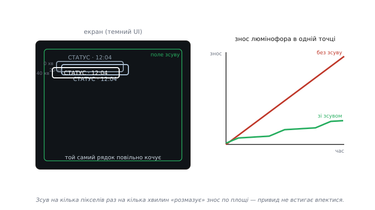
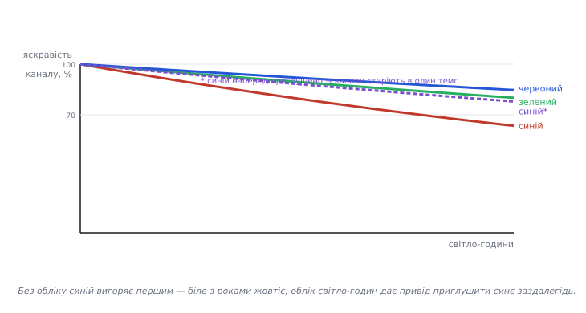

# ⚙️ Пом'якшуємо вигоряння AMOLED на боці хоста

У темі ми домовилися про неприємну плату за красу OLED: органіка **старіє від світіння**, синє вицвітає швидше за решту, а пікселі, що довго показують те саме — годинник, рядок статусу, логотип, — вигоряють сильніше за сусідів і лишають примарний слід. Там ця думка була попередженням «закладайте захист». Тут ми цей захист **напишемо** — рядок за рядком, як шар прошивки, що сидить між вашим малюванням і панеллю.

Домовмося одразу про межу відповідальності. Сучасні AMOLED-модулі часто мають власну апаратну компенсацію всередині драйвера — вимірюють струм комірок, ведуть внутрішні таблиці й підпідсвічують спрацьовані ділянки самі. Ми **не** дублюємо цю кремнієву магію й не ліземо в реєстри драйвера. Наша ділянка — рівень **хоста**: те, що робить ваш мікроконтролер із картинкою **до** того, як віддати її панелі. Чотири прийоми, кожен дешевий і кожен реально відсуває день, коли на екрані проступить привид меню:

- **приглушення статики** — знайти яскраві незмінні плями й притлумити саме їх;
- **зсув картинки** (*pixel-shift*) — повільно кочувати все зображення на пару пікселів, щоб жодна точка не світила вічно в одному місці;
- **згасання за бездіяльності** — притемнити, а потім і згасити екран, коли на нього ніхто не дивиться;
- **облік зносу** — грубий лічильник «світло-годин» на канал, з наголосом на синьому, щоб знати, коли пора наперед приглушити синє й не дати білому пожовкнути.

Це той самий клас турботи, що [керування життєвим циклом дисплея](root:embedded/display-lifecycle) — тільки під конкретним кутом «як не спалити панель». І майже все тут спирається на те, що яскравість людина сприймає **нелінійно**; цей факт ми вже мусили враховувати в [управлінні кольором і гамою](root:embedded/color-management), а тепер він визначить, як саме плавно гасити й приглушувати без мерехтіння.

## Задача: не дати статиці впектися, поки хтось дивиться

Сформулюймо чесно, з чим боремося. Вигоряння (*burn-in*) — це **диференційне старіння**: люмінофор під пікселем тьмяніє пропорційно тому, скільки світла він за життя випромінив, а що яскравіший і незміннiший піксель, то швидше він відстає від сусідів. Коли різниця яскравості між «втомленою» і «свіжою» ділянкою переростає поріг помітності (індустрія називає числа близько 15 %, усталена оцінка за оглядами виробників панелей), око починає бачити привид.

З цього означення одразу випливає, за якими важелями ми можемо тягнути. Знос точки ∝ (яскравість) × (час світіння) × (вразливість каналу). Отже, зменшити його можна трьома незалежними множниками:

```
 знос_точки  ∝   L(точка)   ×   t_світіння   ×   k_каналу
                    │              │                │
             приглушення     зсув + згасання    облік синього
```

Кожен наш прийом б'є по своєму множнику. Приглушення статики зменшує `L` там, де воно найнебезпечніше. Зсув і згасання ріжуть `t` — зсув розмазує час по багатьох точках, згасання прибирає час зовсім, коли глядача немає. Облік каналів дає нам знання про `k`, щоб притлумити найвразливіший синій наперед. Разом вони не скасовують фізику — органіка все одно старітиме, — але **вирівнюють** знос по площі й по каналах, а вирівняний знос око не бачить: тьмяніє все однаково, привида немає.

> 🔧 **Навіщо це.** Тримайте в голові, що ворог — не старіння взагалі, а **нерівномірне** старіння. Панель, що за три роки рівно згасла на 20 % усюди, виглядає просто трохи тьмянішою — це нормально й непомітно. Панель, де рядок статусу згас на 20 %, а решта на 5 %, показує привид. Тому всі наші зусилля — не «менше світити», а «світити так, щоб знос розповзався рівно». Це геть інша мета, ніж просто «економити яскравість».

Ще одне обмеження задачі, дуже практичне: усе це має бути **непомітним для користувача**. Якщо приглушення статики смикає яскравість стрибком, якщо зсув картинки видно як здригання, а вихід зі згасання клацає — ви проміняли повільне вигоряння на щоденне роздратування. Тому половина роботи тут — не сама компенсація, а те, щоб її **не було видно**. До цього ми повернемося в пастках; там і з'ясується, чому наївна реалізація мерехтить.

## Ідея: тонкий шар між малюванням і панеллю

Архітектурно все зводиться до одного рішення: між вашим кодом, що малює інтерфейс, і драйвером, що жене байти в панель, ми вставляємо **шар компенсації**. Він нічого не знає про зміст картинки — він знає лише кілька чисел: поточну ціль яскравості, поточний зсув, накопичену активність користувача й лічильники зносу. Раз на кадр (чи раз на кілька кадрів) цей шар оновлює свій стан і підправляє два важелі, якими розмовляє з панеллю: **глобальну яскравість** і **зсув початку координат**.

Чому саме ці два важелі, а не малювання темніших пікселів у кадровому буфері? Бо вони майже безкоштовні. Глобальну яскравість AMOLED дає однією командою в драйвер (регістр яскравості або широтно-імпульсне притемнення підсвічування комірок) — не треба переписувати ані байта картинки. Зсув теж часто вміє сам контролер (регістр початку прокрутки), а якщо ні — ми зсуваємо вікно, у яке малюємо. Обидва важелі діють на **весь** екран одразу, тож коштують сталого часу незалежно від роздільності.

Стан шару вміщається в одну скромну структуру. Заведімо її одразу — далі всі функції працюватимуть саме з нею:

:::code proj-oled-compensation/c/ideia-tonkyi-shar-mizh.c

Одна структура, кілька чисел — і весь захист панелі. Далі ми наповнимо чотири функції, що працюють над цим станом: приглушення яскравості, зсув, згасання й облік. Порядок неважливий для панелі, але важливий для розповіді — почнемо з найпростішого важеля.

## Плавна яскравість: перцептивна шкала й повзунок

Уся інша логіка (згасання, приглушення статики) зрештою просить одне: «постав яскравість у таке-то значення». Тож спершу зробімо цей примітив — і зробімо його **правильно**, бо саме тут ховається головне джерело мерехтіння.

Наївний підхід — тримати яскравість у тих самих одиницях, що й регістр панелі (скажімо, 0..255 струму комірок), і лінійно її змінювати. Проблема в тому, що око бачить світло **нелінійно**. Джерело з яскравістю лише 18 % від опорної здається вполовину темнішим; сприйняту світлоту (CIE L\*) добре описує **кубічний корінь** із фізичної яскравості — ефективний показник степеня близько 0.43 (усталений факт, за Poynton, «Gamma FAQ», і статтею «CIELAB» у Wikipedia). Це означає, що рівні кроки в струмі панелі дають **дуже нерівні** кроки в сприйнятті: угорі шкали 10 одиниць майже непомітні, а внизу ті самі 10 одиниць — це стрибок від тьмяного до чорного.

Наслідок для нас прямий. Якщо ми плавно згасаємо, лінійно зменшуючи струм, то під кінець, біля нуля, око побачить не плавне згасання, а **різке клацання** в темряву. Тому наш повзунок яскравості мусить жити в **перцептивній** шкалі (я взяв 0..1000 як зручний діапазон), а в струм панелі переводитися нелінійно — підняттям до степеня, оберненого до сприйняття:

:::code proj-oled-compensation/c/plavna-iaskravist.c

На мікроконтролері без апаратного `powf` цей рядок краще замінити невеликою **таблицею** (33 чи 65 точок із лінійною інтерполяцією між ними) — рівно тією гамма-таблицею, що ми будували в [управлінні кольором](root:embedded/color-management/api-gamma-table.md). Ідея та сама: степенева крива один раз порахована офлайн, у рантаймі — лише вибірка з таблиці. Головне не **як** порахувати `p^2.2`, а що ми взагалі згинаємо шкалу перед тим, як віддати число панелі.

Тепер сам повзунок. Ми ніколи не ставимо яскравість стрибком — ми рухаємо `bright_now` до `bright_target` невеликими кроками щокадру. Це і є те, що робить згасання й приглушення **плавними**:

:::code proj-oled-compensation/c/plavna-iaskravist-2.c

Зверніть увагу на дві дрібниці, що коштують копійки, а рятують від артефактів. По-перше, обидві гілки **затискають** значення на цілі — без цього повзунок «перелітав» би ціль і дрижав навколо неї туди-сюди (класичне джерело мерехтіння, до якого повернемось у пастках). По-друге, спад ми робимо трохи повільнішим за підйом: різке потемніння око ловить як тривогу, а плавне — як спокій. Це не забаганка, а той самий перцептивний закон: унизу шкали кожна одиниця «важить» більше, тож там і крок має бути дрібнішим.

## Приглушення статики: знайти незмінне й притлумити

Найбезпечніший піксель — той, що постійно міняється; найнебезпечніший — яскравий і незмінний. Наш другий прийом саме про це: знайти на екрані **яскраві статичні плями** й притлумити їх, не чіпаючи решту. Промислові телевізори називають це «обмежувач яскравості логотипа» (LG — *Logo Luminance Adjustment*, Samsung — *Static Brightness Limiter* із детектором логотипів) — і роблять рівно те, що ми зараз (усталений факт, за оглядами налаштувань OLED LG/Samsung; є й патенти USPTO на приглушення статичних ділянок і зсув, напр. US 12,051,364 та US 11,127,325).

Повний детектор статики на хості дорогий: треба тримати попередній кадр і порівнювати. Але для інтерфейсу приладу є набагато дешевший шлях — ми **самі знаємо**, де в нас статика, бо ми її й малюємо. Рядок статусу, шкала приладу, фірмовий напис — це наші власні віджети. Тож замість шукати статику піксель за пікселем, ми **позначаємо** її на етапі малювання: кожен незмінний яскравий елемент реєструє свій прямокутник як «статичний». А компенсатор раз на N секунд перевіряє, чи ці прямокутники давно не мінялися, і якщо так — притлумлює всередині них найяскравіше.

:::code proj-oled-compensation/c/pryhlushennia-statyky.c

Чому притлумлення повзе по одному відсотку за крок, а не стрибає на потрібні 25 % відразу? Той самий перцептивний закон і той самий ворог — мерехтіння. Якщо різко зняти чверть яскравості з рядка статусу, око спіймає стрибок, навіть якщо рядок не в фокусі — периферійний зір дуже чутливий до змін яскравості. А от повзти по відсотку раз на секунду — це 25 секунд плавного затемнення, якого не помітить ніхто. І симетрично: щойно елемент **змінився** (`region_touched`), стеля падає в нуль, і той самий повзунок за пару секунд поверне повну яскравість — тож активний елемент завжди яскравий, а «застиглий» тихо тьмяніє.

> 🔧 **Навіщо це.** Ключове рішення тут — **не детектувати статику, а декларувати її**. У великому телевізорі, що показує чужий сигнал, вибору немає — треба аналізувати кадри. Але у **вашому** приладі ви автор інтерфейсу: ви точно знаєте, що годинник у кутку статичний, а графік — ні. Скористайтеся цим знанням — воно перетворює дорогий аналіз зображення на дешевий прапорець `region_touched()` у місці, де ви й так малюєте. Це типова інженерна перемога: не розв'язуй складнішу задачу, ніж маєш.

## Зсув картинки: щоб жодна точка не світила вічно

Приглушення рятує від найяскравішого, але навіть притлумлений рядок статусу, що місяцями стоїть на тому самому місці, зрештою впечеться. Радикальніший прийом — не дати жодній точці бути «тим самим пікселем» надовго. Ми повільно **кочуємо весь екран** на пару пікселів у межах невеликого поля. Око цього не помічає (зсув на 1-2 пікселі раз на кілька хвилин), а знос розмазується по площі: те, що вчора палило точку (100, 20), сьогодні палить (102, 24), і жодна точка не набирає критичної дози.


*Чому зсув рятує. Ліворуч той самий рядок статусу за кілька хвилин побував у трьох злегка різних місцях у межах пунктирного поля зсуву. Праворуч — знос люмінофора в одній конкретній точці: без зсуву (червона) точка світить весь час і старіє круто; зі зсувом (зелена) вона світить лише зрідка, коли картинка саме над нею, — знос повзе пологою пилкою. Зсув не зменшує сумарне світло, він розподіляє його так, щоб ніде не назбиралося критичної дози.*

Реалізація елегантно проста, якщо думати про зсув як про **повільний обхід** невеликого прямокутника (у промисловості це так і звуть — *orbit*, «орбіта»). Раз на `shift_period_ms` ми робимо один крок по замкнутому контуру. Найдешевший контур — рамка поля: праворуч, униз, ліворуч, угору й знову. Але рамка лишає центр поля недовикористаним; трохи краще — псевдовипадковий крок у межах поля. Покажу обидва, почавши з передбачуваної орбіти:

:::code proj-oled-compensation/c/zsuv-kartynky-shchob.c

Орбіта передбачувана, а передбачуваність — ворог: якщо зсув завжди ходить тим самим квадратом, кутові точки орбіти самі стають трохи «статичнішими» за середину граней. Тому в реальному коді я волію **розкид** — крок у випадкову точку поля, але з обмеженням «не стрибати далеко», щоб зсув лишався непомітним:

:::code proj-oled-compensation/c/zsuv-kartynky-shchob-2.c

Лишається питання, **як застосувати** зсув до картинки. Два шляхи, і вибір диктує ваша панель. Якщо контролер уміє апаратну прокрутку (регістр «початок вертикальної прокрутки», як у багатьох [OLED-модулів](root:hw-motion/oled) на поширених драйверах), ми просто пишемо туди `shift_y` — і панель сама зсуває вивід, безкоштовно. Якщо ні — ми зсуваємо **вікно малювання**: усі координати наших віджетів отримують `+shift_x, +shift_y`, а по краях лишається вузька рамка, яку ми або заливаємо чорним (на OLED це вимкнені пікселі, тобто нуль зносу — ідеальний бордюр), або навмисно тримаємо порожньою в дизайні. Ось чому `shift_span` беруть малим (2-4 пікселі): що ширше поле, то товща мертва рамка по краях.

## Згасання за бездіяльності: найдешевша економія зносу

Найрадикальніший спосіб не зносити піксель — **не світити** ним, коли на екран ніхто не дивиться. Це водночас і найбільша економія енергії (згадаймо з теми: на OLED темне = холодне, вимкнене = нуль). Логіка проста: лічимо час від останньої взаємодії; минув поріг притемнення — плавно опускаємо яскравість до тьмяної; минув поріг згасання — гасимо в нуль. Будь-яка взаємодія миттю повертає повну яскравість.


*Чому облік каналів важить. Без компенсації синій канал (червона крива — так, іронічно) спадає найкрутіше: його люмінофор зношується у рази швидше, тож за роки білий баланс «пливе» в теплий бік. Пунктирна фіолетова — синій, наперед трохи приглушений за показами лічильника світло-годин: він старіє в один темп із рештою, і біле лишається білим довше. Ми не можемо спинити старіння, але можемо зробити його рівним по каналах.*

Уся машина згасання — це маленький автомат станів над таймером. Ось серце, що зводить пороги в одну ціль яскравості:

:::code proj-oled-compensation/c/zhasannia-za-bezdiialnosti.c

Тут ховається тонкість, яку легко проґавити: коли ми **прокидаємось із повного нуля**, плавний підйом з 0 виглядає як повільне «розгоряння», і користувач, який щойно натиснув кнопку, ще пів секунди дивиться в майже чорний екран, думаючи, що прилад завис. Тому вихід саме **з нуля** варто робити швидшим, а от притемнене (25 %) → повне — плавним. Це знову перцептивний нюанс: реакція на дію має бути миттєвою, а фонове згасання — непомітним. Різні швидкості для різних переходів — не ускладнення, а повага до сприйняття.

## Облік зносу: грубий лічильник світло-годин із наголосом на синьому

Останній і найтонший прийом — **знати**, скільки кожен канал уже відсвітив, щоб приглушувати найвразливіший синій наперед, а не постфактум, коли біле вже пожовкло. Точний облік попіксельний неможливий на скромному хості (сотні тисяч лічильників), та він і не потрібен. Досить **грубої** глобальної моделі: інтегруємо середню яскравість кожного каналу по всьому екрану за час і множимо на **ваговий коефіцієнт вразливості** — для синього більший, бо його органіка старіє в рази швидше.

Наскільки більший? Огляди панелей сходяться: синій деградує приблизно **втричі** швидше за червоний і зелений за однакового струму; T50 (падіння до 50 % яскравості) для синього — близько 10 000-15 000 годин, тоді як червоний і зелений живуть помітно довше (усталена індустрійна оцінка, за оглядами Panox Display і матеріалами про строк служби AMOLED; конкретні числа плавають від матеріалу й струму, тож беремо їх як порядок, не як догму). Звідси й ваги в моделі:

:::code proj-oled-compensation/c/oblik-znosu-hrubyi.c

Звідки взяти `avg_r/g/b`, не скануючи весь кадровий буфер щокадру? Найдешевше — рахувати їх **інкрементно** прямо в малювальному коді: коли заливаєте область кольором, додайте `колір × площа` до бігучих сум каналів за кадр, а наприкінці кадру поділіть на площу екрана. Це кілька множень на віджет замість проходу по сотнях тисяч пікселів. Якщо навіть це задорого — беріть **дуже** грубе наближення: середній колір теми інтерфейсу (він рідко міняється) як сталу оцінку. Точність тут не критична: ми ловимо не абсолютний знос, а **перекіс** між каналами.

А тепер — навіщо ми це рахували. Коли синій набіг помітно випереджає інші, ми **наперед** трохи гасимо синій канал у виводі — і цим сповільнюємо його старіння, підтягуючи темп до червоного й зеленого. Біле лишається білим довше ціною ледь помітного «теплішання» свіжої панелі:

:::code proj-oled-compensation/c/oblik-znosu-hrubyi-2.c

Стеля тут не примха: якщо гасити синій без обмеження, свіжий інтерфейс візьме помітний зелено-жовтий відлив, і ми проміняємо повільний дрейф на негайно бридкий колір. Мета — м'яко пригальмувати найшвидший канал, а не перефарбувати екран. І, як завжди, застосовувати `wear_blue_scale` до виводу треба **плавно** — не стрибком при кожному перерахунку, а повзунком, як усе інше.

## Складання: один виклик щокадру

Чотири прийоми зводяться в одну функцію, яку хост кличе раз на кадр (чи раз на кілька кадрів — облік і приглушення статики не потребують частоти кадрів). Вона й показує, як шматки працюють разом:

:::code proj-oled-compensation/c/skladannia-odyn-vyklyk.c

Уся машина — п'ять кроків, жоден не важчий за кілька арифметичних дій. Це і є сенс «шару на боці хоста»: він майже нічого не коштує, а панелі додає роки рівного зносу. Тепер — про те, де ця простота підступно ламається.

## Складність і пастки

Наївна реалізація вище працює на демо й підводить у полі. Розберімо три пастки, кожна з яких — з тих, що виявляються не на столі, а через тиждень роботи.

**Overshoot: повзунок перелітає ціль і дзвенить.** Якщо крок яскравості за кадр більший, ніж лишилося до цілі, а ми забули затиснути, `bright_now` проскочить `bright_target` і на наступному кадрі поповзе назад — і так туди-сюди, даючи видиме тремтіння яскравості на 1-2 одиниці. Те саме з псевдовипадковим зсувом без затиску в поле: він «вирветься» за `span` і рамка поповзе. Лік — **завжди затискати** на цілі й на межах поля (ми це зробили в `bright_slew` і `shift_random_step`), і ніколи не робити крок більшим за відстань до цілі. Симптом на стенді: увімкніть повільний логгер `bright_now` і подивіться, чи він **сідає** на ціль намертво, чи дрібно осцилює навколо неї. Осциляція — це overshoot.

**Мерехтіння при зміні яскравості: стрибок замість рампи.** Найпідступніша пастка, і майже завжди винна **лінійна** шкала. Якщо приглушення статики знімає «рівні» 25 % у струмі панелі, то внизу яскравості це величезний перцептивний стрибок — око спіймає моргання, навіть якщо математично ми змінили небагато. Друге джерело — **надто великий крок повзунка** щодо частоти кадрів: 20 одиниць/кадр при 60 кадрах/с — це плавно, а при 5 кадрах/с — це видимі сходинки. Лік подвійний: (1) міняти яскравість завжди в **перцептивній** шкалі й гнути в струм гаммою (`perc_to_panel`), тоді рівні кроки внизу й угорі виглядають однаково плавно; (2) прив'язати крок повзунка до **реального** інтервалу кадру, а не до сталого числа — про це нижче. І золоте правило: **жодних стрибків яскравості взагалі**, усе тільки через повзунок. Навіть пробудження з притемнення — рампою.

**Узгодження з частотою кадрів: зсув на видимому кадрі.** Дві біди від нехтування кадрами. Перша: якщо зробити крок зсуву **посеред** малювання кадру, верх екрана буде зсунутий, а низ — ще ні, і мигне розрив (той самий клас проблеми, що [подвійна буферизація](root:hw-motion/display-double-buffering) розв'язує для картинки взагалі). Зсув, як і зміну яскравості, треба застосовувати **між** кадрами, у момент, коли панель не в середині вибірки з буфера. Друга: якщо ваш `disp_guard_tick` кличеться нерегулярно (то 60, то 10 разів на секунду, бо процесор зайнятий), то і згасання, і зсув поповзуть ривками. Лік — **не рахувати кроки в «одиницях на кадр»**, а масштабувати їх на **фактичний** `dt`:

```c
// крок яскравості, прив'язаний до реального часу кадру, а не до сталого числа
static void bright_slew_dt(disp_guard_t *g, uint16_t units_per_sec, uint32_t dt_ms) {
    uint32_t step = (uint32_t)units_per_sec * dt_ms / 1000u;
    if (step == 0) step = 1;                 // за дуже короткий dt хоч одиницю
    if (step > 60000u) step = 60000u;        // за дуже довгий dt (лаг) не стрибати через увесь діапазон
    // ... далі як у bright_slew, але з цим step і затиском на цілі ...
}
```

Зверніть увагу на **другий** затиск — на великому `dt`. Якщо кадр раптом підвис на секунду (щось довге в головному циклі), наївна формула `units_per_sec × dt` дасть величезний крок і яскравість **стрибне** — рівно те мерехтіння, від якого ми тікаємо. Тож обмежуємо крок і зверху: краще досягати цілі на кадр-два пізніше, ніж клацнути. Це загальне правило для будь-якого часозалежного згладжування на непевному таймінгу: затискай крок з **обох** боків.

Є й четверта, тихіша пастка — **облік зносу з переповненням і нульовим стартом**. Лічильники `wear_*` ростуть безперервно; за роки безперервної роботи навіть 64-бітний лічильник теоретично можна переповнити, якщо масштаб одиниць завеликий (перевірте: `255 × 30 × 86400000 мс/добу ≈ 6.6×10¹¹ за добу` — до переповнення `uint64` тисячоліття, тож 64 біти безпечні, а от `uint32` переповниться за годину, і взяти його було б помилкою). І другий бік: `wear_blue_scale` мусить коректно поводитись, поки лічильники ще малі (ми повертаємо 256 при нульовому опорному) — інакше свіжий прилад на перших секундах смикне синій. Дрібниця, але саме на таких дрібницях компенсатор або тихо працює роками, або дає артефакт на першому ввімкненні.

> 🔧 **Навіщо це.** Спільний корінь усіх чотирьох пасток один: **сприйняття й таймінг живуть окремо від вашої математики**. Формула, ідеальна на папері, дає стрибок, бо око нелінійне; дає ривок, бо кадри нерівні; дає дзвін, бо ви забули затиск. Тому головна навичка тут — не вивести компенсацію (вона проста), а зробити її **невидимою**: усе через повзунки, усе в перцептивній шкалі, усе прив'язане до реального `dt` і затиснуте з обох боків. Компенсатор, якого видно, — це зіпсований компенсатор, хоч би як правильно він рахував знос.

Зведімо все докупи. Ми побудували тонкий шар хоста, що б'є по трьох множниках зносу — яскравості (приглушення статики), часу світіння точки (зсув і згасання) і вразливості каналу (облік світло-годин із наголосом на синьому). Кожен прийом коштує копійки процесорного часу й діє на весь екран одразу. А вся інженерна тонкість зосереджена не в самих прийомах, а в тому, щоб їх **не було видно**: перцептивна шкала яскравості замість лінійної, повзунки замість стрибків, прив'язка до реального інтервалу кадру й затиски з обох боків. Зробіть це — і панель, що на demo сяяла б собі привидом меню за рік, проживе роки з рівним, непомітним зносом, а користувач ніколи не здогадається, що хост увесь цей час тихо беріг його екран.
