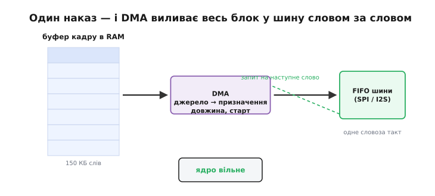
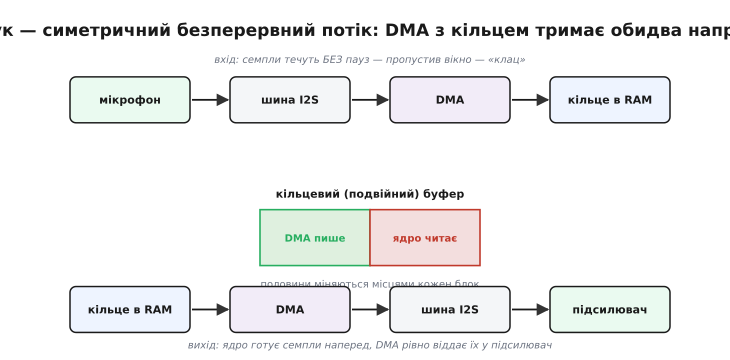
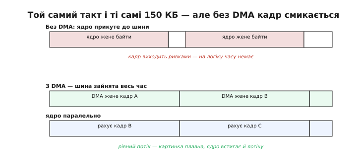

# DMA + SPI/I2S: великі блоки без переривань

Прямий доступ до пам'яті (DMA, англ. *direct memory access* — «прямий доступ до пам'яті») задуманий, щоб дані переливались між пам'яттю й периферією **без участі ядра на кожному слові**. Один із напрямів цього переливання — коли [DMA вичитує потік із АЦП](root:embedded/dma-adc): дані течуть із периферії **в** пам'ять. Є й дзеркальний напрям, не менш важливий: великий блок треба вилити з пам'яті **у** швидку послідовну шину. Найгучніші приклади — кадр пікселів на дисплей і потік звукових відліків у цифровий підсилювач.

Шини, якими це робиться, — [SPI](root:com-devices/spi-bus) (англ. *serial peripheral interface*) та I2S (англ. *inter-IC sound* — «звук між мікросхемами») — тут цікавлять лише з одного боку: як «послідовний канал, що бере по слову за раз на високій тактовій частоті». Фізичний рівень і формат кадрів залишимо осторонь — вистачить факту «шина просить наступне слово дуже часто». Уся задача в тому, **хто** подає ці слова: ядро, що зупиняється на кожному, чи DMA, що качає блок самостійно.

## Чому ядро захлинається

Кадр дисплея 320×240 пікселів у форматі RGB565 — це 153 600 байтів. Уявімо, що ядро саме годує шину словом за словом — через поллінг або через переривання «поклади наступне слово».

```
Шина 40 Мбіт/с:  1 байт ≈ 0.2 мкс
Кадр 150 КБ:     150 000 × 0.2 мкс ≈ 30 мс
```

Тридцять мілісекунд ядро прикуте до шини. При 30 кадрах за секунду (33 мс на кадр) воно майже весь час виливає пікселі й нічого іншого зробити не встигає. Звідси видимий наслідок: картинка лягає нерівно, бо ядро смикають інші переривання; частота кадрів плаває, зображення «смикається».

Підхід через переривання-на-слово не рятує, а добиває. Для 16-бітного слова це 150 000 / 2 = 75 000 викликів на кадр, або при 30 кадрах за секунду — 2,25 мільйона викликів на секунду. На такій частоті сам вхід і вихід в [обробник переривання](root:hw-arch/isr) з'їдає більшість тактів — корисній роботі майже нічого не лишається. Поллінг блокує ядро суцільно, переривання-на-слово топить його в накладних витратах; обидва шляхи впираються в те, що ядро торкається кожного слова.

## Як це знімає DMA

Ядро готує буфер кадру, пише в регістри DMA «джерело = буфер, призначення = FIFO шини, довжина = 150 000» і ставить «старт». Далі шина сама смикає DMA-запит на кожне готове слово, DMA подає слово, шина просить наступне — і так до кінця блоку. Ядро при цьому вільне: один наказ замінив сто п'ятдесят тисяч окремих дотиків.


*Великий буфер у RAM переливається у послідовну шину через DMA. Ядро дає один наказ — джерело, призначення, довжина, старт; далі шина смикає DMA-запит на кожне готове слово, DMA подає слово. Поки блок тече, ядро не бере участі й рахує наступний кадр.*

Ключова ідея — **один виклик → весь блок**. Що відбувається всередині шини — деталі протоколу [SPI](root:com-devices/spi-bus); тут важливо одне: ядро не береться за кожне слово окремо. Саме на цьому стоїть безперервний потік на дисплей і безперервний звук — апаратура качає дані, поки процесор зайнятий своїм.

## Два класи навантаження

**Дисплей — потік в один бік, порціями.** Буфер кадру виливається при кожному оновленні. З DMA кадр тече рівним струменем, а ядро паралельно будує наступний; без DMA кадр виходить ривками, бо ядро відволікається на шину. Покроковий розбір, чому без DMA картинка «протирається» хвилею і рветься швом, — у вставці про [SPI-дисплей класу ILI9341](root:embedded/dma-spi-i2s/comp-spi-display.md).

**Звук і мікрофон — потік симетричний і безперервний.** Це різкіший випадок, ніж дисплей. [Цифровий мікрофон](root:hw-motion/microphone-speaker) віддає відліки в темпі 16 000…48 000 за секунду **без жодної паузи** (мікрофон → шина → DMA → SRAM), і одночасно підсилювач у такому ж темпі просить відліки (SRAM → DMA → шина → підсилювач). Кадр дисплея можна почати на мілісекунду пізніше — глядач не помітить; звук пропустити не можна: пропущене вікно стає чутним «клацом», бо ланцюг живого звуку не можна «доопитати потім». Обидва напрями тримаються на [подвійних (кільцевих) буферах](root:sf-tasks/double-buffering): поки DMA читає або пише одну половину, ядро обробляє іншу, а на стику половин апаратура дає переривання «половину заповнено» — сигнал міняти буфери місцями. Про підключення цифрового мікрофона детальніше — у вставці про [I2S-мікрофон класу INMP441](root:embedded/dma-spi-i2s/comp-i2s-mic.md).


*Звук — симетричний потік без пауз. Угорі вхід: мікрофон → шина → DMA → кільце в RAM. Унизу вихід: кільце → DMA → шина → підсилювач. Посередині кільцевий буфер із двох половин: поки DMA пише одну, ядро читає іншу, і кожен блок половини міняються місцями. Пропустити вікно не можна — звук не можна «доопитати пізніше».*

## Розмір блоку і яка пам'ять годиться

Здавалося б, найпростіше — віддати DMA весь кадр одним наказом і забути. На практиці так не роблять із двох причин. Перша: апаратура часто має стелю на одну передачу, і кадр у 150 КБ її переростає — тоді кадр шлють шматками (англ. *chunk*) по кілька рядків, ставлячи наступний шматок у чергу, доки летить поточний. Друга причина важливіша для плавності: великий буфер тримає ядро в очікуванні довше, ніж потрібно. Менший шматок дає швидший зворотний зв'язок — ядро раніше дізнається, що блок долетів, і раніше береться за наступний; тому розмір шматка підбирають як компроміс між накладними витратами на кожну передачу й затримкою реакції. У звуку це той самий вибір розміру half-буфера: більший — рідші переривання, але довша затримка від мікрофона до обробки; менший — навпаки.

Є й тихіша пастка: **не всяка пам'ять годиться під DMA**. DMA-контролер ходить у пам'ять повз кеш ядра, тож буфер мусить лежати в ділянці, до якої контролер має доступ, і бути вирівняним (зазвичай по чотири байти). Звичайний `malloc` цього не гарантує — на ESP32 DMA-придатний буфер беруть окремим викликом (`heap_caps_malloc` із прапором `MALLOC_CAP_DMA`). Інакше передача мовчки дасть порожній екран або кашу. А якщо ядро змінить буфер, поки DMA його ще читає, — на виході сміття; тому й потрібні два буфери, щоб ядро ніколи не чіпало той, що зараз летить у шину. Глибше про вирівнювання, кеш і ці тонкі збої — у темі про [гонки DMA й кеш](root:sf-tasks/dma-cache-races).

## Worked-приклад: потік на дисплей і потік звуку через DMA

Покажемо обидва класи на реальному коді ESP-IDF. Спершу — кадр у SPI-дисплей через DMA з двома буферами (ping-pong): ядро дає DMA один блок, а поки той летить у шину, малює наступний.

**Дисплей: відправити кадр у SPI словами, поки ядро рахує наступний**

:::code dma-spi-i2s/c/worked-pryklad-potik-na.c

Ядро жодного разу не торкається SPI-регістра: `spi_device_queue_trans` віддає блок DMA й одразу повертається, а `render` рахує наступний шматок, поки апаратура виливає поточний. Тепер той самий принцип на безперервному звуці — мікрофон через I2S у кільце буферів:

**Звук: вибрати готовий блок із DMA-кільця одним викликом**

:::code dma-spi-i2s/c/worked-pryklad-potik-na-2.c

Один `i2s_read` повертає цілий блок — 256 відліків, які DMA зібрав сам, поки цикл обробляв попередній блок. Семпли не губляться: апаратура наповнює наступний буфер кільця, доки ядро зайняте поточним. Те саме залізо в режимі передачі (`I2S_MODE_TX`) віддає готові відліки в підсилювач — шина двонаправлена, а схема з кільцем однакова в обидва боки.

**Числовий приклад: кадр дисплея**

```
Кадр 320×240×2 байти = 153 600 байт
Шина 40 Мбіт/с = 5 МБ/с

Час передачі: 153 600 / 5 000 000 = 30.7 мс

Без DMA: ядро стоїть усі 30 мс, на логіку часу немає.
З DMA:   ядро вільне 30 мс → будує наступний кадр, веде RTOS-задачі.
         Частота кадрів: без DMA ≈ 16, з DMA → 30+ (ядро встигає і кадр, і логіку).
```


*Той самий такт і ті самі 150 КБ, різна доля ядра. Без DMA ядро суцільно жене байти, на обчислення наступного кадру часу не лишається — картинка смикається. З DMA шина зайнята весь час, а ядро паралельно рахує наступний кадр; потік рівний, інтерфейс живий.*

> 🔧 **Навіщо це.** Щойно блок переростає кілька сотень байтів, а шина швидка — DMA стає обов'язковим, не розкішшю. Саме так дисплей дає плавну картинку без «протирання», а звук іде без клацань: апаратура качає дані безперервно, а ядро в цей час будує наступний кадр чи обробляє звук. Без DMA той самий мікроконтролер на тій самій шині або стоїть стовпом, або тоне в перериваннях.

Є й приємна культурна довідка про те, звідки ціле покоління знало слово «DMA» ще до мікроконтролерів: [звукова карта Sound Blaster і її канал DMA](root:embedded/dma-spi-i2s/hist-soundblaster.md) зробили це поняття відчутним для мільйонів геймерів 1990-х — через клацання у звуці й рядок налаштування в автозапуску.
