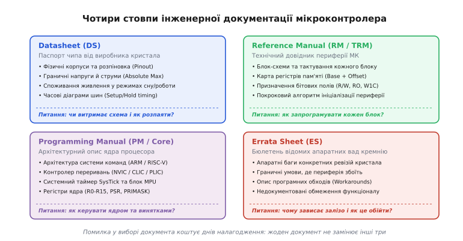
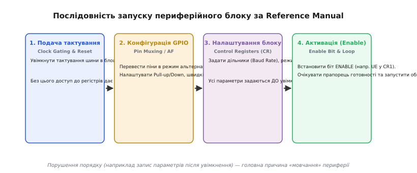
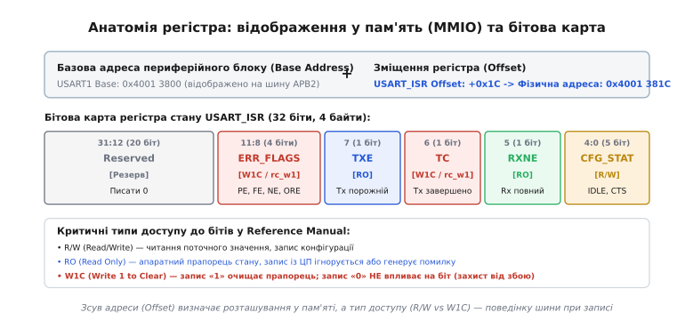
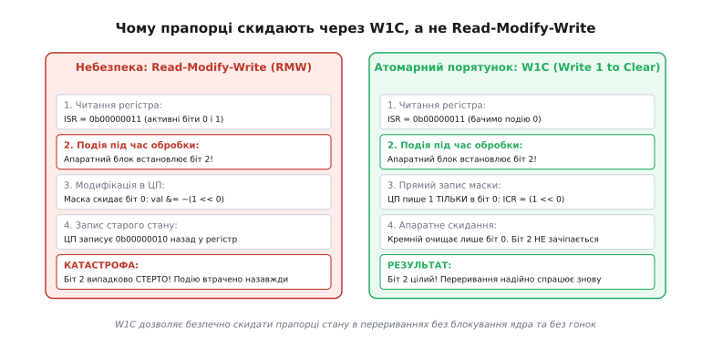

# Документація чипа: даташит, reference manual, errata, приклади

<preknowlist>
- [Практикум даташитів: мікроконтролер](root:embedded/datasheet-mcu) — як читати електричні характеристики, струми живлення та обмеження виводів МК.
- [Побітові операції в C](root:embedded/c-bit-operations) — бітові маски, зсуви, логічні AND/OR/XOR/NOT для керування регістрами.
- [Вказівники в C](root:embedded/c-pointers-intro) — пряма адресація пам'яті, адресне зміщення та розіменування покажчиків на структури регістрів.
- [ARM Cortex-M](root:hw-arch/cortex-m) — архітектура 32-бітного процесорного ядра, векторна таблиця та модель пам'яті.
</preknowlist>

Розробник прикладного програмного забезпечення для комп'ютерів спирається на операційну систему: щоб надіслати байт у мережу чи зберегти файл на диск, достатньо викликати стандартну функцію системної бібліотеки. Операційна система приховує фізичну структуру накопичувача, таймінги шини та конкретну модель контролера. Вбудована розробка *(англ. embedded development)* починається там, де жодних абстракцій ще немає: процесорне ядро прокидається після сигналу скидання перед порожнім адресним простором, оточеним мільйонами логічних вентилів периферійних блоків. Єдиний спосіб примусити цей кремнієвий кристал виконувати корисну роботу — самостійно налаштувати внутрішні мультиплексори, подати тактові імпульси на потрібні шини та записати точну послідовність бітів у фізичні регістри керування.

Мікроконтролер не пробачає здогадок. Запис одного помилкового біта в регістр конфігурації тактування здатен миттєво заблокувати процесор або вивести з ладу вихідні каскади виводів через коротке замикання. Оскільки сучасний мікроконтролер містить від десятка до сотні автономних апаратних блоків (таймери, контролери прямого доступу до пам'яті DMA, модулі зв'язку UART, SPI, I2C, CAN, USB, перетворювачі АЦП та ЦАП), сукупний опис одного чипа займає від 1000 до 3500 сторінок щільного технічного тексту. Уміння орієнтуватися в цьому океані специфікацій, миттєво знаходити потрібний документ і верифікувати кожен бітовий перехід — це базовий інженерний навик, без якого неможливо написати жодної надійної прошивки.

> 🔧 **Навіщо це.** Налагодження вбудованих систем наосліп коштує тижнів безсонних ночей: коли мікроконтролер мовчить або періодично зависає, логічний аналізатор фіксує лише відсутність сигналу на виводі. Здатність швидко зіставити поведінку заліза з чотирма стовпами документації дає відповідь на питання, чи винен код, чи неправильно налаштована шина, чи виник апаратний збій периферії, зафіксований у переліку помилок кремнію.

## Чотирикутник документації: розмежування відповідальності

Головна помилка інженера-початківця — спроба знайти всю інформацію в одному файлі з назвою «Datasheet». Намагаючись дізнатися, як налаштувати таймер або чому збоїть передача даних через SPI, розробник відкриває паспорт мікроконтролера, гортає двісті сторінок таблиць струмів споживання та корпусів, не знаходить жодного біта конфігурації й доходить хибного висновку, що інформація прихована виробником.

Виробники напівпровідників (STMicroelectronics, Espressif, NXP, Microchip, Raspberry Pi, Texas Instruments) суворо розділяють документацію за цільовою аудиторією та сферою відповідальності. Навколо будь-якого мікроконтролера завжди існує **чотирикутник документації**:

1. **Datasheet (DS) — паспорт виробу.** Документ для інженера-схемотехніка та розробника друкованої плати. Відповідає на питання: *«Чи підходить цей чип за електричними параметрами, і як розвести його на платі?»*
2. **Reference Manual (RM або Technical Reference Manual, TRM) — технічний довідник периферії.** Документ для розробника низькорівневого програмного забезпечення та драйверів. Відповідає на питання: *«Як функціонує кожен внутрішній блок чипа і що записувати в його регістри?»*
3. **Programming Manual (PM або Core Reference Manual) — посібник з програмування процесорного ядра.** Документ для системного програміста та автора компіляторів. Відповідає на питання: *«Як влаштована система команд ядра, як керувати перериваннями та стеком?»*
4. **Errata Sheet (ES або Silicon Errata) — бюлетень відомих апаратних дефектів кристала.** Документ для налагодження нестандартної та граничної поведінки. Відповідає на питання: *«Які апаратні баги містить ця конкретна ревізія кремнію і як їх програмно обійти?»*


*Чотирикутник документації мікроконтролера: розподіл сфер відповідальності між паспортом заліза (Datasheet), довідником периферії (Reference Manual), описом ядра (Programming Manual) та бюлетенем кремнієвих помилок (Errata Sheet).*

### 1. Datasheet: фізичні межі та розпіновка

Паспорт чипа зазвичай має обсяг від 70 до 250 сторінок і містить інформацію, що безпосередньо прив'язана до конкретного номера замовлення *(англ. Part Number)* та типу корпусу (LQFP, BGA, QFN, TSSOP):

- **Абсолютні граничні параметри (Absolute Maximum Ratings):** максимальна напруга живлення, граничні струми через захисні діоди виводів, температурний діапазон зберігання та кристала. Перевищення цих значень хоча б на мікросекунду призводить до фізичної деградації або незворотного вигорання кремнієвих структур.
- **Робочі електричні характеристики:** допустимий діапазон напруги живлення, рівні логічного нуля та одиниці (`V_IL`, `V_IH`), струмові навантаження окремих ніжок та сумарний струм через шини живлення `V_DD` та `V_SS`.
- **Таблиця виводів та матриця мультиплексування (Pinout & Pin Description):** прив'язка номерів фізичних ніжок корпусу до портів введення-виведення (GPIO) та їхніх альтернативних функцій (UART TX/RX, SPI SCK/MOSI/MISO, I2C SCL/SDA).
- **Часові діаграми (Timing Characteristics):** мінімальний час встановлення та утримання сигналів *(англ. setup and hold times)* для зовнішніх шин пам'яті, інтерфейсів SPI, I2S та паралельних інтерфейсів дисплеїв чи камер.

### 2. Reference Manual: світ регістрів та апаратних автоматів

Технічний довідник периферії — наймасивніший документ в екосистемі чипа (зазвичай від 1000 до 3500 сторінок). Він створюється спільним для цілого сімейства або підродини мікроконтролерів (наприклад, єдиний Reference Manual RM0090 для всіх мікроконтролерів STM32F405, STM32F415, STM32F407 та STM32F417).

Reference Manual описує кожен вбудований периферійний модуль як ізольований апаратний автомат:
- Функціональну блок-схему вузла із зазначенням внутрішніх мультиплексорів, лічильників, тригерів і компараторів;
- Джерела тактування та зв'язок із системними шинами (AHB, APB);
- Покрокові алгоритми ініціалізації, передачі, прийому даних та коректної зупинки модуля;
- Умови генерації апаратних запитів на прямий доступ до пам'яті (DMA) та подій переривань;
- Вичерпну карту регістрів модуля із зазначенням адресних зміщень, значень після скидання та бітових полів.

### 3. Programming Manual: архітектура процесорного ядра

Мікроконтролер будується за модульним принципом: напівпровідникова компанія купує ліцензію на процесорне ядро в компанії ARM (родини Cortex-M0+, Cortex-M3, Cortex-M4, Cortex-M7) або використовує відкриту архітектуру RISC-V чи Xtensa (у випадку ESP32), після чого проєктує навколо ядра власну матрицю шин, пам'ять та периферію.

Опис самого обчислювального ядра виноситься в окремий документ — Programming Manual або Core Reference Manual:
- Система команд процесора *(англ. Instruction Set Architecture, ISA)*, формат кодування машинних інструкцій та кількість тактів на їхнє виконання;
- Архітектура регістрів ядра: регістри загального призначення `R0`–`R12`, покажчик стека `SP` (`R13`), регістр зв'язку `LR` (`R14`), лічильник команд `PC` (`R15`), регістр стану програми `xPSR`, регістри маскування переривань `PRIMASK`, `FAULTMASK`, `BASEPRI`;
- Контролер векторних переривань: для архітектури Cortex-M це блок `NVIC` *(англ. Nested Vectored Interrupt Controller)* — правила пріоритезації переривань, вкладеність, робота з хвостом переривання *(англ. tail-chaining)*;
- Системний таймер ядра `SysTick` та модуль захисту пам'яті `MPU` *(англ. Memory Protection Unit)*;
- Поведінка ядра при виникненні апаратних винятків (HardFault, MemManage, BusFault, UsageFault).

### 4. Errata Sheet: фізичні дефекти напівпровідника

Жоден складний мікроконтролер не виходить із фабрики ідеальним. Errata Sheet документує відомі апаратні баги кристала, які не вдалося або виявилося занадто дорого виправити на рівні літографічних масок. Документ структурований за ревізіями кремнію і містить три обов'язкові пункти для кожного дефекту:
1. **Симптом вади (Fault Description):** що саме працює не за довідником Reference Manual;
2. **Умови виникнення (Conditions):** точна комбінація частот, напруг або бітових послідовностей, яка провокує збій;
3. **Програмний обхід (Workaround):** алгоритм дій у прошивці, що дозволяє уникнути аварійного стану або відновити працездатність вузла.

Детальніше про те, як помилка ділення в процесорі Pentium змінила культуру напівпровідникової індустрії та чому виправлення кремнію коштує мільйони доларів, читайте в [історії виникнення публічних Errata Sheets та боротьби з багами кристалів](root:embedded/dokumentatsiia-chypa/hist-silicon-errata.md).

---

## Анатомія опису периферійного блоку в Reference Manual

Коли перед розробником постає завдання запустити новий периферійний модуль (наприклад, апаратний інтерфейс SPI чи таймер ШІМ) без готових бібліотек, читання відповідного розділу Reference Manual має відбуватися за строгою чотирикроковою методикою. Спроба одразу писати дані в регістр даних закінчується апаратною аварією шини.


*Чотири послідовні фази налаштування будь-якого периферійного блоку: від подачі тактового сигналу до активації кінцевого автомата.*

### Крок 1. Блок-схема та тактування (Clock Gating & Reset)

Сучасні мікроконтролери оптимізовані за енергоспоживанням. За замовчуванням після системного скидання тактування практично всіх периферійних модулів **вимкнено** на рівні мультиплексорів шини *(англ. clock gating)*. Логічні вентилі модуля знеструмлені або ізольовані від генератора імпульсів, а тригери не перемикаються.

Якщо центральний процесор спробує прочитати або записати значення за адресою регістра вимкненого модуля, транзакція на шині AHB/APB не отримає сигналу підтвердження *(READY)* від веденого пристрою. Це призводить до миттєвого генерування апаратного винятку процесора — `BusFault` або `HardFault`.

Тому перша дія завжди виконується в системному модулі керування тактуванням (блок `RCC` у STM32, `SYSCON` у NXP, `SYSTEM` / `DPORT` в ESP32 або `RESETS` / `CLOCKS` у RP2040):
1. Знайти в розділі модуля Reference Manual, до якої саме шини він підключений (наприклад, `APB1` чи `APB2`);
2. Увімкнути біт тактування відповідного модуля у регістрі увімкнення тактування (наприклад, `RCC->APB1ENR |= RCC_APB1ENR_SPI2EN`);
3. Якщо модуль має власний блок програмного скидання *(англ. peripheral reset)*, зняти біт скидання в регістрі `RCC->APB1RSTR`.

### Крок 2. Конфігурація матриці виводів (Pin Muxing / Alternate Function)

Периферійний блок живе всередині кремнієвого кристала. Щоб його сигнали потрапили у фізичний світ, внутрішні лінії (TX, RX, SCK, MOSI) необхідно під'єднати до зовнішніх контактних площадок кристала.

Розділ периферійного модуля в Reference Manual описує, які зовнішні лінії йому потрібні. Далі розробник відкриває Datasheet, знаходить таблицю альтернативних функцій *(Alternate Functions Table)* для обраного корпусу і налаштовує порти GPIO:
- Перемикає режим роботи виводу з універсального введення-виведення в режим альтернативної функції (регістр `GPIOx_MODER`);
- Прописує номер альтернативної функції в мультиплексор виводу (регістри `GPIOx_AFRL` / `GPIOx_AFRH`);
- Налаштовує внутрішні підтягуючі резистори (Pull-Up/Pull-Down), тип вихідного каскаду (Push-Pull чи Open-Drain для шини I2C) та максимальну швидкість наростання фронту сигналу (Slew Rate).

### Крок 3. Налаштування параметрів до активації блоку

Головне правило Reference Manual, порушення якого генерує плаваючі помилки: **конфігураційні регістри периферійного блоку дозволено модифікувати лише тоді, коли сам блок вимкнений**.

Якщо модуль SPI або UART увімкнений (встановлено біт `ENABLE` / `UE` / `SPE`), його внутрішній кінцевий автомат починає генерувати строби тактування та відстежувати фронти на вхідних лініях. Спроба змінити дільник частоти *(Baud Rate Prescaler)*, полярність тактового сигналу *(CPOL/CPHA)* або довжину слова під час активного стану блоку переводить тригери у проміжний метастабільний стан, що спричиняє зависання шини або появу паразитних імпульсів *(glitches)*.

Тому послідовність налаштування завжди має вигляд:
1. Переконатися, що біт активації модуля скинутий (`CR1_ENABLE = 0`);
2. Записати дільники частоти, режими роботи (Master/Slave), формати кадру;
3. Налаштувати маски дозволу переривань (Interrupt Enable bits) та конфігурацію DMA;
4. Тільки після повної фіксації конфігурації встановити біт активації модуля.

### Крок 4. Активація та робота з прапорцями стану

Після активації блок переходить у робочий стан. Усі події, що відбуваються в кремнії (надходження байта, звільнення буфера передачі, помилка парності, переповнення черги), фіксуються в регістрі стану модуля *(Status Register, SR / ISR)*.

---

## Регістрові карти та типи доступу до бітів

Усі мікроконтролери з фон-нейманівською або гарвардською організацією шинної матриці використовують принцип відображення вводу-виводу у загальний адресний простір пам'яті *(англ. Memory-Mapped I/O, MMIO)*. Це означає, що фізичні регістри периферійних модулів розташовані за фіксованими 32-бітними числовими адресами поряд з оперативною пам'яттю (SRAM) та флеш-пам'яттю.


*Анатомія регістра в Reference Manual: формування фізичної адреси через базову адресу шини та зміщення (Offset), а також розподіл бітових полів за типами доступу.*

### Формування фізичної адреси регістра

Кожен периферійний блок займає в адресному просторі фіксований блок пам'яті розміром 1 КБ або 4 КБ. Адреса конкретного регістра визначається за формулою:

```
Physical_Address = Peripheral_Base_Address + Register_Offset
```

Наприклад, у мікроконтролері STM32F4:
- Базова адреса шини `APB2`: `0x40010000`;
- Зміщення блоку `USART1` на шині `APB2`: `+0x3800` (базова адреса USART1 = `0x40013800`);
- Зміщення регістра стану `USART_SR`: `+0x00` (адреса = `0x40013800`);
- Зміщення регістра даних `USART_DR`: `+0x04` (адреса = `0x40013804`);
- Зміщення регістра конфігурації швидкості `USART_BRR`: `+0x08` (адреса = `0x40013808`).

### Специфікатор `volatile`: захист від оптимізатора компілятора

Оскільки звернення до регістра виглядає у мові C як звичайне розіменування покажчика на адресу пам'яті (`*(uint32_t*)0x40013800`), компілятор розглядає цю комірку як звичайну змінну в ОЗП.

Якщо розробник пише цикл очікування завершення передачі:

:::tabs
```c
/* Помилковий код без специфікатора volatile */
uint32_t *status_reg = (uint32_t *)0x40013800UL;
while (!(*status_reg & (1UL << 7))) {
    /* Очікуємо прапорець TXE */
}
```
```cpp
// Помилковий код без специфікатора volatile
auto *status_reg = reinterpret_cast<uint32_t *>(0x40013800UL);
while (!(*status_reg & (1UL << 7))) {
    // Очікуємо прапорець TXE
}
```
:::

Компілятор із рівнем оптимізації `-O2` або `-O3` аналізує код і робить висновок: тіло циклу порожнє, а змінна `*status_reg` всередині циклу не змінюється жодною інструкцією процесора. Отже, значення можна зчитати в регістр ядра `r0` лише один раз до початку циклу. Якщо біт 7 спочатку був 0, компілятор згенерує нескінченний перехід на самого себе (`b .`), повністю видаливши повторні звернення до пам'яті. Програма зависне назавжди, навіть коли апаратний блок встановить потрібний біт у кремнії.

Специфікатор `volatile` *(лат. volatilis — «летючий, мінливий»)* наказує компілятору: **значення за цією адресою може змінюватися апаратними процесами поза контролем процесора; будь-яке читання чи запис заборонено кешувати чи оптимізувати**. Кожна строчка коду з розіменуванням `volatile`-покажчика транслюється в реальну апаратну інструкцію читання (`LDR`) або запису (`STR`) на системній шині.

### Типи доступу до бітів у Reference Manual

У таблицях регістрових карт Reference Manual кожне бітове поле маркується типом дозволеного доступу:

- **R/W (Read / Write) — повний доступ.** Процесор може вільно читати поточне значення біта та записувати нову конфігурацію.
- **RO (Read Only) — тільки читання.** Апаратний прапорець стану, яким керує виключно кремнієва логіка (наприклад, біт наявності даних у буфері прийому). Спроба запису з процесора або ігнорується, або генерує помилку шини.
- **WO (Write Only) — тільки запис.** Регістри передачі даних або запуску одноразових команд (наприклад, генерація імпульсу програмного скидання). Читання з такого регістра зазвичай повертає нулі.
- **W1C / rc_w1 (Write 1 to Clear) — запис одиниці для очищення.** Найважливіший тип доступу для прапорців переривань і помилок. Запис значення «1» у відповідний біт апаратно скидає тригер у нуль. Запис значення «0» **ніяк не змінює стан біта**.


*Гонка станів при використанні Read-Modify-Write над регістром прапорців переривань (ліворуч) та надійне атомарне скидання через механізм Write-1-to-Clear (праворуч).*

#### Чому W1C рятує від гонки станів (Race Condition)

Припустимо, регістр стану `ISR` містить два біти: біт 0 `TXE` (передавач вільний) та біт 1 `RXNE` (прийнято новий байт). Обидва біти формують переривання.

Якщо скидання прапорців реалізовано за застарілою схемою «запис нуля» або через звичайний бітовий запис, обробник переривання передавача змушений виконати операцію читання-модифікації-запису *(англ. Read-Modify-Write, RMW)*:

1. Процесор зчитує регістр: `val = ISR` (біт 0 = 1, біт 1 = 0);
2. Процесор скидає біт 0 у своїй копії: `val &= ~(1 << 0)`;
3. **У цей самий момент** на лінію надходить байт від зовнішнього пристрою, і залізо мікроконтролера виставляє біт 1 (`RXNE`) у фізичному регістрі `ISR`;
4. Процесор записує обчислене значення назад: `ISR = val` (записується 0 у біт 0 і **0 у біт 1**).

**Наслідок:** біт `RXNE` випадково стерто до того, як процесор дізнався про надходження нового байта. Дані втрачено назавжди, лінія зависає.

Механізм W1C повністю ліквідує цю небезпеку. Щоб очистити біт 0, процесор виконує простий прямий запис константи без попереднього читання:

:::tabs
```c
/* Атомарне скидання біта 0: біт 1 гарантовано не зачіпається */
USART1->ISR_CLEAR = (1UL << 0);
```
```cpp
// Атомарне скидання біта 0: біт 1 гарантовано не зачіпається
usart1->isr_clear = (1UL << 0);
```
:::

Апаратна логіка інтерпретує одиницю в біті 0 як команду скидання лише нульового тригера. Нуль у біті 1 кремній сприймає як відсутність операції, і щойно встановлений прапорець `RXNE` залишається недоторканим.

- **W1S / W1T (Write 1 to Set, Write 1 to Toggle).** Регістри атомарного встановлення та перемикання виводів GPIO (наприклад, регістр `BSRR` у STM32 або регістри `GPIO_OUT_W1TS` / `GPIO_OUT_W1TC` в ESP32). Дозволяють змінювати стан конкретної ніжки мікроконтролера за одну апаратну інструкцію `STR` без блокування переривань та без виконання RMW-циклів.
- **Reserved (Резервні біти).** Невикористані комірки пам'яті всередині 32-бітного слова. Reference Manual завжди зазначає: *«Must be kept at reset value»* (повинні зберігати значення після скидання, зазвичай 0). Запис одиниць у резервні біти може активувати тестові заводські режими кристала або призвести до несумісності з майбутніми ревізіями чипа.

---

## Errata Sheet: апаратні пастки кристала

Розробник вбудованих систем повинен прийняти аксіому: **навіть якщо код на 100% відповідає специфікації Reference Manual, периферійний блок може не працювати через фізичний дефект у кремнії**.

Виготовлення одного комплекту фотошаблонів *(англ. mask set)* для серійного виробництва чипа за сучасним техпроцесом коштує мільйони доларів, а цикл виготовлення інженерної партії триває понад пів року. Якщо після випуску мікроконтролера інженери виявляють помилку в логіці роботи апаратного фільтра шини чи таймера, виробник не відкликає мільйони чипів зі складів. Він випускає бюлетень Errata Sheet і перекладає тягар обходу апаратної вади на плечі програмістів.

### Класичні апаратні баги в індустрії

#### 1. Апаратний баг I2C у популярному STM32F103

Легендарний дефект апаратного контролера I2C у сімействі STM32F103 (Errata розділ *I2C limitation*): якщо під час передачі даних на шині виникає затримка з боку веденого пристрою *(clock stretching)* або процесор переривається високопріоритетним перериванням у момент генерації сигналу Stop, внутрішній кінцевий автомат I2C безповоротно зависає. Прапорець зайнятості шини `BUSY` залишається виставленим у «1», а модуль блокує лінії SDA/SCL у низькому рівні.

**Офіційний Workaround:** виробник рекомендує програмно вимкнути тактування I2C, перевести піни GPIO в режим ручного програмного ногодрингу *(англ. bit-banging)*, згенерувати вручну 9 тактових імпульсів на лінії SCL для примусового звільнення лінії slave-пристроєм, після чого заново ініціалізувати апаратний модуль I2C з нуля.

#### 2. Баг пам'яті та кешу ESP32 ревізії Rev 0

У першій ревізії кристала ESP32 (ревізія 0) одночасне звернення двох ядер процесора Xtensa LX6 до певних ділянок внутрішньої пам'яті через кеш SPI-Flash призводило до випадкового спотворення прочитаних машинних інструкцій.

**Офіційний Workaround:** компіляторний прапорець `-mfix-esp32-psram-cache-issue` у тулчейні GCC вставляє спеціальні інструкції `NOP` та бар'єри синхронізації пам'яті навколо кожної операції доступу до зовнішньої пам'яті, якщо ідентифікатор чипа вказує на ревізію `Rev 0`.

#### 3. Нелінійність АЦП у Raspberry Pi RP2040 (Errata RP2040-E1)

Вбудований 12-бітний аналогово-цифровий перетворювач мікроконтролера RP2040 страждає від апаратної диференціальної нелінійності (DNL) на певних кодових переходах (значення 512, 1536, 2560, 3584). Причина полягає в паразитній ємності внутрішніх перемикачів конденсаторної матриці ЦАП послідовного наближення *(SAR ADC)*. На цих точках виникають так звані «пропущені коди» або суттєві сплески похибки перетворення.

**Офіційний Workaround:** заміна простого зчитування одиничного відліку на алгоритм оверсемплінгу з додаванням псевдовипадкового аналогового шуму *(dithering)* та подальшим цифровим усередненням.

### Визначення ревізії кремнію в коді

Щоб програмний обхід еррати не сповільнював роботу на нових, виправлених ревізіях мікроконтролера, прошивка повинна програмно зчитувати апаратний номер ревізії кристала:

:::tabs
:::code dokumentatsiia-chypa-d/c/vyznachennia-revizii.c
:::code dokumentatsiia-chypa-d/cpp/vyznachennia-revizii.cpp
:::

---

## Робота з прикладами виробника (SDK, HAL, LL)

Виробники мікроконтролерів надають готові пакети підтримки плат *(BSP)* та бібліотеки драйверів:
- **HAL (Hardware Abstraction Layer):** високорівневий шар абстракцій з уніфікованим API для перенесення коду між різними родинами чипів одного виробника;
- **LL (Low-Layer) або Register API:** тонкі інлайн-обгортки над прямими записами в регістри;
- **Vendor SDK (наприклад, ESP-IDF для ESP32 або Pico SDK для RP2040):** повноцінне програмне середовище з інтегрованою операційною системою реального часу FreeRTOS та мережевими стеками.

Головна небезпека полягає у сліпому копіюванні прикладів коду з навчальних проєктів виробника *(Application Notes)* у промисловий пристрій.

### Три смертельні пастки виробничих прикладів

1. **Нескінченні блокуючі цикли без таймаутів.** Приклади від виробника створені для демонстрації роботи за ідеальних умов на столі лабораторії. Вони містять конструкції вигляду:
:::tabs
```c
/* Небезпечний блокуючий цикл з Application Note */
while ((SPI1->SR & SPI_SR_TXE) == 0) {
    /* Очікуємо готовності буфера без таймауту */
}
```
```cpp
// Небезпечний блокуючий цикл з Application Note
while ((spi1->sr & spi_sr_txe) == 0) {
    // Очікуємо готовності буфера без таймауту
}
```
:::
   Якщо в реальному пристрої на виробництві виникне електромагнітна завада, пропаде контакт на платі або відімкнеться тактування веденого пристрою, процесор зависне в цьому циклі назавжди. Промисловий код **завжди** зобов'язаний містити обмеження за кількістю тактів або системним часом (Timeout Guard) з коректним поверненням коду помилки.

2. **Приховане маскування переривань у критичних секціях HAL.** Щоб зробити універсальні функції простими для новачків, бібліотеки HAL часто глобально вимикають переривання процесора (`__disable_irq()`) на час оновлення службових структур. Якщо пристрій одночасно виконує прецизійне керування електродвигуном або обробляє високошвидкісний аудіопотік, неконтрольоване блокування переривань бібліотекою HAL на 20–50 мікросекунд призводить до зриву синхронізації та фізичної аварії механізму.

3. **Коли HAL створює власні помилки.** Через бажання покрити однією функцією десятки конфігурацій чипів бібліотеки HAL перевантажені десятками перевірок вказівників, динамічними виділеннями пам'яті та рекурсивними викликами зворотних викликів *(callbacks)*. Це призводить до ситуацій, коли простий запис байта в UART виконується тисячу тактів процесора замість однієї апаратної інструкції.

Правильний підхід інженера: **розглядати приклад виробника лише як ілюстрацію до Reference Manual, а не як непогрішний еталон**. Кожен виклик бібліотеки виробника має бути перевірений за бітовими картами довідника регістрів.

Як написати повноцінний, швидкий та безпечний драйвер периферії за Reference Manual з нуля з урахуванням апаратних бар'єрів пам'яті та ревізій кремнію, дивіться у [практикумі розробки регістрового драйвера за специфікацією Reference Manual](root:embedded/dokumentatsiia-chypa/proj-register-driver.md).

---

## Приклад: прямий доступ до регістрів та обхід еррати

Розглянемо практичний приклад ініціалізації таймера загального призначення для генерації періодичного переривання з прямою роботою через регістрові зміщення та програмною перевіркою ревізії мікроконтролера.

:::tabs
:::code dokumentatsiia-chypa-d/c/pryklad-priamyi-dostup-do.c
:::code dokumentatsiia-chypa-d/cpp/pryklad-priamyi-dostup-do.cpp
:::

---

## Інженерний маршрут роботи з документацією

Щоб уникнути помилок під час розробки вбудованих пристроїв, дотримуйтесь перевіреного інженерного алгоритму з п'яти послідовних кроків:

1. **Datasheet:** знайти потрібний корпус чипа, перевірити допустимі напруги живлення, граничні струми та записати номери фізичних ніжок і номери їхніх альтернативних функцій для вибраної периферії.
2. **Reference Manual (Розділ тактування):** знайти, на якій внутрішній шині (AHB, APB1, APB2) розташований периферійний модуль, та з'ясувати назву біта в системному контролері тактування для подачі живлення на модуль.
3. **Reference Manual (Розділ периферії):** вивчити послідовність кроків ініціалізації модуля, з'ясувати адресні зміщення конфігураційних регістрів, правила розрахунку дільників частоти та типи доступу до бітів стану (RO, W1C, R/W).
4. **Programming Manual:** якщо периферія генерує переривання, знайти номер вектора переривання в таблиці векторів, налаштувати пріоритет у контролері переривань (NVIC) та з'ясувати правила використання бар'єрів пам'яті (`DSB`/`ISB`).
5. **Errata Sheet:** знайти розділ для свого модуля, перевірити перелік відомих помилок кремнію для поточної ревізії чипа та інтегрувати описані програмні обходи (Workarounds) безпосередньо у драйвер.

Тільки такий комплексний підхід гарантує, що написана прошивка буде стабільно працювати на мільйонах серійних пристроїв у найсуворіших умовах експлуатації.
