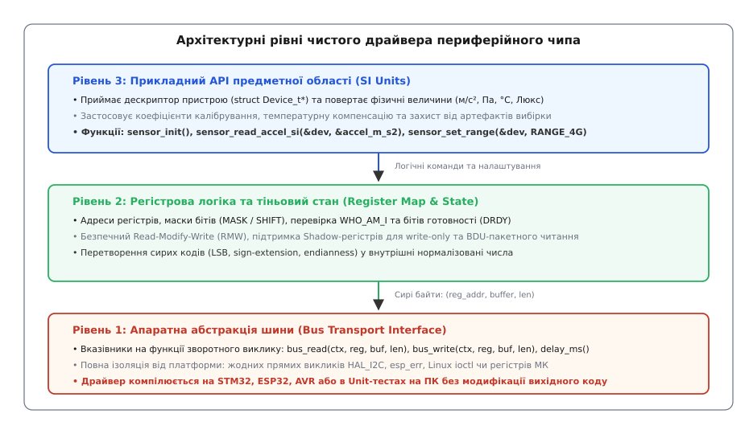
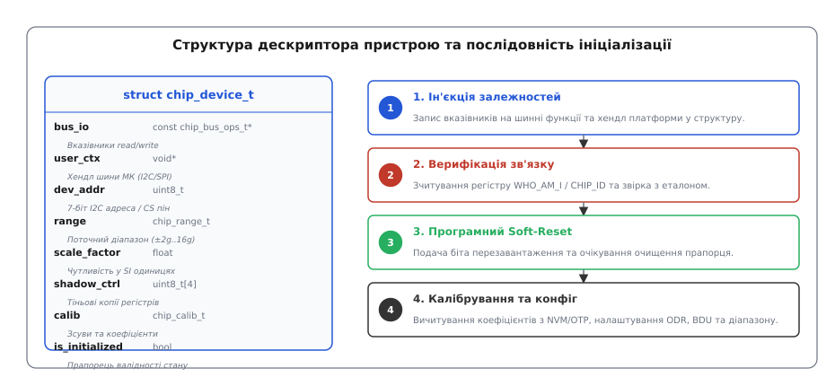
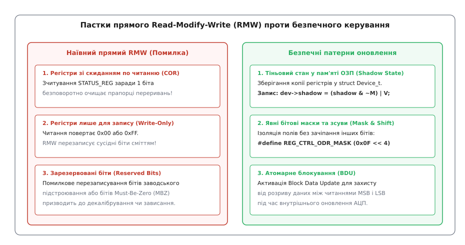
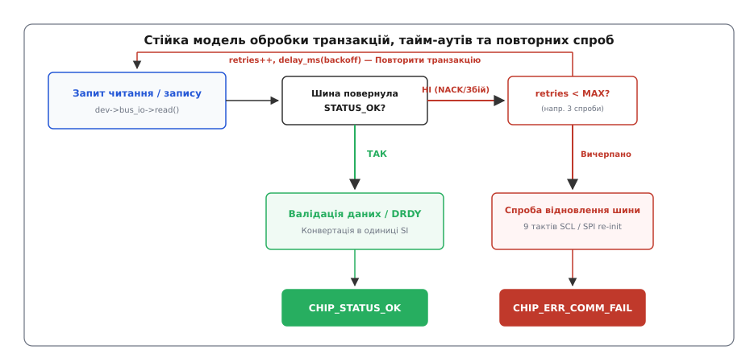

# Драйвер чипа: від регістрової карти до значення у SI

<preknowlist>
- [Регістрова карта](root:com-devices/register-map) — адресація регістрів, бітові поля, прапорці стану та правила взаємодії з цифровими мікросхемами.
- [SPI проти I2C](root:embedded/spi-vs-i2c) — часові діаграми, транзакції, особливості адресації та відмінності серійних інтерфейсів.
- [Блокуючий і неблокуючий ввід-вивід](root:sf-tasks/blocking-vs-nonblocking-io) — чому зависання в лічильних циклах руйнує систему та як будувати асинхронні переходи.
- [Пакетне зчитування регістрів](root:com-devices/burst-read) — автоінкремент адреси та атомарне вичитування багатобайтових відліків.
- [Жодна помилка не мовчить](root:sf-apps/error-handling) — таксономія кодів повернення, тайм-аути та культура захисного програмування.
</preknowlist>

Коли розробник прототипує пристрій на оціночній платі, він зазвичай бере готову бібліотеку від виробника модуля, підключає цифровий датчик до першого-ліпшого порту і викликає функцію на зразок `Sensor_Read()`, яка повертає рядок у послідовний порт або ціле число. На столі в лабораторії цей підхід працює: прошивка крутиться в єдиному лінійному циклі, датчик з'єднаний короткими проводами на макетці, силових завад немає, а процесор займається лише одним завданням.

Справжні проблеми починаються в серійному виробі. Уявімо блок керування акумуляторною батареєю (BMS) електромобіля або польотний контролер безпілотного апарата. На платі встановлено два однакові 3-осьові акселерометри на різних шинах I2C для апаратного дублювання та підвищення безпеки. Прошивка працює під керуванням операційної системи реального часу (RTOS) у десяти паралельних завданнях із жорсткими дедлайнами. При спробі інтеграції з'ясовується, що аматорський драйвер містить жорстко зашиті виклики периферії конкретного мікроконтролера, спирається на глобальні змінні стану і робить створення другого екземпляра пристрою неможливим без повного дублювання файлів коду. Далі, під час пуску тягового інвертора або передачі пакета через радіомодуль, силова електромагнітна завада спотворює сигнал на шині — і драйвер назавжди зависає у мертвому циклі `while (!data_ready);`, блокуючи планувальник завдань. На додачу, через наївне почергове зчитування молодшого й старшого байтів без блокування оновлень регістрів, прошивка періодично отримує хибний сплеск прискорення у 16g, коли реальне фізичне значення становило нуль.

Професійний драйвер чипа — це не набір розрізнених функцій із магічними константами, а строго спроєктований програмний модуль із чіткою багаторівневою архітектурою, повною ізоляцією апаратного транспорту, детермінованою обробкою помилок, підтримкою багатьох екземплярів пристроїв та математично точним перетворенням двійкових кодів у фізичні величини міжнародної системи одиниць (SI).

---

## 1. Трирівневий архітектурний стек драйвера

Щоб програмний драйвер залишався надійним, легким у супроводі та повністю переносним між різними мікроконтролерами (від 8-бітних кристалів до 64-бітних ядер під керуванням Linux чи RTOS), його внутрішній дизайн будується за принципом розділення відповідальностей на три ізольовані рівні абстракції.


*Рівень 1 повністю ізолює апаратну платформу через вказівники на функції вводу-виводу. Рівень 2 транслює операції в бітові поля та регістрові транзакції. Рівень 3 надає прикладній програмі фізичні величини в системі SI.*

### Рівень 1: Транспортна абстракція шини (Platform Bus Abstraction)

Найнижчий шар стека відповідає виключно за фізичне переміщення байтів між мікроконтролером та зовнішньою мікросхемою по серійному інтерфейсу (I2C, SPI, UART, 1-Wire). У цьому шарі немає жодної інформації про те, що саме означають ці байти — чи це налаштування частоти фільтра, чи покази барометра.

Головне правило проєктування Рівня 1: **драйвер чипа не містить жодного `#include` специфічних бібліотек виробника мікроконтролера** (STM32 HAL, ESP-IDF, NXP SDK, AVR libc тощо). Замість жорсткого прив'язування використовується механізм ін'єкції залежностей через таблицю вказівників на функції зворотного виклику:

1. **`bus_read`:** виконує транзакцію читання блоку пам'яті заданої довжини за вказаною адресою регістру.
2. **`bus_write`:** виконує транзакцію запису блоку даних.
3. **`delay_ms`:** забезпечує апаратні паузи, необхідні для завершення внутрішнього скидання або виходу аналогового ядра мікросхеми на робочий режим.

Завдяки цьому драйвер компілюється без змін для будь-якої платформи, а також запускається на комп'ютері розробника під керуванням швидких Unit-тестів із програмним емулятором шини. Детальний контракт вимог до цього інтерфейсу, вимоги до DMA та правила управління пам'яттю зафіксовано у вставці [Специфікація інтерфейсу драйвера](root:embedded/draiver-chypa/api-driver-contract.md).

### Рівень 2: Логічний рівень регістрової карти та стану чипа

Цей рівень містить усі знання про внутрішню будову конкретного кремнієвого чипа. Тут зосереджені:
* Числові адреси регістрів конфігурації, статусів, переривань та вихідних даних.
* Бітові маски (`MASK`) та позиційні зсуви (`SHIFT`) для кожного функціонального поля.
* Перевірка заводського ідентифікатора кристала (`WHO_AM_I` або `CHIP_ID`) для виявлення неправильного монтажу або підроблених чипів.
* Алгоритми безпечного оновлення налаштувань без порушення сусідніх бітів регістру.
* Збереження копій регістрів конфігурації у **тіньовій пам'яті (Shadow Registers)** в ОЗП.

Рівень 2 перетворює логічні запити вищого шару (наприклад, «увімкнути режим низького енергоспоживання з частотою вибірки 50 Гц») на послідовність записів конкретних бітових конфігурацій у регістри чипа через Рівень 1.

### Рівень 3: Прикладний інтерфейс предметної області (Domain API)

Найвищий шар взаємодіє з бізнес-логікою прошивки пристрою. Він повністю приховує регістрову специфіку та оперує фізичними термінами предметної області:
* Замість незрозумілого запису байта `0x57` у регістр `0x20` викликач використовує зрозумілу функцію `sensor_set_data_rate(&dev, RATE_100_HZ)`.
* Замість передачі масиву з шести сирих байтів `[0x1A, 0x02, 0xFE, 0xFF, 0x10, 0x40]` функція повертає структуру з фізичними значеннями: `accel.x = 0.52f` м/с², `accel.y = -0.02f` м/с², `accel.z = 9.81f` м/с².
* Рівень автоматично застосовує індивідуальні калібрувальні коефіцієнти, враховує обраний діапазон повної шкали (Full-Scale Range) та компенсує зміщення нуля.

---

## 2. Електричний шар шини: завади, ємність лінії та зависання

Перш ніж розглядати програмні структури драйвера, необхідно чітко розуміти фізичні обмеження ліній зв'язку на друкованій платі. Програмні помилки у драйверах найчастіше виникають там, де розробник вважає лінії ідеальними двійковими провідниками, тоді як у реальності це аналогові RLC-кола з розподіленими параметрами.

### Ємність шини I2C та розрахунок підтяжки

Шина I2C використовує виходи типу «відкритий стік» (Open-Drain). Це означає, що транзистори мікроконтролера та датчика вміють лише активно притискати лінію до землі (формуючи логічний «0»). Повернення лінії у стан логічної «1» відбувається виключно за рахунок зовнішнього резистора підтяжки R_p, який заряджає сумарну паразитну ємність шини C_b (ємність доріжок друкованої плати, виводів мікросхем та роз'ємів).

Час наростання фронту сигналу t_r описується експоненційним законом заряду RC-ланцюга від 0.3 V_DD до 0.7 V_DD:
```
t_r = 0.8473 · R_p · C_b
```

Якщо на довгій платі сумарна ємність C_b досягає 200 пФ, а резистор підтяжки встановлено занадто великого номіналу (наприклад, 10 кОм), час наростання складе:
```
t_r = 0.8473 · 10000 · 200 · 10⁻¹² = 1.69 мкс
```
Для стандартного режиму Fast Mode (400 кГц) максимальний допустимий час наростання за специфікацією становить 300 нс. Сигнал просто не встигне піднятися до рівня логічної одиниці за час половини тактового імпульсу, що призведе до масової появи помилок NACK і спотворення переданих бітів. Професійний драйвер враховує можливі затримки наростання і не встановлює агресивних мінімальних тайм-аутів.

### Класичне зависання лінії I2C (SDA Stuck Low)

Найнебезпечніша ситуація на шині I2C виникає, коли мікроконтролер перезавантажується (наприклад, через спрацьовування сторожового таймера Watchdog або стрибок живлення) прямо під час транзакції читання. Датчик у цей момент утримував лінію SDA притиснутою до землі, передаючи нульовий біт чергового байта.

Коли мікроконтролер запускається заново, його периферія I2C бачить, що лінія SDA постійно притиснута до нуля. Оскільки мікроконтролер не генерував тактових імпульсів SCL, ведений датчик продовжує нескінченно чекати такту, утримуючи SDA на землі. Спроба мікроконтролера розпочати нову транзакцію формує помилку Bus Busy, і система блокується назавжди.

Надійний транспортний рівень драйвера містить функцію **аварійного скидання шини (I2C Bus Recovery)**:
1. Виводи мікроконтролера переводяться з режиму периферії I2C у режим звичайного GPIO.
2. Лінія SCL тактується програмно 9 разів із частотою ~100 кГц. Бачачи такти SCL, ведений датчик по черзі виштовхує залишок свого внутрішнього зсувного регістра, поки не відпустить лінію SDA у стан «1».
3. Після цього мікроконтролер формує апаратну умову STOP (перехід SDA з низького рівня у високий при високому рівні SCL), повертаючи всі чипи на шині у вихідний стан очікування.

---

## 3. Інкапсуляція стану в дескрипторі пристрою (Device Context)

У професійній архітектурі вбудованого програмного забезпечення діє фундаментальне правило: **драйвер не повинен містити жодної глобальної або статичної змінної стану**.

Якщо драйвер зберігає поточний діапазон вимірювань або адресу пристрою у глобальній змінній (`static uint8_t g_current_range;`), такий драйвер стає монопольним. Його неможливо використати для двох однакових датчиків на одній платі, а в багатопотоковому середовищі RTOS паралельні виклики з різних завдань неминуче призведуть до руйнування внутрішнього стану.

Вирішенням є патерн **Дескриптор пристрою (Device Context)**. Усі параметри, конфігурація та змінні стану кожної фізичної мікросхеми інкапсулюються в окрему структуру даних.


*Дескриптор пристрою містить апаратні хендли, налаштування та калібрувальні коефіцієнти. Ініціалізація послідовно валідує залізо та конфігурує робочі параметри.*

### Склад дескриптора пристрою

Дескриптор об'єднує чотири категорії даних:

:::tabs
:::code draiver-chypa-d/c/chip_dev.h
:::code draiver-chypa-d/cpp/include/accel/accelerometer.hpp
:::

Кожна функція драйвера приймає вказівник на структуру `chip_dev_t` як свій перший параметр. Це забезпечує три ключові властивості:
1. **Повна реентерабельність:** Ви можете створити масив `chip_dev_t sensors[3]` і паралельно опитувати три однакові датчики на різних шинах без найменшого конфлікту даних.
2. **Відсутність динамічного виділення пам'яті:** Пам'ять під структуру виділяється викликачем (статично у секції `.bss`, у пулі об'єктів або на стеку ініціалізуючої функції). Драйвер ніколи не звертається до купи (`malloc`/`free`), запобігаючи небезпечній фрагментації пам'яті.
3. **Непрозорий контекст платформи (`user_ctx`):** Драйвер не знає типу цього покажчика. Для STM32 це покажчик на `I2C_HandleTypeDef`, для ESP32 — числовий дескриптор шини, для Linux — файловий дескриптор пристрою `/dev/i2c-0`. Драйвер лише передає його назад у функції платформи під час виклику шинних операцій.

---

## 4. Безпечне керування регістрами: бітові маски та пастки RMW

Усі цифрові периферійні чипи керуються через набір 8-бітних регістрів. З метою економії адресного простору виробники кремнію розміщують в одному регістрі кілька незалежних параметрів. Наприклад, у типовому регістрі керування `CTRL_REG1` біти `[7:4]` задають вихідну частоту даних (ODR), біт `[3]` вмикає режим низького енергоспоживання, а біти `[2:0]` незалежно активують осі Z, Y та X.

Коли прошивці потрібно змінити лише одне налаштування (наприклад, увімкнути вісь Z), наївний розробник виконує операцію **Read-Modify-Write (RMW)**: читає регістр із чипа по шині, накладає побітове АБО (`|`) і записує значення назад. У реальних вбудованих системах цей підхід приховує критичні небезпеки.


*Прямий RMW руйнує прапорці зі скиданням по читанню та псує write-only регістри. Тіньовий стан у пам'яті ОЗП гарантує надійність оновлення.*

### Три головні небезпеки операцій RMW

1. **Регістри зі скиданням по читанню (Clear-on-Read, COR):**
   Багато мікросхем мають статусні регістри, читання яких автоматично очищає апаратні прапорці переривань або готовності даних. Якщо драйвер виконує RMW статусного регістру заради перевірки біта готовності температури, а в цей самий момент апаратне ядро чипа виставило біт аварійного виявлення вільного падіння, цей аварійний біт буде зчитаний, скинутий у нуль і назавжди втрачений для обробника переривань.
2. **Регістри лише для запису (Write-Only Registers):**
   Деякі конфігураційні регістри на кристалі не мають зворотних ліній зчитування заради зменшення площі кремнію. Спроба зчитати такий регістр повертає або `0x00`, або `0xFF`. Якщо після цього виконати операцію `val |= TARGET_BIT` і записати результат назад, усі інші біти конфігурації будуть стерті сміттям, що призведе до непередбачуваної поведінки чипа.
3. **Зарезервовані біти (Reserved / Factory Trim Bits):**
   Даташити часто містять поля з приміткою `Reserved: do not write` або вимагають збереження специфічних значень (Must-Be-Zero чи Must-Be-One). На заводі в ці біти прошиваються унікальні константи калібрування аналогових підсилювачів чи внутрішнього генератора. Випадковий перезапис цих полів нулями під час прямого RMW повністю розкалібровує датчик.

### Вирішення: Тіньові регістри (Shadow State) та явна ізоляція масок

Для гарантування безпеки драйвер застосовує концепцію **тіньових регістрів (Shadow Registers)**. Копія поточного значення конфігураційних регістрів постійно зберігається в оперативній пам'яті мікроконтролера всередині структури дескриптора пристрою.

При зміні окремого налаштування:
1. Значення береться з тіньової змінної в ОЗП (жодної повільної шинної транзакції читання).
2. Біти цільового поля обнуляються за допомогою інвертованої маски (`& ~MASK`).
3. Нове значення зсувається на потрібну позицію і накладається через побітове АБО (`| (val << SHIFT)`).
4. Отриманий байт записується в мікросхему по шині.
5. Тільки при отриманні підтвердження успішного запису (ACK) значення в тіньовому регістрі ОЗП оновлюється.

:::tabs
:::code draiver-chypa-d/c/chip_regops.c
:::code draiver-chypa-d/cpp/include/accel/shadow_registers.hpp
:::

---

## 5. Помилкостійкість: таксономія статусів, тайм-аути та повторні спроби

Фізична шина зв'язку на друкованій платі або в кабельному джгуті піддається впливу завад: індуктивні викиди при комутації реле, радіочастотне випромінювання та просідання напруги живлення можуть викликати спотворення фронтів сигналів або втрату біта підтвердження (I2C NACK).

Промисловий драйвер ніколи не вважає, що зв'язок працює бездоганно, і будує роботу навколо суворої обробки помилок.


*Кожна транзакція контролюється лічильником спроб. При вичерпанні ліміту запускається аварійне відновлення шини.*

### 1. Повна таксономія статусів повернення

Функції драйвера ніколи не повертають нетипізовані цілі числа або «магічні значення» (наприклад, `0` при успіху і `-1` на всі випадки життя). Кожна помилка повинна однозначно пояснювати причину збою:
* `CHIP_ERR_INVALID_PARAM`: передано нульовий покажчик або значення конфігурації поза допустимими межами.
* `CHIP_ERR_COMM`: апаратна помилка шини (NACK, шина зайнята, обрив сигналу).
* `CHIP_ERR_TIMEOUT`: перевищено квантований ліміт часу очікування прапорця готовності даних.
* `CHIP_ERR_NOT_FOUND`: вміст регістру `WHO_AM_I` не збігається з очікуваним ідентифікатором мікросхеми.
* `CHIP_ERR_NOT_INIT`: спроба зчитування даних до успішного виконання процедури ініціалізації.
* `CHIP_ERR_NO_DATA`: апаратний буфер або лінія DRDY ще не містять нового сформованого відліку.

### 2. Квантовані тайм-аути проти мертвих циклів

У коді драйвера категорично заборонені нескінченні цикли очікування на зразок `while ((read_status() & DRDY) == 0);`. Якщо через апаратну несправність лінія даних датчика зависне, процесор мікроконтролера назавжди застрягне в цьому місці.

Будь-яке очікування готовності обов'язково квантується за часом:

:::tabs
:::code draiver-chypa-d/c/chip_io.c
:::code draiver-chypa-d/cpp/include/accel/reliable_transport.hpp
:::

### 3. Механізм автоматичних повторних спроб (Retries & Backoff)

Одиничний імпульс завади тривалістю кілька мікросекунд не повинен переривати роботу всієї системи. Драйвер реалізує стратегію автоматичних повторних спроб: при виявленні помилки передачі транзакція повторюється до трьох разів із мікропаузою. Якщо після трьох спроб відповіді немає — формується статус `CHIP_ERR_COMM`, за яким високорівневий менеджер платформи може ініціювати апаратне відновлення шини.

---

## 6. Апаратні переривання, лінії DRDY та буфери FIFO

Опитування стану готовності даних у циклі (Polling) створює надлишковий трафік на шині і марнує обчислювальні ресурси процесора. У сучасних енергоефективних системах збір даних організовується на основі переривань та апаратних буферів FIFO.

### Сигнал готовності даних (Data Ready, DRDY)

Мікросхема виставляє дискретний логічний рівень на спеціальному виводі `INT1` або `DRDY` щоразу, коли внутрішній АЦП завершує фільтрацію нового відліку.

Дисципліна обробки переривання DRDY у прошивці:
1. **Контекст обробника переривання (ISR):** Обробник переривання мікроконтролера виконує мінімум дій: він лише виставляє двійковий семафор або надсилає сповіщення у чергу подій RTOS (`vTaskNotifyGiveFromISR`) і миттєво завершує роботу.
2. **Контекст завдання збору даних (Worker Thread):** Фонове завдання RTOS прокидається по семафору і викликає функцію `chip_read_accel_si()`, виконуючи пакетне зчитування по шині в безпечному користувацькому контексті.

### Режими апаратного буфера FIFO

Вбудований буфер FIFO (глибиною зазвичай від 32 до 128 вибірок) дозволяє мікроконтролеру перебувати в режимі глибокого сну (Deep Sleep) протягом десятків мілісекунд, поки датчик автономно накопичує відліки.

Датчики підтримують чотири стандартні режими роботи FIFO:
* **Bypass:** Буфер вимкнено, регістри містять лише останнє поточне значення.
* **FIFO Mode:** Буфер заповнюється до кінця і зупиняє запис нових вибірок, доки дані не будуть повністю вичитані мікроконтролером.
* **Stream Mode (Кільцевий буфер):** Нові вибірки безперервно перезаписують найстаріші відліки.
* **Stream-to-FIFO Trigger:** Буфер працює у кільцевому режимі, але при настанні апаратної події (наприклад, виявленні удару) фіксує передісторію та продовжує запис до заповнення буфера.

Драйвер налаштовує поріг заповнення буфера (Watermark Level, наприклад, 24 вибірки з 32). Коли в буфері накопичується вказана кількість вибірок, датчик генерує переривання, і драйвер вичитує весь пакет за одну швидкісну DMA-транзакцію.

---

## 7. Пакетне зчитування (Burst Read) та атомарність вибірок (BDU)

Багатоосьові датчики (акселерометри, гіроскопи, магнітометри) формують відліки за трьома осями X, Y, Z, де кожна вісь представлена двома байтами (молодшим `OUT_L` та старшим `OUT_H`).

Якщо зчитувати ці шість регістрів шістьма окремими шинними командами, виникає катастрофічна апаратна проблема — **розрив даних (Data Tearing)**.

Уявімо, що вимір по осі X становить `0x00FF` (255 відліків). Прошивка надсилає команду і зчитує молодший байт `OUT_X_L = 0xFF`. У проміжку часу перед надсиланням наступної команди читання старшого байту датчик завершує новий цикл вимірювання, і реальне прискорення змінюється на одиницю, досягаючи `0x0100` (256 відліків). Тепер прошивка зчитує старший байт `OUT_X_H = 0x01`. Склеюючи два отримані байти (`0x01 << 8 | 0xFF`), програма отримує значення `0x01FF` (511 відліків!). На графіку прискорення з'являється гігантський хибний пік, здатний перекинути контур стабілізації дрона або викликати помилкове спрацьовування системи захисту.

### Як гарантується атомарність вибірки

1. **Активація блокування оновлення блоку (Block Data Update, BDU):**
   Під час ініціалізації драйвер обов'язково встановлює біт `BDU = 1` у конфігураційному регістрі. У цьому режимі внутрішня цифрова логіка датчика блокує оновлення вихідних регістрів після того, як зчитано перший молодший байт, і утримує значення замороженими доти, доки не буде вичитано старший байт останньої осі.
2. **Атомарне пакетне зчитування (Burst Read):**
   Усі шість байтів вичитуються за **одну неподільну шинну транзакцію** з увімкненим автоінкрементом адрес. Це мінімізує накладні витрати на передачу адресних кадрів шини і скорочує час захоплення шини у 4–5 разів.

---

## 8. Конвертація сирих відліків: цілі числа, рухома та фіксована кома

Датчик видає цілі двійкові числа. Завдання драйвера — перевести їх у точні фізичні величини системи SI, виконавши три послідовні кроки:

1. **Збирання 16-бітного слова з правильним порядком байтів (Little-Endian):**
   Молодший байт стає нижніми 8 бітами, а старший зсувається вліво на 8 позицій.
2. **Коректне поширення знакового розряду (Sign Extension):**
   Для 16-бітних змінних у доповняльному двійковому коді приведення до типу `int16_t` автоматично зберігає від'ємні значення. Якщо датчик має розрядність 12 бітів із вирівнюванням по лівому краю 16-бітного слова, сире значення зсувається вправо на 4 позиції зі збереженням старшого знакового біта.
3. **Застосування коефіцієнта чутливості (Sensitivity Scale Factor):**
   Для діапазону `±2g` даташит вказує чутливість `0.061 мг/LSB`. Знаючи стандартне прискорення вільного падіння `g₀ = 9.80665 м/с²`, розраховуємо коефіцієнт переводу:
   ```
   Scale = 0.061 · 10⁻³ · 9.80665 = 0.00059820565 (м/с²)/LSB
   ```
   Фізичне прискорення отримується множенням сирого коду на цей коефіцієнт:
   ```
   a = raw_x · Scale
   ```

### Розрахунки з фіксованою комою для ядер без апаратного FPU

На недорогих мікроконтролерах із ядрами ARM Cortex-M0, Cortex-M0+ або Cortex-M3 апаратний блок обчислень з плаваючою комою (FPU) відсутній. Програмна емуляція операцій над типом `float` додає до виконуваного коду сотні байтів бібліотечних функцій і виконується в 10–20 разів повільніше за нативні цілочисельні інструкції.

Для таких систем драйвер надає цілочисельний інтерфейс, що повертає значення у мілі-одиницях (мілігравітаціях мг або міліметрах на секунду в квадраті мм/с²). Щоб уникнути переповнення розрядної сітки під час проміжних множень, застосовується 64-бітне цілочисельне масштабування:

:::tabs
:::code draiver-chypa-d/c/chip_fixed.c
:::code draiver-chypa-d/cpp/include/accel/fixed_point.hpp
:::

---

## 9. Повна еталонна реалізація чистого драйвера

Нижче наведено повну вихідну реалізацію чистого драйвера 3-осьового MEMS-акселерометра мовами C99 та сучасним ідіоматичним C++20. Драйвер реалізує повний життєвий цикл: абстракцію шини, ініціалізацію з перевіркою `WHO_AM_I`, налаштування BDU, підтримку тіньових регістрів, пакетне читання та масштабування в одиниці SI.

Реалізація розкладена по модулях так, як її розкладають у справжній прошивці: контракт шини (`c/chip_bus.h`), регістрова карта (`c/chip_regs.h`), транспорт із повторами й тайм-аутами (`c/chip_io.c`), тіньові регістри (`c/chip_regops.c`), аварійне скидання шини (`c/chip_recovery.c`), апаратний буфер (`c/chip_fifo.c`), цілочисельна арифметика (`c/chip_fixed.c`), прикладний Рівень 3 (`c/chip_accel.c`), платформний порт поверх `/dev/i2c-N` (`c/port/linux_i2c.c`) і приклад із двома датчиками на різних шинах (`c/app/main.c`). У теці `cpp/` те саме поділено інакше, як і належить іншій мові: концепти транспорту замість таблиці вказівників, декоратор `ReliableTransport` замість прапорців повторів усередині дескриптора, RAII-шина `LinuxI2cBus` замість пари «відкрити — закрити».

Нижче наведено дві серцевини — числа кремнію та життєвий цикл.

:::tabs
:::code draiver-chypa-d/c/chip_regs.h
:::code draiver-chypa-d/cpp/include/accel/registers.hpp
:::

:::tabs
:::code draiver-chypa-d/c/chip_accel.c
:::code draiver-chypa-d/cpp/include/accel/accelerometer.inl
:::

---

## 10. Діагностика першого запуску: що шукати на логічному аналізаторі

Коли драйвер уперше запускається на реальній друкованій платі, першим інструментом верифікації є логічний аналізатор або цифровий осцилограф, підключений до ліній зв'язку.

### Чекліст аналізу першої транзакції на шині

1. **Правильність 7-бітної адреси (7-bit vs 8-bit Address):**
   Найпоширеніша помилка початківців — плутанина між 7-бітною адресою I2C (наприклад, `0x19`) та 8-бітним байтом адресації на шині. У протоколі I2C перший переданий байт містить 7 бітів адреси, зсунутих уліво на 1 позицію, а наймолодший біт задає напрямок (`0` — запис, `1` — читання). Якщо даташит вказує адресу `0x19`, на шині під час запису передається байт `(0x19 << 1) | 0 = 0x32`, а під час читання — `(0x19 << 1) | 1 = 0x33`. Якщо платформна бібліотека очікує вже зсунутий байт, передача незсунутого `0x19` призведе до надсилання адреси `0x0C`, яку жоден пристрій не підтвердить.
2. **Перевірка біта підтвердження (ACK bit):**
   На 9-му такті кожного байта лінія SDA зобов'язана бути притиснута до нуля веденим пристроєм. Якщо аналізатор показує високий рівень (NACK) уже на першому адресному байті — це ознака апаратної проблеми: відсутнє живлення мікросхеми, неправильно припаяно вивід вибору адреси (SA0/SDO) або відсутні резистори підтяжки.
3. **Форма повторного старту (Repeated Start):**
   Під час переходу від запису адреси регістру до зчитування даних між ними **не повинно бути сигналу STOP**. Натомість генерується сигнал Repeated Start (перепад SDA з високого рівня в низький при високому SCL). Якщо замість Repeated Start формується послідовність `STOP -> START`, інший ведучий пристрій на мультимастер-шині може перехопити керування і спотворити транзакцію.
4. **Полярність та фаза тактів SPI (CPOL / CPHA):**
   Для шини SPI критично звірити режим із даташитом. Якщо мікросхема вимагає `CPOL=1, CPHA=1` (Mode 3), а мікроконтролер налаштовано на `CPOL=0, CPHA=0` (Mode 0), дані будуть зчитуватися зі зсувом на один біт, перетворюючи значення регістру `0x33` на `0x66` або `0x19`.

---

## 11. Тестування та супровід драйвера

Надійний драйвер створюється не на фізичній платі під паяльником, а в детермінованому тестовому середовищі на робочому комп'ютері розробника. Відокремлення шинного транспорту дозволяє підключати програмний емулятор датчика (Mock Bus Driver), який симулює довільні стани регістрів, відмови ліній зв'язку, збої ACK або спотворення бітів під час тривалого стрес-тестування.

Покрокову реалізацію тестового мока, перевірку граничних випадків та автоматизацію юніт-тестів розібрано у вставці [Тестування драйвера на ПК за допомогою Mock-транспорту](root:embedded/draiver-chypa/proj-mock-transport-testing.md).

Створення драйвера за цим стандартом гарантує, що прилад не зависне від випадкової перешкоди, коректно обробить будь-які відмови зв'язку і зможе без змін працювати на будь-якому мікроконтролері протягом усього життєвого циклу комерційного продукту.
