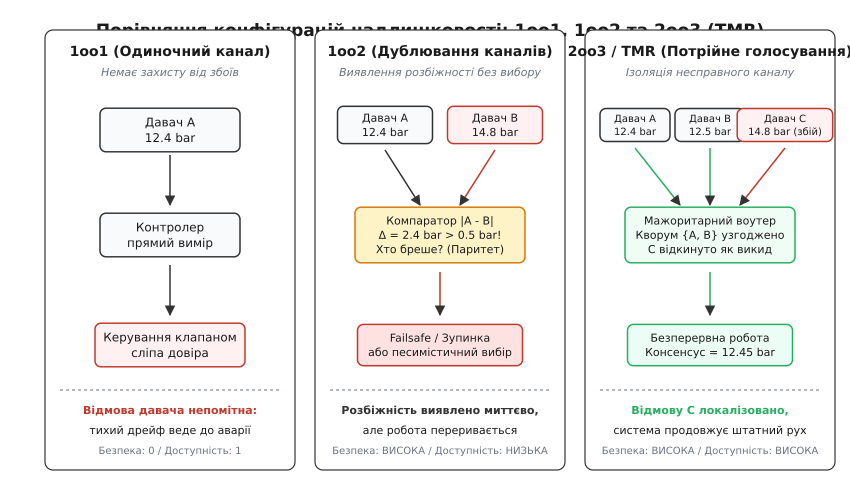
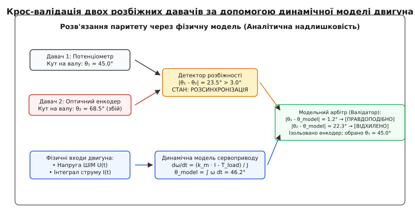
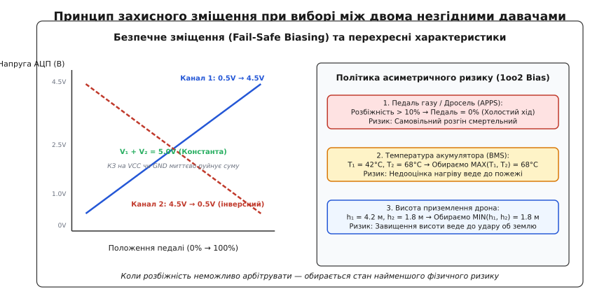

# Два давачі, які не згодні

<preknowlist>
- [Виявлення відмови давача](root:embedded/sensor-fault-detection) — вихід за фізичні межі, застигання відліків, лічильники підтвердження аварії та гістерезис повернення довіри.
- [Безпечний стан](root:sf-devices/safe-mode) — перехід вбудованої системи в детермінований режим мінімального ризику за втрати контролю.
- [Надлишковість](root:sf-devices/redundancy) — апаратне та функціональне дублювання критичних компонентів для збереження працездатності.
- [Надійність систем та ймовірність відмов](root:math-probability/system-reliability-math) — незалежні події, експоненційний розподіл відмов та розрахунок безвідмовної роботи.
</preknowlist>

Електронна педаль газу автомобіля зчитується двома незалежними аналоговими каналами. Водій тримає педаль нерухомо на заміському шосе: перший канал передає в мікроконтролер значення `12%` відкриття дроселя (спокійний рух накатом), а другий канал раптово видає `28%` (інтенсивний розгін). Різниця становить `16%`, що втричі перевищує допустимий інженерний коридор похибки `5%`. Якщо блок керування двигуном обчислить просте середнє арифметичне `(12 + 28) / 2 = 20%`, він згенерує неіснуючий, фальшивий режим, який не відповідає фізичному натисканню педалі. Якщо програма сліпо повірить першому давачу — машина ризикує втратити тягу під час обгону; якщо повірить другому — вилетить у кювет через мимовільний розгін. Два однакові вимірювальні канали миттєво вказують на несправність, але самі по собі не здатні відповісти, хто саме з них зламався.


*Архітектури сенсорної надлишковості: одиночний канал 1oo1 беззахисний перед дрейфом; дублювання 1oo2 миттєво фіксує розбіжність, але вимагає аварійної зупинки; мажоритарна схема 2oo3 (TMR) ізолює збійний канал без переривання роботи.*

## Дилема дублювання: чому двох каналів замало для вибору

Одиночний вимірювальний канал (архітектура 1oo1 — *1 out of 1*) повністю беззахисний перед внутрішніми прихованими відмовами. Якщо давач тиску зазнав механічної деформації мембрани або дрейфу підсилювача, його вихідна напруга може зміститися на `15%` від істини. Оскільки зміщене значення лежить у дозволеному діапазоні `0.5...4.5 В`, алгоритми базової перевірки меж (англ. *range checks*) вважають його повністю здоровим. Система продовжує працювати за хибними даними аж до фізичної аварії обладнання.

Встановлення другого такого самого давача створює дубльовану структуру. Різниця вимірів між двома каналами `Δ = |x₁ - x₂|` формує сигнал неузгодженості. Щойно величина `Δ` перевищує поріг допустимого шуму та технологічного розкиду `ε`, мікроконтролер фіксує факт руйнування вимірювального тракту.

```
Δ = |x₁ - x₂|
Якщо Δ ≤ ε → консенсус досягнуто: x_valid = (x₁ + x₂) / 2
Якщо Δ > ε → виявлено відмову: статус = РОЗБІЖНІСТЬ (DISCREPANCY)
```

Тут розробник стикається з математичним тупиком парності. У двоелементній множині `{x₁, x₂}` не існує поняття більшості. Порівняння дає бінарний результат: «один із каналів бреше». Але вектор помилки `arg min_i |x_i - x_true|` залишається принципово невідомим, оскільки істинне значення фізичної величини `x_true` мікроконтролеру недоступне.

Стандарти функційної безпеки (IEC 61508 та автомобільний ISO 26262) розділяють два підходи до використання пари давачів:

1. **Архітектура 1oo2 (1 out of 2 — спрацьовування за одним із двох).** Захисна функція або аварійне відключення активується, якщо *хоча б один* із двох давачів зафіксував перевищення критичного параметра або якщо між давачами виникла розбіжність `Δ > ε`. Ця структура забезпечує найвищий рівень безпеки (мінімізує ймовірність небезпечної відмови), але призводить до частих помилкових зупинок технологічного процесу через збій усього одного компонента.
2. **Архітектура 2oo2 (2 out of 2 — спрацьовування лише за згодою обох).** Дія виконується лише тоді, коли *обидва* давачі підтверджують небезпеку. Це мінімізує хибні тривоги та максимізує експлуатаційну доступність (англ. *availability*), але створює смертельний ризик: якщо один давач тихо заклинив у «безпечному» положенні, система не відреагує на реальну катастрофу.

Математичне зіставлення ймовірностей небезпечної відмови `PFD_avg` та частоти помилкових спрацьовувань для структур 1oo1, 1oo2, 2oo2, 1oo2D та 2oo3 з урахуванням спільних причин відмов (CCF / β-фактор) наведено в окремому [розрахунку надійності та ймовірності відмови в надлишкових архітектурах](root:embedded/dva-davachi-iaki-ne-zhodni/math-redundancy-reliability.md).

З аналізу випливає головне обмеження: система з двох давачів є чудовим **детектором** несправності, але без додаткової інформації вона ніколи не може бути **відновлюваним джерелом істини**. Щоб продовжити керування без аварійної зупинки, системі потрібен третій голос.

## Фізичні та електричні причини розбіжностей

Щоб правильно налаштувати поріг розбіжності `ε` та час підтвердження аварії (дебаунс), необхідно розуміти, звідки взагалі береться розсинхронізація у фізичному залізі:

### 1. Температурні градієнти та нерівномірний нагрів
На друкованій платі компоненти виділяють тепло нерівномірно. Якщо перший давач (наприклад, мікросхема магнітного енкодера або тензорезистивний міст) змонтований поруч із лінійним стабілізатором напруги LDO чи силовим транзистором MOSFET, його локальна температура може бути `65°C`. Другий давач, встановлений біля краю корпусу, працює при температурі `30°C`. За температурного коефіцієнта зміщення нуля `TCO = 0.05% / °C` різниця температур `35°C` дає систематичну розбіжність `1.75%` без жодної несправності.

### 2. Падіння напруги на загальній шині землі (Ground Bounce)
Якщо аналогові виходи двох давачів під'єднані до входів АЦП мікроконтролера, а їхні мінусові виводи з'єднані з різними точками земляного полігону, струм комутації потужного навантаження (наприклад, обмоток мотора чи клапана) створює падіння напруги на опорі доріжки `ΔV = I_load · R_trace`. Для струму `5 А` та опору доріжки `20 мОм` підскок потенціалу становить `100 мВ`. При опорній напрузі АЦП `3.3 В` це зміщує покази одного з каналів на `3.0%`.

### 3. Механічний люфт, вібрація та контактне дзеленчання
У поворотних механізмах (дросельні заслінки, кермові приводи) потенціометри зазнають вібраційного зносу резистивного шару в зоні найчастішого положення (англ. *fretting wear*). Повзунок починає мікроскопічно підстрибувати (англ. *wiper bounce*), породжуючи високочастотний сплеск напруги тривалістю кілька мілісекунд, тоді як другий канал залишається стабільним.

### 4. Динамічна розбіжність через асинхронне опитування
Якщо Давач 1 опитується на початку циклу керування в момент `t = 0`, а Давач 2 зчитується через `2 мс` (через затримку передачі по шині I2C або чергу в RTOS), під час швидкого натискання педалі водієм зі швидкістю `500% / с` різниця між відліками становитиме:

```
Δ_динамічна = (dx / dt) · Δt = (500% / с) · 0.002 с = 1.0%
```

Якщо допуск `ε` встановлено занадто вузьким (наприклад, `0.8%`), алгоритм сприйме звичайний швидкий маневр за аварію давача. Тому перевірка розбіжності завжди супроводжується фільтрацією або фазовою синхронізацією вибірок АЦП через апаратні тригери таймера.

## Мажоритарне голосування (2oo3 / TMR): третій голос як арбітр

Додавання третього вимірювального каналу формує класичну структуру потрійного модульного резервування (англ. *Triple Modular Redundancy*, TMR або архітектура 2oo3 — *2 out of 3*). Потрійне резервування дозволяє не лише виявити несправність, а й локалізувати зламаний канал і безперервно відкидати його покази.

Нехай три давачі оцифрували значення `A = 12.4 bar`, `B = 12.5 bar` та `C = 14.8 bar` при заданому порозі похибки `ε = 0.5 bar`. Алгоритм мажоритарного селектора обчислює три попарні евклідові відстані:

```
d_AB = |A - B| = |12.4 - 12.5| = 0.1 bar  [≤ ε: канали узгоджені]
d_BC = |B - C| = |12.5 - 14.8| = 2.3 bar  [> ε: розбіжність]
d_CA = |C - A| = |14.8 - 12.4| = 2.4 bar  [> ε: розбіжність]
```

Оскільки відстань `d_AB` лежить у межах допуску, пара `{A, B}` утворює узгоджений кворум. Канал `C` відхиляється обома здоровими каналами, тому селектор помічає давач `C` як несправний, ізолює його лінію та формує підсумковий вимір на основі здорового ядра:

```
x_out = (A + B) / 2 = (12.4 + 12.5) / 2 = 12.45 bar
```

### Селектор середнього значення (Mid-Value Selection, MVS)

Якщо обчислення трьох модулів різниць та розгалуження умов є занадто ресурсомісткими для високочастотних переривань (наприклад, у цифрових контурах керування струмом інвертора на частотах `20...100 кГц`), застосовують селектор середнього значення. Це медіанний фільтр для вибірки з трьох елементів:

```
x_out = median(A, B, C)
```

Математична властивість медіани трьох чисел полягає в тому, що якщо один із каналів видає довільний викид (коротке замикання на живлення, обрив до нуля або плавний дрейф), це хибне значення завжди опиняється на одному з країв упорядкованого масиву:

```
Вихідні виміри: A = 12.4, B = 12.5, C = 100.0 (викид)
Упорядкований ряд: [12.4, 12.5, 100.0]
Медіана: 12.5 (канал C гарантовано проігноровано)
```

На апаратному рівні мікроконтролера медіана трьох чисел реалізується компактною безрозгалуженою послідовністю операцій `min` та `max`:

```
x_out = max(min(A, B), min(max(A, B), C))
```

### Крайовий випадок: втрата кворуму в 2oo3

Мажоритарний вибір надійно захищає від *одиничної* відмови. Проте, якщо в системі з ладу виходять одночасно два давачі (наприклад, під впливом сильного електромагнітного імпульсу або залиття роз'єму), виникає ситуація повної деградації:

```
d_AB > ε,  d_BC > ε,  d_CA > ε
```

Жодна пара не згодна між собою. У такій ситуації голосування більшістю стає неможливим. Рушій ухвалення рішень фіксує статус `КРИТИЧНА_ВТРАТА_КВОРУМУ`, блокує видачу медіани й примусово переводить систему в аварійний безпечний стан (англ. *failsafe shutdown*).

Головний недолік схеми 2oo3 — апаратна надмірність. Потрійний набір давачів збільшує вартість друкованої плати, вимагає втричі більше аналогових входів АЦП або ліній інтерфейсів SPI/I2C, збільшує струм споживання та вагу джгутів проводки. У багатьох вбудованих пристроях (роботизовані суглоби, автомобільні педалі, підвіси камер БПЛА) фізично неможливо або економічно невигідно встановлювати три однакові залізні компоненти.

## Аналітична надлишковість: фізична модель як безкоштовний арбітр

Коли в системі фізично встановлено лише два давачі, розв'язати їхню суперечку можна без монтажу третього давача. Для цього залучають **аналітичну (віртуальну) надлишковість** (англ. *Analytical / Functional Redundancy*).

Аналітична надлишковість спирається на той факт, що керований об'єкт підкоряється законам фізики. Мікроконтролер керує виконавчими механізмами (подає напругу на двигун, відкриває клапан, вмикає нагрівач) і водночас вимірює супутні фізичні величини (струм фази, падіння напруги, тиск). Знаючи математичну модель вузла, процесор може програмно розрахувати очікуване значення вимірюваної величини в реальному часі.


*Крос-валідація двох розбіжних давачів за допомогою динамічної моделі двигуна: інтеграл струму та напруги ШІМ виступає віртуальним арбітром, що ізолює зламаний енкодер без додавання третього фізичного давача.*

### Приклад: сервопривід із потенціометром та енкодером

Розглянемо поворотний механізм промислового маніпулятора. Для контролю кута валу `θ` встановлено:
1. **Давач 1:** аналоговий резистивний потенціометр на вихідному валу редуктора (`θ_pot`).
2. **Давач 2:** інкрементний оптичний енкодер на валу електродвигуна (`θ_enc`).

Під час руху виникає розбіжність: потенціометр показує `θ_pot = 45.0°`, а енкодер повідомляє `θ_enc = 68.5°`. Різниця становить `23.5°`, що свідчить про критичний збій.

Для визначення винуватця підключається динамічний спостерігач стану (англ. *state observer*). Рівняння динаміки електродвигуна постійного струму пов'язує кутове прискорення `dω/dt`, виміряний струм якоря `I(t)` та прикладену напругу ШІМ `U(t)`:

```
J · (dω/dt) = k_m · I(t) - b · ω(t) - T_load
```

де `J` — зведений момент інерції, `k_m` — коефіцієнт крутного моменту мотора, `b` — коефіцієнт в'язкого тертя, `T_load` — навантажувальний момент.

Проінтегрувавши розраховану швидкість `ω(t)` на кроці дискретизації `dt`, спостерігач формує віртуальну оцінку положення `θ_model`:

```
ω_model(t) = ω_model(t - dt) + ((k_m · I(t) - b · ω_model(t - dt)) / J) · dt
θ_model(t) = θ_model(t - dt) + ω_model(t) · dt
```

Нехай розрахунок моделі дав значення `θ_model = 46.2°`. Модуль арбітражу зіставляє нев'язки (англ. *residuals*) обох фізичних давачів відносно математичної моделі:

```
r_pot = |θ_pot - θ_model| = |45.0° - 46.2°| = 1.2°   [< 3.0°: модель підтверджує]
r_enc = |θ_enc - θ_model| = |68.5° - 46.2°| = 22.3°  [≫ 3.0°: модель спростовує]
```

Висновок очевидний: оптичний енкодер пропустив лічильні імпульси через заваду на лінії або провернувся на валу. Потенціометр працює коректно. Система ізолює енкодер, продовжує рух за показами потенціометра та виставляє сервісний прапорець `WARNING_ENCODER_SLIP`.

### Статистична валідація через інноваційну браму Калмана

У складніших багатовимірних системах (наприклад, оцінка просторової орієнтації БПЛА за даними IMU та GPS) замість простого скалярного порогу застосовують статистичну браму валідації (англ. *Innovation Gate* або відстань Махаланобіса). 

Фільтр Калмана формує вектор передбачення `y_pred` та коваріаційну матрицю невизначеності виміру `S`:

```
r = y_measured - y_pred              [вектор нев'язки / інновація]
d_M² = rᵀ · S⁻¹ · r                  [квадрат відстані Махаланобіса]
```

Якщо значення `d_M² > γ_th` (де поріг `γ_th = 9.0` відповідає правилу `3σ` для 99.7% нормального розподілу), вимір конкретного сенсора відкидається як статистично неправдоподібний. Якщо ж один із двох давачів вкладається у браму `d_M² ≤ 9.0`, а другий виходить далеко за її межі, арбітраж однозначно обирає перший канал.

### Крос-валідація в інших доменах

Принцип аналітичної крос-валідації працює скрізь, де є взаємозв'язок фізичних процесів:
* **Альтиметрія безпілотника:** якщо розійшлися два барометричні давачі висоти, арбітром виступає подвійний інтеграл вертикального акселерометра IMU `z_imu = ∬ a_z dt²` або оптичний далекомір (LiDAR).
* **Гідравлічна система:** якщо два давачі тиску в магістралі суперечать один одному, арбітром стає інтеграл часу роботи та струму гідронасоса: нагнітання фіксованого об'єму рідини зобов'язане підняти тиск на прогнозовану величину.

### Обмеження аналітичної надлишковості

Аналітичний спостерігач не є абсолютною заміною фізичного давача через три фактори:
1. **Параметричний дрейф:** нагрів обмоток двигуна змінює активний опір `R` на десятки відсотків, а знос мастила змінює коефіцієнт тертя `b`. Модель починає повільно зміщуватися.
2. **Накопичення похибки інтегрування:** обчислення положення через подвійне інтегрування неминуче дрейфує в часі.
3. **Невизначеність збурень:** якщо маніпулятор уперся в невідому перешкоду (зовнішній момент `T_load ≠ 0`), модель без знання сили реакції дасть хибний кут.

Тому аналітична модель використовується як **короткочасний динамічний валідатор** (вікно прийняття рішень тривалістю сотні мілісекунд), щоб відкинути грубу відмову, після чого система повинна або безпечно зупинитися, або адаптувати параметри контуру.

## Політика безпечної асиметрії (Fail-Safe Biasing): вибір без арбітра

Якщо в системі є лише два давачі, аналітична модель відсутня (або не може бути побудована через стохастичність процесу), а виміри розійшлися — точне істинне значення дізнатися неможливо. Проте алгоритм керування не може зупинити процесор: мікроконтролер зобов'язаний сформувати керівний сигнал на кожному кроці дискретизації.

У таких умовах застосовують принцип **безпечної асиметрії ризику** (англ. *Fail-Safe Biasing*).


*Принцип безпечного зміщення (Fail-Safe Biasing): перехресні передавальні характеристики датчика педалі газу миттєво виявляють замикання дротів, а правила асиметричного ризику вибирають найбільш безпечний фізичний стан при розбіжності.*

Суть принципу: не всі помилки вимірювання несуть однакову небезпеку. Помилка в один бік викликає лише зниження продуктивності чи помилкову зупинку, тоді як помилка в інший бік веде до руйнування механіки, пожежі або загрози життю людей.

### 1. Електронна педаль газу (APPS): асиметрія тяги

В автомобільних системах (стандарт ISO 26262 ASIL-D) та регламенті Formula Student (FSAE) подвійний сенсорний вузол положення педалі реалізується з двома обов'язковими правилами:

**Схемотехнічна асиметрія (Різнорідні характеристики).** Давачі педалі навмисно роблять із різними передавальними функціями напруги від кута натискання:
* Канал 1: пряма залежність від `0.5 В` (відпущено) до `4.5 В` (натиснуто на 100%).
* Канал 2: інверсна залежність від `4.5 В` (відпущено) до `0.5 В` (натиснуто на 100%), або пряма зі зменшеним удвічі нахилом `0.25...2.25 В`.

Навіщо це зроблено: якщо у джгуті проводки станеться перетирання кабелю і дроти двох каналів замкнуться між собою чи на лінію живлення `+5 В`, звичайні однакові давачі видали б однаковий хибний сигнал `5.0 В` (100% газу). Контролер без асиметрії вважав би, що обидва канали згодні, і розігнав би машину. При різноспрямованих характеристиках сума напруг двох справних каналів завжди є константою:

```
V₁ + V₂ = 5.0 В  (± допуск шуму)
```

Замикання між дротами змішує потенціали до одного рівня, що миттєво руйнує співвідношення константи й викликає апаратне блокування.

**Програмне зміщення (Safe Bias).** Якщо після програмного перерахунку напруг у відсотки натискання розбіжність між каналами перевищує `10%` протягом більше ніж `100 мс`:

```
Якщо |APPS₁ - APPS₂| > 10%:
  Тяга_двигуна = 0% (Холостий хід / Idle)
```

*Обґрунтування асиметрії:* Зниження тяги до нуля на шосе створює незручність і змушує водія з'їхати на узбіччя. Але підтримання хибної високої тяги позбавляє водія контролю над машиною і є прямою загрозою життю.

### 2. Захист акумуляторної батареї (BMS): температурна асиметрія

У системі керування літієвим акумуляторним блоком (BMS) встановлено два терморезистори на модуль комірок. Перший показує `T₁ = 42°C`, другий раптово показує `T₂ = 68°C` (при критичній межі безпеки літію `60°C`).

Політика зміщення:
```
T_control = max(T₁, T₂) = 68°C
```

*Обґрунтування асиметрії:* Якщо хибним є показ `68°C`, система передчасно увімкне вентилятори охолодження або скине струм швидкої зарядки. Це призведе лише до невеликої втрати ефективності. Але якщо істинним є `68°C`, а система повірить датчику на `42°C`, акумулятор увійде в некерований тепловий розгін (англ. *thermal runaway*) із самозайманням.

### 3. Посадковий радар безпілотника: висотна асиметрія

Під час вертикальної автопосадки коптера ультразвуковий сонар показує висоту `h₁ = 4.2 м`, а оптичний далекомір показує `h₂ = 1.6 м`.

Політика зміщення:
```
h_control = min(h₁, h₂) = 1.6 м
```

*Обґрунтування асиметрії:* Якщо апарат повірить меншій висоті, він завчасно загальмує вертикальну швидкість зниження і здійснить посадку повільніше. Якщо апарат повірить більшій висоті `4.2 м`, він вважатиме, що земля ще далеко, не встигне погасити швидкість і вдариться об поверхню на повному ходу.

> 🔧 **Навіщо це.** Безпечна асиметрія — це перетворення невизначеності на передбачувану поведінку. У критичних вбудованих пристроях інженер ніколи не залишає вибір розбіжності на розсуд «випадкового значення» чи «середнього арифметичного». Для кожного дубльованого параметра в технічному завданні має бути явно зафіксовано вектор безпечного дефолту: занулення для тяги й тиску, максимум для температури й струму, мінімум для залишкової дистанції та висоти над перешкодою.

## Архітектура та програмна реалізація voting-рушія на C та C++

Спроєктуємо закінчений виробничий модуль голосування та арбітражу показів (`SensorVoter`). Модуль підтримує:
1. Роботу з 2 або 3 фізичними давачами.
2. Підключення опційного аналітичного спостерігача (фізичної моделі).
3. Налаштування політик безпечного зміщення (`BIAS_PESSIMISTIC_MAX`, `BIAS_PESSIMISTIC_MIN`, `BIAS_FAILSAFE_DEFAULT`).
4. Лічильники дебаунсу для запобігання хибним спрацьовуванням від короткочасних завад (англ. *fault persistence counter*) та гістерезис зняття аварії.

:::tabs
:::code dva-davachi-iaki-ne-zhodni-d/c/main.c
:::code dva-davachi-iaki-ne-zhodni-d/cpp/main.cpp
:::

### Особливості реалізації та крайові випадки

1. **Захист від дзеленчання (Debounce & Hysteresis).** Лічильник `trip_debounce` вимагає, щоб розбіжність тривала кілька циклів дискретизації поспіль, перш ніж модуль перейде в аварійний режим. Це фільтрує одиничні перехідні сплески від комутації силових ключів ШІМ. Зворотне повернення у здоровий стан вимагає значно довшої серії валідних циклів `heal_debounce` (гістерезис довіри).
2. **Нульова динамічна пам'ять.** Уся пам'ять статична, без викликів `malloc` або динамічних контейнерів `std::vector`, що гарантує детермінований час виконання функції (WCET — *Worst-Case Execution Time*) у жорсткому реальному часі.
3. **Діагностична маска (Fault Isolation Mask).** Поле `healthyMask` сигналізує верхньому рівню системи (наприклад, реєстратору польотних даних чи системі технічного обслуговування), який саме фізичний канал втратив достовірність, дозволяючи провести заміну конкретного вузла під час регламентних робіт.

## Підсумок: ієрархія захисту від незгідних давачів

Робота з суперечливими вимірами будується за чіткою інженерною драбиною:

```
Рівень 1: 3 давачі (2oo3 / TMR)
          ↳ Голосування за більшістю: локалізація та ізоляція несправного каналу.
Рівень 2: 2 давачі + фізична модель (Аналітична надлишковість)
          ↳ Модельний арбітраж: порівняння динамічних нев'язок зі струмом/напругою.
Рівень 3: 2 давачі без моделі (Fail-Safe Biasing)
          ↳ Безпечне зміщення: вибір найменш ризикованого фізичного стану (0% газу, MAX нагріву, MIN висоти).
Рівень 4: Повна незгода / втрата кворуму
          ↳ Аварійне знеструмлення (Failsafe Shutdown): перехід у захисний режим.
```

Надійність критичної системи полягає не в ілюзії створення «невразливого» давача, а у володінні набором детермінованих правил для кожної можливої комбінації розбіжностей.
