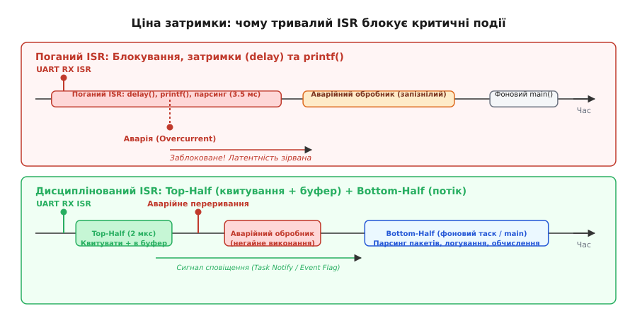
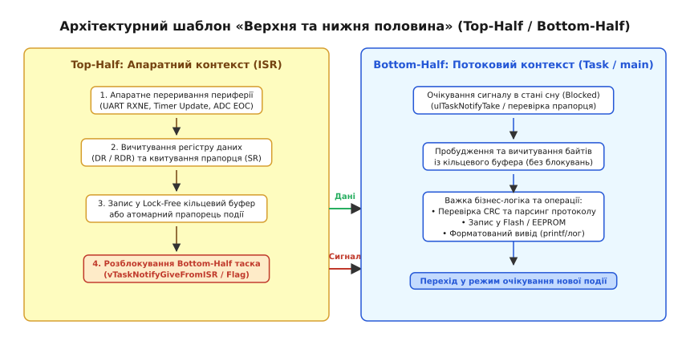
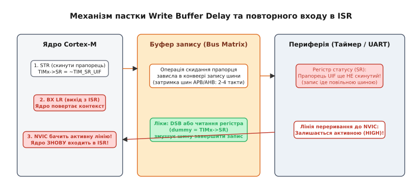

# Дисципліна обробника: що в ISR робити не можна

<preknowlist>
- [Апаратні переривання](root:hw-arch/interrupts) — механізм апаратного призупинення поточного коду процесора.
- [Латентність переривання](root:hw-arch/latentnist-pereryvannia) — повний час від фізичного сигналу на ніжці до першої інструкції обробника.
- [Пріоритети переривань](root:hw-arch/interrupt-priorities) — правила витіснення та субординації обробників у контролері переривань.
</preknowlist>

Коли двигун промислового верстата обертається зі швидкістю 12 000 обертів на хвилину, аварійний оптичний датчик кінцевого положення має зупинити живлення силового каскаду за лічені мікросекунди, інакше механічний супорт вріжеться в станину. Якщо саме в цю мить мікроконтролер увійшов в обробник переривання UART (англ. *Interrupt Service Routine*, ISR; лат. *interruptio* — переривання) і застряг там усередині виклику форматованого виводу `printf()` або циклу очікування `delay(5)`, процесор перестає реагувати на зовнішній світ. Лінія аварії виставляє прапорець, контролер переривань намагається привернути увагу ядра, але ядро зайняте пересиланням тексту зі швидкістю 9600 бод. Аварійний обробник спізнюється на 5 мілісекунд — і силова механіка зазнає непоправних руйнувань.

Цей сценарій розкриває фундаментальний інженерний контракт переривання. Апаратне переривання — це механізм аварійного або термінового втручання в нормальний потік програми. Отримуючи сигнал, ядро кидає виконання основного коду, складає контекст у стек і перемикається на функцію-обробник. Але ціна цього втручання — повна або часткова заморозка іншої активності процесора. Будь-яка затримка всередині обробника перетворюється на затримку реакції для всієї системи. Розуміння меж допустимого всередині ISR — це межа між надійним промисловим пристроєм і системою, що періодично зависає без очевидних причин.

## Золоте правило ISR: вхід, дія, квитування, вихід

Обробник переривання підпорядковується жорсткій послідовності дій: зафіксувати апаратну подію, зберегти мінімально необхідні дані, зняти апаратний запит і негайно віддати керування процесору. Усе, що виходить за межі цієї формули, роздуває час перебування в контексті переривання і ставить під загрозу детермінізм системи реального часу (англ. *Real-Time System*).

```
Вхід у переривання (апаратне збереження контексту)
  ↓
1. Зчитування сирих даних із регістру периферії (UART DR, ADC DR, SPI DR)
  ↓
2. Квитування (скидання) прапорця переривання в регістрі статусу (SR / ISR)
  ↓
3. Запис даних у Lock-Free буфер або встановлення атомарного прапорця події
  ↓
4. Сповіщення фонового завдання (RTOS Task Notify або семафор)
  ↓
Вихід з переривання (апаратне відновлення контексту)
```

Чому тривалість обробника є критичною величиною? Відповідь криється в двох показниках: латентності переривань (англ. *Interrupt Latency*; лат. *latens* — прихований) та джитері (англ. *Jitter* — тремтіння затримки).

Латентність визначає часовий інтервал між появою фізичної події на виводі мікроконтролера і виконанням першої інструкції корисного коду відповідного обробника. Якщо в момент приходу події ядро вже виконує інший обробник рівного або вищого пріоритету, нове переривання змушене чекати в черзі. Найгірша затримка реакції системи визначається сумою тривалостей усіх обробників, які можуть заблокувати або відкласти цей виклик:

```
T(латентність_max) = T(вхід_ядра) + T(найдовша_критична_секція) + ∑ T(активні_ISR_вищого_пріоритету)
```

Коли один із ваших обробників виконується замість 2 мікросекунд цілих 500 мікросекунд, ви автоматично додаєте ці 500 мікросекунд до найгіршої латентності **всіх інших переривань системи**.


*Тривалий обробник переривання затримує обслуговування високопріоритетних і аварійних сигналів, тоді як короткий обробник за моделлю Top-Half миттєво звільняє процесор і передає важку роботу фоновому потоку.*

Другий наслідок затягнутого ISR — переповнення апаратних буферів периферії (англ. *Overrun Error*). Розглянемо послідовний інтерфейс UART, що працює на швидкості 1 Мбіт/с. Новий байт надходить кожні 10 мікросекунд:

```
T(байт) = 10 бітів / 1 000 000 біт/с = 10 мкс
```

Якщо обробник переривання таймера чи АЦП затримає ядро на 25 мікросекунд, модуль UART встигне прийняти наступний байт у зсувний регістр, поки в приймальному регістрі даних ще лежить непотрібний старий байт. Апаратура встановить прапорець помилки переповнення `ORE` (англ. *Overrun Error*), і проміжний байт буде назавжди втрачено.

Третій фактор — процесорний бюджет. Якщо переривання надходять із частотою `F`, а кожне виконання обробника триває час `T(ISR)`, частка процесорного часу `U`, яку споживає обробник, дорівнює:

```
U = F · T(ISR) · 100%
```

Якщо датчик положення генерує 50 000 переривань на секунду (період 20 мкс), а ваша ISR триває 15 мкс, обробник з'їсть 75% усієї обчислювальної потужності ядра. На весь головний цикл `main()`, математичні розрахунки, протоколи обміну та роботу операційної системи залишиться лише 25% часу процесора. Будь-яке незначне збільшення навантаження призведе до колапсу планувальника.

> 🔧 **Навіщо це.** Детермінізм вбудованої системи вимірюється не середньою швидкістю виконання коду, а найгіршим часом реакції на критичну подію. Тримаючи обробники переривань короткими (у межах кількох десятків чи сотень тактів процесора), ви гарантуєте, що жодне периферійне джерело не втратить дані через `Overrun`, а аварійні сигнали виконаються вчасно.

## П'ять заборонених операцій всередині ISR

Практика розробки прошивок для мікроконтролерів виділяє п'ять типових операцій, які категорично заборонено виконувати в контексті переривання. Кожна з них несе конкретну фізичну загрозу працездатності системи.

### 1. Блокуючі затримки та очікування часу

Найгрубша помилка початківців — використання функцій очікування на кшталт `delay()`, `HAL_Delay()` або `vTaskDelay()` всередині обробника переривання.

Механізм катастрофи тут подвійний. По-перше, у більшості сучасних SDK (наприклад, STM32 HAL або Arduino) функція `HAL_Delay()` спирається на системний таймер `SysTick`, який щомілісекунди генерує власне переривання й інкрементує лічильник `uwTick`. Якщо ваш обробник периферії має такий самий або вищий пріоритет, ніж `SysTick`, переривання таймера `SysTick` виявляється заблокованим. Лічильник `uwTick` більше не зростає, умова виходу з циклу `while (uwTick - start < delay)` ніколи не виконається, і мікроконтролер назавжди зависає всередині мертвого циклу.

По-друге, в операційних системах реального часу (FreeRTOS, Zephyr) виклик `vTaskDelay()` призначений для переведення **поточного завдання (Task)** у стан блокування зі збереженням його стека і передачею керування іншому таску. Але ISR **не є завданням RTOS**: він виконується на спеціальному системному стеку обробника (Main Stack Pointer, MSP в архітектурі ARM Cortex-M) поза контекстом планувальника. Спроба приспати ISR призводить до спрацювання апаратного виключення ядра `HardFault` або паніки ядра RTOS.

### 2. Очікування прапорців периферії в циклах

Спроба зачекати в обробнику переривання готовності іншого апаратного блоку через активне опитування (англ. *busy-wait*) — це бомба уповільненої дії:

:::tabs
:::code dystsyplina-obrobnyka-d/c/2-ochikuvannia-praportsiv.c
:::code dystsyplina-obrobnyka-d/cpp/2-ochikuvannia-praportsiv.cpp
:::

Якщо на шині I2C або SPI виникне апаратний збій (наприклад, підключений датчик затисне лінію даних `SDA` до землі або відбудеться збій живлення зовнішньої мікросхеми), регістр статусу ніколи не встановить прапорець готовності. Звичайний код головного циклу міг би вийти за таймаутом, але перебування в ISR означає, що всі інші переривання відповідного рівня заблоковано. Система не зможе навіть відправити звіт про помилку.

### 3. Блокування на м'ютексах та примітивах синхронізації

У багатозадачних системах спільні ресурси захищають м'ютексами (англ. *Mutual Exclusion*, Mutex). Якщо завдання намагається захопити зайнятий м'ютекс через виклик `xSemaphoreTake(mutex, timeout)`, планувальник переводить це завдання в стан очікування (Blocked) і передає процесор завданню, що утримує замок.

Всередині ISR такий сценарій технічно неможливий:
1. Контекст переривання не має дескриптора завдання (Task Control Block, TCB), який можна було б помістити в чергу очікування.
2. Якщо м'ютекс був захоплений завданням `Task_A`, яке ядро щойно перервало для виклику ISR, виникає гарантований взаємний замок (англ. *Deadlock*): обробник чекає, поки `Task_A` звільнить ресурс, але `Task_A` ніколи не отримає квант часу процесора, тому що процесор зайнятий виконанням цього самого обробника!

Саме тому всі RTOS суворо забороняють захоплення м'ютексів з переривань і надають окремі версії функцій для роботи з семафорами та чергами з суфіксом `FromISR` (наприклад, `xSemaphoreGiveFromISR`), які ніколи не блокують виконання.

### 4. Динамічне виділення пам'яті (`malloc`, `free`, `new`, `delete`)

Виклик стандартного менеджера динамічної пам'яті всередині обробника неприпустимий з трьох причин:
1. **Недетермінованість часу виконання `O(N)`**: пошук вільного блоку в списку купа (англ. *heap*) може вимагати перебору десятків фрагментованих комірок. Час роботи функції `malloc()` непередбачуваний і може стрибати від кількох десятків тактів до сотень мікросекунд.
2. **Внутрішні критичні секції та м'ютекси**: стандартні реалізації бібліотек C (`glibc`, `newlib`) роблять купу потокобезпечною за допомогою внутрішніх замків. Якщо перерваний потік у цей момент сам виділяв пам'ять і тримав замок купи, виклик `malloc()` з переривання викличе миттєвий дедлок або пошкодження структури купа.
3. **Небезпека вичерпання пам'яті**: якщо під час інтенсивного потоку переривань виділяти пам'ять, купу швидко буде фрагментовано й вичерпано. Обробник не має зручного способу адекватно обробити повернення `NULL`.

Усі структури для передачі даних з переривань повинні розміщуватися статично на етапі компіляції.

### 5. Форматований вивід та повільне логування (`printf`)

Виклик `printf("UART Byte: %02X\n", byte)` всередині ISR — класична пастка налагодження. 

Спроба вивести один короткий рядок через `printf()` призводить до виконання сотень інструкцій розбору форматної стрічки, перетворення двійкових чисел у символи ASCII, виклику функцій вирівнювання і, зрештою, блокуючої відправки символів у периферійний регістр UART. На швидкості 115 200 бод відправка всього 20 символів рядка забирає майже 1.7 мілісекунди:

```
T(вивід) = 20 символів · 10 бітів / 115 200 біт/с ≈ 1.736 мс = 1736 мкс
```

Це рівноцінно повному паралічу системи на понад 100 000 процесорних тактів ядра Cortex-M4 @ 72 МГц. Крім того, стек форматованого виводу вимагає створення великих локальних масивів символів всередині функції, що призводить до раптового переповнення системного стека переривань (MSP).

## Безпечний міст між ISR та основним кодом

Оскільки обробник переривання не повинен виконувати важку роботу, виникає потреба швидко і надійно передавати сирі дані в основний потік програми або завдання операційної системи. Для цього застосовують три ключові інструменти.

### Модифікатор volatile та його реальні межі

Ключове слово `volatile` (лат. *volatilis* — летючий) у мовах C та C++ вказує компілятору, що значення змінної може змінитися в будь-який момент незалежно від коду поточного блоку (наприклад, апаратним модулем або перериванням).

Компілятор, оптимізуючи код головного циклу, намагається зберегти змінну в регістрі загального призначення процесора (наприклад, у регістрі `R4` ядра ARM) замість постійного зчитування її з оперативної пам'яті через повільну інструкцію `LDR`. Без ключового слова `volatile` цикл очікування перетвориться на нескінченний:

:::tabs
```c
/* Без volatile компілятор згенерує:
   LDR R0, [flag_addr]
.L1:
   CBZ R0, .L1   <- Регістр R0 перевіряється по колу, пам'ять більше не читається! */
bool event_ready = false; 

/* Правильно: змушує компілятор щоразу зчитувати значення з RAM */
volatile bool event_ready = false;
```
```cpp
/* У C++ для простих прапорців рекомендовано volatile або std::atomic */
volatile bool event_ready = false;

// Ідіоматичний сучасний C++:
#include <atomic>
std::atomic<bool> atomic_event_ready{false};
```
:::

Проте навколо `volatile` існує небезпечна ілюзія. **`volatile` не гарантує атомарності й не вставляє бар'єри пам'яті!** Якщо ви оголосите 32-бітний лічильник `volatile uint32_t counter;` на 8-бітному ядрі AVR, операція `counter++` усе одно виконуватиметься як чотири окремі байтові операції читання-модифікації-запису, які можуть бути розірвані перериванням посередині. Навіть на 32-бітному ARM інструкція `counter++` транслюється в три інструкції:

```
LDR R0, [counter]   ; Читання з пам'яті в регістр
ADDS R0, R0, #1     ; Інкремент у регістрі
STR R0, [counter]   ; Запис із регістра назад у пам'ять
```

Якщо переривання вклиниться між `LDR` і `STR`, значення буде зіпсовано. `volatile` лише забороняє компілятору викидати або кешувати звернення до змінної, але ніяк не захищає від перегонів даних (англ. *Data Races*).

### Атомарність та типи фіксованого розміру

Операція вважається атомарною (грец. *ἄтоμος* — неподільний), якщо вона виконується як єдиний неподільний крок процесора, який не може бути перерваний жодною іншою подією.

На 32-бітних процесорах архітектури ARM Cortex-M читання або запис вирівняного 32-бітного слова через інструкції `LDR` або `STR` є апаратно атомарним. Тобто встановлення прапорця `flag = 1` або збереження 32-бітного числа відбувається за один такт шини без ризику «порваного запису». Для операцій модифікації типу «прочитати-змінити-записати» стандарт C11 пропонує заголовковий файл `<stdatomic.h>`, а C++ — бібліотеку `<atomic>`, які на рівні асемблера задіюють інструкції ексклюзивного доступу `LDREX`/`STREX`.

### Кільцевий буфер без блокувань (SPSC Lock-Free Ring Buffer)

Коли з переривання потрібно передавати безперервний потік даних (наприклад, байти з приймача UART), ідеальним рішенням є кільцевий буфер із топологією Single-Producer Single-Consumer (один постачальник — один споживач).

У такому буфері обробник переривання змінює лише покажчик голови `head`, а головний потік — лише покажчик хвоста `tail`. Оскільки жоден із покажчиків не змінюється двома контекстами одночасно, доступ не вимагає вимкнення переривань чи захоплення блокувань. Повний детальний розбір структури та її оптимізації під степені двійки з використанням бар'єрів пам'яті наведено в окремому проектному модулі [Lock-Free кільцевий буфер](root:embedded/dystsyplina-obrobnyka/proj-lockfree-ringbuf.md).

## Архітектурний шаблон Top-Half / Bottom-Half

Для вирішення суперечності між необхідністю миттєвої реакції на апаратну подію та потребою у важкій обробці даних використовують класичний архітектурний шаблон, запозичений з операційних систем: **поділ обробки на верхню (Top-Half) та нижню (Bottom-Half) половини**.


*Шаблон розподілу праці: Top-Half (швидкий ISR) взаємодіє з апаратурою, зберігає дані в буфер і пробуджує Bottom-Half (потік/завдання), який виконує важкі обчислення у фоновому режимі.*

Розподіл обов'язків між половинами є строго фіксованим:

| Властивість | Верхня половина (Top-Half / ISR) | Нижня половина (Bottom-Half / Task / main) |
|---|---|---|
| **Контекст виконання** | Апаратне переривання (MSP стек ядра) | Потоковий контекст (Завдання RTOS або цикл `main()`) |
| **Пріоритет** | Вищий за будь-який користувацький код | Звичайний пріоритет планувальника |
| **Допустима тривалість** | Одиниці мікросекунд (десятки тактів) | Мілісекунди або безперервно |
| **Типові задачі** | Зчитати регістр, квитувати прапорець, покласти в чергу | Парсинг JSON/Protobuf, перевірка CRC, запис у Flash |
| **Можливість блокування** | Категорично заборонено | Дозволено очікувати на події, семафори, м'ютекси |

### Сигналізація між половинами у FreeRTOS

В операційній системі FreeRTOS нижня половина зазвичай реалізується у вигляді окремого завдання, яке перебуває в заблокованому стані (не споживаючи жодного такту процесора), поки обробник переривання не надішле йому сигнал пробудження.

Найшвидшим і найбільш ефективним за пам'яттю механізмом передачі сигналу є пряме сповіщення завдання (англ. *Direct to Task Notifications*):

:::tabs
:::code dystsyplina-obrobnyka-d/c/syhnalizatsiia-mizh.c
:::code dystsyplina-obrobnyka-d/cpp/syhnalizatsiia-mizh.cpp
:::

Зверніть увагу на змінну `xHigherPriorityTaskWoken` та макрос `portYIELD_FROM_ISR()`. Якщо завдання `vUartProcessingTask` має вищий пріоритет, ніж поточне перерване завдання, макрос вказує планувальнику перемкнути контекст негайно після виходу з ISR, не чекаючи наступного системного кванту часу `SysTick`. Затримка між приходом байта і початком його розбору скорочується до лічених мікросекунд.

## Пріоритети NVIC, витіснення та апаратні пастки

Сучасні контролери переривань, такі як Nested Vectored Interrupt Controller (NVIC) в ядрах ARM Cortex-M, підтримують дворівневу систему пріоритетів і вкладені переривання. Проте робота з ними містить підводні камені, що здатні повністю заблокувати виконання коду.

### Витіснення (Preemption) проти підпріоритетів (Subpriority)

У контролері NVIC регістри пріоритетів ділять біти конфігурації на дві частини:
1. **Preemption Priority (пріоритет витіснення)**: якщо переривання з вищим пріоритетом витіснення надходить під час роботи обробника з нижчим пріоритетом, ядро негайно перериває поточний обробник, складає новий контекст у стек і починає виконувати новий ISR (вкладене переривання).
2. **Subpriority (підпріоритет)**: якщо одночасно надійшли два переривання з **однаковим** пріоритетом витіснення, першим виконається те, що має менший числовий підпріоритет. Проте одне таке переривання **не може витіснити інше** в процесі його роботи.

Вкладеність переривань (англ. *Nested Interrupts*) вимагає ретельного розрахунку розміру системного стека `MSP`. Кожне вкладення автоматично зберігає в стек мінімум 8 слів (32 байти) апаратного контексту плюс локальні змінні функції-обробника. Глибокий ланцюг переривань за умови малого розміру стека переривань призводить до непомітного псування сусідніх змінних у пам'яті (Stack Overflow).

### Зациклення переривань (Interrupt Storm) та затримка шини

Найпоширеніша апаратна пастка на мікроконтролерах STM32 та інших чипах Cortex-M — **зациклення переривання через затримку буфера запису шини** (англ. *Write Buffer Delay*).

Розглянемо звичайне переривання таймера:

:::tabs
```c
/* ПАСТКА: прапорець скинуто в самому кінці ISR */
void TIM2_IRQHandler(void) {
    if (TIM2->SR & TIM_SR_UIF) {
        do_fast_action();
        
        /* Скидаємо прапорець переривання в останньому рядку */
        TIM2->SR = ~TIM_SR_UIF;
    }
}
```
```cpp
/* ПАСТКА на C++: скидання прапорця в останній момент */
extern "C" void TIM2_IRQHandler() {
    if ((TIM2->SR & TIM_SR_UIF) != 0) {
        do_fast_action();
        
        // Скидання прапорця перед самим виходом
        TIM2->SR = ~TIM_SR_UIF;
    }
}
```
:::

Чому цей код періодично викликає помилковий повторний вхід в `TIM2_IRQHandler`?

Архітектура ARM Cortex-M використовує конвеєризовану матрицю шин (AHB/APB) з буфером запису (англ. *Write Buffer*). Коли процесор виконує асемблерну інструкцію запису `STR` для скидання прапорця в регістрі таймера `TIM2->SR`, він не чекає фізичного завершення запису на повільній шині APB (яка часто працює на вдвічі меншій частоті, ніж ядро). Процесор складає запит у буфер шини і негайно виконує наступну інструкцію повернення з переривання `BX LR`.


*Механізм помилкового входу: процесор повертається з ISR до того, як сигнал скидання досяг регістра периферії через повільну шину APB. NVIC бачить активну лінію переривання і негайно запускає обробник удруге.*

Ядро завершує ISR і повертається в головну програму. Але сигнал від таймера до контролера переривань NVIC усе ще активний, тому що запис до регістра `TIM2->SR` ще фізично подорожує шиною APB! Контролер NVIC вважає, що виникло нове переривання, і негайно знову зупиняє ядро, викликаючи `TIM2_IRQHandler` удруге вхолосту.

Як правильно захиститися від цього ефекту:
1. **Скидати прапорець переривання на самому початку ISR**, а не в кінці. Поки обробник виконає корисну дію, запис гарантовано дійде до периферії.
2. **Використовувати фіктивне зчитування або бар'єр інструкцій**: зчитування регістра `(void)TIM2->SR` або інструкція `__DSB()` (Data Synchronization Barrier) змушують конвеєр процесора дочекатися завершення всіх операцій на шині пам'яті перед виходом.

:::tabs
:::code dystsyplina-obrobnyka-d/c/zatsyklennia-pereryvan.c
:::code dystsyplina-obrobnyka-d/cpp/zatsyklennia-pereryvan.cpp
:::

## Повний інженерний зразок: обробник UART на різних платформах

Порівняймо реалізацію дисциплінованого обробника переривання UART на сучасних платформах мікроконтролерів: bare-metal на STM32 з бібліотекою LL (Low-Layer) та на ESP-IDF для ESP32 з чергою FreeRTOS.

:::tabs
:::code dystsyplina-obrobnyka-d/c/stm32/main.c
:::code dystsyplina-obrobnyka-d/c/esp-idf/main.c
:::code dystsyplina-obrobnyka-d/c/arduino/main.ino
:::

## Зведена пам'ятка: що дозволено й що заборонено в ISR

Для швидкої самоперевірки коду обробника переривань керуйтеся інженерним чеклистом:

```
[+] ДОЗВОЛЕНО ТА РЕКОМЕНДОВАНО:
  ✓ Зчитування апаратних регістрів даних (Data Register, FIFO).
  ✓ Квитування (скидання) прапорців переривань на початку обробника.
  ✓ Збереження елементів у статичний Lock-Free кільцевий буфер (SPSC).
  ✓ Атомарне встановлення або скидання спільних прапорців (`std::atomic`, `volatile`).
  ✓ Виклик функцій сповіщення завдань RTOS із суфіксом `FromISR` (`vTaskNotifyGiveFromISR`).
  ✓ Запит на перемикання контексту планувальника (`portYIELD_FROM_ISR`).

[-] КАТЕГОРИЧНО ЗАБОРОНЕНО:
  ✗ Будь-які функції затримки та очікування часу (`delay()`, `HAL_Delay()`, `vTaskDelay()`).
  ✗ Цикли очікування апаратних прапорців без жорсткого лічильника таймауту (`while (!ready)`).
  ✗ Захоплення м'ютексів та примітивів блокування (`xSemaphoreTake()`, `pthread_mutex_lock()`).
  ✗ Динамічне виділення та звільнення пам'яті (`malloc()`, `free()`, `new`, `delete`).
  ✗ Форматований вивід, робота зі стрічками та повільний друк (`printf()`, `std::cout`).
  ✗ Обчислювально важка математика (плаваюча кома, перетворення Фур'є, розрахунок криптографії/CRC).
```

Дотримання цієї дисципліни перетворює обробник переривання з джерела незрозумілих збоїв на надійний апаратний міст, що забезпечує миттєву реакцію мікроконтролера за будь-яких умов експлуатації.
